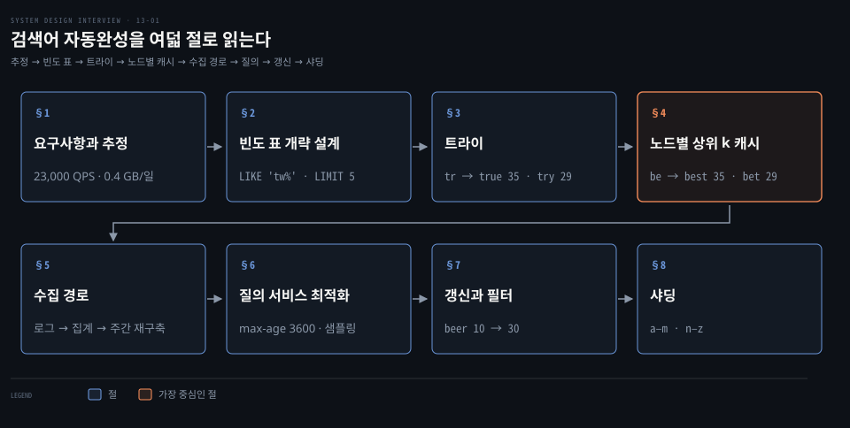
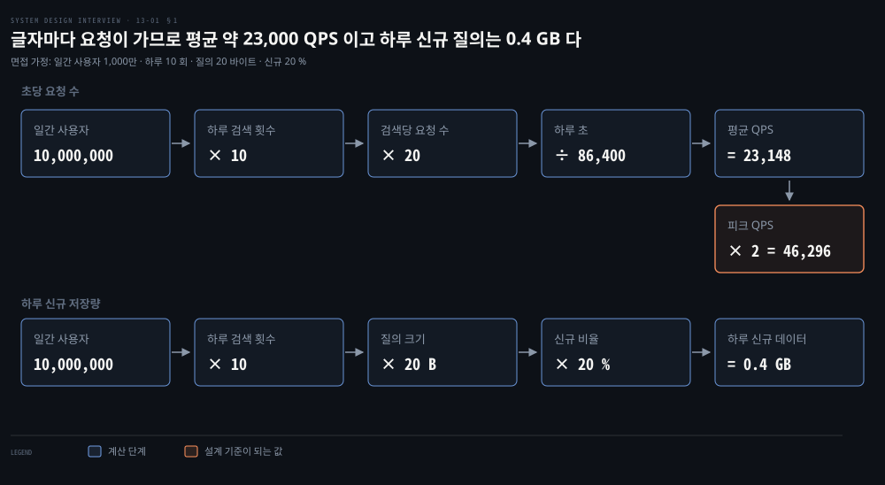
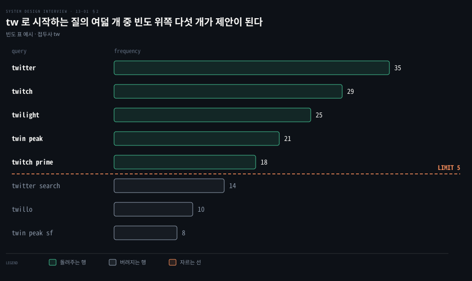
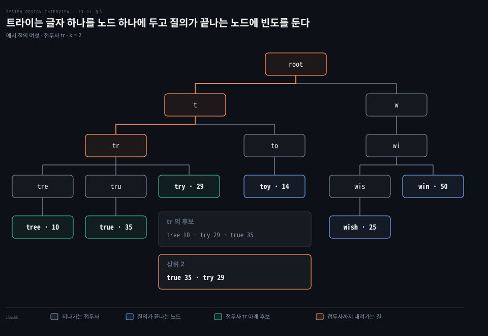
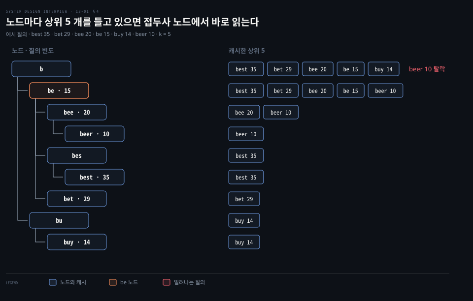
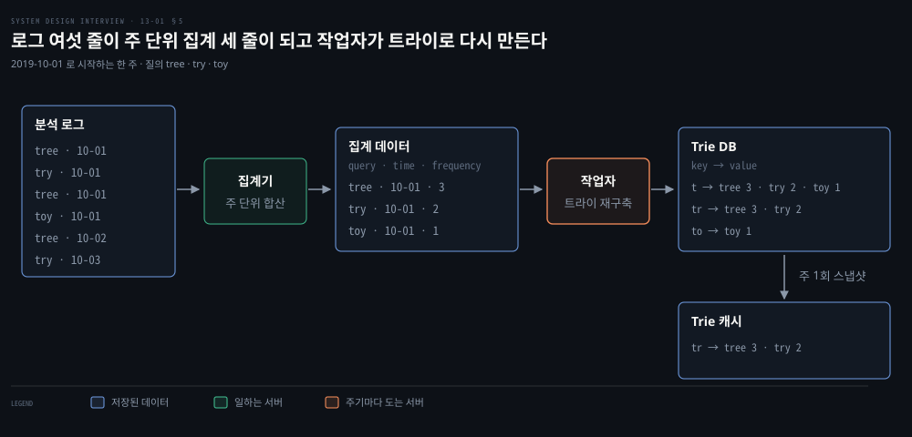
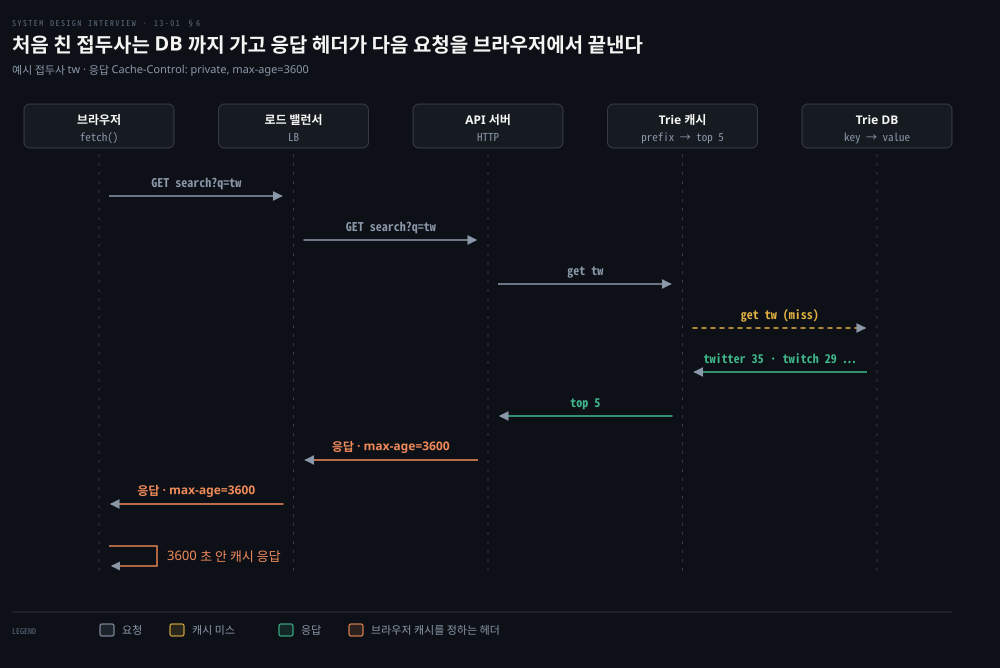
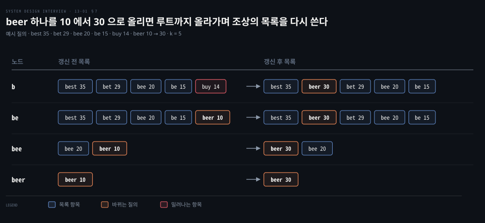
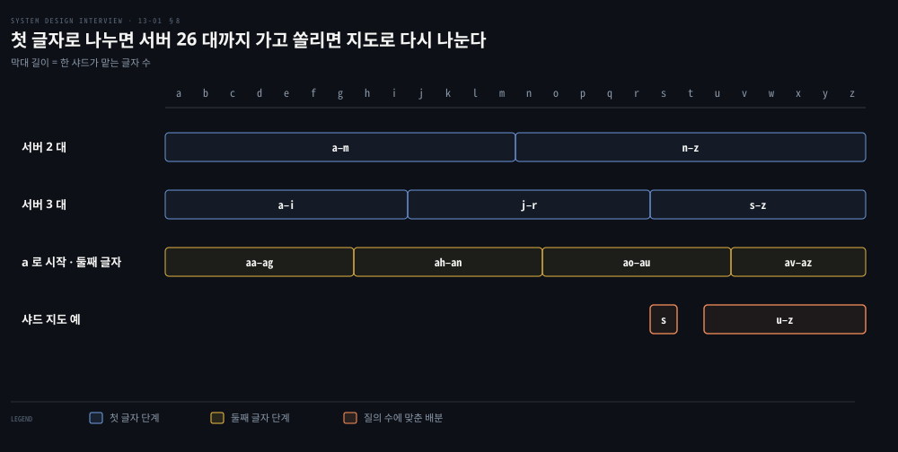

# 검색어 자동완성은 트라이 노드에 상위 k 개를 캐시하고 수집 경로가 주기적으로 트라이를 다시 만든다

---

> 자동완성은 트라이의 노드마다 상위 k 개 질의를 미리 들고 있어 접두사 하나로 바로 읽고, 그 트라이는 로그를 주 단위로 집계한 작업자가 주기적으로 다시 만듭니다.


## 핵심 요약

> 이 편의 중심 생각은 글자를 칠 때마다 오는 읽기 요청의 비용과 인기 순위를 새로 반영하는 쓰기 비용을 서로 다른 경로로 갈라 놓는다는 것입니다. 읽기 경로는 계산을 하지 않고 만들어 둔 목록을 꺼내기만 합니다.

접두사로 질의를 고르는 일을 데이터베이스의 `LIKE` 로 시작하면 요청마다 후보를 모두 훑어 정렬해야 합니다. 트라이는 접두사를 따라 내려간 노드에서 후보를 찾고, 노드마다 상위 5 개를 저장해 두면 정렬도 순회도 사라집니다. 접두사 길이를 50 자로 막으면 노드를 찾는 걸음도 상수가 됩니다.

저장해 둔 목록은 수집 경로가 만듭니다. 검색 로그를 주 단위로 집계하면 작업자가 그 집계로 트라이를 다시 세워 Trie DB 에 씁니다. Trie 캐시는 그 DB 를 주 1회 스냅샷으로 읽습니다. 질의 서비스는 캐시 미스를 채워 넣고 브라우저 캐시와 샘플링으로 부하를 더 줄입니다. 트라이가 한 서버를 넘으면 첫 글자로 나누며, 쏠린 글자는 샤드 지도로 따로 배정합니다.




## 학습 목표

> 이 편을 읽고 나면 다음을 설명할 수 있습니다.

1. 글자마다 요청이 간다는 사실에서 평균 QPS 와 하루 신규 저장량을 계산식으로 어림할 수 있습니다.
2. 빈도 표와 `LIKE` 질의가 데이터가 커질 때 병목이 되는 까닭을 말할 수 있습니다.
3. 트라이에서 접두사 질의의 세 단계와 시간 복잡도를 따라가고, 접두사 길이 제한과 노드별 상위 k 캐시가 각 단계를 어떻게 상수로 만드는지 설명할 수 있습니다.
4. 로그에서 집계 데이터, 작업자, Trie DB, Trie 캐시로 이어지는 수집 경로와 주 단위 재구축의 한계를 설명할 수 있습니다.
5. 노드 갱신이 조상 목록까지 번지는 모습, 필터 계층의 자리, 첫 글자 샤딩과 샤드 지도를 값으로 설명할 수 있습니다.


## 1. 글자마다 요청이 가므로 1,000만 DAU 는 평균 약 23,000 QPS 이고 하루 신규 질의는 0.4 GB 다

> 자동완성은 검색 한 번이 아니라 글자 하나마다 요청을 보냅니다. 요구사항을 좁힌 뒤 그 가정으로 초당 요청 수와 저장량을 어림하면 어느 단계가 병목이 될지 보입니다.

사용자가 `dinner` 를 치는 동안 서버는 몇 번이나 불릴까요? 범위부터 정합니다. 면접에서는 질문으로 확인하는 단계이며 방식은 [면접 단계 편](./03-01.시스템%20설계%20면접은%20범위%20확정·개략%20설계·상세%20설계·마무리%20네%20단계로%20진행한다.md)에서 다뤘습니다.

- 일치 위치: 검색어의 처음부터 일치하는 접두사만 다룹니다
- 제안 개수: 다섯 개를 돌려줍니다
- 순위 기준: 과거 질의 빈도가 높은 순입니다
- 제외 범위: 맞춤법 교정은 하지 않고, 질의는 영어 소문자라고 가정합니다
- 규모: 일간 사용자(DAU) 1,000만 명입니다

비기능 요구는 다섯 가지입니다.

- 빠른 응답: 사용자가 타이핑하는 속도를 따라가야 합니다
- 관련성: 제안이 입력과 관련 있어야 합니다
- 정렬: 인기 순으로 정렬합니다
- 확장성: 높은 트래픽을 감당합니다
- 가용성: 일부가 느려지거나 멈춰도 계속 응답합니다

응답 지연 목표는 면접에서 100 ms 안쪽으로 잡습니다. 사용자가 시스템이 즉각 반응한다고 느끼는 한계가 약 0.1 초라는 사용성 연구와 같은 크기입니다.[^nng-limits]

요청 수는 입력 글자 수에서 나옵니다. 검색어 하나가 평균 4 단어, 단어마다 5 글자라서 20 글자이고, 글자 하나마다 요청 하나가 갑니다. `dinner` 는 `search?q=d`, `search?q=di`, `search?q=din`, `search?q=dinn`, `search?q=dinne`, `search?q=dinner` 로 요청이 여섯 번입니다. 계산은 다음과 같습니다.

- 하루 요청 수: 10,000,000 × 10 회 × 20 = 2,000,000,000
- 평균 QPS: 2,000,000,000 ÷ 86,400 초 ≈ 23,148, 약 23,000
- 피크 QPS: 23,148 × 2 = 46,296, 약 46,000
- 하루 신규 저장량: 10,000,000 × 10 × 20 B × 20 % = 400,000,000 B = 0.4 GB

사용자 수, 하루 검색 횟수 10 회, 질의 20 바이트(ASCII 한 글자 1 바이트), 신규 질의 비율 20 % 는 면접에서 합의하는 설계 가정입니다. 실제 서비스의 통계가 아니므로 숫자가 달라지면 같은 식에 다시 넣으면 됩니다. 계산 방식은 [규모 추정 편](./02-01.개략적%20규모%20추정은%202의%20거듭제곱·지연%20시간·가용성%20수치로%20QPS%20와%20저장%20용량을%20어림한다.md)과 같습니다.




## 2. 빈도 표와 LIKE 질의는 작은 데이터에서만 통한다

> 가장 단순한 설계는 질의와 빈도를 담은 표 하나입니다. 동작은 맞지만 글자마다 접두사 일치와 정렬을 하므로 데이터가 커지면 데이터베이스가 병목이 됩니다.

가장 단순한 설계는 어떤 모양이고 어디서 막힐까요? 개략 설계는 둘로 나뉩니다. 데이터 수집 서비스는 사용자가 입력한 질의를 모아 빈도를 올리고, 질의 서비스는 접두사를 받아 가장 자주 검색된 질의 다섯 개를 돌려줍니다. 처음에는 실시간으로 집계한다고 가정합니다. 큰 데이터에서는 현실적이지 않지만 출발점으로는 충분합니다.

빈도 표는 질의와 빈도 두 칸입니다. 비어 있다가 `twitch`, `twitter`, `twitter`, `twillo` 가 차례로 들어오면 다음처럼 바뀝니다.

| 입력 | 갱신 뒤 빈도 표 |
|------|----------------|
| (없음) | 비어 있음 |
| `twitch` | twitch 1 |
| `twitter` | twitch 1 · twitter 1 |
| `twitter` | twitch 1 · twitter 2 |
| `twillo` | twitch 1 · twitter 2 · twillo 1 |

빈도 표가 다음 여덟 행이라고 합시다. 모두 `tw` 로 시작합니다.

| query | frequency |
|-------|-----------|
| `twitter` | 35 |
| `twitch` | 29 |
| `twilight` | 25 |
| `twin peak` | 21 |
| `twitch prime` | 18 |
| `twitter search` | 14 |
| `twillo` | 10 |
| `twin peak sf` | 8 |

사용자가 `tw` 를 치면 접두사가 같은 행을 빈도 내림차순으로 세워 다섯 개를 자릅니다.

```sql
-- 접두사 tw 로 시작하는 질의를 빈도 내림차순으로 다섯 줄만 가져옵니다.
SELECT * FROM frequency_table
WHERE query LIKE 'tw%'
ORDER BY frequency DESC
LIMIT 5;
```

위 표에서 빈도 35·29·25·21·18 인 `twitter`·`twitch`·`twilight`·`twin peak`·`twitch prime` 이 제안이 됩니다. 빈도 14·10·8 인 `twitter search`·`twillo`·`twin peak sf` 는 `LIMIT 5` 에서 잘립니다.



문제는 규모입니다. 접두사가 짧을수록 일치하는 행이 많고, 상위 다섯 개를 알려면 일치한 행의 빈도를 모두 비교해야 합니다. 이 질의가 글자 하나마다 초당 약 23,000 번 데이터베이스에 도착합니다. 그래서 질의를 접두사 구조로 두는 자료구조로 바꿉니다.


## 3. 트라이는 접두사를 따라 내려가 빈도를 모으고 정렬해 상위 k 를 얻는다

> 문자열을 글자 단위 트리에 두면 접두사 하나가 노드 하나가 됩니다. 접두사 노드에서 아래를 훑어 질의를 모으는 기본 알고리즘은 정확하지만 최악에는 트라이 전체를 돕니다.

접두사 일치만 필요하다면 질의를 글자 단위로 쪼개 트리에 넣는 편이 맞습니다. **트라이**(trie, 접두사 트리)는 문자열 조회용 트리 자료구조이고 이름은 retrieval 에서 왔습니다. 뿌리는 빈 문자열을 나타냅니다. 노드 하나는 글자 하나를 갖습니다. 노드는 글자마다 자식을 둘 수 있고 단어 하나이거나 접두사 하나입니다. 영어 소문자라면 노드당 자식은 최대 26 개입니다. 비어 있는 연결은 그리지 않습니다. 여러 단어 질의(`twin peak`)를 담으려면 공백도 한 글자로 넣어야 합니다. 아래 예시는 소문자 단어만 씁니다.

질의 `tree`·`try`·`true`·`toy`·`wish`·`win` 과 빈도 10·29·35·14·25·50 을 넣으면 아래 그림이 됩니다. 질의가 끝나는 노드에만 빈도가 붙고, 나머지 노드는 지나가는 접두사입니다.



조회에 쓰는 기호는 셋입니다. p 는 접두사 길이, n 은 트라이 전체 노드 수, c 는 접두사 노드 아래 부분 트리의 노드 수입니다. 후보를 모으는 단계는 접두사 노드의 자식만 보지 않고 부분 트리 전체를 돌기 때문에 c 를 자식 수가 아니라 이 수로 읽습니다. 정렬할 후보는 그중 질의가 끝나는 노드라 c 이하이므로 `O(c log c)` 로 넉넉히 묶습니다. 세 단계는 다음과 같습니다.

1. 접두사 노드를 찾습니다. 글자마다 한 칸씩 내려가므로 O(p) 입니다.
2. 접두사 노드 아래 부분 트리를 돌며 질의가 끝나는 노드를 모읍니다. O(c) 입니다.
3. 모은 후보를 빈도로 정렬해 위쪽 k 개를 고릅니다. O(c log c) 입니다.

k = 2 이고 사용자가 `tr` 을 쳤다고 합시다. 먼저 `tr` 노드를 찾습니다. 그 아래 노드는 다섯(`tre`·`tru`·`try`·`tree`·`true`)이고 그중 질의가 끝나는 노드는 `tree` 10, `true` 35, `try` 29 셋입니다. 정렬하면 `true` 35 와 `try` 29 가 위쪽 둘이고 이 둘이 제안입니다. 전체 비용은 `O(p) + O(c) + O(c log c)` 입니다.

이 알고리즘은 단순하지만 `t` 나 `a` 처럼 짧은 접두사에서 c 가 n 에 가까워집니다. 가장 자주 호출되는 짧은 접두사가 가장 비쌉니다. 개선은 두 갈래입니다.


## 4. 접두사 길이를 50 으로 막고 노드마다 상위 5 개를 캐시하면 조회가 O(1) 이 된다

> 접두사 길이를 막으면 노드 찾기가 상수가 되고, 노드마다 상위 k 개를 미리 들고 있으면 후보 수집과 정렬이 사라집니다. 대가는 노드마다 목록을 저장하는 공간입니다.

접두사 노드를 찾는 길과 후보를 고르는 일 중 어느 쪽부터 줄여야 할까요? 첫째는 접두사 길이 제한입니다. 사용자는 긴 검색어를 입력창에 잘 치지 않으므로 p 를 50 같은 작은 정수로 막습니다. 접두사 노드를 찾는 걸음이 50 을 넘지 않으니 `O(p)` 는 사실상 `O(1)` 입니다. 트라이도 깊이 50 까지만 만들면 됩니다.

둘째는 노드별 상위 k 캐시입니다. 모든 노드가 자기 아래 질의의 상위 5 개를 목록으로 들고 있으면, 접두사 노드에 도착한 뒤에는 목록을 읽기만 하면 됩니다. 제안이 5~10 개면 충분하므로 k 는 작은 상수입니다.

예를 들어 질의가 `best` 35, `bet` 29, `bee` 20, `be` 15, `buy` 14, `beer` 10 이라고 합시다. 각 노드의 목록은 자기 질의와 자식 목록을 합친 뒤 위쪽 다섯 개를 남겨 만듭니다.

- `bee`: 자기 20 에 자식 `beer` 10 을 더해 `bee` 20, `beer` 10
- `be`: 자기 15 에 `bee` 목록, `bes` 목록(`best` 35), `bet` 29 를 합쳐 `best` 35, `bet` 29, `bee` 20, `be` 15, `beer` 10
- `b`: `be` 목록에 `bu` 목록(`buy` 14)을 합치면 여섯 개이므로 `beer` 10 이 빠지고 `best` 35, `bet` 29, `bee` 20, `be` 15, `buy` 14

자식 목록의 상위 k 만 합쳐도 상위 k 가 보존되므로, 작업자는 아래에서 위로 한 번 올라가며 모든 목록을 만들 수 있습니다.



접두사 노드 찾기와 목록 반환이 모두 상수 시간이라 조회 전체가 `O(1)` 입니다. 대가는 공간입니다. 질의 하나를 20 바이트로 보면 노드 하나의 목록이 5 × 20 = 100 바이트이고, 노드 수만큼 곱해집니다. 응답 시간이 중요한 서비스에서는 공간을 내주고 시간을 사는 거래가 합리적입니다.


## 5. 수집 경로는 로그를 주 단위로 집계해 작업자가 트라이를 다시 만들고 캐시에 스냅샷으로 올린다

> 질의마다 트라이를 고치면 조회가 느려지고, 상위 제안은 트라이를 한 번 세운 뒤 크게 바뀌지 않습니다. 그래서 수집은 읽기 경로와 분리한 배치로 두고 주기를 서비스 성격에 맞춥니다.

트라이를 질의마다 바로 고치면 안 되는 이유는 둘입니다. 하루에 쏟아지는 질의가 많아서 갱신이 질의 서비스를 느리게 만듭니다. 또 트라이를 한 번 세운 뒤에는 상위 제안이 크게 바뀌지 않습니다. 실시간성이 중요한 서비스는 집계 주기를 짧게 잡습니다. 대부분의 검색어가 일 단위로 안 바뀌는 서비스는 주 1회로도 충분합니다. 면접에서는 실시간 요구가 있는지 먼저 확인하고, 여기서는 주 단위로 다시 만든다고 가정합니다.

구성 요소는 여섯입니다.

- 분석 로그: 검색 질의의 원본 기록입니다. 덧붙이기만 하고 색인하지 않습니다
- 집계기: 로그가 크고 형식이 제각각이라 시스템이 쓰기 쉬운 모양으로 합산합니다
- 집계 데이터: 질의, 주 시작일, 그 주의 빈도 합입니다
- 작업자: 정해진 주기로 비동기 작업을 돌리는 서버로, 트라이를 만들어 Trie DB 에 씁니다
- Trie DB: 영속 저장소입니다. 새 트라이를 주마다 만들므로 직렬화한 스냅샷을 문서 저장소에 담는 안과, 접두사를 키·노드 데이터를 값으로 해시 표현하는 키-값 저장소 안이 있습니다
- Trie 캐시: 읽기를 빠르게 하려고 트라이를 메모리에 올려 두는 분산 캐시이며 DB 의 주간 스냅샷을 받습니다

로그 여섯 줄이 어떻게 접두사 키가 되는지 값으로 따라가 봅니다. 로그는 다음과 같습니다.

| query | time |
|-------|------|
| `tree` | 2019-10-01 22:01:01 |
| `try` | 2019-10-01 22:01:05 |
| `tree` | 2019-10-01 22:01:30 |
| `toy` | 2019-10-01 22:02:22 |
| `tree` | 2019-10-02 22:02:42 |
| `try` | 2019-10-03 22:03:03 |

`tree` 3 번, `try` 2 번, `toy` 1 번이고 모두 2019-10-01 로 시작하는 주에 속합니다.



집계기는 주 시작일 아래에 `tree` 3, `try` 2, `toy` 1 을 만듭니다. 작업자는 이 셋으로 트라이를 세우고, 키-값으로 쓸 때 접두사마다 한 행을 만듭니다. `t` 는 `tree` 3, `try` 2, `toy` 1 을, `tr` 은 `tree` 3, `try` 2 를, `to` 는 `toy` 1 을 값으로 가집니다. 집계 데이터는 질의와 주 시작일이 키라서 같은 질의가 주마다 한 행씩 쌓입니다. 아래 표는 위 로그 여섯 줄과 별개로, 여러 주가 쌓였을 때의 집계 예시이며 값도 따로 잡은 것입니다.

| query | time | frequency |
|-------|------|-----------|
| `tree` | 2019-10-01 | 12000 |
| `tree` | 2019-10-08 | 15000 |
| `tree` | 2019-10-15 | 9000 |
| `toy` | 2019-10-01 | 8500 |
| `toy` | 2019-10-08 | 6256 |
| `toy` | 2019-10-15 | 8866 |

이렇게 여러 주 행이 쌓였을 때 트라이의 노드 빈도로 어느 주를 어떻게 합칠지는 이 설계가 정하지 않아 순위 모델이 고르는 몫으로 남습니다. 키-값 저장소의 동작은 [키-값 저장소 편](./06-01.키-값%20저장소는%20CAP%20선택%20아래%20안정%20해시로%20나누고%20N·W·R%20정족수로%20복제%20일관성을%20고른다.md)에서 다룹니다.

접두사 질의를 검색 엔진에 맡기는 방법은 OpenSearch 의 search-as-you-type 필드와 `match_phrase_prefix` 를 쓰며 [검색 앱 편](../../../06_observability/book/dgos_opensearch/09-01.검색%20앱%20만들기%20—%20autocomplete·fuzzy·faceted·UI.md)에서 다뤘습니다.


## 6. 질의 서비스는 캐시 미스를 채워 넣고 브라우저 캐시와 샘플링으로 부하를 줄인다

> 질의 서비스는 로드 밸런서 뒤의 API 서버가 Trie 캐시에서 목록을 꺼내 돌려줍니다. 캐시에 없는 접두사만 DB 까지 가고, 같은 접두사는 브라우저가 서버를 부르지 않게 합니다.

캐시에 없는 접두사가 오면 요청은 어디까지 갈까요? 요청은 로드 밸런서를 거쳐 API 서버에 도착합니다. API 서버는 Trie 캐시에서 접두사의 목록을 꺼내 제안을 만들어 돌려줍니다. 캐시에 없으면 Trie DB 에서 가져와 캐시를 채우고, 같은 접두사의 이후 요청은 캐시에서 답합니다. 미스는 캐시 서버의 메모리가 모자라거나 서버가 내려가 있을 때 생길 수 있습니다. 로드 밸런서의 역할은 [첫 병목 편](./01-01.단일%20서버에서%20출발한%20시스템은%20DB%20분리·로드밸런서·DB%20복제로%20첫%20병목을%20넘는다.md)에서 다뤘습니다.



속도를 더 올리는 방법이 셋입니다.

첫째는 비동기 요청입니다. 웹 앱은 페이지 전체를 새로고침하지 않고 자바스크립트로 요청을 보내 제안만 갱신합니다. 이 방식을 AJAX 라고 부르며, 지금은 `fetch()` 가 `XMLHttpRequest` 의 현대적인 대체입니다.[^fetch]

둘째는 브라우저 캐시입니다. 자동완성 제안은 짧은 시간 안에 크게 바뀌지 않으므로 응답에 보관 시간을 달면 같은 요청은 서버를 거치지 않습니다. 요청 URL(`search?q=tw`)이 캐시의 키가 되어 같은 접두사는 같은 응답을 재사용합니다.[^rfc9111-key] 아래 헤더는 설계 예시입니다.

```bash
# 응답 헤더 예시입니다. 같은 URL 요청은 3600 초 동안 브라우저 캐시에서 답합니다.
Cache-Control: private, max-age=3600
```

`max-age=3600` 은 응답이 만들어진 지 3600 초가 지나면 오래된 것으로 본다는 뜻입니다.[^rfc9111-max-age] 낡음을 가르는 방식은 [웹 편](../../../02_os/book/cntd_computer-networking-top-down/02-02.웹은%20어떻게%20주고받는가.md)의 「그러면 언제 낡은 것인가」에서 다뤘습니다. `private` 은 공유 캐시가 응답을 저장하지 못하게 하고, 브라우저 캐시 같은 사설 캐시는 저장할 수 있게 둡니다.[^rfc9111-private] 대가는 신선도입니다. 그 한 시간 동안 새로 뜬 인기어는 같은 접두사에 보이지 않습니다.

셋째는 데이터 샘플링입니다. 큰 서비스에서는 질의를 모두 로깅하는 비용이 크므로 N 번에 한 번만 기록합니다. 가정으로 N = 100 을 두면 주간 12,000 번 검색된 질의는 기대값 12,000 ÷ 100 = 120 번 기록됩니다. 주간 30 번인 질의는 30 ÷ 100 = 0.3 번이라 대부분 로그에 나타나지 않습니다. 샘플링은 수집 비용을 줄이는 대신 드문 질의가 로그에서 빠질 수 있다는 대가를 치릅니다.


## 7. 트라이 갱신은 주 단위 교체가 기본이고 노드 직접 갱신은 조상 전부를 고치며 필터 계층이 삭제를 맡는다

> 갱신은 새 트라이를 만들어 통째로 바꾸는 방법과 노드를 직접 고치는 방법이 있고, 직접 고치면 조상의 목록까지 다시 써야 합니다. 삭제는 캐시 앞에 필터 계층을 두어 즉시 거릅니다.

트라이는 한 번 만들면 끝일까요? 트라이는 작업자가 집계 데이터로 만듭니다. 갱신은 두 갈래입니다.

첫 번째는 주마다 새 트라이를 만들어 옛 트라이를 교체하는 방식입니다. 두 번째는 노드를 직접 고치는 방식인데, 가능하면 피합니다. 조상이 자식의 상위 질의를 목록으로 들고 있어서 노드 하나를 고치면 루트까지 올라가며 목록을 모두 고쳐야 하기 때문입니다. 트라이가 작으면 쓸 만한 방법입니다.

`beer` 가 10 에서 30 이 된다면 목록이 어떻게 바뀌는지 §4 의 값으로 따라가 봅니다. `beer`, `bee`, `be`, `b` 네 노드의 목록이 바뀝니다. `b` 의 목록은 `beer` 가 두 번째로 올라오면서 가장 낮은 `buy` 14 를 밀어냅니다. 같은 갱신이 깊이 50 의 질의에는 목록을 가진 노드를 최대 50 개 건드립니다. 깊이 × k 개의 항목을 다시 정렬하고 캐시에 써야 해서 질의마다 하기에는 무겁습니다.



삭제는 다른 문제입니다. 혐오·폭력·선정·위험 제안은 지워야 하는데, 트라이를 다시 만들 때까지 기다릴 수 없습니다. Trie 캐시와 API 서버 사이에 필터 계층을 두어 규칙에 걸린 제안을 응답에서 걸러냅니다. 규칙을 바꿔도 캐시를 다시 만들 필요가 없습니다. DB 에서는 비동기로 물리 삭제해서 다음 재구축에 올바른 데이터가 쓰이게 합니다.


## 8. 트라이가 한 서버를 넘으면 첫 글자로 샤딩하고 쏠림은 샤드 지도로 푼다

> 트라이가 메모리에 담기지 않으면 접두사를 기준으로 나눕니다. 첫 글자 구간은 단순하지만 글자마다 질의 수가 달라 쏠리고, 그래서 샤드 지도가 구간을 배정합니다.

영어만 지원하니 첫 글자로 나누는 것이 가장 단순합니다. 서버가 둘이면 `a`~`m` 과 `n`~`z`, 셋이면 `a`~`i`, `j`~`r`, `s`~`z` 입니다. 글자가 26 개이므로 첫 글자 단계로는 서버 26 대까지 갑니다. 그보다 많으면 둘째 글자로 더 쪼갭니다. `a` 로 시작하는 질의를 `aa`~`ag`, `ah`~`an`, `ao`~`au`, `av`~`az` 네 서버에 나눌 수 있습니다.



문제는 쏠림입니다. `c` 로 시작하는 단어는 `x` 로 시작하는 것보다 훨씬 많아서 구간이 같아도 질의 수가 같지 않습니다. 그래서 과거 질의 분포를 분석해 샤드 지도 관리자가 어느 구간이 어느 샤드인지 룩업 DB 에 기록합니다. 예를 들어 `s` 의 질의 수가 `u`~`z` 를 합친 것과 비슷하면 `s` 한 샤드, `u`~`z` 한 샤드로 나눕니다. 조회는 샤드 지도에 샤드를 묻고, 그 샤드에서 읽는 두 걸음입니다. 샤딩의 일반 원리는 [규모 확장 편](./01-02.캐시·CDN·무상태%20웹%20계층·데이터%20센터·메시지%20큐·샤딩이%20수백만%20사용자까지%20규모를%20늘린다.md)에서 다뤘습니다.

첫 글자 구간으로만 나누면 접두사 하나가 샤드 하나에 속합니다. 둘째 글자까지 쪼갤 때 한 글자 접두사 `a` 의 목록을 어디에 둘지는 이 설계가 정하지 않았습니다. 목록을 구간대로 나눠 두면 `a` 의 후보를 네 샤드에서 합쳐야 하는 부담이 생긴다는 점은 구조에서 따라오는 추론입니다.

### 이 설계가 다음 질문에서 달라지는 곳

면접은 보통 확장 질문으로 이어집니다. 다음 세 가지입니다.

- 다국어: 트라이 노드에 영어 소문자 대신 유니코드 글자를 담습니다
- 국가별 순위: 나라마다 트라이를 따로 만들고, 응답 시간을 줄이려면 CDN 에 둡니다
- 실시간 인기어: 지금의 설계는 주 1회 도는 작업자와 오래 걸리는 재구축 때문에 갑작스러운 뉴스에 반응하지 못합니다

실시간 인기어는 범위가 커서 아이디어만 남깁니다.

- 샤딩으로 다루는 데이터 집합을 줄입니다
- 최근 질의에 더 높은 가중치를 주도록 순위 모델을 바꿉니다
- 데이터가 스트림으로 들어오므로 스트림 처리 시스템을 씁니다

스트림 엔진인 Spark Streaming(DStream)은 더 이상 갱신되지 않는 레거시이고 공식 문서는 Structured Streaming 을 쓰라고 안내합니다.[^spark-legacy] 이벤트 로그 쪽은 [Kafka 편](../bytebytego-system-design/05-01.Kafka%20는%20순차%20IO%20와%20제로%20카피로%20빠르고%20전달%20보장은%20최대%20한%20번·최소%20한%20번·정확히%20한%20번으로%20갈린다.md)에서 다룹니다.


## 면접 대비

> 빈도 표에서 트라이로 넘어가는 이유, 노드별 캐시, 주 단위 재구축, 질의 최적화, 샤딩에 관한 면접 질문입니다.

1. 접두사 질의를 `LIKE` 와 `ORDER BY` 로 풀 때 병목은 어디이며, 트라이로 바꾸면 무엇이 달라집니까?
2. 노드마다 상위 k 개를 캐시하면 조회 시간 복잡도는 얼마이고, 어떤 비용을 치릅니까?
3. 트라이를 질의마다 고치지 않고 주 단위로 다시 만드는 이유는 무엇이며, 어떤 요구에서 그 설계가 깨집니까?
4. `Cache-Control: private, max-age=3600` 과 로그 샘플링은 각각 무엇을 줄이고 무엇을 포기합니까?
5. 트라이가 한 서버를 넘을 때 어떻게 나누고, 질의 수가 쏠리면 어떻게 풉니까?


## 정답 (자답 후 펼치기)

> 면접 질문에 대한 키워드 중심의 모범 답안입니다.

### 정답 1 — 후보 전체 정렬을 접두사 노드 읽기로 바꾼다

글자마다 질의가 와서 일치한 행 전체를 정렬하는 일이 초당 약 23,000 번 데이터베이스에 갑니다. 트라이는 접두사를 따라 내려간 노드에서 후보를 찾아 일치 범위를 줄이고, 노드별 상위 k 캐시를 두면 정렬도 사라집니다.

### 정답 2 — O(1), 공간과 갱신 비용

접두사 길이를 50 으로 막아 노드 찾기가 O(1) 이고 목록 반환도 O(1) 입니다. 노드마다 k 개 목록을 들고 있어 공간이 늘고, 노드 하나를 고치면 루트까지 조상 목록을 다시 써야 합니다.

### 정답 3 — 읽기와 쓰기 경로 분리, 실시간 요구에서 깨진다

질의마다 갱신하면 조회가 느려지고 상위 제안은 크게 안 바뀝니다. 주 1회 재구축은 갑작스러운 인기어를 못 따라가므로 샤딩으로 데이터를 줄이고 최근 질의에 가중치를 주며 스트림 처리를 씁니다.

### 정답 4 — 서버 호출과 로깅 비용을 줄이고 신선도와 드문 질의를 포기한다

`max-age` 동안 같은 URL 은 브라우저가 답하므로 호출이 줄고 새 인기어가 늦게 보입니다. 샘플링은 로깅 비용을 줄이는 대신 드문 질의가 로그에서 빠집니다.

### 정답 5 — 첫 글자 구간과 샤드 지도

서버 수에 맞춰 알파벳 구간으로 나누고 더 필요하면 둘째 글자로 쪼갭니다. 글자별 질의 수가 쏠리면 과거 분포를 분석해 샤드 지도에 구간을 배정합니다.


## 참고 자료

- Alex Xu, 《System Design Interview – An Insider's Guide》, Chapter 13 "Design A Search Autocomplete System".
- RFC 9111, HTTP Caching: https://www.rfc-editor.org/rfc/rfc9111
- MDN, Using the Fetch API: https://developer.mozilla.org/en-US/docs/Web/API/Fetch_API/Using_Fetch
- Apache Spark 4.2.0, Spark Streaming Programming Guide: https://spark.apache.org/docs/4.2.0/streaming-programming-guide.html
- Nielsen Norman Group, Response Times: The 3 Important Limits: https://www.nngroup.com/articles/response-times-3-important-limits/


## 관련 문서

- [개략적 규모 추정은 2의 거듭제곱·지연 시간·가용성 수치로 QPS 와 저장 용량을 어림한다](./02-01.개략적%20규모%20추정은%202의%20거듭제곱·지연%20시간·가용성%20수치로%20QPS%20와%20저장%20용량을%20어림한다.md)
- [단일 서버에서 출발한 시스템은 DB 분리·로드밸런서·DB 복제로 첫 병목을 넘는다](./01-01.단일%20서버에서%20출발한%20시스템은%20DB%20분리·로드밸런서·DB%20복제로%20첫%20병목을%20넘는다.md)
- [캐시·CDN·무상태 웹 계층·데이터 센터·메시지 큐·샤딩이 수백만 사용자까지 규모를 늘린다](./01-02.캐시·CDN·무상태%20웹%20계층·데이터%20센터·메시지%20큐·샤딩이%20수백만%20사용자까지%20규모를%20늘린다.md)
- [키-값 저장소는 CAP 선택 아래 안정 해시로 나누고 N·W·R 정족수로 복제 일관성을 고른다](./06-01.키-값%20저장소는%20CAP%20선택%20아래%20안정%20해시로%20나누고%20N·W·R%20정족수로%20복제%20일관성을%20고른다.md)
- [Kafka 는 순차 IO 와 제로 카피로 빠르고 전달 보장은 최대 한 번·최소 한 번·정확히 한 번으로 갈린다](../bytebytego-system-design/05-01.Kafka%20는%20순차%20IO%20와%20제로%20카피로%20빠르고%20전달%20보장은%20최대%20한%20번·최소%20한%20번·정확히%20한%20번으로%20갈린다.md)

[^nng-limits]: Nielsen Norman Group, Response Times: The 3 Important Limits: <https://www.nngroup.com/articles/response-times-3-important-limits/>
[^fetch]: MDN, Using the Fetch API: <https://developer.mozilla.org/en-US/docs/Web/API/Fetch_API/Using_Fetch>
[^rfc9111-key]: RFC 9111 §2, 캐시 키: <https://www.rfc-editor.org/rfc/rfc9111#section-2>
[^rfc9111-max-age]: RFC 9111 §5.2.2.1, max-age: <https://www.rfc-editor.org/rfc/rfc9111#section-5.2.2.1>
[^rfc9111-private]: RFC 9111 §5.2.2.7, private: <https://www.rfc-editor.org/rfc/rfc9111#section-5.2.2.7>
[^spark-legacy]: Apache Spark 4.2.0, Spark Streaming Programming Guide: <https://spark.apache.org/docs/4.2.0/streaming-programming-guide.html>
