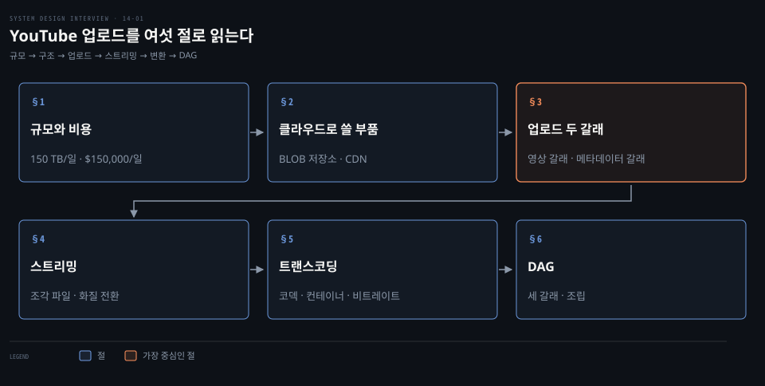
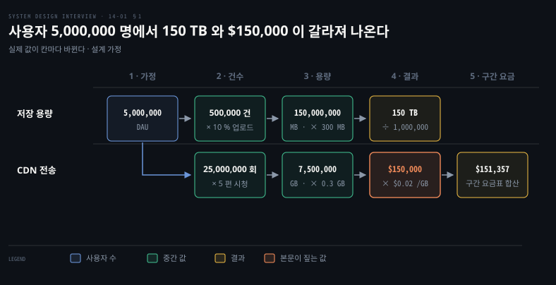
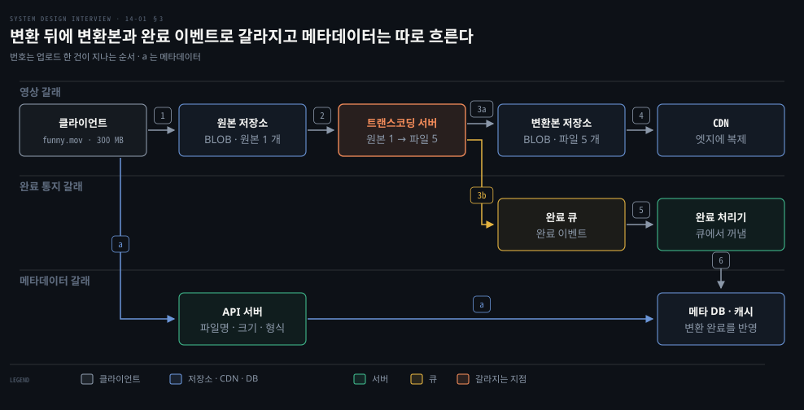
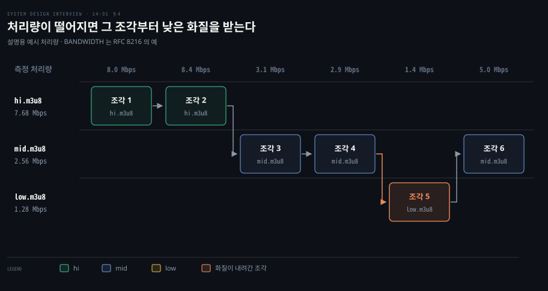
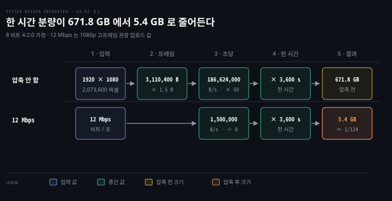
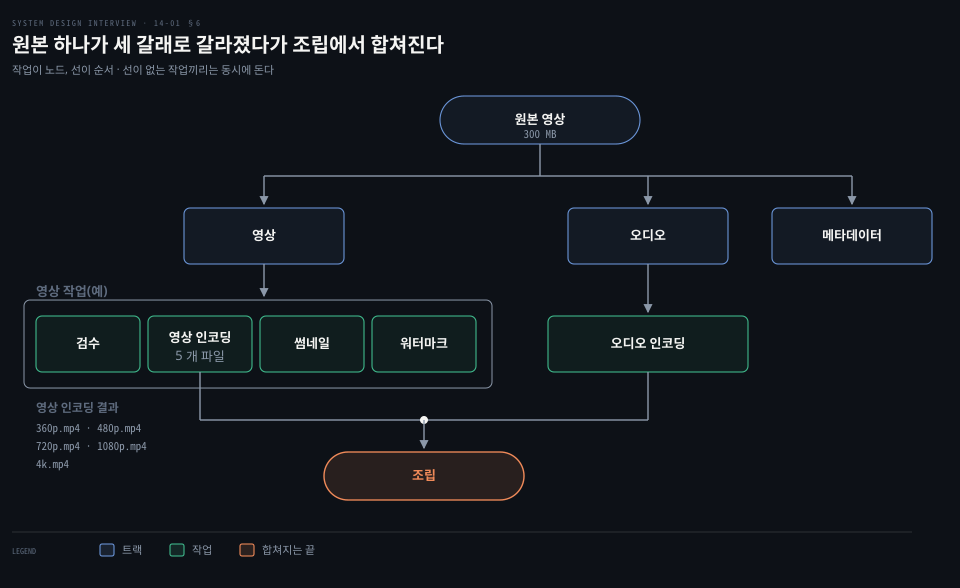

# YouTube 업로드는 원본을 BLOB 저장소에 두고 DAG 로 쪼갠 트랜스코딩을 거쳐 CDN 으로 스트리밍한다

---

> 영상 서비스는 원본을 BLOB 저장소에 두고 변환 작업을 DAG 로 쪼개 병렬로 돌린 뒤 변환본을 CDN 에서 조각 단위로 내려 보냅니다. 올리기는 영상과 메타데이터 두 갈래가 동시에 흐릅니다.

## 핵심 요약

> 이 편의 중심 생각은 영상 서비스의 비용이 올리는 쪽보다 보여 주는 쪽에서 커지므로 올린 원본을 여러 화질로 미리 바꿔 두고 그 일을 병렬로 쪼갠다는 것입니다.

일간 사용자 500 만 명이 하루 150 TB 를 올리면 그 50 배인 7,500 TB 가 CDN 에서 나갑니다. 그래서 BLOB 저장소와 CDN 은 클라우드 서비스를 쓰고 그 위에 API 서버와 변환 파이프라인의 구조를 설계합니다.

올리기는 두 갈래가 동시에 흐릅니다. 영상은 원본 저장소와 트랜스코딩 서버를 지나 변환본 저장소와 CDN 으로 가고, 메타데이터는 API 서버를 지나 DB 와 캐시에 적힙니다. 변환이 끝나면 완료 이벤트가 큐를 거쳐 그 DB 를 바꿉니다.

보기는 CDN 이 조각 파일을 HTTP 로 내려 주고 플레이어가 조각마다 화질을 고르는 방식입니다. 변환은 비싸고 올린 사람마다 필요한 처리가 달라서 작업을 DAG 로 정의합니다.

## 학습 목표

> 이 편을 읽고 나면 다음을 설명할 수 있습니다.

1. 일간 사용자 수와 업로드 비율에서 하루 저장량과 CDN 전송비를 계산식으로 어림할 수 있습니다.
2. 업로드의 영상 갈래와 메타데이터 갈래가 어떻게 병렬로 흐르고 어디서 갈라지는지 말할 수 있습니다.
3. 스트리밍이 다운로드와 어떻게 다르며 HLS 와 DASH 가 조각과 화질 목록으로 화질 전환을 가능하게 하는지 설명할 수 있습니다.
4. 트랜스코딩이 필요한 네 가지 이유와 코덱·컨테이너·비트레이트의 관계를 구분할 수 있습니다.
5. 변환 작업을 DAG 로 정의하는 까닭과 갈래와 병합이 생기는 자리를 설명할 수 있습니다.

## 1. 일 500 만 명이 만드는 부하는 저장 하루 150 TB 와 CDN 전송비 하루 $150,000 로 환산된다

> 영상 서비스의 규모는 올리는 양과 보는 양을 따로 곱해 어림합니다. 같은 사용자 수에서 저장은 하루 150 TB, 전송은 하루 7,500 TB 가 나와 전송이 비용을 지배합니다.

YouTube 에는 댓글·공유·좋아요·재생 목록 같은 기능도 많아서 한 번의 면접에 다 담을 수 없습니다. 그래서 먼저 범위를 올리기와 보기로 좁히고 조건을 정합니다.

- 클라이언트: 모바일 앱, 웹 브라우저, 스마트 TV
- 사용자: 해외 사용자 비중이 크고 하루 평균 사용 시간은 30 분
- 영상: 대부분의 해상도와 형식을 받고 암호화가 필요하며 크기는 중소형 위주
- 인프라: 클라우드 서비스를 쓸 수 있음

설계 목표는 여섯입니다. 빠른 업로드, 끊김 없는 스트리밍, 화질 변경, 낮은 인프라 비용, 높은 가용성·확장성·안정성, 위 클라이언트 지원입니다. 낮은 비용은 이 절의 전송비 계산이, 화질 변경은 §4 와 §5 가 이어받습니다.

규모는 어떻게 어림할까요? 가정부터 적습니다. 아래 값은 설계를 위한 가정이고 실제 YouTube 의 통계가 아닙니다.

| 가정 | 값 |
|------|----|
| 일간 활성 사용자(DAU) | 5,000,000 |
| 사용자당 하루 시청 | 5 편 |
| 하루에 업로드하는 사용자 비율 | 10% |
| 평균 영상 크기 | 300 MB |
| 영상 크기 상한 | 1 GB |
| 트래픽 | 전부 미국에서 나감 |
| 비용 범위 | 영상 스트리밍 전송비만 셈 |

저장은 업로드 건수에 크기를 곱합니다. 5,000,000 × 10% = 500,000 건이고 500,000 × 300 MB = 150,000,000 MB 이므로 하루 150 TB 입니다. 평균으로는 초당 500,000 ÷ 86,400 = 5.8 건이 올라옵니다.

전송은 시청 횟수에 크기를 곱합니다. 5,000,000 × 5 = 25,000,000 회이고 25,000,000 × 0.3 GB = 7,500,000 GB 이므로 하루 7,500 TB 입니다. 올리는 양의 50 배이며 초당 평균으로는 7,500,000 GB × 8 ÷ 86,400 = 694 Gbps 입니다. 단위를 1,000 배로 어림하는 이유는 [규모 추정 편](./02-01.개략적%20규모%20추정은%202의%20거듭제곱·지연%20시간·가용성%20수치로%20QPS%20와%20저장%20용량을%20어림한다.md)에 있습니다.

GB 당 $0.02 를 곱하면 7,500,000 × $0.02 = $150,000 이 하루 전송비입니다. 다만 $0.02 는 평균 단가가 아니라 한 구간의 단가입니다. 트래픽이 전부 미국에서 나간다는 가정이라 미국 구간 단가를 씁니다. CloudFront 종량 요금의 미국 구간은 월 전송량이 늘수록 내려가는 계단식이고 $0.02 는 월 5 PB 를 넘는 구간에 붙습니다.[^cf-price]

하루 7,500,000 GB 를 30 일 쌓으면 월 225,000,000 GB 입니다. 구간별로 합산하면 월 $4,540,724.48 이고 하루로는 약 $151,357 입니다. 실효 단가가 GB 당 약 $0.0202 라서 $0.02 로 어림한 값과 1% 안쪽으로 맞습니다. 이 합산은 2026-10 의 공시 단가 기준이며 대형 고객과 협의한 단가는 들어 있지 않습니다.

전송비가 이만큼 크다는 사실이 이후 설계의 동기입니다. 줄이는 방법은 [트랜스코딩 편](./14-02.트랜스코딩은%20전처리·DAG%20스케줄러·자원%20관리자·작업%20서버로%20나뉘고%20사전%20서명%20URL·CDN%20비용·오류%20처리로%20다듬는다.md)이 이어서 다룹니다. 영상 크기 상한 1 GB 도 면접용 가정입니다. 실제 YouTube 의 업로드 한도는 256 GB 또는 12 시간 중 작은 쪽입니다.[^yt-limit]

## 2. 확장 가능한 BLOB 저장소와 CDN 은 클라우드 서비스를 쓰고 나머지 구조만 설계가 정한다

> BLOB 저장소나 CDN 을 처음부터 만드는 일은 극도로 복잡하고 비싸며, 면접에서는 기술을 고르는 일이 내부 설명보다 중요합니다. 설계의 몫은 무엇을 클라우드 서비스로 쓰고 나머지를 어떻게 구성할지 정하는 일입니다.

모든 부품을 직접 설계해야 할까요? 이 설계는 세 부분으로 나뉩니다. 클라이언트는 컴퓨터·휴대폰·스마트 TV 입니다. 영상 재생은 CDN 이 맡습니다. 재생을 뺀 나머지는 API 서버가 맡아 추천 피드와 업로드 URL 생성, 메타데이터 DB·캐시 갱신, 가입을 처리합니다.

**BLOB 저장소**는 영상 같은 큰 이진 데이터를 이름 붙은 개체 하나로 통째로 담는 저장소입니다. 면접에서는 원본을 BLOB 저장소에 둔다고만 말해도 충분하고 내부 설계까지 갈 필요가 없습니다. 객체 저장소의 구조는 [DDIA 11-02 의 §3 오브젝트 스토어 절](../../../05_data/book/designing-data-intensive-applications/11-02.분산%20파일시스템과%20오브젝트%20스토어.md)과 [블록·파일·객체 저장소 편](../bytebytego-system-design/04-01.블록·파일·객체%20저장소는%20접근%20단위가%20다르고%20이레이저%20코딩과%20분할%20업로드가%20큰%20데이터를%20싸고%20안전하게%20담는다.md)에 있습니다.

| 부품 | 이 설계가 정한 것 |
|------|--------------|
| 원본 저장소·변환본 저장소 | 클라우드 BLOB 저장소 사용 |
| CDN | 클라우드 CDN 사용 |
| 로드 밸런서·API 서버 | 요청을 API 서버에 고르게 분배 |
| 메타데이터 DB·캐시 | DB 샤딩과 복제 |
| 트랜스코딩 서버·완료 큐·완료 처리기 | 변환과 완료 통지 구조 설계 |

큰 회사도 모든 것을 직접 만들지는 않습니다. Netflix 는 컴퓨트와 저장과 인프라를 AWS 위에서 돌립니다.[^nflx-aws] 영상 전달은 ISP 망 안에 자사 장비를 두는 자체 CDN 인 Open Connect 로 합니다. 자사 장비는 자격을 갖춘 ISP 에 무료로 제공되고 자사 데이터 센터 60 곳 이상에서도 같은 종류를 씁니다.[^nflx-oc]

## 3. 업로드는 영상 갈래와 메타데이터 갈래가 병렬로 흐르고 변환 뒤에 다시 갈라진다

> 클라이언트는 영상 파일과 메타데이터를 따로 보냅니다. 변환이 끝나면 변환본은 CDN 으로, 완료 이벤트는 큐를 거쳐 DB 로 갈라집니다.

300 MB 파일이 올라오는 동안 파일명과 크기는 어디로 가고, 변환이 끝났다는 사실은 누가 어디에 적을까요? 도식은 업로드 한 건을 세 갈래로 나눠 그렸습니다. 파일 이름 funny.mov 는 설명을 위한 예시입니다.

| 번호 | 일 |
|------|----|
| 1 | 클라이언트가 영상을 원본 저장소에 올립니다. |
| 2 | 트랜스코딩 서버가 원본 저장소에서 영상을 가져와 변환합니다. |
| 3a | 변환본이 변환본 저장소에 쌓입니다. |
| 3b | 변환 완료 이벤트가 완료 큐에 쌓입니다. 3a 와 3b 는 동시에 일어납니다. |
| 4 | 변환본 저장소의 영상이 CDN 으로 배포됩니다. |
| 5 | 완료 처리기의 작업자들이 큐에서 이벤트를 꺼냅니다. |
| 6 | 완료 처리기가 메타데이터 DB 와 캐시를 갱신합니다. |
| a | 올리는 동안 클라이언트가 파일명·크기·형식을 API 서버에 보내고 API 서버가 DB 와 캐시를 갱신합니다. |

6 번이 끝나면 API 서버가 클라이언트에 올리기가 끝났고 스트리밍할 수 있다고 알립니다. 완료 큐는 메시지 큐이고 완료 처리기는 그 큐에서 이벤트를 꺼내는 작업자 모음입니다.

변환 서버는 DB 를 직접 쓰지 않고 이벤트만 큐에 둡니다. 그래서 변환 서버가 DB 를 기다리지 않으며 처리기를 변환 서버와 따로 늘릴 수 있습니다. 큐가 생산자와 소비자를 떼어 놓는 원리는 [규모 확장 편의 §5 메시지 큐 절](./01-02.캐시·CDN·무상태%20웹%20계층·데이터%20센터·메시지%20큐·샤딩이%20수백만%20사용자까지%20규모를%20늘린다.md)과 [알림 시스템 편](./10-01.알림%20시스템은%20제3자%20푸시·SMS·이메일%20서비스%20앞에%20메시지%20큐와%20작업%20서버를%20두어%20재시도와%20중복을%20다룬다.md)에 있습니다.

메타데이터 DB 는 성능과 가용성을 맞추려고 샤딩하고 복제합니다. 메타데이터 캐시에는 영상 메타데이터와 사용자 객체를 둡니다.

## 4. 스트리밍은 CDN 이 조각 파일을 HTTP 로 내려 보내고 플레이어가 조각마다 화질을 고른다

> 다운로드는 파일 전체를 기기에 복사한 뒤 재생하고 **스트리밍**은 받으면서 재생합니다. HLS 와 DASH 는 영상을 짧은 조각으로 나눠 화질별 목록을 내려 주어 플레이어가 조각마다 화질을 바꾸게 합니다.

300 MB 파일을 다 받을 때까지 기다리지 않고 재생하려면 서버는 파일을 어떻게 내놓아야 할까요? 서버는 영상을 짧은 조각 파일 여러 개로 내놓고 조각의 순서와 위치를 적은 목록을 먼저 줍니다.

HLS 에서 이 목록은 Media Playlist 입니다. 조각은 URI 로 가리키고 길이는 EXTINF 로 적습니다. 규격의 예에서 조각 하나는 3.003 초에서 9.009 초입니다.[^rfc8216] 플레이어는 첫 조각만 받으면 재생을 시작할 수 있습니다.

스트리밍 프로토콜은 이 전달을 표준화한 방식입니다. 이 편은 HLS, MPEG-DASH, Microsoft Smooth Streaming 셋을 다룹니다. 프로토콜마다 지원하는 영상 인코딩과 재생 플레이어가 달라서 서비스는 대상 기기에 맞춰 고릅니다.

- HLS: RFC 8216 에 기술돼 있습니다. 이 RFC 는 독립 제출 문서이고 표준 트랙이 아닌 Informational 입니다.[^rfc8216] 개정판 초안 draft-pantos-hls-rfc8216bis-22 가 RFC Editor 로 넘어가 있고 발행되면 RFC 8216 을 대체합니다.[^hls-bis]
- MPEG-DASH: ISO/IEC 23009-1 입니다. DASH-IF 의 상호운용 지침 5 판이 CMAF(ISO/IEC 23000-19) 형식의 조각과 묶어 정리합니다.[^dashif]
- Smooth Streaming: 규격 MS-SSTR 의 개정 11.0 이 2024-11 에 게시됐습니다.[^mssstr]

셋은 영상을 작은 파일로 나눠 HTTP 로 내려 보내는 점이 같습니다. HLS 규격은 데이터를 HTTP 로 싣도록 권고합니다.[^rfc8216] DASH-IF 지침은 CDN 을 DASH 리소스의 전달과 캐싱을 맡는 확장 가능한 배포 네트워크로 둡니다.[^dashif] 조각은 보통의 HTTP 파일이라 범용 HTTP CDN 이 캐시할 수 있습니다. 가장 가까운 엣지 서버가 조각을 내려 주므로 지연이 짧습니다. 캐시와 TTL 의 동작은 [규모 확장 편의 §2 CDN 절](./01-02.캐시·CDN·무상태%20웹%20계층·데이터%20센터·메시지%20큐·샤딩이%20수백만%20사용자까지%20규모를%20늘린다.md)과 [CDN 편](../bytebytego-system-design/03-01.URL%20을%20치면%20DNS·TCP·TLS·HTTP%20를%20거쳐%20브라우저가%20화면을%20그리고%20CDN%20이%20그%20길을%20줄인다.md)이 다룹니다.

화질 선택지는 조각 위의 목록이 맡습니다. HLS 의 Master Playlist 는 같은 내용을 화질별로 담은 Variant Stream 들을 나열하고 줄마다 BANDWIDTH 를 적습니다. 개정판 초안은 이 문서를 Multivariant Playlist 로 부르지만 이 편은 공개된 RFC 의 용어를 씁니다. BANDWIDTH 는 그 화질의 조각 비트레이트 가운데 최대값이라 값이 부정확하면 재생이 멈추거나 그 화질을 재생하지 못할 수 있습니다.[^hls-bw]

규격의 예는 영상 화질 셋 low·mid·hi 를 1,280,000·2,560,000·7,680,000 bps 로 두고 오디오 전용 줄(65,000 bps)을 하나 더 둡니다. 이 편은 영상 셋만 씁니다. 규격은 클라이언트가 네트워크 상태에 맞춰 Variant Stream 사이를 바꿔 가며 받도록 권고합니다.[^rfc8216]

플레이어가 조각을 받을 때마다 처리량을 재고 그 값 이하의 BANDWIDTH 중 가장 높은 화질을 고른다고 가정합니다. 규격이 정한 규칙이 아니라 가장 단순한 예이고 처리량 값도 설명을 위해 정했습니다.

조각마다 잰 처리량이 8.0 · 8.4 · 3.1 · 2.9 · 1.4 · 5.0 Mbps 라면 고르는 화질은 hi · hi · mid · mid · low · mid 입니다. 다섯 번째 조각에서 1.4 Mbps 가 mid 의 2.56 Mbps 에 못 미쳐 low 의 1.28 Mbps 로 내려갑니다. 여섯 번째 조각에서 5.0 Mbps 로 회복되면 mid 로 올라옵니다. 재생이 멈추지 않는 대신 화질이 잠깐 내려갑니다.

DASH 는 MPD 문서가 Period, Adaptation Set, Representation, Segment 계층으로 구성됩니다. 클라이언트는 MPD 를 처리해 Adaptation Set 을 고르고 ABR 제어기가 화질을 동적으로 바꿉니다.[^dashif] HLS 조각은 MPEG-2 Transport Stream 이나 조각난 MP4 같은 형식입니다.[^hls-seg] 조각을 어떤 코덱과 컨테이너로 만드는지는 다음 절의 변환이 정합니다.

## 5. 트랜스코딩은 원본을 호환되는 코덱·컨테이너·비트레이트로 바꿔 저장·호환·화질 선택·화질 전환을 맞춘다

> 휴대폰이 찍은 파일은 용량이 크고 기기마다 읽는 형식이 다릅니다. 트랜스코딩은 원본을 여러 코덱과 컨테이너와 비트레이트로 다시 만들어 네 가지 요구를 맞춥니다.

찍힌 파일을 그대로 모든 기기에 내보내면 무엇이 어긋날까요? 네 가지입니다.

1. 저장: 압축하지 않은 영상은 용량이 큽니다.
2. 호환: 기기와 브라우저마다 지원하는 형식이 다릅니다.
3. 화질 선택: 대역폭이 넉넉한 사용자에게는 높은 해상도를, 모자란 사용자에게는 낮은 해상도를 줍니다.
4. 화질 전환: 네트워크 상태가 바뀌는 모바일에서 재생 도중 화질을 자동이나 수동으로 바꿀 수 있어야 합니다.

Facebook 의 영상 처리 논문도 같은 이유를 듭니다. 여러 비트레이트는 변하는 네트워크에서 가장 높은 지속 가능한 화질로 계속 재생하게 합니다. 여러 형식은 다양한 기기와 클라이언트 버전을 지원하게 합니다.[^sve]

첫째 이유는 계산으로 확인합니다. 1920 × 1080 픽셀에 픽셀당 1.5 B(8 비트 4:2:0 가정), 60 프레임이면 1 초에 186,624,000 B 입니다. 한 시간(3,600 초)은 671,846,400,000 B, 약 671.8 GB 입니다.

같은 1080p 고프레임 영상을 12 Mbps 로 압축하면 12,000,000 ÷ 8 = 1,500,000 B/s 이고 한 시간은 5.4 GB 라서 약 124 분의 1 입니다. 12 Mbps 는 YouTube 가 1080p 고프레임 업로드에 권하는 비트레이트이며 서비스가 내보내는 변환본의 비트레이트가 아닙니다.[^yt-enc]

변환의 결과는 컨테이너와 코덱 두 부분으로 정해집니다. **컨테이너**는 영상·오디오 트랙과 메타데이터를 한 파일에 담는 형식이고 .mp4 · .mov · .avi 같은 확장자로 알아봅니다. **코덱**은 영상을 줄였다 푸는 압축 알고리즘입니다. H.264 는 ITU-T H.264 이자 ISO/IEC 14496-10(AVC)이고 HEVC 는 ITU-T H.265 이자 ISO/IEC 23008-2 입니다.[^iop7] 오픈 코덱으로는 VP9[^vp9] 와 AV1[^av1] 이 있습니다.

**비트레이트**는 단위 시간에 처리하는 비트 수입니다. 높을수록 화질이 좋은 대신 더 많은 계산과 빠른 회선이 듭니다.

MPEG 나 HLS 를 변환 결과 형식처럼 부르면 두 층이 섞입니다. HLS 는 조각을 내려 보내는 전달 규격입니다. 변환은 코덱과 컨테이너와 비트레이트를 정하는 일입니다.

입력에도 서비스가 권하는 형식이 있습니다. YouTube 도움말은 업로드 권장 형식으로 MP4 컨테이너, H.264 영상, AAC-LC 같은 오디오, 4:2:0 크로마 서브샘플링을 적습니다.[^yt-enc] 올라온 파일을 검증한 뒤 여러 비트레이트와 형식으로 다시 인코딩하는 단계는 Facebook 의 파이프라인에도 있습니다.[^sve]

이 편의 예는 한 원본에서 360p · 480p · 720p · 1080p · 4k 다섯 파일을 만듭니다. 이 일은 계산이 비싸고 오래 걸려 다음 절의 DAG 로 쪼갭니다.

## 6. DAG 는 변환 작업을 노드로 두고 순서를 간선으로 둬서 순차와 병렬을 함께 표현한다

> 변환은 비싸고 올린 사람마다 필요한 처리가 다릅니다. 작업을 노드로 순서를 방향 간선으로 두는 DAG 로 정의하면 같은 실행기가 서로 다른 처리 흐름을 순차와 병렬로 돌립니다.

어떤 사람은 워터마크가 필요하고 어떤 사람은 썸네일을 직접 올립니다. 어떤 영상은 고화질입니다. 파이프라인 하나로 이 요구를 다 받을 수 있을까요? 해법은 추상화 한 층입니다. 돌릴 작업을 클라이언트 프로그래머가 정의하고 시스템은 그 정의를 실행합니다.

**DAG**(directed acyclic graph)는 방향이 있고 순환이 없는 그래프입니다. 노드는 작업이고 간선은 이 작업이 끝나야 다음 작업이 시작된다는 순서입니다.

Facebook 의 영상 처리 시스템이 같은 방식입니다. 작업을 DAG 로 정의하고 영상을 영상·오디오·메타데이터 트랙으로 나눈 위에서 작업을 순차로 잇습니다. 지연이 중요한 곳은 병렬로 돌립니다.[^sve] 영상 게시물은 업로드당 평균 153 개, Messenger 영상은 평균 18 개를 조금 넘는 작업의 DAG 를 돌립니다.[^sve] 요구에 따라 DAG 의 크기가 이만큼 달라집니다.

도식에서 원본 영상은 영상·오디오·메타데이터 세 갈래로 나뉩니다. 영상에 적용할 수 있는 작업 가운데 넷을 예로 듭니다.

- 검수: 영상이 좋은 품질이고 깨지지 않았는지 확인합니다.
- 영상 인코딩: 해상도·코덱·비트레이트별로 영상을 바꿉니다. 이 편의 예에서는 360p.mp4 · 480p.mp4 · 720p.mp4 · 1080p.mp4 · 4k.mp4 다섯 파일이 나옵니다.
- 썸네일: 올린 사람이 주거나 시스템이 자동으로 만듭니다.
- 워터마크: 영상 위에 식별 정보를 담은 이미지를 얹습니다.

오디오 갈래에는 오디오 인코딩이 있습니다. 영상 인코딩과 오디오 인코딩의 결과가 조립에서 합쳐집니다. 간선이 없는 작업끼리는 순서 제약이 없어 같은 시각에 돌 수 있습니다. 영상 갈래와 오디오 갈래가 그렇습니다. 워터마크가 필요 없는 사용자의 DAG 에서는 그 노드가 빠질 뿐입니다.

이 DAG 를 누가 만들고 쪼개서 어느 서버에 맡기는지는 [트랜스코딩 편](./14-02.트랜스코딩은%20전처리·DAG%20스케줄러·자원%20관리자·작업%20서버로%20나뉘고%20사전%20서명%20URL·CDN%20비용·오류%20처리로%20다듬는다.md)이 이어서 다룹니다. 작업 의존을 DAG 로 관리하는 일반론은 [DDIA 11-03 의 §3 워크플로우 스케줄러 절](../../../05_data/book/designing-data-intensive-applications/11-03.분산%20잡%20오케스트레이션과%20MapReduce.md)에 있습니다.

## 면접 대비

> 규모 어림, 업로드 갈래, 스트리밍 방식, 변환 이유, DAG 에 관한 면접 질문입니다.

1. 일간 사용자 500 만 명이 하루 5 편을 보고 10% 가 300 MB 를 올린다면 하루 저장량과 CDN 전송비를 어떻게 어림합니까?
2. 올린 영상이 시청 가능해지기까지 영상 갈래와 메타데이터 갈래는 각각 어떤 부품을 지납니까?
3. HLS 와 DASH 는 어떻게 화질 전환을 가능하게 하며 왜 범용 HTTP CDN 이 영상 조각을 캐시할 수 있습니까?
4. 트랜스코딩이 필요한 이유 네 가지와 코덱·컨테이너의 차이를 설명해 보십시오.
5. 변환 작업을 DAG 로 정의하는 이유와 병렬 실행이 가능해지는 조건은 무엇입니까?

## 정답 (자답 후 펼치기)

> 면접 질문에 대한 키워드 중심의 모범 답안입니다.

### 정답 1 — 150 TB 와 $150,000

저장은 5,000,000 × 10% × 300 MB = 150 TB 입니다. 전송은 5,000,000 × 5 × 0.3 GB = 7,500,000 GB 이고 GB 당 $0.02 를 곱해 하루 $150,000 입니다. 구간 요금표로 합산해도 약 $151,357 로 1% 안쪽입니다.

### 정답 2 — 영상은 변환 뒤 갈라지고 메타데이터는 따로

영상은 원본 저장소와 트랜스코딩 서버를 지나 변환본 저장소와 CDN 으로 갑니다. 메타데이터는 API 서버를 지나 DB 와 캐시에 적힙니다. 변환 완료 이벤트가 완료 큐와 완료 처리기를 거쳐 그 DB 를 갱신합니다.

### 정답 3 — 조각과 화질 목록, HTTP 캐시

영상을 짧은 조각 파일로 나눠 두고 화질별 BANDWIDTH 를 적은 목록을 줍니다. 플레이어가 조각마다 처리량에 맞는 화질을 고릅니다. 조각은 HTTP 로 내려가는 보통의 파일이라 범용 HTTP CDN 이 캐시할 수 있습니다.

### 정답 4 — 저장·호환·화질 선택·화질 전환

압축 전 용량, 기기별 형식, 대역폭별 해상도, 네트워크 변화에 따른 전환이 이유입니다. 컨테이너는 트랙과 메타데이터를 담는 파일 형식이고 코덱은 영상을 줄이는 압축 알고리즘입니다.

### 정답 5 — 작업이 노드, 순서가 간선

올린 사람마다 필요한 작업이 달라 파이프라인을 정의로 받습니다. 간선이 없는 작업끼리는 순서 제약이 없어 병렬로 돌고 의존이 있는 작업만 순서대로 돕니다.

## 참고 자료

- Alex Xu, 《System Design Interview – An Insider's Guide》.
- RFC 8216, HTTP Live Streaming: https://www.rfc-editor.org/rfc/rfc8216
- DASH-IF Interoperability Points v5: https://dashif.org/guidelines/iop-v5/
- AWS Price List, Amazon CloudFront: https://pricing.us-east-1.amazonaws.com/offers/v1.0/aws/AmazonCloudFront/20261003000426/index.json
- Huang 외, SVE: Distributed Video Processing at Facebook Scale, SOSP 2017: https://www.cs.princeton.edu/~wlloyd/papers/sve-sosp17.pdf
- YouTube 도움말, 권장 업로드 인코딩 설정: https://support.google.com/youtube/answer/1722171

## 관련 문서

- [캐시·CDN·무상태 웹 계층·데이터 센터·메시지 큐·샤딩이 수백만 사용자까지 규모를 늘린다](./01-02.캐시·CDN·무상태%20웹%20계층·데이터%20센터·메시지%20큐·샤딩이%20수백만%20사용자까지%20규모를%20늘린다.md)
- [개략적 규모 추정은 2의 거듭제곱·지연 시간·가용성 수치로 QPS 와 저장 용량을 어림한다](./02-01.개략적%20규모%20추정은%202의%20거듭제곱·지연%20시간·가용성%20수치로%20QPS%20와%20저장%20용량을%20어림한다.md)
- [알림 시스템은 제3자 푸시·SMS·이메일 서비스 앞에 메시지 큐와 작업 서버를 두어 재시도와 중복을 다룬다](./10-01.알림%20시스템은%20제3자%20푸시·SMS·이메일%20서비스%20앞에%20메시지%20큐와%20작업%20서버를%20두어%20재시도와%20중복을%20다룬다.md)
- [트랜스코딩은 전처리·DAG 스케줄러·자원 관리자·작업 서버로 나뉘고 사전 서명 URL·CDN 비용·오류 처리로 다듬는다](./14-02.트랜스코딩은%20전처리·DAG%20스케줄러·자원%20관리자·작업%20서버로%20나뉘고%20사전%20서명%20URL·CDN%20비용·오류%20처리로%20다듬는다.md)
- [블록·파일·객체 저장소는 접근 단위가 다르고 이레이저 코딩과 분할 업로드가 큰 데이터를 싸고 안전하게 담는다](../bytebytego-system-design/04-01.블록·파일·객체%20저장소는%20접근%20단위가%20다르고%20이레이저%20코딩과%20분할%20업로드가%20큰%20데이터를%20싸고%20안전하게%20담는다.md)
- [URL 을 치면 DNS·TCP·TLS·HTTP 를 거쳐 브라우저가 화면을 그리고 CDN 이 그 길을 줄인다](../bytebytego-system-design/03-01.URL%20을%20치면%20DNS·TCP·TLS·HTTP%20를%20거쳐%20브라우저가%20화면을%20그리고%20CDN%20이%20그%20길을%20줄인다.md)

[^cf-price]: AWS Price List API, Amazon CloudFront 버전 20261003000426(2026-10-03 게시, 2026-10-01 시행), `US-DataTransfer-Out-Bytes` 구간 단가 $0.085·$0.080·$0.060·$0.040·$0.030·$0.025·$0.020(5 PB 초과): <https://pricing.us-east-1.amazonaws.com/offers/v1.0/aws/AmazonCloudFront/20261003000426/index.json>
[^yt-limit]: YouTube 도움말, 최대 업로드 크기: <https://support.google.com/youtube/answer/71673>
[^nflx-aws]: AWS, Netflix 사례: <https://aws.amazon.com/solutions/case-studies/netflix/>
[^nflx-oc]: Netflix Open Connect, 제공 조건과 데이터 센터: <https://openconnect.netflix.com/en/> · CDN 이라는 서술: <https://openconnect.netflix.com/Open-Connect-Overview.pdf>
[^rfc8216]: RFC 8216 HTTP Live Streaming(2017-08), §2 Overview·§3 Media Segments·§8.1 Simple Media Playlist: <https://www.rfc-editor.org/rfc/rfc8216>
[^hls-bis]: draft-pantos-hls-rfc8216bis-22(2026-05-01). 2026-10-12 확인 시 ISE 상태는 Sent to the RFC Editor(마지막 갱신 2026-08-13)이고 §9.4 Multivariant Playlist 의 예는 같은 BANDWIDTH 값을 씁니다: <https://datatracker.ietf.org/doc/draft-pantos-hls-rfc8216bis/>
[^dashif]: DASH-IF Interoperability Points v5.0.0 Part 1(2022-06), §5 Architecture and interfaces: <https://dash-industry-forum.github.io/docs/IOP-Guidelines/DASH-IF-IOP-Part1-v5.0.0.pdf>
[^mssstr]: [MS-SSTR] Smooth Streaming Protocol: <https://learn.microsoft.com/en-us/openspecs/windows_protocols/ms-sstr/8383f27f-7efe-4c60-832a-387274457251>
[^hls-bw]: RFC 8216 §4.3.4.2 EXT-X-STREAM-INF 의 BANDWIDTH, 예의 값은 §8.4 Master Playlist: <https://www.rfc-editor.org/rfc/rfc8216#section-4.3.4.2>
[^hls-seg]: RFC 8216 §3.2 MPEG-2 Transport Streams·§3.3 Fragmented MPEG-4: <https://www.rfc-editor.org/rfc/rfc8216#section-3>
[^iop7]: DASH-IF IOP Part 7 Video v5.0.0(2022-05) 참고 문헌 [6] [7]: <https://dash-industry-forum.github.io/docs/IOP-Guidelines/DASH-IF-IOP-Part7-v5.0.0.pdf>
[^vp9]: WebM Project, VP9 Bitstream & Decoding Process Specification: <https://www.webmproject.org/vp9/>
[^av1]: Alliance for Open Media, AV1 Bitstream & Decoding Process Specification: <https://aomediacodec.github.io/av1-spec/av1-spec.pdf>
[^yt-enc]: YouTube 도움말, Recommended upload encoding settings: <https://support.google.com/youtube/answer/1722171>
[^sve]: Huang 외, SVE: Distributed Video Processing at Facebook Scale, SOSP 2017, 초록·소개와 응용 설명: <https://www.cs.princeton.edu/~wlloyd/papers/sve-sosp17.pdf>
