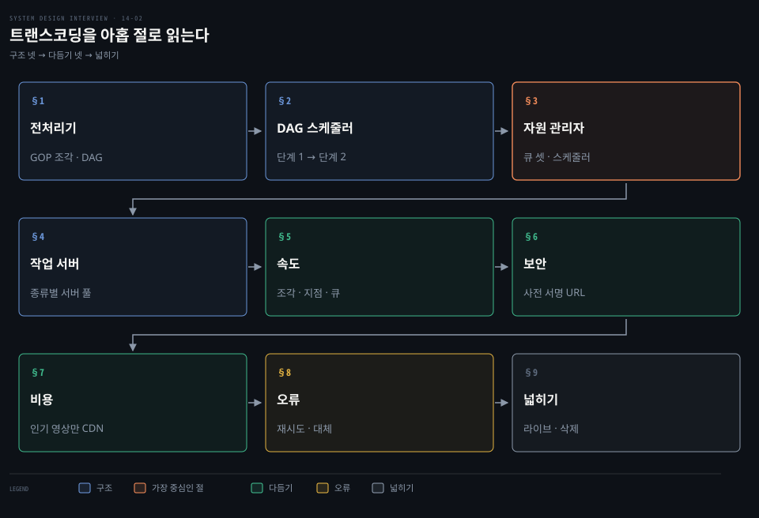
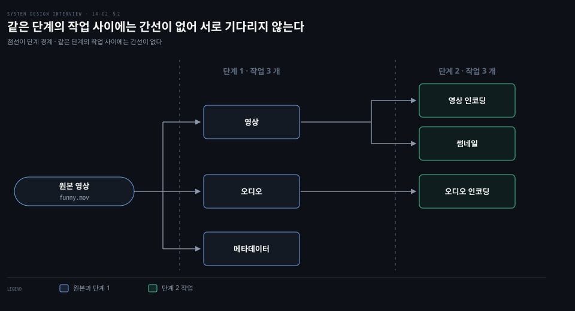
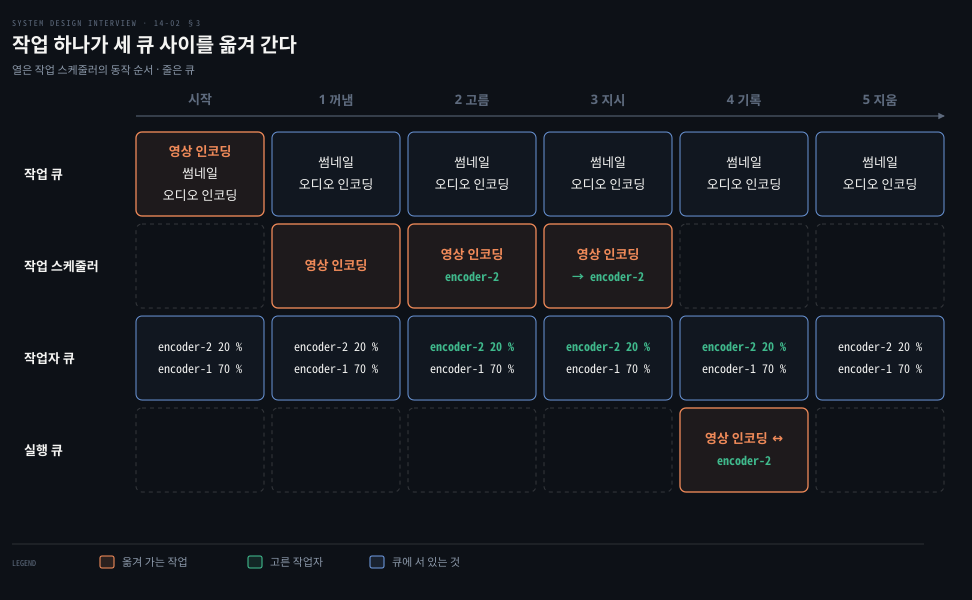
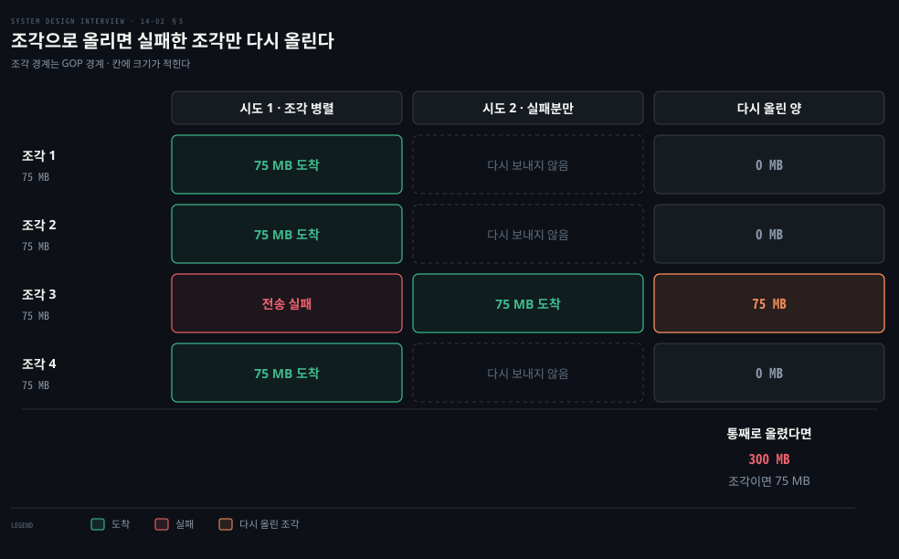
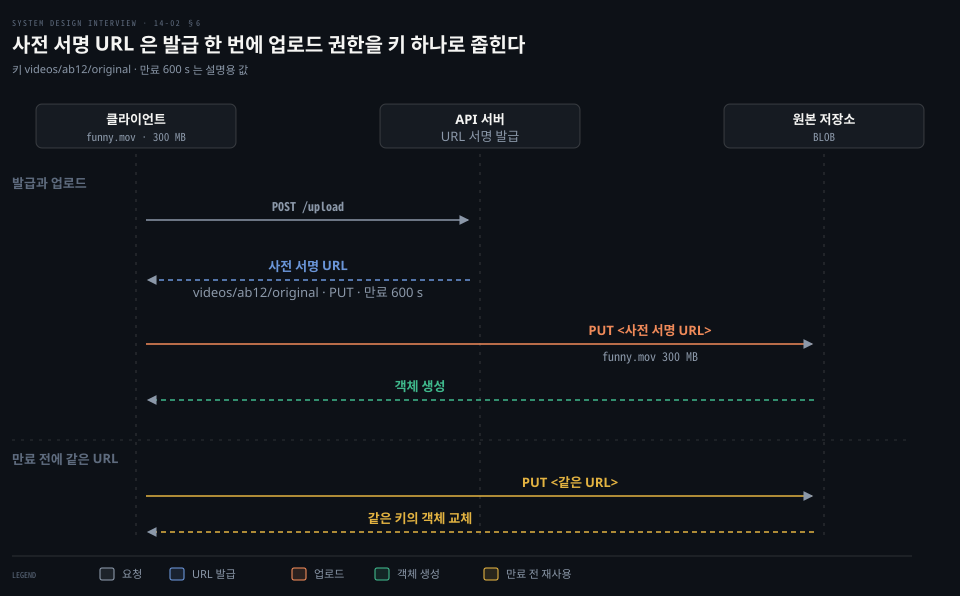
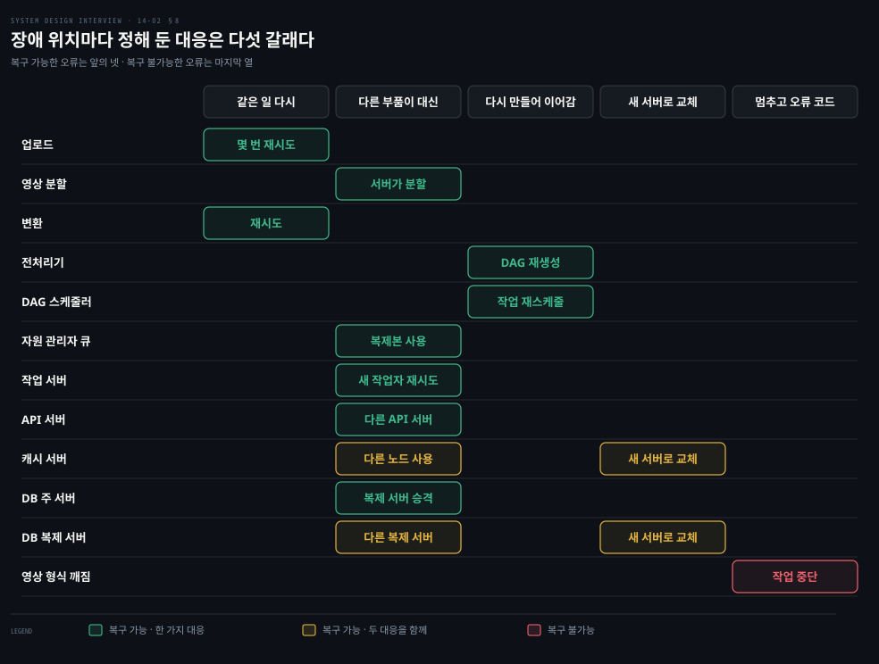

# 트랜스코딩은 전처리·DAG 스케줄러·자원 관리자·작업 서버로 나뉘고 사전 서명 URL·CDN 비용·오류 처리로 다듬는다

---

> 올린 원본은 전처리기가 조각과 DAG 로 바꾸고 DAG 스케줄러가 자른 작업을 자원 관리자가 작업 서버에 배정합니다. 속도·보안·비용·오류는 이 파이프라인 위에서 따로 다듬습니다.


## 핵심 요약

> 이 편의 중심 생각은 변환 파이프라인이 무엇을 할지(전처리기·DAG 스케줄러)와 어디서 돌릴지(자원 관리자·작업 서버)를 갈라 두었기 때문에, 속도·보안·비용·오류를 한 자리씩 따로 고칠 수 있다는 것입니다.

올라온 원본은 여섯 부품을 지납니다. 마지막 부품은 출력인 인코딩된 영상입니다. 전처리기가 영상을 조각으로 자르고 설정 파일에서 DAG 를 만듭니다. DAG 스케줄러는 그 DAG 를 단계로 잘라 자원 관리자의 작업 큐에 넣습니다. 자원 관리자는 큐 셋과 작업 스케줄러로 작업을 작업 서버에 배정합니다. 중간 결과는 임시 저장소에 둡니다.

다듬는 방향은 넷입니다. 속도는 조각 병렬 업로드·가까운 업로드 지점·큐로 끊은 모듈에서 나옵니다. 보안은 사전 서명 URL 이 업로드 권한을 좁히고 DRM·AES·워터마크가 영상을 지킵니다. 비용은 인기 영상만 CDN 에 두어 줄입니다. 오류는 재시도로 풀리는지로 갈라 부품마다 대응을 정해 둡니다.




## 학습 목표

> 이 편을 읽고 나면 다음을 설명할 수 있습니다.

1. 전처리기의 네 가지 일과 DAG 스케줄러가 DAG 를 단계로 잘라 같은 단계의 작업을 병렬로 돌리는 방식을 설명할 수 있습니다.
2. 자원 관리자의 세 큐와 작업 스케줄러가 작업 하나를 배정하는 다섯 동작을 순서대로 말할 수 있습니다.
3. 조각 병렬 업로드·가까운 업로드 지점·메시지 큐가 각각 어떤 대기를 없애는지 구분할 수 있습니다.
4. 사전 서명 URL 의 발급·업로드 순서와 영상 보호 세 방식의 차이를 설명할 수 있습니다.
5. 인기 영상만 CDN 에 두는 근거와 오류를 복구 가능 여부로 갈라 대응하는 방식을 설명할 수 있습니다.


## 1. 전처리기는 영상을 GOP 경계의 조각으로 자르고 설정 파일에서 DAG 를 만들어 조각을 임시 저장소에 둔다

> 전처리기는 변환 파이프라인의 입구입니다. 영상을 독립 재생되는 조각으로 나누고 클라이언트 프로그래머가 쓴 설정으로 DAG 를 만든 뒤 재시도에 쓸 조각을 저장해 둡니다.

300 MB 파일 하나를 통째로 인코더에 넣으면 무엇이 곤란할까요? 한 서버가 처음부터 끝까지 맡아야 합니다. 도중에 실패하면 처음부터 다시 해야 합니다. 그래서 입구에서 영상을 먼저 잘게 나눕니다.

**GOP**(Group of Pictures)는 특정 순서로 놓인 프레임 묶음입니다. 조각 하나가 독립 재생 단위가 되고 길이는 보통 몇 초입니다. HLS 규격도 H.264 영상 조각이 IDR 프레임을 포함하도록 권고합니다. 첫 IDR 앞의 프레임은 내려받아도 버려질 수 있다고도 적습니다.[^rfc8216-seg] 조각이 앞뒤 조각 없이 풀려야 병렬 인코딩과 재시도가 가능합니다.

전처리기가 맡는 일은 넷입니다.

1. 영상 분할: 영상을 GOP 경계로 잘라 조각을 만듭니다.
2. 구형 클라이언트 대신 분할: 분할을 못 하는 오래된 기기나 브라우저는 파일을 통째로 올립니다. 그러면 서버 쪽 전처리기가 대신 자릅니다.
3. DAG 생성: 클라이언트 프로그래머가 쓴 설정 파일에서 DAG 를 만듭니다.
4. 조각 캐시: 조각과 메타데이터를 임시 저장소에 둡니다. 인코딩이 실패하면 저장해 둔 조각으로 재시도합니다.

설정 파일은 작업 하나가 task 블록 하나입니다. 아래 둘을 합치면 노드 2 개와 간선 1 개의 DAG 가 됩니다.

```pseudocode
// 내려받기 작업입니다. 받은 파일을 context.inputVideo 에 두고 다음 작업을 가리킵니다.
task {
    name 'download-input'
    type 'Download'
    input {
        url config.url
    }
    output { it ->
        context.inputVideo = it.file
    }
    next 'transcode'
}
// 변환 작업입니다. context.inputVideo 를 입력으로 받아 변환 결과를 context.file 에 둡니다.
task {
    name 'transcode'
    type 'Transcode'
    input {
        input context.inputVideo
        config config.transConfig
    }
    output { it ->
        context.file = it.outputVideo
    }
}
```

간선은 `next 'transcode'` 한 줄입니다. 두 작업 사이의 값은 `context` 를 지나가는 것으로 읽힙니다. 앞 작업이 `context.inputVideo` 에 쓰고 뒤 작업이 그것을 입력으로 받습니다. 그래서 작업 정의는 이름·유형·입력·출력·다음 작업이라는 다섯 칸으로 충분합니다. 작업을 DAG 로 정의하는 까닭은 [업로드 편의 §6](./14-01.YouTube%20업로드는%20원본을%20BLOB%20저장소에%20두고%20DAG%20로%20쪼갠%20트랜스코딩을%20거쳐%20CDN%20으로%20스트리밍한다.md)에 있습니다.


## 2. DAG 스케줄러는 간선으로 이어진 작업을 단계로 묶어 자원 관리자의 작업 큐에 넣는다

> DAG 스케줄러는 DAG 를 단계별 작업 묶음으로 잘라 자원 관리자의 작업 큐에 넣습니다. 같은 단계의 작업끼리는 서로 기다릴 일이 없습니다.

DAG 는 순서를 적은 그림일 뿐이고 실행을 시키지는 않습니다. 그러면 어느 작업을 언제 내보낼지는 누가 정할까요? 그 일이 DAG 스케줄러입니다.

원본 영상 funny.mov 의 예에서 단계는 원본에서 그 작업까지 닿는 간선 수로 나뉩니다. 단계 1 에는 간선 한 개로 닿는 영상·오디오·메타데이터가 들어갑니다. 단계 2 에는 영상에서 이어지는 영상 인코딩과 썸네일, 오디오에서 이어지는 오디오 인코딩이 들어갑니다. 메타데이터에는 이어지는 작업이 없어 단계 1 에서 끝납니다.



같은 단계의 작업 사이에는 간선이 없으므로 동시에 돌 수 있습니다. 영상 인코딩이 단계 1 의 영상 작업을 기다리는 것처럼, 다른 단계 사이에서만 간선이 순서를 강제합니다. 이 예에서는 단계 1 과 단계 2 에 각각 작업 3 개가 들어가 여섯 개가 단계 둘로 정리됩니다.

잡 사이의 의존을 DAG 로 관리하는 도구의 일반론은 [DDIA 11-03 의 §3 워크플로우 스케줄러 절](../../../05_data/book/designing-data-intensive-applications/11-03.분산%20잡%20오케스트레이션과%20MapReduce.md)에 있습니다.


## 3. 자원 관리자는 작업 큐·작업자 큐·실행 큐와 작업 스케줄러로 작업을 가장 알맞은 작업자에게 배정한다

> 자원 관리자는 자원 배정의 효율을 맡습니다. 작업 큐와 작업자 큐는 우선순위 큐이고 실행 큐는 짝을 기록하며 작업 스케줄러가 다섯 동작으로 이 셋을 잇습니다.

작업은 여섯 개인데 작업 서버가 수십 대라면 어느 작업을 어느 서버에 줄까요? 이 선택을 한 곳에 모아 둔 것이 자원 관리자입니다. 구성은 큐 셋과 스케줄러 하나입니다.

- 작업 큐: 실행할 작업이 들어 있는 우선순위 큐입니다.
- 작업자 큐: 작업자의 사용 현황이 들어 있는 우선순위 큐입니다.
- 실행 큐: 지금 실행 중인 작업과 그 작업을 돌리는 작업자의 정보입니다.
- 작업 스케줄러: 알맞은 작업과 작업자를 골라 작업자에게 실행을 지시합니다.

작업 스케줄러의 동작은 다섯 단계입니다.

1. 작업 큐에서 우선순위가 가장 높은 작업을 꺼냅니다.
2. 작업자 큐에서 그 작업을 돌릴 가장 알맞은 작업자를 고릅니다.
3. 고른 작업자에게 작업 실행을 지시합니다.
4. 작업과 작업자의 짝을 실행 큐에 넣습니다.
5. 작업이 끝나면 실행 큐에서 그 작업을 지웁니다.

아래는 영상 인코딩 작업 하나가 이 다섯 동작을 지나는 모습입니다. 작업자 이름과 가동률은 설명을 위해 정한 값입니다.



작업 큐에는 영상 인코딩·썸네일·오디오 인코딩이 서 있고 맨 앞이 영상 인코딩입니다. 작업자 큐에는 가동률 70 % 의 encoder-1 과 20 % 의 encoder-2 가 있습니다. 어느 작업자가 알맞은지의 기준은 여기서 가동률이 낮은 쪽으로 가정해 encoder-2 를 고릅니다. 지시가 나가면 짝 영상 인코딩 ↔ encoder-2 가 실행 큐에 들어갑니다. 끝나면 실행 큐가 다시 비어 있습니다.

실행 큐가 짝을 들고 있으니 작업자가 죽었을 때 어느 작업을 다시 돌려야 하는지 거기서 찾을 수 있습니다. §8 의 작업자 장애 대응이 이 기록을 쓸 수 있습니다. 선점 없이 우선순위 큐만 쓰면 우선순위가 낮은 작업이 계속 밀릴 수 있다는 점은 [DDIA 11-03 의 §2 스케줄러 자원 할당 절](../../../05_data/book/designing-data-intensive-applications/11-03.분산%20잡%20오케스트레이션과%20MapReduce.md)이 스타베이션으로 다룹니다.


## 4. 작업 서버는 작업 종류별로 나뉘고 임시 저장소는 데이터 성격별로 저장 방식을 고른다

> 작업 서버는 워터마크·인코더·썸네일·병합기처럼 종류별로 DAG 의 작업을 실행합니다. 임시 저장소는 데이터의 크기와 접근 빈도에 따라 메모리 캐시와 BLOB 저장소를 나눠 씁니다.

인코딩은 오래 걸리는 계산이고 썸네일은 짧은 계산입니다. 이 둘을 한 종류의 서버에서 돌리면 한쪽이 병목이 될 때 전체를 늘려야 합니다. 작업 서버가 작업 종류별 풀로 나뉘어 있으면 막힌 종류만 늘릴 수 있습니다. 자원 관리자는 작업자 큐에서 그 작업에 맞는 풀의 서버를 고릅니다.

임시 저장소는 한 가지 저장소가 아닙니다. 데이터 유형·크기·접근 빈도·수명에 따라 저장 방식을 고릅니다.

| 데이터 | 성격 | 저장 방식 |
|--------|------|----------|
| 메타데이터 | 작고 작업자가 자주 읽음 | 메모리 캐시 |
| 영상·오디오 조각 | 큼 | BLOB 저장소 |

해당 영상의 처리가 끝나면 임시 저장소의 데이터는 비웁니다. 파이프라인의 최종 출력은 인코딩된 영상이고 파일 이름은 funny_720p.mp4 같은 모양입니다. 이 파일이 변환본 저장소를 거쳐 CDN 으로 가는 길은 [업로드 편의 §3](./14-01.YouTube%20업로드는%20원본을%20BLOB%20저장소에%20두고%20DAG%20로%20쪼갠%20트랜스코딩을%20거쳐%20CDN%20으로%20스트리밍한다.md)에 있습니다.


## 5. 속도는 조각 병렬 업로드·가까운 업로드 지점·큐로 끊은 모듈에서 나온다

> 업로드는 영상을 GOP 경계의 조각으로 잘라 병렬로 올리고 사용자와 가까운 업로드 지점으로 보내며 모듈 사이에 메시지 큐를 두어 앞 단계를 기다리지 않게 해서 빨라집니다.

변환 파이프라인이 아무리 빨라도 올리는 구간이 느리면 사용자는 기다립니다. 올리기를 빠르게 하는 방법이 셋 있습니다. 각각 없애는 대기가 다릅니다.

### 조각으로 올리면 실패한 조각만 다시 올린다

영상을 통째로 올리다 끊기면 처음부터 다시 올려야 합니다. 클라이언트가 GOP 경계로 자른 조각을 따로 올리면 실패한 조각만 다시 보내면 됩니다. 평균 영상 300 MB 를 조각 4 개로 자르면(계산을 쉽게 하려고 정한 값이고 실제 조각은 몇 초 단위라 훨씬 많습니다) 조각 하나는 300 ÷ 4 = 75 MB 입니다. 3 번째가 실패해도 다시 올리는 양은 75 MB 로 전체의 4 분의 1 입니다.



클라우드 저장소가 같은 이점을 직접 줍니다. S3 의 분할 업로드는 객체를 파트 묶음으로 올립니다. 파트는 독립적으로 순서와 관계없이 올릴 수 있고 실패한 파트만 다시 보낼 수 있습니다. 100 MB 이상 객체에는 분할 업로드를 권장합니다.[^s3-mpu] 이 파트는 GOP 경계가 아니라 바이트 범위라는 점이 다릅니다. 객체 저장소 쪽 구조는 [블록·파일·객체 저장소 편](../bytebytego-system-design/04-01.블록·파일·객체%20저장소는%20접근%20단위가%20다르고%20이레이저%20코딩과%20분할%20업로드가%20큰%20데이터를%20싸고%20안전하게%20담는다.md)이 다룹니다. 분할을 못 하는 구형 클라이언트는 §1 처럼 서버가 대신 자릅니다.

### 가까운 업로드 지점은 CDN 의 엣지를 업로드 입구로 쓴다

미국 사용자와 아시아 사용자가 같은 한 곳으로 올리면 먼 쪽이 느립니다. 대륙마다 업로드 지점을 두고 사용자를 가까운 곳으로 보냅니다. CDN 을 그 업로드 지점으로 씁니다.

지금의 구현 하나가 S3 Transfer Acceleration 입니다. 버킷 단위 기능으로 CloudFront 의 전 세계 엣지 위치에서 데이터를 받아 최적화된 네트워크 경로로 S3 에 넘깁니다. 켠 뒤 속도가 오르기까지 최대 20 분이 걸릴 수 있고 추가 전송 요금이 붙을 수 있습니다.[^s3-ta]

### 큐를 사이에 두면 인코딩이 다운로드를 기다리지 않는다

원본 저장소에서 CDN 까지는 내려받기 모듈 → 인코딩 모듈 → 올리기 모듈 → 변환본 저장소 → CDN 으로 이어집니다. 각 모듈의 출력이 다음 모듈의 입력이라 앞이 끝나야 뒤가 시작합니다. 이 의존이 병렬화를 막습니다.

모듈 사이에 메시지 큐를 두면 앞 모듈은 이벤트를 큐에 놓고 끝납니다. 인코딩 모듈은 큐에 이벤트가 있는 대로 꺼내 병렬로 처리하므로 내려받기 모듈의 출력을 기다리지 않습니다. 큐가 생산자와 소비자를 떼어 놓는 원리는 [규모 확장 편의 §5 메시지 큐 절](./01-02.캐시·CDN·무상태%20웹%20계층·데이터%20센터·메시지%20큐·샤딩이%20수백만%20사용자까지%20규모를%20늘린다.md)에 있습니다.


## 6. 보안은 사전 서명 URL 이 업로드 권한을 개체 하나와 시간 하나로 좁히고 DRM·AES·워터마크가 영상을 지킨다

> 사전 서명 URL 은 API 서버가 만들어 준 URL 하나로 지정한 개체에 정해진 시간 동안만 올릴 수 있게 합니다. 올라온 영상의 도용은 DRM·AES 암호화·워터마크로 막거나 추적합니다.

클라이언트가 BLOB 저장소에 직접 올리게 두면 아무나 아무 위치에나 올릴 수 있지 않을까요? 업로드 권한을 서버가 한 번 걸러서 내주는 것이 사전 서명 URL 입니다.



순서는 셋입니다. 클라이언트가 API 서버에 업로드를 요청하고(`POST /upload`), API 서버가 사전 서명 URL 로 응답합니다. 마지막으로 클라이언트가 그 URL 로 원본 저장소에 영상을 올립니다. 도식의 funny.mov 300 MB 는 업로드 편의 예시이고, 객체 키 videos/ab12/original 과 만료 600 초는 설명을 위해 정한 값입니다. 사전 서명 URL 이라는 이름은 S3 에서 쓰는 말이고 Azure Blob 저장소의 같은 기능은 공유 액세스 서명(SAS)입니다.

S3 의 사전 서명 URL 은 현재 다음처럼 동작합니다.[^s3-presign]

- 만들 때 버킷·객체 키·HTTP 메서드(업로드는 PUT)·만료 시간을 정합니다.
- 받는 쪽은 AWS 자격 증명이 필요 없습니다. 권한은 URL 을 만든 주체의 권한으로 제한됩니다.
- 같은 키의 객체가 이미 있으면 올린 객체가 그것을 덮어씁니다.
- 만료 전에는 여러 번 쓸 수 있습니다.
- SDK 나 CLI 로 만들면 만료를 최대 7 일까지 둘 수 있습니다. 콘솔에서는 1 분부터 12 시간까지입니다.
- 임시 자격 증명으로 만들면 그 자격 증명이 끝날 때 같이 만료됩니다.

URL 을 가진 사람은 누구나 쓸 수 있는 bearer 토큰이므로 설계에서 다룰 몫이 생깁니다. 객체 키를 사용자가 정하게 두면 남의 객체를 덮어쓸 수 있으니 키는 서버가 정해 URL 에 담는 편이 안전합니다. 만료는 발급 직후 쓰는 값이므로 짧게 둡니다. S3 는 서명이 10 분보다 오래된 사전 서명 요청을 거부하는 버킷 정책의 예(`s3:signatureAge` 600000 ms)도 보입니다.

Azure 의 SAS 는 세 종류입니다. 사용자 위임 SAS 는 Microsoft Entra 자격 증명으로, 서비스 SAS 와 계정 SAS 는 저장소 계정 키로 서명하며 Microsoft 는 사용자 위임 SAS 를 권장합니다.[^az-sas]

올라온 영상을 지키는 방식은 셋이고 막는 대상이 다릅니다.

| 방식 | 하는 일 | 쓰는 규격 |
|------|---------|----------|
| DRM | 재생 권한을 기기에서 강제 | FairPlay(Apple), Widevine(Google), PlayReady(Microsoft) |
| AES 암호화 | 조각 내용을 암호화하고 재생할 때 풂 | HLS 는 `EXT-X-KEY` 의 AES-128 |
| 눈에 보이는 워터마크 | 영상 위에 로고·회사 이름 같은 식별 이미지를 얹음 | 변환 작업의 한 노드 |

FairPlay Streaming 은 HLS 로 전달하는 콘텐츠를 Apple 플랫폼에서 암호화하고 키를 교환하며 재생을 보호하는 기술입니다.[^fps] Widevine 은 W3C 의 Encrypted Media Extensions 와 ISO/IEC 23001-7 공통 암호화를 채택한 Google 의 콘텐츠 보호 시스템입니다.[^widevine] PlayReady 는 만료일·보안 수준·출력 제한 같은 정책을 강제합니다.[^playready]

HLS 의 AES-128 은 조각 전체를 128 비트 키와 CBC, PKCS7 패딩으로 암호화하며 CBC 를 조각 경계마다 다시 시작합니다. 키는 `EXT-X-KEY` 의 URI 로 가져옵니다. KEYFORMAT 이 identity 이고 IV 속성이 없으면 미디어 시퀀스 번호가 IV 가 됩니다.[^rfc8216-key] 키 URI 의 요청을 누구에게 열어 줄지가 곧 인가 규칙이므로 서비스가 정해야 합니다. 워터마크는 복제 자체를 막지 못하고 유출된 영상의 출처를 알아보게 하는 쪽입니다.


## 7. 비용은 인기 영상만 CDN 에서 내려 보내고 나머지는 고용량 저장 서버에 맡겨 줄인다

> 조회가 소수 영상에 몰린다는 관찰에서, 인기 영상만 CDN 에 두고 나머지는 저장 서버에서 내려 줍니다. 인코딩 버전 수와 배포 지역도 인기에 맞춰 줄입니다.

[업로드 편](./14-01.YouTube%20업로드는%20원본을%20BLOB%20저장소에%20두고%20DAG%20로%20쪼갠%20트랜스코딩을%20거쳐%20CDN%20으로%20스트리밍한다.md)의 가정으로 CDN 전송비는 하루 $150,000 였습니다. 모든 영상을 CDN 에 둘 필요가 있을까요? 시청이 몰려 있다면 조회가 거의 없는 영상까지 엣지에 복제하는 것이 낭비입니다.

줄이는 방법은 넷입니다.

1. 인기 영상만 CDN 에서 내려 보내고 나머지는 고용량 저장 서버에서 내려 줍니다.
2. 인기가 낮은 영상은 인코딩 버전을 적게 둡니다. 짧은 영상은 요청이 올 때 인코딩합니다.
3. 특정 지역에서만 인기 있는 영상은 다른 지역에 배포하지 않습니다.
4. 자체 CDN 을 만들어 ISP 와 제휴합니다. 큰 스트리밍 회사에서나 성립하는 큰 사업입니다.

첫 방법의 효과는 비중으로 어림합니다. CDN 이 담당하는 시청 비중을 p 라 하면 CDN 전송비는 p × $150,000 입니다. 인기 영상이 시청의 80 % 를 차지한다고 가정하면 0.8 × $150,000 = $120,000 입니다. 나머지 20 % 는 저장 서버의 대역폭으로 옮겨 갑니다. 80 % 는 설명용 가정입니다.

가정이 맞는지는 측정으로 가립니다. YouTube 를 2007 년에 측정한 연구는 조회 수를 순위로 늘어놓은 곡선이 선형 축에서는 긴 꼬리를 가지지만 Zipf 분포는 아니라고 보고했습니다. 10 만 개 넘는 영상의 2007-04-03 자료에서 꼬리가 2 × 10³ 번째 영상 뒤로 크게 꺼졌습니다. Weibull 과 Gamma 가 Zipf 보다 잘 맞았습니다.[^yt2007] 인기가 몰린다는 방향은 같지만 곡선의 모양은 서비스마다 다릅니다. 그래서 인기 영상의 기준은 해당 서비스의 시청 기록을 분석해 정합니다.

자체 CDN 의 대표 사례가 Netflix Open Connect 이고 [업로드 편의 §2](./14-01.YouTube%20업로드는%20원본을%20BLOB%20저장소에%20두고%20DAG%20로%20쪼갠%20트랜스코딩을%20거쳐%20CDN%20으로%20스트리밍한다.md)도 빌릴지 만들지의 기준으로 이 사례를 듭니다. 1,000 곳이 넘는 ISP 와 제휴해 Open Connect 장비를 ISP 망 안에 두는 방식으로 콘텐츠를 더 효율적으로 전달합니다. 개방형 피어링 정책도 둡니다.[^nflx-oc] 두 CDN 철학은 [영상 스트리밍 노트의 §3](../../../02_os/book/cntd_computer-networking-top-down/02-04.영상은%20어떻게%20끊기지%20않는가.md)이, Netflix·YouTube 의 선택은 같은 노트의 §5 가 다룹니다. 사용자와 가까운 ISP 망 안에서 내려 주면 시청 경험이 나아지고 대역폭 비용이 줄어듭니다. CDN 자체의 TTL 과 엣지 동작은 [CDN 편](../bytebytego-system-design/03-01.URL%20을%20치면%20DNS·TCP·TLS·HTTP%20를%20거쳐%20브라우저가%20화면을%20그리고%20CDN%20이%20그%20길을%20줄인다.md)이 다룹니다.


## 8. 오류는 재시도로 풀리는 것과 영상이 깨진 것으로 갈라 대응하고 부품마다 대응을 미리 정해 둔다

> 복구 가능한 오류는 몇 번 재시도하고 그래도 안 되면 클라이언트에 오류 코드를 돌려줍니다. 복구 불가능한 오류는 그 영상의 작업을 멈추고 오류 코드를 돌려줍니다.

대규모 시스템에서 오류는 피할 수 없습니다. 같은 오류가 나도 다시 하면 풀리는 것이 있고 아무리 다시 해도 풀리지 않는 것이 있습니다. 두 종류의 대응이 다릅니다.

- 복구 가능한 오류: 영상 조각 하나의 변환이 실패한 경우처럼 다시 하면 풀릴 수 있습니다. 몇 번 재시도합니다. 계속 실패하면 복구 불가능하다고 보고 적절한 오류 코드를 돌려줍니다.
- 복구 불가능한 오류: 영상 형식이 깨진 경우처럼 다시 해도 같습니다. 그 영상에 딸린 실행 중 작업을 멈추고 오류 코드를 돌려줍니다.

부품마다 어떻게 대응할지는 미리 정해 둡니다.



| 장애 위치 | 대응 |
|-----------|------|
| 업로드 | 몇 번 재시도 |
| 영상 분할 | 구형 클라이언트가 못 자르면 전체 영상을 서버로 넘기고 서버가 분할 |
| 변환 | 재시도 |
| 전처리기 | DAG 재생성 |
| DAG 스케줄러 | 작업 재스케줄 |
| 자원 관리자의 큐 | 복제본 사용 |
| 작업 서버 | 새 작업자 재시도 |
| API 서버 | 무상태이므로 다른 API 서버로 요청을 보냄 |
| 메타데이터 캐시 서버 | 데이터가 여러 노드에 복제돼 있어 다른 노드 사용, 새 서버로 교체 |
| 메타데이터 DB 주 서버 | 복제 서버 승격 |
| 메타데이터 DB 복제 서버 | 다른 복제 서버로 읽고 새 서버로 교체 |

복구 가능한 오류의 대응은 넷으로 갈립니다. 같은 일을 다시 하거나, 다른 부품이 대신 받거나, 만들어 둔 것을 다시 만들거나, 죽은 서버를 새 서버로 바꿉니다. 복구 불가능한 오류만 작업을 멈춥니다. 재시도가 같은 일을 두 번 하게 만들 수 있으므로 중복을 걸러 내는 방식이 함께 필요합니다. [알림 시스템 편의 §6](./10-01.알림%20시스템은%20제3자%20푸시·SMS·이메일%20서비스%20앞에%20메시지%20큐와%20작업%20서버를%20두어%20재시도와%20중복을%20다룬다.md)이 이벤트 ID 로 거르는 방법을 다룹니다.


## 9. 면접에 시간이 남으면 API 계층과 DB 확장·라이브 스트리밍·영상 삭제로 넓힌다

> 설계를 마친 뒤에는 이미 있는 부품의 확장과 이 설계가 비켜 간 주제를 짚습니다. 라이브 스트리밍과 영상 삭제는 지연과 사후 대응의 요구가 다릅니다.

- API 계층 확장: API 서버가 무상태이므로 수평으로 늘리기 쉽습니다.
- DB 확장: 복제와 샤딩을 이야기합니다.
- 라이브 스트리밍: 실시간으로 녹화해 내보내는 방식입니다. 올리기·인코딩·스트리밍이 모두 필요하다는 점은 일반 영상과 같고 다른 점은 셋입니다.
  - 지연 요구가 더 높아 다른 스트리밍 프로토콜이 필요할 수 있습니다.
  - 작은 조각이 이미 실시간으로 처리되므로 병렬화 요구는 낮습니다.
  - 오류 처리에 시간이 오래 걸리는 방식은 받아들여지지 않습니다.
- 영상 삭제: 저작권 침해나 불법 영상은 내려야 합니다. 업로드 과정에서 시스템이 찾아내기도 하고 사용자 신고로 알게 되기도 합니다.


## 면접 대비

> 전처리기와 스케줄러, 자원 관리자, 속도·보안·비용, 오류 처리에 관한 면접 질문입니다.

1. 변환 파이프라인의 구성 요소 여섯을 순서대로 말하고 전처리기가 맡는 일 넷을 설명해 보십시오.
2. DAG 스케줄러가 나눈 한 단계 안의 작업은 왜 병렬로 돌 수 있으며 예의 영상 인코딩은 어느 단계에 놓입니까?
3. 자원 관리자의 세 큐는 각각 무엇을 담으며 작업 스케줄러는 작업 하나를 어떤 순서로 배정합니까?
4. 사전 서명 URL 은 어떤 순서로 쓰이며 URL 을 받은 쪽이 할 수 있는 일과 설계에서 정할 것은 무엇입니까?
5. CDN 비용을 줄이는 방법과 복구 가능한 오류·복구 불가능한 오류의 대응 차이를 설명해 보십시오.


## 정답 (자답 후 펼치기)

> 면접 질문에 대한 키워드 중심의 모범 답안입니다.

### 정답 1 — 전처리기·DAG 스케줄러·자원 관리자·작업 서버·임시 저장소·인코딩된 영상

전처리기가 영상을 GOP 조각으로 자르고 DAG 를 만듭니다. DAG 스케줄러가 단계로 잘라 작업 큐에 넣고 자원 관리자가 작업 서버에 배정합니다. 중간 결과는 임시 저장소에 두고 인코딩된 영상이 마지막 출력입니다. 전처리기의 일은 영상 분할·구형 클라이언트 대신 분할·DAG 생성·조각 캐시입니다.

### 정답 2 — 단계 안에는 간선 없음

같은 단계의 작업 사이에는 간선이 없어 순서 제약이 없으므로 동시에 돌 수 있습니다. 예에서는 원본에서 닿는 간선 수로 단계가 갈려 영상 인코딩이 단계 2 에 놓입니다.

### 정답 3 — 작업 큐·작업자 큐·실행 큐, 꺼내고 고르고 지시하고 기록하고 지움

작업 큐는 실행할 작업, 작업자 큐는 작업자 사용 현황, 실행 큐는 실행 중인 작업과 작업자의 짝을 담습니다. 가장 우선순위 높은 작업을 꺼내 알맞은 작업자를 골라 지시합니다. 짝을 실행 큐에 넣었다가 끝나면 지웁니다.

### 정답 4 — 요청·URL 응답·URL 로 업로드, 키·만료는 서버가 정함

클라이언트가 API 서버에 요청하고 사전 서명 URL 을 받아 그 URL 로 저장소에 올립니다. URL 은 bearer 토큰이라 가진 사람은 누구나 만료 전까지 쓸 수 있습니다. 객체 키와 짧은 만료를 서버가 정해야 합니다.

### 정답 5 — 인기 영상만 CDN, 재시도 대 중단

인기 영상만 CDN 에서 내리고 나머지는 저장 서버에서 내립니다. 인코딩 버전과 배포 지역도 인기에 맞춰 줄이고 자체 CDN 과 ISP 제휴도 있습니다. 복구 가능한 오류는 몇 번 재시도한 뒤 오류 코드를 돌려줍니다. 복구 불가능한 오류는 그 영상의 작업을 멈추고 오류 코드를 돌려줍니다.


## 참고 자료

- Alex Xu, 《System Design Interview – An Insider's Guide》.
- Amazon S3 User Guide, 사전 서명 URL: https://docs.aws.amazon.com/AmazonS3/latest/userguide/using-presigned-url.html
- Amazon S3 User Guide, 분할 업로드: https://docs.aws.amazon.com/AmazonS3/latest/userguide/mpuoverview.html
- Amazon S3 User Guide, Transfer Acceleration: https://docs.aws.amazon.com/AmazonS3/latest/userguide/transfer-acceleration.html
- Microsoft Learn, 공유 액세스 서명(SAS): https://learn.microsoft.com/en-us/azure/storage/common/storage-sas-overview
- RFC 8216, HTTP Live Streaming: https://www.rfc-editor.org/rfc/rfc8216
- Cheng·Dale·Liu, Understanding the Characteristics of Internet Short Video Sharing: YouTube as a Case Study (2007): https://arxiv.org/abs/0707.3670
- Netflix Open Connect: https://openconnect.netflix.com/en/


## 관련 문서

- [YouTube 업로드는 원본을 BLOB 저장소에 두고 DAG 로 쪼갠 트랜스코딩을 거쳐 CDN 으로 스트리밍한다](./14-01.YouTube%20업로드는%20원본을%20BLOB%20저장소에%20두고%20DAG%20로%20쪼갠%20트랜스코딩을%20거쳐%20CDN%20으로%20스트리밍한다.md)
- [캐시·CDN·무상태 웹 계층·데이터 센터·메시지 큐·샤딩이 수백만 사용자까지 규모를 늘린다](./01-02.캐시·CDN·무상태%20웹%20계층·데이터%20센터·메시지%20큐·샤딩이%20수백만%20사용자까지%20규모를%20늘린다.md)
- [알림 시스템은 제3자 푸시·SMS·이메일 서비스 앞에 메시지 큐와 작업 서버를 두어 재시도와 중복을 다룬다](./10-01.알림%20시스템은%20제3자%20푸시·SMS·이메일%20서비스%20앞에%20메시지%20큐와%20작업%20서버를%20두어%20재시도와%20중복을%20다룬다.md)
- [DDIA 11-03 분산 잡 오케스트레이션과 MapReduce](../../../05_data/book/designing-data-intensive-applications/11-03.분산%20잡%20오케스트레이션과%20MapReduce.md)
- [영상은 어떻게 끊기지 않는가](../../../02_os/book/cntd_computer-networking-top-down/02-04.영상은%20어떻게%20끊기지%20않는가.md)
- [블록·파일·객체 저장소는 접근 단위가 다르고 이레이저 코딩과 분할 업로드가 큰 데이터를 싸고 안전하게 담는다](../bytebytego-system-design/04-01.블록·파일·객체%20저장소는%20접근%20단위가%20다르고%20이레이저%20코딩과%20분할%20업로드가%20큰%20데이터를%20싸고%20안전하게%20담는다.md)
- [URL 을 치면 DNS·TCP·TLS·HTTP 를 거쳐 브라우저가 화면을 그리고 CDN 이 그 길을 줄인다](../bytebytego-system-design/03-01.URL%20을%20치면%20DNS·TCP·TLS·HTTP%20를%20거쳐%20브라우저가%20화면을%20그리고%20CDN%20이%20그%20길을%20줄인다.md)

[^rfc8216-seg]: RFC 8216 HTTP Live Streaming(2017-08), §3 Media Segments(H.264 조각은 IDR 을 포함하도록 권고): <https://www.rfc-editor.org/rfc/rfc8216#section-3>
[^s3-mpu]: Amazon S3 User Guide, Uploading and copying objects using multipart upload(2026-10-13 확인, 100 MB 이상 객체에 권장): <https://docs.aws.amazon.com/AmazonS3/latest/userguide/mpuoverview.html>
[^s3-ta]: Amazon S3 User Guide, S3 Transfer Acceleration(2026-10-13 확인): <https://docs.aws.amazon.com/AmazonS3/latest/userguide/transfer-acceleration.html>
[^s3-presign]: Amazon S3 User Guide, Download and upload objects with presigned URLs(2026-10-13 확인, 만료 시간·bearer 토큰·`s3:signatureAge`): <https://docs.aws.amazon.com/AmazonS3/latest/userguide/using-presigned-url.html>, 업로드: <https://docs.aws.amazon.com/AmazonS3/latest/userguide/PresignedUrlUploadObject.html>
[^az-sas]: Microsoft Learn, Grant limited access to Azure Storage resources using shared access signatures(2026-10-13 확인): <https://learn.microsoft.com/en-us/azure/storage/common/storage-sas-overview>
[^fps]: Apple Developer, FairPlay Streaming: <https://developer.apple.com/streaming/fps/>
[^widevine]: Google for Developers, Widevine DRM Overview: <https://developers.google.com/widevine/drm/overview>
[^playready]: Microsoft Learn, PlayReady Overview: <https://learn.microsoft.com/en-us/playready/overview/overview>
[^rfc8216-key]: RFC 8216 §4.3.2.4 EXT-X-KEY 와 §5.2 IV for AES-128: <https://www.rfc-editor.org/rfc/rfc8216#section-4.3.2.4>
[^yt2007]: Cheng·Dale·Liu(2007), §E Views, Ratings – User Access Pattern: <https://arxiv.org/abs/0707.3670>
[^nflx-oc]: Netflix Open Connect, Welcome to Open Connect(2026-10-13 확인): <https://openconnect.netflix.com/en/>
