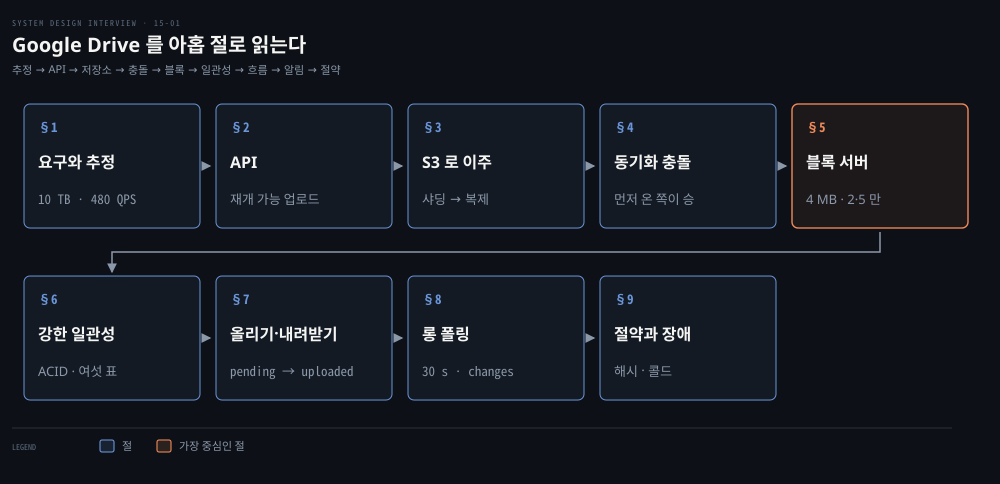
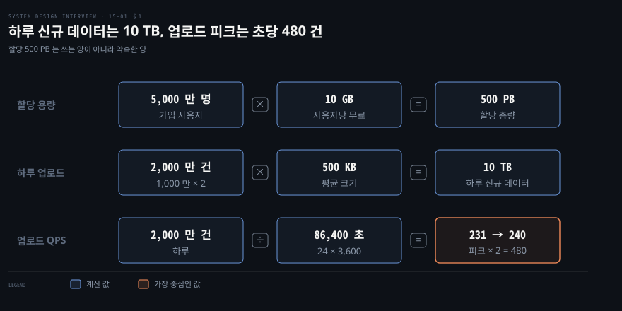
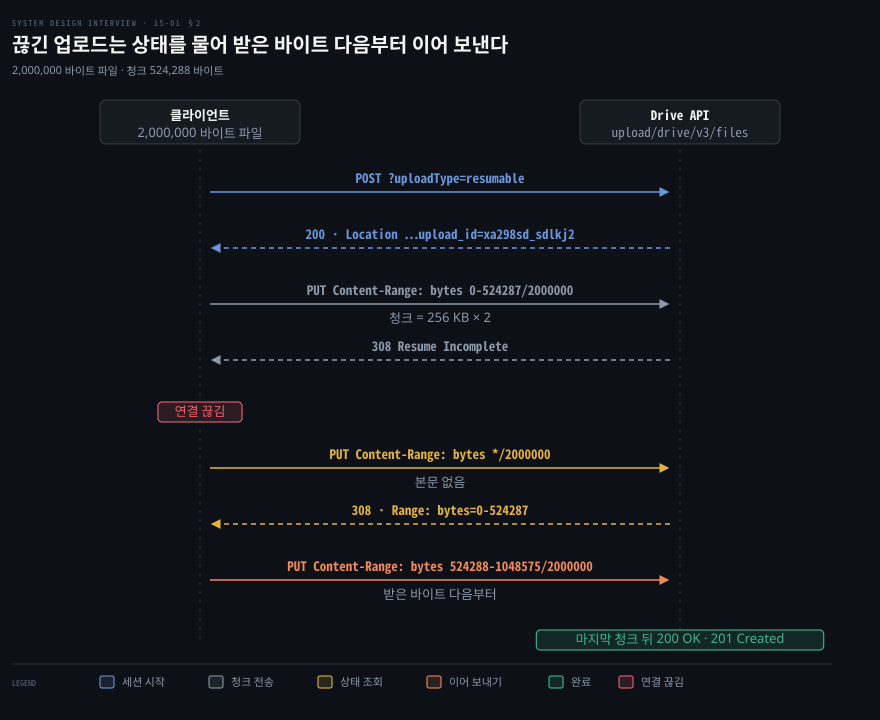
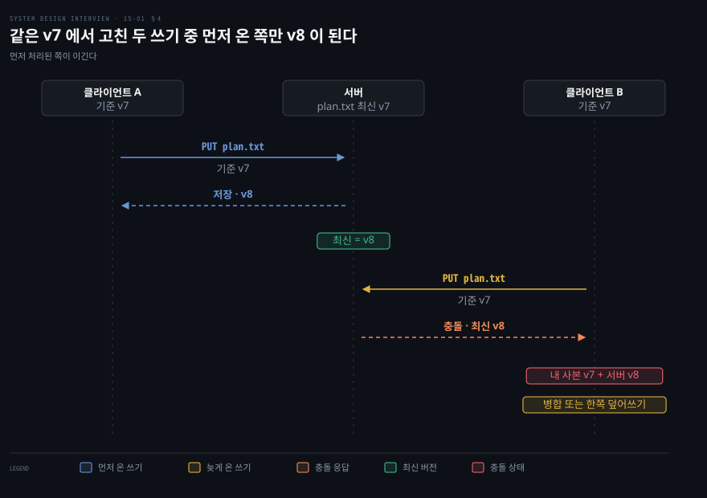
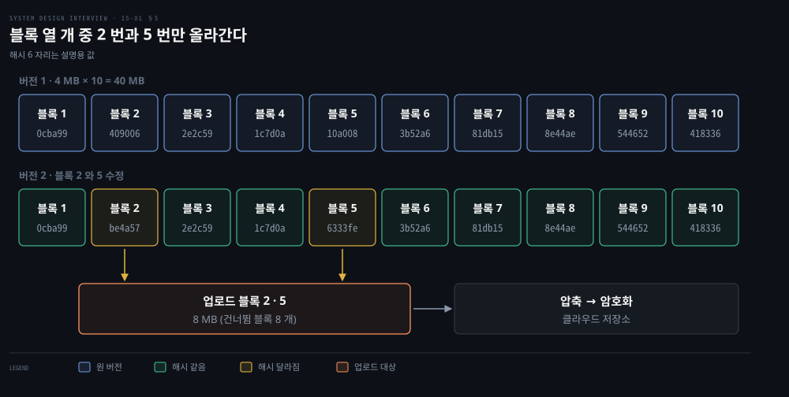
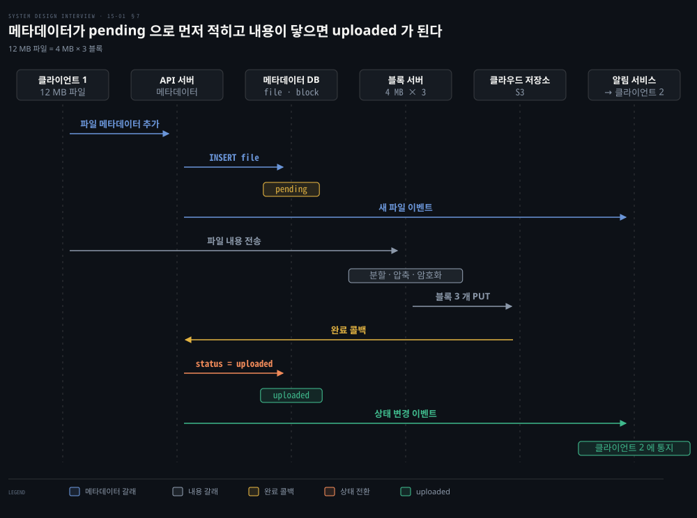
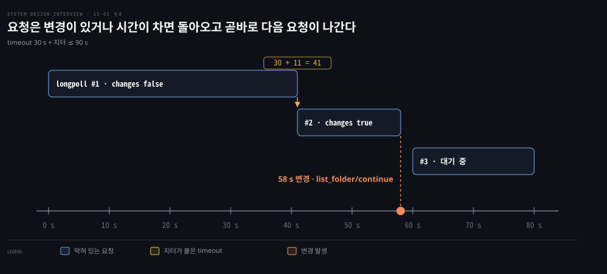

# Google Drive 는 파일을 블록으로 쪼개 변경분만 올리고 강한 일관성의 메타데이터와 롱 폴링으로 동기화한다

---

> 파일 동기화 서비스는 파일을 블록으로 쪼개 해시가 바뀐 블록만 올리고, 파일 목록은 관계형 DB 로 강하게 일관되게 지키며, 다른 기기의 변경은 롱 폴링으로 알립니다.


## 핵심 요약

> 이 편의 중심 생각은 큰 파일을 자주 고치는 서비스에서 아끼는 대상이 저장 공간보다 네트워크라서, 파일을 블록으로 쪼개 바뀐 블록만 옮기고 그 블록 목록을 강하게 일관된 메타데이터가 쥔다는 것입니다.

단일 서버에서 출발한 설계는 저장소가 차면서 샤딩을 거쳐 S3 로 옮겨 갑니다. 이때 블록 서버가 파일을 4 MB 블록으로 쪼개 해시가 달라진 블록만 압축하고 암호화해 올립니다. 40 MB 파일에서 블록 두 개만 고쳤다면 8 MB 만 나갑니다.

메타데이터 DB 는 관계형으로 두어 ACID 를 그대로 받습니다. 올릴 때 파일은 먼저 pending 으로 적히고 내용이 클라우드 저장소에 닿은 뒤 uploaded 로 바뀝니다. 다른 기기에는 롱 폴링 알림이 갑니다. 알림을 받은 기기가 메타데이터를 읽고 블록을 내려받아 파일을 맞춥니다.

같은 파일을 두 곳에서 고치면 먼저 처리된 쪽이 이기고 늦은 쪽은 충돌을 받습니다. 블록 해시가 같으면 같은 블록이므로 중복 제거와 버전 보관도 같은 해시 위에서 이뤄집니다.




## 학습 목표

> 이 편을 읽고 나면 다음을 설명할 수 있습니다.

1. 사용자 수와 업로드 비율에서 하루 신규 데이터와 업로드 QPS 를 계산식으로 어림할 수 있습니다.
2. 재개 가능 업로드가 세션 URI 와 `Content-Range` 로 끊긴 지점부터 이어 보내는 순서를 설명할 수 있습니다.
3. 블록 분할과 해시 비교가 델타 동기화를 만드는 과정과 고정 크기 블록의 약점을 설명할 수 있습니다.
4. 메타데이터에 강한 일관성이 필요한 까닭과 관계형 DB 를 고른 근거를 말할 수 있습니다.
5. 롱 폴링이 웹소켓보다 이 문제에 맞는 까닭과 재접속이 몰리는 위험을 설명할 수 있습니다.


## 1. 하루 신규 10 TB 와 초당 480 건은 작지만 데이터를 잃어선 안 된다는 조건이 설계를 끈다

> 규모 숫자만 보면 평범한 서비스인데, 파일이 최대 10 GB 까지 가고 잃으면 안 된다는 조건이 블록 분할과 복제를 부릅니다.

올리기와 내려받기만 있으면 되는 서비스일까요? 범위는 여섯 가지입니다. 파일 추가, 내려받기, 여러 기기 동기화, 버전 기록, 공유, 파일이 고쳐지거나 지워지거나 공유될 때의 알림입니다. 같은 문서를 여럿이 동시에 편집하는 기능은 범위 밖입니다.

기능 말고도 설계를 정하는 비기능 요구가 다섯 있습니다.

1. 신뢰성: 저장소에서 데이터를 잃는 일은 용납되지 않습니다.
2. 빠른 동기화: 오래 걸리면 사용자가 떠납니다.
3. 대역폭: 모바일 데이터에서 불필요한 전송은 불만이 됩니다.
4. 확장성: 많은 트래픽을 받아야 합니다.
5. 고가용성: 일부 서버가 꺼지거나 느려져도 쓸 수 있어야 합니다.

아래 값은 2020 년 판 면접 문제의 설계 가정이며 현재 서비스 통계가 아닙니다. 가입자 5,000 만 명, DAU 1,000 만 명, 사용자당 무료 10 GB, 하루 업로드 2 건, 평균 500 KB, 읽기 대 쓰기 1 대 1, 파일 10 GB 이하, 저장 시 암호화입니다.



QPS 는 20,000,000 ÷ 86,400 ≈ 231 이고 올림해 240 으로 두면 피크는 480 입니다. 할당 500 PB 를 하루 신규 10 TB 로 나누면 50,000 일입니다. 할당량은 쓰는 양이 아니라 약속한 양입니다. 읽기와 쓰기가 같은 비율이므로 내려받기도 비슷한 규모입니다. 추정 방법 자체는 [개략적 규모 추정](./02-01.개략적%20규모%20추정은%202의%20거듭제곱·지연%20시간·가용성%20수치로%20QPS%20와%20저장%20용량을%20어림한다.md)에서 다뤘습니다.


## 2. 올리기는 단순 업로드와 끊겨도 이어 보내는 재개 가능 업로드로 나뉜다

> 큰 파일은 중간에 끊길 확률이 높습니다. 재개 가능 업로드는 세션을 하나 열고 받은 바이트 수를 서버에 물어 그 다음부터 보냅니다.

API 는 세 가지면 충분합니다. 올리기, 내려받기, 파일 리비전 목록입니다. 내려받기는 경로 하나를, 리비전 목록은 경로와 최대 개수를 받습니다. 모두 사용자 인증이 필요하고 HTTPS 로 보호됩니다.

```json
// 내려받기 요청의 파라미터입니다.
{ "path": "/recipes/soup/best_soup.txt" }

// 리비전 목록 요청의 파라미터이고 limit 은 돌려줄 최대 개수입니다.
{ "path": "/recipes/soup/best_soup.txt", "limit": 20 }
```

10 GB 파일을 올리다 끊기면 처음부터 다시 보내야 할까요? Google Drive API v3 는 올리기를 세 가지로 나눕니다. 5 MB 이하는 `uploadType=media` 단순 업로드 또는 메타데이터를 함께 보내는 `multipart` 이고, 5 MB 를 넘거나 끊길 가능성이 높으면 `uploadType=resumable` 입니다.[^drive-upload]

재개 가능 업로드는 세 단계입니다. 먼저 `POST` 로 세션을 열면 `200 OK` 와 `Location` 헤더의 세션 URI 가 돌아오고 이 URI 는 일주일 뒤 만료됩니다. 그다음 세션 URI 에 `PUT` 으로 내용을 보내며 청크는 256 KB 의 배수여야 하고 마지막 청크만 예외입니다. 끊기면 본문 없는 `PUT` 에 `Content-Range: bytes */<전체 크기>` 를 실어 상태를 묻습니다. 응답이 `308` 이면 `Range` 헤더가 받은 바이트를 알려 주고, `404` 면 세션이 만료되어 처음부터 다시 시작합니다.



도식의 값은 그 문서가 든 예시입니다. 2,000,000 바이트 파일의 첫 청크가 524,288 바이트(256 KB × 2)이고, 서버는 청크를 받아들이면 `308 Resume Incomplete` 로 답합니다. `Range: bytes=0-524287` 은 처음 524,288 바이트를 받았다는 뜻입니다. 그래서 다음 청크는 오프셋 524,288(524,289 번째 바이트)에서 시작하고 범위는 524,288 + 524,288 − 1 = 1,048,575 까지입니다. 마지막 청크까지 받으면 `200 OK` 또는 `201 Created` 가 돌아옵니다.


## 3. 단일 서버는 저장소가 차서 샤딩을 거쳐 S3 와 분리된 구성 요소로 옮겨 간다

> 서버 한 대로 시작하면 디스크가 먼저 찹니다. 샤딩은 불을 끄고 객체 저장소는 유실을 막으며, 남은 부분은 로드 밸런서와 복제로 갈라냅니다.

처음 설계는 웹 서버 하나, 메타데이터를 담는 DB 하나, 업로드된 파일을 담는 디렉터리 하나입니다. 디렉터리 아래에 사용자마다 네임스페이스가 있고 파일 이름을 그대로 둡니다. 네임스페이스와 상대 경로를 합치면 파일이나 폴더가 하나로 식별됩니다. 1 TB 를 할당한 이 저장소가 차면 업로드가 막힙니다.

첫 대응은 `user_id` 로 데이터를 나눠 저장 서버를 여러 대로 늘리는 샤딩입니다. 불은 꺼지지만 저장 서버 한 대가 죽으면 유실이 걱정됩니다. 그래서 파일을 객체 저장소인 S3 에 둡니다. 객체 저장소의 접근 단위는 [블록·파일·객체 저장소](../bytebytego-system-design/04-01.블록·파일·객체%20저장소는%20접근%20단위가%20다르고%20이레이저%20코딩과%20분할%20업로드가%20큰%20데이터를%20싸고%20안전하게%20담는다.md)에서 비교했습니다.

S3 는 데이터를 기본으로 지리적으로 떨어진 여러 가용 영역에 저장합니다. 더 멀리 두려면 리전 간 복제(CRR)를 켭니다. 같은 리전 안의 버킷 사이 복제는 SRR 입니다. 복제는 비동기이고 원본과 대상 버킷 모두 버저닝이 켜져 있어야 합니다. 복제 시간을 보장해야 하면 15 분 안 복제를 SLA 로 뒷받침하는 S3 RTC 를 씁니다.[^s3-repl] 복제본은 다른 버킷이라서 한 리전에 장애가 나면 읽는 쪽이 복제본 버킷을 가리켜야 합니다. 여러 리전 버킷을 묶어 장애 시 넘겨 주는 Multi-Region Access Point 도 있습니다.[^s3-mrap]

저장소가 풀리자 나머지도 갈라냅니다. 로드 밸런서가 요청을 나누면 웹 서버를 늘고 줄이기 쉽습니다. 메타데이터 DB 는 서버 밖으로 빼서 복제와 샤딩을 겁니다. 이 과정은 [단일 서버에서 출발한 시스템](./01-01.단일%20서버에서%20출발한%20시스템은%20DB%20분리·로드밸런서·DB%20복제로%20첫%20병목을%20넘는다.md)과 [규모 확장](./01-02.캐시·CDN·무상태%20웹%20계층·데이터%20센터·메시지%20큐·샤딩이%20수백만%20사용자까지%20규모를%20늘린다.md)에서 다뤘습니다. 갈라낸 뒤의 구성 요소는 아홉 가지입니다.

| 구성 요소 | 하는 일 |
|-----------|---------|
| 블록 서버 | 파일을 블록으로 쪼개 압축하고 암호화해 클라우드 저장소에 올림 |
| 클라우드 저장소 | 블록을 객체로 저장함 |
| 콜드 스토리지 | 오래 접근하지 않은 데이터를 싸게 보관함 |
| 로드 밸런서 | 요청을 API 서버에 고르게 나눔 |
| API 서버 | 올리기 외의 일: 인증, 프로필, 메타데이터 갱신 |
| 메타데이터 DB | 사용자·파일·블록·버전의 메타데이터만 담음 |
| 메타데이터 캐시 | 자주 읽는 메타데이터를 빠르게 돌려줌 |
| 알림 서비스 | 발행·구독으로 파일 변경을 클라이언트에 전함 |
| 오프라인 백업 큐 | 오프라인 클라이언트가 놓친 변경 정보를 보관함 |


## 4. 같은 파일을 동시에 고치면 먼저 처리된 쪽이 이기고 늦은 쪽은 두 사본을 받는다

> 큰 저장 시스템에서는 충돌이 가끔 아니라 늘 일어납니다. 먼저 처리된 변경이 이기고, 늦은 쪽은 자기 사본과 서버 최신본을 나란히 받아 직접 고릅니다.

두 사용자가 같은 순간 같은 파일을 고치면 누구 것이 남을까요? 같은 파일이나 폴더를 동시에 고치면 충돌이고, 규칙은 단순합니다. 먼저 처리된 버전이 이기고 나중에 처리된 쪽이 충돌을 받습니다.



서버는 클라이언트가 어느 버전을 기준으로 고쳤는지를 최신 버전과 비교해 충돌을 알아냅니다. Dropbox API 의 `WriteMode.update` 가 그 예입니다. 클라이언트가 마지막으로 안 `rev` 를 보내고 서버의 현재 `rev` 와 같을 때만 덮어씁니다. 다르면 충돌로 판정해 쓰기를 거절하고, `autorename` 을 켜 두었다면 이름에 `conflicted copy` 를 붙인 사본으로 저장합니다.[^dropbox-rev]

읽은 버전이 그대로일 때만 갱신을 받는 이 방식이 낙관적 잠금이며 [낙관적 잠금 편](../bytebytego-system-design/01-01.격리%20수준과%20낙관적%20잠금이%20동시%20쓰기의%20이상%20현상을%20막고%20데이터%20모양이%20데이터베이스%20종류를%20고른다.md)의 §3 에서 다뤘습니다. 도식은 기준이 v7 인데 이미 v8 이면 늦은 쓰기가 되는 모습을 그렸고 파일 이름과 버전 번호는 설명용입니다.

충돌을 받은 사용자에게는 자기 로컬 사본과 서버의 최신본을 모두 보여 줍니다. 사용자는 두 파일을 병합하거나 한쪽으로 덮어씁니다.

여러 사람이 같은 문서를 실시간으로 함께 고치는 일은 이 규칙으로 풀리지 않습니다. 문서 안의 변경을 서로 변환해 맞추는 별도의 알고리즘이 필요하며 [구글 독스 동시 편집](../bytebytego-system-design/08-01.트위터%20타임라인·구글%20독스%20동시%20편집·슬랙%20알림%20판정·크롤러%20중복%20제거는%20팬아웃·OT·흐름도·블룸%20필터로%20푼다.md)에서 다룹니다.


## 5. 블록 서버는 파일을 4 MB 블록으로 쪼개 해시가 바뀐 블록만 압축하고 암호화해 올린다

> 100 MB 파일에서 한 줄을 고쳤다고 100 MB 를 다시 올릴 이유는 없습니다. 블록마다 해시를 두면 바뀐 블록만 알아내 보낼 수 있습니다.

바뀐 블록을 무엇으로 알아낼까요? 파일은 블록 여러 개로 쪼개지고 블록마다 고유한 해시가 메타데이터 DB 에 적힙니다. 블록 하나는 클라우드 저장소의 독립된 객체입니다. 파일을 되살릴 때는 정해진 순서로 블록을 이어 붙입니다. 블록 최대 크기는 4 MB 로 잡습니다. Dropbox 의 콘텐츠 해시 정의도 파일을 4 MB(4,194,304 바이트) 블록으로 나누고 블록마다 SHA-256 을 구합니다.[^dropbox-hash] 이 수치로 보면 평균 500 KB 파일은 블록 하나입니다. 10 GB 파일은 10,240 MB ÷ 4 MB = 2,560 블록입니다.

블록 서버가 하는 일은 네 단계입니다.

1. 파일을 블록으로 쪼갭니다.
2. 블록마다 압축합니다. 파일 형식에 맞는 알고리즘을 고르는데 텍스트에는 gzip 이나 bzip2 를 쓰고 이미지와 영상에는 다른 알고리즘이 필요합니다.
3. 블록을 암호화합니다.
4. 클라우드 저장소에 올립니다.



도식의 해시 6 자리는 `block-02-v1` 같은 문자열을 SHA-256 으로 구한 앞부분이며 설명용입니다. 40 MB 파일의 버전 2 에서 블록 2 와 5 의 해시만 달라졌으므로, 해시가 같은 여덟 블록은 건너뛰고 8 MB 만 올립니다. 이처럼 고친 블록만 옮기는 방식이 델타 동기화입니다.

고정 크기 블록에는 약점이 있습니다. 파일 앞쪽에 한 바이트를 끼워 넣으면 그 뒤 블록 경계가 모두 밀려 해시가 전부 달라집니다. rsync 알고리즘은 이를 롤링 체크섬으로 풉니다. 받는 쪽이 블록마다 약한 체크섬과 강한 체크섬을 보내면, 보내는 쪽은 블록 경계가 아닌 모든 오프셋에서 일치하는 구간을 찾아 일치하지 않은 부분만 보냅니다.[^rsync]

암호화는 블록 서버가 맡습니다. 현재 S3 는 2023-01-05 부터 새 객체를 SSE-S3(AES-256)로 자동 암호화하므로, 블록 서버의 암호화는 그 위에 얹히는 애플리케이션 계층입니다.[^s3-enc]


## 6. 메타데이터는 관계형 DB 로 강한 일관성을 지키고 블록 목록이 버전을 이룬다

> 같은 순간 기기마다 파일 목록이 다르게 보이면 안 됩니다. 캐시와 DB 를 함께 일관되게 만들고, 그 일을 기본으로 해 주는 관계형 DB 를 고릅니다.

이 시스템은 기본으로 강한 일관성이 필요합니다. 한 기기에서 본 파일 목록이 다른 기기에서 다르면 곤란하기 때문입니다. 메모리 캐시는 기본이 최종 일관성이라 복제본마다 값이 다를 수 있습니다. 그래서 캐시 복제본과 마스터를 일치시키고, DB 에 쓸 때 캐시를 무효화해 둘이 같은 값을 갖게 합니다.

관계형 DB 는 여러 행을 묶는 ACID 트랜잭션을 기본으로 제공합니다. NoSQL 은 제품마다 달라서 DynamoDB 와 MongoDB 처럼 ACID 트랜잭션을 주는 제품도 있습니다.[^nosql-acid] 그래도 파일·버전·블록 목록처럼 여러 행이 늘 함께 바뀌는 메타데이터에는 그 트랜잭션이 기본인 관계형이 맞아서 메타데이터 DB 는 관계형으로 둡니다. 쓰려는 NoSQL 이 어떤 범위의 트랜잭션을 주는지는 그 제품 문서로 확인합니다. ACID 의 뜻은 [ACID 와 트랜잭션](../../../05_data/book/designing-data-intensive-applications/08-01.ACID와%20트랜잭션%20개요.md)에서, 강한 일관성의 정확한 정의는 [선형성](../../../05_data/book/designing-data-intensive-applications/10-01.선형성.md)에서 다뤘습니다.

블록이 들어 있는 S3 는 어떨까요? 객체 하나를 PUT 한 뒤의 GET 은 항상 그 값을 돌려주고, 한 키의 갱신은 원자적입니다. 반면 여러 키를 한꺼번에 원자적으로 바꾸는 방법은 없습니다.[^s3-consist] 파일 한 버전은 여러 블록의 순서 있는 목록입니다. 그 목록과 버전 번호를 함께 바꾸는 일은 DB 트랜잭션이 맡아야 합니다.

| 테이블 | 담는 것 |
|--------|---------|
| user | 사용자 이름, 이메일, 프로필 사진 |
| device | 기기 정보와 모바일 푸시용 `push_id`, 한 사용자가 여러 기기를 가짐 |
| namespace | 사용자의 루트 디렉터리 |
| file | 최신 파일에 관한 모든 것 |
| file_version | 파일의 버전 이력이며 기존 행은 읽기 전용으로 두어 이력의 무결성을 지킴 |
| block | 블록 정보이며 버전별로 블록을 순서대로 이어 파일을 복원함 |

§5 도식의 파일이 블록 해시를 어떻게 나눠 갖는지 표로 보면 다음과 같습니다.

| 블록 위치 | 버전 1 의 해시 | 버전 2 의 해시 |
|-----------|---------------|---------------|
| 2 | 409006 | be4a57 |
| 5 | 10a008 | 6333fe |
| 나머지 8 곳 | 같음 | 같음 |

버전 2 는 블록 여덟 개를 버전 1 과 공유하므로 저장된 블록은 20 개가 아니라 10 + 2 = 12 개입니다.


## 7. 올리기는 메타데이터와 내용이 병렬로 흐르고 내려받기는 알림 뒤 메타데이터와 블록을 받는다

> 파일은 메타데이터가 먼저 pending 으로 적히고, 내용이 클라우드 저장소에 닿은 뒤 완료 콜백이 uploaded 로 바꿉니다. 내려받기는 알림이 시작점입니다.

메타데이터와 내용 중 무엇을 먼저 보낼까요? 클라이언트 1 이 파일을 올리면 요청 두 개가 병렬로 나갑니다. 하나는 메타데이터 추가이고 하나는 내용 업로드입니다.



메타데이터 쪽은 API 서버가 새 파일 메타데이터를 DB 에 넣고 상태를 pending 으로 적습니다. 알림 서비스가 이를 받아 다른 클라이언트에 파일이 올라오는 중임을 알립니다.

내용 쪽은 클라이언트 1 이 블록 서버로 내용을 보냅니다. 블록 서버가 이를 쪼개고 압축하고 암호화해 클라우드 저장소에 올립니다. 내용이 모두 올라가면 완료 콜백이 API 서버에 가고 상태가 uploaded 로 바뀌며 알림 서비스가 이를 다시 알립니다. S3 에서는 객체 변경 이벤트 알림을 SNS·SQS·Lambda 로 이어 이 콜백을 만듭니다.[^s3-events] 파일을 고칠 때도 흐름이 비슷합니다.

도식은 12 MB 파일을 예로 들어 4 MB × 3 = 블록 3 개로 그렸으며 설명용 값입니다.

내려받기는 다른 기기에서 파일이 추가되거나 고쳐질 때 시작됩니다. 온라인인 클라이언트는 알림 서비스가 알려 주고, 오프라인인 클라이언트는 변경 정보가 오프라인 백업 큐에 쌓였다가 다시 온라인이 되면 받아 갑니다. 변경을 알게 된 클라이언트 2 는 다음 순서를 따릅니다.

1. API 서버에 변경된 메타데이터를 요청하고 API 서버가 메타데이터 DB 에서 읽어 돌려줍니다.
2. 받은 메타데이터의 블록 목록으로 블록 서버에 블록을 요청합니다.
3. 블록 서버가 클라우드 저장소에서 블록을 내려받아 돌려줍니다.
4. 클라이언트가 새 블록들로 파일을 재구성합니다.

블록 서버를 거치지 않고 클라이언트가 클라우드 저장소로 곧장 올리면 파일이 한 번만 전송되어 더 빠릅니다. 대신 쪼개기·압축·암호화 로직을 iOS·Android·웹마다 따로 구현해야 합니다. 클라이언트는 쉽게 조작되므로 암호화를 맡기기에도 불안합니다. 그래서 이 설계는 로직을 블록 서버 한곳에 둡니다. 클라이언트가 곧장 올리는 방식은 [사전 서명 URL](./14-02.트랜스코딩은%20전처리·DAG%20스케줄러·자원%20관리자·작업%20서버로%20나뉘고%20사전%20서명%20URL·CDN%20비용·오류%20처리로%20다듬는다.md)로 구현합니다.


## 8. 알림은 단방향이고 드물게 일어나므로 웹소켓 대신 롱 폴링으로 보낸다

> 서버가 먼저 말을 걸 수 없는 HTTP 에서 변경을 곧바로 알리려면 연결을 열어 둔 채 기다리게 해야 합니다. 이 알림은 단방향이라 롱 폴링으로 충분합니다.

후보는 롱 폴링과 웹소켓입니다. 웹소켓은 클라이언트와 서버 사이에 양방향 연결을 유지합니다. 이 알림은 서버가 변경을 클라이언트로 보낼 뿐 반대 방향이 없고, 변경이 드물게 오며 한꺼번에 몰리지도 않습니다. 양방향 실시간 통신이 필요한 채팅이라면 웹소켓이 맞습니다([채팅 시스템](./12-01.채팅%20시스템은%20웹소켓%20연결을%20상태%20유지%20서버에%20두고%20키-값%20저장소와%20메시지%20ID%20로%20대화와%20접속%20상태를%20다룬다.md)의 §2).

롱 폴링에서는 클라이언트가 알림 서비스에 연결을 열어 둡니다. 변경이 감지되면 연결이 닫히고 클라이언트가 메타데이터 서버에서 최신 변경을 내려받습니다. 응답을 받았거나 타임아웃이 되면 곧바로 새 요청을 보내 연결을 이어 갑니다.

Dropbox API 의 `files/list_folder/longpoll` 이 이 방식이며 값이 공개되어 있어 도식에 그대로 썼습니다.[^dropbox-longpoll] `timeout` 은 기본 30 초이고 30 초에서 480 초 사이로 고릅니다. 요청은 그 시간에 최대 90 초의 무작위 지터를 더한 만큼까지 막혀 있다가 돌아옵니다. 결과의 `changes` 가 `true` 면 `list_folder/continue` 로 변경을 받습니다. `backoff` 가 있으면 그만큼 기다린 뒤 다시 부릅니다.

도식의 41 초는 timeout 30 초에 지터 11 초가 붙은 예이고 변경이 생긴 58 초와 그 뒤 2 초 만인 60 초의 다음 요청은 설명용 값입니다.



지터는 같은 때 연결한 클라이언트들의 timeout 이 한꺼번에 차서 동시에 다시 폴링하는 일을 막습니다. 스펙이 밝힌 목적이 thundering herd 방지입니다.

알림 서버가 죽는 경우는 다른 문제입니다. 그 서버에 붙은 연결이 같은 순간 모두 끊기고 클라이언트가 다른 서버로 다시 붙어야 하는데, 서버는 그 많은 연결을 한 번에 받지 못해 재접속이 느립니다. 재접속 간격에 지수 백오프와 지터를 두어 몰림을 줄이는 방법은 [연결 관리와 재연결 전략](../../../09_spring/03_network/realtime/04-01.연결%20관리와%20재연결%20전략.md)의 §3 과 [Retry 의 jitter](../../../09_spring/03_network/resilience/01-03.Retry%20—%20exponential%20backoff·jitter·재시도%20폭주%20방지.md)에서 다뤘습니다. 응답에 `backoff` 가 있으면 그만큼 기다린 뒤 다시 부르는 것이 스펙의 규칙입니다.

이 설계에서 알림 서버는 온라인·오프라인 여부도 다룹니다. 이 기능을 알림 서버 밖의 프레즌스 서비스로 빼면 다른 서비스도 쉽게 가져다 쓸 수 있습니다.


## 9. 저장 공간은 중복 블록 제거·버전 제한·콜드 스토리지로 줄이고 장애는 구성 요소마다 대체한다

> 모든 버전을 여러 데이터 센터에 쌓으면 공간이 금방 찹니다. 같은 해시는 한 번만 두고, 버전 수를 제한하고, 안 쓰는 데이터는 싼 계층으로 내립니다.

버전을 쌓을수록 저장 공간은 어디까지 늘까요? 버전 이력과 신뢰성 때문에 같은 파일의 여러 버전이 여러 데이터 센터에 저장됩니다. 비용을 줄이는 방법은 셋입니다.

1. 중복 블록 제거: 계정 안에서 해시가 같은 블록은 같은 블록으로 보고 하나만 저장합니다. §6 에서 버전 2 가 블록 여덟 개를 공유한 것이 이 방식입니다.
2. 백업 전략 조정: 저장할 버전 수에 상한을 두고 차면 가장 오래된 것을 새 버전으로 바꿉니다. 자주 고치는 문서는 짧은 시간에 1,000 번 넘게 저장될 수 있습니다. 그래서 최근 버전에 가중치를 주고 가치 있는 버전만 남깁니다. 몇 개를 남길지는 실험으로 정합니다.
3. 콜드 스토리지: 몇 달에서 몇 년 접근하지 않은 데이터는 싼 계층으로 옮깁니다.

S3 에서는 보관 등급이 S3 Glacier Instant Retrieval, S3 Glacier Flexible Retrieval, S3 Glacier Deep Archive 입니다. 최소 보관 기간은 각각 90 일, 90 일, 180 일이고, 꺼내는 데 밀리초, 분에서 시간, 시간이 걸립니다. 접근 패턴을 모르면 S3 Intelligent-Tiering 이 30 일 동안 접근이 없는 객체를 Infrequent Access 로, 90 일 동안 없는 객체를 Archive Instant Access 로 자동으로 옮깁니다.[^s3-class] 수명 주기 규칙으로 객체를 다른 등급으로 전환할 수도 있습니다.

장애는 구성 요소마다 대체 경로를 둡니다.

| 장애 | 대응 |
|------|------|
| 로드 밸런서 | 보조가 활성화되고, 서로 하트비트를 보내 일정 시간 오지 않으면 죽은 것으로 봄 |
| 블록 서버 | 다른 서버가 끝내지 못한 작업과 대기 작업을 이어받음 |
| 클라우드 저장소 | 다른 리전에 복제해 두고 거기서 가져옴(§3) |
| API 서버 | 무상태라서 로드 밸런서가 다른 서버로 돌림 |
| 메타데이터 캐시 | 복제본으로 읽고 새 캐시 서버를 띄워 교체함 |
| 메타데이터 DB 마스터 | 슬레이브 하나를 새 마스터로 올리고 새 슬레이브를 띄움 |
| 메타데이터 DB 슬레이브 | 다른 슬레이브로 읽고 대체 서버를 띄움 |
| 알림 서버 | 연결이 모두 끊겨 클라이언트가 다른 서버로 다시 붙으며, 한꺼번에 못 붙어 느림 |
| 오프라인 백업 큐 | 큐를 여러 벌 복제하고 소비자가 백업 큐를 다시 구독함 |


## 면접 대비

> 블록 단위 동기화, 일관성 선택, 알림 방식, 장애 대응에 관한 면접 질문입니다.

1. 100 MB 파일을 조금 고쳤을 때 전부 다시 올리지 않으려면 어떻게 설계합니까?
2. 재개 가능 업로드는 연결이 끊긴 뒤 어디서부터 이어 보낼지 어떻게 압니까?
3. 메타데이터 DB 를 NoSQL 이 아니라 관계형으로 둔 까닭은 무엇입니까?
4. 알림에 웹소켓이 아니라 롱 폴링을 고른 까닭은 무엇이며 알림 서버가 죽으면 무슨 일이 생깁니까?
5. 모든 버전을 저장하면 공간이 빨리 차는데 어떻게 줄입니까?


## 정답 (자답 후 펼치기)

> 면접 질문에 대한 키워드 중심의 모범 답안입니다.

### 정답 1 — 블록 해시 비교로 바뀐 블록만 전송

파일을 4 MB 블록으로 쪼개 블록마다 해시를 메타데이터에 두고, 해시가 달라진 블록만 압축·암호화해 올립니다. 40 MB 파일에서 블록 두 개가 바뀌면 8 MB 만 나갑니다. 앞쪽에 바이트를 끼워 경계가 밀리는 경우는 rsync 의 롤링 체크섬처럼 모든 오프셋에서 일치를 찾아 줄입니다.

### 정답 2 — 세션 URI 에 빈 PUT 으로 Range 를 조회

세션 URI 에 `Content-Range: bytes */<전체 크기>` 를 실은 빈 `PUT` 을 보냅니다. `308` 의 `Range` 헤더가 받은 바이트를 알려 주고 그 다음 바이트부터 청크를 보냅니다. `404` 면 세션이 만료된 것이라 처음부터 시작합니다.

### 정답 3 — ACID 를 DB 가 기본으로 제공

파일 한 버전의 블록 목록과 상태가 함께 바뀌어야 하고 기기마다 다르게 보이면 안 됩니다. 관계형 DB 는 ACID 트랜잭션이 기본이라 목록과 상태를 함께 바꾸기 쉽습니다. 일부 NoSQL 도 트랜잭션을 주지만 제품마다 보장 범위가 달라 기본으로 갖춘 관계형을 고릅니다. 캐시는 쓸 때 무효화해 DB 와 같은 값을 갖게 합니다.

### 정답 4 — 단방향·저빈도 알림, 재접속 몰림

서버에서 클라이언트로만 가고 변경이 드물게 오므로 양방향 연결은 필요 없습니다. 알림 서버가 죽으면 그 서버에 붙은 연결이 모두 끊기고 클라이언트가 다른 서버로 다시 붙어야 합니다. 한꺼번에 받지 못해 느립니다. 지터는 timeout 이 한꺼번에 차서 다시 폴링하는 시각을 흩고, 재접속 몰림은 지수 백오프와 지터로 줄입니다.

### 정답 5 — 해시 중복 제거·버전 제한·콜드 스토리지

계정 안에서 같은 해시의 블록을 하나만 저장합니다. 버전 수 상한과 최근 가중으로 가치 있는 버전만 남깁니다. 오래 안 쓴 데이터는 S3 Glacier 계열이나 Intelligent-Tiering 같은 싼 등급으로 옮깁니다.


## 참고 자료

- Alex Xu, 《System Design Interview – An Insider's Guide》, 2nd ed., 2020, ISBN 979-8664653403.
- Google Drive API, Manage file uploads: https://developers.google.com/workspace/drive/api/guides/manage-uploads
- Amazon S3 User Guide, Replicating objects within and across Regions: https://docs.aws.amazon.com/AmazonS3/latest/userguide/replication.html
- Amazon S3 User Guide, Understanding and managing Amazon S3 storage classes: https://docs.aws.amazon.com/AmazonS3/latest/userguide/storage-class-intro.html
- Dropbox API 문서, Content hash: https://docs.dropboxapi.com/dropbox-api/docs/technical-reference/content-hash
- Dropbox API 스펙 저장소, `files.stone`(커밋 고정): https://github.com/dropbox/dropbox-api-spec/blob/3c363a594dafbe0f4646e73352b62a4767540d25/files.stone
- Tridgell, A., & Mackerras, P., The rsync algorithm(technical report): https://rsync.samba.org/tech_report/node2.html
- Amazon S3 User Guide, Requirements and considerations for replication: https://docs.aws.amazon.com/AmazonS3/latest/userguide/replication-requirements.html
- Amazon S3 User Guide, Default encryption FAQ: https://docs.aws.amazon.com/AmazonS3/latest/userguide/default-encryption-faq.html
- Amazon S3 User Guide, What is Amazon S3(데이터 일관성 모델·이벤트 알림): https://docs.aws.amazon.com/AmazonS3/latest/userguide/Welcome.html
- Amazon S3 User Guide, Managing multi-Region traffic with Multi-Region Access Points: https://docs.aws.amazon.com/AmazonS3/latest/userguide/MultiRegionAccessPoints.html
- Amazon DynamoDB Developer Guide, Transactions: https://docs.aws.amazon.com/amazondynamodb/latest/developerguide/transactions.html
- MongoDB Manual, Transactions: https://www.mongodb.com/docs/manual/core/transactions/


## 관련 문서

- [단일 서버에서 출발한 시스템은 DB 분리·로드밸런서·DB 복제로 첫 병목을 넘는다](./01-01.단일%20서버에서%20출발한%20시스템은%20DB%20분리·로드밸런서·DB%20복제로%20첫%20병목을%20넘는다.md)
- [캐시·CDN·무상태 웹 계층·데이터 센터·메시지 큐·샤딩이 수백만 사용자까지 규모를 늘린다](./01-02.캐시·CDN·무상태%20웹%20계층·데이터%20센터·메시지%20큐·샤딩이%20수백만%20사용자까지%20규모를%20늘린다.md)
- [개략적 규모 추정은 2의 거듭제곱·지연 시간·가용성 수치로 QPS 와 저장 용량을 어림한다](./02-01.개략적%20규모%20추정은%202의%20거듭제곱·지연%20시간·가용성%20수치로%20QPS%20와%20저장%20용량을%20어림한다.md)
- [격리 수준과 낙관적 잠금이 동시 쓰기의 이상 현상을 막고 데이터 모양이 데이터베이스 종류를 고른다](../bytebytego-system-design/01-01.격리%20수준과%20낙관적%20잠금이%20동시%20쓰기의%20이상%20현상을%20막고%20데이터%20모양이%20데이터베이스%20종류를%20고른다.md)
- [연결 관리와 재연결 전략](../../../09_spring/03_network/realtime/04-01.연결%20관리와%20재연결%20전략.md)
- [Retry — exponential backoff·jitter·재시도 폭주 방지](../../../09_spring/03_network/resilience/01-03.Retry%20—%20exponential%20backoff·jitter·재시도%20폭주%20방지.md)
- [채팅 시스템은 웹소켓 연결을 상태 유지 서버에 두고 키-값 저장소와 메시지 ID 로 대화와 접속 상태를 다룬다](./12-01.채팅%20시스템은%20웹소켓%20연결을%20상태%20유지%20서버에%20두고%20키-값%20저장소와%20메시지%20ID%20로%20대화와%20접속%20상태를%20다룬다.md)
- [트랜스코딩은 전처리·DAG 스케줄러·자원 관리자·작업 서버로 나뉘고 사전 서명 URL·CDN 비용·오류 처리로 다듬는다](./14-02.트랜스코딩은%20전처리·DAG%20스케줄러·자원%20관리자·작업%20서버로%20나뉘고%20사전%20서명%20URL·CDN%20비용·오류%20처리로%20다듬는다.md)
- [블록·파일·객체 저장소는 접근 단위가 다르고 이레이저 코딩과 분할 업로드가 큰 데이터를 싸고 안전하게 담는다](../bytebytego-system-design/04-01.블록·파일·객체%20저장소는%20접근%20단위가%20다르고%20이레이저%20코딩과%20분할%20업로드가%20큰%20데이터를%20싸고%20안전하게%20담는다.md)
- [트위터 타임라인·구글 독스 동시 편집·슬랙 알림 판정·크롤러 중복 제거는 팬아웃·OT·흐름도·블룸 필터로 푼다](../bytebytego-system-design/08-01.트위터%20타임라인·구글%20독스%20동시%20편집·슬랙%20알림%20판정·크롤러%20중복%20제거는%20팬아웃·OT·흐름도·블룸%20필터로%20푼다.md)
- [ACID 와 트랜잭션 개요](../../../05_data/book/designing-data-intensive-applications/08-01.ACID와%20트랜잭션%20개요.md)
- [선형성](../../../05_data/book/designing-data-intensive-applications/10-01.선형성.md)

[^drive-upload]: Google Drive API, Manage file uploads. 업로드 유형(`media`·`multipart`·`resumable`)과 5 MB 기준, 재개 가능 업로드의 세션 시작(`POST https://www.googleapis.com/upload/drive/v3/files?uploadType=resumable`, 200 과 `Location`, 세션 URI 일주일 만료)·청크(256 KB 배수, `Content-Range: bytes 0-524287/2000000`)·재개(`bytes */<전체 크기>`, 308 과 `Range: bytes=0-42` 예, 404 는 만료): <https://developers.google.com/workspace/drive/api/guides/manage-uploads>
[^s3-repl]: Amazon S3 User Guide, Replicating objects within and across Regions(기본 다중 가용 영역 저장, CRR·SRR, 비동기 복제, S3 RTC 15 분 SLA)와 Requirements and considerations for replication(원본·대상 버킷 모두 버저닝): <https://docs.aws.amazon.com/AmazonS3/latest/userguide/replication.html>, <https://docs.aws.amazon.com/AmazonS3/latest/userguide/replication-requirements.html>
[^dropbox-hash]: Dropbox API 문서, Content hash. "Split the file into blocks of 4 MB (4,194,304 or 4 * 1024 * 1024 bytes)", "Compute the hash of each block using SHA-256": <https://docs.dropboxapi.com/dropbox-api/docs/technical-reference/content-hash>
[^rsync]: Tridgell, A., & Mackerras, P., The rsync algorithm. 수신 쪽이 고정 크기 블록마다 약한 롤링 체크섬과 강한 체크섬을 보내고, 송신 쪽이 "at any offset, not just multiples of S" 에서 일치를 찾아 일치하지 않은 구간만 보냄: <https://rsync.samba.org/tech_report/node2.html>
[^s3-enc]: Amazon S3 User Guide, Default encryption FAQ. 2023-01-05 부터 모든 새 객체 업로드를 SSE-S3(AES-256)로 자동 암호화: <https://docs.aws.amazon.com/AmazonS3/latest/userguide/default-encryption-faq.html>
[^s3-consist]: Amazon S3 User Guide, What is Amazon S3 의 Amazon S3 data consistency model. PUT·DELETE 의 strong read-after-write, 단일 키 갱신은 원자적, 키 사이 원자적 갱신 방법 없음: <https://docs.aws.amazon.com/AmazonS3/latest/userguide/Welcome.html#ConsistencyModel>
[^s3-events]: Amazon S3 User Guide, What is Amazon S3 의 Data processing. Event notifications 가 S3 리소스 변경 시 SNS·SQS·Lambda 워크플로를 시작함: <https://docs.aws.amazon.com/AmazonS3/latest/userguide/Welcome.html#features-data-processing>
[^dropbox-longpoll]: Dropbox API 스펙 `files.stone` L1869-L1893 의 `ListFolderLongpollArg`(`timeout` 기본 30·범위 30~480, 최대 90 초 지터, thundering herd 방지)·`ListFolderLongpollResult`(`changes`·`backoff`)와 L2892-L2896 의 route `list_folder/longpoll`: <https://github.com/dropbox/dropbox-api-spec/blob/3c363a594dafbe0f4646e73352b62a4767540d25/files.stone#L1869-L1893>
[^s3-mrap]: Amazon S3 User Guide, Managing multi-Region traffic with Multi-Region Access Points. 여러 리전 버킷을 위한 전역 엔드포인트와 장애 시 트래픽을 옮기는 failover controls: <https://docs.aws.amazon.com/AmazonS3/latest/userguide/MultiRegionAccessPoints.html>
[^nosql-acid]: Amazon DynamoDB Developer Guide, Transactions("Transactions provide atomicity, consistency, isolation, and durability (ACID) in DynamoDB"): <https://docs.aws.amazon.com/amazondynamodb/latest/developerguide/transactions.html>, MongoDB Manual, Transactions("MongoDB supports ACID transactions"): <https://www.mongodb.com/docs/manual/core/transactions/>
[^dropbox-rev]: Dropbox API 스펙 `files.stone` L446-L454 의 `WriteMode.update Rev` 와 L470-L472 의 `autorename`(기본 false). 주어진 `rev` 가 서버 파일의 현재 `rev` 와 같을 때만 덮어쓰고, 충돌 시 이름 전략(`autorename` 이 켜진 경우)은 `conflicted copy` 를 덧붙임: <https://github.com/dropbox/dropbox-api-spec/blob/3c363a594dafbe0f4646e73352b62a4767540d25/files.stone#L446-L472>
[^s3-class]: Amazon S3 User Guide, Understanding and managing Amazon S3 storage classes. Glacier 세 등급의 용도·최소 보관 기간(90·90·180 일)과 Intelligent-Tiering 의 30 일·90 일 자동 이동: <https://docs.aws.amazon.com/AmazonS3/latest/userguide/storage-class-intro.html>
