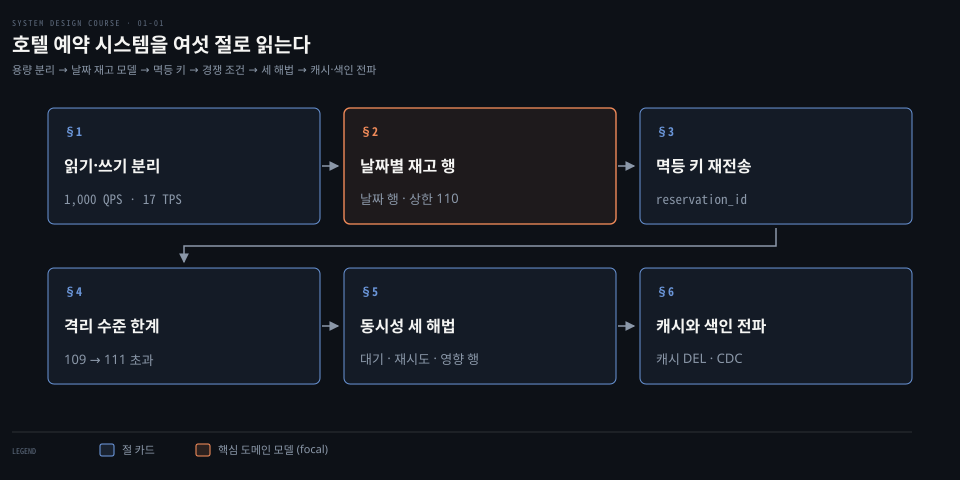
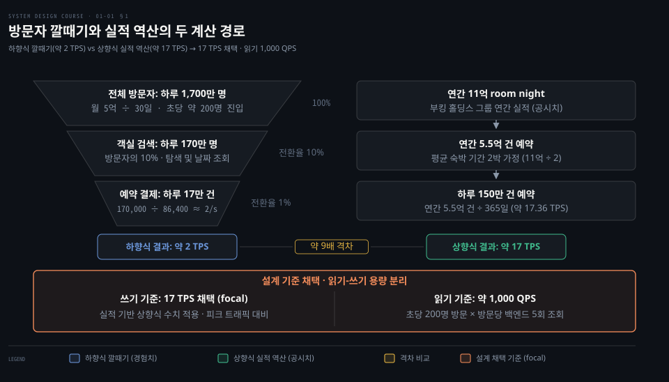
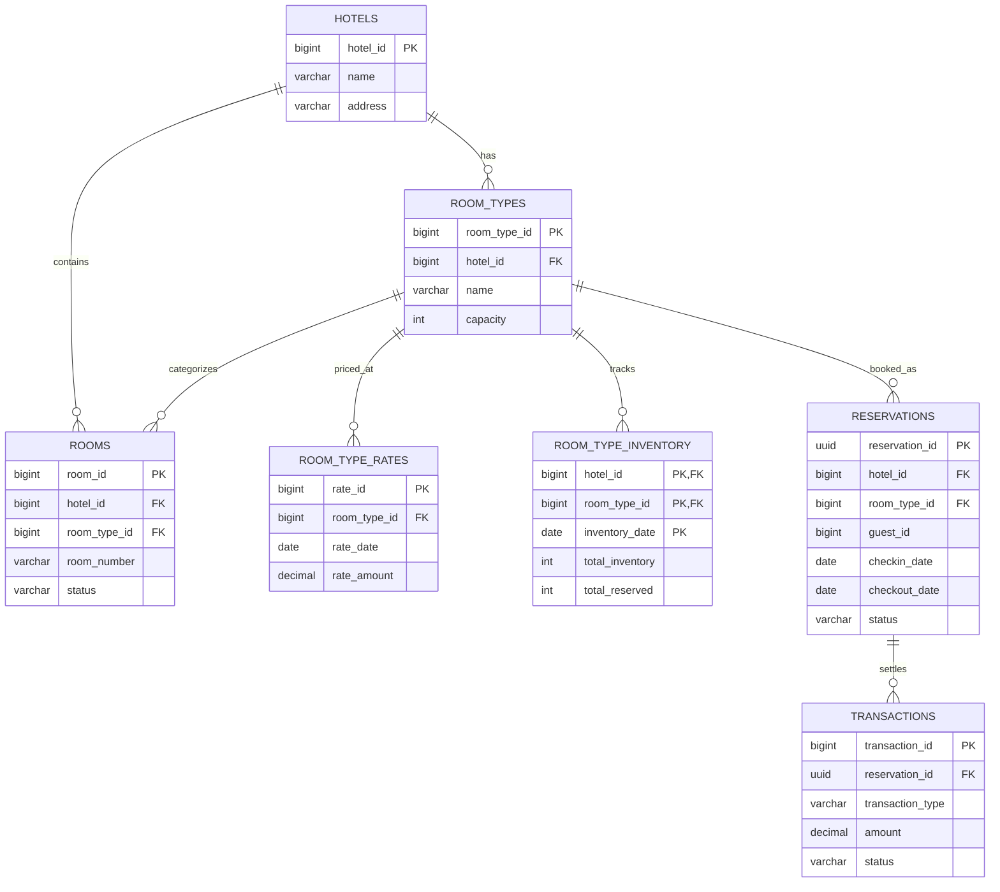
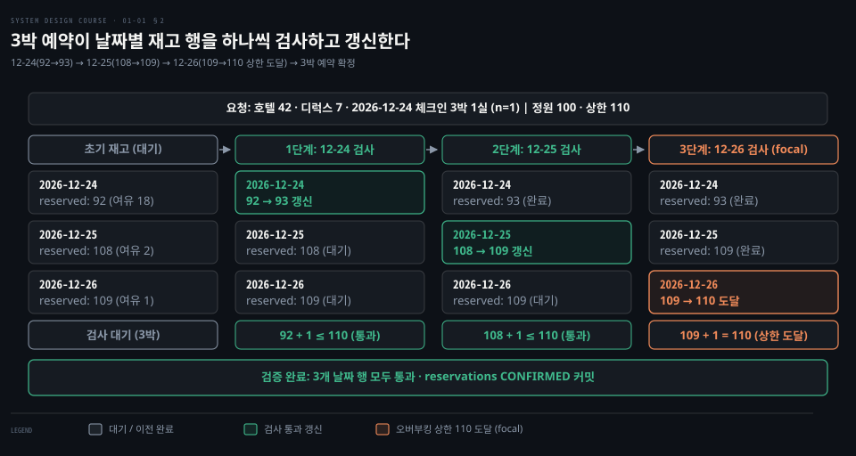
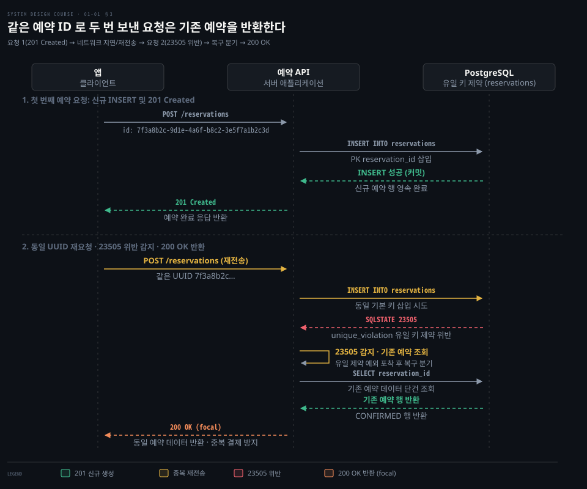
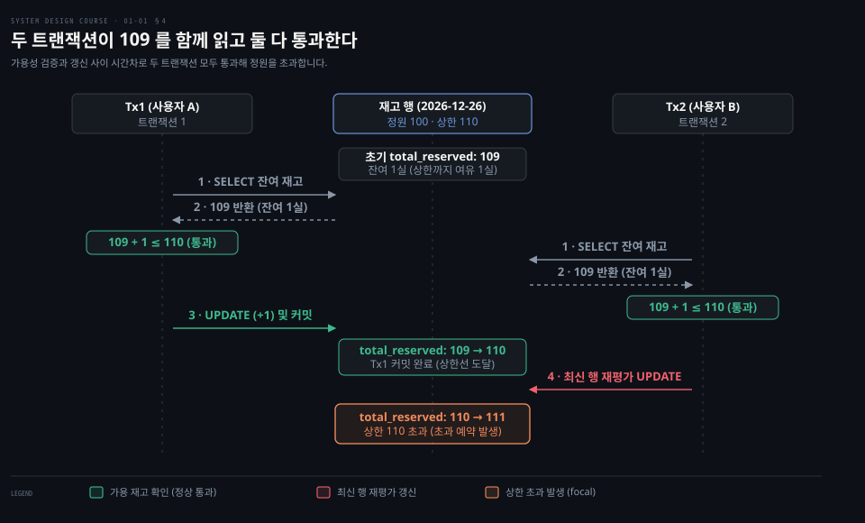
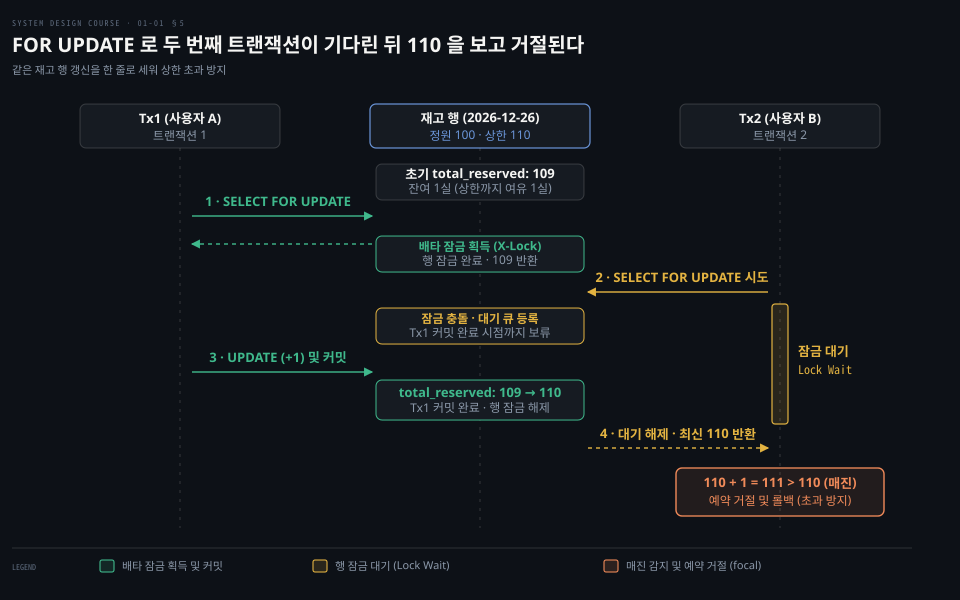
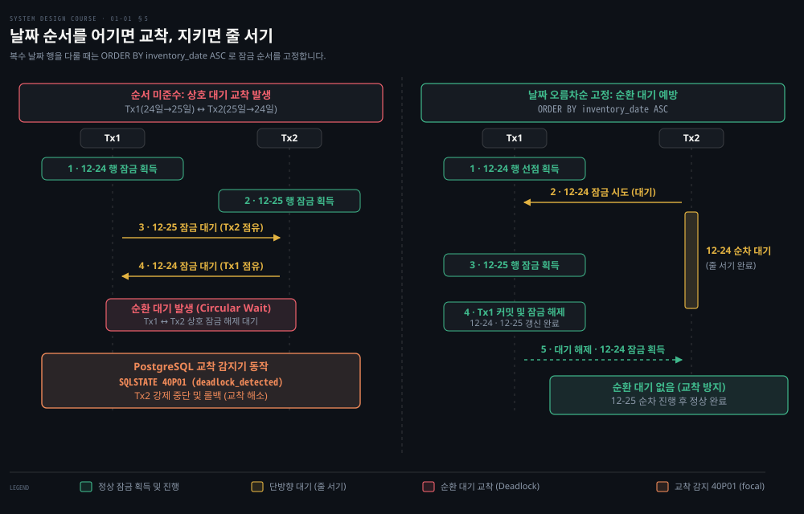
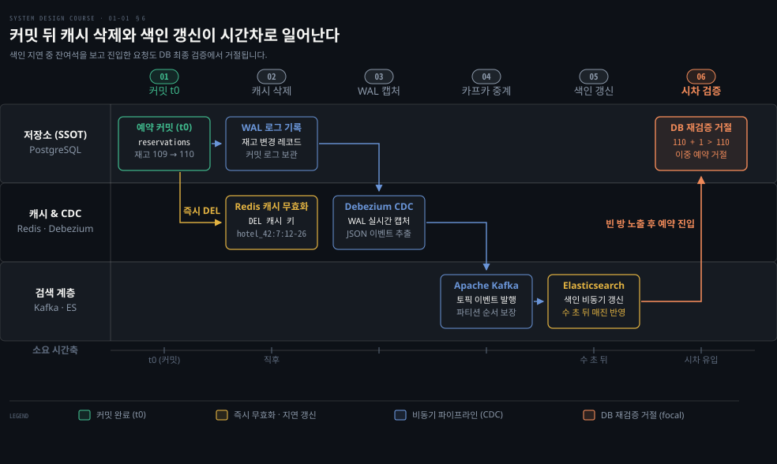

# 호텔 예약은 방 타입의 날짜별 재고 행을 팔고 그 행을 잠가 이중 예약을 막는다

---

> 호텔 예약은 구체적인 객실 번호 대신 방 타입의 날짜별 재고 행을 다루며, 비관적 행 잠금과 조건부 갱신으로 동시 쓰기를 제어해 이중 예약을 방지합니다.


## 핵심 요약

> 호텔 예약 시스템은 대다수 방문자가 검색만 수행하므로 검색은 캐시와 검색 색인으로 넓히고, 예약은 단일 RDBMS 샤드의 트랜잭션으로 강한 일관성을 보장합니다. 재고는 방 타입과 날짜마다 한 행으로 관리하며, 동시 예약 충돌은 격리 수준과 행 잠금 또는 조건부 갱신으로 안전하게 차단합니다.

방문자 100% 중 약 10%가 검색하고 그중 약 10%만 예약으로 이어져 읽기가 쓰기보다 수십 배 많습니다. 검색은 복제본과 검색 엔진을 활용해 최종 일관성으로 처리하고, 예약 확정은 단일 관계형 데이터베이스 샤드 안에서 강한 일관성을 지킵니다.

재고는 실제 101호 방 번호가 아니라 방 타입과 날짜를 묶은 복합 키 행으로 관리합니다. 3박 예약은 연속된 세 날짜 행을 각각 검사하고 차감합니다. 오버부킹 비율 10%를 적용해 노쇼로 인한 공실 손실을 방어합니다.

기본 격리 수준인 read committed 에서는 잔여 재고 확인과 차감 갱신 사이에 틈이 생겨 두 사용자가 동시에 마지막 남은 방을 예약할 수 있습니다. serializable 은 충돌 시 트랜잭션을 중단시키므로 재시도 루프가 필요하고 비관적 행 잠금은 같은 날짜 행을 차례대로 줄 세우며 조건부 갱신은 검증과 차감을 단일 원자적 SQL 로 처리합니다. 예약 커밋 뒤에는 캐시 키를 무효화하고 변경 로그를 CDC 파이프라인으로 넘겨 검색 색인을 비동기 동기화합니다.


## 학습 목표

> 이 편을 읽고 나면 다음을 설명할 수 있습니다.

1. 호텔 예약 시스템에서 읽기 QPS 와 쓰기 TPS 를 따로 어림하는 까닭과 방문자 깔때기 기반 계산을 비교해 설명할 수 있습니다.
2. 재고를 개별 객실이 아니라 방 타입의 날짜별 행으로 설계하는 이유와 일곱 개 핵심 엔티티의 관계를 설명할 수 있습니다.
3. 동일 사용자의 중복 클릭이나 네트워크 재전송을 멱등 키와 데이터베이스 유일 제약으로 걸러 내는 원리를 제시할 수 있습니다.
4. read committed 격리 수준에서 두 트랜잭션이 마지막 방을 동시에 예약할 때 발생하는 경쟁 조건의 전개 과정을 설명할 수 있습니다.
5. serializable, 비관적 행 잠금, 조건부 갱신, 낙관적 잠금의 동작 차이를 비교하고 경합도에 따른 선택 기준을 설명할 수 있습니다.




## 1. 호텔 예약은 읽기가 쓰기보다 수십 배 많아 검색은 넓히고 예약은 한 곳에서 맞춘다

> 읽기 트래픽과 쓰기 트래픽은 요구하는 일관성과 지연 시간이 달라 경로를 분리합니다. 검색은 복제본과 검색 엔진으로 확장하고 예약은 단일 원장 트랜잭션으로 집중시킵니다.

호텔 예약 시스템을 설계할 때 읽기 처리량과 쓰기 처리량을 하나의 잣대로 어림하면 요구사항과 전혀 맞지 않는 병목이 생깁니다. 호텔 웹사이트를 찾는 대다수 사용자는 날짜와 목적지를 바꾸며 방을 둘러볼 뿐, 실제 결제까지 나아가는 비율은 소수에 불과합니다.

읽기와 쓰기는 시스템에 요구하는 성격이 완전히 다릅니다. 검색과 탐색은 수백 밀리초 이내의 빠른 응답이 필요하지만 최신 재고가 몇 초 늦게 반영되는 최종 일관성을 허용합니다. 반면 예약 확정은 2~3초의 대기 시간이 주어지더라도 같은 날짜에 정원을 초과해 방이 팔리는 이중 예약을 결코 허용하지 않는 강한 일관성을 요구합니다.

용량을 어림하는 경로는 크게 두 갈래로 나뉩니다. 첫 번째는 방문자 트래픽 깔때기를 위에서 아래로 내려오는 하향식 경로입니다. 월간 방문자 수를 5억 명으로 가정하면, 한 달을 30일로 계산했을 때 하루 방문자는 약 1,670만 명(약 1,700만 명)이 됩니다. 이를 초당 방문자로 환산하면 초당 약 200명이 진입합니다.

방문자 깔때기에 따르면 전체 방문자 중 객실을 검색하거나 둘러보는 사용자는 약 10%입니다. 그 검색 사용자 중에서 실제 예약 버튼을 누르는 사용자는 다시 약 10%에 머뭅니다. 즉 전체 방문자의 약 1%만 예약으로 전환됩니다. 하루 1,700만 명의 1%는 하루 약 17만 건의 예약이며, 이를 초당으로 나누면 약 2 TPS(170,000 ÷ 86,400 ≈ 1.97)가 됩니다.



두 번째는 실제 발생한 연간 숙박 수에서 거꾸로 올라가는 상향식 경로입니다. 부킹 홀딩스 연간 실적 보고서에 따르면 그룹 전체 숙박일은 2024년 약 11억 4,400만 박, 2025년 약 12억 3,500만 박입니다. 부킹 홀딩스는 Booking.com 과 아고다와 프라이스라인의 실적을 모두 합산한 그룹 수치입니다. 평균 숙박 기간을 2박으로 가정하면 연간 예약 건수는 약 5억 5,000만 건으로 계산됩니다.

연간 5억 5,000만 건을 365일로 나누면 하루 약 150만 건의 예약이 발생합니다. 이를 초당 트랜잭션으로 계산하면 약 17 TPS(1,500,000 ÷ 86,400 ≈ 17.36)가 됩니다.

두 계산 경로는 하루 17만 예약(약 2 TPS)과 하루 150만 예약(약 17 TPS)으로 약 9배의 차이를 보입니다. 방문자 깔때기의 전환율 10%는 계절과 프로모션에 따라 요동치는 경험적 추정치입니다. 반면 연간 숙박일은 회사가 실적 발표로 공시한 실제 거래 집계입니다. 다만 이 통계표에는 감사 전 수치라는 Unaudited 표시가 붙어 있습니다.[^bkng-stats] 따라서 쓰기 용량 설계는 큰 쪽인 17 TPS를 기준으로 삼아야 휴가철 피크 트래픽에서도 데이터베이스가 쓰러지지 않습니다.

읽기 QPS 는 초당 200명의 방문자가 방문당 평균 5회의 백엔드 읽기 조회를 일으킨다고 가정하면 약 1,000 QPS(200 × 5)로 산출됩니다. 읽기 1,000 QPS 와 쓰기 17 TPS 는 수십 배의 격차를 보입니다.

시스템은 동적 가격 책정과 취소를 감안한 10% 오버부킹을 지원해야 합니다. 규모 추정의 기본 원리는 [개략적 규모 추정](../../book/system-design/02-01.%EA%B0%9C%EB%9E%B5%EC%A0%81%20%EA%B7%9C%EB%AA%A8%20%EC%B6%94%EC%A0%95%EC%9D%80%202%EC%9D%98%20%EA%B1%B0%EB%93%AD%EC%A0%9C%EA%B3%B1%C2%B7%EC%A7%80%EC%97%B0%20%EC%8B%9C%EA%B0%84%C2%B7%EA%B0%80%EC%9A%A9%EC%84%B1%20%EC%88%98%EC%B9%98%EB%A1%9C%20QPS%20%EC%99%80%20%EC%A0%80%EC%9E%A5%20%EC%9A%A9%EB%9F%89%EC%9D%84%20%EC%96%B4%EB%A6%BC%ED%95%9C%EB%8B%A4.md)에서 다룹니다.


## 2. 손님이 사는 것은 101호가 아니라 방 타입의 하룻밤이라 재고는 호텔·방 타입·날짜마다 한 행이다

> 구체적인 객실은 체크인 때 배정되므로 예약 단계에서는 방 타입의 날짜별 수량만 관리합니다. 3박 예약은 연속된 3개의 날짜 행을 각각 검사하고 차감합니다.

호텔 웹사이트에서 객실을 예약할 때 손님이 선택하는 상품은 특정한 물리적 방 번호가 아닙니다. 301호나 502호 같은 실제 객실 번호는 투숙 당일 호텔 프런트 데스크에서 체크인할 때 직원이 배정합니다.

만약 예약 시점에 개별 객실 번호를 직접 판매한다면 심각한 파편화가 발생합니다. 디럭스 룸 100실이 있는 호텔에서 손님 A 가 101호를 3일간 예약하는 순간, 그 전후 날짜에 101호를 원하는 다른 손님은 빈 99개의 다른 디럭스 룸이 있어도 날짜가 겹친다는 이유로 예약을 거절당하게 됩니다. 숙주 한 사람의 집 전체를 통째로 빌려주는 에어비앤비와 달리, 균질한 객실을 대량 보유한 호텔은 개별 방 번호가 아니라 방 타입이라는 추상화된 단위를 판매해야 재고 운영이 유연해집니다.

따라서 재고의 최소 거래 단위는 호텔, 방 타입, 날짜의 조합이 됩니다. 손님이 디럭스 룸을 3박 4일 일정으로 예약하면 데이터베이스에서는 연속된 3개의 날짜 행을 각각 검사하고 수정해야 합니다.



핵심 테이블인 `room_type_inventory` 는 `hotel_id`, `room_type_id`, `inventory_date` 를 묶어 복합 기본 키로 삼습니다. 열은 총 보유 객실 수인 `total_inventory` 와 현재 예약 완료된 객실 수인 `total_reserved` 로 구성됩니다. 향후 2년 치(약 730일) 재고 행을 시스템 초기 구축 시 미리 생성해 두고, 매일 자정에 동작하는 크론 작업이 하루치 미래 날짜 행을 덧붙입니다.

### 3박 예약이 날짜별 재고 행을 차감하는 과정

호텔 업계는 예약 취소와 당일 나타나지 않는 노쇼(no-show)로 인해 객실이 공실로 남는 손실을 막기 위해 오버부킹을 허용합니다. 이 편의 10% 는 강의가 든 예시 비율입니다. 코넬대 eCornell 의 호텔 수익 관리 강좌는 호텔이 노쇼율 예측을 바탕으로 오버부킹 정책을 정해 노쇼로 인한 매출 손실을 막는다고 설명합니다.[^ecornell-overbooking]

예약 가능 여부는 `total_reserved + n <= floor(total_inventory * 1.1)` 조건식으로 판정합니다. 총 객실 수가 100개이고 10% 오버부킹을 허용한다면 예약 상한은 110개가 됩니다.



호텔 42의 방 타입 7(디럭스 룸)을 2026년 12월 24일부터 3박으로 1실(`n=1`) 예약하는 상황을 가정합니다. 총 객실 수 `total_inventory` 는 100개이며 상한은 110개입니다.

- 2026-12-24 행: 현재 `total_reserved` 가 92개입니다. 92 + 1 = 93개로 상한 110개 이하이므로 통과합니다.
- 2026-12-25 행: 현재 `total_reserved` 가 108개입니다. 108 + 1 = 109개로 상한 110개 이하이므로 통과합니다.
- 2026-12-26 행: 현재 `total_reserved` 가 109개입니다. 109 + 1 = 110개로 상한 110개 이하이므로 통과하며, 갱신 후 정확히 110개가 채워집니다.

결제 거래를 관리하는 `transactions` 테이블을 `reservations` 테이블과 분리한 구조도 주목해야 합니다. 예약 하나에 대해 최초 예약 결제, 일정 변경에 따른 차액 결제, 취소 시 환불 처리가 1:N 관계로 엮입니다. 환불이 발생할 때 기존 결제 장부를 수정하거나 삭제하지 않고 음수 금액 행을 추가하는 방식을 취해야 회계 감사 추적성을 확보합니다.

관계형 데이터베이스를 주 저장소로 선택한 까닭은 트랜잭션 ACID 보장을 통해 이중 예약을 방지하고, 특정 체크인·체크아웃 날짜 구간에 걸친 다중 행 조회와 합산 집계를 안정적으로 수행하기 위함입니다.


## 3. 같은 손님이 버튼을 두 번 누른 중복은 클라이언트가 만든 예약 ID 를 유일 키로 걸러 낸다

> 동일 사용자의 중복 요청은 서버 잠금 대신 멱등 키를 활용해 데이터베이스 유일 제약으로 막아냅니다. 두 번째 요청이 오면 예외를 잡아서 이미 생성된 예약 정보를 그대로 반환합니다.

모바일 환경에서는 네트워크 지연이나 조작 실수로 동일한 결제 요청이 연달아 둘 전송되는 문제가 발생하기 쉽습니다. 사용자가 결제 버튼을 누른 뒤 화면이 멈추면 버튼을 연달아 두 번 누르기도 합니다.

이러한 단일 사용자의 중복 요청을 막겠다고 서버 메모리에 락을 걸거나 분산 락을 도입하면 시스템 복잡도가 급격히 올라갑니다. 분산 락은 네트워크 단절 시 타임아웃 처리와 만료 시간 조율이 까다롭고 추가적인 네트워크 왕복을 유발합니다. 가장 단순하고 확실한 해법은 멱등 키(idempotency key)를 데이터베이스 유일 제약 조건과 결합하는 것입니다.

클라이언트는 예약 최종 확인 화면에 진입할 때 고유한 UUID 형태의 예약 식별자 `reservation_id` 를 미리 발급받거나 직접 생성합니다. 그리고 예약 요청 본문에 이 식별자를 담아 `POST /reservations` 를 호출합니다.

```sql
-- reservations 테이블의 reservation_id 는 기본 키 또는 유일 키로 지정됩니다
INSERT INTO reservations (
    reservation_id, hotel_id, room_type_id, guest_id, checkin_date, checkout_date, status
) VALUES (
    '7f3a8b2c-9d1e-4a6f-b8c2-3e5f7a1b2c3d', 42, 7, 1001, '2026-12-24', '2026-12-27', 'CONFIRMED'
);
```

첫 번째 요청이 도착하면 데이터베이스의 `reservations` 테이블에 정상적으로 행이 삽입되고 트랜잭션이 커밋됩니다. 손님이 버튼을 다시 눌러 동일한 `reservation_id` 를 실은 두 번째 요청이 서버에 도달하면, 데이터베이스는 유일 키 제약 조건 위반 에러(PostgreSQL SQLSTATE `23505`, `unique_violation`)를 반환합니다.



서버 애플리케이션은 이 `23505` 에러를 단순 장애로 취급해 500 에러를 던지지 않습니다. 유일 제약 위반 예외를 감지하면 해당 `reservation_id` 로 기존 예약 데이터를 다시 조회하여 HTTP 200 성공 응답으로 손님에게 기존 예약 번호를 그대로 돌려줍니다. 덕분에 손님 화면에는 결제가 두 번 되지 않고 정상적인 예약 완료 화면이 표시됩니다.

대안으로 요청 파라미터(사용자 ID, 호텔 ID, 방 타입 ID, 체크인 날짜)를 조합해 서버에서 해시값을 계산하는 방식을 고려할 수도 있습니다. 하지만 이 방식은 사용자가 동일한 날짜에 부모님이나 동행인을 위해 방 두 개를 연속으로 정상 예약하려는 의도까지 중복으로 오인해 차단할 위험이 있습니다.

클라이언트가 특정 예약 행위마다 고유 키를 부여해 재전송 시 같은 키를 재사용하는 방식이 안전합니다. 멱등 키의 일반적인 동작 원리와 결제 시스템 적용 방식은 [결제 정확성과 멱등 키](../../book/bytebytego-system-design/07-02.%EA%B2%B0%EC%A0%9C%20%EC%A0%95%ED%99%95%EC%84%B1%EC%9D%80%20%EB%A9%B1%EB%93%B1%20%ED%82%A4%EB%A1%9C%20%EC%9D%B4%EC%A4%91%20%EC%B2%AD%EA%B5%AC%EB%A5%BC%20%EB%A7%89%EA%B3%A0%20%EB%8C%80%EC%82%AC%EB%A1%9C%20%EC%9E%A5%EB%B6%80%20%EB%B6%88%EC%9D%BC%EC%B9%98%EB%A5%BC%20%EC%B0%BE%EA%B3%A0%20%ED%86%A0%ED%81%B0%ED%99%94%EB%A1%9C%20%EC%B9%B4%EB%93%9C%20%EC%A0%95%EB%B3%B4%EB%A5%BC%20%EC%A7%80%ED%82%A8%EB%8B%A4.md)에서 다룹니다.


## 4. 두 손님이 마지막 한 방을 다투면 읽고 나서 쓰는 사이의 틈으로 둘 다 통과한다

> 기본 격리 수준에서는 잔여 재고 확인과 차감 갱신 사이에 시간차가 생겨 두 트랜잭션이 모두 통과합니다. 갱신 손실을 막더라도 검증 조건이 빠지면 오버부킹 한도를 초과해 버립니다.

동일 사용자의 중복 요청을 멱등 키로 해결하더라도 서로 다른 두 사용자가 마지막 남은 객실을 동시에 예약할 때는 다른 차원의 동시성 문제가 터져 나옵니다.

PostgreSQL 을 포함한 대부분의 관계형 데이터베이스는 기본 격리 수준으로 read committed 를 채택하고 있습니다. read committed 수준에서는 커밋된 최신 데이터만 읽을 수 있지만, 한 트랜잭션 안에서 읽기(SELECT)와 쓰기(UPDATE)를 분리해 실행할 때 발생하는 경쟁 조건을 막아주지 못합니다.

2026년 12월 26일의 디럭스 룸 재고 상황을 봅니다. 총 객실 수 `total_inventory` 는 100개이며 오버부킹 한도(110%)는 110개입니다. 현재 예약 완료된 객실 수 `total_reserved` 가 109개여서 오버부킹 한도까지 딱 1실만 남아 있습니다.

이때 사용자 A 와 사용자 B 가 동시에 마지막 1실을 예약하려고 결제 버튼을 누릅니다. 두 요청은 각기 다른 트랜잭션 Tx1 과 Tx2 로 데이터베이스에 진입합니다.



경쟁 조건은 다음과 같은 순서로 전개됩니다.

1. Tx1 이 잔여 재고를 확인하려고 `SELECT total_inventory, total_reserved FROM room_type_inventory ...` 를 실행합니다. `total_reserved` 값 109를 읽습니다. 애플리케이션 코드는 109 + 1 = 110 이 상한 110 이하임을 확인하고 예약을 진행하기로 판단합니다.
2. 거의 같은 시점에 Tx2 도 동일한 `SELECT` 문을 실행합니다. Tx1 이 아직 데이터를 바꾸지 않았으므로 Tx2 역시 `total_reserved` 값 109를 읽습니다. Tx2 의 애플리케이션 코드도 109 + 1 = 110 이 상한 110 이하이므로 예약 가능으로 판단합니다.
3. Tx1 이 `UPDATE room_type_inventory SET total_reserved = total_reserved + 1 ...` 을 실행하고 즉시 커밋합니다. 이제 데이터베이스의 `total_reserved` 는 110이 됩니다.
4. 뒤이어 Tx2 가 `UPDATE room_type_inventory SET total_reserved = total_reserved + 1 ...` 을 실행합니다.

여기서 데이터베이스 엔진의 동작을 정확히 짚어야 합니다. PostgreSQL 의 read committed 수준에서는 UPDATE 대상 행을 다른 동시 트랜잭션이 이미 갱신했지만 아직 커밋하지 않았다면 그 트랜잭션이 끝나기를 기다리고, 상대가 커밋하면 갱신된 최신 행 버전을 대상으로 WHERE 조건을 다시 평가합니다. 상대가 이미 커밋한 뒤라면 UPDATE 는 처음부터 최신 값을 봅니다.[^pg-iso]

단순 덮어쓰기라면 갱신 분실이 나겠지만 `SET total_reserved = total_reserved + 1` 로 작성하면 최신 값 110에 1을 더해 111로 변경합니다. 즉 값의 유실은 없지만, 상한선 110을 검증하는 단계가 UPDATE 문 바깥에 있었기 때문에 최종 결과는 111이 됩니다.

허용 상한선 110석을 넘어 111석이 예약되면서 호텔 정원을 초과하는 심각한 초과 예약 사고가 터집니다. 가용성 확인(SELECT)과 재고 차감(UPDATE) 사이에 존재하는 미세한 시간차 틈새로 두 요청이 모두 비집고 들어간 결과입니다.

격리 수준별 이상 현상의 상세한 분류는 [트랜잭션과 격리 수준](../../../05_data/01_foundation/01-04.%ED%8A%B8%EB%9E%9C%EC%9E%AD%EC%85%98%EA%B3%BC%20%EA%B2%A9%EB%A6%AC%20%EC%88%98%EC%A4%80.md)과 [격리 수준과 낙관적 잠금](../../book/bytebytego-system-design/01-01.%EA%B2%A9%EB%A6%AC%20%EC%88%98%EC%A4%80%EA%B3%BC%20%EB%82%99%EA%B4%80%EC%A0%81%20%EC%9E%A0%EA%B8%88%EC%9D%B4%20%EB%8F%99%EC%8B%9C%20%EC%93%B0%EA%B8%B0%EC%9D%98%20%EC%9D%B4%EC%83%81%20%ED%98%84%EC%83%81%EC%9D%84%20%EB%A7%89%EA%B3%A0%20%EB%8D%B0%EC%9D%B4%ED%84%B0%20%EB%AA%A8%EC%96%91%EC%9D%B4%20%EB%8D%B0%EC%9D%B4%ED%84%B0%EB%B2%A0%EC%9D%B4%EC%8A%A4%20%EC%A2%85%EB%A5%98%EB%A5%BC%20%EA%B3%A0%EB%A5%B8%EB%8B%A4.md)에서 다룹니다.


## 5. serializable 은 충돌한 쪽을 되돌리고 행 잠금은 같은 행만 줄 세우며 조건부 갱신은 검사와 쓰기를 한 문장에 넣는다

> 동시 예약 충돌은 직렬화 실패 후 재시도, 비관적 행 잠금을 통한 대기, 원자적 조건부 갱신이라는 세 방식으로 해결합니다. 시스템 경합도와 비즈니스 요구사항에 따라 가장 적절한 제어 기법을 선택합니다.

마지막 남은 객실을 두고 다투는 경쟁 조건을 제어하는 방법에는 크게 네 가지 선택지가 존재합니다. 각 기법은 데이터베이스 엔진이 충돌을 다루는 방식과 애플리케이션 계층에 요구하는 책임이 다릅니다.

첫 번째 해법은 가장 엄격한 격리 수준인 **serializable** 을 적용하는 것입니다. PostgreSQL 의 serializable 격리 수준은 직렬화 가능 스냅샷 격리(SSI) 방식으로 구현되어 있습니다. 이 방식은 읽기 작업 시 잠금을 걸어 다른 트랜잭션을 차단하지 않으며, 감시용 술어 잠금(SIREAD 락) 역시 교착을 유발하지 않습니다.

대신 동일한 재고 행에 대해 두 트랜잭션이 동시에 쓰기를 시도하면, 두 번째 트랜잭션은 첫 번째 트랜잭션이 커밋되는 순간 직렬화 충돌을 감지당해 `40001` (`serialization_failure`) SQLSTATE 코드를 받으며 롤백됩니다. 따라서 serializable 을 사용할 때는 트랜잭션 실패를 정상적인 제어 흐름으로 받아들이고, `40001` 에러 발생 시 트랜잭션을 처음부터 다시 실행하는 재시도 루프 코드를 반드시 작성해야 합니다.

두 번째 해법은 **비관적 행 잠금**(pessimistic row locking)인 `SELECT … FOR UPDATE` 구문을 사용하는 것입니다. 기본 격리 수준인 read committed 를 유지한 채, 잔여 재고를 조회하는 첫 번째 단계부터 해당 행에 배타적 행 잠금을 획득합니다.

```sql
-- 재고 행을 조회하면서 배타적 행 잠금을 획득합니다
SELECT hotel_id, room_type_id, inventory_date, total_inventory, total_reserved
FROM room_type_inventory
WHERE hotel_id = 42
  AND room_type_id = 7
  AND inventory_date = '2026-12-26'
FOR UPDATE;
```



Tx1 이 `FOR UPDATE` 로 2026년 12월 26일 행을 잠그면, 같은 날짜 행을 예약하려는 Tx2 는 잠금이 풀릴 때까지 대기 상태에 들어갑니다. 다른 호텔이나 다른 날짜를 예약하는 트랜잭션은 잠금 대상이 아니므로 완벽히 병렬로 진행됩니다.

Tx1 이 예약을 마치고 `total_reserved` 를 110으로 올린 뒤 커밋하면 비로소 Tx2 의 잠금 대기가 풀립니다. 이때 Tx2 는 이미 갱신 완료된 최신 값 110을 읽게 됩니다. Tx2 의 애플리케이션 로직은 110 + 1 = 111 이 상한 110을 넘는 것을 확인하고 사용자에게 매진 안내를 반환하며 안전하게 롤백합니다.

`FOR UPDATE` 뒤에 `NOWAIT` 옵션을 붙이면 다른 트랜잭션이 잠금을 쥐고 있을 때 대기하지 않고 즉시 에러를 뱉게 만들 수 있으며, `SKIP LOCKED` 는 이미 잠긴 행을 건너뛰는 문법으로 주로 큐 작업에 쓰입니다. PostgreSQL 공식 문서는 `SELECT FOR UPDATE` 자체가 데이터를 변경하는 것은 아니므로, 데이터 정합성을 지키려면 동일 트랜잭션 내에서 반드시 실제 UPDATE 작업까지 완결해야 한다고 명시합니다.

세 번째 해법은 **조건부 갱신**(conditional atomic update)입니다. 조회와 수정을 분리하지 않고, 재고 가용 조건을 UPDATE 문의 WHERE 절에 직접 포함해 단일 SQL 문장으로 원자적 실행을 끝내는 방식입니다.

```sql
-- 조건부 갱신: 잔여 재고 조건을 WHERE 절에 포함하여 원자적으로 차감합니다
UPDATE room_type_inventory
SET total_reserved = total_reserved + 1
WHERE hotel_id = 42
  AND room_type_id = 7
  AND inventory_date = '2026-12-26'
  AND total_reserved + 1 <= floor(total_inventory * 1.1);
```

이 쿼리는 데이터베이스 엔진 내부에서 원자적으로 실행됩니다. PostgreSQL read committed 환경에서 Tx1 이 행을 110으로 바꾼 직후 Tx2 의 UPDATE 문이 평가될 때, WHERE 절의 `total_reserved + 1 <= 110` 조건이 최신 행 버전에 대해 재평가됩니다. 이미 값이 110이 되었으므로 조건은 거짓이 되며 0개 행이 수정됩니다. 애플리케이션은 갱신된 행 수가 0건임을 확인하고 손님에게 매진을 안내하면 됩니다. 별도의 잠금 획득 없이도 안전합니다.

네 번째 해법은 데이터 행에 `version` 번호 열을 두고 수정 시마다 버전 번호를 1씩 증가시키는 **낙관적 잠금**(optimistic locking)입니다. 경합이 드문 시스템에서는 잠금 오버헤드가 없어 유리합니다.

마지막 방어선으로 데이터베이스 레벨의 **CHECK 제약 조건**을 걸어둘 수 있습니다. 테이블 정의 시 `CHECK (total_reserved <= floor(total_inventory * 1.1))` 제약을 선언하면 버그로 상한을 넘는 쓰기가 시도되어도 데이터베이스가 그 문장을 즉시 거부합니다. 오류 코드는 SQLSTATE `23514`(`check_violation`)이고, CHECK 제약은 커밋 때로 미룰 수 없습니다.[^pg-createtable]

이때 오버부킹 비율 10%를 고려하지 않고 단순히 `CHECK (total_inventory - total_reserved >= 0)` 로 제약을 걸면 정상적인 10% 오버부킹 정책 자체가 DB 에서 차단되는 함정에 빠지므로 주의해야 합니다.

| 해법 | 충돌 때 일어나는 일 | 재시도 코드 | 다른 행 병렬 | 교착 위험 |
|---|---|---|---|---|
| serializable | 뒤처진 트랜잭션이 직렬화 실패(40001)로 중단 | 트랜잭션 전체 재시도 코드 필수 | 읽기 병렬 진행, 쓰기 행 충돌 시 중단 | 낮음 (술어 잠금 자체는 교착 없음) |
| FOR UPDATE (행 잠금) | 같은 행을 요청한 두 번째 트랜잭션이 대기 | 불필요 (대기 후 갱신된 값 확인) | 다른 호텔·날짜 행은 완전 병렬 | 여러 날짜 갱신 시 순서 어기면 발생 |
| 조건부 갱신 | WHERE 조건 불일치로 0개 행이 수정됨 | 영향 행 수 0건일 때 매진 처리 | 다른 호텔·날짜 행은 완전 병렬 | 단일 문장 실행 시 없음 |
| 낙관적 잠금 (version) | 버전 불일치로 0개 행 수정 또는 예외 발생 | 버전 충돌 시 재조회 후 재시도 | 완전 병렬 진행 | 없음 |

어느 한 해법이 절대적으로 우월하지는 않습니다. 일반적인 호텔 예약은 전 세계 수많은 호텔로 트래픽이 넓게 분산되므로 개별 객실 행에 대한 경합도가 낮습니다. 따라서 Alex Xu 의 공개 설계 사례는 비관적 행 잠금보다 낙관적 잠금이나 DB 제약 조건을 우선적으로 권장합니다.

반면 인기 콘서트 인근 호텔이나 연말 특가 행사처럼 특정 객실에 수백 명이 동시에 몰리는 극심한 경합 상황에서는 낙관적 잠금이 무수한 재시도 실패를 낳아 CPU 자원을 낭비하므로, 행 잠금이나 조건부 갱신이 유리합니다.

### 여러 날짜 행을 잠글 때는 날짜 오름차순으로 정렬해 교착을 막는다

손님이 3박 4일 일정을 예약할 때는 하루가 아니라 3일 치 재고 행을 한 번에 다뤄야 합니다. 여러 행을 잠글 때는 반드시 **교착 상태**(deadlock)를 예방해야 합니다.

손님 A 와 손님 B 가 둘 다 12월 24일부터 26일까지 2박을 예약하는데, A 쪽 코드는 날짜 오름차순으로, B 쪽 코드는 날짜 내림차순으로 행을 잠근다고 가정합니다. 손님 A 의 트랜잭션이 24일 행을 먼저 잠그고 25일 행의 잠금을 얻으려 할 때, 손님 B 의 트랜잭션이 25일 행을 먼저 잠근 채 24일 행의 잠금을 얻으려 한다면 두 트랜잭션은 서로의 잠금이 풀리기를 기다리며 영원히 멈추는 교착 상태에 빠집니다.



교착 상태를 방지하는 표준 원칙은 모든 트랜잭션이 복수 자원을 잠글 때 동일한 정렬 순서를 지키는 것입니다. 날짜 범위의 재고 행을 잠글 때는 언제나 `ORDER BY inventory_date ASC` 로 정렬하여 날짜 오름차순으로만 행 잠금을 획득해야 합니다.

모든 트랜잭션이 12월 24일, 25일, 26일 순서로만 잠금을 잡는다면 나중에 진입한 트랜잭션은 첫 번째 행인 24일 잠금 단계에서부터 얌전하게 줄을 서게 되므로 순환 대기 고리가 형성되지 않습니다.

조건부 갱신을 여러 날짜에 걸쳐 실행할 때도 검증이 필요합니다. `WHERE inventory_date >= '2026-12-24' AND inventory_date < '2026-12-27'` 로 3개 행을 갱신했다면 반환된 영향 받은 행 수가 정확히 3인지 확인해야 합니다. 중간에 하루라도 잔여석이 부족해 2개 행만 갱신되었다면 트랜잭션을 즉시 롤백해야 부분 예약 버그를 방지합니다.


## 6. 예약이 끝나면 캐시 키를 지우고 검색 색인은 변경 로그를 따라 몇 초 늦게 맞춰진다

> 예약이 커밋되면 재고 캐시 키를 즉시 무효화하고 변경 데이터 캡처를 통해 검색 색인으로 비동기 전파합니다. 색인 갱신 지연으로 이미 매진된 방이 검색에 노출되어도 최종 예약 단계의 RDBMS 검증이 초과 예약을 막습니다.

예약 트랜잭션이 PostgreSQL 데이터베이스에 성공적으로 커밋된 직후 시스템의 다른 저장소들이 어떻게 동기화되는지 살펴보아야 합니다.

읽기 처리량이 1,000 QPS 에 달하는 대규모 환경에서 사용자의 모든 검색 요청을 관계형 데이터베이스로 직접 쏟아붓는다면 데이터베이스는 얼마 못 가 한계에 부딪힙니다. 따라서 검색 계층에는 캐시와 전문 검색 엔진이 앞단에 배치됩니다.

자주 조회되는 호텔의 날짜별 잔여 객실 수와 요금 정보는 Redis 캐시에 보관됩니다. 캐시 키는 `hotel_id:room_type_id:inventory_date` 형태로 구성하며 TTL(Time To Live)을 5분 정도로 설정합니다. 손님이 검색할 때는 먼저 Redis 를 조회하여 캐시 적중 시 즉시 응답을 반환합니다.



새로운 예약이 체결되면 예약 서비스는 관계형 데이터베이스의 트랜잭션을 먼저 커밋한 뒤, 해당 날짜의 Redis 캐시 키를 즉시 삭제(invalidation)합니다. 캐시를 갱신하지 않고 삭제하는 Cache-Aside 패턴을 취함으로써 동시 갱신으로 인한 캐시 오염을 막습니다. 이후 들어오는 첫 검색 요청이 데이터베이스에서 최신 잔여석을 다시 읽어 캐시를 채우게 됩니다.

위치 기반 반경 5km 필터링, 평점과 편의시설 필터링, 동적 가격 조건 검색을 수행하는 검색 엔진으로는 엘라스틱서치 또는 오픈서치가 쓰입니다. 검색 엔진에는 조인 비용을 없애기 위해 호텔 기본 정보, 객실 타입 목록, 편의시설, 위치 좌표를 단일 역색인 JSON 문서로 비정규화하여 적재합니다.

진실의 원천(Single Source of Truth)은 언제나 PostgreSQL 입니다. 데이터베이스와 검색 엔진 사이의 동기화는 트랜잭션 커밋 로그를 직접 추적하는 CDC(Change Data Capture) 파이프라인이 맡습니다.

1. PostgreSQL 의 WAL(Write-Ahead Log)에 재고 변경 기록이 기록됩니다.
2. 오픈소스 CDC 도구인 디비지움(Debezium)이 WAL 을 실시간으로 읽어 변경 이벤트를 캡처합니다.
3. 디비지움은 캡처한 이벤트를 아파치 카프카(Apache Kafka)의 `hotel-inventory-events` 토픽으로 발행합니다.
4. 검색 색인 전용 컨슈머가 카프카 메시지를 읽어 엘라스틱서치의 비정규화 검색 문서를 갱신합니다.

카프카와 컨슈머를 거치는 파이프라인의 특성상 엘라스틱서치의 검색 색인은 실제 데이터베이스보다 수 초 정도 늦게 맞춰지는 최종 일관성을 띱니다. 색인이 몇 초 늦게 갱신되는 동안 이미 매진된 방이 다른 사용자의 검색 화면에 노출되더라도, 실제로는 이중 예약이 발생하지 않습니다.

이중 예약이 차단되는 이유는 명확합니다. 검색 화면에서 빈 방으로 보여 손님이 상세 페이지로 진입하고 결제 버튼을 누르더라도, 실제 예약 요청이 도달하는 곳은 검색 엔진이 아니라 진실의 원천인 관계형 데이터베이스이기 때문입니다. 데이터베이스에서 앞서 살펴본 `FOR UPDATE` 행 잠금이나 조건부 UPDATE 가 잔여 재고를 철저하게 재검증하므로, 늦게 반영된 검색 화면을 보고 들어온 예약 시도는 이미 예약이 완료된 객실이라는 안내와 함께 안전하게 거절됩니다.

샤딩 전략 역시 단일 데이터베이스의 확장성을 뒷받침합니다. 샤드 키로는 `hotel_id` 를 사용합니다. 손님의 대부분의 질의가 특정 호텔을 기준으로 이루어지므로, 특정 호텔의 2년 치 재고 행과 예약 기록 전체가 동일한 물리적 데이터베이스 샤드 안에 온전하게 모여 있게 됩니다. 덕분에 3박 예약 과정에서 발생하는 복수 날짜 행 잠금과 트랜잭션 처리가 분산 2단계 커밋(2PC) 없이 단일 샤드 내부의 로컬 ACID 트랜잭션으로 가볍게 완결됩니다.

읽기 복제본(Read Replica)을 운용할 때는 복제 지연을 주의해야 합니다. 방금 결제를 마치고 예약 상세 조회를 요청한 손님의 읽기 요청은 복제본이 아니라 쓰기 마스터 노드에서 직접 읽도록 라우팅해야 방금 완료된 예약 내역이 누락되어 보이는 복제 지연 착시를 막아냅니다.

캐시의 세부 운용 원리는 [캐시 전략](../../book/bytebytego-system-design/02-01.%EC%BA%90%EC%8B%9C%20%EC%A0%84%EB%9E%B5%EC%9D%80%20%EC%9D%BD%EA%B8%B0%C2%B7%EC%93%B0%EA%B8%B0%20%EA%B2%BD%EB%A1%9C%EC%97%90%EC%84%9C%20%EC%BA%90%EC%8B%9C%20%EC%9E%90%EB%A6%AC%EB%A5%BC%20%EC%A0%95%ED%95%98%EA%B3%A0%20Redis%20%EB%8A%94%20%EB%A9%94%EB%AA%A8%EB%A6%AC%EC%99%80%20%EB%8B%A8%EC%9D%BC%20%EC%8A%A4%EB%A0%88%EB%93%9C%20%EC%9D%B4%EB%B2%A4%ED%8A%B8%20%EB%A3%A8%ED%94%84%EB%A1%9C%20%EB%B9%A0%EB%A5%B4%EB%8B%A4.md)에서, CDC 파이프라인 구조는 [Data Liberation 과 CDC](../../05_edd/01-04.%EA%B8%B0%EC%A1%B4%20%EC%8B%9C%EC%8A%A4%ED%85%9C%20%ED%86%B5%ED%95%A9%20%E2%80%94%20Data%20Liberation%20%EA%B3%BC%20CDC.md)에서 다룹니다. 복제 지연 극복 패턴은 [복제 지연 문제와 일관성 보장](../../../05_data/book/designing-data-intensive-applications/06-03.%EB%B3%B5%EC%A0%9C%20%EC%A7%80%EC%97%B0%20%EB%AC%B8%EC%A0%9C%EC%99%80%20%EC%9D%BC%EA%B4%80%EC%84%B1%20%EB%B3%B4%EC%9E%A5.md)에서 자세히 설명합니다.


## 면접 대비

> 트래픽 규모 추정, 도메인 재고 모델, 동시성 제어 격리 수준, 분산 동기화에 관한 핵심 면접 질문입니다.

1. 호텔 예약 시스템에서 개별 객실 번호(101호)가 아니라 방 타입과 날짜별 행으로 재고를 모델링하는 까닭은 무엇입니까?
2. 읽기 QPS 와 쓰기 TPS 의 트래픽 깔때기를 계산할 때, 방문자 기준 계산과 연간 room night 역산 중 어느 값을 용량 기준으로 삼아야 합니까?
3. PostgreSQL 기본 격리 수준인 read committed 에서 마지막 남은 방을 두 사용자가 동시에 예약할 때 이중 예약이 발생하는 원인은 무엇입니까?
4. 이중 예약을 막기 위한 해법으로 serializable 격리 수준, 비관적 행 잠금(FOR UPDATE), 조건부 UPDATE 를 비교하고 경합도에 따른 선택 기준을 설명해 보십시오.
5. 검색 색인(Elasticsearch)에는 빈 방으로 표시되었는데 실제 예약 요청이 거절되는 까닭과, 이 구조에서도 이중 예약이 방지되는 원리는 무엇입니까?


## 정답 (자답 후 펼치기)

> 위 §면접 대비 의 5개 질문에 먼저 자답한 뒤 아래 모범 답안을 확인하세요.

### 정답 1 — 객실 배정 시점의 분리와 날짜별 재고 행 분할

호텔은 동일한 등급의 객실을 다수 보유하므로, 실제 객실 번호는 체크인 당일 현장에서 배정하는 것이 재고 파편화를 막고 판매 가용성을 극대화합니다. 만약 101호를 직접 예약 단위로 삼으면 101호의 특정 날짜만 비어 있어도 다른 손님이 연속 숙박을 예약할 수 없는 문제가 발생합니다.

또한 숙박 일정은 날짜 범위로 이어지므로 `hotel_id`, `room_type_id`, `date` 복합 키 단위로 하루씩 행을 분할 관리해야 합니다. 그래야 3박 예약 시 연속된 3개 날짜 행만 독립적으로 검사하고 차감할 수 있으며, 특정 날짜 행만 행 단위로 잠글 수 있습니다.

### 정답 2 — 쓰기 피크를 보수적으로 방어하는 큰 쪽 수치 기준

방문자 깔때기 기준인 하루 17만 예약(약 2 TPS)과 연간 11억 숙박일에서 역산한 하루 150만 예약(약 17 TPS) 사이에는 약 9배의 차이가 존재합니다. 방문자 깔때기 전환율은 계절과 외부 요인에 따라 변동폭이 큰 추정치인 반면, 연간 숙박일은 회사가 공시한 실제 거래 집계입니다.

따라서 쓰기 용량 설계는 더 보수적이고 안전한 17 TPS 를 기준으로 삼아야 합니다. 큰 쪽을 용량 기준으로 잡아야 성수기나 프로모션 기간에 쓰기 트래픽이 집중되더라도 데이터베이스 병목으로 예약 트랜잭션이 실패하는 사고를 막을 수 있습니다.

### 정답 3 — SELECT 와 UPDATE 사이의 가용성 검증 시차

read committed 수준에서는 커밋된 최신 행만 읽지만, 잔여석을 확인하는 SELECT 문과 실제 숫자를 차감하는 UPDATE 문 사이에 시간차가 발생합니다. 두 트랜잭션 Tx1 과 Tx2 가 동시에 잔여 1실(109석)을 읽으면 둘 다 애플리케이션의 상한 조건(109 + 1 <= 110)을 통과합니다.

이후 Tx1 이 `total_reserved + 1` 로 110을 만들고 커밋한 뒤 Tx2 가 UPDATE 를 실행하면 PostgreSQL 은 갱신된 최신 값(110)에 1을 더해 111로 만들어 버립니다. 조회와 쓰기가 분리되어 있어 검증 조건이 최신 상태에 다시 묶이지 못했기 때문에 10% 오버부킹 한도를 초과하는 이중 예약이 발생합니다.

### 정답 4 — 경합도와 재시도 비용에 따른 동시성 제어 전략 선택

serializable 은 직렬화 실패 시 SQLSTATE `40001` 에러로 트랜잭션을 중단시키므로 애플리케이션의 재시도 로직이 필수적입니다. 비관적 행 잠금(`FOR UPDATE`)은 첫 번째 트랜잭션이 끝날 때까지 두 번째 트랜잭션을 줄 세워 대기시킨 뒤 최신 값을 확인하게 만듭니다. 조건부 UPDATE 는 `WHERE total_reserved + n <= 상한` 조건을 UPDATE 문에 포함해 0개 행 수정 여부로 충돌을 판정합니다.

선택 기준은 재고 행에 대한 경합도입니다. 일반적인 호텔처럼 트래픽이 전 세계 호텔로 고르게 분산되어 경합이 낮을 때는 잠금 비용이 없는 낙관적 잠금(version 열)이나 조건부 UPDATE 가 효율적입니다. 반면 특가 세일처럼 한 호텔 객실에 동시 요청이 폭주하는 높은 경합 환경에서는 낙관적 잠금의 재시도 실패 비용이 크므로 비관적 행 잠금이나 조건부 UPDATE 로 줄을 세우는 것이 안정적입니다. 복수 날짜를 잠글 때는 항상 날짜 오름차순 정렬을 지켜 교착을 방지해야 합니다.

### 정답 5 — 검색의 최종 일관성과 예약 단계의 RDBMS 최종 검증

검색 엔진은 대규모 다중 조건 검색을 빠르게 처리하기 위해 비정규화된 JSON 문서를 색인하며, 데이터베이스 WAL 변경 로그를 Debezium 과 Kafka 로 읽어오는 CDC 파이프라인을 거치므로 수 초간의 복제 지연이 발생합니다. 그 결과 실제 데이터베이스에서 방금 매진된 객실이 검색 엔진에는 잠시 동안 잔여 객실로 노출될 수 있습니다.

그러나 최종 예약 확정 요청은 검색 엔진이 아니라 단일 샤드의 PostgreSQL 데이터베이스로 전송됩니다. 데이터베이스 트랜잭션 내부에서 행 잠금이나 조건부 UPDATE 를 통해 최신 원장 재고를 엄격하게 검증하므로, 지연된 검색 결과를 보고 진입한 예약 요청은 즉시 거절되며 초과 예약이 발생하지 않습니다.


## 참고 자료

- Design Software Systems Like a Senior Engineer – Complete Course (YouTube, 00:51~01:53)
- Alex Xu, 《System Design Interview – An Insider's Guide (Volume 2)》, Chapter 7 "Hotel Reservation System" (공개 챕터: https://bytebytego.com/courses/system-design-interview/hotel-reservation-system)
- PostgreSQL 18 Documentation, Transaction Isolation: https://www.postgresql.org/docs/18/transaction-iso.html
- PostgreSQL 18 Documentation, Transaction Serialization Failure Handling: https://www.postgresql.org/docs/18/mvcc-serialization-failure-handling.html
- PostgreSQL 18 Documentation, SELECT (Locking Clause, NOWAIT, SKIP LOCKED): https://www.postgresql.org/docs/18/sql-select.html
- PostgreSQL 18 Documentation, Explicit Locking: https://www.postgresql.org/docs/18/explicit-locking.html
- PostgreSQL 18 Documentation, Check Constraints: https://www.postgresql.org/docs/18/ddl-constraints.html
- PostgreSQL 18 Documentation, Consistency at the Application Level: https://www.postgresql.org/docs/18/applevel-consistency.html
- Booking Holdings Inc., Form 8-K (FY2024 Earnings Press Release, Exhibit 99.1): https://web.archive.org/web/20251010095531id_/https://www.sec.gov/Archives/edgar/data/1075531/000107553125000009/bnkgq42024earningspressr.htm
- Booking Holdings Inc., Q4 2025 Earnings Release: https://web.archive.org/web/20260714093928id_/https://s201.q4cdn.com/865305287/files/doc_financials/2025/q4/Q4-25-BKNG-Earnings-Release.pdf
- eCornell, Overbooking Practices in Hotel Revenue Management: https://ecornell.cornell.edu/courses/hospitality-and-foodservice-management/overbooking-practices-in-hotel-revenue-management/
- eCornell Impact, The Cheapest and Best Approach to Overbooking: https://ecornell-impact.cornell.edu/the-cheapest-and-best-approach-to-overbooking/
- Airbnb Engineering, Avoiding Double Payments in a Distributed Payments System (Wayback Machine): https://web.archive.org/web/20260516074518id_/https://medium.com/airbnb-engineering/avoiding-double-payments-in-a-distributed-payments-system-2981f6b070bb

[^bkng-stats]: Booking Holdings, Q4 2025 Earnings Release, Statistical Data 표 머리의 "(Unaudited)" 표시: https://web.archive.org/web/20260714093928id_/https://s201.q4cdn.com/865305287/files/doc_financials/2025/q4/Q4-25-BKNG-Earnings-Release.pdf
[^ecornell-overbooking]: eCornell, Overbooking Practices in Hotel Revenue Management, "Hotels can protect themselves against revenue loss from no-shows by overbooking.": https://ecornell.cornell.edu/courses/hospitality-and-foodservice-management/overbooking-practices-in-hotel-revenue-management/
[^pg-iso]: PostgreSQL 18 Documentation, Transaction Isolation, "In this case, the would-be updater will wait for the first updating transaction to commit or roll back (if it is still in progress)." / "The search condition of the command (the WHERE clause) is re-evaluated to see if the updated version of the row still matches the search condition.": https://www.postgresql.org/docs/18/transaction-iso.html
[^pg-createtable]: PostgreSQL 18 Documentation, CREATE TABLE, "NOT NULL and CHECK constraints are not deferrable." / "A constraint that is not deferrable will be checked immediately after every command.": https://www.postgresql.org/docs/18/sql-createtable.html


## 관련 문서

> 호텔 예약의 트래픽 어림과 동시성 제어는 규모 추정, 격리 수준, 멱등성 결제, 분산 캐시 및 복제 지연 패턴과 긴밀하게 연결됩니다.

- [개략적 규모 추정은 2의 거듭제곱·지연 시간·가용성 수치로 QPS 와 저장 용량을 어림한다](../../book/system-design/02-01.%EA%B0%9C%EB%9E%B5%EC%A0%81%20%EA%B7%9C%EB%AA%A8%20%EC%B6%94%EC%A0%95%EC%9D%80%202%EC%9D%98%20%EA%B1%B0%EB%93%AD%EC%A0%9C%EA%B3%B1%C2%B7%EC%A7%80%EC%97%B0%20%EC%8B%9C%EA%B0%84%C2%B7%EA%B0%80%EC%9A%A9%EC%84%B1%20%EC%88%98%EC%B9%98%EB%A1%9C%20QPS%20%EC%99%80%20%EC%A0%80%EC%9E%A5%20%EC%9A%A9%EB%9F%89%EC%9D%84%20%EC%96%B4%EB%A6%BC%ED%95%9C%EB%8B%A4.md) § "2의 거듭제곱과 QPS 어림" — 방문자 깔때기와 쓰기 트랜잭션의 기본 규모 계산 기준을 제시합니다.
- [격리 수준과 낙관적 잠금이 동시 쓰기의 이상 현상을 막고 데이터 모양이 데이터베이스 종류를 고른다](../../book/bytebytego-system-design/01-01.%EA%B2%A9%EB%A6%AC%20%EC%88%98%EC%A4%80%EA%B3%BC%20%EB%82%99%EA%B4%80%EC%A0%81%20%EC%9E%A0%EA%B8%88%EC%9D%B4%20%EB%8F%99%EC%8B%9C%20%EC%93%B0%EA%B8%B0%EC%9D%98%20%EC%9D%B4%EC%83%81%20%ED%98%84%EC%83%81%EC%9D%84%20%EB%A7%89%EA%B3%A0%20%EB%8D%B0%EC%9D%B4%ED%84%B0%20%EB%AA%A8%EC%96%91%EC%9D%B4%20%EB%8D%B0%EC%9D%B4%ED%84%B0%EB%B2%A0%EC%9D%B4%EC%8A%A4%20%EC%A2%85%EB%A5%98%EB%A5%BC%20%EA%B3%A0%EB%A5%B8%EB%8B%A4.md) § "격리 수준과 MVCC" — read committed 과 직렬화 이상의 이론적 기초 및 version 기반 낙관적 잠금을 제공합니다.
- [결제 정확성은 멱등 키로 이중 청구를 막고 대사로 장부 불일치를 찾고 토큰화로 카드 정보를 지킨다](../../book/bytebytego-system-design/07-02.%EA%B2%B0%EC%A0%9C%20%EC%A0%95%ED%99%95%EC%84%B1%EC%9D%80%20%EB%A9%B1%EB%93%B1%20%ED%82%A4%EB%A1%9C%20%EC%9D%B4%EC%A4%91%20%EC%B2%AD%EA%B5%AC%EB%A5%BC%20%EB%A7%89%EA%B3%A0%20%EB%8C%80%EC%82%AC%EB%A1%9C%20%EC%9E%A5%EB%B6%80%20%EB%B6%88%EC%9D%BC%EC%B9%98%EB%A5%BC%20%EC%B0%BE%EA%B3%A0%20%ED%86%A0%ED%81%B0%ED%99%94%EB%A1%9C%20%EC%B9%B4%EB%93%9C%20%EC%A0%95%EB%B3%B4%EB%A5%BC%20%EC%A7%80%ED%82%A8%EB%8B%A4.md) § "멱등 키와 이중 결제 방지" — 클라이언트 멱등 키 생성과 유일 제약 결합 패턴을 다룹니다.
- [트랜잭션과 격리 수준](../../../05_data/01_foundation/01-04.%ED%8A%B8%EB%9E%9C%EC%9E%AD%EC%85%98%EA%B3%BC%20%EA%B2%A9%EB%A6%AC%20%EC%88%98%EC%A4%80.md) § "격리 수준별 이상 현상" — SQL 표준 격리 수준과 ANSI 현상들의 정의와 한계를 설명합니다.
- [복제 지연 문제와 일관성 보장](../../../05_data/book/designing-data-intensive-applications/06-03.%EB%B3%B5%EC%A0%9C%20%EC%A7%80%EC%97%B0%20%EB%AC%B8%EC%A0%9C%EC%99%80%20%EC%9D%BC%EA%B4%80%EC%84%B1%20%EB%B3%B4%EC%9E%A5.md) § "자신의 쓰기 읽기" — 마스터 노드 직접 조회로 복제 지연 착시를 극복하는 원리를 다룹니다.
