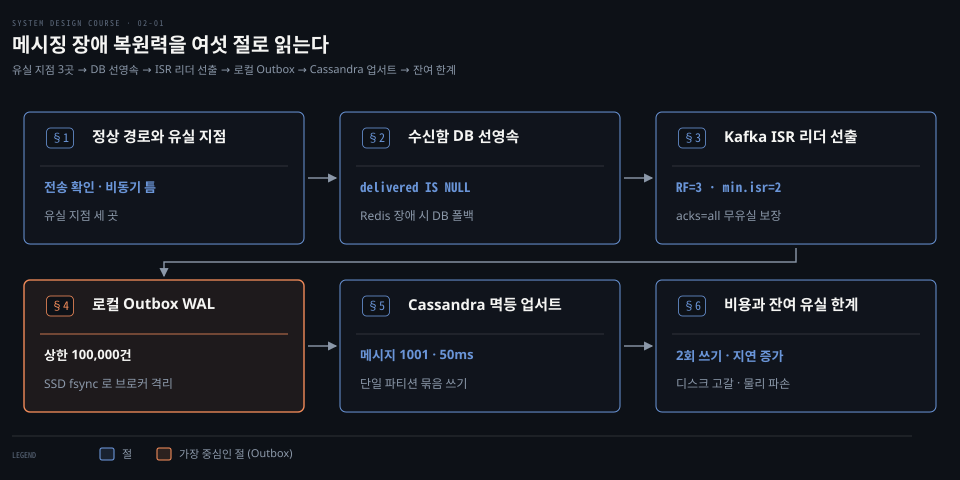
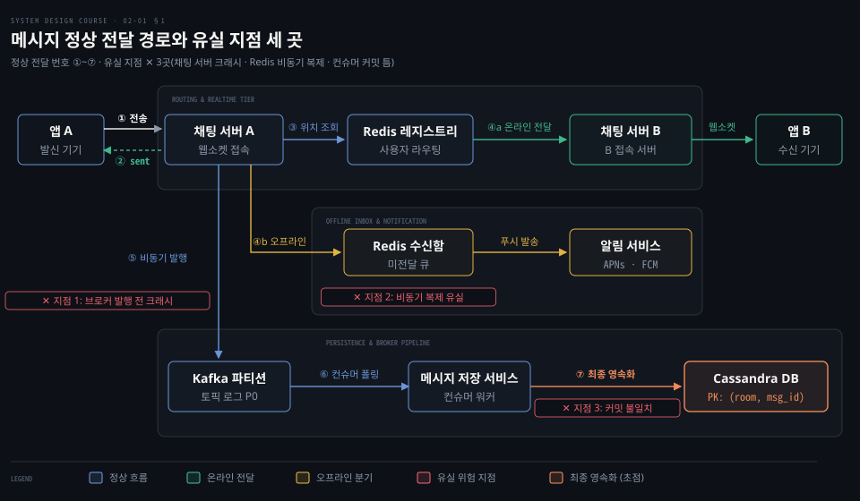
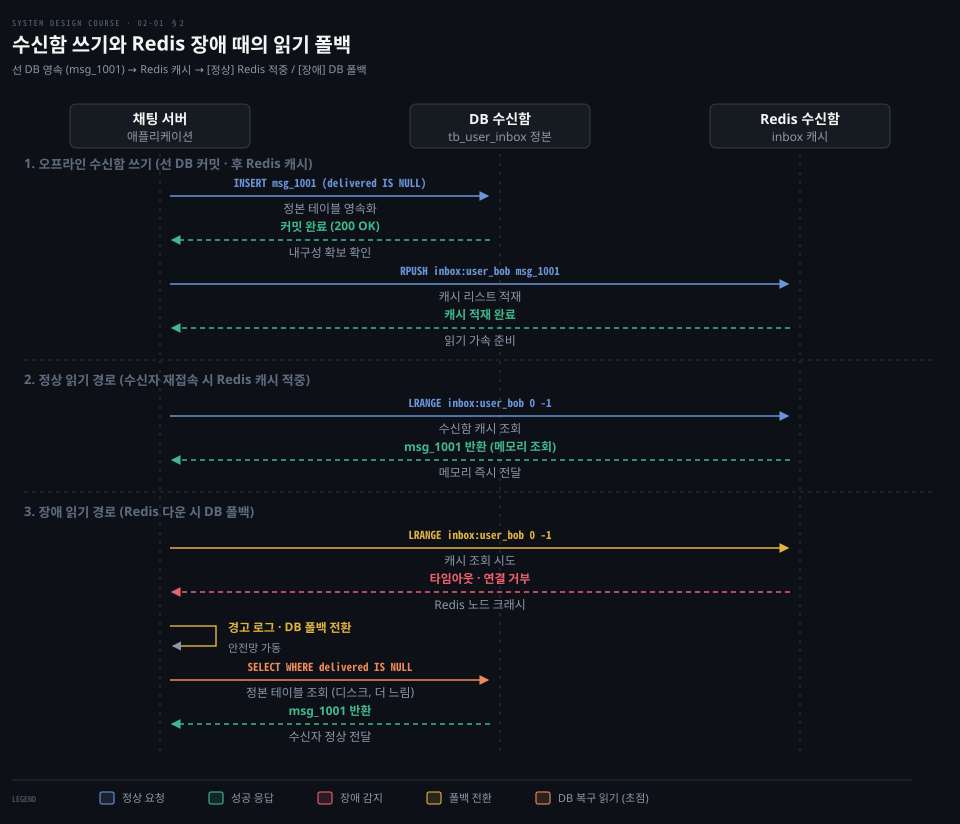
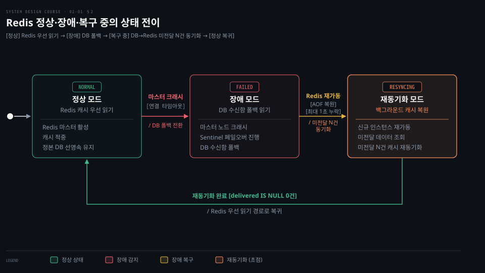
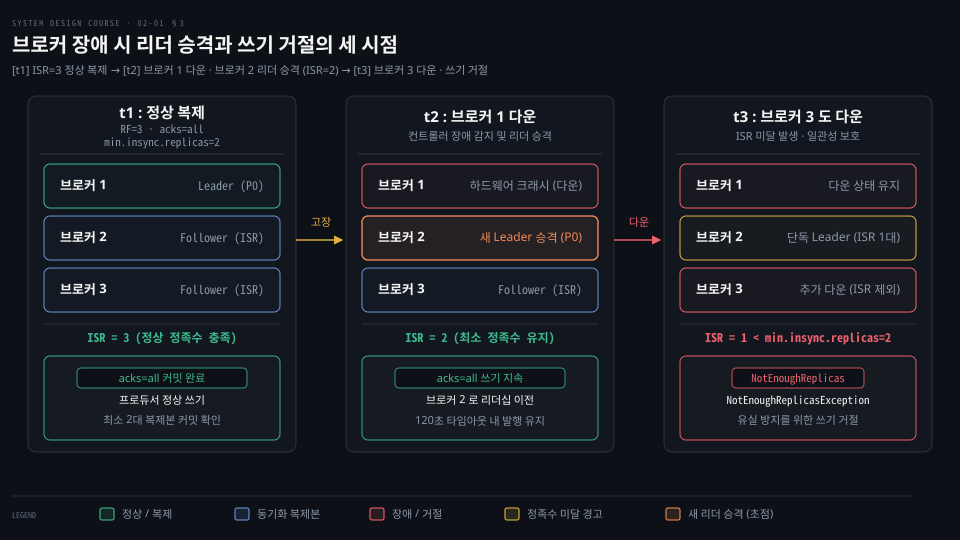
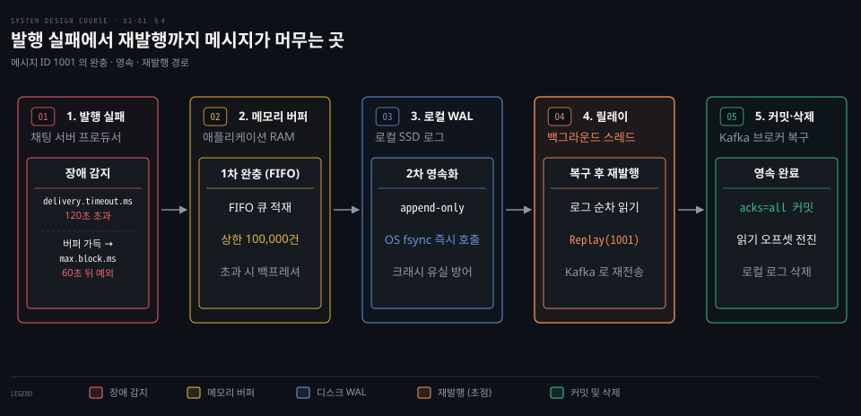
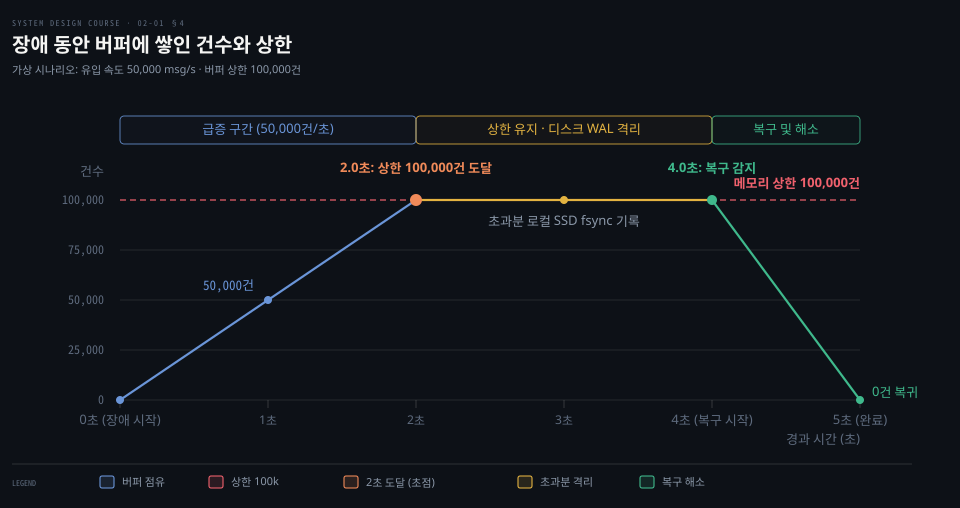
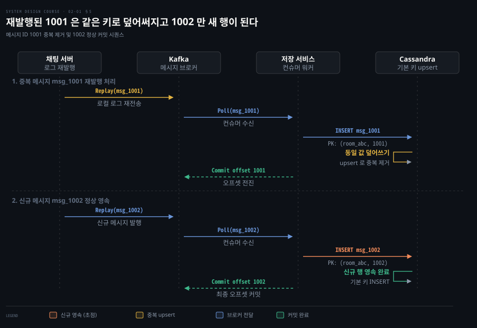
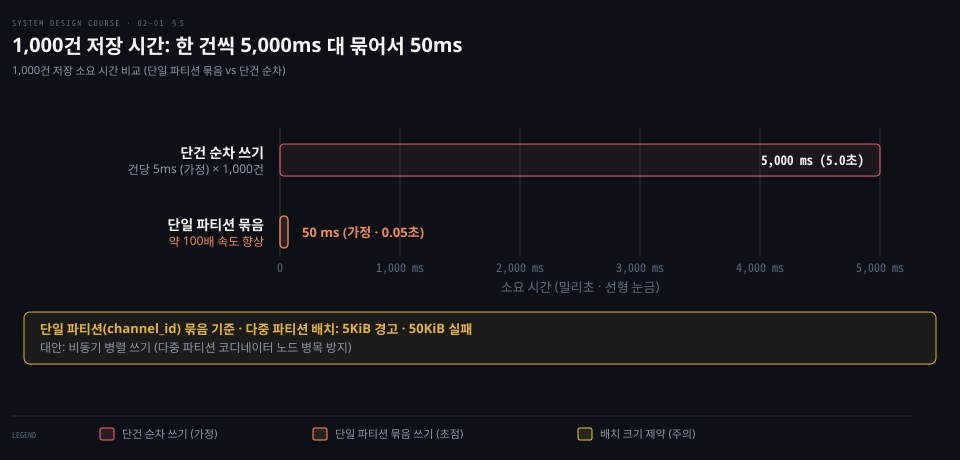

# 메시징 서버는 Redis 가 멈추면 DB 수신함으로 Kafka 가 멈추면 로컬 로그로 버텨 메시지를 잃지 않는다

---

> 메시지 전달 경로에서 확인 응답과 디스크 영속화 사이의 틈을 메우기 위해 Redis 장애는 내구성 있는 DB 수신함으로, Kafka 전체 장애는 채팅 서버 로컬 디스크 로그로 방어하고 중복은 메시지 ID 멱등 쓰기로 흡수합니다.


## 핵심 요약

> 이 편의 중심 생각은 메시지 유실이 컴포넌트 자체의 결함보다 확인 응답을 내준 시점과 영속 계층에 완전히 안착한 시점 사이의 틈에서 생기며 각 이음매마다 대체 저장소를 두어 그 틈을 메워야 한다는 것입니다.

채팅 서버가 발신자에게 전송 확인을 돌려준 뒤 브로커에 비동기로 넣는 구조는 서버가 크래시될 때 확인받은 메시지를 잃을 위험을 만듭니다. 이를 막기 위해 발신 기기가 고유 ID를 부여하고 실패 시 같은 ID로 재전송합니다.

Redis 수신함이 비동기 복제와 노드 장애로 흔들릴 때는 정본인 관계형 DB에 먼저 쓰고 읽기 실패 시 DB로 폴백합니다. Kafka 브로커 한 대 장애는 복제본의 리더 승격이 흡수하지만 클러스터 전면 장애 시에는 채팅 서버가 로컬 디스크 로그에 격리해 두었다가 복구 뒤 재발행합니다. 저장 서비스는 이 재발행과 재시도가 만든 중복을 메시지 ID 기반의 멱등 쓰기로 걸러냅니다.


## 학습 목표

> 이 편을 읽고 나면 다음을 설명할 수 있습니다.

1. 보낸 사람에게 확인 응답이 나간 시점과 Kafka·DB 영속화 시점 사이의 유실 지점 세 곳을 짚고 방어 조건을 설명할 수 있습니다.
2. 오프라인 수신함에서 DB를 정본으로 삼고 Redis를 채우는 쓰기 순서와 Redis 장애 조치 시 읽기 폴백 동작을 설명할 수 있습니다.
3. Kafka 브로커 한 대 장애 시 파티션 리더 선출이 컨슈머 리밸런스와 어떻게 다른지 구별하고 복제본 설정의 역할을 설명할 수 있습니다.
4. Kafka 클러스터 전면 장애 시 채팅 서버 로컬 메모리 버퍼와 디스크 로그가 Transactional Outbox 패턴으로 동작하는 원리를 비교할 수 있습니다.
5. 재발행으로 발생하는 중복 메시지를 저장 서비스가 메시지 ID 기반 멱등 쓰기로 흡수하고 단일 파티션 묶음 쓰기로 처리량을 확보하는 구조를 설명할 수 있습니다.




## 1. 메시지 하나는 채팅 서버·Redis·Kafka·저장 서비스를 차례로 지나고 그 이음매마다 잃을 자리가 있다

> 정상 전송 경로에서 발신자에게 전송 확인이 돌아간 뒤에도 메시지는 네트워크와 캐시와 큐의 이음매에서 유실될 수 있습니다.

대규모 메시징 시스템에서 사용자 A가 사용자 B에게 보낸 메시지 하나는 단일 데이터베이스에 바로 쓰이지 않습니다. 실시간 전달 지연을 500ms 미만으로 낮추고 초당 수십만 건의 쓰기 처리를 감당하기 위해 메시지는 여러 컴포넌트 사이를 빠르게 이동합니다.

발신자 모바일 앱은 지속 연결된 웹소켓을 통해 채팅 서버로 메시지를 보냅니다. 채팅 서버는 메시지를 받자마자 발신자에게 전송 확인 응답을 돌려줍니다. 그런 다음 메시지 영속화를 위해 Kafka 토픽으로 비동기 발행합니다.

동시에 수신자 B의 상태를 확인합니다. Redis에 저장된 사용자 연결 레지스트리를 조회해 B가 어느 채팅 서버에 접속해 있는지 찾습니다. B가 온라인이면 해당 채팅 서버로 메시지를 라우팅해 웹소켓으로 즉시 전달합니다.

B가 오프라인이면 미전달 메시지를 보관하는 **수신함**(inbox)에 넣고 알림 서비스를 통해 푸시 알림을 보냅니다. 뒤단에서는 메시지 저장 서비스가 Kafka 파티션에서 메시지를 읽어 Cassandra에 최종 영속화합니다. 웹소켓 상태 유지와 서비스 탐색에 관한 전반적인 구조는 [12-01.채팅 시스템은 웹소켓 연결을 상태 유지 서버에 두고 키-값 저장소와 메시지 ID 로 대화와 접속 상태를 다룬다](../../book/system-design/12-01.%EC%B1%84%ED%8C%85%20%EC%8B%9C%EC%8A%A4%ED%85%9C%EC%9D%80%20%EC%9B%B9%EC%86%8C%EC%BC%93%20%EC%97%B0%EA%B2%B0%EC%9D%84%20%EC%83%81%ED%83%9C%20%EC%9C%A0%EC%A7%80%20%EC%84%9C%EB%B2%84%EC%97%90%20%EB%91%90%EA%B3%A0%20%ED%82%A4-%EA%B0%92%20%EC%A0%80%EC%9E%A5%EC%86%8C%EC%99%80%20%EB%A9%94%EC%8B%9C%EC%A7%80%20ID%20%EB%A1%9C%20%EB%8C%80%ED%99%94%EC%99%80%20%EC%A0%91%EC%86%8D%20%EC%83%81%ED%83%9C%EB%A5%BC%20%EB%8B%A4%EB%A3%AC%EB%8B%A4.md)가 다룹니다. 푸시 알림 연동과 큐 처리는 [10-01.알림 시스템은 제3자 푸시·SMS·이메일 서비스 앞에 메시지 큐와 작업 서버를 두어 재시도와 중복을 다룬다](../../book/system-design/10-01.%EC%95%8C%EB%A6%BC%20%EC%8B%9C%EC%8A%A4%ED%85%9C%EC%9D%80%20%EC%A0%9C3%EC%9E%90%20%ED%91%B8%EC%8B%9C%C2%B7SMS%C2%B7%EC%9D%B4%EB%A9%94%EC%9D%BC%20%EC%84%9C%EB%B9%84%EC%8A%A4%20%EC%95%9E%EC%97%90%20%EB%A9%94%EC%8B%9C%EC%A7%80%20%ED%81%90%EC%99%80%20%EC%9E%91%EC%97%85%20%EC%84%9C%EB%B2%84%EB%A5%BC%20%EB%91%90%EC%96%B4%20%EC%9E%AC%EC%8B%9C%EB%8F%84%EC%99%80%20%EC%A4%91%EB%B3%B5%EC%9D%84%20%EB%8B%A4%EB%A3%AC%EB%8B%A4.md)를 참고합니다.

이 설계에는 심각한 취약점이 숨어 있습니다. 발신자에게 전송 완료 확인을 돌려주는 시점과 메시지가 내구성 있는 저장소에 실제로 기록되는 시점 사이에 시간차가 존재한다는 사실입니다.

```pseudocode
발신자 앱                채팅 서버                 Kafka 클러스터             Cassandra DB
   │                        │                         │                        │
   │── 1. 메시지 전송 ─────>│                         │                        │
   │<── 2. sent 확인(ack) ──│ (아직 메모리에만 존재)   │                        │
   │                        │── 3. 비동기 발행 ──────>│ (브로커 메모리/디스크)  │
   │                        │                         │── 4. 소비 및 쓰기 ────>│
```

발신자가 화면에서 전송 확인 체크 표시를 본 순간 메시지는 오직 채팅 서버 프로세스 메모리에만 머물고 있을 수 있습니다. 그 직후 채팅 서버에 정전이 발생하거나 프로세스가 비정상 종료되면 메시지는 증발합니다. 발신자는 전송 성공으로 알지만 수신자는 영원히 메시지를 받지 못합니다.

유실 지점은 경로 곳곳에 있습니다.

- **지점 1: 채팅 서버와 브로커 사이**: 채팅 서버가 발신자에게 확인을 준 뒤 브로커로 넘기기 전에 서버가 죽는 경우입니다.
- **지점 2: Redis 연결 레지스트리와 오프라인 수신함**: 오프라인 메시지를 Redis에만 담아 두었는데 노드가 다운되어 복제 지연분만큼 유실되는 경우입니다.
- **지점 3: Kafka 브로커와 저장 서비스 사이**: 브로커 클러스터가 멈추거나 저장 서비스가 DB에 쓰기 전에 크래시되어 오프셋 커밋과 실제 쓰기가 어긋나는 경우입니다.

Kafka의 기본 개념은 이 유실 지점들을 통제하는 핵심 토대입니다. 토픽은 여러 **파티션**으로 쪼개져 분산 저장됩니다. 각 파티션은 하나의 **리더 복제본**과 여러 **팔로워 복제본**을 둡니다. 프로듀서 쓰기는 파티션 리더로 들어가며 리더와 정상 동기화를 유지하는 복제본들의 묶음을 **ISR**(In-Sync Replicas)이라 부릅니다. 컨슈머는 **컨슈머 그룹**을 구성해 파티션을 나누어 맡고 오프셋을 전진시키며 메시지를 읽습니다.

Kafka의 순차 I/O 원리는 [05-01.Kafka 는 순차 IO 와 제로 카피로 빠르고 전달 보장은 최대 한 번·최소 한 번·정확히 한 번으로 갈린다](../../book/bytebytego-system-design/05-01.Kafka%20%EB%8A%94%20%EC%88%9C%EC%B0%A8%20IO%20%EC%99%80%20%EC%A0%9C%EB%A1%9C%20%EC%B9%B4%ED%94%BC%EB%A1%9C%20%EB%B9%A0%EB%A5%B4%EA%B3%A0%20%EC%A0%84%EB%8B%AC%20%EB%B3%B4%EC%9E%A5%EC%9D%80%20%EC%B5%9C%EB%8C%80%20%ED%95%9C%20%EB%B2%88%C2%B7%EC%B5%9C%EC%86%8C%20%ED%95%9C%20%EB%B2%88%C2%B7%EC%A0%95%ED%99%95%ED%9E%88%20%ED%95%9C%20%EB%B2%88%EC%9C%BC%EB%A1%9C%20%EA%B0%88%EB%A6%B0%EB%8B%A4.md)가 다룹니다. 로그 기반 브로커의 세부 동작은 [12-01.스트림 전송 — 메시지 브로커와 로그 기반 브로커](../../../05_data/book/designing-data-intensive-applications/12-01.%EC%8A%A4%ED%8A%B8%EB%A6%BC%20%EC%A0%84%EC%86%A1%20%E2%80%94%20%EB%A9%94%EC%8B%9C%EC%A7%80%20%EB%B8%8C%EB%A1%9C%EC%BB%A4%EC%99%80%20%EB%A1%9C%EA%B7%B8%20%EA%B8%B0%EB%B0%98%20%EB%B8%8C%EB%A1%9C%EC%BB%A4.md)를 참고합니다.




## 2. 오프라인 수신함은 Redis 와 DB 에 함께 써 두고 Redis 가 죽으면 느린 DB 에서 읽는다

> 오프라인 수신함은 빠른 조회를 위해 Redis 에 캐시하되 내구성이 있는 DB 에 먼저 영속하고, Redis 장애 시 DB 로 폴백해 유실을 방지합니다.

수신자가 네트워크에 접속하지 않은 오프라인 상태일 때 메시지를 제때 전달하지 못하면 대화가 끊어집니다. 이를 막기 위해 전송된 메시지는 수신함에 대기합니다. 수신자가 네트워크에 다시 접속하면 채팅 서버는 수신함에서 대기 중인 메시지를 모아 한꺼번에 밀어줍니다.

Redis는 모든 데이터를 메모리에 보관하므로 디스크를 거치는 DB보다 조회가 빠릅니다. 사용자가 접속하자마자 대기 메시지를 지연 없이 화면에 띄우는 용도로 적합합니다.

그러나 미전달 메시지를 Redis에만 담아두면 심각한 유실이 발생합니다. Redis Sentinel이나 Redis Cluster는 마스터 노드가 죽으면 레플리카 노드를 새 마스터로 자동 승격합니다. 하지만 Redis의 복제는 **비동기 복제**(asynchronous replication) 방식입니다.[^redis-sentinel] 마스터 노드가 클라이언트에게 쓰기 성공 응답을 돌려주었더라도 해당 명령이 복제본으로 복제되기 직전에 마스터가 죽을 수 있습니다. 새로 승격된 마스터에는 방금 확인된 메시지가 존재하지 않으며 저장되었다고 응답받은 데이터가 영구 소실됩니다.[^redis-scaling]

AOF 설정을 켜더라도 한계는 남습니다. 실무 기본값인 `appendfsync everysec` 설정은 1초마다 디스크로 동기화하므로 크래시 발생 시 최대 1초간의 쓰기가 사라질 수 있습니다.[^redis-persistence] `WAIT` 명령어로 복제본 동기화를 기다릴 수 있지만 완전한 강한 일관성을 보장하지는 못합니다.[^redis-wait]

이 문제를 풀기 위해 시스템은 Redis와 관계형 데이터베이스에 메시지를 함께 기록하는 이중 쓰기 구조를 취합니다. 이때 쓰기 순서가 데이터의 생사를 가릅니다.

만약 Redis에 먼저 쓰고 DB에 비동기로 나중에 쓰는 방식을 택하면 Redis 장애 조치 시 유실된 메시지는 DB에도 남지 못합니다. 따라서 **내구성이 보장되는 데이터베이스에 먼저 쓰고 커밋이 성공한 뒤에 Redis 수신함을 채워야 합니다.** 데이터베이스가 정본이 되고 Redis는 읽기 가속용 캐시 역할을 맡습니다. 캐시 쓰기 전략의 트레이드오프는 [01-07.캐싱 전략](../../../05_data/01_foundation/01-07.%EC%BA%90%EC%8B%B1%20%EC%A0%84%EB%9E%B5.md)의 Cache-Aside와 Write-Through 절을 참고합니다.

```sql
-- 내구성 있는 DB 수신함 테이블에 먼저 영속화
INSERT INTO tb_user_inbox (
    message_id,
    receiver_id,
    sender_id,
    payload,
    delivered,
    created_at
) VALUES (
    'msg_1001',
    'user_bob',
    'user_alice',
    '안녕하세요',
    NULL,
    NOW()
);
```

읽기 경로는 단계적 안전망을 갖춥니다. 수신자가 재접속하면 시스템은 먼저 Redis 수신함 조회를 시도합니다. 정상 상황이라면 메모리에서 바로 메시지 목록을 반환합니다.

만약 Redis 노드가 다운되어 타임아웃이나 연결 거부 오류가 발생하면 시스템은 즉시 DB 수신함 테이블로 **폴백**(fallback)합니다.

```pseudocode
정상 경로:   클라이언트 요청 ──> 채팅 서버 ──> Redis 수신함 (메모리 조회)
장애 시:     클라이언트 요청 ──> 채팅 서버 ──> Redis 연결 실패 ──> DB 수신함 폴백 (디스크 DB 조회, 더 느림)
```

DB 조회는 Redis 조회보다 느리지만 시스템 전체가 에러를 내뿜으며 메시지를 잃어버리는 것보다 훨씬 안전합니다. 다만 대규모 장애 상황에서 수많은 사용자의 재접속 요청이 한꺼번에 DB로 몰리면 데이터베이스 커넥션 풀이 고갈되어 DB마저 쓰러질 수 있습니다. 캐시 장애 시의 부하 완화 원칙은 [01-07.캐싱 전략](../../../05_data/01_foundation/01-07.%EC%BA%90%EC%8B%B1%20%EC%A0%84%EB%9E%B5.md)을 따릅니다.



### Redis 복구와 데이터 재동기화

Redis가 복구되어 재가동되면 상태 전이가 시작됩니다. 재시작된 Redis는 비어 있거나 AOF 복원 과정에서 마지막 1초분의 데이터가 누락되어 있습니다. 이 상태에서 즉시 Redis 우선 읽기 모드로 복귀하면 사용자에게 일부 메시지가 보이지 않는 정합성 오류가 발생합니다.

따라서 백그라운드 재동기화 작업이 먼저 실행됩니다. 백그라운드 워커는 DB 수신함 테이블에서 아직 수신 확인이 되지 않은(`delivered IS NULL`) 메시지들을 조회해 Redis 수신함으로 다시 밀어 넣습니다.

재동기화 작업이 완료되어 상태 플래그가 정상으로 바뀐 뒤에야 채팅 서버는 캐시 우선 읽기 경로로 전환합니다.



더 나아가 Redis는 오프라인 수신함뿐 아니라 온라인 사용자 연결 레지스트리도 관리합니다. 만약 Redis 클러스터 전체가 완전히 불능 상태에 빠지면 시스템은 어떤 수신자가 어느 서버에 접속해 있는지 확인할 수 없습니다.

이때 시스템은 **강등 모드**(degraded mode)로 전환합니다. 모든 수신자를 일시적으로 오프라인 상태로 간주하고 모든 메시지를 내구성 있는 DB 수신함 테이블에 기록한 뒤 푸시 알림 경로로 전송합니다. 실시간 웹소켓 전달은 잠시 지연되지만 메시지 유실은 막아냅니다.


## 3. 브로커 한 대가 죽는 것은 Kafka 가 복제본 하나를 새 리더로 세워 흡수한다

> Kafka 클러스터는 파티션 복제본과 ISR 추적으로 브로커 한 대 장애를 감지하고 다른 복제본을 즉시 새 리더로 선출해 발행을 이어갑니다.

채팅 서버가 메시지를 받아 데이터베이스에 직접 쓰지 않고 Kafka에 넣는 까닭은 데이터베이스의 순간 쓰기 병목을 분리하고 버스트 트래픽을 완충하기 위함입니다. 메시지를 받아주는 브로커 서버 한 대가 전원 고장이나 디스크 손상으로 멈추더라도 애플리케이션이 우회 경로를 직접 찾거나 특수 코드를 돌릴 필요가 없습니다. Kafka의 내장 복제 메커니즘이 이 장애를 자연스럽게 흡수합니다.

Kafka의 모든 토픽 파티션은 여러 브로커에 걸쳐 복제됩니다. 쓰기와 읽기를 도맡아 처리하는 단 하나의 복제본을 리더 복제본이라 부릅니다. 리더의 로그를 그대로 따라 복제하는 나머지 복제본들은 팔로워 복제본이라 부릅니다.

리더는 팔로워들이 자신을 얼마나 잘 따라오고 있는지 지속적으로 감시합니다. 뒤처지지 않고 동기화 상태를 유지하는 복제본들의 집합을 ISR 로 관리합니다.[^kafka-design]

```pseudocode
[Broker 1 (Leader)] ─── 쓰기/복제 ───> [Broker 2 (Follower, ISR)]
        │
   (하드웨어 장애 발생)
        │
        ▼
Kafka 컨트롤러가 Broker 1 장애 감지 ──> ISR 내 Broker 2를 새 Leader로 선출 ──> 프로듀서가 Broker 2로 발행 재개
```

브로커 1이 다운되면 브로커 1이 리더를 맡고 있던 파티션들의 리더십은 ISR에 속한 다른 정상 복제본으로 즉시 이전됩니다. 컨트롤러가 새 메타데이터를 클러스터에 전파하고 프로듀서와 컨슈머는 갱신된 메타데이터를 받아 새 리더 브로커와 통신을 재개합니다.[^kafka-operations]

여기서 시스템 엔지니어가 반드시 명확히 구분해야 할 개념이 있습니다. 바로 **파티션 리더 선출**과 **컨슈머 그룹 리밸런스**입니다.

- **파티션 리더 선출**: 브로커가 멈추었을 때 해당 브로커가 쥐고 있던 파티션의 책임을 ISR 내 다른 브로커 복제본으로 넘기는 브로커 수준의 고가용성 메커니즘입니다.[^kafka-operations]
- **컨슈머 그룹 리밸런스**: 컨슈머 프로세스가 죽거나 세션 타임아웃 동안 하트비트를 보내지 못했을 때 파티션을 같은 그룹 내 다른 컨슈머에게 다시 배분하는 클라이언트 수준의 작업 분배 메커니즘입니다.[^kafka-consumer]
- **클러스터 확장**: 새 브로커를 클러스터에 물리적으로 추가하더라도 기존 파티션이 그 브로커로 자동으로 옮겨가지 않습니다. 운영자가 파티션 재할당 명령을 내려야 비로소 데이터가 새 브로커로 분산됩니다.[^kafka-operations]

브로커 한 대 장애가 메시지 유실로 이어지지 않으려면 다음 세 가지 설정이 맞물려야 합니다.

첫째, 토픽 복제 계수를 3으로 둡니다. 파티션 데이터가 세 대의 독립된 브로커에 나뉘어 복제됩니다. 둘째, 토픽 설정 `min.insync.replicas`를 2로 지정합니다.[^kafka-topic] 메시지가 커밋된 것으로 인정받기 위해 최소 2대의 ISR 복제본에 기록되어야 함을 뜻합니다. 셋째, 프로듀서의 확인 응답 설정을 `acks=all`로 둡니다.[^kafka-producer] 프로듀서는 리더뿐 아니라 현재 ISR에 속한 모든 복제본이 레코드를 안전하게 기록할 때까지 기다린 뒤에야 성공 응답을 받습니다.

만약 브로커 두 대가 연달아 죽어 ISR 크기가 `min.insync.replicas` 미만인 1대로 떨어지면 Kafka는 쓰기를 거절합니다. 일관성을 보호하기 위해 `NotEnoughReplicasException` 예외를 던집니다. 유실 위험이 있는 상태에서는 쓰기를 멈추는 것이 더 안전합니다.

또한 토픽의 `unclean.leader.election.enable`은 반드시 `false`로 유지해야 합니다.[^kafka-design] 이 옵션을 켜면 모든 ISR 복제본이 죽었을 때 동기화되지 않고 뒤처진 옛 복제본이 리더로 승격될 수 있으며 이미 커밋 확인을 내주었던 과거의 메시지들이 통째로 사라집니다.

프로듀서 라이브러리는 `delivery.timeout.ms`(기본값 120초) 동안 메타데이터를 갱신하며 새 리더로 재시도합니다.[^kafka-producer] 최신 Kafka 프로듀서는 멱등 프로듀서(`enable.idempotence=true`)가 기본입니다. 재시도로 같은 레코드가 브로커에 두 번 가더라도 중복이 생기지 않습니다.




## 4. 클러스터 전체가 멈추면 채팅 서버가 메모리 버퍼와 디스크 로그에 쌓았다가 복구 뒤 다시 보낸다

> Kafka 클러스터 전면 다운이나 네트워크 고립으로 프로듀서 타임아웃이 초과되면 채팅 서버는 메모리 버퍼와 디스크의 append-only 로그에 격리해 두었다가 복구 후 재발행합니다.

브로커 한 대의 장애는 Kafka의 복제본 프로토콜이 흡수합니다. 그러나 데이터센터 전체의 전원 차단이나 대규모 네트워크 단절로 Kafka 클러스터 전체가 멈추는 극단적인 상황이 벌어질 수 있습니다.

이때 프로듀서는 더 이상 쓰기를 완료하지 못합니다. 프로듀서 라이브러리 내부에는 크기가 기본 32MiB인 자체 메모리 버퍼 `buffer.memory`가 있습니다.[^kafka-producer] 브로커로 나가지 못한 메시지는 이 버퍼에 차곡차곡 쌓입니다.

버퍼가 가득 차면 `send()` 호출은 `max.block.ms` 설정에 따라 최대 60초 동안 대기하다가 풀리지 않으면 예외를 던집니다. 그리고 전체 재시도 제한 시간인 `delivery.timeout.ms`(기본 120초)를 넘기면 최종 실패 콜백이 실행됩니다.

초 단위의 일시적인 브로커 순단은 프로듀서 자체 버퍼가 막아줍니다. 하지만 장애가 `delivery.timeout.ms`(기본 2분)를 넘기면 레코드는 실패로 끝납니다. 그 전에 버퍼가 가득 차도 `send()` 가 `max.block.ms`(기본 1분) 뒤 예외를 던집니다. 이때 애플리케이션 레벨의 보호 장치가 없으면 발신자에게 전송 확인을 이미 내준 메시지들이 사라집니다.

채팅 서버는 이 상황을 버텨내기 위해 단계적 완충 장치를 가동합니다.

```pseudocode
[클라이언트 메시지 유입]
         │
         ▼
[채팅 서버 프로세스] ── 정상 ──> [Kafka 클러스터] (다운!)
         │
    (발행 실패 감지)
         │
         ├─ 1차: 메모리 버퍼 (FIFO 큐, 상한 100,000건)
         │
         └─ 2차: 로컬 디스크 WAL (append-only 파일 + fsync)
```

발행 실패가 감지되면 채팅 서버는 에러를 남기고 메시지를 애플리케이션 메모리 버퍼에 적재합니다. 그러나 서버의 RAM 용량은 한정되어 있으므로 버퍼에는 반드시 최대 건수 상한을 둡니다.

피크 시간대 대규모 채팅 시스템의 가상 시나리오를 계산해 봅니다. 단일 대형 채팅 서버로 초당 50,000건의 메시지가 들어온다고 가정하면 Kafka가 멈춘 지 2초 만에 메모리 버퍼 상한인 100,000건에 도달합니다.

```pseudocode
유입 속도: 초당 50,000건 (가상 시나리오)
버퍼 상한: 100,000건
도달 시간: 100,000 ÷ 50,000 = 2.0초
```

상한에 도달했을 때 오래된 메시지를 덮어쓰거나 버리는 전략은 유실 없음을 포기하는 선택입니다. 따라서 버퍼가 임계치에 도달하면 즉시 클라이언트에게 백프레셔를 걸어 전송 속도를 늦추도록 요구하거나 전송 실패를 명확히 알려야 합니다.



### 메모리 버퍼 상한과 디스크 로그의 Transactional Outbox

더 큰 위험은 채팅 서버 프로세스 자체의 크래시입니다. Kafka가 멈춘 상태에서 채팅 서버마저 메모리 부족이나 서버 재부팅으로 쓰러지면 RAM에 있던 100,000건의 메시지는 영구히 증발합니다.

이를 막기 위해 채팅 서버는 메시지를 메모리뿐 아니라 로컬 SSD의 **순차 추가 로그**(append-only log) 파일에 기록하고 OS 캐시를 디스크로 내리는 작업을 수행합니다. 파일 끝에 바이트를 덧붙이는 순차 I/O 는 빠르고 안정적입니다.

이 메커니즘은 분산 시스템의 **Transactional Outbox 패턴**과 같은 발상입니다.[^transactional-outbox] Outbox 패턴은 비즈니스 데이터와 메시지를 로컬 트랜잭션으로 묶어 DB에 먼저 영속합니다. 채팅 서버는 이 원리를 응용해 로컬 파일시스템의 append-only 로그를 Outbox 로 삼아 브로커 장애를 격리합니다.



장애가 해결되어 Kafka 클러스터가 복구되면 백그라운드 릴레이 스레드가 로컬 로그 파일을 순차적으로 읽어 Kafka로 **재발행**(Replay)합니다. 브로커로부터 정상 커밋 확인을 받은 뒤에야 로컬 로그의 읽기 오프셋을 전진시키고 완료된 파일 세그먼트를 디스크에서 삭제합니다.

여기서 필연적인 부작용이 발생합니다. 릴레이 스레드가 Kafka로 메시지를 성공적으로 보냈으나 로컬 디스크의 로그를 지우기 직전에 채팅 서버가 죽는 경우입니다. 서버가 다시 켜지면 릴레이는 삭제되지 않은 디스크 로그를 읽어 같은 메시지를 Kafka에 한 번 더 발행합니다. 유실을 막기 위해 도입한 로컬 로그 재발행 장치는 필연적으로 중복 발행을 낳습니다.


## 5. 다시 보내면 같은 메시지가 두 번 갈 수 있어 저장 서비스는 메시지 ID 로 걸러 내고 묶어서 쓴다

> 재발행과 네트워크 재시도로 인한 중복 전달은 메시지 ID 를 기본 키로 삼는 저장소의 멱등 쓰기로 걸러내고, 단일 파티션 단위 묶음 쓰기로 처리량을 확보합니다.

채팅 서버의 로컬 로그 재발행, 프로듀서의 세션을 넘는 네트워크 재시도, 모바일 앱의 타임아웃 재전송이 겹치면 동일한 메시지가 Kafka에 두 번 이상 들어옵니다.

저장 서비스는 파티션을 나누어 맡는 무상태 인스턴스들로 구성됩니다. 각 인스턴스는 Kafka 컨슈머로서 메시지를 폴링해 데이터베이스에 영속화합니다. 컨슈머는 데이터베이스에 쓰기가 완전히 끝난 뒤에만 Kafka 오프셋을 커밋합니다.[^kafka-delivery] 처리 도중 인스턴스가 다운되면 아직 커밋되지 않은 오프셋부터 다른 인스턴스가 다시 읽어 들이므로 소비 계층에서도 중복 처리는 피할 수 없는 현실입니다.

중복을 걸러낼 때 메시지 본문의 **내용 해시**로 중복을 거르는 방식은 위험합니다. 내용 해시는 텍스트 문자열에서 계산되므로 사용자가 짧은 확인 문장을 연속으로 보낼 때 정상적인 두 번째 메시지가 중복으로 판정되어 삭제됩니다. 반대로 재시도 과정에서 타임스탬프 필드가 조금이라도 바뀌면 해시값이 달라져 실제 중복 메시지를 잡지 못합니다.

따라서 중복 제거의 기준은 내용이 아니라 유일한 **메시지 ID**여야 합니다.[^idempotent-consumer] 더욱 중요한 점은 이 메시지 ID를 **발신 기기**가 만들어야 한다는 사실입니다. 만약 채팅 서버가 ID를 발급하면 클라이언트가 응답을 받지 못해 재전송할 때 서버가 새 ID를 부여하게 되어 중복 제거 메커니즘 전체가 무력화됩니다. 클라이언트가 고유 멱등 키를 발급해야 한다는 원리는 [07-02.결제 정확성은 멱등 키로 이중 청구를 막고 대사로 장부 불일치를 찾고 토큰화로 카드 정보를 지킨다](../../book/bytebytego-system-design/07-02.%EA%B2%B0%EC%A0%9C%20%EC%A0%95%ED%99%95%EC%84%B1%EC%9D%80%20%EB%A9%B1%EB%93%B1%20%ED%82%A4%EB%A1%9C%20%EC%9D%B4%EC%A4%91%20%EC%B2%AD%EA%B5%AC%EB%A5%BC%20%EB%A7%89%EA%B3%A0%20%EB%8C%80%EC%82%AC%EB%A1%9C%20%EC%9E%A5%EB%B6%80%20%EB%B6%88%EC%9D%BC%EC%B9%98%EB%A5%BC%20%EC%B0%BE%EA%B3%A0%20%ED%86%A0%ED%81%B0%ED%99%94%EB%A1%9C%20%EC%B9%B4%EB%93%9C%20%EC%A0%95%EB%B3%B4%EB%A5%BC%20%EC%A7%80%ED%82%A8%EB%8B%A4.md)가 상세히 다룹니다.

저장소로 널리 쓰이는 Cassandra는 중복 처리에 탁월한 특성을 갖추고 있습니다. 일반적인 관계형 데이터베이스와 달리 Cassandra의 `INSERT` 문은 사전에 해당 행이 존재하는지 확인하지 않고 기본적으로 **업서트**(upsert)로 동작합니다.[^cassandra-dml]

기본 키를 `(channel_id, message_id)`로 설계해 두면 재발행된 메시지 1001이 다시 들어오더라도 에러가 발생하거나 데이터가 중복 생성되지 않고 기존 행을 동일한 값으로 덮어쓰며 끝납니다.

실제 대규모 운영 사례로 Discord는 수십억 건의 메시지를 저장하기 위해 Cassandra를 도입하고 기본 키를 `(channel_id, message_id)`로 잡았습니다. 다만 같은 글은 Cassandra의 모든 쓰기가 upsert라는 성질이 문제를 일으킨 사례도 적습니다. 한 사용자가 메시지를 고치는 동안 다른 사용자가 그 메시지를 지우자, 기본 키와 본문만 남고 나머지 열이 빈 행이 생겼습니다.[^discord-billions]

```cql
-- Cassandra 메시지 테이블 스키마
CREATE TABLE IF NOT EXISTS messages (
    channel_id text,
    message_id text,
    sender_id text,
    content text,
    created_at timestamp,
    PRIMARY KEY ((channel_id), message_id)
) WITH CLUSTERING ORDER BY (message_id DESC);

-- 재발행된 메시지가 들어와도 기본 키가 같으면 upsert 로 덮어쓴다
INSERT INTO messages (channel_id, message_id, sender_id, content, created_at)
VALUES ('room_abc', '1001', 'user_alice', '안녕하세요', '2026-10-20T09:00:00Z');
```



### Cassandra 묶어 쓰기 최적화와 DLQ 격리

초당 수십만 건의 쓰기를 감당하려면 메시지를 한 건씩 디스크에 쓸 수 없습니다. 단건 쓰기는 네트워크 왕복과 커밋 I/O 비용이 매번 발생하기 때문입니다. PostgreSQL 공식 문서가 설명하듯 트랜잭션을 하나로 묶어 커밋하면 행마다 치르는 디스크 커밋 비용을 줄일 수 있습니다.[^postgres-populate]

단건 쓰기 지연이 평균 5ms라고 가정하면 1,000건을 순차적으로 쓸 때 걸리는 총시간은 5초에 달합니다. 반면 강의는 1,000건을 메모리에 모았다가 한 번의 묶음으로 쓰면 약 50ms 로 줄어든다고 가정합니다. 두 수치 모두 실측이 아니라 강의의 가정입니다.

그러나 Cassandra에서 다중 파티션에 걸친 배치는 성능 최적화 도구가 아닙니다.

Cassandra의 BATCH 문은 여러 노드 간의 원자성을 위해 배치로그를 기록합니다. 서로 다른 파티션 키를 하나의 배치로 묶으면 코디네이터 노드에 심각한 부하가 걸립니다. Cassandra 설정 파일은 다중 파티션 배치가 5KiB를 넘으면 경고를 내고 50KiB를 넘으면 실패시킵니다.[^cassandra-yaml] 메시지당 1KB씩 1,000건을 한 번의 Cassandra batch로 넣으려 하면 시스템은 에러를 내며 멈춰 섭니다.

따라서 묶어 쓰기의 이점을 얻으려면 두 가지 올바른 경로 중 하나를 택해야 합니다.

1. **단일 파티션 배치**: 수집된 1,000건의 메시지를 메모리에서 `channel_id` 별로 그룹화하여 같은 대화방에 속한 메시지들끼리만 배치로 묶어 씁니다. 같은 파티션 내 쓰기는 배치로그를 타지 않아 가볍습니다.
2. **비동기 개별 병렬 쓰기**: 개별 INSERT 문들을 드라이버의 비동기 API(`session.executeAsync()`)를 통해 여러 노드로 동시에 병렬 발행하여 파이프라이닝 이점을 얻습니다.

배치 쓰기 도중 특정 메시지의 포맷 오류로 일부 레코드가 계속 실패할 수 있습니다. 1,000건 중 일부 때문에 전체 배치를 무한정 재시도하면 파티션의 오프셋 전진이 막혀 컨슈머 전체가 마비됩니다. 짧은 재시도 후에도 실패가 지속되는 악성 메시지는 **DLQ**(Dead Letter Queue) 토픽으로 격리 발행하고 정상 메시지들의 오프셋을 먼저 커밋해야 합니다.[^kafka-connect-dlq]




## 6. 이 장치들은 메시지를 잃지 않는 대신 두 번 쓰기와 중복 처리와 버퍼 상한을 비용으로 낸다

> 장애 복원력을 위해 도입한 이중화와 로컬 로그는 시스템 복잡도와 디스크 I/O, 중복 처리 비용을 요구하며 극단적 재난 상황에서의 한계를 이해해야 합니다.

메시지를 잃지 않기 위해 시스템 곳곳에 덧댄 안전장치들은 공짜가 아닙니다. 모든 엔지니어링 선택은 트레이드오프를 수반합니다. 내구성을 얻은 대가로 시스템은 추가 지연 시간, 디스크 I/O 소비, 메모리 점유, 복잡한 중복 처리 로직을 비용으로 지불합니다.

| 장치 | 막는 유실 | 비용 | 여전히 남는 유실 |
|---|---|---|---|
| DB 수신함 우선 쓰기 + Redis 캐시 및 DB 폴백 | Redis 마스터 크래시, 비동기 복제 유실 창, 캐시 미스 시 오프라인 메시지 유실 | 정상 쓰기 시 2회 쓰기(DB + Redis) 지연 증가, Redis 장애 시 DB 커넥션 풀 및 I/O 부하 증가 | DB 자체가 다운되거나 DB 쓰기 전 채팅 서버가 크래시되는 경우 |
| Kafka ISR 복제 + `acks=all` + `min.insync.replicas=2` | 단일 또는 소수 브로커 장애 시 커밋된 메시지 유실 | 복제 네트워크 대역폭 소비, 정족수 확인 대기 시간(프로듀서 지연 증가) | ISR 복제본이 `min.insync.replicas` 미만으로 남아 새 쓰기가 거절되는 동안의 유실 위험 |
| 채팅 서버 로컬 메모리 버퍼 + 디스크 WAL | Kafka 클러스터 전면 다운 및 장기 장애 시 메시지 영구 소실 | 디스크 용량 소비, `fsync` I/O 오버헤드, 재발행 릴레이 스레드 및 메모리 점유 | 메모리 버퍼 상한(예: 100,000건) 초과 후 디스크 공간마저 고갈되거나 서버 로컬 드라이브 물리 파손 시 |
| 메시지 ID 기반 Cassandra 단일 파티션 업서트 | 로컬 로그 재발행, 프로듀서/클라이언트 재시도로 인한 중복 저장 | 대화방(파티션)별 메시지 정렬·그룹화 메모리 연산, 필수 컬럼 검증 로직 | 클라이언트가 재전송 시 서로 다른 새 메시지 ID를 발급하여 전송하는 경우 |

이 모든 장치를 두텁게 쌓더라도 물리적 현실 앞에서는 여전히 한계가 남습니다.

첫째, 채팅 서버 로컬 디스크의 한계입니다. Kafka 클러스터 장애가 며칠 동안 이어지면 채팅 서버의 로컬 SSD 역시 가득 차게 됩니다. 디스크가 100%에 도달하면 더 이상 append-only 로그를 쓸 수 없으므로 새 메시지를 거부하는 백프레셔를 걸지 않는 한 유실이 발생합니다.

둘째, 단일 서버의 물리적 파괴입니다. 메시지가 채팅 서버 로컬 디스크에만 쓰여 있고 아직 Kafka로 복제되지 않은 상태에서 서버 랙 전체가 전소되면 로컬 로그 자체가 소실됩니다. 완전한 무유실을 달성하려면 로컬 디스크 대신 다중 AZ로 복제되는 분산 파일시스템이나 원격 DB 트랜잭션을 거쳐야 하지만 이는 실시간 메신저의 지연 시간 요구조건과 정면으로 충돌합니다.

결국 아키텍처는 어디까지의 장애를 감당하고 어디서부터를 재난으로 규정할 것인가의 경계 설정입니다. Redis 단독 장애, 브로커 1대 장애, 일시적 Kafka 전면 장애까지는 자동 복구와 무유실로 흡수하되 그 이상의 장기 복합 재해에 대해서는 명확한 백프레셔와 실패 통지로 클라이언트에게 책임을 넘기는 것이 실무 시스템 설계의 현실적인 종착점입니다.


## 면접 대비

1. 클라이언트에게 "sent" 전송 확인 응답을 보낸 직후 채팅 서버가 크래시되면 어떤 유실이 발생하며 이를 방지하는 근본 설계는 무엇인가요?
2. 오프라인 수신함을 설계할 때 Redis와 관계형 데이터베이스의 쓰기 순서를 어떻게 결정해야 하며, Redis 장애 조치 시 어떤 문제가 발생할 수 있나요?
3. Kafka에서 브로커 한 대 장애 시 일어나는 리더 선출과 컨슈머 그룹 리밸런스는 어떻게 다르며, 무유실을 위해 필요한 핵심 설정 세 가지는 무엇인가요?
4. Kafka 클러스터 전체가 장기간 다운되었을 때 채팅 서버의 프로듀서 기본 버퍼로는 왜 부족하며, 로컬 디스크 로그는 Transactional Outbox 패턴과 어떤 관계가 있나요?
5. 메시지 저장 서비스에서 네트워크 재시도나 재발행으로 들어오는 중복 메시지를 내용 해시가 아닌 메시지 ID 기반 멱등 쓰기로 걸러내야 하는 이유는 무엇인가요?


## 정답 (자답 후 펼치기)

> 위 면접 대비 질문 5개에 *먼저 자답한 뒤* 아래를 읽으세요.

### 정답 1 — 전송 확인 응답과 영속화 사이의 유실 창 방어

채팅 서버가 메시지를 메모리에만 올린 상태에서 클라이언트에게 "sent" 확인 응답을 먼저 주고 Kafka나 DB에 비동기로 넣으면 응답 직후 서버 프로세스가 죽었을 때 클라이언트는 전송 성공으로 알지만 실제 데이터는 소실되는 유실 창이 열립니다.

이를 방지하는 근본 설계는 두 가지입니다. 첫째, 클라이언트가 유일한 메시지 ID를 직접 발급하고 서버로부터 확인 응답을 받지 못하거나 타임아웃이 나면 동일한 ID로 재전송하는 구조를 갖춥니다. 둘째, 서버는 Kafka 프로듀서의 `acks=all` 커밋을 확인한 뒤에 응답을 주거나 로컬 디스크의 append-only 로그에 기록하여 `fsync`를 마친 후에 확인 응답을 내보내야 서버 크래시 후에도 메시지를 복원해 전송할 수 있습니다.

### 정답 2 — 오프라인 수신함 쓰기 순서와 Redis 장애 조치

Redis는 비동기 복제를 사용하므로 마스터 노드가 클라이언트에게 쓰기 확인을 내준 직후 다운되어 레플리카가 승격되면 복제되지 못한 최신 쓰기 데이터가 영구 소실될 수 있습니다. 또한 `appendfsync everysec` 설정 하에서는 최대 약 1초간의 AOF 버퍼 데이터가 유실됩니다.

따라서 반드시 내구성이 보장되는 관계형 데이터베이스에 먼저 쓰고 트랜잭션 커밋이 성공한 뒤에 캐시인 Redis 수신함을 채우는 순서를 지켜야 합니다. 읽기 시에는 빠른 Redis를 먼저 조회하되 Redis 장애 시 데이터베이스 수신함 테이블로 폴백하여 읽습니다. Redis가 복구된 뒤에는 백그라운드 워커가 DB에서 미전달(`delivered IS NULL`) 메시지를 읽어 Redis로 재동기화한 후에야 캐시 우선 경로로 복귀합니다.

### 정답 3 — 파티션 리더 선출과 컨슈머 리밸런스의 차이 및 무유실 설정

파티션 리더 선출은 브로커 다운 시 해당 브로커가 맡고 있던 파티션의 권한을 ISR 내의 다른 브로커 복제본으로 이전하는 브로커 수준의 고가용성 조치입니다. 반면 컨슈머 그룹 리밸런스는 컨슈머 프로세스가 종료되거나 하트비트 세션이 만료되었을 때 파티션 소비 권한을 그룹 내 다른 컨슈머에게 재할당하는 클라이언트 수준의 작업 분배 메커니즘입니다.

무유실 쓰기를 위한 핵심 설정 세 가지는 다음과 같습니다.
1. 복제 계수 3: 토픽을 만들 때 `--replication-factor 3` 으로 파티션 복제본을 3개 둡니다. 브로커 기본값 `default.replication.factor` 는 1 입니다.[^kafka-broker]
2. `min.insync.replicas=2`: 최소 2개 이상의 ISR 복제본에 기록되어야 쓰기 성공으로 판정합니다.
3. `acks=all`: 프로듀서가 모든 ISR 복제본의 동기화 완료를 확인한 뒤 응답을 받습니다. 추가로 불완전 복제본의 리더 승격을 막기 위해 `unclean.leader.election.enable=false`를 유지해야 합니다.

### 정답 4 — 카프카 클러스터 전면 장애 시 로컬 디스크 로그와 Outbox 패턴

Kafka 프로듀서 내부 버퍼는 짧은 순단은 흡수하지만 2분을 초과하는 장기 클러스터 장애 시 예외를 던지며 메시지를 폐기합니다. 또한 채팅 서버 프로세스가 메모리 부족이나 재부팅으로 종료되면 프로듀서 메모리 버퍼 전체가 날아갑니다.

채팅 서버의 로컬 디스크 append-only 로그는 마이크로서비스의 Transactional Outbox 패턴을 로컬 파일시스템에 구현한 변형입니다. 메시지를 외부 브로커로 직접 발행하기 전에 로컬 내구성 저장소에 먼저 기록하고 `fsync`로 안착시킨 뒤 별도의 릴레이 스레드가 브로커 복구 후 재발행하는 구조입니다. 이 방식은 브로커 장애를 격리하지만 재발행 후 로그를 삭제하기 전에 서버가 다운되면 동일 메시지가 다시 발행되는 중복을 필연적으로 발생시킵니다.

### 정답 5 — 중복 메시지 판별 기준과 저장소 멱등 쓰기

메시지 본문의 내용 해시로 중복을 거르면 짧은 문장을 연속으로 보낼 때 정상 메시지가 중복으로 오인되어 삭제됩니다. 반대로 재전송 과정에서 메타데이터나 타임스탬프가 변경되면 해시가 달라져 실제 중복을 감지하지 못합니다. 따라서 발신 기기가 부여한 고유 메시지 ID로 중복을 판별해야 합니다.

Cassandra의 `INSERT`는 사전에 행 존재 여부를 검사하지 않고 기본적으로 업서트로 동작합니다. 기본 키를 `(channel_id, message_id)`로 설계하면 중복 메시지가 도달하더라도 기존 행을 동일한 값으로 덮어쓰므로 멱등성이 보장됩니다. 이때 Cassandra의 BATCH 문은 다중 파티션에 걸칠 경우 배치로그 오버헤드가 큽니다. 기본 설정상 5KiB 초과 시 경고가 발생하고 50KiB 초과 시 실패합니다. 따라서 대화방별 단일 파티션 배치로 묶거나 비동기 병렬 쓰기(`executeAsync`)를 활용해야 합니다.


## 참고 자료

- *Design Software Systems Like a Senior Engineer – Complete Course*, YouTube (01:59~02:03, 02:20~02:25, 02:34~02:41, 03:00~03:12).
  - 강사 이름은 자동 자막의 "Hike Simon" 표기라 확실하지 않습니다.
- Apache Kafka 4.3 Documentation:
  - Kafka Design: https://kafka.apache.org/43/design/design/
  - Producer Configs: https://kafka.apache.org/43/configuration/producer-configs/
  - Consumer Configs: https://kafka.apache.org/43/configuration/consumer-configs/
  - Topic Configs: https://kafka.apache.org/43/configuration/topic-configs/
  - Basic Kafka Operations: https://kafka.apache.org/43/operations/basic-kafka-operations/
  - Kafka Connect Sink Connector Configs: https://kafka.apache.org/43/configuration/kafka-connect-configs/
- Redis Documentation (commit `ccca67ec98d9429698ef2e09d9a9419c4c6c0246`):
  - Sentinel: https://raw.githubusercontent.com/redis/docs/ccca67ec98d9429698ef2e09d9a9419c4c6c0246/content/operate/oss_and_stack/management/sentinel.md
  - Scaling (Cluster): https://raw.githubusercontent.com/redis/docs/ccca67ec98d9429698ef2e09d9a9419c4c6c0246/content/operate/oss_and_stack/management/scaling.md
  - Persistence: https://raw.githubusercontent.com/redis/docs/ccca67ec98d9429698ef2e09d9a9419c4c6c0246/content/operate/oss_and_stack/management/persistence.md
  - Replication: https://raw.githubusercontent.com/redis/docs/ccca67ec98d9429698ef2e09d9a9419c4c6c0246/content/operate/oss_and_stack/management/replication.md
  - WAIT command: https://raw.githubusercontent.com/redis/docs/ccca67ec98d9429698ef2e09d9a9419c4c6c0246/content/commands/wait.md
  - Pub/Sub: https://raw.githubusercontent.com/redis/docs/ccca67ec98d9429698ef2e09d9a9419c4c6c0246/content/develop/pubsub/_index.md
- Apache Cassandra 5.0 Documentation:
  - CQL DML: https://cassandra.apache.org/doc/5.0/cassandra/developing/cql/dml.html
  - cassandra.yaml: https://cassandra.apache.org/doc/5.0/cassandra/managing/configuration/cass_yaml_file.html
- PostgreSQL 18 Documentation:
  - Populating a Database: https://www.postgresql.org/docs/18/populate.html
- Chris Richardson, *Microservices Patterns*:
  - Transactional Outbox Pattern: https://microservices.io/patterns/data/transactional-outbox.html
  - Idempotent Consumer Pattern: https://microservices.io/patterns/communication-style/idempotent-consumer.html
- Engineering Blogs:
  - Discord, *How Discord Stores Billions of Messages* (2017): https://discord.com/blog/how-discord-stores-billions-of-messages
  - Discord, *How Discord Stores Trillions of Messages* (2023): https://discord.com/blog/how-discord-stores-trillions-of-messages
  - Slack, *Real-time Messaging* (2023): https://slack.engineering/real-time-messaging/

[^redis-sentinel]: Redis Sentinel documentation, "Sentinel + Redis distributed system does not guarantee that acknowledged writes are retained during failures, since Redis uses asynchronous replication.": https://raw.githubusercontent.com/redis/docs/ccca67ec98d9429698ef2e09d9a9419c4c6c0246/content/operate/oss_and_stack/management/sentinel.md
[^redis-scaling]: Redis Cluster Scaling documentation, "In practical terms this means that under certain conditions it is possible that Redis Cluster will lose writes that were acknowledged by the system to the client.": https://raw.githubusercontent.com/redis/docs/ccca67ec98d9429698ef2e09d9a9419c4c6c0246/content/operate/oss_and_stack/management/scaling.md
[^redis-persistence]: Redis Persistence documentation, "and you may lose 1 second of data if there is a disaster.": https://raw.githubusercontent.com/redis/docs/ccca67ec98d9429698ef2e09d9a9419c4c6c0246/content/operate/oss_and_stack/management/persistence.md
[^redis-wait]: Redis WAIT documentation, "WAIT does not make Redis a strongly consistent store": https://raw.githubusercontent.com/redis/docs/ccca67ec98d9429698ef2e09d9a9419c4c6c0246/content/commands/wait.md
[^kafka-design]: Apache Kafka Design documentation, "The guarantee that Kafka offers is that a committed message will not be lost, as long as there is at least one in sync replica alive, at all times.": https://kafka.apache.org/43/design/design/
[^kafka-operations]: Apache Kafka Basic Operations documentation, "Whenever a broker stops or crashes, leadership for that broker’s partitions transfers to other replicas.": https://kafka.apache.org/43/operations/basic-kafka-operations/
[^kafka-consumer]: Apache Kafka Consumer Configs, "If no heartbeats are received by the broker before the expiration of this session timeout, then the broker will remove this client from the group and initiate a rebalance.": https://kafka.apache.org/43/configuration/consumer-configs/
[^kafka-topic]: Apache Kafka Topic Configs, "A typical scenario would be to create a topic with a replication factor of 3, set min.insync.replicas to 2": https://kafka.apache.org/43/configuration/topic-configs/
[^kafka-producer]: Apache Kafka Producer Configs, "This guarantees that the record will not be lost as long as at least one in-sync replica remains alive.": https://kafka.apache.org/43/configuration/producer-configs/
[^transactional-outbox]: Chris Richardson, Transactional Outbox pattern, "The solution is for the service that sends the message to first store the message in the database as part of the transaction that updates the business entities.": https://microservices.io/patterns/data/transactional-outbox.html
[^idempotent-consumer]: Chris Richardson, Idempotent Consumer pattern, "Make a consumer idempotent by having it record the IDs of processed messages in the database.": https://microservices.io/patterns/communication-style/idempotent-consumer.html
[^discord-billions]: Discord Engineering Blog, "we ended up with a row that was missing all the data except the primary key and the text since all Cassandra writes are upserts.": https://discord.com/blog/how-discord-stores-billions-of-messages
[^cassandra-dml]: Apache Cassandra CQL DML documentation, "Unlike in SQL, INSERT does not check the prior existence of the row by default.": https://cassandra.apache.org/doc/5.0/cassandra/developing/cql/dml.html
[^postgres-populate]: PostgreSQL 18 Documentation, "If you allow each insertion to be committed separately, PostgreSQL is doing a lot of work for each row that is added.": https://www.postgresql.org/docs/18/populate.html
[^cassandra-yaml]: Apache Cassandra cassandra.yaml documentation, "Fail any multiple-partition batch exceeding this value. 50KiB (10x warn threshold) by default.": https://cassandra.apache.org/doc/5.0/cassandra/managing/configuration/cass_yaml_file.html
[^kafka-delivery]: Apache Kafka Design documentation, "It can read the messages, process the messages, and finally save its position.": https://kafka.apache.org/43/design/design/
[^kafka-broker]: Apache Kafka Broker Configs, "default.replication.factor The default replication factor per topic." (Default: 1) / Basic Kafka Operations, "--replication-factor 3": https://kafka.apache.org/43/configuration/broker-configs/ , https://kafka.apache.org/43/operations/basic-kafka-operations/
[^kafka-connect-dlq]: Apache Kafka Connect Configs, "The name of the topic to be used as the dead letter queue (DLQ) for messages that result in an error when processed by this sink connector": https://kafka.apache.org/43/configuration/kafka-connect-configs/


## 관련 문서

> 이 문서는 대규모 채팅 시스템의 정상 흐름을 다룬 정독 노트에서 출발하여 분산 메시지 큐와 멱등 결제 시스템의 내구성 보장 원리로 확장됩니다.

- [12-01. 채팅 시스템은 웹소켓 연결을 상태 유지 서버에 두고 키-값 저장소와 메시지 ID 로 대화와 접속 상태를 다룬다](../../book/system-design/12-01.%EC%B1%84%ED%8C%85%20%EC%8B%9C%EC%8A%A4%ED%85%9C%EC%9D%80%20%EC%9B%B9%EC%86%8C%EC%BC%93%20%EC%97%B0%EA%B2%B0%EC%9D%84%20%EC%83%81%ED%83%9C%20%EC%9C%A0%EC%A7%80%20%EC%84%9C%EB%B2%84%EC%97%90%20%EB%91%90%EA%B3%A0%20%ED%82%A4-%EA%B0%92%20%EC%A0%80%EC%9E%A5%EC%86%8C%EC%99%80%20%EB%A9%94%EC%8B%9C%EC%A7%80%20ID%20%EB%A1%9C%20%EB%8C%80%ED%99%94%EC%99%80%20%EC%A0%91%EC%86%8D%20%EC%83%81%ED%83%9C%EB%A5%BC%20%EB%8B%A4%EB%A3%AC%EB%8B%A4.md) § "9. 오류 처리" — 웹소켓 상태 유지와 1:1·그룹 정상 전달 흐름의 기초
- [10-01. 알림 시스템은 제3자 푸시·SMS·이메일 서비스 앞에 메시지 큐와 작업 서버를 두어 재시도와 중복을 다룬다](../../book/system-design/10-01.%EC%95%8C%EB%A6%BC%20%EC%8B%9C%EC%8A%A4%ED%85%9C%EC%9D%80%20%EC%A0%9C3%EC%9E%90%20%ED%91%B8%EC%8B%9C%C2%B7SMS%C2%B7%EC%9D%B4%EB%A9%94%EC%9D%BC%20%EC%84%9C%EB%B9%84%EC%8A%A4%20%EC%95%9E%EC%97%90%20%EB%A9%94%EC%8B%9C%EC%A7%80%20%ED%81%90%EC%99%80%20%EC%9E%91%EC%97%85%20%EC%84%9C%EB%B2%84%EB%A5%BC%20%EB%91%90%EC%96%B4%20%EC%9E%AC%EC%8B%9C%EB%8F%84%EC%99%80%20%EC%A4%91%EB%B3%B5%EC%9D%84%20%EB%8B%A4%EB%A3%AC%EB%8B%A4.md) — 오프라인 사용자 수신함과 제3자 푸시(APNs·FCM) 연동 경로
- [05-01. Kafka 는 순차 IO 와 제로 카피로 빠르고 전달 보장은 최대 한 번·최소 한 번·정확히 한 번으로 갈린다](../../book/bytebytego-system-design/05-01.Kafka%20%EB%8A%94%20%EC%88%9C%EC%B0%A8%20IO%20%EC%99%80%20%EC%A0%9C%EB%A1%9C%20%EC%B9%B4%ED%94%BC%EB%A1%9C%20%EB%B9%A0%EB%A5%B4%EA%B3%A0%20%EC%A0%84%EB%8B%AC%20%EB%B3%B4%EC%9E%A5%EC%9D%80%20%EC%B5%9C%EB%8C%80%20%ED%95%9C%20%EB%B2%88%C2%B7%EC%B5%9C%EC%86%8C%20%ED%95%9C%20%EB%B2%88%C2%B7%EC%A0%95%ED%99%95%ED%9E%88%20%ED%95%9C%20%EB%B2%88%EC%9C%BC%EB%A1%9C%20%EA%B0%88%EB%A6%B0%EB%8B%A4.md) — 카프카 로그 구조와 전달 보장 의미론
- [07-02. 결제 정확성은 멱등 키로 이중 청구를 막고 대사로 장부 불일치를 찾고 토큰화로 카드 정보를 지킨다](../../book/bytebytego-system-design/07-02.%EA%B2%B0%EC%A0%9C%20%EC%A0%95%ED%99%95%EC%84%B1%EC%9D%80%20%EB%A9%B1%EB%93%B1%20%ED%82%A4%EB%A1%9C%20%EC%9D%B4%EC%A4%91%20%EC%B2%AD%EA%B5%AC%EB%A5%BC%20%EB%A7%89%EA%B3%A0%20%EB%8C%80%EC%82%AC%EB%A1%9C%20%EC%9E%A5%EB%B6%80%20%EB%B6%88%EC%9D%BC%EC%B9%98%EB%A5%BC%20%EC%B0%BE%EA%B3%A0%20%ED%86%A0%ED%81%B0%ED%99%94%EB%A1%9C%20%EC%B9%B4%EB%93%9C%20%EC%A0%95%EB%B3%B4%EB%A5%BC%20%EC%A7%80%ED%82%A8%EB%8B%A4.md) § "2. 멱등 키" — 클라이언트 생성 메시지 ID와 중복 제거 멱등 소비자 패턴
- [01-07. 캐싱 전략](../../../05_data/01_foundation/01-07.%EC%BA%90%EC%8B%B1%20%EC%A0%84%EB%9E%B5.md) § "Cache-Aside / Write-Through" — Redis와 DB 수신함 이중 쓰기 순서 및 캐시 장애 점검
- [12-01. 스트림 전송 — 메시지 브로커와 로그 기반 브로커](../../../05_data/book/designing-data-intensive-applications/12-01.%EC%8A%A4%ED%8A%B8%EB%A6%BC%20%EC%A0%84%EC%86%A1%20%E2%80%94%20%EB%A9%94%EC%8B%9C%EC%A7%80%20%EB%B8%8C%EB%A1%9C%EC%BB%A4%EC%99%80%20%EB%A1%9C%EA%B7%B8%20%EA%B8%B0%EB%B0%98%20%EB%B8%8C%EB%A1%9C%EC%BB%A4.md) — 로그 기반 메시지 브로커의 파티션 복제와 오프셋 관리 원리
