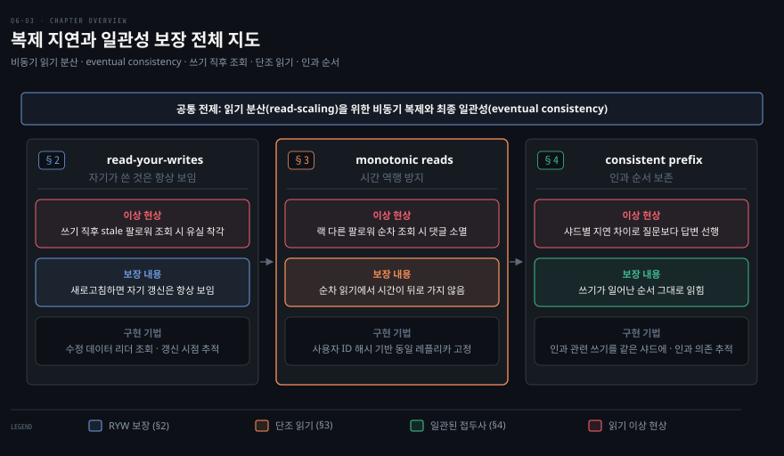
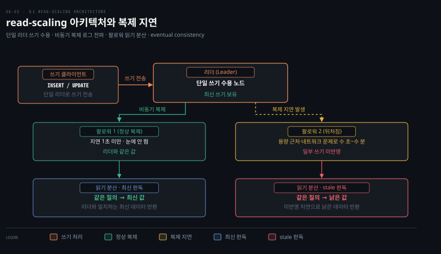
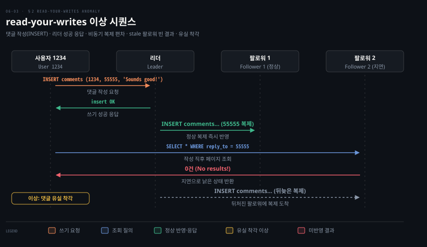
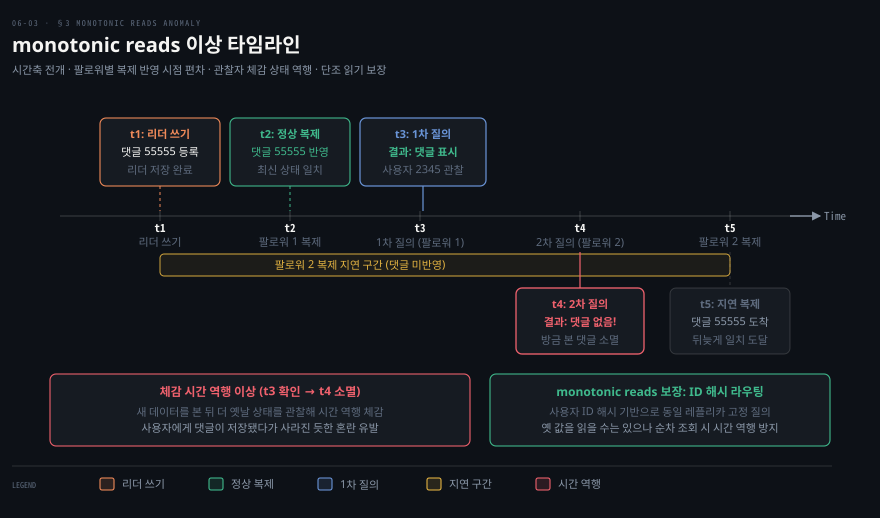
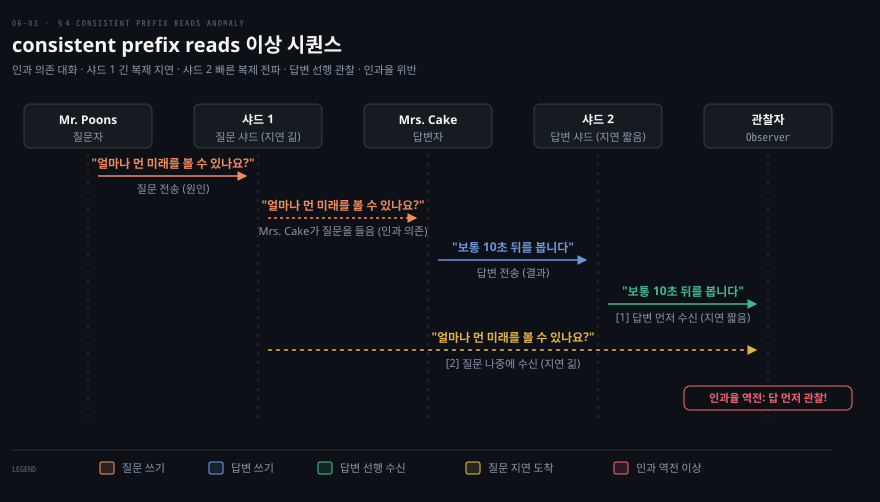

# 복제 지연 문제와 일관성 보장

---

> 비동기 팔로워에서 읽으면 낡은 값이 나오는 eventual consistency가 생기고, read-your-writes·monotonic reads·consistent prefix reads 세 보장으로 그 이상 현상을 완화합니다.

이 노트를 읽고 나면 read-scaling이 비동기를 요구하는 이유와 eventual consistency의 뜻을 설명할 수 있습니다. 또한 복제 지연이 낳는 세 가지 읽기 이상과 각각을 막는 일관성 보장을 짝지어 말할 수 있습니다.

이 노트는 6장에서 단일 리더의 운영 측면([06-02](06-02.%EB%85%B8%EB%93%9C%20%EC%9E%A5%EC%95%A0%20%EC%B2%98%EB%A6%AC%EC%99%80%20%EB%B3%B5%EC%A0%9C%20%EB%A1%9C%EA%B7%B8.md))을 이어 복제 자체가 낳는 일관성 문제를 다룹니다. 복제의 이유는 노드 장애 내성만이 아닙니다. 한 머신보다 많은 요청을 처리하는 확장성과 사용자 가까이 레플리카를 배치하는 지연 단축도 동기입니다. 그 이점을 누리는 read-scaling이 어떤 함정을 부르는지가 이 노트의 주제입니다.

지도는 복제 지연이 낳는 세 가지 읽기 이상을 절마다 한 칸에 두고 칸마다 이상·보장·구현 기법을 짝지었습니다.

## 1. eventual consistency
> 읽기를 팔로워에 분산하면 읽기 처리량이 늘지만 비동기 복제가 필수이고, 뒤처진 팔로워에서 낡은 값을 읽는 eventual consistency가 따라옵니다.

리더 기반 복제는 쓰기를 한 노드로 모으지만 읽기는 아무 레플리카로 갈 수 있습니다. 온라인 서비스처럼 읽기가 대부분이고 쓰기가 적은 워크로드에는 팔로워를 많이 만들어 읽기를 분산하는 선택이 매력적입니다. 이처럼 팔로워를 더해 읽기 용량을 늘리는 방식을 **read-scaling** 아키텍처라 부릅니다. 다만 read-scaling은 현실적으로 비동기 복제에서만 동작합니다. 모든 팔로워에 동기 복제하면 노드 하나나 네트워크 장애로 쓰기 전체가 막힙니다. 또한 노드가 많을수록 하나가 멈출 확률이 높아져 완전 동기는 너무 불안정합니다.

문제는 비동기 팔로워에서 읽으면 그 팔로워가 뒤처졌을 때 낡은 정보를 본다는 점입니다. 같은 질의를 리더와 팔로워에 동시에 던지면 아직 일부 쓰기가 팔로워에 반영되지 않아 다른 결과가 나옵니다. 이는 일시적인 상태로, 쓰기를 멈추고 기다리면 팔로워가 결국 따라잡아 일치합니다. 그래서 이 효과를 **eventual consistency(최종 일관성)** 라 부릅니다.

같은 질의라도 리더를 따라잡은 팔로워는 최신 값을, 뒤처진 팔로워는 낡은 값을 돌려줍니다.

"eventually(결국)"라는 표현은 일부러 모호하게 쓰였습니다. 레플리카가 얼마나 뒤처질지 상한이 없기 때문입니다. 정상 상태에서는 **복제 지연(replication lag)** 이 1초 미만이라 눈에 띄지 않습니다. 하지만 용량 근처이거나 네트워크 문제가 있으면 지연이 수 초나 수 분으로 쉽게 커집니다. 이 노트는 지연이 클 때 생기는 세 가지 문제와 그 해법을 정리합니다.

> 📌 eventual consistency는 NoSQL의 구호로 유명해졌지만 비동기 복제 관계형 DB의 팔로워도 같은 성질을 가집니다.

## 2. read-your-writes 일관성
> 자기가 방금 쓴 것을 stale 팔로워에서 읽으면 사라진 듯 보이므로, 자기가 쓴 것은 항상 보이게 하는 read-your-writes를 보장해야 합니다.

많은 앱에서 사용자는 댓글이나 프로필 같은 데이터를 제출하고 곧바로 자기가 낸 것을 봅니다. 제출은 리더로 가지만 조회는 팔로워에서 읽을 수 있습니다. 이때 비동기 복제 환경에서는 쓰기 직후 새 데이터가 아직 해당 팔로워에 도달하지 못했을 수 있습니다. 그러면 사용자에게는 방금 입력한 내용이 사라진 것처럼 보입니다. 여기서 필요한 것이 **read-after-write 일관성(=read-your-writes)** 입니다. 사용자가 페이지를 새로고침하면 자기가 제출한 갱신은 항상 본다는 보장입니다. 다만 다른 사람의 갱신까지 최신으로 보장하지는 않습니다.

댓글을 제출하고 곧바로 조회하면, 질의가 새 데이터가 아직 도달하지 않은 팔로워로 가 자기 입력이 사라진 것처럼 보입니다.

리더 기반에서 구현하는 기법은 여럿입니다.

1. 사용자가 수정했을 만한 것은 리더(또는 동기 팔로워)에서 읽고 나머지는 비동기 팔로워에서 읽습니다. 예를 들어 소셜 네트워크 프로필은 본인만 편집할 수 있으므로, 자기 프로필은 리더에서 읽고 다른 사람의 프로필은 팔로워에서 읽습니다.
2. 대부분이 사용자 편집 대상이면 읽기가 리더로 쏠려 위 방법이 통하지 않습니다. 이때는 마지막 갱신 시각을 추적해 갱신 후 1분간 모든 읽기를 리더로 보내거나, 1분 이상 뒤처진 팔로워로 질의를 보내지 못하게 막는 다른 기준을 씁니다.
3. 클라이언트가 자기 최근 쓰기의 타임스탬프(논리 타임스탬프 또는 시스템 시계)를 기억하고 그 시점까지 반영한 레플리카만 읽기를 처리하게 합니다.

레플리카가 여러 리전에 분산되면 복잡도가 늘어납니다. 리더가 처리해야 할 요청은 리더가 위치한 리전으로 라우팅해야 하기 때문입니다.

또한 같은 사용자가 여러 기기로 접근하면 **교차 기기 read-your-writes** 가 필요합니다. 한 기기는 다른 기기의 갱신을 알지 못하므로 메타데이터를 중앙화해야 합니다. 기기마다 네트워크 경로도 달라지므로, 리더 읽기가 필요하다면 한 리전으로 모아야 합니다.

## 3. monotonic reads
> 랙이 다른 두 팔로워에서 읽으면 시간이 뒤로 가 봤던 데이터가 사라질 수 있으므로, 한 사용자가 항상 같은 레플리카에서 읽게 해 단조성을 보장합니다.

두 번째 이상은 사용자가 **시간이 뒤로 가는** 현상을 보는 것입니다. 한 사용자가 서로 다른 레플리카에서 여러 번 읽으면 생깁니다. 예를 들어 첫 질의는 랙이 적은 팔로워로 가 최근 추가된 댓글을 반환합니다. 하지만 두 번째 질의는 랙이 큰 팔로워로 가 아직 쓰기를 받지 못해 그 댓글을 보지 못합니다. 두 번째 질의가 첫 번째보다 이른 시점의 상태를 본 셈입니다. 댓글을 봤다가 사라지는 현상은 사용자에게 사뭇 혼란스럽습니다.

시간축 위에 놓으면 두 번째 질의가 첫 번째보다 이른 시점의 상태를 본 셈이어서, 봤던 댓글이 사라집니다.

이 이상을 막는 보장이 **monotonic reads(단조 읽기)** 입니다. 강한 일관성보다는 약하고 eventual consistency보다는 강한 보장입니다. 읽을 때 옛 값을 볼 수는 있지만 한 사용자가 순차로 읽으면 새 데이터를 본 뒤 옛 데이터를 보지 않아 시간이 뒤로 가지 않음만 보장합니다.

한 가지 방법은 각 사용자가 항상 같은 레플리카에서 읽게 하는 것입니다. 예를 들어 사용자 ID 해시로 레플리카를 선택합니다. 그 레플리카에 장애가 생기면 다른 레플리카로 재라우팅해야 합니다.

## 4. consistent prefix reads
> 샤드별 랙 차이로 답이 질문보다 먼저 보이는 인과 위반이 생기므로, 쓰기 순서대로 보이는 consistent prefix reads를 보장합니다.

세 번째 이상은 인과율 위반입니다. 질문과 그 답 사이에는 인과 의존이 있습니다. 그런데 답은 랙이 적은 팔로워로 가고 질문은 랙이 큰 팔로워로 가면 관찰자는 답을 질문보다 먼저 듣습니다. 마치 질문하기도 전에 답하는 것처럼 보입니다.

답이 랙 적은 팔로워로, 질문이 랙 큰 팔로워로 전해지면 관찰자는 답을 질문보다 먼저 듣습니다.

이 이상을 막는 것이 **consistent prefix reads** 입니다. 쓰기가 어떤 순서로 일어나면 그것을 읽는 누구든 같은 순서로 본다는 보장입니다. 샤딩된 DB에서 특히 문제입니다(7장). 많은 분산 DB는 샤드가 독립 동작해 쓰기의 전역 순서가 없으므로 일부는 옛 상태, 일부는 새 상태로 보입니다.

한 해법은 인과 관련 쓰기를 같은 샤드에 쓰는 것이지만 항상 효율적이진 않습니다. 인과 의존을 명시 추적하는 알고리즘도 있는데, happens-before 관계로 [06-06](06-06.%EB%A6%AC%EB%8D%94%EB%A6%AC%EC%8A%A4%20%EB%B3%B5%EC%A0%9C%EC%99%80%206%EC%9E%A5%20%EC%A2%85%ED%95%A9.md)에서 다시 봅니다.

근본 해법은 앱 코드로 우회하는 대신 강한 보장을 주는 DB를 고르는 것입니다. 앱 코드로 우회하는 방식은 복잡하고 틀리기 쉽습니다. linearizable(10장)이나 ACID 트랜잭션(8장)을 지원하면 복제 난점을 대부분 무시하고 단일 노드처럼 다룰 수 있습니다.

2010년대 초 NoSQL은 이 기능들이 확장성을 막는다고 봤습니다. 하지만 이후 강한 일관성과 트랜잭션을 내결함성·고가용성·확장성과 함께 제공하는 DB가 나왔고 이 흐름을 **NewSQL** 이라 부릅니다.

## 자주 받는 오해
> eventual consistency, read-your-writes, monotonic reads, 복제 지연의 범위에 관한 흔한 오해 네 가지를 바로잡습니다.

1. **"eventual consistency는 NoSQL만의 특성이다"** — 비동기 복제 관계형 DB의 팔로워도 같은 성질을 가집니다. eventual consistency는 복제 방식의 결과이지 특정 제품 분류가 아닙니다.
2. **"read-your-writes면 다른 사람 글도 최신으로 보인다"** — 자기가 쓴 것만 보장합니다. 타인의 갱신은 나중에야 보일 수 있습니다. 본인 입력이 저장됐다는 안심을 주는 것이 목적입니다.
3. **"monotonic reads는 항상 최신을 본다는 뜻이다"** — 아닙니다. 옛 값을 볼 수는 있고 다만 새 값을 본 뒤 더 옛 값으로 시간이 뒤로 가지 않음만 보장합니다. 강한 일관성과 eventual consistency의 중간입니다.
4. **"복제 지연은 1초 미만이라 무시해도 된다"** — 정상에선 그렇지만 용량 근처나 네트워크 문제 시 수 분으로 커집니다. 랙이 클 때 앱이 어떻게 거동할지 미리 설계해야 합니다. 비동기인데 동기인 척하면 나중에 탈이 납니다.

## 면접에서 받을 만한 질문

1. **"eventual consistency란?"** — 비동기 복제에서 팔로워가 뒤처져 낡은 값을 읽을 수 있지만 쓰기를 멈추고 기다리면 팔로워가 결국 리더를 따라잡아 일치하는 일시적 비일관 상태입니다. "결국"의 시점에는 상한이 없어 복제 지연이 분 단위로 커질 수 있습니다.
2. **"복제 지연이 낳는 세 이상과 각 해법은?"** — 첫째, 쓰기 직후 stale 데이터를 읽는 read-your-writes 위반은 자기 데이터를 리더에서 읽어 풉니다. 둘째, 시간이 뒤로 가는 monotonic reads 위반은 사용자마다 같은 레플리카에서 읽게 해 막습니다. 셋째, 답이 질문보다 먼저 보이는 consistent prefix reads 위반은 인과 관련 쓰기를 같은 샤드로 모아 해결합니다.
3. **"복제 지연 문제의 근본 해법은?"** — 앱 코드로 일일이 우회하기보다 강한 일관성(linearizable)과 트랜잭션을 주는 DB를 고르는 것입니다. NewSQL은 이를 분산 DB의 내결함성·확장성과 함께 제공해, 복제 난점을 대부분 단일 노드처럼 다루게 합니다.

## 관련 문서

> 이 노트는 단일 리더의 일관성 한계를 다루며, 다음은 리더를 여럿 두는 다중 리더로 넘어갑니다.

- [06-02 노드 장애 처리와 복제 로그](06-02.%EB%85%B8%EB%93%9C%20%EC%9E%A5%EC%95%A0%20%EC%B2%98%EB%A6%AC%EC%99%80%20%EB%B3%B5%EC%A0%9C%20%EB%A1%9C%EA%B7%B8.md) § "복제 로그" — replication lag을 측정하는 로그 위치
- [06-04 다중 리더 복제](06-04.%EB%8B%A4%EC%A4%91%20%EB%A6%AC%EB%8D%94%20%EB%B3%B5%EC%A0%9C.md) § "geo-distributed" — 리전 분산이 일관성을 더 약화시키는 다음 단계
- [06-06 리더리스 복제와 6장 종합](06-06.%EB%A6%AC%EB%8D%94%EB%A6%AC%EC%8A%A4%20%EB%B3%B5%EC%A0%9C%EC%99%80%206%EC%9E%A5%20%EC%A2%85%ED%95%A9.md) § "happens-before" — 인과 의존을 명시 추적하는 방법
- [ddia2 README — 2판 정독 인덱스](README.md)
