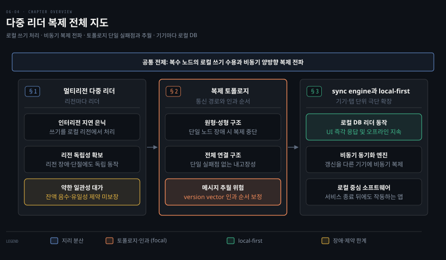
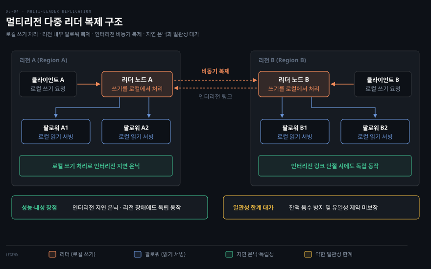
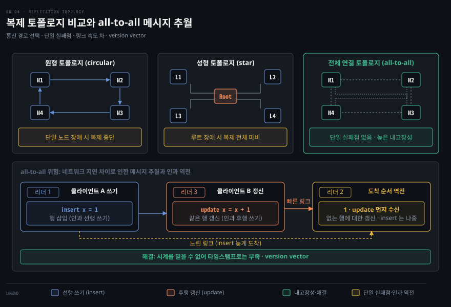
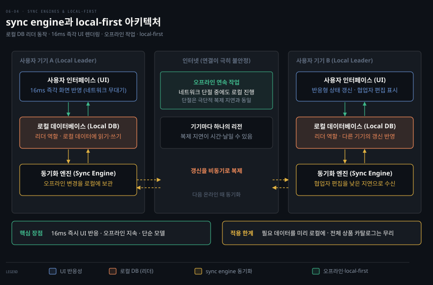

# 다중 리더 복제

---

> 리더를 여럿 둬 어느 리더든 쓰기를 받게 하면 멀티리전 성능·내성을 얻지만 일관성이 약해지고, 토폴로지 선택과 충돌 해소가 따라옵니다.

이 노트를 읽고 나면 다중 리더가 멀티리전에서 단일 리더보다 나은 점과 일관성 대가를 설명할 수 있습니다. 또 세 복제 토폴로지의 트레이드오프를 비교하고, sync engine과 local-first 소프트웨어가 왜 다중 리더의 극단인지 말할 수 있습니다.

이 노트는 6장에서 단일 리더의 일관성 한계([06-03](06-03.%EB%B3%B5%EC%A0%9C%20%EC%A7%80%EC%97%B0%20%EB%AC%B8%EC%A0%9C%EC%99%80%20%EC%9D%BC%EA%B4%80%EC%84%B1%20%EB%B3%B4%EC%9E%A5.md))를 이어, 리더를 여럿 두는 대안을 다룹니다. 단일 리더의 큰 약점은 모든 쓰기가 한 리더를 거쳐야 한다는 점입니다. 그 리더에 접속할 수 없으면 쓰기 자체가 불가능합니다. 이에 대한 자연스러운 확장이 둘 이상의 노드가 쓰기를 받는 **다중 리더(multi-leader, active/active, 양방향)** 구성입니다. 각 리더는 쓰기를 받으면서 동시에 다른 리더의 팔로워 역할도 맡습니다.

다중 리더에서도 동기와 비동기 복제를 고를 수 있습니다. 하지만 동기 다중 리더는 단일 리더와 사실상 같아집니다(A→B 동기면 네트워크 단절 때 A에 쓰지 못함). 그래서 이 노트는 다른 리더와 끊겨도 각자 쓰기를 처리하는 **비동기 다중 리더**에 집중합니다.

지도는 리전마다 리더를 두는 지리 분산, 쓰기가 오가는 토폴로지, 각 기기가 리더인 sync engine을 절 순서대로 놓았습니다.

## 1. 멀티리전에서의 다중 리더
> 리전마다 리더를 두면 로컬에서 쓰기를 처리해 인터리전 지연을 숨기고 리전·네트워크 장애를 견디지만, 일관성 제약을 보장하지 못합니다.

단일 리전 안에서 다중 리더를 쓸 이유는 드뭅니다(이점이 복잡도를 넘지 못함). 하지만 레플리카가 여러 리전에 있는 **geo-distributed(지리 분산)** 환경에서는 합리적입니다. 단일 리더에서는 모든 쓰기가 리더가 있는 한 리전을 거쳐야 합니다. 반면 다중 리더에서는 리전마다 리더를 둘 수 있습니다. 리전 내부에서는 일반적인 leader-follower 복제를 쓰고, 리전 사이에서는 각 리전 리더가 다른 리전 리더로 변경을 복제합니다. 단일 리더와 비교하면 네 가지 차이가 있습니다.

1. **성능** — 단일 리더는 모든 쓰기가 인터넷 너머 리더 리전으로 가 큰 지연이 붙습니다. 반면 다중 리더는 쓰기를 로컬 리전에서 처리하고 비동기로 다른 리전에 복제하므로 인터리전 지연이 사용자에게 숨겨집니다.
2. **리전 장애 내성** — 단일 리더는 리더 리전이 죽으면 failover로 다른 리전 팔로워를 승격해야 합니다. 반면 다중 리더는 각 리전이 독립 동작하며, 장애 리전은 복귀할 때 변경을 따라잡습니다.
3. **네트워크 문제 내성** — 인터리전 트래픽은 리전 내부보다 덜 안정적입니다. 단일 리더는 다른 리전 리더로 쓰기를 보내고 응답을 기다려야 하므로 이 링크에 민감합니다. 반면 비동기 다중 리더는 일시 단절 중에도 각 리전이 독립해서 진행합니다.
4. **일관성** — 가장 큰 단점입니다. 단일 리더는 직렬성 같은 강한 보장을 줄 수 있지만, 다중 리더가 줄 수 있는 일관성은 훨씬 약합니다. 예를 들어 잔액이 음수가 되지 않게 막거나 username 유일성을 보장할 수 없습니다. 서로 다른 리더가 각자 정상인 쓰기를 처리해도, 둘을 합치면 제약이 깨질 수 있기 때문입니다. 이는 분산 시스템의 근본 한계이며, 그런 제약이 필요하다면 단일 리더가 낫습니다.

두 리전의 리더가 각자 로컬에서 쓰기를 처리하고, 인터리전 링크로 서로에게 변경을 비동기 복제합니다.

다중 리더는 단일 리더보다 덜 흔하지만 MySQL·Oracle·SQL Server·YugabyteDB 등이 지원합니다. 외부 애드온(Redis Enterprise·EDB Postgres Distributed·pglogical)으로 제공되기도 합니다. 이 기능은 여러 데이터베이스에 나중에 덧붙은 경우가 많습니다. 그래서 autoincrement 키나 트리거, 무결성 제약과 미묘하게 충돌하는 함정이 흔합니다. 이런 이유로 다중 리더는 가능하면 피해야 할 위험 지대로 여겨지기도 합니다.

## 2. 복제 토폴로지
> 리더가 셋 이상이면 circular·star·all-to-all 토폴로지를 고를 수 있고, 밀집된 all-to-all이 내고장성은 낫지만 메시지 추월로 인과 순서가 깨질 위험이 있습니다.

**복제 토폴로지(replication topology)** 는 쓰기가 노드 사이로 전파되는 통신 경로입니다. 리더가 둘이면 경로가 하나뿐이지만, 셋 이상이면 여러 토폴로지가 가능합니다.

1. **all-to-all(전체)** — 모든 리더가 다른 모든 리더에 자기 쓰기를 보냅니다. 가장 일반적입니다.
2. **circular(원형)** — 각 노드가 한 노드에서 쓰기를 받아 (자기 쓰기와 함께) 다른 한 노드로 전달합니다.
3. **star(성형)** — 지정된 루트 노드가 모든 다른 노드에 쓰기를 전달합니다(트리로 일반화 가능).

circular와 star에서는 쓰기가 여러 노드를 거쳐야 모든 레플리카에 도달합니다. 그래서 무한 복제 루프를 막으려면 각 노드에 고유 식별자를 두고, 쓰기 데이터에 거쳐 온 노드의 식별자를 태깅합니다(자기 식별자가 붙은 변경은 무시). 하지만 이 구조는 노드 하나만 죽어도 다른 노드 사이의 복제 흐름이 끊기는 취약점이 있습니다. 반면 더 밀집된 all-to-all은 메시지가 여러 경로로 갈 수 있어 단일 실패점이 없어 내고장성이 낫습니다.

다만 all-to-all에도 문제가 있습니다. 네트워크 링크 속도가 서로 다르면 메시지가 **추월**할 수 있습니다. 예를 들어 리더 1에서 insert가 발생하고 리더 3에서 그 행의 update가 일어났다고 가정해 봅시다. 이때 리더 2는 update를 먼저 받고 insert를 나중에 받을 수 있습니다(존재하지 않는 행에 대한 갱신). 이는 consistent prefix reads([06-03](06-03.%EB%B3%B5%EC%A0%9C%20%EC%A7%80%EC%97%B0%20%EB%AC%B8%EC%A0%9C%EC%99%80%20%EC%9D%BC%EA%B4%80%EC%84%B1%20%EB%B3%B4%EC%9E%A5.md))에서 본 인과 문제와 같습니다.

시계를 신뢰할 수 없어(9장) 타임스탬프만으로는 부족합니다. 순서는 **version vector**([06-06](06-06.%EB%A6%AC%EB%8D%94%EB%A6%AC%EC%8A%A4%20%EB%B3%B5%EC%A0%9C%EC%99%80%206%EC%9E%A5%20%EC%A2%85%ED%95%A9.md))로 바로잡습니다. 하지만 많은 다중 리더 시스템이 적절한 순서 기법을 쓰지 않아 이 문제에 취약합니다. 따라서 문서를 꼼꼼히 확인하고 실제 보장이 성립하는지 직접 시험해야 합니다.

circular·star는 한 노드만 죽어도 흐름이 끊기지만, all-to-all은 내고장성이 나은 대신 링크 속도 차로 메시지가 추월해 인과 순서가 뒤바뀔 수 있습니다.

> 📌 성형 네트워크 토폴로지는 star schema([03-03](03-03.%EB%B6%84%EC%84%9D%EC%9A%A9%20%EC%8A%A4%ED%82%A4%EB%A7%88%20%E2%80%94%20%EB%B3%84%C2%B7%EB%88%88%EC%86%A1%EC%9D%B4%C2%B7OBT.md))와 무관합니다. star schema는 데이터 모델 구조를 가리킵니다.

## 3. sync engine과 local-first 소프트웨어
> 오프라인 작동 앱과 실시간 협업은 각 기기·탭이 리더인 다중 리더의 극단이며, sync engine이 로컬 상태로 즉각 응답·오프라인 작동·단순한 프로그래밍 모델을 줍니다.

다중 리더는 인터넷 연결이 끊겨도 작동해야 하는 앱에도 맞습니다. 캘린더 앱이 좋은 예입니다. 오프라인 상태에서도 일정을 확인하는 읽기와 새 일정을 등록하는 쓰기가 모두 가능해야 하고, 오프라인에서 바꾼 내용은 온라인으로 복귀할 때 동기화되어야 합니다.

이는 각 기기가 리더 역할을 하는 로컬 데이터베이스 레플리카를 두고 기기 사이에 비동기 다중 리더 동기화를 돌리는 셈입니다. 복제 지연이 몇 시간이나 며칠씩 이어질 수 있다는 점을 빼면, 리전 간 다중 리더를 극단으로 확장한 구조와 같습니다(각 기기가 리전이고 연결이 극히 불안정함).

Google Docs·Figma·Linear 같은 실시간 협업 앱이 빠르게 반응하는 까닭은 두 가지입니다. 사용자 입력은 네트워크 왕복을 기다리지 않고 즉시 UI에 반영됩니다. 한 사용자의 편집도 낮은 지연으로 협업자에게 보입니다. 이 구조 역시 다중 리더입니다. 공유 파일을 연 각 브라우저 탭이 레플리카가 되고, 로컬 갱신은 비동기로 다른 사용자 기기에 복제됩니다. 이 과정을 돕는 라이브러리를 **sync engine**이라 부릅니다. sync engine 접근의 장점은 다음과 같습니다.

1. 데이터가 로컬에 있어 UI가 서비스 호출을 기다리지 않고 빠르게 응답합니다(다음 프레임, 16ms 목표).
2. 오프라인에서 계속 작업할 수 있습니다. 별도의 오프라인 모드가 필요하지 않으며, 오프라인 상태는 단지 긴 네트워크 지연과 같습니다.
3. 프로그래밍 모델이 단순해집니다. 명시적 서비스 호출과 오류 처리 대신 로컬 데이터를 읽고 쓰며, 로컬 연산은 거의 실패하지 않아 선언적 스타일을 유지할 수 있습니다.
4. 반응형 프로그래밍과 결합해 타인 편집을 실시간 반영하기 좋습니다.

기기마다 로컬 DB가 리더 역할을 하고, sync engine이 갱신을 다른 기기에 비동기로 복제합니다.

sync engine은 사용자가 필요로 할 데이터를 미리 다 받아 로컬에 둘 때 가장 잘 동작합니다. 따라서 사용자가 방대한 데이터에 접근해야 하는 환경에는 맞지 않습니다(개인 파일 다운로드는 가능하지만 전체 상품 카탈로그는 무리).

**offline-first**는 오프라인 편집을 허용하는 애플리케이션을 뜻합니다. **local-first**는 개발사가 온라인 서비스를 모두 종료해도 계속 작동하도록 설계된 협업 앱입니다(개방 sync 프로토콜로 복수 제공자 지원 가능). Git이 그 예로, GitHub나 GitLab 등으로 동기화할 수 있는 local-first 협업 시스템입니다(실시간 협업은 미지원).

## 자주 받는 오해
> 다중 리더는 단일 리더의 상위 호환이 아니며, 지리 분산과 오프라인 협업의 이점 뒤에 약한 일관성과 토폴로지 위험이 따릅니다.

1. **"다중 리더는 단일 리더보다 항상 낫다"** — 일관성이 훨씬 약합니다. 잔액 음수 방지나 username 유일성 같은 제약을 보장하지 못하므로, 그런 제약이 필요하다면 단일 리더가 낫습니다. 다중 리더는 멀티리전 성능이나 내성이 필요하고 강한 제약이 필요 없는 애플리케이션에 맞습니다.
2. **"단일 리전에서도 다중 리더를 쓰면 좋다"** — 단일 리전에서는 복잡도에 비해 얻는 이점이 적어 거의 쓰지 않습니다. 다중 리더의 값어치는 주로 geo-distributed 환경이나 오프라인, 실시간 협업에서 나옵니다.
3. **"토폴로지는 아무거나 골라도 된다"** — circular와 star는 한 노드만 죽어도 복제 흐름이 끊깁니다. all-to-all은 내고장성이 낫지만 메시지 추월로 insert보다 update가 먼저 도착하는 인과 문제가 있습니다. 그래서 version vector 같은 순서 기법이 필요합니다.
4. **"실시간 협업 앱은 다중 리더가 아니다"** — 각 브라우저 탭이 로컬 쓰기를 받아 비동기로 전파하므로 다중 리더의 일종입니다. 오프라인 편집을 막더라도 여러 사용자가 서버 응답을 기다리지 않고 편집하는 순간 이미 다중 리더로 동작합니다.

## 면접에서 받을 만한 질문

1. **"다중 리더가 멀티리전에서 단일 리더보다 나은 점은?"** — 쓰기를 로컬 리전에서 처리해 인터리전 지연을 숨깁니다(성능). 각 리전이 독립 동작해 리전 장애를 견디며(리전 내성), 인터리전 링크가 끊겨도 로컬에서 진행합니다(네트워크 내성). 다만 대가로 일관성이 약해져 교차 리더 제약을 보장하지 못합니다.
2. **"all-to-all 토폴로지의 위험은?"** — 링크 속도 차이로 메시지가 서로 추월해, insert보다 그 행의 update가 먼저 도착하는 인과 순서 위반이 생깁니다. 시계를 신뢰할 수 없으므로 타임스탬프만으로는 부족하며, version vector로 순서를 바로잡아야 합니다.
3. **"sync engine은 왜 다중 리더인가, 어떤 장단점이 있나?"** — 각 기기와 브라우저 탭이 로컬 쓰기를 받는 리더 역할을 하고 비동기로 동기화하기 때문입니다. 즉각적인 UI 응답과 오프라인 작동, 단순한 프로그래밍 모델이 장점입니다. 반면 필요한 데이터를 로컬에 미리 다 받아야 하므로 대용량 데이터 접근에는 부적합합니다.

## 관련 문서

> 이 노트는 리더를 여럿 두는 구조를 다루며, 다음은 그 구조가 낳는 쓰기 충돌을 어떻게 푸는지로 넘어갑니다.

- [06-03 복제 지연 문제와 일관성 보장](06-03.%EB%B3%B5%EC%A0%9C%20%EC%A7%80%EC%97%B0%20%EB%AC%B8%EC%A0%9C%EC%99%80%20%EC%9D%BC%EA%B4%80%EC%84%B1%20%EB%B3%B4%EC%9E%A5.md) § "consistent prefix reads" — all-to-all 추월이 같은 인과 문제인 배경
- [06-05 쓰기 충돌 해소](06-05.%EC%93%B0%EA%B8%B0%20%EC%B6%A9%EB%8F%8C%20%ED%95%B4%EC%86%8C.md) § "충돌 회피·LWW" — 다중 리더가 부르는 충돌의 해법
- [03-03 분석용 스키마 — 별·눈송이·OBT](03-03.%EB%B6%84%EC%84%9D%EC%9A%A9%20%EC%8A%A4%ED%82%A4%EB%A7%88%20%E2%80%94%20%EB%B3%84%C2%B7%EB%88%88%EC%86%A1%EC%9D%B4%C2%B7OBT.md) § "star schema" — 이름만 같고 무관한 개념 구분
- [ddia2 README — 2판 정독 인덱스](README.md)
