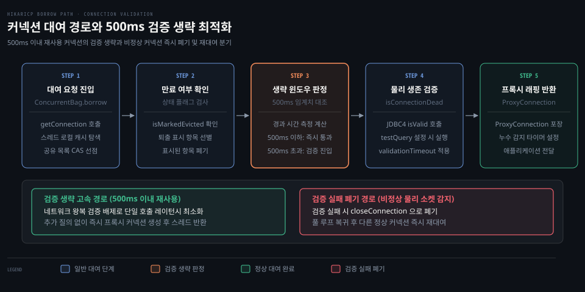
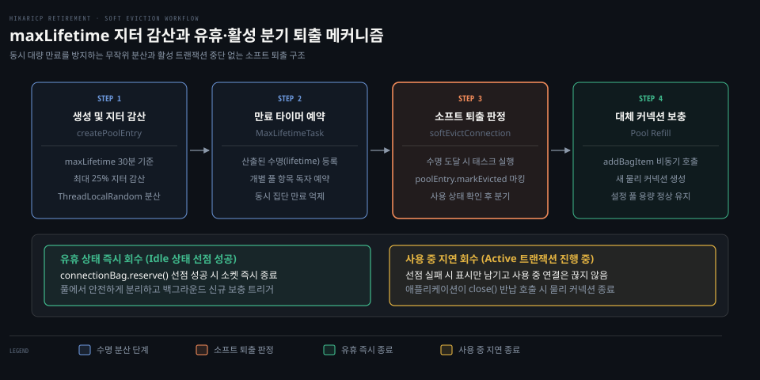

# getConnection·HouseKeeper·maxLifetime

---

> 커넥션 풀은 데이터베이스와의 핸드셰이크와 인증 비용을 아끼려고 연결을 재사용합니다. HikariCP 6.2.1 소스를 기준으로 대여 경로와 검증 생략, 하우스키퍼의 주기 검사, 지터를 뺀 수명 만료와 소프트 퇴출을 따라갑니다.

## 학습 목표

> 이 문서를 읽고 나면 커넥션 대여, 주기 검사, 수명 퇴출이 일어나는 내부 경로를 설명할 수 있습니다.

1. `getConnection` 호출 시 `ConcurrentBag` 대여와 500ms 검증 생략 구간의 동작을 추적할 수 있습니다.
2. `HouseKeeper` 의 30초 주기 실행과 시계 이상 감지, `idleTimeout` 회수 조건을 설명할 수 있습니다.
3. `maxLifetime` 에서 무작위 지터를 빼 동시 만료를 흩는 원리를 계산할 수 있습니다.
4. `softEvictConnection` 이 유휴 연결은 바로 닫고 사용 중 연결은 반납 시점에 닫는 분기를 설명할 수 있습니다.
5. Commons DBCP2 설정과 HikariCP 동작의 차이를 비교할 수 있습니다.


## 1. 대여 경로와 검증 생략 구간

> 마지막 반납 뒤 500ms 안에 다시 빌려 가는 연결은 생존 검사를 건너뛰어 대여 지연을 줄입니다.



쿼리를 실행할 때마다 데이터베이스와 TCP 연결을 새로 맺으면 지연이 생깁니다. 핸드셰이크와 TLS 협상, 계정 인증이 매번 반복되기 때문입니다. 커넥션 풀은 연결을 미리 만들어 두고 빌려주는 방식으로 이 비용을 없앱니다. 하지만 풀에서 꺼낸 연결이 살아 있는지 매번 원격으로 확인하면 네트워크 왕복이 듭니다. HikariCP 는 락 없이 선점하는 자료구조와 검증 생략 구간을 조합해 이 비용을 낮춥니다[^hikaripool-source].

### ConcurrentBag 대여 메커니즘

애플리케이션이 `DataSource.getConnection()` 을 호출하면 `HikariPool.getConnection()` 으로 들어옵니다. 이 메서드는 대기 기한 `connectionTimeout`(기본 30초)을 넘겨 `getConnection(hardTimeout)` 을 부릅니다[^hikaripool-source][^hikariconfig-source]. 그 안의 루프가 `ConcurrentBag.borrow()` 를 호출합니다.

`ConcurrentBag.borrow()` 는 스레드 간 경합을 줄이려고 세 단계로 대상을 찾습니다[^concurrentbag-source].

1. 스레드 로컬 목록 확인: 요청 스레드가 전에 반납한 항목을 담아 둔 `ThreadLocal` 목록을 먼저 살핍니다.
2. 공유 목록 탐색: 로컬 목록에서 못 찾으면 전체 공유 목록(`CopyOnWriteArrayList`)을 돌며 유휴 항목을 CAS 로 선점합니다.
3. 인계 큐 대기: 그래도 없으면 풀에 연결 추가를 요청(`addBagItem`)하고, 인계 큐(`SynchronousQueue`)에서 남은 대기 시간만큼 다른 스레드의 반납을 기다립니다.

같은 스레드가 연결을 반복해서 쓰면 첫 단계에서 끝나므로, 공유 목록 탐색이나 대기 큐까지 내려가지 않습니다.

### 500ms 검증 생략 구간

선점한 `PoolEntry` 는 바로 애플리케이션에 넘어가지 않습니다. 풀은 먼저 그 항목에 퇴출 표시가 있는지(`isMarkedEvicted()`) 봅니다. 표시된 항목은 닫고, 남은 대기 시간으로 루프를 다시 돌아 다른 항목을 빌립니다[^hikaripool-source].

표시가 없으면 경과 시간을 계산합니다. 현재 시각과 그 연결의 마지막 접근 시각(`lastAccessed`)의 차이입니다. `lastAccessed` 는 연결이 풀로 반납될 때 갱신됩니다[^poolentry-source]. 이 차이가 `aliveBypassWindowMs` 이하이면 생존 검사를 건너뜁니다[^hikaripool-source].

`aliveBypassWindowMs` 는 설정 항목이 아니라 시스템 속성 `com.zaxxer.hikari.aliveBypassWindowMs` 로 읽는 값입니다. 기본값은 500밀리초입니다[^hikaripool-source]. 직전 500ms 안에 반납된 연결은 소켓이 정상일 가능성이 높다고 봅니다. 그래서 연달아 빌려 가는 호출에서는 검사 왕복이 생기지 않습니다.

### 물리 생존 검증과 폐기 분기

마지막 접근 뒤 500ms 를 넘긴 연결은 `PoolBase.isConnectionDead()` 검사를 거칩니다[^hikaripool-source][^poolbase-source]. 검사 방식은 `connectionTestQuery` 설정 여부 하나로 갈립니다[^poolbase-source].

`connectionTestQuery` 를 설정하지 않았으면 JDBC4 표준 API 인 `Connection.isValid(seconds)` 를 호출합니다. 설정했으면 그 SQL 을 직접 실행합니다[^poolbase-source]. README 는 JDBC4 를 지원하는 드라이버라면 이 속성을 설정하지 말라고 강하게 권하고, 이 속성이 `isValid()` 를 지원하지 않는 옛 드라이버용이라고 적습니다[^hikaricp-readme]. `isValid()` 가 서버에 무엇을 보내는지는 드라이버 구현에 달려 있습니다.

검사 시간은 `validationTimeout` 으로 제한되며 기본값은 5초, 최솟값은 250ms 입니다[^hikariconfig-source][^hikaricp-readme]. 데이터베이스 재시작이나 네트워크 단절로 소켓이 닫혔다면 검사가 실패합니다. 실패한 연결은 `closeConnection()` 이 풀에서 빼고, 실제 닫기와 빈자리 채우기(`fillPool`)는 별도 실행기에서 비동기로 처리합니다[^hikaripool-source]. 대여 루프는 남은 대기 시간으로 다시 돌아 다른 연결을 찾습니다.

### ProxyConnection 래핑과 누수 감지

검사를 통과한 연결은 물리 객체 그대로 반환되지 않습니다. HikariCP 는 `poolEntry.createProxyConnection()` 으로 이를 `ProxyConnection` 으로 감싸 돌려줍니다[^hikaripool-source].

프록시로 감싸는 목적은 `close()` 를 가로채는 것입니다. 애플리케이션이 `connection.close()` 를 호출하면 프록시는 실제 소켓을 끊지 않습니다. 커밋되지 않은 변경이 있으면 롤백하고 바뀐 연결 상태를 되돌린 뒤 `poolEntry.recycle()` 을 부릅니다[^proxyconn-source]. 퇴출 표시가 없는 연결이면 풀은 이를 `ConcurrentBag` 에 반납 상태(`STATE_NOT_IN_USE`)로 되돌립니다[^hikaripool-source][^concurrentbag-source].

`leakDetectionThreshold` 가 0 보다 크면 대여할 때마다 누수 감지 작업이 예약됩니다[^hikaripool-source]. 그 시간 안에 반납되지 않으면 `ProxyLeakTask` 가 "Connection leak detection triggered" 경고를 남깁니다. 경고에는 연결을 빌려 간 지점의 스택 트레이스가 붙습니다[^proxyleaktask-source]. 이 값은 2초보다 작거나 `maxLifetime` 보다 크면 경고와 함께 꺼집니다[^hikariconfig-source].


## 2. 하우스키퍼 주기와 유휴 연결 회수

> 30초마다 도는 하우스키퍼가 시계 이상을 감시하고, 가변 풀일 때만 오래 쉰 연결을 줄이며, 최소 유휴 수를 채웁니다.

트래픽이 몰려 풀이 연결을 늘렸다가 요청이 줄면 빈 연결이 자원을 차지합니다. 반대로 시스템이 멈추거나 시계가 어긋나면 풀의 시간 계산이 틀어질 수 있습니다. HikariCP 는 주기적으로 도는 백그라운드 작업 `HouseKeeper` 로 이 두 가지를 처리합니다[^hikaripool-source].

### 30초 주기 스케줄러 실행

`HikariPool` 생성자는 하우스키핑 실행기(`ScheduledExecutorService`)에 `HouseKeeper` 를 `scheduleWithFixedDelay` 로 등록합니다. 첫 실행은 100ms 뒤이고, 그다음부터는 앞 실행이 끝난 뒤 `housekeepingPeriodMs` 만큼 쉬고 다시 돕니다[^hikaripool-source].

`housekeepingPeriodMs` 는 시스템 속성 `com.zaxxer.hikari.housekeeping.periodMs` 로 읽는 필드입니다. 기본값은 30초입니다[^hikaripool-source]. 매 실행은 먼저 `connectionTimeout`·`validationTimeout`·`leakDetectionThreshold` 를 설정에서 다시 읽습니다. MBean 으로 바뀐 값을 반영하기 위해서입니다[^hikaripool-source].

### 시계 역행과 스레드 기아 감지

그다음 `HouseKeeper` 는 이번 실행 시각(`now`)과 지난 실행 시각(`previous`)의 간격을 봅니다. 아래는 [HikariPool.java L811–L824](https://github.com/brettwooldridge/HikariCP/blob/HikariCP-6.2.1/src/main/java/com/zaxxer/hikari/pool/HikariPool.java#L811-L824) 를 그대로 옮긴 일부 코드입니다.

```java
            // Detect retrograde time, allowing +128ms as per NTP spec.
            if (plusMillis(now, 128) < plusMillis(previous, housekeepingPeriodMs)) {
               logger.warn("{} - Retrograde clock change detected (housekeeper delta={}), soft-evicting connections from pool.",
                           poolName, elapsedDisplayString(previous, now));
               previous = now;
               softEvictConnections();
               return;
            }
            else if (now > plusMillis(previous, (3 * housekeepingPeriodMs) / 2)) {
               // No point evicting for forward clock motion, this merely accelerates connection retirement anyway
               logger.warn("{} - Thread starvation or clock leap detected (housekeeper delta={}).", poolName, elapsedDisplayString(previous, now));
            }

            previous = now;
```

첫 분기는 간격이 주기보다 128ms 넘게 짧을 때입니다. 소스는 이를 시계가 뒤로 간 것(retrograde clock change)으로 보고 경고를 남긴 뒤 모든 연결을 소프트 퇴출하고, 이번 회차의 유휴 정리는 건너뜁니다. 128ms 여유는 주석대로 NTP 명세가 허용하는 오차입니다[^hikaripool-source].

둘째 분기는 간격이 주기의 1.5배, 기본값으로 45초를 넘었을 때입니다. 스레드 기아나 시계가 앞으로 뛴 경우라 경고 로그만 남기고 연결은 퇴출하지 않습니다. 주석은 시계가 앞으로 가면 연결 은퇴가 앞당겨질 뿐이라 퇴출할 이유가 없다고 설명합니다[^hikaripool-source]. README 는 HikariCP 가 정확한 타이머에 기대므로 서버 시계를 NTP 같은 시간 원천에 맞춰 두라고 따로 강조합니다[^hikaricp-readme].

### 유휴 연결의 조건부 회수

시계 검사를 통과하면 유휴 연결을 정리합니다. 이 단계는 `idleTimeout > 0` 이고 `minimumIdle < maximumPoolSize` 일 때만 돕니다[^hikaripool-source].

정리할 수 있는 개수는 "현재 유휴 연결 수 − `minimumIdle`" 까지입니다. 그 안에서 마지막 접근 뒤 `idleTimeout` 을 넘긴 연결을 `reserve()` 로 선점해 닫습니다[^hikaripool-source]. 그래서 README 는 유휴 연결이 `minimumIdle` 개에 이르면 더는 은퇴시키지 않는다고 적습니다. 또 하우스키퍼가 30초마다 돌기 때문에 실제 회수 시점이 `idleTimeout` 보다 최대 30초, 평균 15초 늦을 수 있다고 적습니다[^hikaricp-readme].

`idleTimeout` 의 기본값은 10분(600,000ms)입니다. 가변 풀에서 10초보다 작게 주면 경고와 함께 기본값으로 돌아가고, `maxLifetime` 에 1초 이내로 가깝거나 더 크면 꺼집니다[^hikariconfig-source].

`minimumIdle` 의 기본값은 `maximumPoolSize` 와 같습니다[^hikariconfig-source][^hikaricp-readme]. README 는 최대 성능과 갑작스러운 수요에 대한 응답성을 위해 이 값을 설정하지 말라고 권합니다. 고정 크기 풀로 쓰라는 뜻입니다[^hikaricp-readme].

고정 크기 풀에서는 정리 단계 자체가 돌지 않으므로 `idleTimeout` 이 지나도 연결이 줄지 않습니다. 이때 `idleTimeout` 을 기본값과 다르게 주면 시작할 때 경고가 남습니다. 경고 문구는 "has no effect because the pool is operating as a fixed size pool" 입니다[^hikariconfig-source].

정리 여부와 상관없이 하우스키퍼는 마지막에 `fillPool(true)` 를 부릅니다. `fillPool` 은 두 조건을 봅니다. 전체 연결 수가 `maximumPoolSize` 보다 적고 유휴 연결이 `minimumIdle` 보다 적으면, 모자란 만큼 연결 추가 작업을 넣습니다[^hikaripool-source].


## 3. 수명 만료와 소프트 퇴출 메커니즘

> 연결마다 다른 지터를 뺀 수명으로 만료 시점을 흩고, 사용 중인 연결은 반납될 때까지 기다렸다 바꿉니다.



데이터베이스 서버나 네트워크 장비는 연결에 시간 제한을 두기도 합니다. 풀이 이를 모르고 이미 끊긴 소켓을 애플리케이션에 건네면 쿼리가 실패합니다. HikariCP 는 연결에 최대 수명 `maxLifetime` 을 두어 연결을 스스로 은퇴시킵니다. README 는 이 값을 데이터베이스나 인프라가 정한 연결 시간 제한보다 몇 초 짧게 두라고 권합니다[^hikaricp-readme]. 그 제한이 어디서 오는지는 다음 편 01-03 에서 다룹니다.

### maxLifetime 지터 감산과 동시 만료 방지

`maxLifetime` 의 기본값은 30분(1,800,000ms)이고 최솟값은 30초입니다. 30초보다 작게 주면 경고와 함께 기본값으로 돌아갑니다[^hikariconfig-source]. 0 은 수명 제한 없음이지만, README 는 이 값을 설정하라고 강하게 권합니다[^hikaricp-readme].

애플리케이션이 시작할 때 연결 10개가 한꺼번에 만들어졌다고 해 봅시다. 모든 연결의 수명이 정확히 30분이면 30분이 되는 순간 10개가 함께 만료됩니다. 그러면 새 연결 10개의 핸드셰이크가 데이터베이스로 몰립니다. README 는 이를 풀의 집단 만료(mass-extinction)라 부릅니다. 그리고 연결마다 수명을 조금씩 깎아 이를 피한다고 적습니다[^hikaricp-readme].

수명을 깎는 곳은 `createPoolEntry()` 입니다. 아래는 [HikariPool.java L486–L492](https://github.com/brettwooldridge/HikariCP/blob/HikariCP-6.2.1/src/main/java/com/zaxxer/hikari/pool/HikariPool.java#L486-L492) 를 그대로 옮긴 일부 코드입니다.

```java
         final var maxLifetime = config.getMaxLifetime();
         if (maxLifetime > 0) {
            // default variance upto 25% of the maxLifetime (random)
            final var variance = maxLifetime > 10_000L ? ThreadLocalRandom.current().nextLong( maxLifetime / lifeTimeVarianceFactor ) : 0L;
            final var lifetime = maxLifetime - variance;
            poolEntry.setFutureEol(houseKeepingExecutorService.schedule(new MaxLifetimeTask(poolEntry), lifetime, MILLISECONDS));
         }
```

`lifeTimeVarianceFactor` 는 시스템 속성 `com.zaxxer.hikari.lifeTimeVarianceFactor` 로 읽습니다. 기본값은 4 이고 2 에서 40 사이로 묶입니다. 소스 주석대로 감산 비율은 `100 / factor` 퍼센트입니다. 그래서 기본은 최대 25%, 조정 범위는 2.5%에서 50%입니다([HikariPool.java L68](https://github.com/brettwooldridge/HikariCP/blob/HikariCP-6.2.1/src/main/java/com/zaxxer/hikari/pool/HikariPool.java#L68))[^hikaripool-source].

기본값으로 계산하면 `maxLifetime / 4` 는 450,000ms 이고, `variance` 는 0 이상 450,000ms 미만에서 무작위로 정해집니다. 그래서 각 연결의 실제 수명은 22분 30초 초과 30분 이하로 흩어집니다. 함께 만든 연결 10개도 7분 30초 폭 안에서 서로 다른 시점에 만료되므로 재연결이 한 시점에 몰리지 않습니다. README 는 이 감산을 "minor negative attenuation" 이라고만 적으므로, 실제 폭은 소스의 기본값으로 확인해야 합니다.

### 소프트 퇴출과 유휴·사용 중 분기

예약된 시각이 되면 그 연결의 `MaxLifetimeTask` 가 실행되어 `softEvictConnection()` 을 부릅니다[^hikaripool-source]. 소프트 퇴출은 실행 중인 쿼리를 끊지 않고 연결을 은퇴시키는 방식입니다.

1. 퇴출 표시: `poolEntry.markEvicted()` 로 항목에 퇴출 표시를 남깁니다[^hikaripool-source].
2. 유휴 연결 즉시 닫기: 연결이 풀에서 쉬고 있으면 `connectionBag.reserve()` 가 성공합니다. 풀은 그 자리에서 `closeConnection()` 으로 연결을 뺍니다. 이어서 `MaxLifetimeTask` 가 연결 추가(`addBagItem`)를 요청합니다[^hikaripool-source].
3. 사용 중 연결은 그대로 두기: 애플리케이션이 빌려 간 연결이면 `reserve()` 가 실패합니다. 풀은 연결을 끊지 않고 표시만 남깁니다[^hikaripool-source].
4. 반납 시점에 닫기: 애플리케이션이 `connection.close()` 를 부르면 프록시가 `poolEntry.recycle()` 을 거쳐 `HikariPool.recycle()` 로 넘깁니다. 여기서 퇴출 표시를 확인하고, 풀로 돌려보내는 대신 `closeConnection()` 으로 닫습니다. `closeConnection()` 은 닫은 뒤 `fillPool` 로 빈자리를 채웁니다[^proxyconn-source][^hikaripool-source].

README 도 사용 중인 연결은 은퇴시키지 않고, 닫힐 때에야 풀에서 뺀다고 적습니다[^hikaricp-readme]. 그래서 긴 배치가 도는 동안 `maxLifetime` 이 지나도, 풀이 그 연결을 중간에 끊지는 않습니다.

### keepaliveTime 과 유휴 연결 사전 검증

`keepaliveTime` 은 쉬고 있는 연결이 데이터베이스나 네트워크 장비에 의해 끊기지 않도록 주기적으로 깨우는 설정입니다[^hikaricp-readme]. 6.2.1 의 기본값은 2분(120,000ms)입니다. 30초보다 작으면 경고와 함께 꺼지고, `maxLifetime` 이상이어도 꺼집니다[^hikariconfig-source].

`createPoolEntry()` 는 연결마다 `KeepaliveTask` 를 반복 예약합니다. 간격은 `keepaliveTime` 에서 최대 10% 를 무작위로 뺀 값입니다[^hikaripool-source]. 작업은 연결을 `reserve()` 로 선점할 수 있을 때, 즉 유휴 상태일 때만 돕니다. 선점한 연결이 `isConnectionDead()` 검사를 통과하면 풀에 되돌립니다. 실패하면 닫고 연결 추가를 요청합니다[^hikaripool-source].

README 는 이 "ping" 이 `isValid()` 호출이거나 `connectionTestQuery` 실행이라고 적습니다. 연결이 풀 밖에 나가 있는 시간은 보통 한 자릿수 밀리초 이하라고 덧붙입니다[^hikaricp-readme].

ping 이 실제로 서버까지 오가면 그 연결에 트래픽이 생기므로, 유휴 시간만 보고 연결을 끊는 장비보다 먼저 연결을 깨울 수 있습니다. 중간 장비가 유휴를 어떻게 세는지와 `keepaliveTime` 을 몇으로 둘지는 01-03 에서 다룹니다.


## 4. Commons DBCP2 와의 구조 비교

> DBCP2 는 검증과 백그라운드 정리를 설정으로 켜고 끄게 두고, HikariCP 는 기본으로 켜 둔 내부 동작으로 처리합니다.

Apache Commons DBCP2 와 HikariCP 는 관리 방식이 다릅니다. DBCP2 는 대여·반납·유휴 검증과 백그라운드 정리를 각각 설정으로 조합하게 합니다[^dbcp2-config]. HikariCP 는 대여 검증과 하우스키핑을 내부 동작으로 고정해 두고, 바꿀 수 있는 손잡이를 줄였습니다[^hikaricp-readme][^hikaripool-source].

### 대여 검증 방식의 차이

DBCP2 의 `testOnBorrow` 는 기본값이 `true` 입니다[^dbcp2-config]. 켜져 있으면 연결을 빌려줄 때마다 검증하고, 실패한 연결은 풀에서 빼고 다른 연결을 빌립니다. 검증에는 `validationQuery` 가 있으면 그 쿼리를, 없으면 `isValid()` 를 씁니다[^dbcp2-config]. 대여마다 검증이 붙으므로 그만큼 왕복이 늘어납니다.

HikariCP README 의 설정 목록에는 `testOnBorrow` 같은 대여 검증 스위치가 없습니다[^hikaricp-readme]. 대신 1절의 500ms 생략 구간이 항상 적용되고, 그 폭은 시스템 속성으로만 바꿀 수 있습니다. 최근에 반납된 연결은 바로 내주고 오래 쉰 연결만 검사합니다[^hikaripool-source].

### 백그라운드 정리와 수명 관리 비교

DBCP2 에서 유휴 연결을 정리하는 evictor 스레드는 `timeBetweenEvictionRunsMillis` 가 양수일 때만 돕니다. 기본값이 -1 이라 따로 설정하지 않으면 evictor 가 돌지 않습니다[^dbcp2-config]. 유휴 연결에 검증까지 하려면 `testWhileIdle`(기본 `false`)도 켜야 합니다. 또 한 번 돌 때 살펴보는 연결 수는 `numTestsPerEvictionRun`(기본 3)으로 제한됩니다[^dbcp2-config].

HikariCP 의 `HouseKeeper` 는 풀을 만들 때 항상 예약되고 기본 30초마다 돕니다[^hikaripool-source]. 시계 이상 감지와 최소 유휴 수 채우기는 설정 없이 동작하고, 유휴 연결 회수만 가변 풀일 때 동작합니다.

수명 만료도 방식이 다릅니다. DBCP2 의 `maxConnLifetimeMillis`(기본 -1, 무제한)는 시간이 지난 연결을 다음 활성화·비활성화·검증 때 실패 처리합니다[^dbcp2-config]. 설정 문서에는 연결마다 수명을 흩는다는 설명이 없습니다. HikariCP 는 연결마다 지터를 뺀 만료 작업을 따로 예약합니다[^hikaripool-source].

| 기능과 관리 목표 | Apache Commons DBCP2 (2.14.0 문서) | HikariCP 6.2.1 | 동작 차이 |
|---|---|---|---|
| 대여 시점 연결 검증 | `testOnBorrow` (기본 true) | `aliveBypassWindowMs` (시스템 속성, 기본 500ms) | DBCP2 는 켜 두면 대여마다 검증, HikariCP 는 500ms 안에 반납된 연결은 생략 |
| 유휴 연결 백그라운드 검증 | `testWhileIdle` (기본 false) | `keepaliveTime` (기본 2분) | DBCP2 는 evictor 가 한 번에 `numTestsPerEvictionRun`(기본 3)개 검사, HikariCP 는 연결마다 따로 예약 |
| 백그라운드 감시 주기 | `timeBetweenEvictionRunsMillis` (기본 -1) | `HouseKeeper` (시스템 속성, 기본 30초) | DBCP2 는 양수로 설정해야 동작, HikariCP 는 항상 예약 |
| 유휴 연결 정리 기준 | `minEvictableIdleTimeMillis` (기본 30분) | `idleTimeout` (기본 10분) | HikariCP 는 `minimumIdle < maximumPoolSize` 일 때만 `minimumIdle` 초과분 회수 |
| 최대 수명 | `maxConnLifetimeMillis` (기본 -1) | `maxLifetime` (기본 30분) + 지터 | HikariCP 는 기본 최대 25% 를 무작위로 빼 만료 시점을 흩음 |


## 점검 질문

> 본문에서 다룬 커넥션 풀 내부 동작을 바탕으로 4가지 질문에 답해 봅니다.

1. 초당 처리량이 높은 환경에서 HikariCP 가 대여마다 DB 에 검사를 보내지 않고도 깨진 커넥션을 걸러내는 방법은 무엇입니까?
2. 기본 설정의 HikariCP 에서 `idleTimeout` 을 1분으로 줄여도 유휴 커넥션 수가 줄지 않는 이유는 무엇입니까?
3. 풀의 커넥션 10개가 같은 시각에 생성되었을 때, 30분 뒤 DB 서버로 재연결 요청이 한꺼번에 몰리지 않는 원리는 무엇입니까?
4. 긴 트랜잭션을 수행 중인 커넥션이 `maxLifetime` 에 도달했을 때 쿼리가 끊기지 않고 교체되는 소프트 퇴출 흐름은 어떻게 동작합니까?


## 정답 (자답 후 펼치기)

> 위 질문 4개에 먼저 자답한 뒤 아래를 읽으세요.

### 정답 1 — 500ms 검증 생략 구간과 선별 검사

HikariCP 는 `aliveBypassWindowMs`(기본 500ms)를 씁니다. 마지막 반납 뒤 500ms 안에 다시 빌려 가는 커넥션은 생존 검사를 건너뜁니다. 그보다 오래 쉰 커넥션만 `isConnectionDead()` 로 검사하는데, `connectionTestQuery` 가 없으면 JDBC4 `isValid()` 를 부릅니다. 검사에 실패하면 그 커넥션을 닫고, 남은 대기 시간 안에서 다른 커넥션을 다시 빌립니다.

### 정답 2 — minimumIdle 과 고정 크기

`idleTimeout` 에 의한 회수는 `minimumIdle` 이 `maximumPoolSize` 보다 작을 때만 돕니다. 기본 설정에서 `minimumIdle` 은 `maximumPoolSize` 와 같아 고정 크기 풀이므로 하우스키퍼의 정리 단계 자체가 건너뛰어집니다. 이때 `idleTimeout` 을 바꾸면 효과가 없다는 경고 로그가 남습니다.

### 정답 3 — ThreadLocalRandom 지터 감산

`createPoolEntry()` 가 `maxLifetime` 에서 무작위 값을 뺀 시각으로 연결마다 만료 작업을 예약합니다. 수명이 10초를 넘으면 `ThreadLocalRandom` 으로 `maxLifetime / 4` 미만, 즉 기본 최대 25% 를 뺍니다. 30분 기준으로 각 연결은 22분 30초 초과 30분 이하의 서로 다른 시점에 만료되므로 재연결이 한 시점에 몰리지 않습니다.

### 정답 4 — 퇴출 표시와 반납 시점 폐기

`MaxLifetimeTask` 가 `softEvictConnection()` 을 부르면 먼저 `markEvicted()` 로 표시합니다. 커넥션이 사용 중이면 `reserve()` 가 실패하므로 풀은 끊지 않고 표시만 남기며, 쿼리는 그대로 진행됩니다. 애플리케이션이 `connection.close()` 를 부르면 `ProxyConnection` 이 `recycle()` 로 넘깁니다. `HikariPool.recycle()` 은 퇴출 표시를 보고 풀에 돌려보내는 대신 물리 연결을 닫습니다. 빈자리는 `fillPool` 이 채웁니다.


## 참고 자료

> 본문에서 다룬 커넥션 풀 동작을 소스 코드와 공식 문서에서 직접 확인할 수 있는 1차 자료입니다.

- [HikariCP 공식 README (6.2.1)](https://github.com/brettwooldridge/HikariCP/blob/HikariCP-6.2.1/README.md) — 설정값별 의미와 기본값, 고정 크기 풀 권장, 시간 동기화 경고를 확인합니다.
- [HikariConfig.java (6.2.1)](https://github.com/brettwooldridge/HikariCP/blob/HikariCP-6.2.1/src/main/java/com/zaxxer/hikari/HikariConfig.java) — 기본값 상수와 `validateNumerics()` 의 하한·비활성화 규칙을 확인합니다.
- [HikariPool.java (6.2.1)](https://github.com/brettwooldridge/HikariCP/blob/HikariCP-6.2.1/src/main/java/com/zaxxer/hikari/pool/HikariPool.java) — 대여 루프, `HouseKeeper`, 지터 감산, `softEvictConnection`, `KeepaliveTask` 를 확인합니다.
- [PoolBase.java (6.2.1)](https://github.com/brettwooldridge/HikariCP/blob/HikariCP-6.2.1/src/main/java/com/zaxxer/hikari/pool/PoolBase.java) — `isConnectionDead()` 의 `isValid()`·테스트 쿼리 분기를 확인합니다.
- [ConcurrentBag.java (6.2.1)](https://github.com/brettwooldridge/HikariCP/blob/HikariCP-6.2.1/src/main/java/com/zaxxer/hikari/util/ConcurrentBag.java) — `borrow()` 의 세 단계와 `requite()` 를 확인합니다.
- [Apache Commons DBCP Configuration](https://commons.apache.org/proper/commons-dbcp/configuration.html) — `testOnBorrow`, `testWhileIdle`, `timeBetweenEvictionRunsMillis`, `maxConnLifetimeMillis` 의 기본값과 설명을 확인합니다.

[^hikaricp-readme]: HikariCP 공식 README (HikariCP 6.2.1). https://github.com/brettwooldridge/HikariCP/blob/HikariCP-6.2.1/README.md
[^hikariconfig-source]: HikariConfig.java 소스 코드 (HikariCP 6.2.1) — 기본값 L50–L56, 하한·비활성화 규칙 L1096–L1147. https://github.com/brettwooldridge/HikariCP/blob/HikariCP-6.2.1/src/main/java/com/zaxxer/hikari/HikariConfig.java
[^hikaripool-source]: HikariPool.java 소스 코드 (HikariCP 6.2.1) — 시스템 속성 L66–L68, 하우스키퍼 예약 L123, 대여 루프 L145–L187, `recycle` L430–L445, `closeConnection` L453–L463, `createPoolEntry` L481–L500, `fillPool` L521–L527, `softEvictConnection` L622–L630, `HouseKeeper` L789–L847, `MaxLifetimeTask`·`KeepaliveTask` L849–L887. https://github.com/brettwooldridge/HikariCP/blob/HikariCP-6.2.1/src/main/java/com/zaxxer/hikari/pool/HikariPool.java
[^poolbase-source]: PoolBase.java 소스 코드 (HikariCP 6.2.1) — `isUseJdbc4Validation` L107, `isConnectionDead` L152–L170. https://github.com/brettwooldridge/HikariCP/blob/HikariCP-6.2.1/src/main/java/com/zaxxer/hikari/pool/PoolBase.java
[^poolentry-source]: PoolEntry.java 소스 코드 (HikariCP 6.2.1) — `recycle` 에서 `lastAccessed` 갱신 L77–L83. https://github.com/brettwooldridge/HikariCP/blob/HikariCP-6.2.1/src/main/java/com/zaxxer/hikari/pool/PoolEntry.java
[^proxyconn-source]: ProxyConnection.java 소스 코드 (HikariCP 6.2.1) — `close()` L240–L270. https://github.com/brettwooldridge/HikariCP/blob/HikariCP-6.2.1/src/main/java/com/zaxxer/hikari/pool/ProxyConnection.java
[^concurrentbag-source]: ConcurrentBag.java 소스 코드 (HikariCP 6.2.1) — `borrow` L120–L165, `requite` L175–L180. https://github.com/brettwooldridge/HikariCP/blob/HikariCP-6.2.1/src/main/java/com/zaxxer/hikari/util/ConcurrentBag.java
[^proxyleaktask-source]: ProxyLeakTask.java 소스 코드 (HikariCP 6.2.1) — 경고 로그 L85. https://github.com/brettwooldridge/HikariCP/blob/HikariCP-6.2.1/src/main/java/com/zaxxer/hikari/pool/ProxyLeakTask.java
[^dbcp2-config]: Apache Commons DBCP Configuration. 버전 고정 주소가 없어 현행 페이지를 씁니다(2026-11-17 확인 시 Version 2.14.0, Last Published 2025-12-11). https://commons.apache.org/proper/commons-dbcp/configuration.html
