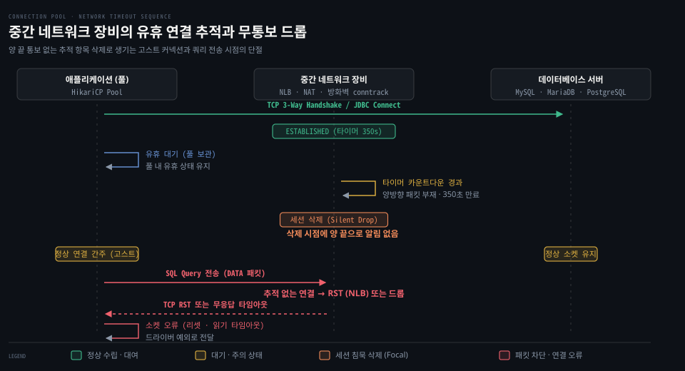
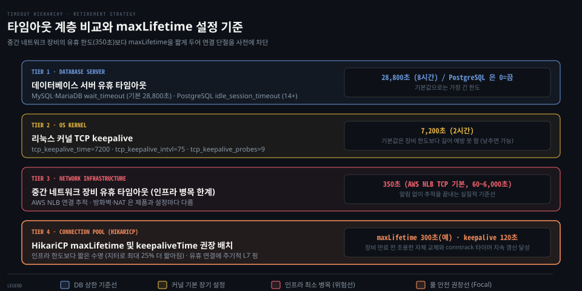

# wait_timeout·idle timeout·TCP keepalive

---

> 데이터베이스 서버와 중간 네트워크 장비는 일정 시간 활동이 없는 유휴 커넥션을 일방적으로 종료합니다. 유휴 타임아웃의 만료 원리와 무통보 침묵 삭제로 인한 고스트 커넥션 문제를 살펴보고, 풀의 수명 설정을 인프라 한도보다 짧게 맞춰 장애를 예방하는 기준을 정리합니다.

## 학습 목표

> 이 문서를 읽고 나면 DB 서버와 네트워크 장비의 유휴 연결 차단 원리와 풀 수명 설정의 관계를 설명할 수 있습니다.

1. MySQL 과 PostgreSQL 의 유휴 세션 종료 파라미터와 클라이언트 측 단절 오류를 설명할 수 있습니다.
2. 상태 저장형 L4 로드밸런서와 방화벽의 conntrack 세션 테이블 만료와 무통보 드롭(Silent Drop) 메커니즘을 분석할 수 있습니다.
3. 리눅스 커널의 TCP keepalive 파라미터 3종과 기본 시간 설정의 한계를 분석할 수 있습니다.
4. L4 소켓 프로브와 커넥션 풀 L7 핑(keepaliveTime)이 중간 장비 상태 갱신에 미치는 차이를 비교할 수 있습니다.
5. 커넥션 나이와 유휴 시간의 포함 관계를 바탕으로 maxLifetime 을 인프라 타임아웃보다 짧게 설정해야 하는 근거를 계산할 수 있습니다.

## 1. 데이터베이스 서버의 유휴 세션 종료

> 유휴 상태로 방치된 커넥션은 DB 서버가 먼저 닫아 서버 메모리와 프로세스 자원을 회수합니다.

트래픽이 뜸한 야간에 웹 애플리케이션에서 간헐적인 쿼리 실패 문제가 발생합니다. 풀에서 꺼낸 연결로 쿼리를 실행하는 즉시 소켓 에러가 터지며 트랜잭션이 중단됩니다. 애플리케이션 모르게 데이터베이스 서버가 유휴 연결을 먼저 끊어버렸기 때문입니다. 데이터베이스 엔진은 서버 자원을 보호하기 위해 활동이 없는 세션을 강제 종료하는 타이머를 동작시킵니다.

### MySQL과 MariaDB의 wait_timeout

MySQL 과 MariaDB 는 연결에 활동이 없는 시간을 잽니다. 그 시간이 한도를 넘으면 서버가 연결을 닫습니다[^mysql-wait-timeout][^mariadb-wait-timeout]. 한도는 클라이언트의 성격에 따라 두 변수 중 하나에서 옵니다.

연결이 시작될 때 세션의 `wait_timeout` 값이 정해집니다. 접속 옵션 `CLIENT_INTERACTIVE` 를 켠 대화형 클라이언트는 전역 `interactive_timeout` 에서 값을 받습니다. 커넥션 풀 같은 비대화형 연결은 전역 `wait_timeout` 에서 받습니다[^mysql-wait-timeout]. 두 변수의 기본값은 모두 28,800초(8시간)입니다[^mysql-wait-timeout][^mariadb-wait-timeout].

유휴 시간이 `wait_timeout` 을 넘으면 서버는 소켓을 닫습니다. 서버가 TCP FIN 패킷을 보내도 풀은 이를 즉시 감지하지 못할 수 있습니다. 커넥션이 애플리케이션에 대여되지 않고 유휴 풀에 보관 중이기 때문입니다.

### PostgreSQL의 세션 타임아웃

PostgreSQL 은 14 버전부터 `idle_session_timeout` 을 지원합니다. 13 버전 문서의 같은 절에는 이 변수가 없습니다[^postgresql-idle-timeout]. 단위 없이 쓰면 밀리초로 읽고, 기본값 0 은 이 타임아웃을 끈다는 뜻입니다.

이 설정은 트랜잭션 밖에서 쉬고 있는 세션을 종료합니다. 트랜잭션 내부를 정리하는 `idle_in_transaction_session_timeout` 과 다릅니다[^postgresql-idle-timeout].

타임아웃이 만료되면 PostgreSQL 서버는 세션을 강제 종료합니다. 이때 내는 FATAL 오류의 문구는 `terminating connection due to idle-session timeout` 입니다[^postgresql-source]. 공식 문서는 커넥션 풀이나 미들웨어를 거치는 연결에 이 타임아웃을 걸 때 조심하라고 적습니다. 그런 계층은 예기치 않은 연결 종료에 잘 대처하지 못할 수 있기 때문입니다. 문서는 대화형 세션에만 거는 방법을 제안합니다[^postgresql-idle-timeout].

### 서버 주도 종료가 애플리케이션에 미치는 영향

서버가 타임아웃으로 연결을 정리하면 소켓은 이미 닫힌 상태가 됩니다. 그러나 커넥션 풀 내부에서는 해당 연결이 여전히 유효한 것으로 남아 있을 수 있습니다.

애플리케이션 스레드가 풀에서 이 연결을 대여해 SQL 질의를 전송하는 순간 오류가 발생합니다. MySQL 매뉴얼은 `MySQL server has gone away` 오류의 가장 흔한 원인이 서버가 시간 초과로 연결을 닫은 것이라고 적습니다. 같은 절은 이와 관련된 `Lost connection to server during query` 오류도 함께 다룹니다[^mysql-gone-away]. JDBC 드라이버는 이런 소켓 오류를 자기 예외로 감싸 애플리케이션에 던집니다.

네트워크 폴링이나 사전 검증이 없다면 애플리케이션 사용자의 실제 비즈니스 요청이 실패로 끝납니다.

## 2. 중간 네트워크 장비의 유휴 연결 제거

> L4 로드밸런서와 방화벽은 유휴 타임아웃 만료 시 양 끝단 통보 없이 세션 테이블을 지워 고스트 커넥션을 만듭니다.

클라이언트와 데이터베이스 사이에 배치된 인프라 장비는 메모리 절약을 위해 연결 상태를 주기적으로 정리합니다.

네트워크 인프라의 상태 추적 테이블은 유휴 상태가 길어지면 연결을 침묵 속에서 폐기합니다. 이로 인해 양 끝단이 인지하지 못하는 절단이 일어납니다.

### 상태 저장형 장비와 conntrack 테이블 한계

AWS NLB 는 클라이언트가 자신을 거쳐 연 TCP 연결마다 상태를 추적합니다[^aws-nlb-timeout]. 상태를 기억하는 방화벽과 NAT 도 연결마다 추적 항목을 둡니다. 이 문서는 이런 추적 표를 conntrack 테이블이라고 부릅니다. 리눅스 tcp(7) 도 이런 연결 추적 장치의 시간 제한이 커널 keepalive 주기보다 훨씬 짧을 수 있다고 적습니다[^linux-tcp-man].

NLB 에서는 클라이언트와 대상 어느 쪽도 유휴 타임아웃보다 오래 데이터를 보내지 않으면 추적이 끝납니다[^aws-nlb-timeout].

### AWS NLB와 방화벽의 타임아웃 기본값

AWS Network Load Balancer (NLB) 에서 TCP 흐름의 기본 유휴 타임아웃은 350초입니다. 이 값은 60초에서 6,000초 사이로 바꿀 수 있습니다. TLS 리스너의 타임아웃은 350초로 고정입니다(AWS 문서, 2026-11-17 확인)[^aws-nlb-timeout].

방화벽과 NAT 의 유휴 한도는 제품과 설정마다 다릅니다. 같은 AWS 문서는 대상 인스턴스의 네트워크 인터페이스도 따로 연결 추적 시간 제한을 둔다고 적습니다. 6세대 Nitro(V6+) 인스턴스에서는 그 기본값도 350초입니다[^aws-nlb-timeout]. 이 값들은 데이터베이스 서버의 기본 유휴 한도인 8시간보다 훨씬 짧습니다. 그래서 경로 중간에 이런 장비가 있으면 먼저 연결을 끊는 쪽은 대개 데이터베이스가 아니라 장비입니다.

### FIN/RST 없는 조용한 삭제와 고스트 커넥션

중간 장비가 추적 항목을 지우는 순간, 양 끝은 알림을 받지 못합니다. 이 문서는 이 동작을 무통보 삭제(Silent Drop)라고 부릅니다. NLB 문서도 만료 때 양 끝에 무엇을 보낸다고 적지 않습니다. 만료 뒤에 데이터가 오면 클라이언트가 TCP RST 를 받는다고만 적습니다[^aws-nlb-timeout].

장비는 자기 표에서 해당 연결을 지울 뿐입니다. 그 결과 클라이언트 커넥션 풀과 DB 서버는 양쪽 모두 소켓 상태를 여전히 `ESTABLISHED` 로 유지합니다.

양 끝은 연결이 열려 있다고 믿는데 경로 위 장비만 연결을 잊은 이 상태를, 이 문서에서는 고스트 커넥션이라고 부릅니다. 풀은 소켓이 살아 있다고 오판하여 대여를 진행합니다. 애플리케이션이 SQL 질의 패킷을 전송하면 장비는 모르는 연결의 패킷을 버리거나 TCP RST 로 응답합니다. NLB 는 RST 를 돌려줍니다[^aws-nlb-timeout]. 클라이언트는 읽기 타임아웃에 빠지거나 갑작스러운 리셋 오류를 만납니다.

## 3. TCP keepalive 와 L7 핑의 차이

> 커널 TCP keepalive 는 기본 주기 2시간으로는 중간 장비의 유휴 타임아웃보다 늦고 DB 가 쿼리를 처리하는지도 보지 못하므로, 풀 레벨의 L7 검증이 따로 필요합니다.

운영체제 전송 계층의 프로브와 애플리케이션 계층의 핑은 동작 주기와 검증 범위에서 근본적인 차이가 있습니다.

### 리눅스 TCP keepalive 기본값의 한계

TCP 표준 RFC 9293 은 keep-alive 를 구현해도 되는 선택 기능으로 둡니다. 구현한다면 연결마다 켜고 끌 수 있어야 하고 기본은 꺼져 있어야 합니다. 프로브를 보내기 전 대기 시간은 설정할 수 있어야 하며 기본값이 2시간 이상이어야 합니다[^rfc9293-tcp]. 리눅스도 소켓에 `SO_KEEPALIVE` 옵션이 켜져 있을 때만 커널 매개변수의 주기대로 프로브를 보냅니다[^linux-tcp-man].

- `tcp_keepalive_time`: 첫 프로브를 보낼 때까지의 유휴 대기 시간이며 기본값은 7,200초입니다[^linux-tcp-man].
- `tcp_keepalive_intvl`: 상대방의 응답이 없을 때 프로브를 재전송하는 간격이며 기본값은 75초입니다[^linux-tcp-man].
- `tcp_keepalive_probes`: 연결 단절을 최종 판정하기 전까지 시도할 프로브 실패 횟수이며 기본값은 9회입니다[^linux-tcp-man].

리눅스 커널의 기본 유휴 대기 시간 2시간은 AWS NLB 의 기본 타임아웃 350초보다 훨씬 깁니다. 첫 번째 커널 keepalive 프로브 패킷이 출발하기도 전에 중간 장비의 세션 엔트리는 이미 삭제됩니다. 운영체제 기본 설정만으로는 중간 장비의 유휴 연결 절단을 방지할 수 없습니다.

대기 시간을 장비 한도보다 짧게 낮추면 이야기가 달라집니다. 시스템 전체는 `tcp_keepalive_time`, 소켓 하나는 `TCP_KEEPIDLE` 옵션으로 낮춥니다[^linux-tcp-man]. NLB 문서는 클라이언트나 대상이 TCP keepalive 패킷으로 유휴 타임아웃을 다시 시작할 수 있다고 적습니다[^aws-nlb-timeout]. 다만 이 값은 운영체제나 드라이버 설정이라 풀 설정과 따로 관리해야 합니다.

### 소켓 레벨 패킷과 애플리케이션 상태 검증의 간극

커널 TCP keepalive 는 L4 전송 계층의 메커니즘입니다. RFC 9293 은 상대 TCP 의 응답을 끌어내도록 만든 세그먼트를 프로브로 보낸다고 적습니다. 데이터 없이 보내라고 권하되(SHOULD), 오래된 구현과의 호환을 위해 쓰레기 1바이트를 넣는 설정도 허용합니다[^rfc9293-tcp].

수신 측의 운영체제 TCP 스택은 데이터베이스 엔진의 실제 동작 상태와 무관하게 즉시 TCP ACK 응답을 회신합니다. 따라서 데이터베이스 프로세스가 데드락에 빠져 있거나 메모리 부족(OOM)으로 요청을 처리할 수 없는 상태여도 L4 소켓 검사는 통과합니다. 소켓 연결만 살아 있고 쿼리는 수행하지 못하는 좀비 연결을 전송 계층 프로브는 걸러내지 못합니다.

### 풀 레벨 keepaliveTime과 세션 유지

커넥션 풀은 애플리케이션 계층(L7)에서 동작하는 생존 확인 메커니즘을 제공합니다. HikariCP 의 `keepaliveTime` 설정이 대표적입니다[^hikaricp-readme].

설정된 주기가 도래하면 풀의 백그라운드 스케줄러는 유휴 커넥션을 꺼내 JDBC4 `isValid()` 메서드나 검증 쿼리를 직접 수행합니다. 이 과정에서 실제 데이터베이스 요청 패킷이 물리 네트워크 소켓을 타고 흐릅니다.

패킷이 중간 방화벽과 L4 로드밸런서를 통과하면서 해당 세션의 conntrack 타이머가 0으로 갱신됩니다. 유휴 시간 카운터가 리셋되므로 장비의 엔트리 삭제가 유예됩니다. 또한 데이터베이스 엔진의 응답을 직접 확인하므로 프로세스 장애 여부까지 확실하게 검증합니다. 하우스키퍼 주기와 대여 검증의 상세 경로는 앞 편 [01-02.getConnection·HouseKeeper·maxLifetime.md](./01-02.getConnection·HouseKeeper·maxLifetime.md) 에서 확인할 수 있습니다.

## 4. maxLifetime 설정과 수명 단축 전략

> 커넥션의 전체 수명을 인프라 유휴 타임아웃보다 짧게 설정하면 유휴 상태로 방치되어 끊기는 사고를 근본적으로 차단합니다.

장비마다 제각각인 타임아웃 값을 일일이 추적하지 못하면 야간 배치나 간헐적 트래픽 환경에서 커넥션 단절이 반복됩니다.

여러 계층의 타임아웃 가운데 가장 짧은 병목 구간을 기준으로 풀의 수명을 설계해야 안전합니다.

### 커넥션 나이와 유휴 시간의 수학적 포함 관계

커넥션이 생성된 뒤 경과한 전체 수명(나이, $T_{age}$)과 풀 안에서 유휴 상태로 대기한 시간($T_{idle}$) 사이에는 수학적 부등식이 성립합니다.

$$T_{age} \ge T_{idle}$$

커넥션이 쉰 시간은 생성 이후 총 수명을 결코 초과할 수 없습니다. 그래서 `maxLifetime` 을 장비의 유휴 타임아웃 $T_{infra}$ 보다 작게 두면, 풀 안에서 쉬는 연결에는 다음 관계가 성립합니다.

$$T_{idle} \le T_{age} \le maxLifetime < T_{infra}$$

연결의 나이 자체를 인프라 타임아웃보다 짧게 묶어두면, 커넥션이 풀 안에서 아무리 오래 쉬더라도 인프라 유휴 한도에 도달할 수 없습니다. 장비가 세션을 삭제하기 전에 풀이 스스로 연결을 회수하고 갱신합니다.

이 부등식은 풀 안에 있는 연결에만 성립합니다. README 는 사용 중인 연결은 은퇴시키지 않고 닫힐 때에야 풀에서 뺀다고 적습니다[^hikaricp-readme]. 애플리케이션이 연결을 빌린 채 장비 한도보다 오래 아무 쿼리도 보내지 않으면, 그 연결은 `maxLifetime` 과 상관없이 끊길 수 있습니다.

### 인프라 타임아웃 계층과 권장 여유 마진

HikariCP README 는 `maxLifetime` 을 DB 나 인프라가 거는 연결 시간 제한보다 몇 초 짧게 두라고 권합니다[^hikaricp-readme].

예를 들어 AWS NLB(350초) 환경이라면 `maxLifetime` 을 300초처럼 350초보다 확실히 작은 값으로 둡니다. README 는 여유를 몇 초로 잡을지 정하지 않으므로, 이 예의 50초 여유는 이 문서가 고른 값입니다.

풀은 연결마다 `maxLifetime` 에서 무작위 지터를 빼 만료 시점을 흩습니다. 기본은 최대 25% 이므로 300초로 두면 각 연결은 225초 초과 300초 이하에서 은퇴합니다. 계산 근거는 앞 편 [01-02.getConnection·HouseKeeper·maxLifetime.md](./01-02.getConnection·HouseKeeper·maxLifetime.md) 에 있습니다. 또한 쿼리 실행 중에는 소켓을 끊지 않고 반납 시점에 교체하는 소프트 퇴출을 적용합니다. 트랜잭션 중단 없이 안전하게 물리 연결이 갱신됩니다.

### 먼저 버리기와 살려 두기의 트레이드오프

중간 장비의 유휴 절단에 대응하는 풀의 전략은 두 갈래로 나뉩니다.

- 먼저 버리기 전략 (`maxLifetime` 단축): 인프라 유휴 타임아웃보다 짧은 수명을 강제하여 만료 전에 스스로 연결을 폐기합니다. 중간 장비의 정책이나 동작 상태에 구애받지 않고 고스트 커넥션을 완벽히 배제할 수 있습니다. 다만 커넥션 생성 핸드셰이크가 상대적으로 더 자주 발생합니다.
- 살려 두기 전략 (`keepaliveTime` 활용): 유휴 커넥션에 주기적으로 L7 핑을 보내 conntrack 타이머를 갱신합니다. 커넥션 재사용성을 높여 핸드셰이크 비용을 절감합니다. HikariCP 6.2.1 은 이 값이 기본 2분으로 켜져 있습니다[^hikaricp-readme]. 하지만 장비가 연결 총 수명을 제한하는 환경에서는 절단을 예방하지 못합니다.

이 문서의 예는 350초 제한 환경에서 두 길을 함께 씁니다. `maxLifetime` 은 300초로 줄이고, `keepaliveTime` 은 기본값 120초를 그대로 둡니다. `keepaliveTime` 은 `maxLifetime` 보다 작아야 합니다[^hikaricp-readme].

## 점검 질문

> 본문에서 다룬 타임아웃 메커니즘과 풀 수명 설계를 바탕으로 4가지 질문에 답해 봅니다.

1. AWS NLB(기본 유휴 350초) 환경에서 keepaliveTime 을 0 으로 끄고 maxLifetime 을 30분 기본값으로 둘 때 야간에 발생하는 쿼리 실패의 원인은 무엇입니까?
2. 운영체제의 SO_KEEPALIVE 설정을 켜 두어도 중간 방화벽의 유휴 세션 삭제를 막을 수 없는 이유는 무엇입니까?
3. 커넥션 나이를 인프라 유휴 타임아웃보다 짧게 제한할 때 유휴 단절이 수학적으로 예방되는 원리는 무엇입니까?
4. 풀의 '먼저 버리기' 전략과 '살려 두기' 전략이 갖는 장단점과 트레이드오프는 무엇입니까?

## 정답 (자답 후 펼치기)

> 위 질문 4개에 먼저 자답한 뒤 아래를 읽으세요.

### 정답 1 — 인프라 유휴 타임아웃 초과와 무통보 드롭

트래픽이 뜸한 야간에는 풀 안의 커넥션이 350초 이상 유휴 상태로 대기하기 쉽습니다. keepaliveTime 이 꺼져 있으니 그동안 이 연결로 오가는 패킷이 없습니다. NLB 는 350초 동안 데이터가 없으면 그 연결을 더 이상 추적하지 않고, 양 끝은 이를 모릅니다. 애플리케이션이 이 고스트 커넥션을 대여해 쿼리를 전송하면 NLB 가 RST 로 답하여 간헐적인 커넥션 단절 오류가 발생합니다.

### 정답 2 — 커널 주기와 인프라 한도의 간극

리눅스 커널의 `tcp_keepalive_time` 기본값은 7,200초(2시간)입니다. NLB 의 기본 유휴 타임아웃 350초처럼 장비 한도는 이보다 훨씬 짧습니다. 그래서 첫 번째 TCP keepalive 프로브 패킷이 전송되기도 전에 중간 장비의 세션 엔트리가 이미 삭제됩니다. 대기 시간을 장비 한도보다 짧게 낮추면 커널 프로브로도 유휴 타이머를 다시 시작할 수 있습니다.

### 정답 3 — 수명과 유휴 시간의 수학적 포함 관계

커넥션이 유휴 상태로 쉰 시간은 생성 후 경과한 총 나이보다 항상 작거나 같습니다. 부등식으로 표현하면 유휴 시간은 총 나이 이하입니다. 따라서 커넥션의 최대 수명 자체를 인프라 타임아웃보다 짧게 묶어두면, 풀 안에서 쉬는 연결의 유휴 시간도 인프라 한도를 넘을 수 없습니다. 인프라 장비가 세션을 삭제하기 전에 풀이 스스로 연결을 갱신합니다. 다만 애플리케이션이 빌려 간 채 쉬게 둔 연결은 풀이 은퇴시키지 않으므로 이 보장 밖에 있습니다.

### 정답 4 — 안전성과 핸드셰이크 비용의 트레이드오프

먼저 버리기 전략은 고스트 커넥션을 원천 차단하여 안전성이 뛰어납니다. 중간 장비가 연결의 절대 수명을 제한하더라도 안전하게 동작합니다. 다만 핸드셰이크와 인증이 빈번해지는 단점이 있습니다. 반면 살려 두기 전략은 커넥션 재사용을 극대화하여 생성 비용을 절감합니다. 하지만 중간 장비의 절대 수명 제한을 넘지 못하며 데이터베이스로 주기적인 핑 질의가 누적되는 부담이 따릅니다.

## 참고 자료

> 본문에서 다룬 유휴 타임아웃과 수명 설정 메커니즘을 공식 문서에서 직접 확인할 수 있는 1차 자료입니다.

- [MySQL 8.4 Server System Variables (wait_timeout)](https://dev.mysql.com/doc/refman/8.4/en/server-system-variables.html#sysvar_wait_timeout) — 비대화형 클라이언트 연결의 유휴 대기 한도와 종료 동작을 확인합니다.
- [MySQL 8.4 「MySQL server has gone away」](https://dev.mysql.com/doc/refman/8.4/en/gone-away.html) — 서버가 시간 초과로 연결을 닫았을 때 클라이언트가 받는 오류를 확인합니다.
- [MariaDB Server System Variables (wait_timeout)](https://mariadb.com/docs/server/server-management/variables-and-modes/server-system-variables#wait_timeout) — MariaDB 환경의 wait_timeout 기본값과 동작 기준을 확인합니다.
- [PostgreSQL Client Connection Defaults (idle_session_timeout)](https://www.postgresql.org/docs/16/runtime-config-client.html#GUC-IDLE-SESSION-TIMEOUT) — PostgreSQL 14 이상에서 도입된 세션 유휴 타임아웃과 커넥션 풀러 주의사항을 확인합니다.
- [PostgreSQL 16.0 postgres.c (idle-session timeout)](https://github.com/postgres/postgres/blob/REL_16_0/src/backend/tcop/postgres.c#L3423) — 타임아웃 만료 때 내는 FATAL 오류 문구를 확인합니다.
- [AWS NLB Connection Idle Timeout](https://docs.aws.amazon.com/elasticloadbalancing/latest/network/network-load-balancers.html#connection-idle-timeout) — Network Load Balancer 의 TCP 350초 기본 유휴 한도, 만료 뒤 RST 응답, keepalive 로 타이머를 다시 시작하는 동작을 확인합니다.
- [Linux tcp(7) Manual Page](https://man7.org/linux/man-pages/man7/tcp.7.html) — tcp_keepalive_time, tcp_keepalive_intvl, tcp_keepalive_probes 의 커널 기본값과 소켓 옵션을 확인합니다.
- [RFC 9293 Transmission Control Protocol (TCP)](https://www.rfc-editor.org/rfc/rfc9293.html#section-3.8.4) — keep-alive 가 선택 기능이고 기본은 꺼져 있으며 대기 시간 기본값이 2시간 이상이라는 규정을 확인합니다.
- [HikariCP 공식 README (Frequently used)](https://github.com/brettwooldridge/HikariCP/blob/HikariCP-6.2.1/README.md#frequently-used) — maxLifetime 및 keepaliveTime 의 인프라 타임아웃 연계 권장 기준을 확인합니다.

[^mysql-wait-timeout]: MySQL 8.4 Reference Manual, Server System Variables (wait_timeout). https://dev.mysql.com/doc/refman/8.4/en/server-system-variables.html#sysvar_wait_timeout
[^mariadb-wait-timeout]: MariaDB Documentation, Server System Variables (wait_timeout). 버전별 주소가 없는 문서라 2026-11-17 에 확인했습니다. https://mariadb.com/docs/server/server-management/variables-and-modes/server-system-variables#wait_timeout
[^postgresql-idle-timeout]: PostgreSQL 16 Documentation, Client Connection Defaults (idle_session_timeout). https://www.postgresql.org/docs/16/runtime-config-client.html#GUC-IDLE-SESSION-TIMEOUT 13 버전 같은 절에 변수가 없는 것은 https://www.postgresql.org/docs/13/runtime-config-client.html 에서 확인했습니다.
[^postgresql-source]: PostgreSQL 16.0 소스, src/backend/tcop/postgres.c L3423. https://github.com/postgres/postgres/blob/REL_16_0/src/backend/tcop/postgres.c#L3423
[^mysql-gone-away]: MySQL 8.4 Reference Manual, B.3.2.7 MySQL server has gone away. https://dev.mysql.com/doc/refman/8.4/en/gone-away.html
[^aws-nlb-timeout]: AWS Elastic Load Balancing Documentation, Network Load Balancers (Connection idle timeout), 2026-11-17 확인. https://docs.aws.amazon.com/elasticloadbalancing/latest/network/network-load-balancers.html#connection-idle-timeout
[^linux-tcp-man]: Linux manual page, tcp(7). https://man7.org/linux/man-pages/man7/tcp.7.html
[^rfc9293-tcp]: RFC 9293, Transmission Control Protocol (TCP), Section 3.8.4 TCP Keep-Alives. https://www.rfc-editor.org/rfc/rfc9293.html#section-3.8.4
[^hikaricp-readme]: HikariCP 공식 README, Frequently used. https://github.com/brettwooldridge/HikariCP/blob/HikariCP-6.2.1/README.md#frequently-used
