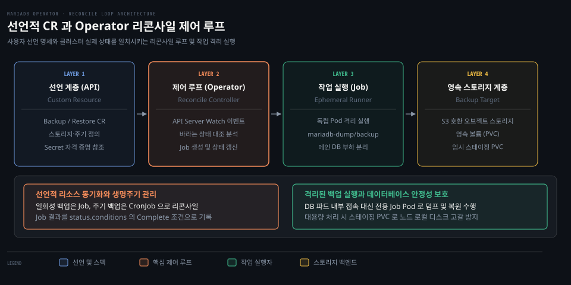
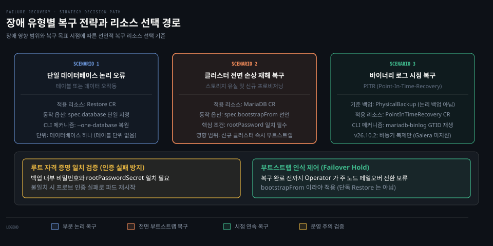
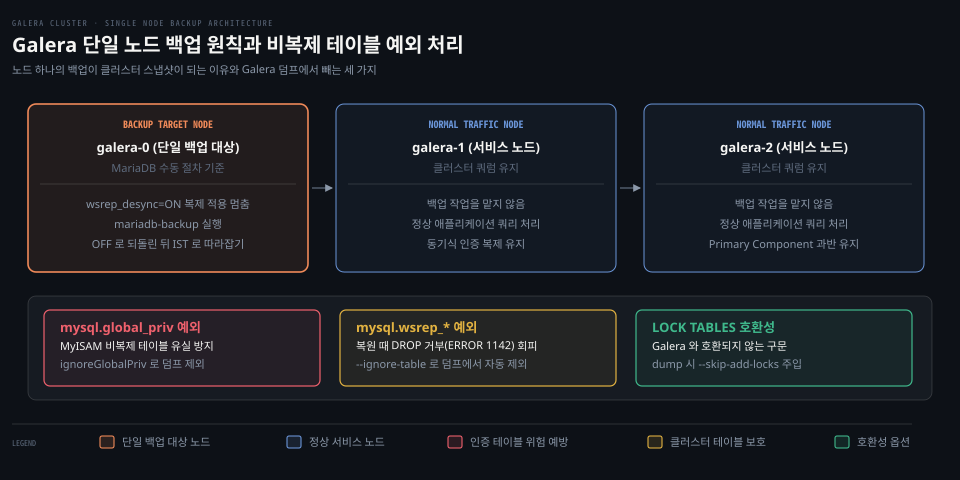

# Backup·Restore

---

> MariaDB Operator 는 데이터베이스의 백업과 복구를 명령형 스크립트가 아닌 선언적 커스텀 리소스(CR)로 자동화합니다. 리콘사일 루프를 통한 Job 생성, 스토리지 연동, 상황별 복구 경로, 그리고 Galera 클러스터 환경에서의 단일 노드 백업 원칙을 다룹니다.

전통적인 데이터베이스 백업은 크론탭이나 외부 스크립트에 의존했습니다. 이 방식은 컨테이너 환경에서 파드 IP 변경, 자격 증명 주입, 볼륨 마운트 격리 문제를 매끄럽게 처리하기 어렵습니다. Kubernetes 의 Operator 패턴은 데이터베이스 운영 지식을 컨트롤러 로직으로 승격시킵니다. 커스텀 리소스 정의(CRD)를 통해 바라는 백업 상태를 선언하면, 컨트롤러가 실제 클러스터 상태를 감시하며 작업을 수렴시킵니다.

## 학습 목표

> 선언적 리소스로 데이터베이스 백업과 복구를 제어하는 원리를 이해하고 운영 장애 시나리오에 대응합니다.

이 문서를 읽고 나면 다음에 답할 수 있습니다.

1. MariaDB Operator 의 리콘사일 루프가 `Backup` 과 `Restore` CR 을 읽어 Job 으로 상태를 수렴시키는 과정을 설명할 수 있습니다.
2. `Backup` CR 에서 PVC, S3 스토리지, 주기적 스케줄링 및 보존 정책을 선언하는 방식을 구성할 수 있습니다.
3. `Restore` CR 이 파드마다 수동 주입하지 않고 Operator 주도로 복구 Job 을 실행하는 구조적 이유를 도출할 수 있습니다.
4. 단일 DB 오류, 전체 손상 부트스트랩, 바이너리 로그 시점 복구(PITR) 등 상황별 복구 경로를 선택할 수 있습니다.
5. Galera 환경에서 백업을 단일 노드에서만 받는 이유와 비복제 시스템 테이블 예외 처리 방식을 분석할 수 있습니다.


## 1. Operator 와 CR 기반 리콘사일 루프

> Operator 는 사용자가 선언한 바라는 상태(Desired State)와 클러스터의 실제 상태(Actual State)를 지속적으로 비교하여 일치시키는 제어 루프를 실행합니다.

데이터베이스 백업을 외부 스크립트로 돌리면 파드가 재시작되거나 네트워크가 끊겼을 때 작업이 실패한 사실을 놓치기 쉽습니다. MariaDB Operator 는 `Backup` 및 `Restore` 커스텀 리소스를 감시하여 복구 작업을 선언적으로 제어합니다.



위 도식은 선언 계층부터 제어 루프, 작업 실행 파드, 영속 스토리지로 이어지는 단방향 실행 구조를 보여 줍니다. 사용자는 파드 내부 명령어나 셸 접속에 관여하지 않고 오직 커스텀 리소스만을 조작합니다.

### 바라는 상태와 실제 상태의 수렴

Kubernetes Operator 패턴의 핵심은 리콘사일(Reconciliation) 루프입니다. Operator 는 커스텀 리소스를 맡는 컨트롤러이고, Kubernetes 의 제어 루프 원칙을 따릅니다[^k8s-operator]. 사용자가 `Backup` CR 을 만들거나 고치면 컨트롤러가 그 명세를 다시 읽어 실제 리소스를 맞춥니다.

일회성 백업이면 컨트롤러는 명세를 읽어 `Job` 하나를 만듭니다. `spec.schedule` 이 있으면 `Backup` 을 `CronJob` 으로 바꿔 두고, 주기마다 `Job` 을 띄우는 일은 그 `CronJob` 이 맡습니다[^mb-logical].

컨트롤러는 Job 의 결과를 CR 의 `status.conditions` 에 적습니다. 백업이 끝났는지는 이 목록의 `Complete` 조건으로 판정합니다[^mb-types].

### 선언적 API 와 작업 위임 구조

수동 운영에서는 관리자가 데이터베이스 파드 내부로 `kubectl exec` 접속하여 `mariadb-dump` 명령을 직접 내렸습니다. 이 방식은 네트워크가 끊기거나 세션이 닫히면 백업이 어디까지 진행됐는지 파악하기 어렵습니다.

MariaDB Operator 는 백업 작업을 데이터베이스 파드가 아닌 별도의 `Job` 파드에 맡깁니다. 스토리지 인증 정보는 `accessKeyIdSecretKeyRef` 처럼 Secret 키를 가리키는 참조로 넘깁니다[^mb-logical].

그래서 데이터베이스 컨테이너 안에서 백업 도구를 돌리지 않습니다. 작업 파드의 CPU 와 메모리는 `Backup` 의 `resources` 필드로 따로 정합니다[^mb-api].


## 2. Backup 리소스와 백업 스토리지 구성

> 백업 파일의 영속성과 전송 효율을 보장하기 위해 스토리지 백엔드 선택과 압축 및 주기 정책을 세밀하게 정의해야 합니다.

데이터 크기와 복구 목표 시간에 따라 백업 방식을 고르지 않으면 백업 지연이나 복구 실패 위험이 발생합니다. MariaDB Operator 는 논리 백업(`Backup` CR)과 물리 백업(`PhysicalBackup` CR)을 모두 지원합니다.

| 비교 항목 | 논리 백업 (`Backup` CR) | 물리 백업 (`PhysicalBackup` CR) |
|---|---|---|
| 기반 도구 | `mariadb-dump` [^mb-logical] | `mariadb-backup` [^mb-physical] |
| 산출물 형태 | SQL DDL 및 INSERT 텍스트 파일 | 데이터 디렉터리 바이너리 스냅샷 |
| 처리 속도 | 큰 데이터베이스에서는 물리 백업보다 느림 | 논리 백업보다 빠르고 효율적 |
| 데이터 이식성 | 토폴로지와 무관해 인스턴스 사이 이관에 쓰임 | 데이터가 없는 새 `MariaDB` 에만 복원 가능 |
| 공식 권장 | 데이터 이동과 마이그레이션 | 운영 환경의 기본 백업 방식 |

표의 근거는 두 공식 문서의 첫 절입니다[^mb-logical][^mb-physical]. 물리 백업은 `mariadb-backup` 외에 Kubernetes `VolumeSnapshot` 으로도 받을 수 있습니다[^mb-physical].

### 스토리지 백엔드와 S3 연동

논리 백업 파일은 세 곳에 둘 수 있습니다. 클러스터 안의 PVC, NFS 같은 Kubernetes 볼륨, 그리고 외부 S3 호환 오브젝트 스토리지입니다. 공식 문서는 백업을 클러스터 밖 S3 호환 스토리지에 두라고 권합니다[^mb-logical].

아래는 S3 호환 스토리지에 백업을 저장하도록 선언한 `Backup` CR 명세입니다.

<!-- 출처: https://github.com/mariadb-operator/mariadb-operator/blob/v26.10.2/docs/logical_backup.md#L60-L83 -->
```yaml
apiVersion: k8s.mariadb.com/v1alpha1
kind: Backup
metadata:
  name: backup
spec:
  mariaDbRef:
    name: mariadb
  storage:
    s3:
      bucket: backups
      prefix: mariadb
      endpoint: minio.minio.svc.cluster.local:9000
      region: us-east-1
      accessKeyIdSecretKeyRef:
        name: minio
        key: access-key-id
      secretAccessKeySecretKeyRef:
        name: minio
        key: secret-access-key
      tls:
        enabled: true
        caSecretKeyRef:
          name: minio-ca
          key: tls.crt
```

저장소 종류 가운데 S3 만 임시 스테이징 공간을 씁니다. 백업 파일을 올리거나 내려받는 동안 잠시 담아 두는 곳입니다. 기본값은 Job 이 뜬 노드의 `emptyDir` 볼륨이라서, 백업이 크고 노드 디스크가 모자라면 백업이나 복구가 실패할 수 있습니다.

이를 피하려면 `Backup` 과 `Restore` 의 `stagingStorage` 필드에 전용 PVC 를 지정합니다[^mb-logical]. 스테이징 공간은 백업이 끝날 때마다 비워지므로, 백업 한 벌이 들어갈 크기로 잡습니다[^mb-api].

### 크론 스케줄링과 보존 정책

정기 백업은 `spec.schedule.cron` 필드에 표준 크론 표현식을 적어 구성합니다. 예를 들어 매일 새벽 2시에 받으려면 `spec.schedule.cron: "0 2 * * *"` 를 선언합니다. `spec.schedule.suspend` 를 `true` 로 두면 일정을 잠시 멈춥니다[^mb-api].

백업이 계속 쌓이지 않도록 `spec.maxRetention` 필드로 보존 기간을 정합니다. 값은 개수가 아니라 `720h` 같은 기간이고, 비워 두면 30일입니다. 기간이 지난 백업 파일은 Backup Job 이 지웁니다[^mb-api].

저장 공간을 아끼려면 `spec.compression` 에 압축 알고리즘을 적습니다. 논리 백업 문서는 `bzip2`·`gzip`·`none` 을 들고 기본값을 `none` 으로 둡니다[^mb-logical]. v26.10.2 의 API 레퍼런스는 여기에 `zstd` 를 더하고, `spec.compressionThreads` 는 `zstd` 일 때만 압축 스레드 수를 정합니다[^mb-api].


## 3. Restore 리소스와 복구 자동화

> Operator 주도의 복구는 개별 파드에 수동으로 SQL 을 밀어 넣는 방식의 불일치 위험을 원천 차단하고 복구 전후의 상태 전이를 단일 통제선에서 제어합니다.

데이터 복원 절차가 표준화되어 있지 않으면 작업자 실수로 데이터베이스가 오염되거나 프로브 실패로 파드가 재시작되는 장애가 발생합니다. Operator 는 `Restore` 리소스를 통해 복구 파이프라인을 체계적으로 조율합니다.

### Restore 컨트롤러와 복구 Job 생성

복구가 필요할 때 사용자는 복구 대상 데이터베이스와 복원할 백업 참조를 담은 `Restore` CR 을 선언합니다.

아래는 기존 백업본을 지정하여 데이터베이스를 복원하는 `Restore` CR 명세입니다.

<!-- 출처: https://github.com/mariadb-operator/mariadb-operator/blob/v26.10.2/docs/logical_backup.md#L233-L241 -->
```yaml
apiVersion: k8s.mariadb.com/v1alpha1
kind: Restore
metadata:
  name: restore
spec:
  mariaDbRef:
    name: mariadb
  backupRef:
    name: backup
```

`Restore` CR 이 만들어지면 컨트롤러는 복구 Job 을 띄웁니다. 이 Job 은 `Backup` 과 같은 스토리지를 마운트해 덤프를 대상 MariaDB 에 적용합니다[^mb-logical]. `backupRef` 대신 S3 버킷이나 볼륨을 직접 가리켜도 됩니다.

정기 백업이 여러 벌 쌓여 있으면 `spec.targetRecoveryTime` 으로 어느 백업을 쓸지 정합니다. Operator 는 이 시각과 같거나 그 이전인 백업 가운데 가장 가까운 것을 고릅니다. 값을 비우면 현재 시각이 들어가 가장 최근 백업이 쓰입니다[^mb-logical]. 이 필드는 백업 파일을 고를 뿐이라, 논리 백업만으로는 백업과 백업 사이의 시각으로 되돌릴 수 없습니다.

### 파드 직접 주입 방지와 상태 정합성

수동 복구에서는 관리자가 파드 셸에서 `cat backup.sql | mariadb` 처럼 SQL 을 직접 흘려 넣곤 했습니다. Operator 가 복구를 맡으면 세 가지가 달라집니다.

첫째, 복구에 드는 자원을 Job 에 따로 줍니다. 큰 백업을 복원하면 계산 자원을 많이 써서 `Restore` Job 이 멈출 수 있으므로, 공식 문서는 Job 의 `resources` 를 지정하라고 안내합니다[^mb-logical].

둘째, 결과가 CR 상태에 남습니다. `Restore` Job 은 실패하면 `backoffLimit`(기본 5회)만큼 다시 시도합니다[^mb-api]. 복원이 끝나면 `status.conditions` 에 `Complete` 조건이 기록됩니다[^mb-types].

셋째, 새 인스턴스를 백업에서 띄울 때(`spec.bootstrapFrom`)의 제어입니다. 이때 `MariaDB` 는 자신이 부트스트랩 중인 것을 압니다. 그래서 Operator 는 복원이 끝날 때까지 primary switchover 와 failover 를 미룹니다[^mb-logical].


## 4. 장애 시나리오별 복구 전략

> 장애의 범위와 원인에 따라 논리 데이터베이스 복구, 신규 클러스터 부트스트랩, 바이너리 로그 기반 시점 복구로 접근 경로를 분기해야 합니다.

실제 운영 환경의 데이터베이스 장애는 테이블 삭제 실수부터 클러스터 스토리지 전면 손상까지 다양하게 발생합니다.



위 도식은 장애 유형에 따라 선택해야 할 복구 CR 과 주요 제어 옵션의 분기를 보여 줍니다. 상황에 부합하지 않는 복구 방식을 선택하면 불필요한 서비스 중단이 발생할 수 있습니다.

### 단일 데이터베이스 및 테이블 복구

운영자의 실수로 특정 데이터베이스나 테이블만 DROP 또는 DELETE 된 상황입니다. 스토리지는 온전하므로 파드를 다시 띄울 필요가 없습니다.

이때는 `Restore` CR 의 `spec.database` 필드를 씁니다. 전체 덤프 파일에서 지정한 데이터베이스 하나만 골라 복원합니다. `Restore` 에는 테이블을 고르는 필드가 없어서, 테이블 하나를 잃었어도 그 테이블이 든 데이터베이스 단위로 되돌립니다[^mb-api].

<!-- 출처: https://github.com/mariadb-operator/mariadb-operator/blob/v26.10.2/docs/logical_backup.md#L365-L374 -->
```yaml
apiVersion: k8s.mariadb.com/v1alpha1
kind: Restore
metadata:
  name: restore
spec:
  mariaDbRef:
    name: mariadb
  backupRef:
    name: backup
  database: db1
```

Operator 는 내부에서 `mariadb` CLI 의 `--one-database` 옵션으로 대상 데이터베이스 하나만 복원합니다. 이 옵션은 데이터베이스 하나만 받으므로 여러 데이터베이스를 골라 복원할 수는 없습니다. 대상 데이터베이스가 미리 있어야 `Restore` 가 성공합니다[^mb-logical].

### 신규 클러스터 부트스트랩 복구

스토리지 하드웨어 고장, 랜섬웨어 감염, 재해 복구(DR) 등으로 기존 클러스터가 복구 불가능한 상태가 된 상황입니다. 손상된 파드를 수리하는 대신 깨끗한 새 파드를 프로비저닝하면서 백업을 밀어 넣어야 합니다.

이때는 신규 `MariaDB` 리소스의 `spec.bootstrapFrom` 필드를 선언합니다.

<!-- 출처: https://github.com/mariadb-operator/mariadb-operator/blob/v26.10.2/docs/logical_backup.md#L300-L310 -->
```yaml
apiVersion: k8s.mariadb.com/v1alpha1
kind: MariaDB
metadata:
  name: mariadb-from-backup
spec:
  storage:
    size: 1Gi
  bootstrapFrom:
    backupRef:
      name: backup
    targetRecoveryTime: 2023-12-19T09:00:00Z
```

Operator 는 `MariaDB` 가 준비되자마자 내부에서 `Restore` 객체를 만들어 복원을 시작합니다[^mb-logical]. 위 예시의 `targetRecoveryTime` 도 `Restore` 와 같이 쓸 백업을 고르는 기준입니다.

여기서 꼭 확인할 것은 루트 비밀번호입니다. 새 `MariaDB` CR 의 `spec.rootPasswordSecretKeyRef` 가 가리키는 비밀번호는 백업에 담긴 값과 같아야 합니다. liveness·readiness 프로브가 이 자격 증명을 쓰기 때문에, 값이 다르면 복원 뒤 프로브가 실패해 파드가 재시작됩니다[^mb-logical].

### 바이너리 로그 기반 시점 복구

일일 백업이 새벽 2시에 끝났는데 오후 2시에 장애가 났다면, 백업만으로는 그 사이 12시간의 변경을 되살릴 수 없습니다. 이 공백을 메우는 기능이 시점 복구(Point-In-Time-Recovery, PITR)입니다. 전체 백업 위에 그 뒤의 변경을 기록한 바이너리 로그를 이어 붙여, 원하는 시각까지 되돌립니다[^mb-pitr].

v26.10.2 의 PITR 은 앞 절의 논리 백업이 아니라 물리 백업 위에서 동작합니다. 구성은 세 단계입니다[^mb-pitr].

1. `PhysicalBackup` 으로 기준이 될 전체 백업을 주기적으로 받습니다.
2. `PointInTimeRecovery` CR 에 그 `PhysicalBackup` 과 바이너리 로그를 둘 오브젝트 스토리지(S3 호환 또는 Azure Blob)를 적습니다.
3. `MariaDB` 의 `spec.pointInTimeRecoveryRef` 로 이 CR 을 가리키면, 사이드카 에이전트가 바이너리 로그를 그 스토리지에 보관합니다.

되살릴 때는 새 `MariaDB` 를 만들면서 `bootstrapFrom` 에 `PointInTimeRecovery` 와 목표 시각을 줍니다.

<!-- 출처: https://github.com/mariadb-operator/mariadb-operator/blob/v26.10.2/docs/pitr.md#L139-L153 -->
```yaml
apiVersion: k8s.mariadb.com/v1alpha1
kind: MariaDB
metadata:
  name: mariadb-repl
spec:
  storage:
    size: 1Gi
  replicas: 3
  replication:
    enabled: true
  # bootstrap the instance from PITR: restore closest physical backup and replay binary logs up to targetRecoveryTime.
  bootstrapFrom:
    pointInTimeRecoveryRef:
      name: pitr
    targetRecoveryTime: 2026-02-20T18:00:04Z
```

Operator 는 목표 시각에 가장 가까운 물리 백업을 복원한 뒤, `mariadb-binlog` 로 그 시각까지 바이너리 로그를 재생합니다. 재생 시작점을 GTID 로 넘기는 방식이라 MariaDB 서버 10.8 이상이 필요합니다. 되돌릴 수 있는 가장 늦은 시각은 `kubectl get pitr` 의 `LAST RECOVERABLE TIME` 에서 확인합니다[^mb-pitr].

이 버전에서 바이너리 로그 보관과 PITR 은 비동기 복제 토폴로지만 지원합니다. Galera 와 단일 인스턴스는 지원 예정으로 남아 있어서[^mb-pitr], Galera 클러스터는 아직 백업 주기보다 촘촘하게 되돌릴 수 없습니다.


## 5. Galera 다중 노드와 단일 백업 원칙

> Galera Cluster 는 모든 노드가 동일한 커밋 상태를 공유하므로 백업은 단일 노드에서만 수행하며 비복제 시스템 테이블에 대한 예외 처리가 필수적입니다.

Galera 클러스터의 백업을 단일 인스턴스처럼 받으면 두 곳에서 어긋납니다. 백업 안의 시점이 흐트러질 수 있고, 덤프를 복원한 뒤 다른 노드가 재시작될 수 있습니다. 그래서 어느 노드에서 받을지와 덤프에서 무엇을 뺄지를 따로 정해야 합니다.



위 도식은 3노드 클러스터 중 단일 노드에서만 백업을 수행하는 격리 원리와 비복제 테이블의 예외 처리 흐름을 보여 줍니다.

### 데이터 동일성과 단일 노드 백업

정상 Galera 클러스터는 모든 노드가 같은 데이터를 가집니다. 그래서 노드 하나의 전체 백업이 곧 그 시점 클러스터 전체의 스냅샷이 되고, MariaDB 문서도 백업을 노드 하나에서 받으라고 권합니다[^galera-backup].

다만 백업하는 동안에도 그 노드는 다른 노드의 쓰기를 계속 적용합니다. 백업이 길어지면 백업 끝부분의 데이터가 앞부분보다 새로워져 백업 안의 시점이 어긋납니다[^galera-backup].

MariaDB 문서의 수동 절차는 이를 막으려고 먼저 그 노드를 로드밸런서에서 뺍니다. 이어서 `SET GLOBAL wsrep_desync = ON` 으로 복제 적용을 멈추고 `mariadb-backup` 을 돌립니다. 끝나면 `OFF` 로 되돌려 밀린 쓰기를 증분 상태 전송(IST)으로 받게 합니다[^galera-backup]. 상태 전송 원리와 GCache 한계는 [Galera 01-02.State Transfers·Restarting the Cluster](../galera/01-02.State%20Transfers·Restarting%20the%20Cluster.md) §1·§2 를 참조합니다.

Operator 의 Backup·PhysicalBackup 문서에는 이 `wsrep_desync` 단계가 나오지 않습니다. 대신 `PhysicalBackup` 은 `target` 필드로 백업을 받을 Pod 하나를 고릅니다. `Replica` 는 준비된 replica 에서만, `PreferReplica` 는 replica 가 없으면 primary Pod 에서 받습니다[^mb-physical].

### Galera 전용 시스템 테이블 예외 처리

Galera 에서 기본 옵션의 `mariadb-dump` 를 그대로 쓰면 복원할 때 세 가지가 문제가 됩니다. Operator 는 `MariaDB` 에 Galera 가 켜져 있으면 덤프 옵션을 바꿔 셋을 피합니다.

첫째, `mysql.global_priv` 사용자 인증 테이블입니다. 이 테이블은 MyISAM 스토리지 엔진을 사용하므로 Galera 의 InnoDB 동기 복제 대상에서 제외됩니다[^mb-logical]. 덤프에 `DROP TABLE mysql.global_priv;` 가 포함되면 복구 시 DDL 로 인식되어 모든 노드에서 인증 테이블이 삭제됩니다.

하지만 이어지는 `INSERT` 문은 DDL 이 아니라 복원한 노드에만 들어갑니다. 나머지 노드는 테이블이 빈 채 남고, 루트 자격 증명을 쓰는 프로브가 실패해 재시작됩니다[^mb-logical]. 그래서 Operator 는 Galera 에서 `mysql.global_priv` 를 `--ignore-table` 로 덤프에서 뺍니다. `spec.ignoreGlobalPriv` 를 비워 두면 Galera 일 때 `true` 가 기본값입니다[^mb-api].

둘째, `mysql.wsrep_*` 런타임 클러스터 상태 테이블입니다. `mysql.wsrep_cluster`·`mysql.wsrep_cluster_members`·`mysql.wsrep_streaming_log`·`mysql.wsrep_allowlist` 네 개입니다. 노드가 부트스트랩할 때 Galera 가 이 테이블들을 다시 만듭니다.

덤프에 이 테이블의 `DROP TABLE` 이 들어 있으면 복원이 멈춥니다. Galera 가 root 에게도 이 테이블의 DROP 을 거부(`ERROR 1142`)하기 때문입니다. 그래서 Operator 는 이 테이블들을 덤프에서 자동으로 뺍니다. 이 처리가 들어가기 전에 받은 Galera 논리 백업에는 여전히 이 테이블이 들어 있어 복원되지 않으므로, 다시 받아야 합니다[^mb-logical].

셋째, `LOCK TABLES` 구문입니다. Galera 는 `LOCK TABLES` 문과 호환되지 않습니다. 그래서 Operator 는 `Backup` 에 `--skip-add-locks` 옵션을 자동으로 붙여 덤프에 이 구문이 들어가지 않게 합니다[^mb-logical].


## 참고 자료

> 공식 문서와 구현 소스를 기반으로 정리한 1차 출처 목록입니다.

- [MariaDB Operator Logical Backups](https://github.com/mariadb-operator/mariadb-operator/blob/v26.10.2/docs/logical_backup.md) — 논리 백업 명세와 Galera 예외 제약
- [MariaDB Operator Physical Backups](https://github.com/mariadb-operator/mariadb-operator/blob/v26.10.2/docs/physical_backup.md) — 물리 백업 명세와 볼륨 스냅샷
- [MariaDB Operator Point-In-Time-Recovery](https://github.com/mariadb-operator/mariadb-operator/blob/v26.10.2/docs/pitr.md) — 바이너리 로그 기반 시점 복구 구조
- [MariaDB Operator API Reference](https://github.com/mariadb-operator/mariadb-operator/blob/v26.10.2/docs/api_reference.md) — CRD 필드 명세와 타입 정의
- [MariaDB Operator `backup_types.go`](https://github.com/mariadb-operator/mariadb-operator/blob/v26.10.2/api/v1alpha1/backup_types.go) — `Backup` 상태 조건의 정의
- [MariaDB Operator Galera](https://github.com/mariadb-operator/mariadb-operator/blob/v26.10.2/docs/galera.md) — Operator 의 Galera 구성과 클러스터 복구
- [MariaDB Documentation — mariadb-dump](https://mariadb.com/docs/server/clients-and-utilities/backup-restore-and-import-clients/mariadb-dump) — 논리 덤프 클라이언트 옵션
- [MariaDB Documentation — Full Backup and Restore with mariadb-backup](https://mariadb.com/docs/server/server-usage/backup-and-restore/mariadb-backup/full-backup-and-restore-with-mariadb-backup) — 물리 백업 도구
- [MariaDB Documentation — Backing Up a MariaDB Galera Cluster](https://mariadb.com/docs/galera-cluster/galera-management/general-operations/backing-up-a-mariadb-galera-cluster) — 단일 노드 백업과 `wsrep_desync` 절차
- [Kubernetes Operator Pattern](https://kubernetes.io/docs/concepts/extend-kubernetes/operator/) — 컨트롤러 리콘사일 루프 패턴

[^k8s-operator]: Kubernetes Documentation — Operator Pattern. https://kubernetes.io/docs/concepts/extend-kubernetes/operator/ (2026-11-17 확인)
[^mb-logical]: MariaDB Operator Documentation — Logical Backups (v26.10.2). https://github.com/mariadb-operator/mariadb-operator/blob/v26.10.2/docs/logical_backup.md (2026-11-17 확인)
[^mb-physical]: MariaDB Operator Documentation — Physical Backups (v26.10.2). https://github.com/mariadb-operator/mariadb-operator/blob/v26.10.2/docs/physical_backup.md (2026-11-17 확인)
[^mb-pitr]: MariaDB Operator Documentation — Point-In-Time-Recovery (v26.10.2). https://github.com/mariadb-operator/mariadb-operator/blob/v26.10.2/docs/pitr.md (2026-11-17 확인)
[^mb-api]: MariaDB Operator Documentation — API Reference (v26.10.2), `BackupSpec`·`RestoreSpec`·`Schedule` 표. https://github.com/mariadb-operator/mariadb-operator/blob/v26.10.2/docs/api_reference.md (2026-11-17 확인)
[^mb-types]: MariaDB Operator 소스 — `api/v1alpha1/backup_types.go`·`restore_types.go` (v26.10.2), `IsComplete` 가 `ConditionTypeComplete` 를 본다. https://github.com/mariadb-operator/mariadb-operator/blob/v26.10.2/api/v1alpha1/backup_types.go (2026-11-17 확인)
[^galera-backup]: MariaDB Documentation — Backing Up a MariaDB Galera Cluster. 버전 없는 주소라 연 날짜를 적는다. https://mariadb.com/docs/galera-cluster/galera-management/general-operations/backing-up-a-mariadb-galera-cluster (2026-11-17 확인)
