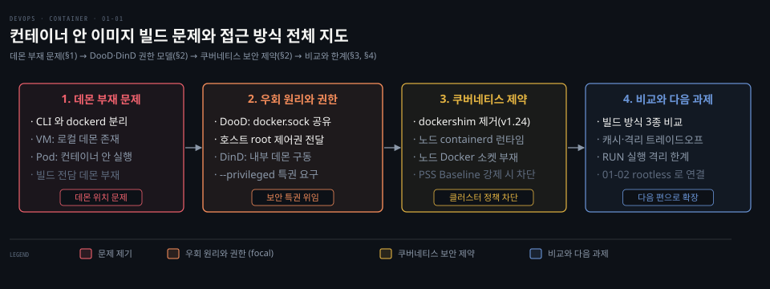
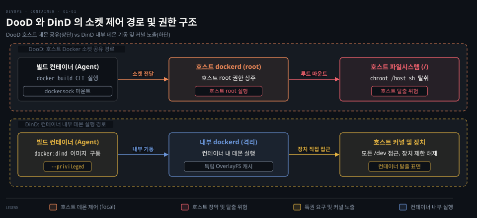

# 컨테이너 안 빌드가 문제가 되는 이유

---

> CI 에이전트가 가상머신(VM)에서 컨테이너나 Pod 로 옮겨 가면 `docker build` 가 기대던 Docker 데몬(`dockerd`)이 곁에 없습니다.

호스트 소켓을 공유하는 DooD 와 컨테이너 안에 데몬을 띄우는 DinD 는 데몬을 되찾는 대가로 호스트 root 에 준하는 권한을 내줍니다. 쿠버네티스에서는 노드 런타임이 바뀌어 소켓이 없습니다. Baseline 이상을 강제하는 네임스페이스에서는 두 방식 모두 Pod 생성 단계에서 거부됩니다.


## 학습 목표

> 이 편을 읽고 나면 아래 네 가지를 스스로 설명하고 판단할 수 있습니다.

1. `docker build` 가 클라이언트와 서버로 분리되어 동작함을 이해하고 에이전트가 컨테이너로 이동할 때 데몬 부재가 생기는 원인을 설명할 수 있습니다.
2. DooD 방식의 소켓 마운트가 호스트 root 권한 획득과 동일한 이유를 공식 보안 문서를 근거로 설명할 수 있습니다.
3. DinD 방식이 `--privileged` 플래그를 요구하는 커널 수준의 이유와 그로 인한 보안 위험을 설명할 수 있습니다.
4. 쿠버네티스 1.24 이후 dockershim 제거와 Pod Security Standards(PSS) 기준에서 DooD 와 DinD 가 차단되는 원리를 분석하고 대안을 제시할 수 있습니다.

아래 지도는 데몬 부재 문제의 발생 원인부터 두 우회 방식(DooD·DinD)의 권한 모델, 쿠버네티스 보안 제약, 그리고 데몬 없는 빌드로 이어지는 전체 흐름을 보여 줍니다.




## 1. 문제 — 데몬 부재와 실행 환경 분리

> `docker build` 는 로컬 CLI 가 직접 빌드하지 않고 백그라운드의 Docker 데몬(`dockerd`)에 작업을 위임하는 클라이언트-서버 구조이며, 에이전트가 VM 에서 컨테이너로 전환되면서 데몬의 위치 문제가 시작됩니다.

CI 파이프라인을 컨테이너나 쿠버네티스 Pod 로 전환할 때 가장 먼저 부딪히는 실패는 `docker build` 명령을 처리할 백그라운드 데몬이 없다는 점입니다. 일반 개발 환경에서 `docker build` 명령은 로컬 단일 도구처럼 실행됩니다. 하지만 Docker 의 아키텍처는 명령어를 입력받는 CLI 클라이언트와 실제 작업을 수행하는 백그라운드 데몬인 `dockerd` 로 분리되어 있습니다.

사용자가 터미널에서 `docker build` 명령을 입력하면 CLI 는 빌드 컨텍스트(빌드에 쓸 파일 모음)를 유닉스 소켓(`/var/run/docker.sock`)이나 TCP 소켓을 거쳐 `dockerd` 의 API 로 보냅니다. Dockerfile 지시어 파싱부터 이미지 태깅까지 실제 이미지 생성은 모두 `dockerd` 프로세스가 처리합니다. 그 사이에 베이스 이미지 다운로드, 임시 컨테이너 생성과 `RUN` 명령어 실행, 파일시스템 레이어 커밋이 들어갑니다.

이 데몬은 Rootless 모드를 따로 켜지 않는 한 root 권한으로 돌아가며 보통 `systemd` 서비스로 상주합니다.[^docker-daemon-root]

전통적인 가상머신(VM) 기반 CI 환경에서는 에이전트 머신마다 호스트 OS 위에 `dockerd` 가 설치되어 백그라운드에서 동작했습니다. Jenkins 나 GitLab CI 에이전트가 VM 안의 일반 프로세스로 실행될 때는 로컬 소켓을 통해 자연스럽게 호스트의 `dockerd` 에 빌드를 요청할 수 있었습니다. 에이전트와 데몬이 같은 VM 운영체제 공간을 공유했기 때문입니다.

그러나 클라우드 네이티브 환경으로 전환되면서 CI 에이전트 자체가 컨테이너나 쿠버네티스 Pod 로 동적 프로비저닝되기 시작했습니다. 빌드가 격리된 컨테이너 환경 안에서 시작되면서 아래와 같은 구조적 단절이 생깁니다.

- 컨테이너 내부의 데몬 부재: 경량 빌드 컨테이너 내부에는 기본적으로 Docker 데몬이 설치되어 있지 않으며 백그라운드 서비스도 돌지 않습니다.
- 소켓 연결 경로의 단절: 컨테이너는 격리된 마운트 네임스페이스를 가지므로, 따로 마운트해 주지 않는 한 호스트 파일시스템의 `/var/run/docker.sock` 에 접근할 수 없습니다.
- 데몬 실행 권한의 부족: 컨테이너 내부에서 `dockerd` 를 직접 띄우려 해도, 컨테이너 생성과 파일시스템 마운트에 필요한 리눅스 커널 권한이 기본 격리 환경에서 차단됩니다.

"컨테이너 안에서 또 다른 컨테이너 이미지를 어떻게 빌드할 것인가"라는 질문이 CI 인프라의 핵심 과제로 떠오릅니다.


## 2. 두 우회로와 쿠버네티스 제약

> 컨테이너 안에서 데몬을 얻기 위해 호스트 소켓을 공유하는 DooD 와 컨테이너 안에 데몬을 띄우는 DinD 가 고안되었으나, 두 방식 모두 호스트 root 수준의 보안 위험을 유발하며 쿠버네티스 최신 런타임 환경에서 제약을 받습니다.

아래 도식은 호스트 소켓을 마운트해 외부 데몬에 기대는 DooD 경로와, 컨테이너 안에 특권 데몬을 띄우는 DinD 경로의 제어 흐름 및 권한 구조를 비교한 아키텍처입니다.



위 도식의 상단은 DooD 가 호스트 데몬 소켓을 통해 호스트 전체를 제어하는 경로를 나타냅니다. 하단은 DinD 가 `--privileged` 권한을 통해 호스트 커널 장치에 접근하는 경로를 보여 줍니다.

### DooD: 소켓 공유와 호스트 root 동등성

**DooD**(Docker-out-of-Docker)는 빌드 컨테이너를 실행할 때 호스트의 유닉스 소켓인 `/var/run/docker.sock` 을 컨테이너 내부의 동일 경로로 볼륨 마운트하는 방식입니다.

```yaml
# DooD 방식의 컨테이너 볼륨 마운트 구성
volumes:
  - /var/run/docker.sock:/var/run/docker.sock
```

빌드 컨테이너 안의 Docker CLI 는 마운트된 소켓을 통해 호스트의 `dockerd` 로 API 요청을 직접 전송합니다. 컨테이너 안에 별도의 데몬을 띄우지 않아도 되므로 자원 소모가 적고 호스트의 레이어 캐시를 그대로 재사용할 수 있어 빌드 속도가 빠릅니다.

그러나 이 편의성의 대가는 호스트 제어권의 완전한 위임입니다. Docker 공식 보안 문서는 Docker 데몬 공격 표면에 대해 다음과 같이 명시합니다.[^docker-daemon-attack-surface]

> "First of all, only trusted users should be allowed to control your Docker daemon. This is a direct consequence of some powerful Docker features. Specifically, Docker allows you to share a directory between the Docker host and a guest container; and it allows you to do so without limiting the access rights of the container. This means that you can start a container where the /host directory is the / directory on your host; and the container can alter your host filesystem without any restriction."

또한 공식 설치 가이드는 `docker` 그룹과 소켓 접근에 대해 명확히 경고합니다.[^docker-group-warning]

> "The docker group grants root-level privileges to the user. For details on how this impacts security in your system, see Docker Daemon Attack Surface."

호스트의 Docker 소켓에 쓰기 권한이 있는 프로세스는 호스트 root 권한을 가진 것과 기술적으로 동일합니다. 악의적인 사용자나 침해된 CI 빌드 스크립트가 빌드 컨테이너 안에서 아래 한 줄의 명령을 실행하면 호스트 파일시스템 전체를 장악할 수 있습니다.

```bash
docker run -v /:/host alpine chroot /host sh
```

위 명령은 호스트의 루트 디렉터리(`/`)를 컨테이너의 `/host` 경로에 마운트한 뒤 `chroot` 로 진입합니다. 소켓만 마운트한 빌드 컨테이너 안에서 이 명령을 보내 보면 결과가 바로 보입니다.

```bash
# 소켓만 마운트한 빌드 컨테이너(docker:cli) 안에서 호스트 데몬에 탈출 명령을 보낸다
docker run --rm -v /var/run/docker.sock:/var/run/docker.sock docker:cli \
  sh -c 'docker run --rm -v /:/host alpine chroot /host sh -c "id; head -c 60 /etc/shadow >/dev/null && echo shadow-readable"'
```

```bash
# 출력 (OrbStack, Docker Engine 29.8.2, 2026-11-15 실측, groups 뒷부분 줄임)
uid=0(root) gid=0(root) groups=0(root),...
shadow-readable
```

빌드 컨테이너는 소켓 하나만 받았는데 호스트 데몬이 대신 띄운 컨테이너는 호스트 `/` 를 root 로 읽습니다. 이 실측에서 호스트는 OrbStack 이 띄운 Linux VM 입니다. 공격자는 이 경로로 호스트의 `/etc/shadow`, SSH 개인 키, 다른 프로젝트의 비밀 자격 증명을 읽거나 변조할 수 있습니다. 컨테이너 격리 경계를 무너뜨리는 공격 경로의 세부 메커니즘은 [컨테이너 격리 깨뜨리기 — 설정 하나로 무너지는 경계](../../../../08_cloud/book/container-security/09-01.컨테이너%20격리%20깨뜨리기%20—%20설정%20하나로%20무너지는%20경계.md) 에서 다룹니다.

### DinD: 내부 데몬과 특권 요구

**DinD**(Docker-in-Docker)는 호스트 데몬을 공유하지 않고 빌드 컨테이너 내부에 독립적인 `dockerd` 프로세스를 직접 실행하는 방식입니다. 주로 공식 `docker:dind` 이미지를 사용합니다.

이 방식은 빌드 컨테이너끼리 데몬을 격리할 수 있다는 장점이 있습니다. 그러나 컨테이너 안에서 Docker 데몬을 정상 기동하려면 컨테이너 실행 시 반드시 `--privileged` 플래그를 부여해야 합니다.[^docker-dind-doc]

```bash
docker run --privileged -d --name dind-builder docker:dind
```

`--privileged` 를 빼고 같은 이미지를 띄우면 안쪽 `dockerd` 가 마운트 단계에서 막혀 곧바로 종료됩니다.

```bash
# --privileged 없이 docker:dind 를 띄운다
docker run -d --name dind-np docker:dind
docker logs dind-np 2>&1 | grep 'permission denied'
# mount: permission denied (are you root?)
# mount: permission denied (are you root?)
docker inspect -f '{{.State.Status}} exit={{.State.ExitCode}}' dind-np
# exited exit=1
# (OrbStack, Docker Engine 29.8.2, 2026-11-15 실측)
```

`--privileged` 플래그가 필수적인 이유는 리눅스 커널의 컨테이너 격리 메커니즘 때문입니다. Docker 데몬은 이미지 빌드와 컨테이너 기동을 위해 다음과 같은 작업을 수행합니다.

- 중첩 네임스페이스 생성: 컨테이너 내부에서 다시 새로운 마운트, PID, 네트워크 네임스페이스를 생성해야 합니다.
- 파일시스템 마운트: 이미지 레이어를 겹치기 위해 `mount(2)` 시스템 콜로 OverlayFS 나 devpts, procfs 를 마운트해야 합니다.
- 디바이스 노드 생성: 루프백 장치나 가상 터미널 생성을 위해 `mknod(2)` 시스템 콜 및 `/dev` 장치 접근이 필요합니다.

일반 컨테이너에서는 빠진 capability(특히 `CAP_SYS_ADMIN`), 기본 seccomp·AppArmor 프로필, cgroup 디바이스 컨트롤러가 이 시스템 콜과 장치 접근을 막습니다. `--privileged` 플래그는 모든 Linux capability 를 켜고 기본 seccomp·AppArmor 프로필을 끄고 호스트의 모든 장치에 접근하게 합니다.[^docker-privileged]

DinD 컨테이너는 호스트 커널 장치에 직접 접근할 수 있는 통로를 엽니다. 그래서 컨테이너 탈출(Container Escape) 취약점에 노출됩니다. 캐시에도 한계가 있습니다. `docker:dind` 는 `/var/lib/docker` 를 익명 볼륨으로 둡니다. 그래서 빌드마다 새 DinD 컨테이너를 띄우면 레이어 캐시가 빈 상태에서 시작합니다.

### 쿠버네티스 소켓 부재와 정책 차단

현대 CI 파이프라인의 중심인 쿠버네티스 클러스터로 이동하면 DooD 와 DinD 는 런타임 구조와 보안 정책 양쪽에서 모두 차단됩니다.

첫 번째 장애물은 쿠버네티스 노드 런타임의 변화입니다. 과거 쿠버네티스는 kubelet 과 Docker 데몬을 연결하기 위해 `dockershim` 이라는 내부 인터페이스를 유지했습니다. 그러나 쿠버네티스는 v1.20 에서 Docker 런타임 지원 중단(deprecation)을 예고했습니다.[^k8s-dont-panic] 그리고 v1.24 에서 dockershim 을 제거했습니다.[^kubernetes-dockershim-removal]

이후 쿠버네티스 노드는 대개 Docker Engine 대신 containerd 나 CRI-O 같은 CRI(Container Runtime Interface) 런타임을 씁니다. 이런 노드에는 보통 `dockerd` 가 없고 `/var/run/docker.sock` 파일도 없습니다. 따라서 DooD 방식으로 호스트 소켓을 마운트하려 해도 마운트할 대상 소켓이 없습니다.

노드 쪽에서 kubelet 이 CRI 소켓으로 런타임을 부르는 경로는 [컨테이너 런타임 인터페이스·crictl](../../../../08_cloud/docs/kubernetes/architecture/%EC%BB%A8%ED%85%8C%EC%9D%B4%EB%84%88%20%EB%9F%B0%ED%83%80%EC%9E%84%20%EC%9D%B8%ED%84%B0%ED%8E%98%EC%9D%B4%EC%8A%A4%C2%B7crictl.md)에서 다룹니다.

두 번째 장애물은 쿠버네티스의 Pod Security Standards(PSS) 정책입니다.[^kubernetes-pss-standards] 쿠버네티스는 워크로드의 보안 수준을 Privileged, Baseline, Restricted 의 세 단계로 정의합니다.

- Baseline 정책 차단: Baseline 프로필은 알려진 권한 상승을 막는 최소 제한입니다. 이 단계에서 `securityContext.privileged: true` 설정이 금지되므로 DinD Pod 는 생성 단계에서 거부됩니다. 아울러 `volumes[*].hostPath` 사용도 금지되어 DooD 소켓 마운트가 차단됩니다.
- Restricted 정책 차단: 강화 보안 프로필인 Restricted 단계는 Baseline 의 제약을 모두 포함합니다. 나아가 root 사용자 실행 금지(`runAsNonRoot: true`), capability `ALL` 제거(`NET_BIND_SERVICE` 만 다시 추가 가능), seccomp 프로필 명시를 요구합니다.

이 차단은 저절로 걸리지 않습니다. Pod Security Admission 은 모드 레이블이 없는 네임스페이스에 `privileged` 수준을 기본으로 적용합니다.[^k8s-psa-defaults] 네임스페이스에 `pod-security.kubernetes.io/enforce: baseline` 같은 레이블을 붙이거나 클러스터 기본값을 바꿔야 위 거부가 일어납니다.

DinD 컨테이너와 DooD 소켓 마운트를 한 Pod 에 담아 두 네임스페이스에 보내 보면 차이가 드러납니다.

```yaml
# dind-dood-pod.yaml — privileged 컨테이너(DinD)와 docker.sock hostPath(DooD)를 함께 둔다
apiVersion: v1
kind: Pod
metadata:
  name: build-agent
spec:
  containers:
  - name: dind
    image: docker:dind
    securityContext:
      privileged: true          # DinD
  - name: cli
    image: docker:cli
    command: ["sleep", "3600"]
    volumeMounts:
    - name: docker-sock
      mountPath: /var/run/docker.sock
  volumes:
  - name: docker-sock
    hostPath:
      path: /var/run/docker.sock  # DooD
```

```bash
# kind 클러스터(v1.35.0)에 레이블 없는 네임스페이스와 baseline 네임스페이스를 만든다
kubectl create namespace psa-default
kubectl create namespace psa-baseline
kubectl label namespace psa-baseline pod-security.kubernetes.io/enforce=baseline
# 같은 Pod 를 서버 측 dry-run 으로 보낸다
kubectl -n psa-default apply --dry-run=server -f dind-dood-pod.yaml
# pod/build-agent created (server dry run)
kubectl -n psa-baseline apply --dry-run=server -f dind-dood-pod.yaml
# Error from server (Forbidden): error when creating "dind-dood-pod.yaml": pods "build-agent" is forbidden: violates PodSecurity "baseline:latest": hostPath volumes (volume "docker-sock"), privileged (container "dind" must not set securityContext.privileged=true)
# (2026-11-15 실측)
```

레이블 없는 네임스페이스는 같은 Pod 를 그대로 받았습니다. baseline 네임스페이스는 hostPath 와 privileged 를 함께 짚어 거부했습니다.

결국 쿠버네티스 환경에서는 두 이유가 겹칩니다. 노드에 Docker 소켓이 없다는 기술적 이유가 있습니다. 여기에 Baseline 이상을 강제한 네임스페이스라면 Pod Security Standards 가 hostPath 와 privileged 설정을 막는다는 정책 이유가 더해집니다.


## 3. 세 가지 빌드 방식의 비교

> DooD, DinD, 데몬 없는 빌드는 권한 요구, 캐시 효율성, 격리 수준, 실행 환경 지원에서 서로 다른 강점과 위험을 가집니다.

컨테이너 환경에서 이미지를 빌드하기 위한 세 가지 접근 방식을 핵심 평가 기준으로 비교하면 다음과 같습니다.

| 비교 기준 | DooD (소켓 공유) | DinD (내부 데몬) | 데몬 없는 빌드 (Daemonless) |
|---|---|---|---|
| 권한 수준 | 호스트 Docker 소켓 쓰기 권한 | `--privileged` 특권 플래그 필수 | 소켓·특권 플래그 없음 (Kaniko 는 컨테이너 안 root, rootless 빌더는 일반 사용자) |
| 레이어 캐시 | 호스트 데몬 캐시 직접 공유로 빠름 | 빌드마다 새 컨테이너면 빈 캐시에서 시작 | 원격 레지스트리 캐시나 볼륨을 따로 설정 |
| 격리 수준 | 낮음 (호스트 데몬과 동일 공간) | 중간 (컨테이너 내부 데몬 분리) | 도구마다 다름 ([01-02](01-02.rootless%20빌드의%20조건.md)) |
| 보안 위험 | 호스트 root 권한 탈출과 동일 | 커널 디바이스 접근을 통한 탈출 | 호스트 데몬·특권 플래그를 거친 탈출 경로 없음 |
| 클러스터 적합성 | 부적합 (노드 소켓 부재, Baseline 의 hostPath 금지) | 부적합 (Baseline 의 privileged 금지) | 조건부 (rootless 빌더는 seccomp·AppArmor 완화 필요, [01-02](01-02.rootless%20빌드의%20조건.md)) |

DooD 는 개발 환경이나 신뢰할 수 있는 단일 테넌트 VM 기반 Jenkins 에이전트에서는 가볍고 빠른 선택지입니다. 하지만 다중 테넌트 환경이나 외부 소스 코드를 검증하는 빌드 환경에서는 보안상 허용될 수 없습니다.

DinD 는 테스트 환경 격리가 필요할 때 쓸 수 있습니다. 그러나 매 빌드마다 데몬을 기동해야 하는 오버헤드와 캐시 단절 때문에 대규모 파이프라인에서 비효율적입니다. 무엇보다 호스트 커널에 대한 광범위한 접근 권한을 요구하므로 보안 정책이 적용된 운영 클러스터에 배포할 수 없습니다.

그래서 쿠버네티스 위 CI 는 백그라운드 데몬 자체를 없애고 특권 플래그 없이 이미지를 조립하는 **데몬 없는 빌드(Daemonless)** 도구로 옮겨 갑니다. 이 도구들도 Pod 보안 설정과 맞물리는 조건이 있습니다. 데몬 없는 빌더들의 구체적인 종류와 선택 기준은 [이미지 빌더 종류와 선택](01-03.이미지%20빌더%20종류와%20선택.md) 에서 다룹니다.


## 4. 데몬 제거 후 남는 RUN 격리 과제

> 백그라운드 데몬을 제거해도 Dockerfile 의 RUN 명령을 처리하려면 프로세스를 격리할 컨테이너 환경이 필요하므로, 비특권 사용자 공간에서 컨테이너 격리를 만드는 기술적 조건이 요구됩니다.

호스트 Docker 소켓 마운트와 `--privileged` 플래그를 모두 제거하면 DooD 와 DinD 의 보안 위험은 사라집니다. 그러나 데몬을 없앤다고 해서 컨테이너 이미지 빌드의 모든 문제가 즉시 해결되지는 않습니다.

Dockerfile 에서 파일을 복사하는 `COPY` 는 파일을 새 레이어(tar 아카이브)로 묶는 작업입니다. 환경 변수를 지정하는 `ENV` 와 메타데이터를 정의하는 `LABEL` 은 OCI 이미지 설정(JSON)만 고치는 작업입니다. 이 작업들은 특별한 권한 없이도 사용자 공간 프로세스가 일반 파일 I/O 로 처리할 수 있습니다.

문제는 `RUN` 지시어입니다.

```dockerfile
RUN apt-get update && apt-get install -y --no-install-recommends python3
```

`RUN` 지시어는 텍스트 조작이 아니라 실제 리눅스 실행 파일을 구동하여 패키지를 설치하고 라이브러리를 빌드하는 작업입니다. 이 실행은 호스트 파일시스템을 오염시키지 않아야 하며 이전 레이어의 파일시스템만을 격리된 루트 디렉터리로 바라보아야 합니다. 즉 `RUN` 명령 하나를 실행할 때마다 격리된 임시 컨테이너가 반드시 생성되어야 합니다.

기존 Docker 환경에서는 이 컨테이너 생성을 root 권한의 `dockerd` 가 도맡아 처리했습니다. 데몬이 없으면 빌더 프로세스가 직접 컨테이너를 만들어야 합니다. rootless 빌더라면 그 프로세스는 일반 사용자(예: UID 1000) 권한입니다.

이때 막히는 곳이 커널의 권한 검사입니다. 새 마운트 네임스페이스를 만드는 `unshare(2)`, 레이어를 합치는 `mount(2)`, 루트 경로를 바꾸는 `pivot_root(2)` 는 모두 `CAP_SYS_ADMIN` 을 요구합니다.[^man-unshare] 기본 seccomp·AppArmor 프로필이 걸린 컨테이너 안에서는 user namespace 를 함께 만들려는 `unshare` 마저 거부됩니다.

```bash
# 기본 프로필 컨테이너에서 UID 1000 으로 user·mount namespace 를 만들고 tmpfs 를 마운트해 본다
docker run --rm --user 1000 debian:12 \
  unshare --user --map-root-user --mount sh -c 'mount -t tmpfs none /mnt && echo mounted'
# unshare: unshare failed: Operation not permitted
# seccomp·AppArmor 를 풀면 같은 사용자가 user namespace 안에서 마운트에 성공한다
docker run --rm --user 1000 --security-opt seccomp=unconfined --security-opt apparmor=unconfined debian:12 \
  unshare --user --map-root-user --mount sh -c 'mount -t tmpfs none /mnt && echo mounted'
# mounted
# (OrbStack, Docker Engine 29.8.2, 2026-11-15 실측)
```

두 번째 결과는 일반 사용자도 조건만 갖추면 격리 공간을 만들 수 있다는 뜻입니다. 그 조건이 다음 편의 주제입니다.

백그라운드 데몬 없이 안전하게 이미지를 빌드하려면 특별한 조건들이 필요합니다. 비특권 사용자가 호스트 root 권한 없이도 커널 수준의 격리 공간을 만들 수 있어야 합니다. 이 과제를 해결하는 원리와 필요조건은 다음 편인 [rootless 빌드의 조건](01-02.rootless%20빌드의%20조건.md) 에서 다룹니다.


## 면접 질문

> 질문에 먼저 스스로 답해 보세요. 자답이 끝나면 아래 정답 절을 확인합니다.

1. `docker build` 가 클라이언트-서버 구조로 동작할 때, 빌드 에이전트가 VM 에서 컨테이너로 바뀌면 어떤 문제가 발생하는가?
2. 호스트의 `/var/run/docker.sock` 을 빌드 컨테이너에 마운트하는 DooD 방식이 왜 호스트 root 권한을 넘겨주는 것과 같은가?
3. `docker:dind` 컨테이너가 동작하기 위해 `--privileged` 플래그가 필수적인 이유와 보안 위험은 무엇인가?
4. 쿠버네티스 1.24 이후 클러스터에서 DooD 와 DinD 가 각각 기술적·정책적으로 차단되는 근거는 무엇인가?
5. 백그라운드 데몬을 제거해도 Dockerfile 의 `RUN` 명령을 비특권 사용자로 실행할 때 어떤 커널 제약이 발생하는가?


## 정답 (자답 후 펼치기)

> 위 면접 질문 5개에 먼저 자답한 뒤 아래를 읽으세요.

### 정답 1 — 에이전트 컨테이너화와 데몬 부재

`docker build` 는 CLI 클라이언트가 요청을 받아 백그라운드 Docker 데몬(`dockerd`)에 빌드를 위임하는 구조입니다. VM 환경에서는 호스트 OS 에 상주하는 `dockerd` 가 존재하여 로컬 소켓으로 통신할 수 있었습니다. 그러나 빌드 에이전트가 컨테이너나 Pod 로 격리되면 컨테이너 내부에는 백그라운드 데몬이 설치되어 있지 않고 호스트 소켓과의 연결 경로도 단절됩니다. 그래서 `docker build` 명령을 처리할 주체가 사라집니다.

### 정답 2 — 소켓 마운트와 root 동등성

Docker 데몬은 호스트에서 root 권한으로 실행됩니다. `/var/run/docker.sock` 은 이 데몬에 임의의 API 명령을 내릴 수 있는 통로입니다. 공식 문서가 명시하듯 `docker` 그룹과 소켓 접근 권한은 호스트 root 권한과 동일합니다. 소켓을 마운트한 빌드 컨테이너는 `docker run -v /:/host alpine chroot /host sh` 와 같은 명령으로 호스트 루트 파일시스템 전체를 마운트하여 호스트 쉘을 획득하고 다른 컨테이너와 시스템 자격 증명을 완전히 장악할 수 있습니다.

### 정답 3 — DinD 의 특권 요구와 위험

DinD 는 컨테이너 내부에서 독립적인 `dockerd` 를 실행합니다. 데몬이 중첩 컨테이너를 만들려면 네임스페이스 생성(`unshare`), 마운트(`mount`), 디바이스 생성(`mknod`) 시스템 콜이 필요합니다. 그러나 일반 컨테이너에서는 빠진 capability, 기본 seccomp·AppArmor 프로필, cgroup 디바이스 컨트롤러가 이를 차단합니다. `--privileged` 플래그는 모든 Linux capability 를 켜고 기본 프로필을 끄며 호스트 장치를 열어 주므로 데몬 기동은 가능해집니다. 그러나 컨테이너 탈출 취약점에 직접 노출되는 보안 위험이 따릅니다.

### 정답 4 — dockershim 제거와 PSS 제약

기술적으로는 쿠버네티스 1.24 에서 dockershim 이 완전히 제거되었습니다. 워커 노드가 containerd 나 CRI-O 를 런타임으로 사용함에 따라 호스트에 `dockerd` 및 소켓이 존재하지 않아 DooD 가 불가능합니다. 정책적으로는 Pod Security Standards 의 Baseline 프로필이 `privileged: true` 컨테이너와 `hostPath` 마운트를 모두 금지합니다. 그래서 Baseline 이상을 강제한 네임스페이스에서는 DinD 와 DooD Pod 가 생성 단계에서 거부됩니다. 레이블이 없는 네임스페이스는 기본값이 `privileged` 라 이 거부가 일어나지 않습니다.

### 정답 5 — RUN 컨테이너 격리 과제

Dockerfile 의 `COPY` 는 레이어 파일을 묶고 `ENV` 는 이미지 설정만 고치므로 비특권 사용자도 수행할 수 있습니다. 그러나 `RUN` 명령은 이전 레이어 파일시스템을 격리된 루트 디렉터리로 삼아 실제 리눅스 바이너리를 실행해야 합니다. 즉 매 `RUN` 마다 격리된 임시 컨테이너가 생성되어야 합니다.

데몬이 없으면 빌더가 직접 이 컨테이너를 만들어야 합니다. 그런데 `unshare`, `mount`, `pivot_root` 는 `CAP_SYS_ADMIN` 을 요구합니다. 기본 seccomp·AppArmor 프로필이 걸린 컨테이너에서는 일반 사용자의 user namespace 생성까지 막혀 `EPERM`(Operation not permitted)이 납니다.


## 관련 문서

- [rootless 빌드의 조건](01-02.rootless%20빌드의%20조건.md) — 데몬 없이 비특권 사용자로 RUN 컨테이너를 실행하기 위한 세 가지 커널 및 보안 조건
- [이미지 빌더 종류와 선택](01-03.이미지%20빌더%20종류와%20선택.md) — BuildKit, Buildah, Kaniko 등 데몬 없는 빌더의 아키텍처 비교와 환경별 선택 기준
- [BuildKit 아키텍처와 rootless 모드](../../cmd/image/buildkit.md) — BuildKit 의 LLB 그래프 변환과 비특권 실행 아키텍처
- [컨테이너 격리 깨뜨리기 — 설정 하나로 무너지는 경계](../../../../08_cloud/book/container-security/09-01.컨테이너%20격리%20깨뜨리기%20—%20설정%20하나로%20무너지는%20경계.md) — 잘못된 소켓 마운트와 privileged 플래그가 초래하는 컨테이너 탈출 기법 분석

[^docker-daemon-root]: Docker Documentation, Docker Engine security. "This daemon requires root privileges unless you opt-in to Rootless mode, and you should therefore be aware of some important details." <https://docs.docker.com/engine/security/> (확인일: 2026-11-15)
[^docker-daemon-attack-surface]: Docker Documentation, Docker Engine security, 「Docker daemon attack surface」. "First of all, only trusted users should be allowed to control your Docker daemon. This is a direct consequence of some powerful Docker features. Specifically, Docker allows you to share a directory between the Docker host and a guest container; and it allows you to do so without limiting the access rights of the container. This means that you can start a container where the /host directory is the / directory on your host; and the container can alter your host filesystem without any restriction." <https://docs.docker.com/engine/security/> (확인일: 2026-11-15)
[^docker-group-warning]: Docker Documentation, Post-installation steps for Linux, 「Manage Docker as a non-root user」. "The docker group grants root-level privileges to the user. For details on how this impacts security in your system, see Docker Daemon Attack Surface." <https://docs.docker.com/engine/install/linux-postinstall/> (확인일: 2026-11-15)
[^docker-dind-doc]: Docker Official Images, docker 이미지 README, 「Start a daemon instance」. "`--privileged` is required for Docker-in-Docker to function properly, but it should be used with care as it provides full access to the host environment" <https://github.com/docker-library/docs/blob/d30d00977fa618a169a32685f6828e1f6469a4b3/docker/README.md#start-a-daemon-instance> (확인일: 2026-11-15)
[^docker-privileged]: Docker Documentation, docker container run, 「Escalate container privileges (--privileged)」. 목록 항목 "Enables all Linux kernel capabilities", "Disables the default seccomp profile", "Disables the default AppArmor profile", "Grants access to all host devices". <https://docs.docker.com/reference/cli/docker/container/run/> (확인일: 2026-11-15)
[^k8s-dont-panic]: Kubernetes Blog, Don't Panic: Kubernetes and Docker (2020-12-02). "Kubernetes is deprecating Docker as a container runtime after v1.20." <https://kubernetes.io/blog/2020/12/02/dont-panic-kubernetes-and-docker/> (확인일: 2026-11-15)
[^kubernetes-dockershim-removal]: Kubernetes Documentation, Tasks, 「Check whether dockershim removal affects you」. "Kubernetes' built-in dockershim component was removed in release v1.24." <https://kubernetes.io/docs/tasks/administer-cluster/migrating-from-dockershim/check-if-dockershim-deprecation-affects-you/> (확인일: 2026-11-15)
[^kubernetes-pss-standards]: Kubernetes Documentation, Concepts, 「Pod Security Standards」. Baseline 표: "Privileged Pods disable most security mechanisms and must be disallowed.", "HostPath volumes must be forbidden." Restricted 표: "Containers must be required to run as non-root users.", "Containers must drop ALL capabilities, and are only permitted to add back the NET_BIND_SERVICE capability.", "Seccomp profile must be explicitly set to one of the allowed values." <https://kubernetes.io/docs/concepts/security/pod-security-standards/> (확인일: 2026-11-15)
[^k8s-psa-defaults]: Kubernetes Documentation, Tasks, 「Enforce Pod Security Standards by Configuring the Built-in Admission Controller」. 설정 예시 주석 "Defaults applied when a mode label is not set." 와 그 아래 값 `enforce: "privileged"`. <https://kubernetes.io/docs/tasks/configure-pod-container/enforce-standards-admission-controller/> (확인일: 2026-11-15)
[^man-unshare]: Linux manual page, unshare(2). "Use of CLONE_NEWNS requires the CAP_SYS_ADMIN capability." 같은 CAP_SYS_ADMIN 요구는 mount(2)·pivot_root(2) 의 EPERM 항목에도 있습니다. <https://man7.org/linux/man-pages/man2/unshare.2.html> (확인일: 2026-11-15)
