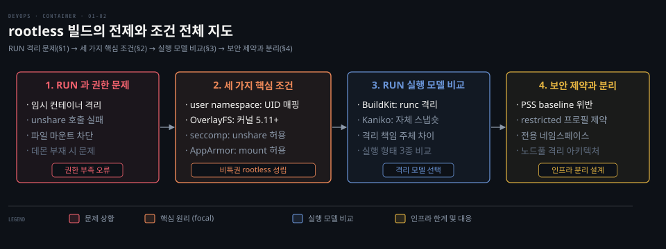
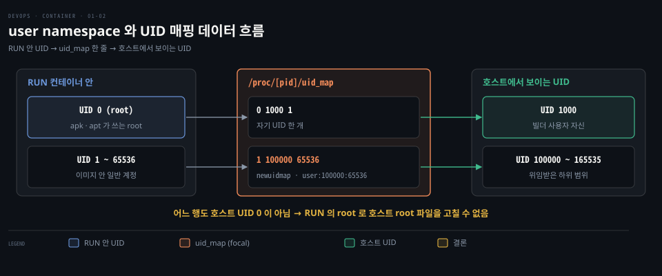
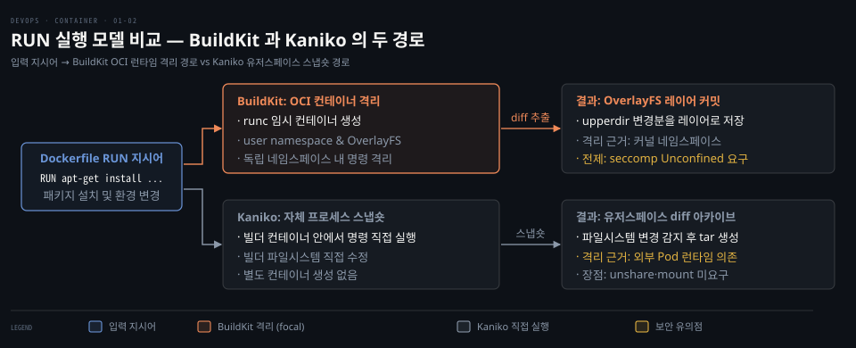

# rootless 빌드의 조건

---

> Dockerfile 의 RUN 명령을 데몬과 호스트 root 권한 없이 실행하려면 리눅스 커널의 user namespace, 비특권 OverlayFS, 완화된 Pod 보안 프로필이라는 세 조건이 갖춰져야 합니다.

## 학습 목표

> 이 편을 읽고 나면 아래 네 가지를 스스로 설명하고 판단할 수 있습니다.

1. Dockerfile 의 RUN 명령이 왜 컨테이너 격리를 요구하며, 비특권 환경에서 어떤 시스템 콜이 막히는지 설명할 수 있습니다.
2. user namespace 와 `/etc/subuid` 매핑으로 컨테이너 안 root 가 호스트 일반 사용자로 격리되는 원리를 설명할 수 있습니다.
3. OverlayFS 커널 지원 조건과 seccomp·AppArmor 완화 요구가 rootless 빌드에 필요한 이유를 설명할 수 있습니다.
4. BuildKit 과 kaniko 의 RUN 실행 모델 차이를 비교하고, PSS 제약 아래에서 빌드 인프라를 분리하는 이유를 판단할 수 있습니다.

아래 지도는 RUN 명령의 격리 요구에서 출발해 rootless 빌드를 성립시키는 세 조건, 그리고 빌더별 실행 모델과 인프라 분리 설계를 보여 줍니다.




## 1. RUN 단계 임시 컨테이너와 권한 문제

> 이미지 빌드는 RUN 마다 임시 컨테이너를 만들어 명령을 실행하므로, 백그라운드 데몬과 호스트 root 권한을 없애려 할 때 컨테이너 격리를 만드는 커널 호출에서 즉시 권한 부족 문제가 발생합니다.

Dockerfile 을 빌드할 때 소스 복사(`COPY`)나 환경 변수 설정(`ENV`)은 tar 아카이브를 풀거나 json 메타데이터를 갱신하는 단순 파일 조작입니다. `RUN apt-get update && apt-get install -y curl` 같은 명령은 셸 프로세스를 구동해 패키지를 설치합니다. 이 명령이 호스트 파일시스템을 오염시키지 않으려면 격리된 컨테이너 안에서 실행되어야 합니다. 그 컨테이너는 이전 레이어를 루트 디렉터리로 삼습니다.

기존 Docker 환경에서는 Docker 데몬(`dockerd`)이 이 작업을 전담했습니다. 데몬은 호스트 root 권한으로 상주하며 OCI(Open Container Initiative) 런타임 runc 를 root 권한으로 호출해 매 RUN 단계마다 임시 컨테이너를 띄웠습니다.

보안 위험을 줄이기 위해 데몬을 없애고 호스트 root 권한도 주지 않는다면 상황이 달라집니다. user namespace 를 쓰지 않는 한, 일반 사용자(UID 1000) 권한으로 동작하는 프로세스는 컨테이너를 만드는 시스템 콜 대부분을 호출할 권한이 없습니다.

- 격리 네임스페이스 생성 실패: 새 마운트 네임스페이스를 만드는 `unshare(CLONE_NEWNS)` 는 `CAP_SYS_ADMIN` 을 요구합니다. 일반 사용자가 부르면 `EPERM` 으로 거부됩니다.
- 파일시스템 마운트 불가: `mount(2)` 시스템 콜은 레이어를 겹쳐 루트 파일시스템을 구성하는데 이 호출 역시 일반 사용자에게 허용되지 않습니다.
- 루트 경로 전환 거부: 격리된 디렉터리를 루트로 전환하는 `pivot_root(2)` 나 `chroot(2)` 호출도 권한 부족으로 차단됩니다.

백그라운드 데몬 없이 비특권 사용자로 이미지를 빌드하려면 root 권한 없이도 격리된 컨테이너 환경을 만들 수 있도록 커널이 지원해야 합니다.


## 2. rootless 빌드를 지탱하는 세 원리

> 비특권 사용자가 안전하게 RUN 컨테이너를 만들고 레이어를 쌓으려면 user namespace 의 UID 매핑, 커널 5.11 이상의 비특권 OverlayFS, 그리고 마운트를 허용하는 보안 프로필 완화가 함께 동작해야 합니다.

### user namespace 와 UID 매핑

리눅스 커널의 **user namespace** 는 프로세스의 사용자 ID 와 그룹 ID 를 네임스페이스 안팎으로 분리하는 기술입니다.[^user-namespaces] 새 user namespace 를 만든 프로세스는 그 안에서 전체 capability 를 갖고, UID 매핑을 적으면 그 안에서 UID 0(root)으로 보입니다. 네임스페이스 바깥인 호스트 관점에서는 비특권 일반 사용자 권한에 머뭅니다.

컨테이너 안의 프로세스는 UID 0 으로 실행되지만, 호스트 커널은 이 UID 를 빌더 사용자 자신의 UID 와 미리 위임받은 하위 UID 범위로 바꿔 봅니다.



특권 없는 프로세스가 `uid_map` 에 직접 쓸 수 있는 것은 자기 UID 하나를 매핑하는 한 줄뿐입니다.[^uid-map-rule] 이미지 안의 여러 계정까지 쓰려면 더 넓은 범위가 필요하고, 이 범위를 정하고 기록하는 도구가 `/etc/subuid` 와 `newuidmap` 입니다.[^newuidmap]

호스트 관리자는 `/etc/subuid` 에 일반 사용자가 쓸 수 있는 하위 UID 범위를 지정합니다. 예를 들어 `user:100000:65536` 은 user 사용자가 호스트의 100000 번부터 65536 개의 UID 를 위임받아 쓴다는 선언입니다. BuildKit 의 rootless 이미지도 UID 1000 인 `user` 에 이 범위를 줍니다.[^buildkit-uid]

비특권 사용자가 새 user namespace 를 만들면 `newuidmap` 이 `/etc/subuid` 의 범위 안에서 그 프로세스의 `/proc/[pid]/uid_map` 에 매핑 규칙을 기록합니다.

BuildKit rootless 이미지에서는 RUN 안의 UID 0 이 사용자 자신의 UID 1000 에, UID 1~65536 이 위임받은 100000~165535 에 매핑됩니다.[^buildkit-uid] 그래서 RUN 안의 root 가 만든 파일은 바깥에서 UID 1000 소유로, RUN 안에서 UID 1 로 바꾼 파일은 UID 100000 소유로 보입니다. 어느 쪽도 호스트의 UID 0 이 아니므로 RUN 안의 root 권한으로 호스트 root 소유의 시스템 파일을 고칠 수는 없습니다.

```bash
# 2026-11-15 OrbStack Docker 29.8.2, 이미지 moby/buildkit:v0.34.1-rootless 에서 실측
# rootlesskit 이 만든 user namespace 안에서 uid_map 을 읽는다
docker run --rm \
  --security-opt seccomp=unconfined \
  --security-opt apparmor=unconfined \
  --entrypoint rootlesskit \
  moby/buildkit:v0.34.1-rootless \
  cat /proc/self/uid_map
```

```bash
# 출력: 안쪽 UID, 바깥 UID, 개수
         0       1000          1
         1     100000      65536
```

같은 이미지에서 rootlesskit 안의 root 가 만든 파일은 바깥 셸의 `stat` 으로 UID 1000 이었고, 안에서 `chown 1:1` 한 파일은 UID 100000 이었습니다.

### 비특권 OverlayFS 와 파일시스템

컨테이너 이미지는 **OverlayFS** 구조로 동작합니다. 읽기 전용 레이어들을 쌓고 최상단에 쓰기 가능한 레이어를 얹는 방식입니다. 하위 읽기 전용 디렉터리(`lowerdir`)와 상위 변경 디렉터리(`upperdir`)를 조합해 단일 병합 디렉터리(`merged`)를 만듭니다.[^netflix-uid]

전통적인 리눅스 커널에서 `mount -t overlay` 호출은 초기 네임스페이스의 `CAP_SYS_ADMIN` 권한을 요구했습니다. 비특권 사용자가 임의의 파일시스템을 마운트하면 커널 보안 검사를 우회할 위험이 있었기 때문입니다.

이 제약은 리눅스 커널 5.11 에서 풀렸습니다. 커널 5.11 부터는 user namespace 안에서 `CAP_SYS_ADMIN` 을 가진 프로세스가 overlayfs 를 마운트할 수 있습니다.[^userns-mount] BuildKit 문서도 overlayfs 스냅숏터의 조건을 커널 5.11 이상 또는 Ubuntu 커널로 적습니다.[^buildkit-rootless]

커널 5.11 이전 환경(커널 4.18~5.10)에서 rootless BuildKit 은 `fuse-overlayfs` 스냅숏터를 대신 씁니다. 4.18 보다 오래된 커널에서는 층을 겹치지 않고 복사하는 `native` 스냅숏터로 내려갑니다.[^buildkit-rootless] `fuse-overlayfs` 는 FUSE(Filesystem in Userspace)를 이용해 유저스페이스에서 OverlayFS 동작을 흉내 냅니다. 파일 입출력이 유저스페이스 프로세스를 거치므로 커널 안에서 끝나는 overlayfs 보다 느립니다. 이 오버헤드를 없애려면 커널 5.11 이상의 네이티브 비특권 OverlayFS 가 필요합니다.

### seccomp 와 AppArmor 보안 프로필

커널이 user namespace 와 비특권 OverlayFS 를 지원하더라도, 빌더가 컨테이너 안에서 실행될 때는 컨테이너 런타임의 **seccomp**·**AppArmor** 프로필이 남습니다. BuildKit 문서는 두 프로필을 끄는 이유를 시스템 콜과 마운트로 나눠 적습니다.[^buildkit-security-opt]

- seccomp 프로필: runc 가 쓰는 `unshare(2)` 와 스냅숏터가 쓰는 `mount(2)` 를 허용하려고 끕니다. Docker 기본 프로필은 `CAP_SYS_ADMIN` 이 없는 컨테이너에서 `mount` 와, `unshare --user` 를 뺀 새 네임스페이스 생성을 막습니다.[^docker-seccomp] 런타임 기본 프로필을 Kubernetes 에서 고르는 이름이 `RuntimeDefault` 입니다.
- AppArmor 프로필: 파일시스템 마운트를 허용하려고 끕니다. AppArmor 를 쓰는 호스트에서는 Kubernetes 가 런타임 기본 AppArmor 프로필을 기본으로 적용하고, AppArmor 가 없는 호스트에서는 이 설정이 필요 없습니다.[^pod-security-standards]

Kubernetes 의 seccomp 기본값은 런타임 기본 프로필이 아닙니다. kubelet 의 `--seccomp-default`(설정 파일의 `seccompDefault`)를 켜지 않은 노드에서는 프로필을 지정하지 않은 Pod 가 `Unconfined` 로 돕니다.[^k8s-seccomp-default] 그래서 seccomp 필드를 빼도 빌드가 되는 노드가 있지만, 이 기본값을 켠 노드에서는 같은 Pod 가 깨집니다.

BuildKit rootless 컨테이너는 먼저 rootlesskit 으로 새 user namespace 를 만들고 그 안에서 runc 와 OverlayFS 마운트를 씁니다.

seccomp 를 런타임 기본 프로필로 두면 이 첫 단계에서 `[rootlesskit:parent] error: failed to start the child: fork/exec /proc/self/exe: operation not permitted` 로 실패합니다. 2026-11-15 OrbStack Docker 에서 기본 seccomp 로 띄운 `moby/buildkit:v0.34.1-rootless` 가 이 문구를 냈습니다. §5 의 정독 노트가 kind 에서 `RuntimeDefault` 로 둔 빌드 Pod 도 같았습니다.

공식 BuildKit Kubernetes 예제는 seccompProfile 과 appArmorProfile 을 모두 Unconfined 로 둡니다.[^buildkit-k8s-job]

남은 조건은 `/proc` 입니다. BuildKit 은 RUN(ExecOp)마다 새 PID 네임스페이스와 전용 `/proc` 를 마운트하는데, 런타임이 컨테이너의 `/proc` 일부를 가려 두면 이 마운트가 막힙니다. Docker 는 `systempaths=unconfined` 로 이 가림을 풀지만 Kubernetes 에는 같은 설정이 없습니다. 그래서 예제는 `BUILDKITD_FLAGS` 환경 변수에 `--oci-worker-no-process-sandbox` 를 넣어 RUN 마다 새 PID 네임스페이스와 `/proc` 를 만들지 않게 합니다.[^buildkit-procmount]

이 플래그 없이 같은 컨테이너에서 빌드하면 RUN 단계가 `error mounting "proc" to rootfs at "/proc": … operation not permitted` 로 실패했습니다. 플래그를 넣으면 RUN 안에서 `uid=0(root)` 가 찍혔습니다(2026-11-15 실측).

문서는 이 플래그를 권하지 않습니다. RUN 이 끝나도 남은 프로세스를 끝내지 못하고, RUN 안의 프로세스가 BuildKit 컨테이너의 다른 프로세스에 `kill` 을 보낼 수 있기 때문입니다. `securityContext.procMount: Unmasked` 가 비슷한 일을 하지만 `hostUsers: false` 를 전제로 합니다.[^buildkit-procmount]

노드 커널 설정도 조건에 들어갑니다. user namespace 수 한도(`user.max_user_namespaces`)가 0 이면 rootlesskit 이 시작하지 못합니다. Ubuntu 24.04 이후 호스트는 `kernel.apparmor_restrict_unprivileged_userns=0` 으로 바꿔야 비특권 user namespace 를 만들 수 있습니다.[^buildkit-node]


## 3. RUN 실행 모델과 세 가지 실행 형태 비교

> 이미지 빌더는 RUN 을 별도 OCI 컨테이너로 띄우거나 빌더 프로세스 안에서 직접 실행하는 두 모델로 나뉘며, 각 모델은 보안 격리를 커널 네임스페이스와 외부 런타임 중 어디에 기대는지가 다릅니다.

### 컨테이너 격리와 파일시스템 스냅숏

빌드 도구의 핵심 아키텍처는 Dockerfile 의 `RUN` 지시어를 어떻게 처리하느냐로 갈립니다. BuildKit 과 Buildah 는 OCI 컨테이너 모델을 따르고 Kaniko 는 유저스페이스 스냅숏 모델을 따릅니다.

동일한 RUN 지시어를 처리해도 BuildKit 과 Kaniko 는 거치는 실행 경로와 격리 메커니즘이 다릅니다.



BuildKit 은 기본 워커로 OCI(runc) 워커를 사용합니다. Dockerfile 의 `RUN` 명령을 만날 때마다 runc 를 호출해 독립된 임시 컨테이너를 생성합니다.

명령 실행이 끝나면 변경된 파일시스템 차이분을 커널 OverlayFS 에서 읽어 새 이미지 레이어로 커밋합니다. 빌드 중에도 프로세스가 커널 네임스페이스 격리 안에서 돌기 때문에 빌드 단계 사이의 간섭이 적습니다. 이 격리를 얻는 대가로 user namespace 생성과 seccomp 완화 같은 커널 권한 설정이 필요합니다. 다만 Kubernetes 예제처럼 `--oci-worker-no-process-sandbox` 를 쓰면 RUN 사이의 PID 네임스페이스 격리는 빠집니다.

Kaniko 는 별도의 OCI 런타임을 띄우지 않습니다. Kaniko 의 executor 프로세스가 빌더 컨테이너 환경 안에서 셸 명령을 직접 실행합니다. 명령 실행 전후의 파일시스템 상태를 유저스페이스에서 스캔해 변경된 파일들을 찾아내고 tar 아카이브로 묶어 레이어를 만듭니다.

Kaniko 는 추가 커널 시스템 콜(`unshare`, `mount`)을 쓰지 않으므로 seccomp 나 AppArmor 프로필을 완화할 필요가 없습니다. 그 대신 빌드 단계를 스스로 격리하지 못해 자신을 감싸고 있는 외부 Pod 런타임의 격리에만 보안을 기댑니다. 악의적인 Dockerfile 명령이 빌더 내부의 다른 파일을 손상시키면 빌드 과정 전체가 오염될 수 있습니다.

### 실행 주체에 따른 세 형태의 보안 비교

컨테이너 환경에서 이미지를 빌드하는 방식은 권한 수준에 따라 세 가지 형태로 분류할 수 있습니다.

| 비교 기준 | rootful (DinD) | 특권 없는 컨테이너 안 root (Kaniko) | rootless (BuildKit rootless) |
|---|---|---|---|
| 필요한 커널 기능 | 초기 네임스페이스 `CAP_SYS_ADMIN` | 표준 컨테이너 런타임 기능만 요구 | user namespace, 커널 5.11+ OverlayFS |
| Pod 보안 설정 | `privileged: true`, UID 0 실행 | `privileged: false`, 컨테이너 내 UID 0 | `privileged: false`, UID 1000, seccomp·AppArmor Unconfined |
| 빌드 격리 주체 | 데몬 및 runc OCI 컨테이너 | 외부 Pod 런타임에 전적 의존 | user namespace 내부 runc OCI 컨테이너 |
| 탈출 시 호스트 영향 | 호스트 root 권한 장악 (전체 영향) | 컨테이너 root 가 호스트 UID 0 이라 런타임 탈출 시 호스트 root | 호스트 비특권 UID(1000, 100000~165535) 권한에 한정 |

rootful 방식은 가장 설정이 단순하지만 Pod 탈출 시 호스트 전체가 장악되는 위험을 안고 있습니다. Kaniko 는 특권 권한을 없앤 대신 격리를 외부 런타임에 넘깁니다. rootless 방식은 RUN 마다 OCI 컨테이너 격리를 유지하면서도 탈출 시 호스트에 미치는 권한을 일반 사용자로 묶어 둡니다.


## 4. PSS 제약과 빌드 인프라 분리

> rootless 빌더는 비특권 사용자로 동작하지만 완화된 보안 프로필을 요구하여 Pod Security Standards baseline 및 restricted 와 충돌하므로, 빌드 워크로드를 위한 전용 네임스페이스와 노드 분리가 필요합니다.

### baseline 위반과 restricted 제약

Kubernetes 클러스터는 워크로드의 보안 수준을 통제하기 위해 **Pod Security Standards**(PSS)를 적용합니다.[^pod-security-standards] PSS 는 보안 강도에 따라 Privileged, Baseline, Restricted 의 세 가지 수준을 정의합니다.

rootless BuildKit 은 `privileged: false` 이며 UID 1000 으로 실행되므로 외형상 안전한 비특권 워크로드처럼 보이지만 실제 배포 시 Baseline 정책조차 통과하지 못합니다.

- Baseline 정책 위반: Baseline 수준은 seccomp 프로필을 `Unconfined` 로 명시하는 것과 기본 AppArmor 프로필을 끄거나 바꾸는 것을 금지합니다. `/proc` 가림을 푸는 `procMount: Unmasked` 도 허용하지 않습니다.[^pod-security-standards]
- Restricted 정책 위반: Restricted 수준은 모든 capability 를 drop 하게 하고, seccomp 프로필을 `RuntimeDefault` 나 `Localhost` 로 명시하도록 요구합니다. 프로필을 지정하지 않는 것도 허용하지 않습니다.

`pod-security.kubernetes.io/enforce=baseline` 레이블이 설정된 네임스페이스에 공식 BuildKit rootless Pod 를 생성하면 오류가 납니다. §5 의 정독 노트가 kind 에서 확인했을 때 Admission 단계가 `violates PodSecurity "baseline:latest"` 로 Pod 생성을 거부했습니다. 거부 사유로는 AppArmor 와 seccomp 두 필드를 들었습니다.

### 전용 네임스페이스와 노드 분리

이 충돌은 빌드 워크로드의 특수성에서 비롯됩니다. 일반 웹 서버나 백엔드 서비스는 시스템 콜 제한을 풀 필요가 없으므로 Restricted 정책을 만족할 수 있습니다. 이미지 빌드는 컨테이너 안에서 또 다른 임시 컨테이너를 만들어야 하므로 시스템 콜 완화가 불가피합니다.

클러스터를 운영할 때는 빌드 워크로드와 일반 서비스 워크로드의 인프라 경계를 분리합니다.

- 빌드 전용 네임스페이스: 빌드 파이프라인이 동작하는 네임스페이스에는 PSS enforce 수준을 `privileged` 로 설정해 완화 옵션을 허용합니다.
- 전용 노드풀 분리: Taints 와 Tolerations 설정을 사용해 빌드 Pod 가 일반 업무 Pod 와 같은 노드에 섞이지 않도록 격리합니다.

이렇게 분리해 두면 일반 워크로드에는 엄격한 PSS Restricted 정책을 유지하면서도 빌드 워크로드가 요구하는 rootless 커널 조건을 안전하게 수용할 수 있습니다.


## 5. 관련 실습

> 이 문서는 커널 메커니즘과 보안 프로필의 성립 조건을 분석하는 개념 편이므로 별도의 독립 실습 프로젝트 코드를 포함하지 않습니다.

본문에서 분석한 BuildKit rootless Pod 의 동작은 관련 책 정독 노트에서 검증할 수 있습니다. [Image Builder — 클러스터 안에서 이미지를 빌드하기](../../../../08_cloud/book/kubernetes-patterns/30-01.Image%20Builder%20—%20클러스터%20안에서%20이미지를%20빌드하기.md) 의 §3 「Build Pod」 절이 공식 `job.rootless.yaml` 을 kind 에서 돌리고, 조건을 하나씩 뺀 결과를 표로 남겼습니다.


## 6. 검증과 복습

> 학습 점검 결과와 다음 편으로 이어지는 연결점을 확인합니다.

- **Phase 4 결과**: 아직 자답 기록이 없습니다. 자답하면 `write/07_devops/docs/artifact/container/_review/` 에 남깁니다.
- **다음 보완점**: BuildKit 의 프론트엔드와 OCI 워커 세부 통신 구조는 [BuildKit 아키텍처와 캐시 메커니즘](buildkit.md) 에서 이어집니다.


## 면접 질문

> 아래 질문에 먼저 스스로 답해 보세요. 자답이 끝나면 아래 §정답 (자답 후 펼치기) 으로 내려갑니다.

1. Dockerfile 의 RUN 명령을 비특권 환경에서 실행할 때 unshare 와 mount 시스템 콜이 실패하는 이유는 무엇입니까?
2. user namespace 가 컨테이너 안의 root 를 호스트 일반 사용자로 격리하는 원리와 `/etc/subuid` 의 역할을 설명하세요.
3. Linux 커널 5.11 이전과 이후에 rootless 이미지 빌더의 OverlayFS 지원 방식이 어떻게 달라졌습니까?
4. rootless BuildKit Pod 가 `privileged: false` 로 동작하면서도 seccomp 와 AppArmor 를 Unconfined 로 설정해야 하는 이유는 무엇입니까?
5. BuildKit 과 Kaniko 의 RUN 실행 모델 차이와, Kaniko 가 의존하는 보안 격리 경계의 한계를 설명하세요.
6. rootless 빌드 Pod 가 Kubernetes Pod Security Standards 의 baseline 및 restricted 수준을 통과하지 못하는 이유와 그에 따른 인프라 분리 설계 방안은 무엇입니까?


## 핵심 개념 체크리스트

> 스스로 점검할 항목을 확인합니다.

- [ ] RUN 명령이 단순 파일 복사와 달리 임시 컨테이너 격리를 요구하는 이유를 설명할 수 있는가?
- [ ] user namespace 에서 UID 0 이 호스트 비특권 UID 로 매핑되는 원리를 알고 있는가?
- [ ] `/etc/subuid` 와 newuidmap 도구가 비특권 ID 매핑에 쓰이는 이유를 설명할 수 있는가?
- [ ] 커널 5.11 의 비특권 OverlayFS 지원과 fuse-overlayfs 의 성능 차이를 비교할 수 있는가?
- [ ] BuildKit 의 OCI 컨테이너 격리와 Kaniko 의 유저스페이스 스냅숏 방식의 차이를 이해하고 있는가?
- [ ] Pod Security Standards 환경에서 빌드 워크로드를 분리 배치하는 이유를 판단할 수 있는가?


## 정답 (자답 후 펼치기)

> 위 §면접 질문 여섯 개에 먼저 자답한 뒤 아래를 읽으세요.

### 정답 1 — RUN 실행과 시스템 콜 실패 원인

Dockerfile 의 RUN 명령은 실제 셸 프로세스를 구동해 패키지를 설치하거나 소스를 컴파일하므로 격리된 임시 컨테이너 환경이 필요합니다. 일반 사용자 권한에서는 새 네임스페이스를 생성하는 `unshare(CLONE_NEWNS)` 나 파일시스템을 결합하는 `mount(2)` 호출이 `CAP_SYS_ADMIN` 권한 부족으로 거부됩니다.

### 정답 2 — user namespace 격리와 매핑

user namespace 는 프로세스의 UID 와 GID 매핑을 분리합니다. 프로세스는 새 user namespace 내부에서 UID 0(root)과 전체 capability 를 갖지만 호스트 초기 네임스페이스에서는 일반 사용자 권한을 유지합니다. `/etc/subuid` 는 일반 사용자에게 허용된 하위 UID 범위를 선언합니다. `newuidmap` 도구가 이를 커널의 `/proc/[pid]/uid_map` 에 기록해 내부 UID 0 이 호스트의 비특권 UID 로 안전하게 변환되도록 합니다.

### 정답 3 — 커널 버전에 따른 OverlayFS 변화

리눅스 커널 5.11 이전에는 OverlayFS 마운트에 초기 네임스페이스의 `CAP_SYS_ADMIN` 이 요구되어 비특권 빌더는 FUSE 기반의 `fuse-overlayfs` 를 사용해야 했습니다. 이 방식은 파일 입출력마다 유저스페이스와 커널스페이스 사이에서 문맥 교환을 자주 일으켜 빌드 성능이 떨어졌습니다. 커널 5.11 부터 user namespace 내 비특권 OverlayFS 가 공식 지원되면서 네이티브 커널 성능으로 레이어를 조작할 수 있게 되었습니다.

### 정답 4 — seccomp 와 AppArmor 완화

rootless BuildKit 은 Pod 내부에서 runc 를 이용해 중첩된 OCI 컨테이너를 띄우고 OverlayFS 를 마운트합니다. 런타임 기본 seccomp 프로필(`RuntimeDefault`)은 `CAP_SYS_ADMIN` 이 없는 컨테이너의 `mount` 와 새 네임스페이스 생성을 막고 런타임 기본 AppArmor 프로필은 파일시스템 마운트를 막습니다. kubelet 기본값이 `Unconfined` 인 노드도 있지만 `--seccomp-default` 를 켠 노드에서 깨지지 않도록, rootless 빌더는 두 프로필을 `Unconfined` 로 명시합니다.

### 정답 5 — BuildKit 과 Kaniko 격리 비교

BuildKit 은 OCI runc 워커를 통해 매 RUN 단계마다 별도의 임시 컨테이너를 띄워 커널 네임스페이스 수준에서 프로세스를 격리합니다. Kaniko 는 별도 컨테이너 없이 빌더 컨테이너 자체에서 셸 명령을 직접 실행하고 유저스페이스에서 파일 변경 사항을 스냅숏합니다. Kaniko 는 추가 권한을 요구하지 않는 장점이 있지만 빌드 단계를 스스로 격리하지 못해 보안을 외부 Pod 런타임의 격리에만 의존합니다.

### 정답 6 — PSS 충돌과 인프라 분리 설계

Pod Security Standards 의 baseline 및 restricted 정책은 `seccompProfile: Unconfined` 설정과 AppArmor 완화를 금지합니다. rootless BuildKit 은 비특권 UID 로 실행되지만 이 프로필 완화가 꼭 필요하므로 baseline 네임스페이스에서 생성이 거부됩니다. 이를 해결하기 위해 빌드 파이프라인을 `enforce: privileged` 수준의 빌드 전용 네임스페이스에 배치하고 Taints 와 Tolerations 를 통해 빌드 전용 노드풀로 물리적·논리적으로 격리합니다.


## 관련 문서

- [컨테이너 안 빌드가 문제가 되는 이유](01-01.컨테이너%20안%20빌드가%20문제가%20되는%20이유.md) — 데몬 소켓 공유와 특권 컨테이너 빌드의 보안 위험
- [이미지 빌더 종류와 선택](01-03.이미지%20빌더%20종류와%20선택.md) — 빌드 도구별 특성과 환경에 맞는 선택 기준
- [BuildKit 아키텍처와 캐시 메커니즘](buildkit.md) — buildkitd 데몬과 LLB 파이프라인
- [OverlayFS 와 idmapped mount — Netflix 사례](../../../../02_os/docs/kernel/OverlayFS%20%EC%99%80%20idmapped%20mount%20%E2%80%94%20Netflix%20%EC%82%AC%EB%A1%80.md) — 커널 수준의 ID 매핑과 마운트 전파 원리

[^user-namespaces]: Linux Programmer's Manual, user_namespaces(7) (2026-11-15 확인). "User namespaces isolate security-related identifiers and attributes, in particular, user IDs and group IDs (see credentials(7)), the root directory, keys (see keyrings(7)), and capabilities (see capabilities(7))." / "The child process created by clone(2) with the CLONE_NEWUSER flag starts out with a complete set of capabilities in the new user namespace." <https://man7.org/linux/man-pages/man7/user_namespaces.7.html>
[^uid-map-rule]: 같은 문서 (2026-11-15 확인). "The data written to uid_map (gid_map) must consist of a single line that maps the writing process's effective user ID (group ID) in the parent user namespace to a user ID (group ID) in the user namespace." <https://man7.org/linux/man-pages/man7/user_namespaces.7.html>
[^newuidmap]: Linux User's Manual, newuidmap(1) (2026-11-15 재확인). "The newuidmap sets /proc/[pid]/uid_map based on its command line arguments and the uids allowed. Subuid delegation can either be managed via /etc/subuid or through the configured NSS subid module." <https://man7.org/linux/man-pages/man1/newuidmap.1.html>
[^buildkit-uid]: Moby BuildKit, Rootless mode documentation, 「Change UID/GID」 (커밋 3a91b50, 2026-11-15 확인). "The moby/buildkit:rootless image has the following UID/GID configuration:" (표: 1000 → 0, 100000 → 1, …, 165535 → 65536) / "$ docker exec cat /etc/subuid user:100000:65536" <https://github.com/moby/buildkit/blob/3a91b50be17b36ecf3ce27ba730d025378f31071/docs/rootless.md>
[^netflix-uid]: OverlayFS 와 idmapped mount — Netflix 사례, 학습 목표 2. "OverlayFS lowerdir/upperdir/merged 구조와 컨테이너 1개당 200번 가까운 마운트 시스템 콜이 어떻게 발생하는지 흐름을 그린다." <../../../../02_os/docs/kernel/OverlayFS%20%EC%99%80%20idmapped%20mount%20%E2%80%94%20Netflix%20%EC%82%AC%EB%A1%80.md>
[^userns-mount]: 같은 문서 (2026-11-15 확인). "Holding CAP_SYS_ADMIN within the user namespace that owns a process's mount namespace allows that process to create bind mounts and mount the following types of filesystems:" / "overlayfs (since Linux 5.11)" <https://man7.org/linux/man-pages/man7/user_namespaces.7.html>
[^buildkit-rootless]: Moby BuildKit, Rootless mode documentation, docs/rootless.md (커밋 3a91b50, 2026-11-15 재확인). "Using the overlayfs snapshotter requires kernel >= 5.11 or Ubuntu kernel. On kernel >= 4.18, the fuse-overlayfs snapshotter is used instead of overlayfs." <https://github.com/moby/buildkit/blob/3a91b50be17b36ecf3ce27ba730d025378f31071/docs/rootless.md>
[^buildkit-security-opt]: 같은 문서 (커밋 3a91b50, 2026-11-15 재확인). "seccomp=unconfined: For allowing several syscalls such as unshare (used by runc) and mount (used by snapshotters, etc)." / "apparmor=unconfined: For allowing mounting filesystems, etc." <https://github.com/moby/buildkit/blob/3a91b50be17b36ecf3ce27ba730d025378f31071/docs/rootless.md>
[^docker-seccomp]: Docker Documentation, Seccomp security profiles for Docker, 「Significant syscalls blocked by the default profile」 (2026-11-15 확인). mount: "Deny mounting, already gated by CAP_SYS_ADMIN." / unshare: "Deny cloning new namespaces for processes. Also gated by CAP_SYS_ADMIN, with the exception of unshare --user." <https://docs.docker.com/engine/security/seccomp/>
[^pod-security-standards]: Kubernetes Documentation, Pod Security Standards, Baseline (2026-11-15 확인). "On supported hosts, the RuntimeDefault AppArmor profile is applied by default. The baseline policy should prevent overriding or disabling the default AppArmor profile, or restrict overrides to an allowed set of profiles." / "The default /proc masks are set up to reduce attack surface, and should be required." / "Seccomp profile must not be explicitly set to Unconfined." <https://kubernetes.io/docs/concepts/security/pod-security-standards/>
[^k8s-seccomp-default]: Kubernetes Documentation, Restrict a Container's Syscalls with seccomp (2026-11-15 확인). "If you have the seccompDefault configuration enabled, then Pods use the RuntimeDefault seccomp profile whenever no other seccomp profile is specified. Otherwise, the default is Unconfined." <https://kubernetes.io/docs/tutorials/security/seccomp/>
[^buildkit-k8s-job]: Moby BuildKit, examples/kubernetes/job.rootless.yaml (커밋 3a91b50, 2026-11-15 재확인). "name: BUILDKITD_FLAGS value: --oci-worker-no-process-sandbox" / "seccompProfile: type: Unconfined" / "appArmorProfile: type: Unconfined" <https://github.com/moby/buildkit/blob/3a91b50be17b36ecf3ce27ba730d025378f31071/examples/kubernetes/job.rootless.yaml>
[^buildkit-procmount]: 같은 문서 (커밋 3a91b50, 2026-11-15 확인). "Instead of --security-opt systempaths=unconfined, buildkitd can be also executed with --oci-worker-no-process-sandbox (flag of buildkitd, not docker) to avoid creating a new PID namespace and mounting a new /proc for it." / "Despite these caveats, the Kubernetes examples uses --oci-worker-no-process-sandbox, as Kubernetes lacks the equivalent of systempaths=unconfined. (securityContext.procMount=Unmasked is similar, but different in the sense that it depends on hostUsers: false)" <https://github.com/moby/buildkit/blob/3a91b50be17b36ecf3ce27ba730d025378f31071/docs/rootless.md>
[^buildkit-node]: 같은 문서 (커밋 3a91b50, 2026-11-15 확인). "/proc/sys/user/max_user_namespaces needs to be set to non-zero." / 「Ubuntu, 24.04 or later」: "Add kernel.apparmor_restrict_unprivileged_userns=0 to /etc/sysctl.conf (or /etc/sysctl.d) and run sudo sysctl -p." <https://github.com/moby/buildkit/blob/3a91b50be17b36ecf3ce27ba730d025378f31071/docs/rootless.md>
