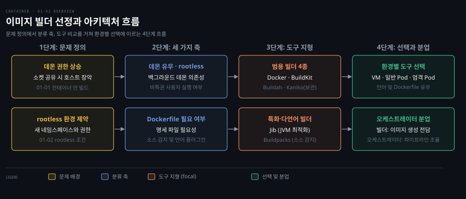
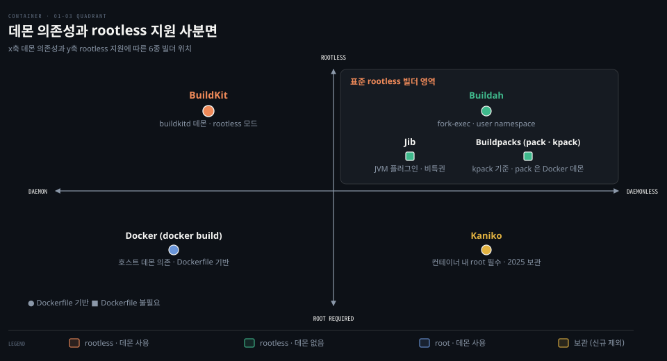
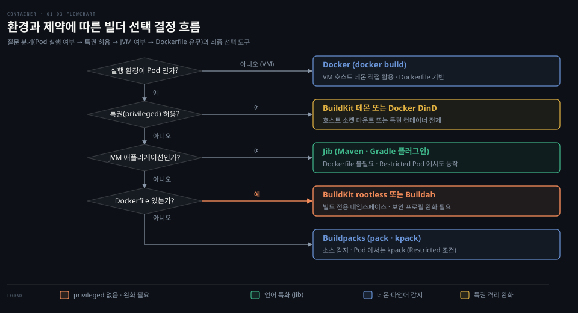

# 이미지 빌더 종류와 선택

---

> 데몬 유무·rootless 지원·Dockerfile 필요 여부라는 세 축으로 이미지 빌더를 분류하고 실행 위치(VM·Pod)와 클러스터 보안 정책, 언어 특성에 따라 최적의 빌더를 고르는 기준을 다룹니다.

## 학습 목표와 범위

> 이 편을 읽고 나면 실행 환경과 보안 제약에 맞는 컨테이너 이미지 빌더를 근거를 들어 선정할 수 있습니다.

1. 컨테이너 안 빌드가 낳은 두 문제인 데몬 권한 상승과 rootless 제약을 각 도구가 어떻게 해결하는지 설명할 수 있습니다.
2. 데몬 유무, rootless 가능 여부, Dockerfile 필요 여부의 세 축으로 6종 빌더의 특징과 제약을 비교할 수 있습니다.
3. 실행 위치와 클러스터 보안 정책, 애플리케이션 언어와 소스 명세에 맞는 빌더를 결정 흐름으로 선택할 수 있습니다.
4. 빌더와 빌드 오케스트레이터의 역할 경계를 구분하고 레지스트리 인증과 파이프라인 조율의 책임 소재를 설명할 수 있습니다.

아래 지도는 두 가지 문제 제기에서 출발해 세 분류 축을 세우고 6종 빌더 비교를 거쳐 환경별 선택에 이르는 전체 흐름을 보여 줍니다.

## 1. 도구가 여럿인 이유와 두 문제

> 컨테이너 안에서 이미지를 빌드하려 할 때 발생하는 데몬 권한 상승과 rootless 환경 제약이라는 두 문제를 도구마다 서로 다른 방식으로 해결하면서 여러 빌더가 등장했습니다.

단일 가상 머신(VM)에서 이미지를 빌드하던 시절에는 `docker build` 하나로 충분했습니다. 호스트에 떠 있는 백그라운드 데몬인 Docker 데몬(`dockerd`)에게 빌드 컨텍스트를 보내면 데몬이 이미지를 만들었습니다.

하지만 빌드 작업이 Kubernetes Pod 내부로 들어오면서 이 구조는 한계에 부딪힙니다. Pod 컨테이너 내부에는 자체 Docker 데몬이 존재하지 않습니다. Pod 안에서 기존 방식대로 Docker 빌드를 돌리려면 호스트의 Docker 소켓(`/var/run/docker.sock`)을 마운트해야 합니다(DooD). 또는 Pod 내부에서 별도 Docker 데몬을 `--privileged` 플래그로 띄워야 합니다(DinD).

어느 방식이든 [컨테이너 안 빌드가 문제가 되는 이유](01-01.컨테이너%20안%20빌드가%20문제가%20되는%20이유.md)에서 다룬 심각한 보안 위험이 따릅니다. 호스트 Docker 소켓에 접근할 수 있는 컨테이너는 호스트 전체의 root 권한을 쥔 것과 같습니다. 공격자가 소켓을 통해 새 컨테이너를 생성하고 호스트 루트 파일시스템 전체를 마운트하면 워커 노드가 완전히 장악됩니다.

이러한 데몬 권한 상승 문제를 막기 위해 보안 정책은 특권 컨테이너와 호스트 소켓 마운트를 차단합니다. 그러나 권한을 제한한 비특권 컨테이너 환경에서는 파일시스템 계층 마운트와 chroot 작업이 막힙니다.

이 제약을 풀려면 [rootless 빌드의 조건](01-02.rootless%20빌드의%20조건.md)에서 살펴본 것처럼 Linux 커널의 user namespace와 subuid/subgid 매핑이 필요합니다. 사용자 공간 오버레이 파일시스템 지원도 함께 갖춰져야 합니다.

컨테이너 이미지 빌더 도구가 여럿으로 갈라진 이유는 이 두 문제를 푸는 접근 방식이 서로 달랐기 때문입니다.

- 데몬 구조를 분리하거나 없애 호스트 장악 위험을 제거하려는 도구들이 나타났습니다.
- user namespace 격리를 활용해 Dockerfile 안의 시스템 패키지 설치(`RUN`)를 실행하는 도구가 등장했습니다.
- Dockerfile 작성과 셸 명령어 실행 자체를 생략하는 특화 빌더들도 등장했습니다. 이들은 애플리케이션 산출물만으로 OCI 레이어를 직접 조립합니다.

## 2. 이미지 빌더 분류의 세 축

> 이미지 빌더는 데몬 유무, rootless 가능 여부, Dockerfile 필요 여부라는 세 축으로 분류되며 각 축은 빌더의 보안 경계와 런타임 제약, 입력 명세를 결정합니다.

도구가 여섯이나 되면 이름만 보고는 어디가 다른지 알기 어렵습니다. 세 축 위에 놓으면 차이가 보입니다.

아래 사분면은 x축 데몬 의존성과 y축 rootless 지원 여부를 기준으로 6종 빌더의 위치를 배치하고 Dockerfile 작성 필요 여부를 마커 모양으로 구분해 보여 줍니다.

도식의 우상단 영역은 표준 rootless 빌더 구역입니다. 여기 놓인 빌더는 별도 호스트 데몬에 의존하지 않으면서 비특권 사용자 환경에서 빌드를 완주합니다. BuildKit 은 rootless 로 돌아도 `buildkitd` 데몬을 쓰므로 좌상단에 놓입니다. 원형 마커는 Dockerfile 문법에 따라 시스템 명령어를 실행하는 범용 도구입니다. 사각형 마커는 소스 코드를 감지하거나 빌드 도구와 결합해 Dockerfile 없이 동작하는 도구입니다.

### 데몬 유무의 영향

빌더가 백그라운드 데몬 프로세스를 요구하느냐에 따라 인프라 복잡도와 캐시 생명주기가 달라집니다.

Docker 데몬(`dockerd`)이나 [BuildKit](../../cmd/image/buildkit.md) 데몬(`buildkitd`)처럼 데몬이 상주하는 구조는 파일 레이어 캐시를 로컬 디스크에 안정적으로 유지합니다. 여러 빌드 요청도 효율적으로 조율합니다. 대신 Pod 기반 CI 환경에서는 데몬 프로세스를 띄우기 위한 별도 사이드카 컨테이너나 호스트 통신 소켓이 필요해집니다.

데몬이 없는 도구(Buildah, Kaniko, Jib)는 단일 명령 프로세스로 실행되고 종료됩니다. Pod 생명주기와 빌드 작업 생명주기가 정확히 일치하여 파이프라인 구성이 단순합니다. 다만 프로세스가 종료되면 로컬 파일시스템 캐시도 함께 사라집니다. 빌드 속도를 높이려면 원격 레지스트리 캐시나 PersistentVolume 마운트를 명시적으로 설정해야 합니다.

### rootless 가능 여부의 영향

클러스터의 Pod Security Standard(PSS) 규정을 충족할 수 있는지는 rootless 지원 여부에 달려 있습니다.

특권(root) 권한을 요구하는 빌더는 노드의 네임스페이스 격리를 해제하거나 컨테이너 내부에서 UID 0 권한을 행사해야 합니다. Kaniko는 호스트 데몬 없이 사용자 공간에서 파일시스템 스냅샷을 뜹니다. 하지만 기본 이미지를 풀거나 `RUN` 을 root 로 실행하려면 컨테이너 내부 프로세스가 UID 0으로 돌아야 합니다. README 는 root 없이 도는 경우를 권한이 필요 없는 최소 기본 이미지와 root 명령이 없는 Dockerfile 로 한정합니다.[^kaniko-root] 그래서 컨테이너 안에서도 root 실행을 막는 OpenShift나 엄격한 보안 네임스페이스에서는 구동되지 않습니다.

rootless 빌더는 커널 user namespace를 활용해 비특권 사용자로 동작합니다. Buildah는 비특권 user namespace 안에서 OCI 레이어를 생성합니다. BuildKit은 rootless 컨테이너 이미지(`moby/buildkit:rootless`)를 공식 제공합니다. Jib과 kpack 빌드 Pod 는 일반 사용자 권한으로 동작하므로 rootless 조건을 그대로 충족합니다.

### Dockerfile 필요 여부의 영향

입력 명세로 Dockerfile이 필요한 빌더와 필요 없는 빌더는 범용성과 추상화 수준이 다릅니다.

Dockerfile 기반 빌더(Docker, BuildKit, Buildah, Kaniko)는 범용 리눅스 환경과 셸 스크립트를 자유롭게 실행할 수 있습니다. 시스템 패키지를 추가하거나 복잡한 환경 설정이 필요한 다목적 빌드에 적합합니다. Dockerfile의 캐시 최적화와 베이스 이미지 보안 패치 책임은 개발자에게 남습니다.

Dockerfile이 필요 없는 도구(Jib, Buildpacks)는 소스 코드나 빌드 도구 설정 파일(`pom.xml`, `build.gradle`)을 직접 읽어 레이어를 조립합니다. Jib 은 Dockerfile 의 `RUN` 같은 임의 셸 실행 단계가 없습니다. 반면 Buildpacks 는 Dockerfile 은 없지만 빌드팩의 detect·build 실행 파일이 빌드 중에 코드를 실행합니다. 또한 런타임 레이어와 애플리케이션 의존성 레이어를 자동으로 분리하여 재현 가능한 빌드를 보장합니다.

### 6종 빌더별 특성

여섯 가지 대표 빌더는 세 축의 조합에 따라 성격이 저마다 다릅니다.

1. Docker (`docker build`):
   - 데몬 필수, rootless 부분 지원, Dockerfile 필수입니다.
   - 가장 널리 쓰이는 표준 도구이며 Docker Engine 23.0부터 BuildKit 엔진이 기본 빌더로 내장되었습니다.[^docker-engine-23]
2. [BuildKit](../../cmd/image/buildkit.md) (`buildkitd`·`buildctl`):
   - 데몬 사용(상주하는 `buildkitd`, 또는 `buildctl-daemonless.sh` 가 빌드마다 같은 컨테이너에 띄우는 임시 데몬), rootless 공식 지원, Dockerfile 필수입니다.
   - 저수준 빌드 표현(LLB)을 기반으로 명령어 그래프 병렬 실행과 고성능 캐시 공유를 지원합니다.[^buildkit-readme]
3. Buildah:
   - 데몬 불필요(fork-exec), rootless 완전 지원, Dockerfile 선택(명령어 CLI로도 빌드 가능)입니다.
   - Dockerfile 없이도 스크립트 명령어로 OCI 컨테이너 레이어를 조작할 수 있는 경량 도구입니다.[^buildah-readme]
4. Kaniko:
   - 데몬 불필요, rootless 사실상 미지원(컨테이너 내 UID 0 요구), Dockerfile 필수입니다.
   - 사용자 공간 스냅샷 방식으로 데몬 없이 빌드합니다. 다만 원 저장소(`GoogleContainerTools/kaniko`)는 2025년 6월 3일 공식 보관(archived)되었습니다.[^kaniko-archived] 현재는 Chainguard 가 관리하는 포크(`chainguard-forks/kaniko`, 옛 이름 `chainguard-dev/kaniko`)가 유지보수를 이어가고 있습니다.[^kaniko-chainguard]
5. Jib:
   - 데몬 불필요, rootless 완전 지원, Dockerfile 불필요입니다.
   - Maven과 Gradle 플러그인 형태로 동작하여 Java 애플리케이션의 클래스와 의존성을 최적화된 OCI 레이어로 직접 묶어 레지스트리에 푸시합니다.[^jib-readme]
6. Buildpacks (`pack`·kpack):
   - 데몬은 실행기에 따라 다릅니다(로컬 `pack` 은 Docker 데몬 필요, 클러스터 kpack 은 데몬 없음). kpack 빌드 Pod 는 비root 로 돌고 Dockerfile 은 필요 없습니다.[^pack-docker][^kpack-pod]
   - 애플리케이션 소스를 감지(detect)해 알맞은 빌드팩을 골라 실행 가능한 이미지로 바꾸는 Cloud Native Buildpacks 의 CLI 입니다.[^pack-readme]

## 3. 빌더 비교와 선택 기준

> 6종 빌더는 데몬·권한·캐시·보안 설정에 따라 명확한 차이를 보이며 실행 위치(VM·Pod)와 보안 규정, 개발 언어에 따라 단계별로 최적의 빌더를 선택합니다.

세 축 값만으로는 Pod 에 어떤 보안 설정을 허용해야 하는지, 지금도 관리되는 도구인지까지는 알 수 없습니다. 그래서 캐시·보안 설정·유지 상태를 함께 놓고 봅니다.

아래 표는 6종 빌더의 핵심 아키텍처 특성과 운영 요구 조건을 한눈에 비교합니다.

| 도구 | 데몬 필요 여부 | rootless 지원 | Dockerfile 필요 | 캐시 저장 방식 | Pod 에서 필요한 보안 설정 | 유지 상태 |
|---|---|---|---|---|---|---|
| Docker (`docker build`) | 필수 (`dockerd`) | 부분 지원 (설정 복잡) | 필수 | 로컬 데몬 그래프 스토리지 | hostPath (`docker.sock`) 또는 `--privileged` | 활성 (Docker Engine 23.0+ 기본 BuildKit)[^docker-engine-23] |
| [BuildKit](../../cmd/image/buildkit.md) | 필요 (`buildkitd`, daemonless 모드도 임시 데몬) | 지원 (`moby/buildkit:rootless`) | 필수 | 인라인·레지스트리·볼륨 캐시 | rootless 시 seccomp/AppArmor unconfined 필요 (PSS Baseline 위반)[^buildkit-rootless][^pss] | 활성 (Moby 공식 프로젝트)[^buildkit-readme] |
| Buildah | 불필요 (fork-exec) | 완전 지원 (user namespace) | 선택 (명령어로 조작 가능) | 로컬 저장소 또는 볼륨 마운트 | privileged 없이 가능, 단 SETUID·SETGID capability 추가 필요 (OpenShift `anyuid` SCC)[^buildah-openshift] | 활성 (Red Hat 메인테인)[^buildah-readme] |
| Kaniko | 불필요 (단일 실행기) | 사실상 미지원 (컨테이너 내 UID 0)[^kaniko-root] | 필수 | 원격 레지스트리 캐시 레이어 | 비특권 Pod 허용되나 컨테이너 안 root(UID 0) 필요 | 보관 (2025-06 archived, 포크 유지)[^kaniko-archived][^kaniko-chainguard] |
| Jib | 불필요 (빌드 툴 플러그인) | 완전 지원 (일반 JVM 프로세스) | 불필요 (Java 설정 기반) | Jib 레이어 캐시 (`build/jib-cache`, 사용자 캐시 폴더) | 특수 보안 권한 불필요 (표준 비특권 Pod) | 활성 (Google 오픈소스)[^jib-readme] |
| Buildpacks (`pack`·kpack) | 불필요 (kpack) / 필요 (`pack`, Docker 데몬)[^pack-docker] | 지원 (kpack 빌드 Pod 는 비root) | 불필요 (Buildpack 감지) | 레이어 캐시 볼륨 및 OCI 레지스트리 | 특수 보안 권한 불필요 (kpack 빌드 Pod 는 Restricted 조건으로 생성)[^kpack-pod] | 활성 (CNCF 프로젝트)[^pack-readme] |

### 환경과 제약에 따른 선택 순서

빌더를 선택할 때는 실행 인프라의 위치에서 출발하여 보안 제약과 언어 스택 순으로 질문을 좁혀 나갑니다.

아래 흐름도는 실행 환경과 보안 제약, 대상 언어 스택에 따른 빌더 선택 경로를 보여 줍니다.

선택 흐름은 네 가지 질문을 차례로 따르고 마지막 다섯째 항목에서 기존 Kaniko 파이프라인을 정리합니다.

1. 실행 위치가 어디인가:
   - 전용 가상 머신(VM)이나 Docker 데몬이 이미 상주하는 CI 워커 노드라면 `docker build`를 쓰는 것이 가장 단순합니다. 별도의 클러스터 격리 장치를 마련하지 않아도 되기 때문입니다.
   - Kubernetes 클러스터의 동적 Pod 안에서 빌드가 실행된다면 호스트 소켓 마운트를 배제하고 클러스터 친화적 빌더를 검토합니다.
2. 클러스터가 특권 권한을 허용하는가:
   - 보안 규정이 엄격하여 `privileged` 플래그가 금지된 환경이라면 비특권 rootless 빌더를 선택해야 합니다.
   - privileged 를 막는 것만으로는 부족합니다. rootless BuildKit 은 seccomp·AppArmor 를 Unconfined 로 풀어야 해서 PSS Baseline 에서부터 거부됩니다.[^buildkit-rootless][^pss] Buildah 도 OpenShift 에서는 restricted SCC 에 없는 SETUID·SETGID capability 를 더 받아야 합니다.[^buildah-openshift]
   - 컨테이너 내부 root(UID 0) 실행까지 막는 Restricted 네임스페이스에서는 Kaniko 도 빠집니다.[^pss] 이 조건에서 그대로 도는 것은 Jib 과 kpack 입니다. Dockerfile 빌드가 꼭 필요하면 [rootless 빌드의 조건](01-02.rootless%20빌드의%20조건.md)처럼 보안 프로필 완화를 허용한 빌드 전용 네임스페이스를 따로 둡니다.
3. 애플리케이션이 JVM 생태계 기반인가:
   - 대상 시스템이 Spring Boot나 일반 Java 애플리케이션이라면 Jib이나 Spring Boot 내장 Buildpacks를 최우선으로 검토합니다. Dockerfile을 관리할 필요가 없고 컴파일된 클래스만 따로 레이어화하므로 CI 빌드와 푸시 시간이 크게 줄어듭니다.
4. Dockerfile이 이미 준비되어 있는가:
   - 다양한 언어 스택에서 검증된 Dockerfile이 이미 있다면 [BuildKit](../../cmd/image/buildkit.md) rootless나 Buildah를 선택합니다. 빌드 단계 간 병렬 처리와 원격 캐시 공유가 중요하다면 BuildKit을 선택합니다. 추가 데몬 프로세스 없이 독립된 명령어 실행을 선호한다면 Buildah를 선택합니다.
   - Dockerfile 관리 부담을 없애고 플랫폼 수준에서 언어 런타임 보안 패치를 표준화하려면 Cloud Native Buildpacks(`pack` 또는 kpack)를 선택합니다.
5. 기존 Kaniko 파이프라인의 처리:
   - 원 프로젝트가 2025년 6월 보관(archived) 상태로 전환되었으므로 신규 파이프라인 구축 시에는 선택 대상에서 제외합니다.
   - 이미 안정적으로 구동 중인 기존 파이프라인은 Chainguard 포크(`chainguard-forks/kaniko`)의 보안 패치를 추적합니다. 그동안 BuildKit이나 Buildah로 점진적으로 마이그레이션합니다.

## 4. 빌더 한계와 오케스트레이터 분업

> 이미지 빌더는 소스를 받아 OCI 이미지를 패키징하는 단일 책임만 지며 파이프라인 순서 조율과 자동 배포 트리거는 상위 빌드 오케스트레이터가 담당합니다.

이미지 빌더는 입력 파일과 환경 설정을 받아 OCI 명세에 맞는 컨테이너 이미지 레이어를 생성합니다. 빌더의 작업은 그 레이어를 레지스트리로 전송하는 데서 끝납니다.

Git 저장소의 커밋 이벤트를 감지하는 일은 빌더의 책임 범위를 벗어납니다. 정적 분석과 단위 테스트 단계를 앞뒤로 배치하거나 빌드가 끝난 뒤 배포 매니페스트의 이미지 태그를 갱신하는 일도 마찬가지입니다.

이 작업은 [쿠버네티스 패턴의 이미지 빌더](../../../../08_cloud/book/kubernetes-patterns/30-01.Image%20Builder%20%E2%80%94%20클러스터%20안에서%20이미지를%20빌드하기.md#빌드-오케스트레이터)에서 설명하는 상위 계층인 **빌드 오케스트레이터**의 영역입니다.

- Tekton, Argo Workflows, Jenkins 파이프라인은 빌더 컨테이너를 Pod 단위 태스크로 실행하고 전체 파이프라인의 흐름을 조율합니다.
- OpenShift Builds나 kpack은 소스 변경이나 베이스 이미지의 보안 패치를 감지하여 빌더를 자동으로 다시 구동합니다.

또한 레지스트리 푸시를 위한 인증 정보(Secret) 관리나 네트워크 프록시 설정은 각 도구의 상세 실행 시트에서 다룹니다. 빌더는 이미지를 굽는 엔진입니다. 언제 어떤 조건에서 구울지는 오케스트레이터가 결정합니다.

## 5. 관련 실습

> 이 편은 빌더 종류와 선택 기준을 다루는 개념 편이므로 별도 실습 코드를 두지 않습니다.

이미지 빌더 선택은 개별 소스 코드 구현이 아니라 클러스터 보안 권한(특권 허용 여부, user namespace 지원)과 실행 환경(VM 또는 Pod)에 종속되는 아키텍처 판단입니다. 그래서 단위 테스트나 모의 코드 형태의 실습을 제공하지 않습니다.

실제 빌더별 구체적인 Pod 명세와 실행 절차는 각 도구의 개별 시트와 [Image Builder — 클러스터 안에서 이미지를 빌드하기](../../../../08_cloud/book/kubernetes-patterns/30-01.Image%20Builder%20%E2%80%94%20클러스터%20안에서%20이미지를%20빌드하기.md)의 실습 구성을 통해 검증할 수 있습니다.

## 6. 검증과 복습

> Phase 4 자답과 회차별 복습은 본문에 누적하지 않고 _review/ 에 남깁니다.

- **Phase 4 결과**: `write/07_devops/docs/artifact/container/_review/2026-11-14.md` 참조
- **다음 보완점**: BuildKit의 LLB 저수준 그래프 변환 원리와 daemonless 스크립트 실행 과정 상세 분석

## 결정 치트시트

> 환경과 제약에 따라 어떤 이미지 빌더를 선택해야 하는지 핵심 규칙을 표로 정리합니다.

| 상황 | 선택 | 이유 |
|---|---|---|
| Docker 데몬이 설치된 일반 VM 또는 전용 빌드 노드 | Docker (`docker build`) | 호스트 데몬을 직접 활용하므로 설정이 가장 단순하고 추가 인프라 구성 불필요 |
| Kubernetes Pod 환경 + privileged 금지, 빌드 전용 네임스페이스에서 보안 프로필 완화 허용 | BuildKit rootless 또는 Buildah | 특권 권한 없이 user namespace 격리로 Dockerfile 을 빌드 (seccomp·AppArmor 또는 capability 완화 필요) |
| PSS Restricted 를 강제하는 네임스페이스 | Jib 또는 kpack | 비root·capability 전부 제거 조건에서도 빌드 Pod 가 그대로 동작 |
| Spring Boot 및 JVM 기반 Java/Kotlin 애플리케이션 | Jib | Dockerfile 없이 빌드 도구 안에서 의존성과 클래스를 분리하여 빠른 레이어 재빌드 |
| Dockerfile 없이 표준화된 다언어 컨테이너 패키징 | Buildpacks (`pack` / kpack) | 언어 런타임 자동 감지 및 플랫폼 표준 레이어 구성을 제공 |
| 호스트 소켓 마운트나 privileged 권한이 허용된 격리 개발 클러스터 | BuildKit 데몬 | LLB 병렬 빌드와 고성능 로컬 캐시를 최대로 활용 |
| 이미 Kaniko 로 구축되어 동작 중인 기존 파이프라인 | Kaniko (유지) | 당장 전환하지 않고 포크 패치를 추적하며 점진적으로 BuildKit/Buildah 로 이전 |

## 면접 질문

> 세 질문에 먼저 스스로 답해 보세요. 자답이 끝나면 아래 §정답 (자답 후 펼치기) 으로 내려갑니다.

1. Kubernetes Pod 내부에서 컨테이너 이미지를 빌드할 때 호스트 Docker 데몬 소켓 마운트(DooD) 대신 daemon-free 또는 rootless 빌더를 사용해야 하는 보안상 이유는 무엇인가요?
2. Kaniko가 호스트 데몬 없이 이미지를 빌드할 수 있음에도 불구하고 컨테이너 내부 비root 실행을 강제하는 보안 클러스터에서 사용할 수 없는 이유는 무엇인가요?
3. Java/Spring Boot 애플리케이션에서 Dockerfile 대신 Jib을 선택했을 때 얻을 수 있는 빌드 캐시 및 보안상의 이점은 무엇인가요?

## 정답 (자답 후 펼치기)

> 위 면접 질문 세 개에 먼저 자답한 뒤 아래를 읽으세요.

### 정답 1 — 데몬 소켓 위험과 rootless 필요성

호스트의 `docker.sock`을 컨테이너 안에 마운트하면 컨테이너 내부 프로세스가 호스트 Docker 데몬에게 임의의 명령을 내릴 수 있습니다. 이 명령으로 특권 컨테이너를 새로 띄워 호스트 루트 파일시스템 전체를 마운트하면 노드를 장악할 수 있습니다. 이렇게 권한 상승 경로가 열립니다. 따라서 클러스터 워커 노드의 root 권한을 보호하기 위해 호스트 소켓 마운트와 특권(privileged) 플래그 없이도 동작하는 daemon-free 및 rootless 빌더를 사용해야 합니다.

### 정답 2 — Kaniko 스냅샷과 root 권한 제약

Kaniko는 백그라운드 데몬 없이 사용자 공간에서 파일시스템 변경 사항을 감지해 스냅샷을 뜹니다. 하지만 시스템 패키지 설치나 파일 조작 명령을 수행하기 위해 컨테이너 내부 프로세스는 여전히 root 권한(UID 0)으로 실행되어야 합니다. user namespace 매핑이 없으면 OpenShift나 Restricted 보안 환경처럼 컨테이너 내부 프로세스의 root 실행을 차단하는 곳에서는 파드가 실행되지 못하고 거부됩니다.

### 정답 3 — Jib 레이어 분리와 비특권 빌드 이점

Jib은 Dockerfile을 작성하거나 컨테이너를 실행하지 않고 Maven 또는 Gradle 빌드 플러그인 프로세스 안에서 직접 OCI 레이어를 조립합니다. 의존성과 SNAPSHOT 의존성, 리소스, 컴파일된 클래스를 서로 다른 레이어로 나누므로 소스 코드만 바뀌면 바뀐 클래스 레이어만 다시 만들어 올립니다.[^jib-faq-layers] 또한 컨테이너 런타임이나 Dockerfile의 `RUN` 명령을 실행하지 않으므로 임의 셸 스크립트 실행으로 인한 보안 취약점과 마운트 권한 문제를 원천 차단합니다.

## 참고 자료

[^docker-engine-23]: Docker Documentation, Docker Engine 23.0 release notes (2026-11-15 확인) — "Set Buildx and BuildKit as the default builder on Linux." <https://docs.docker.com/engine/release-notes/23.0/>
[^buildkit-readme]: Moby BuildKit README (v0.19.0, 2026-11-15 확인) — "BuildKit is a toolkit for converting source code to build artifacts in an efficient, expressive and repeatable manner." <https://github.com/moby/buildkit/blob/v0.19.0/README.md>
[^buildkit-rootless]: Moby BuildKit docs/rootless.md (v0.19.0, 2026-11-15 확인) — "However, you still need to pass `--security-opt seccomp=unconfined --security-opt apparmor=unconfined` to `docker run`." <https://github.com/moby/buildkit/blob/v0.19.0/docs/rootless.md>
[^buildah-readme]: Containers Buildah README (v1.38.0, 2026-11-15 확인) — "create an image, either from a working container or via the instructions in a Dockerfile" <https://github.com/containers/buildah/blob/v1.38.0/README.md>
[^buildah-openshift]: Buildah tutorial 05-openshift-rootless-build (v1.38.0, 2026-11-15 확인) — "This will give the container *cap_kill*, *cap_setgid*, and *cap_setuid* capabilities which are extras compared to the `restricted` SCC." <https://github.com/containers/buildah/blob/v1.38.0/docs/tutorials/05-openshift-rootless-build.md>
[^kaniko-archived]: GoogleContainerTools kaniko README (보관 공지를 넣은 마지막 커밋 236ba56, 2025-06-03, 2026-11-15 확인) — "This project is archived and no longer developed or maintained." 날짜는 저장소 페이지의 "This repository was archived by the owner on Jun 3, 2025." 와 GitHub API 의 `archived: true` 로 확인했습니다. <https://github.com/GoogleContainerTools/kaniko/blob/236ba5690eda9170d0157aa8137ebbeb09d38685/README.md> <https://github.com/GoogleContainerTools/kaniko>
[^kaniko-root]: 같은 README (커밋 236ba56, 2026-11-15 확인) — "If you have a minimal base image (SCRATCH or similar) that doesn't require permissions to unpack, and your Dockerfile doesn't execute any commands as the root user, you can run kaniko without root permissions." <https://github.com/GoogleContainerTools/kaniko/blob/236ba5690eda9170d0157aa8137ebbeb09d38685/README.md>
[^kaniko-chainguard]: Chainguard kaniko README (커밋 8c3f2f0, 2026-11-15 확인) — "This is a supported replacement of the original `GoogleContainerTools/kaniko` repository, which was archived in June of 2025." <https://github.com/chainguard-forks/kaniko/blob/8c3f2f07afb8f362447ff43d439cf0b743687ef0/README.md>
[^jib-readme]: GoogleContainerTools Jib README (v3.5.4-gradle, 2026-11-15 확인) — "Jib builds optimized Docker and OCI images for your Java applications without a Docker daemon" <https://github.com/GoogleContainerTools/jib/blob/v3.5.4-gradle/README.md>
[^jib-faq-layers]: Jib FAQ (v3.5.4-gradle, 2026-11-15 확인) — "For example, `SNAPSHOT` dependencies are placed in a separate layer from other dependencies, so that a frequently changing `SNAPSHOT` will not force the entire dependency layer to rebuild itself." <https://github.com/GoogleContainerTools/jib/blob/v3.5.4-gradle/docs/faq.md>
[^pack-readme]: Cloud Native Buildpacks pack README (v0.36.0, 2026-11-15 확인) — "to use buildpacks to convert code into runnable images." <https://github.com/buildpacks/pack/blob/v0.36.0/README.md>
[^pack-docker]: Cloud Native Buildpacks, pack 설치·CI 연동 문서 (2026-11-15 확인) — "In some container environments you may be required to mount your local Docker daemon’s socket." <https://buildpacks.io/docs/for-platform-operators/how-to/integrate-ci/pack/>
[^kpack-pod]: kpack pkg/apis/build/v1alpha2/build_pod.go (v0.17.1, 2026-11-15 확인) — "AllowPrivilegeEscalation: boolPointer(false)," / "SeccompProfile: &corev1.SeccompProfile{Type: corev1.SeccompProfileTypeRuntimeDefault}," / "Drop: []corev1.Capability{"ALL"}" <https://github.com/buildpacks-community/kpack/blob/v0.17.1/pkg/apis/build/v1alpha2/build_pod.go>
[^pss]: Kubernetes Documentation, Pod Security Standards (2026-11-15 확인) — Baseline "Seccomp profile must not be explicitly set to Unconfined." / Restricted "Containers must be required to run as non-root users." <https://kubernetes.io/docs/concepts/security/pod-security-standards/>

- [컨테이너 안 빌드가 문제가 되는 이유](01-01.컨테이너%20안%20빌드가%20문제가%20되는%20이유.md) — 호스트 데몬 소켓 공유와 권한 상승 위험의 원인
- [rootless 빌드의 조건](01-02.rootless%20빌드의%20조건.md) — 비특권 사용자 환경에서 컨테이너를 빌드하기 위한 커널 매핑과 스토리지 드라이버
- [BuildKit](../../cmd/image/buildkit.md) — 병렬 빌드 그래프와 다단계 캐시를 제공하는 현대적 빌더 엔진
- [Image Builder — 클러스터 안에서 이미지를 빌드하기](../../../../08_cloud/book/kubernetes-patterns/30-01.Image%20Builder%20%E2%80%94%20클러스터%20안에서%20이미지를%20빌드하기.md#빌드-오케스트레이터) — Kubernetes 클러스터 내부의 빌드 파이프라인 패턴과 빌더·오케스트레이터 계층 분리
