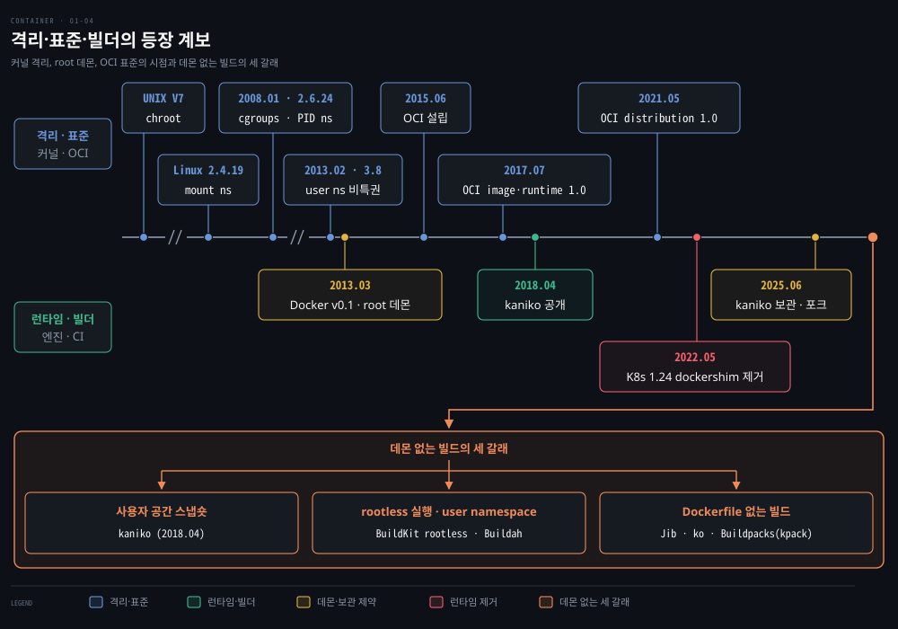

# 데몬 없는 이미지 빌드의 등장 배경

---

> 컨테이너 이미지 빌드는 Docker 의 root 데몬에 묶여 대중화됐지만, 이미지는 형식이 공개된 파일 묶음이라 다른 프로그램도 만들 수 있습니다. 쿠버네티스 Pod 기반 CI 에서 root 데몬을 쓰기 어려워지자 사용자 공간 스냅숏, rootless 격리, Dockerfile 없는 빌드 세 갈래가 그 자리를 채웠습니다.

## 학습 목표와 범위

> 이 편은 kaniko 같은 데몬 없는 이미지 빌더가 왜 어떤 흐름에서 나타났는지 큰 그림과 바탕 이론을 정리합니다. 도구별 CLI 옵션과 사용법은 다루지 않으며, 세부는 이 시리즈의 각 정본 편으로 잇습니다.

1. `chroot` 에서 리눅스 namespace·cgroups 를 거쳐 Docker 단일 데몬 모델이 자리 잡은 과정을 설명할 수 있습니다.
2. 공개된 이미지 형식이 데몬 없는 빌더의 이론적 바탕이 되는 이유와 OCI 세 명세의 역할을 설명할 수 있습니다.
3. 쿠버네티스 Pod 기반 CI 에서 기존 데몬 모델이 막히는 지점을 짚고, 세 갈래 해결 방식의 차이를 비교할 수 있습니다.
4. kaniko 원 저장소의 보관 상태와 후속 포크의 유지 범위를 1차 근거로 확인해 판단할 수 있습니다.

## 1. 격리 계보와 단일 데몬 모델

> 프로세스 격리는 커널 기능이 단계적으로 쌓여 만들어졌습니다. Docker 는 이 위에 빌드와 실행과 배포를 root 데몬 하나에 묶은 클라이언트-데몬 모델을 올렸습니다.

연표의 위쪽 레인은 커널 격리 기능과 OCI 표준의 시점을 보입니다. 아래쪽 레인은 엔진과 빌더와 런타임의 변화입니다. 연표 끝 주황색 영역은 root 데몬 없이 이미지를 만드는 세 갈래입니다. 화살표는 세 갈래가 2025년 뒤에 나왔다는 뜻이 아니라 지금의 분류를 연표 끝에 모아 둔 표시입니다.

2017년 7월 `image-spec`·`runtime-spec` 1.0 은 공개 표준 기준점일 뿐 Docker 밖의 빌드 도구가 처음 나온 시점은 아닙니다. 명령줄 도구 Buildah `v0.1`(2017년 6월)은 1.0 공개 전에 이미 `Dockerfile` 로 OCI 형식 이미지를 만든다고 적었습니다.[^buildah-v01]

CI 파이프라인을 쿠버네티스로 옮기면 이미지 빌드 하나에 왜 root 데몬이 얽혀 있는지부터 막힙니다. 이 결합은 컨테이너 기술이 처음 대중화된 구조에서 비롯했습니다.

### 프로세스 격리의 계보

컨테이너는 운영체제가 새로 만든 가상화 기술이 아닙니다. 리눅스 커널의 격리 기능이 단계적으로 쌓여 만들어진 실행 단위입니다.

출발점은 **chroot** 입니다. `chroot()` 시스템 콜은 Version 7 AT&T UNIX 에서 등장했습니다.[^chroot-v7] 호출한 프로세스의 루트 디렉터리를 지정한 경로로 바꿉니다.[^chroot-linux]

`chroot` 는 파일 경로의 기준만 바꾸므로 프로세스 목록과 네트워크와 자원 사용량은 나뉘지 않습니다. 리눅스 커널에는 이 범위를 나누고 제한하는 **namespace** 와 **cgroups** 가 차례로 들어왔습니다. namespace 는 커널 자원의 가시 범위를 나누고, cgroups(Control Groups)는 프로세스 묶음의 자원 사용량을 제한합니다.

- 마운트 격리: Linux 2.4.19 에서 최초의 namespace 인 마운트 namespace(`CLONE_NEWNS`)가 들어왔습니다.[^mount-ns][^clone-man][^lwn-ns]
- 프로세스·네트워크·자원 격리: Linux 2.6.24(2008년 1월)에서 `CLONE_NEWPID`·`CLONE_NEWNET` 과 cgroups 초기 구현이 합류했습니다. 네트워크 namespace 구현은 2.6.29 무렵에야 마무리됐습니다.[^clone-man][^cgroups-man][^linux-2624]
- 비특권 사용자 격리: user namespace(`CLONE_NEWUSER`)는 Linux 2.6.23 에서 시작해 Linux 3.8(2013년 2월)부터 일반 사용자도 권한 없이 만들 수 있습니다.[^clone-man][^user-ns][^linux-38]

이 커널 기능을 조합해 프로세스에 독립된 파일시스템과 PID 와 자원 한도를 씌운 실행 단위가 컨테이너입니다.

### 단일 root 데몬에 묶인 구조

커널 기능을 직접 조합해 컨테이너를 다루는 일은 번거로웠습니다. Docker `v0.1.0`(2013년 3월)은 root 로 띄우는 데몬(`docker -d`) 하나에 컨테이너 실행(`run`)과 이미지 전송(`pull`·`push`)을 묶었습니다.[^moby-v010][^moby-v010-src] 이때는 `docker build` 가 없었습니다. 변경 기록은 2013년 5월 30일 `0.3.4` 에서 `Dockerfile` 로 빌드하는 `docker build` 를 소개합니다.[^moby-changelog]

Docker Engine 은 **클라이언트-데몬 모델**로 동작합니다. 사용자가 `docker` CLI 를 호출하면 요청이 Docker API 를 거쳐 상주 데몬 `dockerd` 로 전달됩니다.[^docker-engine]

`dockerd` 는 Rootless 모드를 따로 켜지 않는 한 호스트 root 권한으로 실행됩니다.[^docker-sec] 개발자 노트북이나 전용 VM 에서는 이 구조가 단순했습니다. 하지만 빌드 기능까지 root 데몬에 묶인 탓에 나중에 데몬을 둘 수 없는 클러스터 환경에서 곧바로 충돌이 생깁니다.

## 2. OCI 표준 분리와 이미지 이론

> OCI(Open Container Initiative)가 이미지·실행·배포 명세를 서로 떼어 표준화했습니다. 이 가운데 이미지 명세는 이미지를 특정 엔진에 속하지 않는 공개 형식의 파일 묶음으로 정합니다.

초기 Docker 의 이미지 형식은 한 엔진 프로젝트가 정한 규격이었습니다. 여러 도구가 함께 기대려면 특정 엔진에 속하지 않는 공개 표준이 필요했습니다.

2015년 6월 22일 Docker 와 CoreOS 등이 리눅스 재단 아래 **OCI**(Open Container Initiative)를 설립했습니다.[^oci-about] 지금 OCI 는 컨테이너 생태계의 역할을 세 명세로 나눠 정합니다.

| 명세 | 1.0 공개일 | 정하는 범위 |
|---|---|---|
| `runtime-spec` | 2017-07-19 | 풀어 놓은 파일시스템 번들을 컨테이너로 실행하는 설정과 생명주기[^oci-runtime] |
| `image-spec` | 2017-07-19 | 컨테이너 이미지를 이루는 manifest·config·layer·index 파일 형식[^oci-image] |
| `distribution-spec` | 2021-05-05 | 레지스트리와 이미지 콘텐츠를 pull·push 하는 HTTP API 프로토콜[^oci-dist] |

데몬 없는 빌드가 성립하는 바탕 이론은 `image-spec` 에 있습니다. 명세는 OCI 이미지를 네 조각의 정적 파일 구조로 정의합니다.[^oci-image]

- manifest: 이 플랫폼의 이미지가 어떤 config 와 layer 로 이루어졌는지 적은 목차입니다.
- image index: 선택 항목이며 플랫폼별 manifest 목록을 담습니다.
- config: OS·아키텍처·환경 변수·실행 명령 같은 실행 설정 JSON 입니다.
- layer: 파일시스템 변경분을 담은 tar 아카이브 묶음입니다.

명세의 목표 문장은 이미지를 빌드하고 운반하고 실행 준비하는 상호운용 도구를 만드는 데 있다고 밝힙니다.[^oci-image] 전송 쪽은 표준이 늦게 나왔습니다. kaniko 가 공개된 2018년에는 `distribution-spec` 1.0 이 아직 없었습니다. 2021년의 1.0 은 Docker Registry HTTP API V2 를 바탕으로 만든 명세입니다.[^oci-dist]

결국 컨테이너 이미지 생성은 Docker 데몬의 고유 특권이 아닙니다. 공개된 형식에 맞춰 변경분 tar 와 JSON 과 manifest 를 만들고 레지스트리 HTTP API 로 올리면 일반 프로그램도 이미지를 만들 수 있습니다.

각 조각의 digest 사슬은 [03-01 이미지 구조와 digest](03-01.이미지%20구조와%20digest.md)에서 다룹니다. 레지스트리 전송 규약은 [03-02 레지스트리 통신과 오프라인 반입](03-02.레지스트리%20통신과%20오프라인%20반입.md)에 있습니다. layer 변경분 tar 와 삭제 표지는 [03-03 layer 변경분과 whiteout](03-03.layer%20변경분과%20whiteout.md)에서 봅니다.

## 3. 쿠버네티스 CI 와 데몬 모델의 충돌

> CI 에이전트가 VM 에서 쿠버네티스 동적 Pod 로 옮겨 가자 데몬이 사라졌습니다. 우회 방식은 호스트 권한 문제와 런타임·보안 정책 변화에 차례로 막혔습니다.

CI 에이전트가 쿠버네티스 Pod 로 동적 생성되면서 컨테이너 안에는 `dockerd` 가 없습니다. 호스트 소켓을 공유하는 DooD 나 내부에 특권 데몬을 띄우는 DinD 로 우회하면 호스트 root 노출과 `--privileged` 위험이 생깁니다.

여기에 쿠버네티스 v1.24(2022년 5월 3일)에서 `dockershim` 이 제거됐습니다.[^k8s-124][^k8s-dockershim] 런타임을 containerd 나 CRI-O 로 둔 노드에는 보통 Docker 소켓이 없습니다. Baseline 이상을 강제한 네임스페이스에서는 Pod Security Standards(PSS)가 `hostPath` 와 `privileged` 도 막습니다.

kaniko 공개(2018년)는 `dockershim` 제거보다 앞섭니다. 그러므로 이 제거는 kaniko 가 나온 원인이 아니라 우회로를 더 좁힌 뒤의 변화입니다. 권한 분석과 정책 차단 세부는 정본인 [01-01 컨테이너 안 빌드가 문제가 되는 이유](01-01.컨테이너%20안%20빌드가%20문제가%20되는%20이유.md)로 넘깁니다.

## 4. 데몬 없는 빌더의 세 갈래 비교

> root 데몬 없이 이미지를 만드는 방식은 사용자 공간 스냅숏과 rootless 격리와 Dockerfile 없는 빌드라는 세 갈래로 나뉩니다.

root 데몬을 치워도 `Dockerfile` 의 `RUN` 단계가 과제로 남습니다. 파일 복사(`COPY`)와 메타데이터(`ENV`)는 일반 파일 조작으로 끝낼 수 있습니다. 하지만 `RUN` 은 실제 프로세스를 띄워 파일시스템을 바꾼 뒤 변경분만 layer tar 로 뽑아야 합니다. 이 과제를 푸는 방식에 따라 빌더 아키텍처가 셋으로 갈립니다.

여기서 데몬 없는 빌드는 root 로 상주하는 `dockerd` 에 기대지 않는다는 뜻입니다. BuildKit 은 rootless 로 돌아도 자체 데몬 `buildkitd` 를 씁니다.[^buildkit-readme] 그래서 [01-03 이미지 빌더 종류와 선택](01-03.이미지%20빌더%20종류와%20선택.md)은 BuildKit 을 데몬이 필요한 도구로 분류합니다.

| 비교 갈래 | 대표 도구 | layer 생성 방식 | Dockerfile 필요 | 세부 정본 |
|---|---|---|---|---|
| 사용자 공간 스냅숏 | kaniko | 컨테이너 루트에 풀고 실행 뒤 사용자 공간에서 스냅숏 | 필요 | 이 편 §4·§5, [01-02](01-02.rootless%20빌드의%20조건.md) |
| rootless·user namespace | BuildKit rootless, Buildah | user namespace 안에서 임시 컨테이너 격리와 OverlayFS | 필요(Buildah 는 선택) | [01-02](01-02.rootless%20빌드의%20조건.md), [01-03](01-03.이미지%20빌더%20종류와%20선택.md) |
| Dockerfile 없는 빌드 | Jib, ko, Buildpacks | 언어 빌드 산출물이나 소스 감지 빌드팩으로 이미지 조립 | 불필요 | [01-03](01-03.이미지%20빌더%20종류와%20선택.md)(Jib·Buildpacks) |

### 사용자 공간 스냅숏 방식

**kaniko** 는 2018년 4월 Google Cloud 블로그로 공개되었습니다.[^kaniko-blog] 첫 GitHub 릴리스 `v0.1.0` 은 2018년 5월 17일에 나왔습니다.[^kaniko-v010] Docker 데몬에 의존하지 않고 `Dockerfile` 명령을 모두 사용자 공간에서 실행합니다.[^kaniko-readme]

동작 원리는 세 단계입니다. 먼저 `FROM` 베이스 이미지의 파일시스템을 `kaniko` 컨테이너 자신의 루트에 풉니다. 이어 `Dockerfile` 명령을 실행하고 매 단계마다 사용자 공간에서 변경분을 스냅숏해 layer 로 붙입니다. 마지막으로 이미지 메타데이터를 갱신해 레지스트리로 올립니다.[^kaniko-readme]

이 방식은 `mount(2)` 나 중첩 네임스페이스 생성 없이 데몬 없는 빌드를 이뤘습니다. 대신 빌더 컨테이너 루트를 직접 덮어쓰므로 `RUN` 단계끼리의 커널 격리가 없습니다. 베이스 이미지를 풀거나 `RUN` 명령을 실행할 때 root 권한이 필요하면 컨테이너 내부 UID 0 으로 돌아야 합니다.[^kaniko-readme]

### rootless 실행과 user namespace

커널의 user namespace 와 비특권 OverlayFS 를 써서 호스트 root 없이 `RUN` 임시 컨테이너를 격리하는 갈래입니다.

**BuildKit** 은 소스를 빌드 산출물로 바꾸는 툴킷입니다. rootless 모드로 비특권 사용자 환경에서 동작합니다.[^buildkit-readme] Buildah 는 상주 데몬 없이 CLI 로 작업 컨테이너를 다루거나 `Dockerfile` 을 해석해 OCI 이미지를 만듭니다.[^buildah-readme]

BuildKit rootless 의 커널·보안 프로필 조건은 [01-02 rootless 빌드의 조건](01-02.rootless%20빌드의%20조건.md)이 정본입니다. Buildah 를 Pod 에서 돌릴 때 더 필요한 capability 는 [01-03 이미지 빌더 종류와 선택](01-03.이미지%20빌더%20종류와%20선택.md)에서 봅니다.

### Dockerfile 없는 빌드

아예 `Dockerfile` 을 쓰지 않는 갈래입니다. OCI 이미지가 결국 tar layer 와 JSON 파일 묶음이라는 이론을 가장 직접적으로 적용합니다.

**Jib** 은 Maven·Gradle 플러그인으로 동작합니다. Docker 데몬 없이 Java 클래스와 의존성을 컨테이너 이미지로 묶어 레지스트리에 올립니다.[^jib-readme] Gradle 플러그인의 기본 출력은 Docker 형식이고 OCI 형식은 설정으로 고릅니다.[^jib-format] ko 는 CNCF Sandbox 프로젝트입니다. 로컬 `go build` 를 활용해 Docker 설치 없이 Go 애플리케이션의 컨테이너 이미지를 만듭니다.[^ko-readme]

**Buildpacks** 는 `Dockerfile` 없이 소스를 감지해 알맞은 빌드팩으로 실행 이미지를 만듭니다. 로컬 `pack` 은 Docker 데몬이 필요하지만 클러스터용 `kpack` 은 데몬 없이 비root Pod 로 돕니다([01-03 이미지 빌더 종류와 선택](01-03.이미지%20빌더%20종류와%20선택.md)).

Jib 과 ko 에는 `RUN` 같은 셸 실행 단계가 없습니다. 반면 Buildpacks 는 빌드 때 빌드팩의 `/bin/build` 실행 파일을 돌립니다.[^cnb-spec] 앱 개발자가 `project.toml` 에 적은 inline 스크립트도 실행할 수 있습니다.[^cnb-inline] 이 빌드 단계는 비root 사용자로 돕니다.[^cnb-lifecycle]

그래서 Jib·ko 와 `kpack` 은 커널 격리 권한이나 보안 프로필 완화가 필요 없습니다. 반대로 OS 패키지를 설치해야 하는 범용 리눅스 환경에는 적용하기 어렵습니다. 실제 환경과 보안 정책에 맞춰 빌더를 고르는 기준은 [01-03 이미지 빌더 종류와 선택](01-03.이미지%20빌더%20종류와%20선택.md)에서 다룹니다.

## 5. kaniko 유지 상태와 현재 지형

> kaniko 원 저장소는 2025년 6월 보관 상태로 전환되어 개발이 중단되었습니다. 현재는 Chainguard 포크가 보안 패치 중심의 유지보수를 이어가고 있습니다.

쿠버네티스 CI 에 널리 도입된 kaniko 를 새로 채택하거나 유지할 때는 원 저장소의 유지 상태부터 확인해야 합니다.

2026년 11월 27일 직접 조회한 결과 `GoogleContainerTools/kaniko` 는 보관(`archived: true`) 상태입니다.[^kaniko-repo] README 맨 위에는 더 이상 개발하거나 유지보수하지 않는다는 공지가 붙어 있습니다.[^kaniko-readme] 마지막 릴리스는 `v1.24.0`(2025년 5월 23일)이고 마지막 push 는 2025년 6월 3일입니다.[^kaniko-repo][^kaniko-v124]

Chainguard 는 원 저장소를 포크한 `chainguard-forks/kaniko` 에서 유지보수를 이어갑니다.[^cg-kaniko-readme][^cg-kaniko-repo] 포크 README 는 2025년 6월 보관된 원 저장소의 대체 저장소라고 밝힙니다. 보안 패치와 유지보수를 이어가되 큰 기능 추가 계획은 없습니다.[^cg-kaniko-readme]

컨테이너 이미지 배포 방식도 달라졌습니다. 기존 `gcr.io/kaniko-project/executor` 이미지는 더 이상 갱신되지 않습니다. 포크 저장소는 소스 태그와 릴리스 노트만 공개하고 컨테이너 이미지 바이너리는 배포하지 않습니다. 포크 README 는 직접 빌드하거나 Chainguard 의 고객용 이미지를 쓰라고 안내합니다.[^cg-kaniko-readme]

신규 채택에서 원 저장소의 kaniko 를 빼는 판단과 기존 파이프라인의 이전 방법은 [01-03 이미지 빌더 종류와 선택](01-03.이미지%20빌더%20종류와%20선택.md)의 선택 흐름이 정본입니다.

## 6. 이 시리즈에서 이어 읽기

> 이 편은 격리 계보와 OCI 표준 분리와 해결 갈래의 전체 지도만 다룹니다. 세부 원리와 선택 기준은 아래 표의 시리즈 문서로 이어 읽습니다.

| 이 편의 절 | 이어 읽을 문서 | 다루는 세부 내용 |
|---|---|---|
| §2 OCI 표준 분리 | [03-01 이미지 구조와 digest](03-01.이미지%20구조와%20digest.md) | index·manifest·config·layer 가 digest 로 이어지는 구조와 store 별 이미지 ID |
| §2 OCI 표준 분리 | [03-02 레지스트리 통신과 오프라인 반입](03-02.레지스트리%20통신과%20오프라인%20반입.md) | Registry HTTP API 토큰 인증, 프록시·insecure 설정, 폐쇄망 반입 절차 |
| §2 OCI 표준 분리 | [03-03 layer 변경분과 whiteout](03-03.layer%20변경분과%20whiteout.md) | changeset tar 의 전체 복사 규칙, `.wh.` whiteout, `empty_layer`, `ChainID` |
| §3 쿠버네티스 CI 충돌 | [01-01 컨테이너 안 빌드가 문제가 되는 이유](01-01.컨테이너%20안%20빌드가%20문제가%20되는%20이유.md) | DooD 소켓 탈출·DinD `--privileged`·PSS 차단 실측, dockershim 제거 |
| §4 rootless 갈래 | [01-02 rootless 빌드의 조건](01-02.rootless%20빌드의%20조건.md) | user namespace·`/etc/subuid`, 커널 5.11+ OverlayFS, seccomp·AppArmor 완화 |
| §4·§5 빌더 갈래·현재 | [01-03 이미지 빌더 종류와 선택](01-03.이미지%20빌더%20종류와%20선택.md) | 6종 빌더 비교, 실행 위치·보안 정책·언어별 결정 흐름, kaniko 전환 기준 |

## 7. 관련 실습

> 이 편은 데몬 없는 빌드가 등장한 역사적 흐름과 표준 이론을 정리하는 개관 편이므로 별도 실습 코드를 두지 않습니다.

본문에서 요약한 각 지점의 실증 명령은 이어지는 정본 편에서 직접 실행해 검증할 수 있습니다. 소켓 탈출과 PSS 차단 실측은 [01-01 컨테이너 안 빌드가 문제가 되는 이유](01-01.컨테이너%20안%20빌드가%20문제가%20되는%20이유.md)에 있습니다. OCI 이미지 tar 와 digest 해시 확인 명령은 [03-01 이미지 구조와 digest](03-01.이미지%20구조와%20digest.md)와 [03-03 layer 변경분과 whiteout](03-03.layer%20변경분과%20whiteout.md)에서 바로 실행할 수 있습니다.

## 면접 질문

> 네 질문에 먼저 스스로 답해 보세요. 자답이 끝나면 아래 정답 절로 내려갑니다.

1. 컨테이너가 가상머신과 다른 격리 방식임에도 초기 Docker 환경에서 이미지 빌드가 호스트 root 권한에 묶여 있었던 이유는 무엇입니까?
2. 데몬 없는 빌더가 이미지를 만들어 레지스트리에 올릴 수 있는 이론적 근거는 무엇이며, OCI `image-spec` 과 `distribution-spec` 은 여기서 어떤 역할을 합니까?
3. 데몬 없는 빌더가 사용자 공간 스냅숏(kaniko), rootless·user namespace(BuildKit·Buildah), Dockerfile 없는 빌드(Jib·ko·Buildpacks) 세 갈래로 나뉜 기술적 이유는 무엇입니까?
4. 신규 쿠버네티스 CI 파이프라인을 구축할 때 원 저장소 기준 kaniko 를 기본 선택에서 제외해야 하는 근거는 무엇입니까?

## 정답 (자답 후 펼치기)

> 위 면접 질문 네 개에 먼저 자답한 뒤 아래를 읽으세요.

### 정답 1 — 단일 root 데몬에 결합된 초기 모델

컨테이너 자체는 리눅스 커널의 namespace 와 cgroups 조합으로 동작합니다. 그러나 Docker Engine 은 이미지 빌드와 컨테이너 실행과 레지스트리 전송을 상주 데몬 `dockerd` 하나에 묶는 클라이언트-서버 구조로 설계했습니다. 별도 Rootless 모드를 켜지 않는 한 `dockerd` 는 호스트 root 권한으로 돌았기 때문에 `docker build` 도 root 데몬에 의존하게 되었습니다.

### 정답 2 — 이미지 형식과 전송 규약의 표준 분리

이미지가 데몬의 내부 상태가 아니라 형식이 공개된 파일 묶음이고, 레지스트리와는 HTTP API 로 주고받기 때문입니다. OCI `image-spec` 은 이 형식을 layer 변경분 tar, config JSON, manifest 와 선택 index 로 정한 업계 표준입니다. `distribution-spec` 1.0(2021년)은 Docker Registry HTTP API V2 를 바탕으로 전송 규약을 표준화했습니다. 따라서 데몬이 아닌 일반 프로세스도 형식에 맞는 tar 와 JSON 을 만들어 HTTP 로 올리면 호환 이미지를 만들 수 있습니다.

### 정답 3 — RUN 처리 방식에 따른 세 갈래 분기

`COPY` 나 `ENV` 는 일반 파일 조작으로 끝낼 수 있지만 `RUN` 명령을 실행해 변경분을 layer 로 뽑는 방법이 다르기 때문입니다.

kaniko 는 추가 마운트 호출 없이 컨테이너 루트에 풀어 사용자 공간에서 스냅숏을 찍습니다. BuildKit rootless 와 Buildah 는 user namespace 와 비특권 OverlayFS 로 `RUN` 마다 격리 컨테이너를 띄웁니다. Jib·ko·Buildpacks 는 `Dockerfile` 을 쓰지 않고 빌드 도구나 빌드팩으로 이미지 layer 를 만듭니다.

데몬 조건은 도구마다 다릅니다. BuildKit 은 rootless 에서도 `buildkitd` 데몬을 쓰며, 여기서 없앤 것은 root 데몬입니다. Buildpacks 의 로컬 `pack` 은 Docker 데몬을 쓰므로 데몬 없는 쪽은 `kpack` 입니다.

### 정답 4 — kaniko 보관과 유지보수 변화

원 저장소 `GoogleContainerTools/kaniko` 가 2025년 6월 보관(`archived`) 상태로 전환되어 더 이상 개발·유지보수되지 않기 때문입니다. 기존 `gcr.io/kaniko-project/executor` 이미지도 갱신되지 않습니다. 후속 포크 `chainguard-forks/kaniko` 가 보안 패치를 이어가고 있지만 큰 기능 추가 계획이 없고 공개 컨테이너 이미지도 배포하지 않습니다. 따라서 신규 파이프라인은 활성 유지되는 BuildKit·Buildah·Jib·ko 계열을 우선 검토해야 합니다.

## 참고 자료

[^chroot-v7]: FreeBSD System Calls Manual, chroot(2) (2026-11-27 확인) — "The chroot() system call appeared in Version 7 AT&T UNIX." <https://man.freebsd.org/cgi/man.cgi?query=chroot&sektion=2>
[^chroot-linux]: Linux manual page, chroot(2) (2026-11-27 확인) — "chroot() changes the root directory of the calling process to that specified in path." <https://man7.org/linux/man-pages/man2/chroot.2.html>
[^mount-ns]: Linux manual page, mount_namespaces(7) (2026-11-27 확인) — HISTORY "Linux 2.4.19." <https://man7.org/linux/man-pages/man7/mount_namespaces.7.html>
[^clone-man]: Linux manual page, clone(2) (2026-11-27 확인) — "CLONE_NEWNS (since Linux 2.4.19)", "CLONE_NEWPID (since Linux 2.6.24)", "CLONE_NEWNET (since Linux 2.6.24) (The implementation of this flag was completed only by about Linux 2.6.29.)", CLONE_NEWUSER "This flag first became meaningful for clone() in Linux 2.6.23". <https://man7.org/linux/man-pages/man2/clone.2.html>
[^lwn-ns]: LWN, Namespaces in operation, part 1 (2026-11-27 확인) — "Mount namespaces were the first type of namespace to be implemented on Linux, appearing in 2002." <https://lwn.net/Articles/531114/>
[^cgroups-man]: Linux manual page, cgroups(7) (2026-11-27 확인) — "The initial release of the cgroups implementation was in Linux 2.6.24." <https://man7.org/linux/man-pages/man7/cgroups.7.html>
[^linux-2624]: Linux kernel git tag `v2.6.24` (2026-11-27 확인) — Linus Torvalds tagger date `2008-01-24T22:58:53Z`. <https://github.com/torvalds/linux/releases/tag/v2.6.24>
[^user-ns]: Linux manual page, user_namespaces(7) (2026-11-27 확인) — "Since Linux 3.8, unprivileged processes can create user namespaces", "overlayfs (since Linux 5.11)". <https://man7.org/linux/man-pages/man7/user_namespaces.7.html>
[^linux-38]: Linux kernel git tag `v3.8` (2026-11-27 확인) — Linus Torvalds tagger date `2013-02-18T23:59:05Z`. <https://github.com/torvalds/linux/releases/tag/v3.8>
[^moby-v010]: moby/moby git tag `v0.1.0` (2026-11-27 확인) — Solomon Hykes tagger date `2013-03-26T01:11:12Z`. <https://github.com/moby/moby/releases/tag/v0.1.0>
[^moby-v010-src]: moby/moby `v0.1.0` 의 README 와 `commands.go` (2026-11-27 확인) — README 는 데몬을 "sudo $GOPATH/bin/docker -d" 로 띄웁니다. `commands.go` 의 명령에는 `Run`·`Pull`·`Push` 가 있고 `Build` 는 없습니다. <https://github.com/moby/moby/blob/v0.1.0/README.md> <https://github.com/moby/moby/blob/v0.1.0/commands.go>
[^moby-changelog]: moby/moby `v0.4.0` CHANGELOG (2026-11-27 확인) — "0.3.4 (2013-05-30)" 항목 "Builder: 'docker build' builds a container, layer by layer, from a source repository containing a Dockerfile". <https://github.com/moby/moby/blob/v0.4.0/CHANGELOG.md>
[^buildah-v01]: Buildah `v0.1` README 와 태그가 가리키는 커밋(2017-06-14) (2026-11-27 확인) — "a command line tool", "create an image, either from a working container or via the instructions in a Dockerfile", "images can be built in either the OCI image format or the traditional upstream docker image format". <https://github.com/containers/buildah/blob/v0.1/README.md>
[^docker-engine]: Docker Documentation, Docker Engine overview (2026-11-27 확인) — "Docker Engine acts as a client-server application with: A server with a long-running daemon process dockerd." <https://docs.docker.com/engine/>
[^docker-sec]: Docker Documentation, Docker Engine security (2026-11-27 확인) — "This daemon requires root privileges unless you opt-in to Rootless mode". <https://docs.docker.com/engine/security/>
[^oci-about]: Open Container Initiative, About the OCI (2026-11-27 확인) — "The OCI was launched on June 22nd 2015 by Docker, CoreOS and other leaders in the container industry." <https://opencontainers.org/about/overview/>
[^oci-runtime]: OCI Runtime Specification v1.0.0 (2026-11-27 확인) — 릴리스 `2017-07-19`, "aims to specify the configuration, execution environment, and lifecycle of a container." <https://github.com/opencontainers/runtime-spec/releases/tag/v1.0.0> <https://github.com/opencontainers/runtime-spec/blob/v1.0.0/spec.md>
[^oci-image]: OCI Image Format Specification v1.0.0 (2026-11-27 확인) — 릴리스 `2017-07-19`, "defines an OCI Image, consisting of a manifest, an image index (optional), a set of filesystem layers, and a configuration." <https://github.com/opencontainers/image-spec/releases/tag/v1.0.0> <https://github.com/opencontainers/image-spec/blob/v1.0.0/spec.md>
[^oci-dist]: OCI Distribution Specification v1.0.0 (2026-11-27 확인) — 릴리스 `2021-05-05`, "defines an API protocol to facilitate and standardize the distribution of content.", "The spec is based on the specification for the Docker Registry HTTP API V2 protocol". <https://github.com/opencontainers/distribution-spec/releases/tag/v1.0.0> <https://github.com/opencontainers/distribution-spec/blob/v1.0.0/spec.md>
[^k8s-124]: Kubernetes Blog, Kubernetes 1.24: Stargazer (2022-05-03, 2026-11-27 확인) — "This release saw two major changes: Dockershim Removal". <https://kubernetes.io/blog/2022/05/03/kubernetes-1-24-release-announcement/>
[^k8s-dockershim]: Kubernetes Documentation, Check whether dockershim removal affects you (2026-11-27 확인) — "Kubernetes' built-in dockershim component was removed in release v1.24." <https://kubernetes.io/docs/tasks/administer-cluster/migrating-from-dockershim/check-if-dockershim-deprecation-affects-you/>
[^kaniko-blog]: Google Cloud Blog, Introducing kaniko (2026-11-27 확인) — "Introducing kaniko: Build container images in Kubernetes and Google Container Builder without privileges". 게시일은 본문 표기가 April 17, 2018, 페이지 메타데이터 `datePublished` 가 2018-04-16 이라 본문에는 달까지만 적었습니다. <https://cloud.google.com/blog/products/containers-kubernetes/introducing-kaniko-build-container-images-in-kubernetes-and-google-container-builder-even-without-root-access>
[^kaniko-v010]: GoogleContainerTools/kaniko release `v0.1.0` (2026-11-27 확인) — published `2018-05-17T21:44:42Z`. <https://github.com/GoogleContainerTools/kaniko/releases/tag/v0.1.0>
[^kaniko-v124]: GoogleContainerTools/kaniko release `v1.24.0` (2026-11-27 확인) — published `2025-05-23T16:04:33Z`. <https://github.com/GoogleContainerTools/kaniko/releases/tag/v1.24.0>
[^kaniko-readme]: GoogleContainerTools/kaniko README (2026-11-27 확인) — "This project is archived and no longer developed or maintained.", "executes each command within a Dockerfile completely in userspace.", "we extract the filesystem of the base image (the FROM image in the Dockerfile)", "snapshotting the filesystem in userspace after each one", "it unpacks directly into its own container root and may overwrite anything already there", "If you have a minimal base image (SCRATCH or similar) that doesn't require permissions to unpack, and your Dockerfile doesn't execute any commands as the root user, you can run kaniko without root permissions." <https://github.com/GoogleContainerTools/kaniko/blob/main/README.md>
[^kaniko-repo]: GitHub REST API `GET /repos/GoogleContainerTools/kaniko` (2026-11-27 확인) — `archived: true`, `pushed_at: 2025-06-03T14:36:10Z`. <https://api.github.com/repos/GoogleContainerTools/kaniko>
[^cg-kaniko-readme]: chainguard-forks/kaniko README (2026-11-27 확인) — "This is a supported replacement of the original GoogleContainerTools/kaniko repository, which was archived in June of 2025.", "No major feature work is planned.", "Binary release artifacts such as container images are not published.", "Users must build these artifacts themselves or use the Chainguard container images as customer". <https://github.com/chainguard-forks/kaniko/blob/main/README.md>
[^cg-kaniko-repo]: GitHub REST API `GET /repos/chainguard-forks/kaniko` (2026-11-27 확인) — `archived: false`, `pushed_at: 2026-11-27T02:23:23Z`. <https://api.github.com/repos/chainguard-forks/kaniko>
[^buildkit-readme]: Moby BuildKit README (2026-11-27 확인) — "BuildKit is a toolkit for converting source code to build artifacts in an efficient, expressive and repeatable manner.", "Execution without root privileges", "BuildKit is composed of the buildkitd daemon and the buildctl client." <https://github.com/moby/buildkit/blob/master/README.md>
[^buildah-readme]: Containers Buildah README (2026-11-27 확인) — "create an image, either from a working container or via the instructions in a Dockerfile", "Buildah follows a simple fork-exec model and does not run as a daemon". <https://github.com/containers/buildah/blob/main/README.md>
[^jib-readme]: GoogleContainerTools Jib README (2026-11-27 확인) — "Jib builds optimized Docker and OCI images for your Java applications without a Docker daemon". <https://github.com/GoogleContainerTools/jib/blob/master/README.md>
[^jib-format]: Jib Gradle plugin README (2026-11-27 확인) — `format` 속성의 기본값 `Docker`, "Use OCI to build an OCI container image." <https://github.com/GoogleContainerTools/jib/blob/master/jib-gradle-plugin/README.md>
[^ko-readme]: ko-build/ko README (2026-11-27 확인) — "ko is a simple, fast container image builder for Go applications.", "ko builds images by effectively executing go build on your local machine, and as such doesn't require docker to be installed.", "ko is a Cloud Native Computing Foundation Sandbox project." <https://github.com/ko-build/ko/blob/master/README.md>
[^cnb-spec]: Cloud Native Buildpacks, Buildpack Interface Specification (2026-11-27 확인) — "A component buildpack is a buildpack containing /bin/detect and /bin/build executables." <https://github.com/buildpacks/spec/blob/main/buildpack.md>
[^cnb-inline]: Cloud Native Buildpacks, Use an inline buildpack (2026-11-27 확인) — "You can supplement your app’s build process with custom scripts by creating an inline buildpack." <https://buildpacks.io/docs/for-app-developers/how-to/build-inputs/use-inline-buildpacks/>
[^cnb-lifecycle]: Cloud Native Buildpacks, What is the lifecycle? (2026-11-27 확인) — detector 와 builder 단계에 대해 "both the lifecycle and buildpacks run as non-root users when doing this work." <https://buildpacks.io/docs/for-platform-operators/concepts/lifecycle/>
