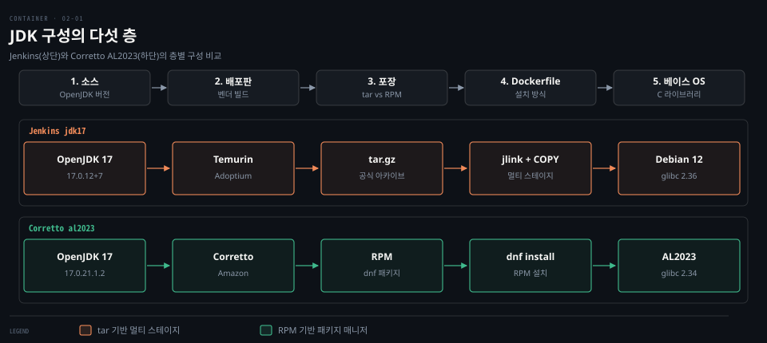
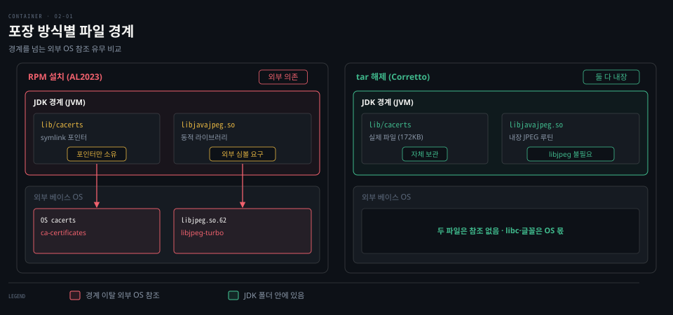

# JDK 이미지가 서로 다른 이유

---

> Java 17 이미지 넷과 Java 21 JRE 이미지 하나(SonarQube)가 배포판 빌드, 포장 방식, Dockerfile 구성, 베이스 OS 계층이 달라 내부 파일 배치와 외부 의존성 경계가 근본적으로 갈라지는 원리를 실측 근거로 설명합니다.

## 학습 목표와 범위

> 읽고 나면 컨테이너 이미지마다 JDK 가 들어 있는 모양이 왜 다른지 다섯 층으로 설명하고 베이스 이미지를 교체하거나 보안 패치 시 런타임 장애 없이 JDK 를 안전하게 이식할 수 있습니다.

1. 공개 이미지 5종의 OS, C 라이브러리, 배포판 빌더, cacerts 형태 차이를 실측 근거로 비교할 수 있습니다.
2. OpenJDK 소스부터 베이스 OS 에 이르는 다섯 층의 결정 요소와 책임 경계를 단계별로 설명할 수 있습니다.
3. RPM 설치 JDK 폴더와 tar 압축 해제 JDK 를 타 OS 로 이식했을 때의 실패 원인을 라이브러리 링킹과 symlink 관점에서 분석할 수 있습니다.
4. 기존 이미지의 실행 사용자, 경로, 신뢰 저장소를 보존하면서 새 JDK 로 교체하는 멀티 스테이지 빌드를 설계할 수 있습니다.

| 사례 | 겪은 증상 | 답하는 절 |
|------|-----------|-----------|
| [보안 패치로 이미지의 JDK 교체](../../../../_company/task/2026-11-23_security_java4shell-jvm-option-apply/concepts/image-jdk-swap.md) | Corretto 공식 Docker 이미지에서 JDK 폴더만 꺼내 다른 OS 이미지에 넣자 HTTPS 연결과 JPEG 처리가 실패 | 4절 |


## 1. 이미지 다섯 개의 실측 차이

> 이미지 다섯 개는 겉보기에 모두 Java 환경을 제공하지만(넷은 Java 17, SonarQube 는 Java 21 JRE) 베이스 OS, C 라이브러리, 포장 형태, 인증서 신뢰 저장소 구조가 완전히 다릅니다.

보안 취약점 조치로 컨테이너 이미지의 JDK 만 교체하려다 빌드나 런타임이 깨지는 사고가 반복됩니다. 공식 Docker Hub 에서 Java 17 태그가 붙은 이미지(SonarQube 는 Java 21)를 내려받아 실행하면 모두 `java -version` 명령에는 정상 응답합니다. 하지만 애플리케이션을 구동하거나 패치를 시도하는 순간 이미지마다 전혀 다른 파일 배치와 마주하게 됩니다.

본 실측은 Apple Silicon 환경에서 x86_64(`--platform linux/amd64`)로 통일해 5개 공개 이미지의 구성을 측정한 결과입니다. SonarQube 이미지는 Java 21 JRE 이므로 Java 버전을 맞춘 비교가 아니라 JRE 전용 이미지의 모양을 보려고 넣었습니다.

| 이미지 태그 | 베이스 OS | C 라이브러리 | 배포판 벤더 | Java 런타임 | 패키징 방식 | cacerts 형태 | cacerts 항목 수 |
|---|---|---|---|---|---|---|---|
| `jenkins/jenkins:2.462.3-jdk17` | Debian 12 (bookworm) | glibc 2.36 | Eclipse Adoptium | JDK 17 (jlink 모듈) | dpkg 미관리 (tar/jlink) | 정규 파일 (172KB) | 148개 (JKS) |
| `sonarqube:25.9.0.112764-community` | Ubuntu 24.04.3 LTS | glibc 2.39 | Eclipse Adoptium | JRE 21 (javac 없음) | dpkg 미관리 (베이스 이미지가 tar 를 풀어 넣음) | 정규 파일 (185KB) | 143개 (PKCS12) |
| `eclipse-temurin:17-jdk` | Ubuntu 26.04.1 LTS | glibc 2.43 | Eclipse Adoptium | JDK 17 (전체 도구) | dpkg 미관리 (tar 풀기) | 정규 파일 (136KB) | 117개 (JKS) |
| `amazoncorretto:17-al2023` | Amazon Linux 2023 | glibc 2.34 | Amazon.com Inc. | JDK 17 (전체 도구) | RPM (`dnf install`) | symlink (상대 경로) | 135개 (JKS) |
| `amazoncorretto:17-alpine` | Alpine Linux v3.24 | musl libc | Amazon.com Inc. | JDK 17 (전체 도구) | apk (`apk add`) | 정규 파일 (172KB) | 151개 (JKS) |

파일 크기는 `ls -l` 의 바이트 수를 1000 으로 나눈 값입니다. 이 표에서 드러나듯이 어떤 이미지는 JDK 가 아니라 실행용 JRE 만 담고 있습니다. 어떤 이미지는 C 라이브러리로 GNU libc(glibc) 대신 musl libc 를 사용합니다.

가장 중대한 차이는 패키징 방식과 인증서 저장소(`cacerts`)의 파일 형태입니다. 평소 컨테이너 안에서 단일 애플리케이션만 돌릴 때는 이러한 차이가 겉으로 드러나지 않습니다.

그러나 보안 패치로 특정 이미지의 `$JAVA_HOME` 폴더만 다른 베이스로 복사하면 문제가 생깁니다. 숨겨진 의존성 차이가 런타임 장애로 폭발합니다.


## 2. 차이가 생기는 다섯 층

> JDK 한 벌이 컨테이너 안 `$JAVA_HOME` 에 놓이기까지 거치는 다섯 층은 각 단계마다 버전, 바이너리 링크, 의존성 경계를 결정합니다.

아래 도식은 OpenJDK 소스코드부터 시작해 최종 컨테이너 내부 베이스 OS 에 이르기까지 5개 층이 실제 이미지에서 어떻게 전개되는지 보여 줍니다.



도식의 상단은 공식 아카이브와 `jlink` 로 멀티 스테이지 조립을 수행하는 Jenkins 이미지의 경로입니다. 하단은 시스템 패키지 매니저로 의존성을 해결하는 Amazon Corretto 이미지의 경로입니다.

### 1단계: OpenJDK 소스

모든 Java 17 배포판은 공통 OpenJDK Git 저장소의 소스코드 태그에서 출발합니다. 이 층에서는 표준 언어 명세, JVM 바이트코드 실행 엔진, 분기별 보안 패치 버전 번호가 확정됩니다. 배포판이 여럿인 까닭은 [02-02 JDK 배포판이 여럿인 이유](02-02.JDK%20배포판이%20여럿인%20이유.md) 에서 다룹니다.

### 2단계: 배포판 빌드

Eclipse Adoptium(Temurin), Amazon(Corretto), Red Hat 등 각 벤더가 동일한 OpenJDK 소스를 가져와 자체 빌드 인프라에서 컴파일합니다. 이 층에서 벤더 고유의 패치 세트, 컴파일러 최적화 플래그, 기본 포함 CA 인증서 번들이 결정됩니다.

### 3단계: 포장

빌드된 JDK 바이너리를 배포용 아카이브로 묶는 단계입니다. 아카이브는 크게 두 갈래로 나뉩니다.
- tar.gz 아카이브: 인증서 파일(`cacerts`)과 JPEG 처리 코드처럼 JDK 가 쓰는 자산을 디렉터리 내부에 담는 자급자족 형태입니다.
- RPM·deb 패키지: 시스템 공유 라이브러리와 OS 공통 CA 인증서(`ca-certificates`)를 재사용하도록 의존성을 정의하고 파일 대신 심볼릭 링크를 배치합니다.

### 4단계: Dockerfile 조립

이미지 빌더가 Dockerfile 명세에 따라 JDK 를 컨테이너 파일시스템에 배치하는 방식입니다. 원격 tar 를 내려받아 압축을 풀거나, 패키지 매니저(`dnf`, `apk`, `apt`)로 설치하거나, 멀티 스테이지 빌드에서 `COPY --from` 으로 필요한 바이너리만 선별 복사합니다.

### 5단계: 베이스 OS

JDK 바이너리가 최종적으로 적재되어 구동되는 리눅스 환경입니다. 베이스 배포판에 따라 동적 링커가 요구하는 glibc 버전이나 musl libc 지원 여부가 갈립니다. 시스템 루트 인증서 번들의 저장 경로도 이 층에서 확정됩니다.


## 3. 층별 근거 확인 명령과 1차 자료

> 각 층의 구성 차이는 컨테이너 내부 런타임 조회 명령과 공식 저장소의 Dockerfile 1차 소스에서 직접 확인할 수 있습니다.

각 소절에서는 해당 층이 무엇을 결정하는지 설명하고 이를 검증하는 1차 근거 명령과 실제 출력을 제시합니다.

### 배포판 정보와 릴리스 메타데이터

JDK 벤더와 정확한 빌드 버전은 `$JAVA_HOME/release` 파일과 `java -XshowSettings:properties` 시스템 프로퍼티에서 확인합니다.

```bash
# Temurin 이미지의 릴리스 메타데이터 조회
docker run --platform linux/amd64 --rm eclipse-temurin:17-jdk cat /opt/java/openjdk/release
```

```bash
IMPLEMENTOR="Eclipse Adoptium"
IMPLEMENTOR_VERSION="Temurin-17.0.21.1+2"
JAVA_RUNTIME_VERSION="17.0.21.1+2"
JAVA_VERSION="17.0.21.1"
JAVA_VERSION_DATE="2026-11-17"
LIBC="gnu"
MODULES="java.base java.compiler java.datatransfer java.xml java.prefs java.desktop java.instrument java.logging java.management java.security.sasl java.naming java.rmi java.management.rmi java.net.http java.scripting java.security.jgss java.transaction.xa java.sql java.sql.rowset java.xml.crypto java.se java.smartcardio jdk.accessibility jdk.internal.jvmstat jdk.attach jdk.charsets jdk.compiler jdk.crypto.ec jdk.crypto.cryptoki jdk.dynalink jdk.internal.ed jdk.editpad jdk.hotspot.agent jdk.httpserver jdk.incubator.foreign jdk.incubator.vector jdk.internal.le jdk.internal.opt jdk.internal.vm.ci jdk.internal.vm.compiler jdk.internal.vm.compiler.management jdk.jartool jdk.javadoc jdk.jcmd jdk.management jdk.management.agent jdk.jconsole jdk.jdeps jdk.jdwp.agent jdk.jdi jdk.jfr jdk.jlink jdk.jpackage jdk.jshell jdk.jsobject jdk.jstatd jdk.localedata jdk.management.jfr jdk.naming.dns jdk.naming.rmi jdk.net jdk.nio.mapmode jdk.random jdk.sctp jdk.security.auth jdk.security.jgss jdk.unsupported jdk.unsupported.desktop jdk.xml.dom jdk.zipfs"
OS_ARCH="x86_64"
OS_NAME="Linux"
SOURCE=".:git:41b754a57540"
BUILD_SOURCE="git:8d9fd6fa96e5066571a13823b07c2934e5958d8b"
BUILD_SOURCE_REPO="https://github.com/adoptium/temurin-build.git"
SOURCE_REPO="https://github.com/adoptium/jdk17u.git"
FULL_VERSION="17.0.21.1+2"
SEMANTIC_VERSION="17.0.21.1+2"
BUILD_INFO="OS: Linux Version: 6.8.0-1070-azure"
JVM_VARIANT="Hotspot"
JVM_VERSION="17.0.21.1+2"
IMAGE_TYPE="JDK"
```

Jenkins 이미지처럼 `jlink` 로 재생성된 런타임은 `release` 파일에 `IMPLEMENTOR` 필드가 누락될 수 있습니다. 이때는 `java -XshowSettings` 플래그로 벤더 프로퍼티를 직접 조회합니다.

```bash
# Jenkins 컨테이너 내부의 벤더 속성 확인
docker run --platform linux/amd64 --rm jenkins/jenkins:2.462.3-jdk17 \
  java -XshowSettings:properties -version 2>&1 | grep -E '(java\.vendor|java\.runtime\.name)'
```

```bash
    java.runtime.name = OpenJDK Runtime Environment
    java.vendor = Eclipse Adoptium
    java.vendor.url = https://adoptium.net/
    java.vendor.url.bug = https://github.com/adoptium/adoptium-support/issues
    java.vendor.version = Temurin-17.0.12+7
```

출력 결과 Jenkins 컨테이너의 JDK 는 소스가 OpenJDK 17 이지만 Eclipse Adoptium 에서 빌드된 Temurin-17.0.12+7 배포판임을 확인할 수 있습니다.

### 패키징 형태와 심볼릭 링크

JDK 가 OS 패키지 매니저로 설치되었는지 아니면 압축 파일로 직접 풀렸는지는 `rpm -qf` 또는 `dpkg -S` 로 판별합니다.

```bash
# AL2023 의 java 바이너리 소유 패키지 조회
docker run --platform linux/amd64 --rm amazoncorretto:17-al2023 \
  rpm -qf /usr/lib/jvm/java-17-amazon-corretto/bin/java
```

```bash
java-17-amazon-corretto-headless-17.0.21.1.2-1.amzn2023.1.x86_64
```

```bash
# Jenkins 이미지의 java 바이너리 소유 패키지 조회
docker run --platform linux/amd64 --rm jenkins/jenkins:2.462.3-jdk17 \
  dpkg -S /opt/java/openjdk/bin/java
```

```bash
dpkg-query: no path found matching pattern /opt/java/openjdk/bin/java
```

AL2023 에서는 RPM 패키지가 명확히 소유권을 반환하지만 Jenkins 에서는 패키지 매니저가 경로를 인식하지 못합니다. tar 아카이브를 풀어 배치했기 때문입니다.

이 차이는 인증서 저장소 파일 형태([ls](../../../../02_os/docs/cmd/file/ls.md))에서 즉시 드러납니다.

```bash
# AL2023 의 cacerts 파일 속성 및 실제 경로 확인
docker run --platform linux/amd64 --rm amazoncorretto:17-al2023 \
  ls -l /usr/lib/jvm/java-17-amazon-corretto/lib/security/cacerts
docker run --platform linux/amd64 --rm amazoncorretto:17-al2023 \
  readlink -f /usr/lib/jvm/java-17-amazon-corretto/lib/security/cacerts
```

```bash
lrwxrwxrwx 1 root root 50 Nov 16 12:42 /usr/lib/jvm/java-17-amazon-corretto/lib/security/cacerts -> ../../../../../../../../../../etc/pki/java/cacerts
/etc/pki/ca-trust/extracted/java/cacerts
```

AL2023 의 cacerts 는 10단계 상위 디렉터리를 거슬러 올라가 OS 의 `/etc/pki/ca-trust/extracted/java/cacerts` 를 가리키는 상대 경로 심볼릭 링크입니다.

반면 tar 아카이브로 설치된 Temurin 이미지의 cacerts 는 링크가 아닌 독립된 정규 파일입니다.

```bash
# Temurin 이미지의 cacerts 파일 속성 확인
docker run --platform linux/amd64 --rm eclipse-temurin:17-jdk \
  ls -l /opt/java/openjdk/lib/security/cacerts
```

```bash
-rw-r--r-- 1 root root 136807 Nov 17 22:48 /opt/java/openjdk/lib/security/cacerts
```

### 공식 Dockerfile 의 JDK 인입 경로

공식 이미지의 빌드 명세는 `docker-library/official-images` 저장소의 `library/<이름>` 정의 파일이 가리키는 커밋 고정 Git 저장소에서 추적할 수 있습니다.[^official-images]

각 공식 이미지에서 JDK 가 반입되는 Dockerfile 설정 줄과 커밋 URL 은 다음과 같습니다.

#### 1. jenkins/jenkins:2.462.3-jdk17

Jenkins 는 독립 `jenkinsci/docker` 저장소에서 관리됩니다.[^jenkins-docker] 멀티 스테이지 빌드의 `jre-build` 단계에서 `jlink` 로 최소 런타임을 생성한 뒤 최종 컨트롤러 스테이지로 복사합니다.

> 출처: [jenkinsci/docker @ e4e887b Dockerfile#L139-L141](https://github.com/jenkinsci/docker/blob/e4e887bf8e6ae500cd90cba291af7ae34a0e1ce6/debian/bookworm/hotspot/Dockerfile#L139-L141)

```dockerfile
ENV JAVA_HOME=/opt/java/openjdk
ENV PATH="${JAVA_HOME}/bin:${PATH}"
COPY --from=jre-build /javaruntime $JAVA_HOME
```

#### 2. sonarqube:25.9.0.112764-community

SonarQube 커뮤니티 빌드는 Temurin 런타임 이미지를 그대로 기본 베이스로 상속받아 사용합니다.[^sonar-docker]

> 출처: [SonarSource/docker-sonarqube @ 7d0a531 Dockerfile#L1](https://github.com/SonarSource/docker-sonarqube/blob/7d0a5314a4c301f1bd3ce713ad5f0d0e212883cf/community-build/Dockerfile#L1)

```dockerfile
FROM eclipse-temurin:21-jre-noble
```

#### 3. eclipse-temurin:17-jdk

`17-jdk` 태그는 `library/eclipse-temurin` 에서 `17-jdk-resolute`(Ubuntu 26.04) 항목의 SharedTags 에 들어 있어 `17/jdk/ubuntu/resolute` 디렉터리를 가리킵니다. 24.04 용 `ubuntu/noble` 은 `17-jdk-noble` 태그의 별도 항목입니다. Temurin 공식 이미지는 Ubuntu 베이스 위에서 Adoptium 공식 tar.gz 바이너리를 다운로드하여 GPG 서명과 해시를 검증한 후 압축을 풉니다.[^temurin-docker]

> 출처: [adoptium/containers @ 717fd25 Dockerfile#L93-L99](https://github.com/adoptium/containers/blob/717fd25f8e0008b474f813353a9608ff01ad64ea/17/jdk/ubuntu/resolute/Dockerfile#L93-L99)

```dockerfile
    mkdir -p "$JAVA_HOME"; \
    tar --extract \
        --file /tmp/openjdk.tar.gz \
        --directory "$JAVA_HOME" \
        --strip-components 1 \
        --no-same-owner \
    ; \
```

#### 4. amazoncorretto:17-al2023

Amazon Corretto AL2023 이미지는 다운로드한 4종 RPM 파일을 `dnf` 명령으로 시스템에 설치합니다.[^corretto-docker-al2023]

> 출처: [corretto/corretto-docker @ f649691 17/jdk/al2023/Dockerfile#L18](https://github.com/corretto/corretto-docker/blob/f649691faabf97452b803d90443389db33112b91/17/jdk/al2023/Dockerfile#L18)

```dockerfile
    && dnf install -y ${CORRETO_TEMP}/*.rpm \
```

#### 5. amazoncorretto:17-alpine

Alpine 기반 Corretto 이미지는 Corretto 전용 apk 저장소를 등록하고 패키지 관리자로 설치합니다.[^corretto-docker-alpine]

> 출처: [corretto/corretto-docker @ f649691 17/jdk/alpine/3.24/Dockerfile#L15](https://github.com/corretto/corretto-docker/blob/f649691faabf97452b803d90443389db33112b91/17/jdk/alpine/3.24/Dockerfile#L15)

```dockerfile
    apk add --no-cache amazon-corretto-17=$version-r0 && \
```

소스를 열어볼 수 없는 환경이라도 `docker history --no-trunc` 명령을 실행하면 빌드 단계에 주입된 원본 명령을 추적할 수 있습니다.

```bash
# Corretto AL2023 이미지의 빌드 히스토리 역추적
docker history --no-trunc amazoncorretto:17-al2023 | head -n 4
```

```bash
IMAGE                                                                     CREATED      CREATED BY                                                                                                                                                                                                                                                                                                                                                                                                                                                                                                                                                                                                                                                                                                                                                                                                                                                                                                                                                                                                                                                                                                                                                                                                          SIZE      COMMENT
sha256:17b4903d0849e3943762411b4601fa7bffed96cf9be5d43f4629a72e3c7e3166   2 days ago   ENV JAVA_HOME=/usr/lib/jvm/java-17-amazon-corretto                                                                                                                                                                                                                                                                                                                                                                                                                                                                                                                                                                                                                                                                                                                                                                                                                                                                                                                                                                                                                                                                                                                                                                  0B        buildkit.dockerfile.v0
<missing>                                                                 2 days ago   ENV LANG=C.UTF-8                                                                                                                                                                                                                                                                                                                                                                                                                                                                                                                                                                                                                                                                                                                                                                                                                                                                                                                                                                                                                                                                                                                                                                                                    0B        buildkit.dockerfile.v0
<missing>                                                                 2 days ago   RUN |3 version=17.0.21.1.2-1 resource_version=17.0.21.1.2 package_version=1 /bin/sh -c set -eux     && ARCH="$(rpm --query --queryformat='%{ARCH}' rpm)"     && rpm --import file:///etc/pki/rpm-gpg/RPM-GPG-KEY-amazon-linux-2023     && echo "localpkg_gpgcheck=1" >> /etc/dnf/dnf.conf     && CORRETO_TEMP=$(mktemp -d)     && pushd ${CORRETO_TEMP}     && RPM_LIST=("java-17-amazon-corretto-headless-$version.amzn2023.${package_version}.${ARCH}.rpm" "java-17-amazon-corretto-$version.amzn2023.${package_version}.${ARCH}.rpm" "java-17-amazon-corretto-devel-$version.amzn2023.${package_version}.${ARCH}.rpm" "java-17-amazon-corretto-jmods-$version.amzn2023.${package_version}.${ARCH}.rpm")     && for rpm in ${RPM_LIST[@]}; do     curl --fail -O https://corretto.aws/downloads/resources/${resource_version}/${rpm}     && rpm -K "${CORRETO_TEMP}/${rpm}" | grep -F "${CORRETO_TEMP}/${rpm}: digests signatures OK" || exit 1;     done     && dnf install -y ${CORRETO_TEMP}/*.rpm     && popd     && rm -rf /usr/lib/jvm/java-17-amazon-corretto.${ARCH}/lib/src.zip     && rm -rf ${CORRETO_TEMP}     && dnf clean all     && sed -i '/localpkg_gpgcheck=1/d' /etc/dnf/dnf.conf # buildkit   314MB     buildkit.dockerfile.v0
```

### 베이스 OS 와 C 라이브러리 동적 링킹

JDK 내부의 네이티브 라이브러리(`.so`)는 호스트 C 라이브러리에 동적으로 결합됩니다. 베이스 OS 의 C 라이브러리 버전은 `ldd --version` 으로 확인합니다.

```bash
# AL2023 과 Debian 12 의 glibc 버전 대조
docker run --platform linux/amd64 --rm amazoncorretto:17-al2023 sh -c 'ldd --version | head -n 1'
docker run --platform linux/amd64 --rm debian:bookworm-slim sh -c 'ldd --version | head -n 1'
```

```bash
ldd (GNU libc) 2.34
ldd (Debian GLIBC 2.36-9+deb12u14) 2.36
```

AL2023 은 glibc 2.34 를 탑재하고 있으며 Debian 12 는 glibc 2.36 을 탑재하고 있습니다.

이때 JDK 의 네이티브 모듈이 시스템 라이브러리를 동적으로 요구하는지 확인해야 합니다.

```bash
# RPM 설치 Corretto 의 libjavajpeg.so 의존성 확인
docker run --platform linux/amd64 --rm amazoncorretto:17-al2023 \
  ldd /usr/lib/jvm/java-17-amazon-corretto.x86_64/lib/libjavajpeg.so
```

```bash
	libjpeg.so.62 => /lib64/libjpeg.so.62 (0x00007fffff72c000)
	libjava.so => /usr/lib/jvm/java-17-amazon-corretto.x86_64/lib/libjava.so (0x00007fffff705000)
	libjvm.so => not found
	libc.so.6 => /lib64/libc.so.6 (0x00007fffff4fa000)
	/lib64/ld-linux-x86-64.so.2 (0x00007ffffffc6000)
	libjvm.so => not found
```

출력에서 보듯 RPM 으로 설치된 Corretto 의 `libjavajpeg.so` 는 베이스 OS 가 제공하는 `/lib64/libjpeg.so.62` 에 직접 링크되어 있습니다.

반면 동일한 Corretto 17 이라도 tar.gz 공식 바이너리의 `libjavajpeg.so` 는 OS 의 `libjpeg.so.62` 를 찾지 않습니다.

```bash
# tar 배포판 Corretto 의 libjavajpeg.so 의존성 확인
docker run --platform linux/amd64 \
  -v /tmp/jdk-image-diff/amazon-corretto-17.0.21.1.2-linux-x64:/tar-jdk:ro \
  --rm debian:bookworm-slim ldd /tar-jdk/lib/libjavajpeg.so
```

```bash
	libjava.so => /tar-jdk/lib/libjava.so (0x00007fffff000000)
	libjvm.so => not found
	libc.so.6 => /lib/x86_64-linux-gnu/libc.so.6 (0x00007ffffee1e000)
	libjvm.so => not found
	libdl.so.2 => /lib/x86_64-linux-gnu/libdl.so.2 (0x00007fffff7c1000)
	/lib64/ld-linux-x86-64.so.2 (0x00007ffffffcb000)
```

tar 배포판의 `libjavajpeg.so` 는 libjpeg 를 OS 에서 가져오지 않고 파일 안에 함께 담고 있습니다. 두 파일의 libjpeg 연결을 나란히 비교합니다.

```bash
# 두 libjavajpeg.so 의 libjpeg 연결 비교 (binutils 를 설치한 Ubuntu 컨테이너에서 측정)
docker run --platform linux/amd64 --rm \
  -v /tmp/jdk-image-diff/rpm-jdk:/rpm:ro \
  -v /tmp/jdk-image-diff/amazon-corretto-17.0.21.1.2-linux-x64:/tar:ro \
  ubuntu:24.04 sh -c 'apt-get update -qq >/dev/null 2>&1; apt-get install -y -qq binutils >/dev/null 2>&1; for d in rpm tar; do echo "$d: 크기=$(stat -L -c %s /$d/lib/libjavajpeg.so) libjpeg 의존=$(readelf -d /$d/lib/libjavajpeg.so | grep -c libjpeg) 미해결 jpeg_ 심볼=$(nm -D --undefined-only /$d/lib/libjavajpeg.so | grep -c " jpeg_") 오류 문구=$(grep -c -a "Not a JPEG file" /$d/lib/libjavajpeg.so)"; done'
```

```bash
rpm: 크기=54768 libjpeg 의존=1 미해결 jpeg_ 심볼=28 오류 문구=0
tar: 크기=261096 libjpeg 의존=0 미해결 jpeg_ 심볼=0 오류 문구=1
```

RPM 판은 `libjpeg.so.62` 를 요구하고 `jpeg_*` 함수 28개를 OS 에서 찾아 쓰며 libjpeg 의 오류 문구(`Not a JPEG file`)도 파일에 없습니다. tar 판은 libjpeg 의존이 없고 미해결 심볼도 0개이며 오류 문구가 파일 안에 있어서, 크기가 4.8배(261096 바이트) 큰 대신 libjpeg 코드를 스스로 담고 있다고 볼 수 있습니다.

참고로 `ldd "$JAVA_HOME"/lib/*.so` 검사 시 나타나는 `libjvm.so => not found` 는 결함이 아닙니다. `libjvm.so` 는 `lib/server/` 안에 있습니다. 그런데 이 라이브러리의 탐색 경로(RUNPATH `$ORIGIN`)는 `lib/` 뿐이라 `ldd` 를 따로 돌리면 찾지 못할 뿐입니다. `LD_LIBRARY_PATH=/opt/jdk/lib/server` 를 주면 `/opt/jdk/lib/server/libjvm.so` 로 풀립니다. 실제로 `java` 로 실행한 실험 2 에서는 같은 `libjavajpeg.so` 로 JPEG 인코딩이 성공했습니다.

### cacerts 항목 수와 고유 인증서 지문

`keytool -list -cacerts` 가 보고하는 항목 수는 실제 신뢰하는 고유 인증서 개수와 다를 수 있습니다.

```bash
# Corretto tar 의 cacerts 항목 수 확인
docker run --platform linux/amd64 \
  -v /tmp/jdk-image-diff/amazon-corretto-17.0.21.1.2-linux-x64:/tar-jdk:ro \
  --rm debian:bookworm-slim \
  /tar-jdk/bin/keytool -list -cacerts -storepass changeit | grep -E "^(Keystore type:|Your keystore contains)"
```

```bash
Keystore type: JKS
Your keystore contains 151 entries
```

keytool 은 저장소에 151개 항목이 들어 있다고 보고합니다. 하지만 고유 SHA-256 인증서 지문을 추출해 중복을 제거하면 수치가 달라집니다.

```bash
# 고유 SHA-256 인증서 지문 개수 산출
docker run --platform linux/amd64 \
  -v /tmp/jdk-image-diff/amazon-corretto-17.0.21.1.2-linux-x64:/tar-jdk:ro \
  --rm debian:bookworm-slim \
  sh -c '/tar-jdk/bin/keytool -list -v -cacerts -storepass changeit | grep "SHA256:" | sort -u | wc -l'
```

```bash
139
```

출력 결과 실제 고유 인증서는 139개에 불과합니다. 같은 지문의 인증서가 `certignarootca` 와 `certignarootca [jdk]` 처럼 별칭 둘로 12쌍 들어 있기 때문입니다.

더 나아가 세 저장소의 SHA-256 지문 집합을 비교하면 Corretto 번들의 cacerts 에는 Jenkins 이미지에 존재하는 루트 인증서 35개와 SonarQube 이미지에 존재하는 루트 인증서 38개가 빠져 있습니다.
- 두 이미지 모두에서 빠진 루트 인증서 예시: AffirmTrust Commercial, D-TRUST EV Root CA 1 2020, emSign Root CA G1, GlobalSign ECC Root CA R4
- Jenkins 이미지에서만 빠진 예시: Baltimore CyberTrust Root

배포판을 무심코 교체하면 내부 사설망이나 특정 외부 SaaS 와의 HTTPS 통신 시 TLS 핸드셰이크 예외가 발생할 수 있습니다.


## 4. JDK 포장별 타 OS 이식 실험

> RPM 으로 설치된 JDK 폴더를 통째로 Debian 베이스로 복사하면 인증서 symlink 파손과 공유 라이브러리 부재로 런타임 장애가 발생하지만 tar 배포판은 인증서와 JPEG 검증을 통과합니다.

아래 도식은 JDK 폴더 경계 안과 밖에서 발생하는 참조 관계를 나타냅니다.



좌측의 RPM 패키지 JDK 는 필수 자산인 cacerts 와 `libjpeg.so.62` 가 JDK 폴더 밖 OS 영역에 존재합니다. 우측의 tar JDK 는 cacerts 와 JPEG 코드가 `$JAVA_HOME` 디렉터리 안에 들어 있습니다. libc 와 글꼴 설정처럼 OS 가 맡는 부분은 tar 도 같습니다.

### 교체 실험 절차와 실패 관찰

시험 프로그램 `T.java` 는 TrustManager 가 로드한 trust anchors 개수, 외부 HTTPS 연결(`repo1.maven.org`), AWT 폰트 렌더링, PNG 이미지 생성, JPEG 이미지 생성을 차례로 실행합니다.

```bash
# 실험 1: AL2023 의 RPM JDK 폴더를 debian:bookworm-slim 으로 복사한 환경
docker run --platform linux/amd64 \
  -v /tmp/jdk-image-diff/rpm-jdk:/opt/jdk:ro \
  --rm debian:bookworm-slim \
  /opt/jdk/bin/keytool -list -cacerts -storepass changeit
```

```bash
keytool error: java.lang.Exception: Keystore file does not exist: /opt/jdk/lib/security/cacerts
```

keytool 실행 즉시 Keystore 파일이 존재하지 않는다는 오류가 발생합니다. `/opt/jdk/lib/security/cacerts` 가 가리키는 `../../../../../../../../../../etc/pki/java/cacerts` 대상 파일이 Debian 컨테이너에는 존재하지 않기 때문입니다.

이 상태에서 Java 애플리케이션을 구동하면 실무와 동일한 런타임 오류가 쏟아집니다.

```bash
# RPM JDK 환경에서 T.java 실행
docker run --platform linux/amd64 \
  -v /tmp/jdk-image-diff/rpm-jdk:/opt/jdk:ro \
  -v /tmp/jdk-image-diff/classes:/classes:ro \
  --rm debian:bookworm-slim \
  /opt/jdk/bin/java -cp /classes T
```

```bash
trust anchors: 0
https FAIL: javax.net.ssl.SSLException: (internal_error) Unexpected error: java.security.InvalidAlgorithmParameterException: the trustAnchors parameter must be non-empty
font FAIL: java.lang.UnsatisfiedLinkError: /opt/jdk/lib/libfontmanager.so: libfreetype.so.6: cannot open shared object file: No such file or directory
png: 88
jpeg FAIL: java.lang.UnsatisfiedLinkError: /opt/jdk/lib/libjavajpeg.so: libjpeg.so.62: cannot open shared object file: No such file or directory
```

관찰된 실패 증상은 네 줄입니다.
1. `trust anchors: 0`: cacerts 심볼릭 링크가 깨져 신뢰 저장소를 읽지 못합니다.
2. `https FAIL`: `the trustAnchors parameter must be non-empty` 예외가 발생하여 모든 외부 TLS 통신이 거부됩니다.
3. `font FAIL`: `libfontmanager.so` 가 OS 에 없는 `libfreetype.so.6` 을 찾지 못합니다. RPM 판은 freetype 을 OS 것으로 쓰기 때문입니다.
4. `jpeg FAIL`: `libjavajpeg.so` 가 OS 에 없는 `libjpeg.so.62` 동적 라이브러리를 찾지 못해 `UnsatisfiedLinkError` 로 크래시됩니다.

### tar 배포판 압축 해제 환경의 정상 동작

반면 공식 아카이브(`amazon-corretto-17.0.21.1.2-linux-x64.tar.gz`)를 압축 해제하여 배치한 환경에서는 인증서, HTTPS, PNG, JPEG 시험이 성공합니다. 글꼴 시험만 실패하는데 원인은 아래에서 따로 봅니다.

```bash
# 실험 2: Corretto tar 압축 해제 환경에서 T.java 실행
docker run --platform linux/amd64 \
  -v /tmp/jdk-image-diff/amazon-corretto-17.0.21.1.2-linux-x64:/opt/jdk:ro \
  -v /tmp/jdk-image-diff/classes:/classes:ro \
  --rm debian:bookworm-slim \
  /opt/jdk/bin/java -cp /classes T
```

```bash
trust anchors: 139
https: 200
font FAIL: java.lang.InternalError: java.lang.reflect.InvocationTargetException
png: 88
jpeg: 683
```

자체 cacerts 파일에서 139개 인증서 앵커를 즉시 인식합니다. HTTPS 요청이 HTTP 200 으로 응답하며 파일 안에 담긴 libjpeg 덕분에 JPEG 인코딩(`683 bytes`)도 정상 완료됩니다.

글꼴 실패의 원인 줄은 `RuntimeException: Fontconfig head is null, check your fonts or fonts configuration` 입니다. `debian:bookworm-slim` 에 `fontconfig` 와 글꼴 패키지가 없어서 생긴 실패입니다. 두 패키지(`fontconfig`, `fonts-dejavu-core`)를 설치한 컨테이너에서 같은 tar JDK 로 `T` 를 다시 실행하면 `font: 8 families` 로 통과했습니다. 이 부분은 OS 가 채워야 하므로 tar JDK 도 피할 수 없습니다.

### glibc 하위 호환성 규칙과 이식 한계

이 실험에서 Corretto 바이너리가 Debian 위에서 실행될 수 있었던 핵심 이유는 glibc 의 버전 호환 방향 덕분입니다.

리눅스 동적 링커는 바이너리가 요구하는 glibc 심볼 버전이 베이스 OS 의 glibc 버전 이하일 때만 파일을 적재합니다. JDK 폴더가 요구하는 가장 높은 glibc 버전을 `objdump -T` 로 모든 실행 파일과 `.so` 에서 뽑아 비교합니다. Ubuntu 항목은 Ubuntu 24.04(glibc 2.39)에서 `apt-get install openjdk-17-jre-headless` 로 설치한 JRE 폴더이며, 아래 첫 명령이 이 폴더를 만듭니다.

```bash
# 작업 폴더의 ubuntu-jdk/jdk 에 Ubuntu 의 apt JRE 를 만든 뒤 요구 glibc 버전을 비교
docker run --platform linux/amd64 --rm -v "$PWD/ubuntu-jdk:/out" ubuntu:24.04 sh -c 'mkdir -p /out/jdk && apt-get update -qq >/dev/null 2>&1 && apt-get install -y -qq openjdk-17-jre-headless >/dev/null 2>&1 && cp -aL /usr/lib/jvm/java-17-openjdk-amd64/. /out/jdk/'
docker run --platform linux/amd64 --rm -v /tmp/jdk-image-diff/rpm-jdk:/jdk/rpm:ro -v /tmp/jdk-image-diff/amazon-corretto-17.0.21.1.2-linux-x64:/jdk/tar:ro -v "$PWD/ubuntu-jdk/jdk:/jdk/ubuntu:ro" ubuntu:24.04 sh -c 'apt-get update -qq >/dev/null 2>&1; apt-get install -y -qq binutils >/dev/null 2>&1; for d in rpm tar ubuntu; do echo "$d: $(find -L /jdk/$d/bin /jdk/$d/lib -type f \( -name "*.so" -o -perm -u+x \) -exec objdump -T {} + 2>/dev/null | grep -o "GLIBC_[0-9.]*" | sort -V -u | tail -1)"; done'
```

```bash
rpm: GLIBC_2.34
tar: GLIBC_2.16
ubuntu: GLIBC_2.38
```

AL2023 RPM JDK 는 2.34 까지, Corretto tar JDK 는 2.16 까지만 요구하므로 glibc 2.36 인 Debian 12 가 모두 충족합니다. 실험 1 과 2 에서 `java` 가 뜬 이유입니다. 반대로 Ubuntu 24.04 에서 만든 JRE 폴더는 2.38 을 요구합니다. 이 폴더를 AL2023(glibc 2.34)과 Debian 12(glibc 2.36)에 얹어 실행하면 둘 다 기동하지 못합니다.

```bash
# Ubuntu 24.04 에서 만든 JRE 폴더를 AL2023 과 Debian 12 에서 실행
docker run --platform linux/amd64 -v "$PWD/ubuntu-jdk/jdk:/opt/jdk:ro" --rm amazoncorretto:17-al2023 /opt/jdk/bin/java -version
docker run --platform linux/amd64 -v "$PWD/ubuntu-jdk/jdk:/opt/jdk:ro" --rm debian:bookworm-slim /opt/jdk/bin/java -version
```

```bash
/opt/jdk/bin/java: /lib64/libc.so.6: version `GLIBC_2.38' not found (required by /opt/jdk/bin/../lib/libjli.so)
/opt/jdk/bin/java: /lib/x86_64-linux-gnu/libc.so.6: version `GLIBC_2.38' not found (required by /opt/jdk/bin/../lib/libjli.so)
```

또한 Alpine Linux 처럼 C 라이브러리 자체가 다른 musl 환경과는 바이너리 ABI 가 호환되지 않아 절대로 이식할 수 없습니다.

실무에서 겪은 보안 패치 교체 장애 사례는 학습 목표 아래 표에 있습니다.


## 5. 이미지의 JDK 만 바꿀 때 확인할 것

> 타사 기본 이미지의 JDK 만 교체하여 사내 표준 보안 패치 태그를 굽고자 할 때는 다섯 가지 조건을 검증해야 합니다.

어느 한 조건이라도 어긋나면 빌드는 성공하더라도 컨테이너 런타임에 불특정 장애가 발생합니다.

- 넣는 JDK 가 자체 완결형(tar)이어야 합니다. RPM 이나 deb 처럼 OS 라이브러리를 가리키는 symlink 가 섞여 있으면 안 됩니다. 다만 glibc 와 글꼴 설정(`fontconfig`)은 tar 판도 베이스 이미지가 채워야 합니다.
- C 라이브러리 호환 방향이 일치해야 합니다. 베이스 OS 의 glibc 버전이 JDK 폴더가 요구하는 glibc 심볼 버전(`objdump -T` 로 확인)보다 같거나 높아야 합니다.
- 기존 이미지의 인증서 신뢰 목록을 유지해야 합니다. 사내 사설 CA 나 기존 배포판 고유 루트가 유실되지 않도록 기존 cacerts 를 새 JDK 로 이식해야 합니다.
- `$JAVA_HOME` 경로와 실행 사용자 권한이 보존되어야 합니다. 파일 소유권이 root 로 바뀌면 비특권 런타임 사용자가 파일을 읽지 못합니다.
- CPU 아키텍처가 일치해야 합니다. amd64 기기용 바이너리를 arm64 컨테이너에 넣거나 그 반대로 교차 주입하지 않아야 합니다.

### 안전한 멀티 스테이지 패치 Dockerfile 예시

아래는 `jenkins/jenkins:2.462.3-jdk17` 이미지를 베이스로 삼아 최신 Corretto tar 배포판으로 JDK 만 교체하고 기존 cacerts 신뢰 목록을 유지하는 Dockerfile 패턴입니다.

```dockerfile
ARG BASE_IMAGE=jenkins/jenkins:2.462.3-jdk17
FROM ${BASE_IMAGE} AS jdk
ARG JDK_TAR=amazon-corretto-17.0.21.1.2-linux-x64.tar.gz
USER root
ADD ${JDK_TAR} /tmp/
RUN mv /tmp/amazon-corretto-* /tmp/jdk \
 && cp /opt/java/openjdk/lib/security/cacerts /tmp/jdk/lib/security/cacerts
FROM ${BASE_IMAGE}
ARG RUN_USER=jenkins
USER root
RUN rm -rf /opt/java/openjdk
COPY --from=jdk /tmp/jdk /opt/java/openjdk
USER ${RUN_USER}
```

이 패턴은 세 가지 안전장치를 가집니다.
1. `jdk` 빌더 스테이지에서 tar 아카이브를 풀어 OS 독립적인 자체 완결형 바이너리를 확보합니다.
2. 기존 이미지의 `/opt/java/openjdk/lib/security/cacerts` 파일을 새 JDK 디렉터리로 덮어써 기존 신뢰 루트 인증서를 온전히 계승합니다.[^tls-signing]
3. 최종 스테이지에서 기존 경로를 교체한 후 `USER ${RUN_USER}` 로 복귀하여 컨테이너 비특권 실행 보안 계약을 유지합니다.

레이어 캐시 최적화 원리는 [02-01.컨테이너와 가상머신](../../../../08_cloud/book/kubernetes-in-action/02-01.%EC%BB%A8%ED%85%8C%EC%9D%B4%EB%84%88%EC%99%80%20%EA%B0%80%EC%83%81%EB%A8%B8%EC%8B%A0.md#4-%EC%9D%B4%EB%AF%B8%EC%A7%80-%EB%A0%88%EC%9D%B4%EC%96%B4%EC%99%80-copy-on-write)에서 다룹니다.

멀티 스테이지 빌드 격리는 [06-01.이미지 작게 만들고 미리 검사하기](../../../../08_cloud/book/cks-study-guide/06-01.%EC%9D%B4%EB%AF%B8%EC%A7%80%20%EC%9E%91%EA%B2%8C%20%EB%A7%8C%EB%93%A4%EA%B3%A0%20%EB%AF%B8%EB%A6%AC%20%EA%B2%80%EC%82%AC%ED%95%98%EA%B8%B0%20%E2%80%94%20%EB%B2%A0%EC%9D%B4%EC%8A%A4%20%EC%9D%B4%EB%AF%B8%EC%A7%80%C2%B7%EB%A9%80%ED%8B%B0%20%EC%8A%A4%ED%85%8C%EC%9D%B4%EC%A7%80%C2%B7Hadolint%C2%B7Kubesec.md#2-%EB%A9%80%ED%8B%B0-%EC%8A%A4%ED%85%8C%EC%9D%B4%EC%A7%80-%EB%B9%8C%EB%93%9C%EB%A1%9C-%EC%B5%9C%EC%A2%85-%EC%9D%B4%EB%AF%B8%EC%A7%80-%EC%A4%84%EC%9D%B4%EA%B8%B0)를 참고합니다.

빌드 인자 전달 기법은 [buildkit](../../cmd/image/buildkit.md#build-arg-%EB%A1%9C-%EA%B0%92-%EB%B0%94%EA%BE%B8%EA%B8%B0)을 참조합니다.

태그 관리와 폐쇄망 반입 절차는 [이미지 pull·폐쇄망 반입](../../../../08_cloud/docs/kubernetes/architecture/%EC%9D%B4%EB%AF%B8%EC%A7%80%20pull%C2%B7%ED%8F%90%EC%87%84%EB%A7%9D%20%EB%B0%98%EC%9E%85.md)에서 다룹니다.

Truststore 와 TLS 종단 검증 위치는 [06-02.빌드 격리와 공격 표면](../../jenkins/06-02.%EB%B9%8C%EB%93%9C%20%EA%B2%A9%EB%A6%AC%EC%99%80%20%EA%B3%B5%EA%B2%A9%20%ED%91%9C%EB%A9%B4.md#5-%EB%85%B8%EC%B6%9C-%ED%8F%AC%ED%8A%B8-%EC%B6%95%EC%86%8C%EC%99%80-tls-%EC%A2%85%EB%8B%A8-%EC%9C%84%EC%B9%98)을 참고합니다.

CA 서명과 클라이언트 검증 원리는 [11-01.TLS 클라이언트는 CA 서명으로 서버를 확인하고 서버는 리스너를 감싸며 피닝은 믿을 인증서를 좁힌다](../../../../02_os/book/npg_network-programming-with-go/11-01.TLS%20%ED%81%B4%EB%9D%BC%EC%9D%B4%EC%96%B8%ED%8A%B8%EB%8A%94%20CA%20%EC%84%9C%EB%AA%85%EC%9C%BC%EB%A1%9C%20%EC%84%9C%EB%B2%84%EB%A5%BC%20%ED%99%95%EC%9D%B8%ED%95%98%EA%B3%A0%20%EC%84%9C%EB%B2%84%EB%8A%94%20%EB%A6%AC%EC%8A%A4%EB%84%88%EB%A5%BC%20%EA%B0%90%EC%8B%B8%EB%A9%B0%20%ED%94%BC%EB%8B%9D%EC%9D%80%20%EB%AF%BF%EC%9D%84%20%EC%9D%B8%EC%A6%9D%EC%84%9C%EB%A5%BC%20%EC%A2%81%ED%9E%8C%EB%8B%A4.md)에 상세히 기술되어 있습니다.


## 6. 관련 실습

> RPM JDK 와 tar JDK 의 타 OS 이식 차이를 재현하는 검증 절차와 실측 결과입니다.

- **실습 스크립트**: `/tmp/jdk-image-diff/run.sh` 및 `T.java`
- **실행 환경**: OrbStack Docker Engine on macOS (arm64, `--platform linux/amd64`)
- **실행 명령**:
  ```bash
  # RPM JDK 와 tar JDK 의 debian:bookworm-slim 이식 비교
  docker run --platform linux/amd64 -v /tmp/jdk-image-diff/rpm-jdk:/opt/jdk:ro -v /tmp/jdk-image-diff/classes:/classes:ro --rm debian:bookworm-slim /opt/jdk/bin/java -cp /classes T
  docker run --platform linux/amd64 -v /tmp/jdk-image-diff/amazon-corretto-17.0.21.1.2-linux-x64:/opt/jdk:ro -v /tmp/jdk-image-diff/classes:/classes:ro --rm debian:bookworm-slim /opt/jdk/bin/java -cp /classes T
  ```
- **실제 결과**:
  RPM JDK 는 cacerts 심볼릭 링크 파손으로 `trust anchors: 0` 및 `SSLException` 을 내며 `libfreetype.so.6`·`libjpeg.so.62` 부재로 `UnsatisfiedLinkError` 를 발생시켰습니다. tar JDK 는 139개 인증서 앵커를 인식하고 HTTPS 200 과 JPEG 인코딩을 완주했으며 글꼴 시험만 `fontconfig` 부재로 실패했습니다.
- **결과 분석**:
  패키지 매니저로 설치된 런타임은 인증서와 네이티브 라이브러리를 OS 쪽에서 가져오므로, 이 실험에서는 cacerts 와 JPEG 를 폴더 안에 담은 tar 판만 다른 OS 로 옮겨도 그 두 항목이 동작했습니다. glibc 와 글꼴 설정처럼 OS 가 채울 부분은 tar 판도 베이스 이미지에 있어야 합니다.


## 7. 검증과 복습

> Phase 4 자답과 회차별 복습은 본문에 누적하지 않고 _review/ 에 남깁니다.

- **Phase 4 결과**: `write/07_devops/docs/artifact/container/_review/2026-11-22.md` 참조
- **다음 보완점**: Alpine Linux musl libc 환경에서 gcompat 호환 레이어를 통한 glibc 바이너리 구동 한계 분석


## 면접 질문

> 세 질문에 먼저 스스로 답해 보세요. 자답이 끝나면 아래 §정답 (자답 후 펼치기) 으로 내려갑니다.

1. 동일한 OpenJDK 17 소스로 빌드된 배포판이라도 RPM 패키지 JDK 와 공식 tar.gz JDK 가 외부 OS 에 대해 갖는 결합도 차이는 무엇인가요?
2. RPM 으로 설치된 JDK 디렉터리를 Debian 베이스 이미지로 복사했을 때 HTTPS 연결과 JPEG 처리가 각각 실패하는 구체적인 원인은 무엇인가요?
3. 오래된 배포판(AL2023)에서 빌드된 JDK 바이너리는 최신 배포판(Debian 12)에서 실행할 수 있지만 그 반대 방향은 실패하는 C 라이브러리 차원의 이유는 무엇인가요?


## 정답 (자답 후 펼치기)

> 위 면접 질문 세 개에 먼저 자답한 뒤 아래를 읽으세요.

### 정답 1 — 패키징 방식에 따른 파일시스템 결합도

RPM 패키지로 설치된 JDK 는 시스템 자원을 재사용합니다. `cacerts` 파일 자리에는 OS 공통 인증서 경로를 가리키는 상대 심볼릭 링크를 배치합니다. `libjavajpeg.so` 같은 네이티브 라이브러리도 OS 패키지(`libjpeg-turbo`)에 동적으로 링크합니다.

반면 공식 tar.gz 배포판은 자급자족 구조를 가집니다. 172KB 크기의 실제 `cacerts` KeyStore 파일을 디렉터리 내부에 품고 있습니다. JPEG 처리 루틴(libjpeg)도 파일 안에 담아 그 부분의 외부 OS 라이브러리 의존성을 없앴습니다.

### 정답 2 — 심볼릭 링크 파손과 공유 라이브러리 부재

RPM JDK 의 `cacerts` 는 10단계 상위 상대 심볼릭 링크입니다. 대상 경로(`/etc/pki/...`)가 Debian 에는 존재하지 않아 심볼릭 링크가 깨집니다. 그 결과 Java TrustManager 가 신뢰 앵커를 찾지 못해(`trust anchors: 0`) HTTPS 통신이 거부됩니다.

또한 `libjavajpeg.so` 는 OS 에 `libjpeg.so.62` 가 있을 것으로 전제합니다. 해당 패키지가 없는 최소 Debian 환경에서는 `UnsatisfiedLinkError` 크래시가 발생합니다.

### 정답 3 — glibc 동적 링커의 하위 호환성 원칙

GNU C 라이브러리는 하위 호환성을 보장하도록 설계되었습니다. 상위 버전 glibc(Debian 12 의 2.36)는 하위 버전 glibc(AL2023 의 2.34)의 심볼 버전 명세를 모두 포함합니다. 따라서 하위 버전 환경에서 빌드된 바이너리를 온전히 적재할 수 있습니다.

반대로 상위 버전 glibc 환경에서 컴파일된 바이너리는 이전 버전 glibc 에 없는 심볼 버전을 요구합니다. 이 경우 동적 링커가 바이너리 로드를 거부합니다.


## 참고 자료

[^official-images]: Docker Official Images repository (2026-11-22 확인). 태그에서 GitRepo·GitCommit·Directory 로 가는 정의 — `eclipse-temurin` 의 `17-jdk`(SharedTags of `17-jdk-resolute`) <https://github.com/docker-library/official-images/blob/1c07353bf94c696b84bc4372425cc0407b5c12cd/library/eclipse-temurin>, `amazoncorretto` 의 `17-al2023`·`17-alpine` <https://github.com/docker-library/official-images/blob/8906e42262d741a232a973aab4eab3ccd045c38c/library/amazoncorretto>, `sonarqube` 의 `25.9.0.112764-community`(GitCommit 7d0a531, Directory `community-build`) <https://github.com/docker-library/official-images/blob/416e7c5481c3758cd662aee36db1d25c7788a19b/library/sonarqube>
[^jenkins-docker]: Jenkins Official Docker Image repository (태그 2.462.3 이 가리키는 커밋 e4e887b, `docker-bake.hcl` 의 `debian_jdk17` 타깃이 이 Dockerfile 로 `jdk17` 태그를 만듭니다. 2026-11-22 확인) — <https://github.com/jenkinsci/docker/blob/e4e887bf8e6ae500cd90cba291af7ae34a0e1ce6/debian/bookworm/hotspot/Dockerfile>
[^sonar-docker]: SonarQube Docker Image repository (커밋 7d0a531, 2026-11-22 확인) — <https://github.com/SonarSource/docker-sonarqube/blob/7d0a5314a4c301f1bd3ce713ad5f0d0e212883cf/community-build/Dockerfile>
[^temurin-docker]: Adoptium Temurin Containers repository (커밋 717fd25, 2026-11-22 확인) — <https://github.com/adoptium/containers/blob/717fd25f8e0008b474f813353a9608ff01ad64ea/17/jdk/ubuntu/noble/Dockerfile>
[^corretto-docker-al2023]: Amazon Corretto Docker repository (커밋 f649691, 2026-11-22 확인) — <https://github.com/corretto/corretto-docker/blob/f649691faabf97452b803d90443389db33112b91/17/jdk/al2023/Dockerfile>
[^corretto-docker-alpine]: Amazon Corretto Docker repository, Alpine build (커밋 f649691, 2026-11-22 확인) — <https://github.com/corretto/corretto-docker/blob/f649691faabf97452b803d90443389db33112b91/17/jdk/alpine/3.24/Dockerfile>
[^tls-signing]: Network Programming with Go, Chapter 11 TLS 클라이언트 (2026-11-22 확인) — CA 서명과 클라이언트 검증 메커니즘
