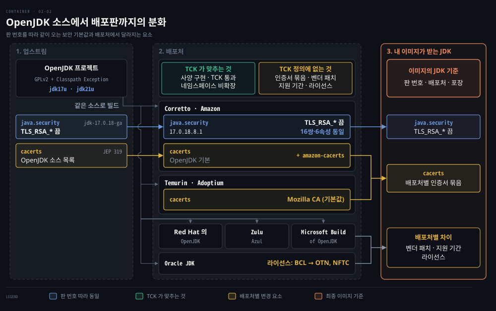
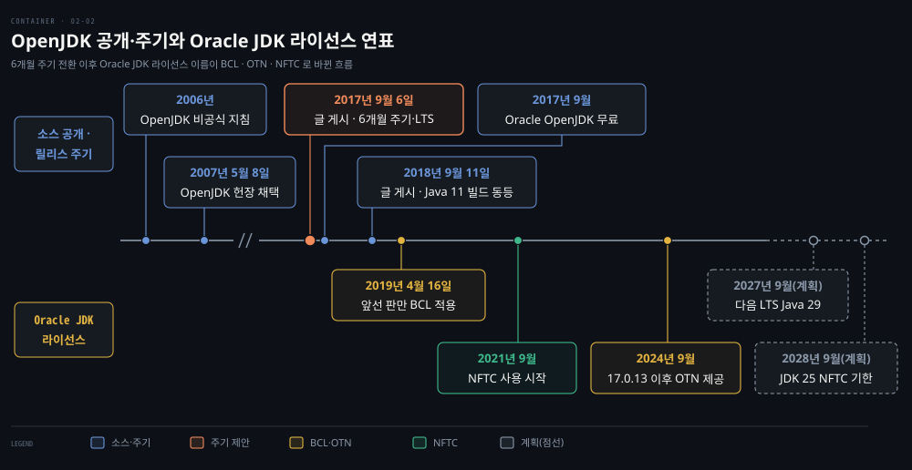
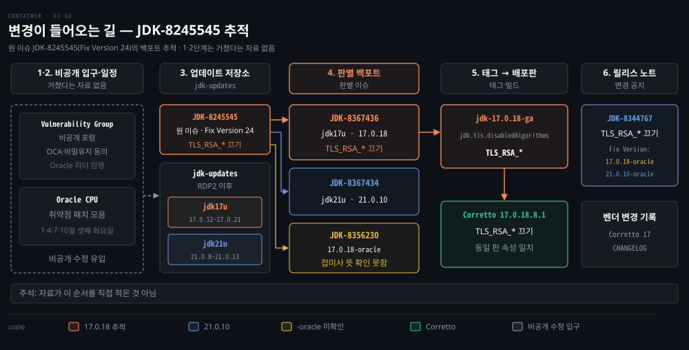

# JDK 배포판이 여럿인 이유

---

> OpenJDK 는 소스이고 바이너리는 배포처마다 따로 빌드해 내므로 JDK 배포판이 여럿입니다. TLS 같은 동작 변화는 배포판보다 업데이트 판 번호를 따라 바뀝니다.

## 학습 목표와 범위

> 읽고 나면 JDK 를 다른 배포판이나 다른 업데이트 판으로 바꿀 때 무엇부터 견줘야 하는지 말할 수 있습니다. 이미지 다섯 개의 파일 배치 차이는 [02-01 JDK 이미지가 서로 다른 이유](02-01.JDK%20이미지가%20서로%20다른%20이유.md) 가 다루므로 여기서는 다루지 않습니다.

1. OpenJDK 소스, 라이선스, 배포처 빌드가 어떤 관계인지 설명할 수 있습니다.
2. 6개월 주기와 Oracle JDK 라이선스 전환이 일어난 차례를 날짜와 함께 말할 수 있습니다.
3. TCK 가 맞춰 주는 것과, `cacerts`·벤더 패치·지원 기간처럼 배포판마다 달라지는 부분을 구분할 수 있습니다.
4. 보안 기본값이 바뀐 판을 찾고, 이미지의 JDK 를 바꿀 때 견줄 세 가지를 꼽을 수 있습니다.

처음 가진 질문은 「JDK 를 바꾸면 SSL 같은 내부 동작이 달라질 수 있다는데 그게 배포판 차이인가」 입니다. 답의 줄기는 아래와 같고 1절부터 5절이 배포판이 갈라진 이유를 쌓고 6절이 이 질문에 답합니다.

- OpenJDK 는 Sun 이 모두에게 허가한 소스이고 GPLv2 에 Classpath Exception 을 붙여 공개돼, 빌드는 Oracle 을 포함한 여러 배포처가 따로 냅니다(1절).
- Oracle JDK 의 라이선스는 BCL, OTN, NFTC 로 바뀌어 왔고 OTN 은 한정된 용도만 무료로 허용합니다(2절).
- Oracle 이 OpenJDK 빌드의 지원과 라이선스 정책을 바꾸자 주요 클라우드 사업자가 장기 업데이트를 내는 자체 빌드를 세웠다고 whichjdk.com 이 정리합니다(2절).
- 지금은 클라우드 사업자, 재단, 리눅스 벤더가 각자 배포판을 내고 지원 기간도 따로 약속합니다(3절).
- TCK 통과의 정의에는 인증서 묶음, 벤더 패치, 지원 기간, 라이선스가 없어서 이 넷은 배포판마다 달라질 수 있습니다(4절, 5절).
- 보안 기본값은 업스트림의 업데이트 판이 오르면서 바뀌었습니다. 비교한 Corretto 와 OpenJDK 는 같은 판 번호에서 보안 속성이 같았으므로 TLS 동작 차이는 먼저 판 번호에서 찾습니다(6절).

## 1. OpenJDK 소스와 바이너리의 분리

> OpenJDK 는 Sun 이 소스로 연 프로젝트이고, 설치해 쓰는 빌드는 Oracle 을 포함한 배포처가 따로 냅니다. GPLv2 에 붙은 Classpath Exception 덕분에 내 애플리케이션은 GPL 에 묶이지 않습니다.

### Sun 이 연 소스

이미지 이름이 `eclipse-temurin` 과 `amazoncorretto` 로 갈리는 출발점은 OpenJDK 소스가 열린 방식에 있습니다.

Sun Microsystems 는 자사 Java SE Development Kit 의 일부를 OpenJDK 라는 이름으로 모두에게 허가했다고 OpenJDK 헌장이 적습니다. 조건은 오픈소스 이념과 호환되는 것입니다.[^eco01] Sun 이 이 헌장을 OpenJDK Governance Board 를 만드는 기초로 쓰기로 한 날은 2007년 5월 8일입니다.[^eco02] 그보다 앞선 2006년부터 OpenJDK 커뮤니티는 그룹과 프로젝트를 위한 비공식 지침 아래 운영돼 왔다고 Bylaws 가 적습니다.[^eco03]

### GPLv2 와 Classpath Exception

OpenJDK 는 GPLv2(GNU General Public License version 2)에 Classpath Exception 을 붙인 조건으로 공개됩니다. Oracle 이 내는 OpenJDK 릴리스도 이 조건을 씁니다.[^eco20]

GPLv2 는 라이브러리를 다른 모듈과 링크하면 결합 저작물이 된다고 적습니다. 정적 링크든 동적 링크든 같고, GPL 의 조건은 그 결합 전체에 미칩니다. 예외가 없으면 JDK 의 클래스 라이브러리와 링크되는 내 애플리케이션까지 GPL 조건 아래 놓인다는 뜻입니다.[^eco16]

Classpath Exception 은 이 결합을 풀어 줍니다. 라이브러리를 독립 모듈과 링크해 만든 실행 파일은 원하는 조건으로 복사하고 배포해도 됩니다. 단 링크된 모듈 각각의 라이선스 조건은 지켜야 합니다.[^eco17]

### OpenJDK 프로젝트가 내는 것

whichjdk.com 은 OpenJDK 를 Java SE 사양의 오픈소스 참조 구현이라 부릅니다. 다만 소스 코드일 뿐이고 바이너리는 벤더가 플랫폼별로 낸다고 정리합니다.[^eco18] 이 문장은 2차 자료의 정리입니다.

1차 자료로는 jdk.java.net 이 있습니다. 이 사이트는 자신을 「Production and Early-Access OpenJDK Builds, from Oracle」 이라 소개합니다.[^eco19] jdk-updates 프로젝트의 목표는 JDK 프로젝트의 업데이트를 개발하는 것입니다.[^flow08] 소스와 그 업데이트는 OpenJDK 프로젝트에 있고, 내려받아 설치하는 빌드는 Oracle 과 다른 배포처가 냅니다.[^eco18][^eco19][^flow08]

## 2. 6개월 주기와 라이선스 전환

> 릴리스 주기와 Oracle JDK 라이선스가 차례로 바뀌었고, 클라우드 사업자들이 자체 빌드를 낸 까닭은 whichjdk.com 이 정리합니다. 이 절은 날짜와 사건을 연표로 모으고 Oracle JDK 라이선스 이름 셋을 풉니다.

### 연표

| 날짜 | 사건 |
|---|---|
| 2006년 | OpenJDK 커뮤니티가 비공식 지침 아래 운영되기 시작했다고 Bylaws 가 적음[^eco03] |
| 2007년 5월 8일 | Sun 이 OpenJDK 헌장을 Governance Board 의 기초로 쓰기로 함[^eco02] |
| 2017년 9월 6일 | mreinhold.org 블로그 글(게시일[^ver04])의 제안: Java 9 다음부터 6개월마다 feature 릴리스, 분기마다 update 릴리스, 3년마다 LTS[^eco04] |
| 2017년 9월 | Oracle 이 Oracle OpenJDK 릴리스를 무료 오픈소스 라이선스로 제공[^eco05] |
| 2018년 9월 11일 | Oracle 이 올린 글(게시일[^ver05])에서 Java 11 부터 Oracle JDK 빌드와 OpenJDK 빌드가 실질적으로 같아진다고 밝힘[^eco07] |
| 2019년 4월 16일 | 이 날짜 앞에 나온 Oracle Java SE 버전만 BCL 아래에 있음[^eco09] |
| 2021년 9월 | NFTC 사용 시작[^eco13] |
| 2024년 9월 | Java 17 의 17.0.13 이후 Oracle JDK 릴리스는 My Oracle Support 와 OTN 쪽으로 제공[^eco15] |
| 2027년 9월(계획) | 다음 LTS 로 계획된 Java 29[^eco26] |
| 2028년 9월(계획) | Oracle JDK 25 업데이트의 NFTC 제공 기한[^add02] |

### 6개월 주기와 LTS

mreinhold.org 블로그 글의 제안은 Java 9 다음부터 엄격한 시간 기반 모델을 쓰자는 것이었습니다. 6개월마다 feature 릴리스, 분기마다 update 릴리스, 3년마다 LTS(Long-Term-Support, 길게 지원하는 릴리스)를 내는 모델입니다.[^eco04] 6개월은 다음 기차를 기다리는 고통을 줄일 만큼 빠르면서 각 릴리스를 높은 품질로 낼 만큼 느린 간격이라고 설명합니다.[^eco24]

같은 글은 LTS 업데이트가 최소 3년은 나오고 그보다 얼마나 길지는 vendor 에 달려 있다고 적었습니다.[^eco25] Oracle 은 Java SE 8, 11, 17, 21, 25 를 LTS 로 두고 다음 계획을 2027년 9월의 Java 29 로 적습니다.[^eco26]

### Oracle JDK 와 OpenJDK 빌드

Oracle 은 2017년 9월부터 Oracle OpenJDK 릴리스를 무료 오픈소스 라이선스로 제공해 왔다고 적습니다.[^eco05] Oracle 은 Java Flight Recorder, Java Mission Control, Application Class-Data Sharing, ZGC 를 OpenJDK 커뮤니티에 기증했습니다. 그래서 Java 11 부터 Oracle JDK 빌드와 OpenJDK 빌드는 실질적으로 같아진다고 Oracle 이 직접 적습니다.[^eco07]

JEP 319 도 같은 방향입니다. Oracle 의 Java SE Root CA program 루트 인증서를 오픈소스로 여는 목적은 두 가지입니다. OpenJDK 빌드를 개발자에게 더 매력 있게 하는 것, Oracle JDK 빌드와의 차이를 줄이는 것입니다.[^eco06]

차이가 완전히 사라진 것은 아닙니다.[^eco21] Oracle JDK 11 은 `-XX:+UnlockCommercialFeatures` 옵션에 경고를 내지만 OpenJDK 빌드는 오류를 냅니다.[^eco21]

### BCL, OTN, NFTC

Oracle JDK 의 라이선스는 이름이 셋 나옵니다.

- BCL: Binary Code License for Java SE 입니다.[^add05] 2019년 4월 16일 앞에 나온 Oracle Java SE 버전만 이 라이선스 아래에 있고, 새 릴리스에는 쓰지 않습니다.[^eco09]
- OTN: Oracle Technology Network 라이선스입니다.[^eco15] 개인 사용, 개발, 테스트, 프로토타이핑, 시연과 일부 제한된 용도를 무료로 허용합니다.[^eco22]
- NFTC: Oracle No-Fee Terms and Conditions 라이선스입니다. 2021년 9월부터 쓰였고 Oracle JDK 21 이후의 라이선스이며 조건을 지키면 상용·프로덕션 사용도 모든 사용자에게 무료로 허용합니다.[^eco13]

NFTC 에는 기한이 있습니다. Oracle JDK 25 업데이트는 NFTC 로 2028년 9월까지 제공할 계획입니다.[^add02] 다음 LTS 인 Java 29 가 나오는 2027년 9월에서 1년 뒤이고 Oracle JDK 17 과 21 에서와 같은 패턴이라고 적습니다.[^add01][^add02] 그 뒤에는 Java 8, 11, 17, 21 LTS 가 지금 쓰는 것과 같은 OTN 으로 옮기려 합니다.[^add03]

Java 17 은 이미 그 시점이 지났습니다. 2024년 9월 이후의 Oracle JDK 릴리스(17.0.13 이상)는 My Oracle Support(Oracle 고객 전용)와 OTN 쪽으로 제공됩니다.[^eco15]

### 비어 있던 자리

Oracle JDK 쪽에서 무료 범위는 좁았습니다. OTN 은 개인 사용, 개발, 테스트, 프로토타이핑, 시연과 일부 제한된 용도만 무료로 허용합니다.[^eco22] Oracle 은 2018년 9월 11일 글에서 Java 11 부터 JDK 릴리스를 두 갈래로 낸다고 밝혔습니다. 하나는 GPLv2+CPE 조건의 릴리스입니다. 다른 하나는 Oracle 제품이나 서비스의 일부로 쓰거나 오픈소스 소프트웨어를 쓰고 싶지 않은 쪽을 위한 상용 라이선스 릴리스입니다.[^ver01]

Oracle 이 내는 OpenJDK 빌드는 따로 적혀 있습니다. Oracle 의 지원 로드맵은 이 빌드의 제공 범위와 커뮤니티 지원이 jdk.java.net 에 따로 적혀 있다고 말합니다. 새 feature 릴리스가 나오면 이전 non-LTS 릴리스를 대체된 것으로 본다는 규칙은 상용 지원을 받는 Oracle JDK 에만 적용된다고도 밝힙니다.[^ver02]

jdk.java.net 의 보관 쪽은 이전에 낸 빌드가 최신 보안 패치로 업데이트되지 않으며 운영에 쓰기를 권하지 않는다고 적습니다.[^ver03] Oracle 의 OpenJDK 빌드가 다음 판이 나온 뒤 언제까지 업데이트되는지를 말한 문장은 이 문서가 확인한 자료에 없습니다.

이 틈을 whichjdk.com 은 이렇게 정리합니다. Oracle 이 OpenJDK 빌드의 지원과 라이선스 정책을 바꿨고, 그래서 주요 클라우드 사업자들이 자체 관리 OpenJDK 빌드를 세우고 장기 업데이트를 내기로 했다고 합니다.[^eco23] 이 인과는 whichjdk.com 의 서술입니다. 사업자들이 직접 밝힌 이유는 3절의 표에 따로 적습니다.

## 3. 빈자리를 메운 배포판들

> 배포판을 내는 곳은 클라우드 사업자, 재단, 리눅스 벤더로 나뉘고 각자 지원 기간과 갱신 주기를 따로 약속합니다. TCK 에 대해서도 말하는 방식이 제각각입니다.

### AdoptOpenJDK 에서 Temurin 으로

AdoptOpenJDK 의 Technical Steering Committee(TSC)가 Eclipse Foundation 으로 이전하자고 제안했고 Eclipse Board 가 승인했습니다. 이전의 이유로는 프로젝트가 사명에 집중하며 계속 성장하게 해 주고 vendor independence 를 강화한다고 적습니다.[^eco10]

프로젝트는 이전하면서 이름도 바꿉니다. 기존 상표를 존중하고 현재 이름과의 유사성 때문에 혼란이 없도록 하기 위해서라고 직접 적습니다.[^eco11] Eclipse Adoptium 은 AdoptOpenJDK 사명의 연속이라고 스스로 소개합니다.[^ver09] Adoptium 의 Temurin 페이지는 Eclipse Temurin 을 OpenJDK 기반의 오픈소스 런타임 바이너리이고 Java SE TCK 인증을 받았다고 적습니다.[^ver10]

### 배포판 비교표

TCK(Technology Compatibility Kit)는 자바 구현이 사양에 맞는지 보는 시험 묶음이고 4절에서 풉니다. 표의 칸은 배포처가 직접 쓴 말만 옮겼고 말을 찾지 못한 칸은 「—」 로 둡니다.

| 배포판 | 내는 곳 | 스스로 밝힌 까닭 | 지원·갱신 | TCK 에 대한 말 |
|---|---|---|---|---|
| Corretto | Amazon | Amazon 이 수천 개 프로덕션 서비스에서 내부 운영하며, Corretto 에 한 수정마다 OpenJDK 를 돌리다 만난 문제를 고치거나 줄인다고 적음[^eco08] | 무료 장기 지원. 긴급 수정은 정기 분기 주기 밖에서도 적용할 계획[^eco08] | TCK 로 인증했다고 적음[^ver06] |
| Temurin | Eclipse Adoptium | Eclipse Foundation 으로 옮기며 사명에 집중하고 vendor independence 를 강화한다고 적음[^eco10] | LTS 를 최소 4년 지원[^eco28] | adoptium.net 의 Temurin 바이너리는 「intermediate builds」 로 표시된 것을 뺀 모두가 JCK 시험의 요건을 통과했다고 인증[^eco27] |
| Red Hat 의 OpenJDK | Red Hat | — | OpenJDK 8, 11, 17, 21, 25 에 연 4회, 약 3개월 간격[^eco29] | 2025년 7월 1일 전 빌드는 TCK 인증. 그 뒤 OpenJDK 8 빌드는 인증 아님, 나머지는 계속 TCK 시험[^eco30] |
| Zulu | Azul | Oracle 라이선스 부담을 없애 예산을 아낄 수 있다고 내세움[^ver07] | 상용 지원, SLA, 보안 업데이트, 「업계에서 가장 긴 지원 기간」 을 내세움[^ver08] | 100% 오픈소스로 빌드하고 TCK 를 통과한다고 적음[^eco31] |
| Microsoft Build of OpenJDK | Microsoft | 고객과 내부 사용자에게 중요하다고 본 backport 수정을 담을 수 있다고 적음[^eco34] | 무료, 어디서나 배포 가능. Java 11 과 17 의 LTS 바이너리 포함[^eco32] | 정식 공개(GA) 바이너리는 TCK 를 통과했다고 적음[^eco33] |

표의 문장은 각 배포처의 주장이며 이 문서가 시험을 다시 돌린 것은 아닙니다. 「—」 칸은 확인한 자료에서 그 말을 찾지 못했다는 뜻이고 그런 말이 없다고 단정하는 것은 아닙니다. Red Hat 은 OpenJDK 가 RHEL 의 JDK 와 JRE 라고 적을 뿐[^ver13] 까닭을 직접 밝힌 문장은 찾지 못했습니다.

## 4. TCK 가 맞추는 것과 남기는 것

> TCK 는 OCTLA 계약으로 받는 시험 묶음이고, 계약서의 「호환」 은 사양 구현과 TCK 통과를 뜻합니다. 통과한 배포판 사이에 어디가 다른지는 계약서가 아니라 5절의 벤더 문서에서 확인합니다.

### TCK 와 OCTLA

JCK(Java Compatibility Kit)는 Java SE 의 TCK 를 가리키는 다른 이름입니다. OpenJDK 에서 파생된 코드로 호환 구현을 배포하려는 개발자에게 무료로 제공됩니다. OpenJDK 연구·버그 수정·포팅에 참여하는 개발자도 받습니다.[^eco36] 제공 조건은 OCTLA(OpenJDK Community TCK License Agreement)이고 현재 판은 Java SE 21 이상용입니다.[^eco37]

OCTLA 에 서명해 JCK 접근을 받은 단체는 공개 목록에 있습니다. Java SE 21 이상 서명자에는 Amazon.com Services LLC, Azul Systems, BellSoft 가 있습니다. Eclipse.org Foundation, Microsoft, Red Hat 도 들어 있습니다.[^eco40]

### 계약서가 말하는 호환

OCTLA 의 Compatible Licensee Implementation 은 세 조건을 모두 채운 구현입니다. 요구되는 인터페이스와 기능을 포함해 Java 사양을 완전히 구현해야 합니다. 사양이 요구하거나 허용한 것 밖으로 Licensor Name Space 를 고치거나 넓히면 안 됩니다. 해당 사양의 TCK 를 TCK Users Guide 의 요건까지 지켜 통과해야 합니다.[^eco14]

계약서의 다른 조항도 범위를 줄입니다. Oracle 과 그 라이선서의 상표에 대한 권리는 이 계약으로 주어지지 않습니다.[^eco38] Oracle 은 TCK 를 「AS IS」 로 제공하며 상품성 등의 묵시적 보증을 부인합니다.[^eco39]

### 통과해도 남는 것

인용한 정의에는 인증서 묶음, 벤더 패치, 지원 기간, 라이선스가 조건으로 들어 있지 않습니다. 실제로 이 네 항목에서 배포판이 어떻게 다른지는 5절에서 벤더 문서로 봅니다.

인증 상태도 고정돼 있지 않습니다. Red Hat 은 2025년 7월 1일 전에 낸 빌드가 TCK 인증을 받았다고 적습니다. 그 뒤의 OpenJDK 8 빌드는 인증을 받지 않습니다. 다른 버전은 계속 TCK 시험을 받습니다.[^eco30] 같은 벤더 안에서도 버전과 시점에 따라 말이 달라집니다.

## 5. 배포판이 갈라지는 자리

> 같은 소스에서 나와도 `cacerts` 를 만드는 방식, 벤더가 얹은 패치, 지원 기간, 라이선스는 배포판마다 다르게 적혀 있습니다. 표의 칸은 벤더가 직접 쓴 문서의 말입니다.

같은 소스에서 나온 두 배포판의 TLS 동작이 갈리는 부분을 찾으려면 `cacerts` 부터 풀어야 합니다. `cacerts` 는 JDK 가 신뢰할 루트 인증서를 모아 둔 키스토어 파일입니다.

| 갈라지는 자리 | 배포판별 모습 |
|---|---|
| 인증서 묶음 | OpenJDK 는 JEP 319 로 Oracle 의 루트 인증서를 소스에 열었음[^eco06]. Temurin 은 기본값(true)에서 Mozilla CA 목록으로 만든 `cacerts` 를 생성하고 false 면 OpenJDK 가 싣는 파일을 씀[^eco42]. Corretto 는 OpenJDK 소스의 목록으로 기본 파일을 만든 뒤 `amazon-cacerts` 를 합침[^flow29][^flow31] |
| 벤더 패치 | Corretto 는 대응하는 OpenJDK update 프로젝트에 아직 들어가지 않은 Amazon 의 패치를 포함[^eco41]. Microsoft 는 upstream 에 아직 정식으로 backport 되지 않은 수정을 담을 수 있고 릴리스 노트에 표시한다고 적음[^eco34] |
| 지원 기간 | Temurin LTS 최소 4년[^eco28], Red Hat 연 4회[^eco29], Corretto 는 정기 주기 밖의 긴급 수정 계획[^eco08] |
| 라이선스 | OpenJDK 릴리스는 GPLv2+CPE[^eco20]. Oracle JDK 는 2절의 BCL, OTN, NFTC |

### Temurin 과 Corretto 의 인증서 조립

Temurin 의 빌드 설명서는 기본값에서 Mozilla CA 목록으로 `cacerts` 를 만든다고 적습니다. 같은 설명서가 false 면 OpenJDK 가 싣는 파일을 쓴다고 적으므로 두 방식이 모두 있습니다.[^eco42] 실제로 포함된 인증서 개수나 지문을 이 문서는 비교하지 않았습니다.

Corretto 17 의 `build.gradle` 은 세 작업으로 `cacerts` 를 조립합니다.[^flow29][^flow31][^add04]

- `generateJdkCacerts`: JDK 소스의 인증서 목록에서 기본 파일을 만듭니다.[^flow29]
- `importAmazonCacerts`: Corretto 저장소 루트의 `amazon-cacerts` 를 `keytool` 로 기본 파일에 합칩니다.[^flow31]
- `copyCacerts`: 합친 파일을 배포 디렉터리로 복사합니다.[^add04]

기본 파일의 소스 위치는 Corretto 17 이 `make/data/cacerts` 이고 Corretto 21 이 `src/java.base/share/data/cacerts` 입니다.[^sec05]

`amazon-cacerts` 에 무엇이 들었는지는 이 문서가 확인하지 못했습니다. Corretto 17 변경 기록에는 「Remove emSign C1 and C3 roots from amazon-cacerts」 라는 줄이 있습니다.[^eco44] 이 파일이 릴리스를 거치며 손질된다는 점까지만 말할 수 있습니다.

## 6. TLS 동작과 업데이트 판

> 보안 기본값은 배포판이 아니라 업데이트 판이 오르면서 바뀌었고, 같은 판 번호의 OpenJDK 와 Corretto 는 비교한 보안 속성에서 같았습니다. JDK 를 바꿀 때는 업데이트 판, 배포판, 포장 순으로 견줍니다.

### 보안 기본값이 바뀐 판

`java.security` 파일의 `jdk.tls.disabledAlgorithms` 는 TLS/DTLS 협상에서 쓰지 못하게 할 항목을 정합니다. 프로토콜, 암호 스위트, 키 등이 대상입니다.[^flow25] `jdk.certpath.disabledAlgorithms` 는 인증서 경로 검사에서 허용하지 않을 알고리즘을 정합니다.[^flow26]

꺼진 항목은 다시 켤 수 있습니다. 파일에서 토큰을 지우거나, JSSE 를 초기화하기 전에 `Security.setProperty` 로 바꾸면 됩니다.[^flow27]

비교한 범위는 두 가지입니다. `jdk17u` 는 `jdk-17.0.12-ga` 부터 `jdk-17.0.21-ga` 까지이고 `jdk21u` 는 `jdk-21.0.8-ga` 부터 `jdk-21.0.13-ga` 까지입니다.[^sec01] 아래 표는 이 범위에서 처음 더해진 토큰입니다.

| 판(OpenJDK 태그) | 속성 | 더해진 토큰 | Corretto 에 처음 나온 태그 |
|---|---|---|---|
| jdk-17.0.13-ga | `jdk.tls.disabledAlgorithms` | ECDH | 17.0.13.11.1 |
| jdk-17.0.13-ga | `jdk.security.caDistrustPolicies` | ENTRUST_TLS | 17.0.13.11.1 |
| jdk-17.0.15-ga | `jdk.security.caDistrustPolicies` | CAMERFIRMA_TLS | 17.0.15.6.1 |
| jdk-17.0.18-ga | `jdk.tls.disabledAlgorithms` | TLS_RSA_*, rsa_pkcs1_sha1 usage HandshakeSignature, ecdsa_sha1 usage HandshakeSignature, dsa_sha1 usage HandshakeSignature | 17.0.18.8.1 |
| jdk-17.0.19-ga | `jdk.security.caDistrustPolicies` | CHUNGHWA_TLS | 17.0.19.10.1 |
| jdk-21.0.10-ga | `jdk.tls.disabledAlgorithms` | 17.0.18 과 같은 네 토큰 | 21.0.10.7.1 |
| jdk-21.0.11-ga | `jdk.security.caDistrustPolicies` | CHUNGHWA_TLS | 21.0.11.10.1 |

표의 값은 저장소 태그의 `java.security` 를 비교한 결과입니다. `jdk21u` 는 비교한 첫 판 21.0.8 앞에서 일어난 변화를 보지 않았습니다.[^sec01]

토큰마다 이유를 적은 자료가 따로 있습니다.

Corretto 17 변경 기록은 TLS_ECDH 암호 스위트가 forward secrecy 를 지키지 못하고 실제로 거의 쓰이지 않는다고 적습니다. 그래서 `ECDH` 를 `jdk.tls.disabledAlgorithms` 에 더해 끈다고 합니다.[^eco46]

같은 변경 기록에는 Entrust 루트 기반 TLS 인증서에 대한 문장도 있습니다. 2024년 11월 12일 뒤에 발급된 인증서를 JDK 가 신뢰하지 않는다는 내용입니다.[^eco43] 이 문장과 `ENTRUST_TLS` 토큰이 같은 판에 들어온 것인지는 판 번호를 맞춰 보지 않았습니다.

JBS 는 OpenJDK 의 이슈 추적기입니다. 릴리스 노트 JDK-8344767 은 `TLS_RSA_*` 암호 스위트를 기본으로 끈다고 적습니다.[^eco47] JDK-8353879 는 TLS 1.2 핸드셰이크 서명의 SHA-1 을 끈다고 적습니다.[^eco48] 두 노트의 Fix Version 에는 17.0.18-oracle 과 21.0.10-oracle 이 들어 있습니다.[^flow15][^flow16] OpenJDK Developers' Guide 와 jdk-updates 위키 첫 쪽에서도 이 접미사를 설명한 글을 찾지 못해 뜻은 확인하지 못했습니다.

### Corretto 와 같은 판의 OpenJDK

같은 판 번호의 OpenJDK 태그와 Corretto 태그 16쌍을 속성 여섯 개로 비교했습니다. 비교한 속성은 아래와 같고 토큰은 모두 같았습니다.[^sec02]

- `jdk.tls.disabledAlgorithms`, `jdk.certpath.disabledAlgorithms`
- `jdk.jar.disabledAlgorithms`, `jdk.security.caDistrustPolicies`
- `jdk.tls.legacyAlgorithms`, `jdk.tls.keyLimits`

쌍 가운데 `jdk-17.0.21-ga` 와 `17.0.21.1.2`, `jdk-21.0.13-ga` 와 `21.0.13.1.2` 도 차이가 없었습니다.[^sec03]

차이가 없었다는 것은 이 여섯 속성과 이 16쌍에 한한 결과입니다. 인증서 묶음은 5절처럼 조립 경로가 다르므로 이 비교에 포함되지 않습니다.

### 변경이 들어오는 길

각 자료가 말하는 역할을 이어 보면 변경이 지나는 곳은 아래와 같습니다. 자료가 이 순서를 직접 적은 것은 아니고, 단계 이름만 자료에서 가져왔습니다.

1. 취약점 제보와 수정: OpenJDK Vulnerability Group 은 비공개 포럼입니다. 신뢰받는 구성원이 취약점 보고를 받아 검토하고 함께 고치며 수정 공개를 조율합니다.[^flow10] 회원은 유효한 OCA 와 비밀유지 동의가 있어야 합니다. 기술 전문성이나 OCTLA·JCK 라이선스 보유도 요건입니다.[^flow12] 그룹 리더는 늘 Oracle 이 임명합니다.[^flow13]
2. 분기 일정: Oracle 의 CPU(Critical Patch Update)는 여러 보안 취약점의 패치 모음입니다.[^flow03] 1월, 4월, 7월, 10월의 셋째 화요일에 나옵니다.[^flow01]
3. 업데이트 저장소: feature 릴리스가 RDP2 단계에 들어가면 GA 에 들어가지 못할 수정을 받는 jdk-updates 저장소가 열립니다.[^flow09] `jdk17u` 와 `jdk21u` 위키에는 각각 Lead Maintainer 가 한 명씩 적혀 있습니다.[^flow06][^flow07]
4. 판별 백포트: JDK-8245545 는 `TLS_RSA_*` 암호 스위트를 끄는 이슈입니다. 이 원 이슈의 Fix Version 은 24 이고[^ver11] 업데이트 판마다 백포트 이슈가 따로 있습니다. 21.0.10 은 JDK-8367434 입니다.[^flow17] 17.0.18-oracle 은 JDK-8356230 입니다.[^flow18] 17.0.18 은 JDK-8367436 입니다.[^flow19]
5. 배포판 빌드: Corretto 는 위 변경이 반영된 17.0.18.8.1 같은 태그로 낸 판을 배포합니다.[^sec01]
6. 릴리스 노트: JBS 와 벤더의 변경 기록(예: Corretto 17 CHANGELOG)이 변경을 알립니다.[^eco46]

### JDK 를 바꿀 때 볼 세 가지

처음 질문의 답은 이렇습니다. 비교한 범위에서는 TLS 동작이 달라지는 직접 원인이 업데이트 판이 다르다는 사실이었습니다. 17.0.13 에서 17.0.18 사이에서도 `ECDH`, `TLS_RSA_*`, SHA-1 핸드셰이크 서명이 차례로 꺼졌습니다. 여섯 속성과 16쌍에서 같은 판의 Corretto 와 OpenJDK 는 같았고 토큰은 판이 오르면서 더해졌습니다. 인증서 묶음은 조립 경로가 다르므로 따로 봐야 합니다.

JDK 를 바꾸기 전에 아래 순서로 견줍니다.

1. 업데이트 판 차이: `java -version` 의 판 번호가 같은지 봅니다. 다르면 그 사이에서 바뀐 `java.security` 토큰과 릴리스 노트를 봅니다. 꺼진 알고리즘을 다시 켜야 하면 `java.security` 에서 토큰을 지우거나 JSSE 를 초기화하기 전에 `Security.setProperty` 로 바꿉니다. `TLS_RSA_*` 릴리스 노트는 이렇게 다시 켜는 일을 사용자가 위험을 지고 하는 일이라고 적습니다.[^ver12]
2. 배포판 차이: `cacerts` 를 누가 어떤 목록으로 조립하는지, 벤더가 넣은 패치를 릴리스 노트에서 확인합니다.
3. 포장 차이: 같은 JDK 라도 RPM 으로 설치된 폴더와 tar 로 푼 폴더는 `cacerts` 링크와 네이티브 라이브러리 위치가 다릅니다. [02-01 JDK 이미지가 서로 다른 이유](02-01.JDK%20이미지가%20서로%20다른%20이유.md) 에서 다룹니다.

## 7. 검증과 복습

> Phase 4 자답과 회차별 복습은 본문에 누적하지 않고 `_review/` 에 남깁니다.

- **Phase 4 결과**: 아직 없음. 자답을 마치면 `_review/` 에 날짜 파일로 남깁니다.
- **다음 보완점**: `amazon-cacerts` 의 실제 인증서 목록을 Temurin·OpenJDK 의 `cacerts` 와 비교합니다. JBS `-oracle` 접미사의 뜻도 확인합니다.

## 면접 질문

> 세 질문에 먼저 스스로 답해 보세요. 자답이 끝나면 아래 정답 절로 내려갑니다.

1. OpenJDK 는 소스인데 JDK 배포판은 왜 여럿인가요? GPLv2 와 Classpath Exception 은 각각 무엇을 정하나요?
2. Java 11 에서 Oracle JDK 와 OpenJDK 빌드의 관계가 어떻게 바뀌었고, TCK 를 통과한 배포판끼리도 어디가 다를 수 있나요?
3. JDK 를 바꿨더니 TLS 동작이 달라졌습니다. 배포판 차이와 업데이트 판 차이를 어떻게 가려내나요?

## 정답 (자답 후 펼치기)

> 위 면접 질문 세 개에 먼저 자답한 뒤 아래를 읽으세요.

### 정답 1 — 소스와 바이너리의 분리

OpenJDK 프로젝트에는 소스와 그 업데이트가 있습니다. 설치해 쓰는 바이너리는 Oracle 과 다른 배포처가 따로 빌드합니다.

GPLv2 는 라이브러리와 링크된 결합 전체에 GPL 조건을 미치게 합니다. Classpath Exception 은 독립 모듈과 링크한 실행 파일을 원하는 조건으로 배포하게 허락합니다. 그래서 JDK 를 쓰는 애플리케이션은 GPL 에 묶이지 않고 배포됩니다.

### 정답 2 — Java 11 과 TCK 이후

Oracle 은 Java 11 에서 Java Flight Recorder, Java Mission Control, Application Class-Data Sharing, ZGC 를 OpenJDK 에 기증해 두 빌드가 실질적으로 같아졌다고 적습니다. TCK 통과의 정의는 사양의 완전한 구현, 네임스페이스 비확장, TCK 통과 세 가지입니다. 인증서 묶음, 벤더 패치, 지원 기간, 라이선스는 이 정의에 들어 있지 않아서 배포판마다 다를 수 있습니다.

### 정답 3 — 업데이트 판부터 가르기

먼저 두 JDK 의 판 번호를 맞춰 같은 판끼리 비교합니다. 판이 다르면 그 사이에서 바뀐 `java.security` 토큰과 릴리스 노트가 원인 후보입니다. 같은 판인데 다르면 `cacerts` 조립 경로와 벤더 패치를 봅니다. 마지막으로 RPM 이나 tar 같은 포장 차이를 02-01 의 방법으로 확인합니다.

## 참고 자료

[^add01]: Oracle Java SE Universal Subscription FAQ, "Following the same pattern as Oracle JDK 17 and Oracle JDK 21" <https://www.oracle.com/java/technologies/javase/jdk-faqs.html> (2026-11-22 확인)
[^add02]: Oracle Java SE Universal Subscription FAQ, "until September of 2028, one year after the release JDK 29 LTS, in September 2027" <https://www.oracle.com/java/technologies/javase/jdk-faqs.html> (2026-11-22 확인)
[^add03]: Oracle Java SE Universal Subscription FAQ, "the same currently used for Java 8, 11, 17, and 21 LTS releases" <https://www.oracle.com/java/technologies/javase/jdk-faqs.html> (2026-11-22 확인)
[^add04]: Corretto 17 build.gradle(17.0.12.7.1), "task copyCacerts(type: Copy) {" <https://raw.githubusercontent.com/corretto/corretto-17/17.0.12.7.1/build.gradle> (2026-11-22 확인)
[^add05]: Oracle Java SE Universal Subscription FAQ, "Binary Code License for Java SE" <https://www.oracle.com/java/technologies/javase/jdk-faqs.html> (2026-11-22 확인)
[^eco01]: OpenJDK Charter, "known henceforth as OpenJDK , to all under terms compatible with Open Source ideals" <https://openjdk.org/legal/charter/> (2026-11-22 확인)
[^eco02]: OpenJDK Charter, "agreed to use this Charter as the basis for creating the OpenJDK Governance Board" <https://openjdk.org/legal/charter/> (2026-11-22 확인)
[^eco03]: OpenJDK Bylaws, "been operating under a set of informal guidelines for Groups and Projects" <https://openjdk.org/bylaws> (2026-11-22 확인)
[^eco04]: mreinhold.org, Moving Java Forward Faster, "a strict, time-based model with a new feature release every six months, update releases every quarter, and a long-term support release every three years" <https://mreinhold.org/blog/forward-faster> (2026-11-22 확인)
[^eco05]: Oracle Java SE Support Roadmap, "Since September 2017, Oracle provides Oracle OpenJDK releases under a free open source license" <https://www.oracle.com/java/technologies/java-se-support-roadmap.html> (2026-11-22 확인)
[^eco06]: JEP 319: Root Certificates, "to make OpenJDK builds more attractive to developers, and to reduce the differences between those builds and Oracle JDK builds" <https://openjdk.org/jeps/319> (2026-11-22 확인)
[^eco07]: Oracle, Oracle JDK Releases for Java 11 and Later, "From Java 11 forward, therefore, Oracle JDK builds and OpenJDK builds will be essentially identical." <https://blogs.oracle.com/java-platform-group/oracle-jdk-releases-for-java-11-and-later> (2026-11-22 확인)
[^eco08]: Amazon Corretto FAQs, "Amazon runs Corretto internally on thousands of production services." … "Every modification we make to Corretto fixes or mitigates a problem we found running OpenJDK." … "outside of the regular quarterly cycle" … "long-term support provided at no cost to you" <https://aws.amazon.com/corretto/faqs/> (2026-11-22 확인)
[^eco09]: Oracle Java SE Universal Subscription FAQ, "are the only versions licensed under the BCL license" … "it is no longer used for new releases" <https://www.oracle.com/java/technologies/javase/jdk-faqs.html> (2026-11-22 확인)
[^eco10]: AdoptOpenJDK blog, AdoptOpenJDK to join the Eclipse Foundation, "approved that proposal" … "continue to grow and to focus on our mission" … "strengthens our vendor independence" <https://blog.adoptopenjdk.net/2020/06/adoptopenjdk-to-join-the-eclipse-foundation/> (2026-11-22 확인)
[^eco11]: AdoptOpenJDK blog, AdoptOpenJDK to join the Eclipse Foundation, "As part of a move to the Eclipse Foundation, we will undergo a project rename." … "we respect existing trademarks" <https://blog.adoptopenjdk.net/2020/06/adoptopenjdk-to-join-the-eclipse-foundation/> (2026-11-22 확인)
[^eco13]: Oracle Java SE Universal Subscription FAQ, "has been in use since September 2021 and is currently the license for Oracle JDK 21 and later releases" … "Subject to the conditions of the license, it permits free use for all users" … "even commercial and production use" <https://www.oracle.com/java/technologies/javase/jdk-faqs.html> (2026-11-22 확인)
[^eco14]: OCTLA JDK 21+, "fully implements the Java Specification, including all its required interfaces and functionality" … "does not modify, subset, superset or otherwise extend the Licensor Name Space" … "passes the TCK (including satisfying the requirements of the applicable TCK Users Guide) for such Specification" <https://openjdk.org/legal/OCTLA-JDK21+.pdf> (2026-11-22 확인)
[^eco15]: Oracle Java SE Universal Subscription FAQ, "Java 17 Oracle JDK releases after September 2024 (17.0.13 and later)" … "My Oracle Support (Oracle Customers Only) and Oracle Technology Network License Agreement for Java SE for Personal, Development and other Users only." <https://www.oracle.com/java/technologies/javase/jdk-faqs.html> (2026-11-22 확인)
[^eco16]: OpenJDK, GPLv2 + Classpath Exception, "Thus, the terms and conditions of the GNU General Public License cover the whole combination." <https://openjdk.org/legal/gplv2+ce.html> (2026-11-22 확인)
[^eco17]: OpenJDK, GPLv2 + Classpath Exception, "give you permission to link this library with independent modules to produce an executable, regardless of the license terms of these independent modules" <https://openjdk.org/legal/gplv2+ce.html> (2026-11-22 확인)
[^eco18]: whichjdk.com(2차 자료), "it is only the source code. Binary distributions are provided by different vendors for a number of supported platforms." <https://whichjdk.com/> (2026-11-22 확인)
[^eco19]: jdk.java.net, "Production and Early-Access OpenJDK Builds, from Oracle" <https://jdk.java.net/> (2026-11-22 확인)
[^eco20]: Oracle Java SE Universal Subscription FAQ, "Oracle OpenJDK releases (available since Java 9) are under the open source GNU General Public License v2, with the Classpath Exception (GPLv2+CPE)" <https://www.oracle.com/java/technologies/javase/jdk-faqs.html> (2026-11-22 확인)
[^eco21]: Oracle, Oracle JDK Releases for Java 11 and Later, "Oracle JDK 11 emits a warning when using the -XX:+UnlockCommercialFeatures option, whereas in OpenJDK builds this option results in an error." <https://blogs.oracle.com/java-platform-group/oracle-jdk-releases-for-java-11-and-later> (2026-11-22 확인)
[^eco22]: Oracle Java SE Universal Subscription FAQ, "This OTN license permits personal use, development, testing, prototyping, demonstrating, and some other limited uses at no cost." <https://www.oracle.com/java/technologies/javase/jdk-faqs.html> (2026-11-22 확인)
[^eco23]: whichjdk.com(2차 자료), "Since Oracle changed the support and license policy for its OpenJDK builds, major cloud providers decided to establish their own managed OpenJDK builds and providing long-term updates." <https://whichjdk.com/> (2026-11-22 확인)
[^eco24]: mreinhold.org, Moving Java Forward Faster, "fast enough to minimize the pain of waiting for the next train, yet slow enough that we can still deliver each release at a high level of quality" <https://mreinhold.org/blog/forward-faster> (2026-11-22 확인)
[^eco25]: mreinhold.org, Moving Java Forward Faster, "Updates for these releases will be available for at least three years and quite possibly longer, depending upon your vendor." <https://mreinhold.org/blog/forward-faster> (2026-11-22 확인)
[^eco26]: Oracle Java SE Support Roadmap, "Java SE 8, 11, 17, 21, and 25 are LTS releases" … "the next planned LTS release is Java 29 in September 2027" <https://www.oracle.com/java/technologies/java-se-support-roadmap.html> (2026-11-22 확인)
[^eco27]: Eclipse Adoptium, Temurin TCK affidavit, "have passed all requirements of the then-current Java SE compatibility test suite (JCK tests)" … "except for those clearly marked as" <https://raw.githubusercontent.com/adoptium/adoptium.net/main/content/asciidoc-pages/temurin/tck-affidavit/index.adoc> (2026-11-22 확인)
[^eco28]: Adoptium, Support, "We will support LTS releases for at least four years." <https://adoptium.net/support/> (2026-11-22 확인)
[^eco29]: Red Hat, OpenJDK lifecycle and support policy, "Red Hat will deliver four updates per year, approximately three months apart, for the OpenJDK 8, 11, 17, 21, and 25 distributions." <https://access.redhat.com/articles/1299013> (2026-11-22 확인)
[^eco30]: Red Hat, OpenJDK lifecycle and support policy, "All builds of OpenJDK delivered by Red Hat before 1 July 2025 have been TCK certified. OpenJDK 8 builds after that date are not TCK certified. All other versions continue to be TCK tested." <https://access.redhat.com/articles/1299013> (2026-11-22 확인)
[^eco31]: Azul, Zulu Core, "pass the Java SE Technology Compatibility Kit (TCK)" <https://www.azul.com/products/core/> (2026-11-22 확인)
[^eco32]: Microsoft Learn, Microsoft Build of OpenJDK, "available for free for anyone to deploy anywhere" … "Long-Term Support (LTS) binaries for Java 11 and Java 17" <https://learn.microsoft.com/en-us/java/openjdk/overview> (2026-11-22 확인)
[^eco33]: Microsoft Learn, Microsoft Build of OpenJDK, "Our generally available binaries have passed the Java Technology Compatibility Kit (TCK)" <https://learn.microsoft.com/en-us/java/openjdk/overview> (2026-11-22 확인)
[^eco34]: Microsoft Learn, Microsoft Build of OpenJDK, "Microsoft Build of OpenJDK binaries may contain backported fixes and enhancements we deem important to our customers and our internal users." … "Some of these may have not yet been formally backported upstream and are clearly signposted in our release notes." <https://learn.microsoft.com/en-us/java/openjdk/overview> (2026-11-22 확인)
[^eco36]: OpenJDK, JCK Access, "The Java Compatibility Kit (a.k.a., the JCK or TCK for Java SE)" … "available at no charge to developers who are planning to deploy a compatible Java implementation based on code derived from OpenJDK" … "or are participating in OpenJDK research, bug fixes, code enhancement and/or ports to other hardware/software architectures" <https://openjdk.org/groups/conformance/JckAccess/> (2026-11-22 확인)
[^eco37]: OpenJDK, JCK Access, "The JCK is made available under the terms of the OpenJDK Community TCK License Agreement (OCTLA)." … "The current version of the OCTLA is for Java SE 21 or later" <https://openjdk.org/groups/conformance/JckAccess/> (2026-11-22 확인)
[^eco38]: OCTLA JDK 21+, "No right, title, or interest in or to any trademarks, service marks, or trade names of Oracle" … "of Oracle or Oracle’s licensors are granted hereunder" <https://openjdk.org/legal/OCTLA-JDK21+.pdf> (2026-11-22 확인)
[^eco39]: OCTLA JDK 21+, "ORACLE PROVIDES THE TCK AND EA TCK TO LICENSEE ON AN" … "ALL REPRESENTATIONS AND WARRANTIES, INCLUDING ANY IMPLIED WARRANTY OF MERCHANTABILITY" <https://openjdk.org/legal/OCTLA-JDK21+.pdf> (2026-11-22 확인)
[^eco40]: OpenJDK, JCK Access(서명자 목록), "have signed the OpenJDK Community TCK License Agreement (OCTLA) and been granted access to the JCK" … "Amazon.com Services LLC Azul Systems, Inc. BellSoft" <https://openjdk.org/groups/conformance/JckAccess/jck-access.html> (2026-11-22 확인)
[^eco41]: Amazon Corretto FAQs, "Corretto is a distribution of Open JDK with patches included by Amazon that are not yet integrated in the corresponding OpenJDK update projects." <https://aws.amazon.com/corretto/faqs/> (2026-11-22 확인)
[^eco42]: Adoptium temurin-build README, "a custom cacerts file will be generated based on the Mozilla list of CA certificates" … "If false, the file shipped by OpenJDK will be used." <https://raw.githubusercontent.com/adoptium/temurin-build/master/README.md> (2026-11-22 확인)
[^eco43]: Corretto 17 CHANGELOG, "the JDK will not trust Transport Layer Security (TLS) certificates issued after the 12th of November 2024 which are anchored by Entrust root certificates" <https://raw.githubusercontent.com/corretto/corretto-17/develop/CHANGELOG.md> (2026-11-22 확인)
[^eco44]: Corretto 17 CHANGELOG, "Remove emSign C1 and C3 roots from amazon-cacerts" <https://raw.githubusercontent.com/corretto/corretto-17/develop/CHANGELOG.md> (2026-11-22 확인)
[^eco46]: Corretto 17 CHANGELOG, "The TLS_ECDH cipher suites do not preserve forward secrecy and are rarely used in practice." <https://raw.githubusercontent.com/corretto/corretto-17/develop/CHANGELOG.md> (2026-11-22 확인)
[^eco47]: JBS JDK-8344767, "The TLS_RSA cipher suites have been disabled by default" <https://bugs.openjdk.org/browse/JDK-8344767> (2026-11-22 확인)
[^eco48]: JBS JDK-8353879, "The SHA-1 algorithm has been disabled by default in TLS 1.2 and DTLS 1.2 handshake signatures" <https://bugs.openjdk.org/browse/JDK-8353879> (2026-11-22 확인)
[^flow01]: Oracle Security Alerts, "Critical Patch Updates are released on the third Tuesday of January, April, July, and October." <https://www.oracle.com/security-alerts/> (2026-11-22 확인)
[^flow03]: Oracle Security Alerts, "A Critical Patch Update is a collection of patches for multiple security vulnerabilities." <https://www.oracle.com/security-alerts/> (2026-11-22 확인)
[^flow06]: OpenJDK Wiki, JDK 17u, "(Lead Maintainer)" <https://wiki.openjdk.org/display/JDKUpdates/JDK+17u> (2026-11-22 확인)
[^flow07]: OpenJDK Wiki, JDK 21u, "(Lead Maintainer)" <https://wiki.openjdk.org/display/JDKUpdates/JDK+21u> (2026-11-22 확인)
[^flow08]: OpenJDK, JDK Updates Project, "The goal of this Project is to develop updates for the JDK Project." <https://openjdk.org/projects/jdk-updates/> (2026-11-22 확인)
[^flow09]: OpenJDK, JDK Updates Project, "Once a feature release enters RDP2, a corresponding jdk-updates repo should be opened to accommodate fixes that would not otherwise make the feature release GA." <https://openjdk.org/projects/jdk-updates/> (2026-11-22 확인)
[^flow10]: OpenJDK, Vulnerability Group, "The Vulnerability Group is a secure, private forum in which trusted members of the OpenJDK Community receive reports of vulnerabilities in OpenJDK code bases, review them, collaborate on fixing them, and coordinate the release of such fixes." <https://openjdk.org/groups/vulnerability/> (2026-11-22 확인)
[^flow12]: OpenJDK, Vulnerability Group, "Have a valid OCA on file" … "Be a recognized technical expert, or else a developer who holds an OCTLA or JCK license or works for a vendor organization that holds such a license." … "Agree to the communication policy (below) and the Non-Disclosure and License Agreement" <https://openjdk.org/groups/vulnerability/> (2026-11-22 확인)
[^flow13]: OpenJDK, Vulnerability Group, "The Group Lead of the Vulnerability Group will initially and always be appointed by Oracle." <https://openjdk.org/groups/vulnerability/> (2026-11-22 확인)
[^flow15]: JBS JDK-8344767, "Fix Version/s: 7u491 , 8u481 , 8u481-perf , 11.0.30-oracle , 17.0.18-oracle , 21.0.10-oracle , 24" <https://bugs.openjdk.org/browse/JDK-8344767> (2026-11-22 확인)
[^flow16]: JBS JDK-8353879, "Fix Version/s: 7u491 , 8u481 , 8u481-perf , 11.0.30-oracle , 17.0.18-oracle , 21.0.10-oracle , 25" <https://bugs.openjdk.org/browse/JDK-8353879> (2026-11-22 확인)
[^flow17]: JBS JDK-8245545, "JDK-8367434 21.0.10" <https://bugs.openjdk.org/browse/JDK-8245545> (2026-11-22 확인)
[^flow18]: JBS JDK-8245545, "JDK-8356230 17.0.18-oracle" <https://bugs.openjdk.org/browse/JDK-8245545> (2026-11-22 확인)
[^flow19]: JBS JDK-8245545, "JDK-8367436 17.0.18" <https://bugs.openjdk.org/browse/JDK-8245545> (2026-11-22 확인)
[^flow25]: Oracle, JSSE Reference Guide(Java 17), "SunJSSE code uses the jdk.tls.disabledAlgorithms Security Property to disable TLS/DTLS protocols, cipher suites, keys, and so on." <https://docs.oracle.com/en/java/javase/17/security/java-secure-socket-extension-jsse-reference-guide.html> (2026-11-22 확인)
[^flow26]: Oracle, JSSE Reference Guide(Java 17), "CertPath code uses the jdk.certpath.disabledAlgorithms Security Property to determine which algorithms should not be allowed during CertPath checking." <https://docs.oracle.com/en/java/javase/17/security/java-secure-socket-extension-jsse-reference-guide.html> (2026-11-22 확인)
[^flow27]: Oracle, JSSE Reference Guide(Java 17), "the protocol can be reactivated by removing SSLv3 from the jdk.tls.disabledAlgorithms property in the java.security file or by dynamically setting this Security Property before JSSE is initialized." <https://docs.oracle.com/en/java/javase/17/security/java-secure-socket-extension-jsse-reference-guide.html> (2026-11-22 확인)
[^flow29]: Corretto 17 build.gradle(17.0.12.7.1), "task generateJdkCacerts(type: JavaExec) {" <https://raw.githubusercontent.com/corretto/corretto-17/17.0.12.7.1/build.gradle> (2026-11-22 확인)
[^flow31]: Corretto 17 build.gradle(17.0.12.7.1), "task importAmazonCacerts(type: Exec) {" <https://raw.githubusercontent.com/corretto/corretto-17/17.0.12.7.1/build.gradle> (2026-11-22 확인)
[^sec01]: OpenJDK jdk17u·jdk21u 와 Corretto 17·21 저장소 태그의 `java.security` 를 비교한 결과. 비교한 태그 사이에서 속성 토큰이 더해진 처음 태그를 적었음 <https://github.com/openjdk/jdk17u> <https://github.com/openjdk/jdk21u> <https://github.com/corretto/corretto-17> <https://github.com/corretto/corretto-21> (2026-11-22 확인)
[^sec02]: 같은 판 번호의 OpenJDK 태그와 Corretto 태그 16쌍 비교. 두 저장소의 `java.security` 에서 속성 여섯(`jdk.tls.disabledAlgorithms`, `jdk.certpath.disabledAlgorithms`, `jdk.jar.disabledAlgorithms`, `jdk.security.caDistrustPolicies`, `jdk.tls.legacyAlgorithms`, `jdk.tls.keyLimits`)을 뽑아 비교했고 모든 쌍에서 토큰이 같았음 <https://github.com/openjdk/jdk17u> <https://github.com/corretto/corretto-17> (2026-11-22 확인)
[^sec03]: 같은 비교에서 `jdk-17.0.21-ga` 와 `17.0.21.1.2`, `jdk-21.0.13-ga` 와 `21.0.13.1.2` 는 차이 없음 <https://github.com/openjdk/jdk21u> <https://github.com/corretto/corretto-21> (2026-11-22 확인)
[^sec05]: Corretto 저장소 태그 비교. Corretto 17 은 `make/data/cacerts`, Corretto 21 은 `src/java.base/share/data/cacerts` 를 소스 위치로 적음 <https://github.com/corretto/corretto-17> (2026-11-22 확인)

[^ver01]: Oracle, Oracle JDK Releases for Java 11 and Later, "Starting with Java 11, Oracle will provide JDK releases under the open source GNU General Public License v2, with the Classpath Exception" … "and under a commercial license for those using the Oracle JDK as part of an Oracle product or service, or who do not wish to use open source software" <https://blogs.oracle.com/java-platform-group/oracle-jdk-releases-for-java-11-and-later> (2026-11-22 확인)
[^ver02]: Oracle Java SE Support Roadmap, "Availability and community support of OpenJDK releases provided by Oracle is listed separately on jdk.java.net" … "apply only to the commercially supported Oracle JDK releases available to Oracle Customers" … "Once a new feature release is made available, any previous non-LTS release will be considered superseded." <https://www.oracle.com/java/technologies/java-se-support-roadmap.html> (2026-11-22 확인)
[^ver03]: jdk.java.net, Archived OpenJDK GA Releases, "They are not updated with the latest security patches and are not recommended for use in production." <https://jdk.java.net/archive/> (2026-11-22 확인)
[^ver04]: mreinhold.org, Moving Java Forward Faster, "Moving Java Forward Faster 2017/09/06" <https://mreinhold.org/blog/forward-faster> (2026-11-22 확인)
[^ver05]: Oracle, Oracle JDK Releases for Java 11 and Later, "September 11, 2018" <https://blogs.oracle.com/java-platform-group/oracle-jdk-releases-for-java-11-and-later> (2026-11-22 확인)
[^ver06]: Amazon Corretto FAQs, "Corretto is certified using the Java Technology Compatibility Kit (TCK) to ensure it meets the Java SE standard" <https://aws.amazon.com/corretto/faqs/> (2026-11-22 확인)
[^ver07]: Azul, Zulu Core, "By eliminating Oracle licensing exposure, enterprises typically gain budget savings of up to 70%" <https://www.azul.com/products/core/> (2026-11-22 확인)
[^ver08]: Azul, Zulu Core, "backed by production-ready SLAs, security updates, the longest support lifecycles in the industry" <https://www.azul.com/products/core/> (2026-11-22 확인)
[^ver09]: Eclipse Adoptium, About, "The Eclipse Adoptium project is the continuation of the original AdoptOpenJDK mission." <https://adoptium.net/about/> (2026-11-22 확인)
[^ver10]: Eclipse Adoptium, Temurin, "Eclipse Temurin offers high-performance, cross-platform, open source Java™ Runtimes binaries that are enterprise-ready and Java SE TCK certified" <https://adoptium.net/temurin/> (2026-11-22 확인)
[^ver11]: JBS JDK-8245545, "JDK-8245545 Disable TLS_RSA cipher suites", "Fix Version/s: 24" <https://bugs.openjdk.org/browse/JDK-8245545> (2026-11-22 확인)
[^ver12]: JBS JDK-8344767, "Users can, at their own risk, re-enable these cipher suites" <https://bugs.openjdk.org/browse/JDK-8344767> (2026-11-22 확인)
[^ver13]: Red Hat, OpenJDK lifecycle and support policy, "OpenJDK is the Java Development Kit (JDK) and Java Runtime Environment (JRE) in Red Hat Enterprise Linux." <https://access.redhat.com/articles/1299013> (2026-11-22 확인)

- [JDK 이미지가 서로 다른 이유](02-01.JDK%20이미지가%20서로%20다른%20이유.md) — 이 문서가 가른 세 가지 중 포장 차이를 이미지 다섯 개로 실측한 문서
