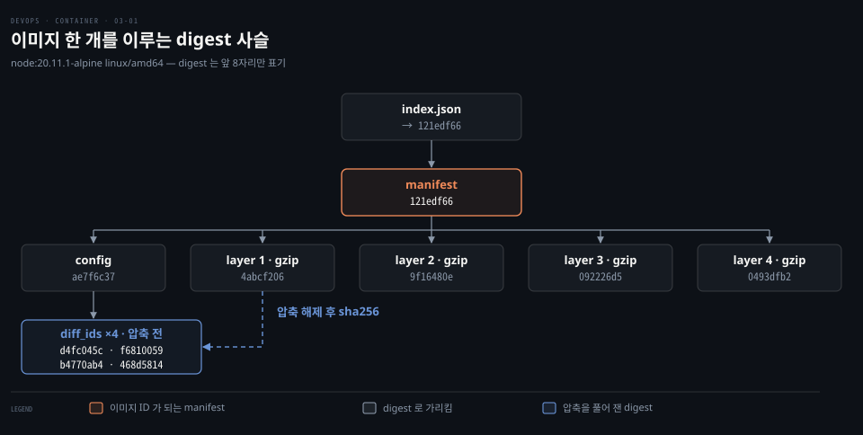

# 이미지 구조와 digest

---

> 컨테이너 이미지는 index·manifest·config·layer 네 조각이 digest(내용에 sha256 해시를 적용한 값)로 이어진 구조입니다. 이미지 ID 는 저장 방식(store)마다 다른 조각의 digest 이며, 같은 이미지인지는 config digest 로 가립니다.

## 학습 목표와 범위

> 이 편을 읽고 나면 이미지 한 개를 tar 로 열어 조각마다 digest 를 확인할 수 있습니다. 이미지 ID 가 달라 보일 때 같은 이미지인지도 가릴 수 있습니다.

1. 이미지를 이루는 index·manifest·config·layer 가 digest 로 이어지는 방식을 tar 안의 해시로 설명할 수 있습니다.
2. `--platform` 이 index 에서 manifest 를 고르는 일임을 설명할 수 있습니다. `docker save` 가 오류를 내는 조건도 예측할 수 있습니다.
3. containerd store 와 classic store 가 이미지 ID 로 쓰는 digest 가 다른 이유를 설명할 수 있습니다.
4. manifest digest 가 바뀌는 조건과 config digest 가 유지되는 조건을 구분할 수 있습니다. 같은 이미지 판정에 쓸 digest 도 고를 수 있습니다.

레지스트리 로그인·HTTP 레지스트리 설정·프록시와 오프라인 반입 절차는 [03-03 레지스트리 통신과 오프라인 반입](03-03.레지스트리%20통신과%20오프라인%20반입.md) 이 맡습니다. 이 편은 이미지 한 개의 안쪽 구조만 다룹니다.


## 1. 머신마다 다른 이미지 ID

> 같은 이미지가 store 와 가져온 경로에 따라 서로 다른 이미지 ID 를 받습니다. 이름이나 ID 로는 같은 이미지인지 가릴 수 없으므로 ID 가 어떤 digest 인지부터 알아야 합니다.

맥에서 받은 `busybox:1.36` 과 서버에 load 한 같은 이미지의 ID 가 서로 달랐습니다. 같은 이미지인지 확신할 수 없었습니다. 이미지 ID 는 `docker image ls` 의 IMAGE ID 열에 보이는 값입니다.

| 환경 | 이미지를 얻은 방법 | 이미지 ID (앞 12자리) |
|---|---|---|
| 맥, containerd store | `docker pull --platform linux/amd64 busybox:1.36` | `73aaf090f3d8` |
| 맥, containerd store | 같은 amd64 이미지를 manifest digest 로 pull | `b7f3d86d6e84` |
| docker 27.3.1 서버, classic store | 맥에서 save 한 같은 이미지를 load | `b116e1550744` |

맥의 두 행은 이번 편에서 다시 잰 값입니다. 서버 행은 같은 날 다른 세션이 잰 값이며 이 편에서는 다시 재지 않았습니다.

store 는 docker 가 이미지를 저장하는 방식입니다. containerd store 는 containerd 의 content store 에 이미지를 둡니다. classic store 는 docker 가 `/var/lib/docker` 에 직접 두는 기존 방식입니다.

세 값은 모두 같은 amd64 이미지를 가리키지만 각각 다른 파일의 digest 입니다. 이 사실을 모르면 ID 가 다르니 다른 이미지라는 틀린 결론을 내립니다.

반대 방향의 함정도 있습니다. 이름과 태그(`busybox:1.36`)는 레지스트리가 언제든 다른 이미지로 옮길 수 있는 별명입니다. 이름이 같다는 사실은 같은 이미지라는 근거가 못 됩니다. 태그가 무엇을 가리키고 언제 옮겨 가는지는 §4 [태그는 digest 를 가리키는 포인터](#태그는-digest-를-가리키는-포인터) 에서 봅니다.

머신 사이에서 같은 이미지를 가리려면 이름도 ID 도 아닌, 이미지를 이루는 조각의 digest 를 비교해야 합니다. 어떤 조각이 어떤 digest 를 갖는지는 아래에서 tar 를 열어 확인합니다.


## 2. 이미지를 이루는 네 조각

> 이미지는 index(선택), manifest, config, layer 네 종류의 파일이고, 부모가 자식을 digest 로 가리켜 사슬처럼 이어집니다. 파일 이름이 곧 내용의 sha256 이므로 한 바이트만 달라져도 위쪽 digest 가 모두 바뀝니다.

같은 이미지에 digest 가 여럿 붙는 까닭은 이미지가 파일 여러 개로 나뉘어 서로를 digest 로 가리키기 때문입니다. digest 는 `알고리즘:값` 꼴의 문자열입니다. `sha256` 은 모든 구현이 검증을 지원해야 하는 알고리즘이고 `sha512` 는 등록돼 있지만 지원이 선택입니다.[^digest-algo] 이 편의 digest 는 모두 `sha256:` 뒤에 64자리 16진수가 붙는 꼴이며 앞 8자리만 적습니다. 내용으로 이름을 정하고 그 이름으로 찾는 방식을 content addressing(내용 주소 지정)이라 부릅니다.[^descriptor]

아래 도식은 `node:20.11.1-alpine` 의 linux/amd64 이미지를 `docker save` 한 tar 안에서 조각이 이어지는 모양입니다. tar 안에는 `index.json` 한 개와 manifest·config·layer 가 `blobs/sha256/` 아래 파일로 들어 있습니다.



맨 위 `index.json` 이 manifest(`121edf66`)를 가리킵니다. manifest 는 config(`ae7f6c37`)와 layer 넷을 가리킵니다. 주황 테두리인 manifest 의 digest 는 containerd store 가 이 이미지의 ID 로 쓰는 값입니다. 점선은 layer 1 의 압축을 풀어 해시하면 config 의 `diff_ids` 첫 값 `d4fc045c` 가 나온다는 뜻입니다.

공개 이미지로 같은 tar 를 만듭니다. 먼저 amd64 manifest 를 digest 로 받아 이름이 아닌 digest 로 save 합니다.

```bash
# node:20.11.1-alpine 의 linux/amd64 manifest digest 입니다.
d=sha256:121edf6661770d20483818426b32042da33323b6fd30fc1ad4cd6890a817e240

docker pull docker.io/library/node@$d

# 같은 이미지를 tar 로 내려받고 앞 21자만 잘라 파일 목록을 봅니다.
docker save --platform linux/amd64 docker.io/library/node@$d -o n.tar
tar -tf n.tar | cut -c1-21
```

```bash
# 결과 (OrbStack, containerd store)
blobs/
blobs/sha256/
blobs/sha256/0493dfb2
blobs/sha256/092226d5
blobs/sha256/121edf66
blobs/sha256/4abcf206
blobs/sha256/9f16480e
blobs/sha256/ae7f6c37
index.json
manifest.json
oci-layout
```

`blobs/sha256/` 아래 여섯 파일이 manifest 하나, config 하나, layer 넷입니다. blob 은 내용을 digest 로만 찾는 파일 한 덩어리를 부르는 말입니다.

### index: 플랫폼별 manifest 목록

index 는 플랫폼(OS 와 CPU 아키텍처 조합)마다 어떤 manifest 를 쓸지 적은 목록입니다. 레지스트리에서는 manifest list 라고도 부릅니다. tar 안에서는 `index.json` 입니다.[^index]

이 tar 의 `index.json` 은 manifest 한 개만 가리킵니다. `node:20.11.1-alpine` 의 레지스트리 index 는 플랫폼 여섯 개를 가리킵니다. 이 이미지는 manifest digest 로 받았으므로 그 manifest 한 개만 담겼습니다.

index 는 선택 항목입니다. 명세는 이미지를 내놓는 쪽에 index 를 선택(OPTIONAL)으로 두고 받는 쪽에 처리 준비를 권고합니다.[^index-optional] 그래서 플랫폼이 하나뿐인 이미지는 index 없이 manifest 가 맨 위에 올 수 있습니다. 반대로 tar 안의 `index.json` 은 image layout 이 반드시(MUST) 두라고 정한 파일입니다. 그래서 manifest 하나만 담겨도 늘 있습니다.[^layout]

```bash
# index.json 의 manifests 항목에서 mediaType 과 digest 앞부분만 뽑습니다.
tar -xOf n.tar index.json \
  | python3 -I -c "import json,sys;[print(m['mediaType'],m['digest'][:15]) for m in json.load(sys.stdin)['manifests']]"
```

```bash
# 결과 (OrbStack, containerd store)
application/vnd.docker.distribution.manifest.v2+json sha256:121edf66
```

mediaType 은 그 파일이 어떤 형식인지 적은 이름표입니다. 이 값은 Docker 형식의 manifest 라는 뜻입니다. `index.json` 에는 `annotations` 항목도 있어서, 이미지를 어느 레지스트리에서 받았는지 같은 출처 정보가 담깁니다.

### manifest: 이미지의 목차

manifest 는 이 플랫폼의 이미지가 config 하나와 layer 몇 개로 이루어졌다고 적은 목차입니다. 항목마다 mediaType·크기(바이트)·digest 가 있습니다.[^manifest]

```bash
# manifest 파일을 이름(digest)으로 꺼내 config 와 layer 의 digest·크기를 뽑습니다.
tar -xOf n.tar blobs/sha256/${d#sha256:} \
  | python3 -I -c "import json,sys;d=json.load(sys.stdin);print('config',d['config']['digest'][7:15],d['config']['size']);[print('layer',l['digest'][7:15],l['size']) for l in d['layers']]"
```

```bash
# 결과 (OrbStack, containerd store)
config ae7f6c37 7136
layer 4abcf206 3408729
layer 9f16480e 42186770
layer 092226d5 2341056
layer 0493dfb2 448
```

layer 크기를 더하면 47,937,003 바이트(약 47.9MB)입니다. manifest 파일 자체는 1,158 바이트입니다. 이 파일의 sha256 이 `121edf66` 입니다.

### config: 실행 설정과 diff_ids

config 는 컨테이너를 띄울 때 쓰는 설정을 담은 JSON 입니다. OS·아키텍처, 환경 변수, `Entrypoint`, `Cmd` 와 `rootfs.diff_ids` 가 들어 있습니다.[^config]

```bash
# config 파일에서 플랫폼, 시작 명령, diff_ids 앞 8자리를 뽑습니다.
c=ae7f6c370720be0fd4120606ee84f6170037f6c163b91522eea08cbe574d78ff
tar -xOf n.tar blobs/sha256/$c \
  | python3 -I -c "import json,sys;d=json.load(sys.stdin);print(d['os'],d['architecture']);print(d['config']['Entrypoint'],d['config']['Cmd']);print([x[7:15] for x in d['rootfs']['diff_ids']])"
```

```bash
# 결과 (OrbStack, containerd store)
linux amd64
['docker-entrypoint.sh'] ['node']
['d4fc045c', 'f6810059', 'b4770ab4', '468d5814']
```

`diff_ids` 는 layer 를 압축하기 전의 tar 에 sha256 을 적용한 값입니다. 그래서 layer 한 개가 digest 두 개를 가집니다. manifest 가 가리키는 압축 digest(`4abcf206`)와 config 가 적은 압축 전 digest(`d4fc045c`)는 서로 다른 값입니다.

### layer: 파일 변경분 blob

layer 는 파일시스템 변경분을 묶은 tar 입니다. 이 이미지에서는 gzip 으로 압축돼 있습니다. 파일 이름이 곧 그 파일의 sha256 인지, 압축을 풀면 `diff_ids` 값이 나오는지를 직접 확인합니다.

```bash
# tar 를 풀어 blobs/sha256 으로 들어가 파일 이름과 내용 해시의 앞 8자리를 맞댑니다. (맥 기준, 리눅스는 sha256sum)
mkdir x && tar -xf n.tar -C x
cd x/blobs/sha256
for f in *; do echo "${f:0:8} $(shasum -a 256 $f | cut -c1-8)"; done

# 마지막 layer 의 처음 두 바이트(gzip 표지)와, 압축을 풀어 잰 sha256 앞 8자리입니다.
head -c2 0493dfb2* | xxd -p
gzip -dc 0493dfb2* | shasum -a 256 | cut -c1-8
```

```bash
# 결과 (OrbStack, containerd store)
0493dfb2 0493dfb2
092226d5 092226d5
121edf66 121edf66
4abcf206 4abcf206
9f16480e 9f16480e
ae7f6c37 ae7f6c37
1f8b
468d5814
```

여섯 파일 모두 이름의 앞 8자리가 내용 해시와 같습니다. 마지막 layer 는 `1f8b`(gzip 표지)로 시작합니다. 압축을 풀면 `diff_ids` 의 네 번째 값 `468d5814` 가 나옵니다. layer 파일의 이름은 manifest 에 적힌 압축 digest 와 같습니다. 따라서 이 tar 의 layer 는 레지스트리에서 받은 압축 바이트 그대로입니다. layer 안에서 파일이 지워지거나 덮일 때 남는 표지는 [03-02 layer 변경분과 whiteout](03-02.layer%20변경분과%20whiteout.md) 에서 열어 봅니다.

### manifest.json: docker 의 옛 목차

tar 최상위에는 `manifest.json` 도 있습니다. 이 파일은 위의 OCI manifest 와 다른 형식으로, docker 가 `docker load` 때 읽는 옛 형식의 목차입니다.

```bash
# busybox 이미지를 이름으로 save 해서 최상위 manifest.json 을 봅니다. (RepoTags 가 채워집니다)
docker save --platform linux/amd64 busybox:1.36 -o p.tar
tar -xOf p.tar manifest.json
```

```bash
# 결과 (OrbStack, containerd store)
[{"Config":"blobs/sha256/b116e155074440ffd9e449559433feb4cd2341eb3554b1da1c638c976e56451d","RepoTags":["busybox:1.36"],"Layers":["blobs/sha256/034d6572bf287fa79604fee9be062f0683809ae3a3685bc7b0e17bd1c48c50e8"]}]
```

`Config` 는 config 파일, `Layers` 는 layer 파일을 가리킵니다. 이 목차의 `RepoTags` 덕분에 `docker load` 가 이미지 이름을 되살립니다. 이름이 아닌 digest 로 save 한 앞의 node tar 는 이 칸이 `null` 입니다.

tar 에는 이름을 싣는 자리가 하나 더 있습니다. 최상위 `oci-layout` 은 이 tar 가 OCI image layout 임을 알리는 표지로, layout 버전만 담습니다. 명세는 `index.json` 항목의 `org.opencontainers.image.ref.name` 주석을 태그 같은 이름의 자리로 듭니다.[^layout] 같은 `p.tar` 에서 두 값을 꺼냅니다. docker 는 여기에 `busybox:1.36` 의 태그 부분만 넣고, 전체 이름은 별도 주석 `io.containerd.image.name` 에 둡니다.

```bash
# oci-layout 파일 내용을 찍고, index.json 항목마다 ref.name 주석과 io.containerd.image.name 주석을 뽑습니다. (주석이 없는 항목은 None)
tar -xOf p.tar oci-layout; echo
tar -xOf p.tar index.json \
  | python3 -I -c "import json,sys;[print(m['digest'][7:15],m.get('annotations',{}).get('org.opencontainers.image.ref.name'),m.get('annotations',{}).get('io.containerd.image.name')) for m in json.load(sys.stdin)['manifests']]"
```

```bash
# 결과 (OrbStack, containerd store)
{"imageLayoutVersion":"1.0.0"}
b7f3d86d 1.36 docker.io/library/busybox:1.36
89ac9548 None None
```


## 3. 플랫폼 선택과 save

> 플랫폼은 index 에서 manifest 를 고르는 열쇠이고, 주지 않으면 daemon 의 플랫폼을 씁니다. 다른 플랫폼을 pull 해 두고 `--platform` 없이 save 하면 실패합니다.

### index 에서 manifest 고르기

`busybox:1.36` 의 index 는 항목이 17개입니다. 플랫폼 manifest 가 9개이고, 나머지 8개는 `unknown unknown` 으로 표시됩니다. 이 8개는 attestation manifest 이며 이미지에 딸린 부가 증명(구성 요소 목록 등)을 담습니다.

```bash
# 레지스트리에 있는 index 원문을 받아 항목마다 digest 앞 8자리와 플랫폼을 뽑습니다.
docker buildx imagetools inspect busybox:1.36 --raw \
  | python3 -I -c "import json,sys;[print(m['digest'][7:15],m['platform']['os'],m['platform']['architecture']) for m in json.load(sys.stdin)['manifests']]"
```

```bash
# 결과 (Docker Hub, 2026-11-23)
b7f3d86d linux amd64
89ac9548 unknown unknown
71b0cbca linux arm
f7af5586 unknown unknown
410cc112 linux arm
4feb116b linux arm
be18d95c unknown unknown
bd44eb13 linux arm64
f460228a unknown unknown
d5f45b39 linux 386
9be4ccb7 unknown unknown
3ed5c2b0 linux ppc64le
fa60eaf3 unknown unknown
64a79a5d linux riscv64
440cb5d7 unknown unknown
aa25235b linux s390x
2142d777 unknown unknown
```

`--platform linux/amd64` 는 이 목록에서 `b7f3d86d` 를, `linux/arm64` 는 `bd44eb13` 을 고르라는 지정입니다. 플랫폼을 주지 않으면 daemon 의 플랫폼으로 고릅니다. 이 맥의 daemon 은 aarch64 입니다. 플랫폼 없이 pull 한 `busybox:1.36` 은 `linux/arm64` 이미지였습니다.

위 목록에서 `linux arm` 이 세 줄인 것은 `platform.variant` 가 같은 CPU 계열 안의 변종을 가르기 때문입니다. `arm` 은 `v6`·`v7`, `arm64` 는 `v8` 같은 값을 씁니다.[^variant] 같은 index 에서 `variant` 가 든 항목만 뽑아 확인합니다.

```bash
# 위와 같은 index 에서 platform 에 variant 가 있는 항목만 뽑습니다.
docker buildx imagetools inspect busybox:1.36 --raw \
  | python3 -I -c "import json,sys;[print(m['digest'][7:15],m['platform']['architecture'],m['platform']['variant']) for m in json.load(sys.stdin)['manifests'] if 'variant' in m['platform']]"
```

```bash
# 결과 (Docker Hub, 2026-11-24)
71b0cbca arm v5
410cc112 arm v6
4feb116b arm v7
bd44eb13 arm64 v8
```

`v5` 는 명세 표(`arm` 은 `v6`·`v7`·`v8`)에 없는 값입니다. 표에 없는 값은 구현이 정하도록 두고 있습니다.[^variant] 조건에 맞는 항목이 여럿이면 명세는 첫 항목을 쓰라고 합니다(SHOULD). `variant` 를 따지지 않고 `linux/arm` 만 맞춘다면 세 항목이 맞고 그중 첫 항목은 `71b0cbca` 입니다. 실제 docker 가 이때 무엇을 고르는지는 재지 않았습니다.

### save 가 실패하는 조건

containerd store 는 pull 한 플랫폼의 manifest 와 layer 만 받아 둡니다. 그래서 amd64 로 pull 한 뒤 플랫폼 없이 save 하면 daemon 기본인 arm64 manifest 를 찾다가 실패합니다.

```bash
# 맥(aarch64 daemon)에서 amd64 로 pull 한 뒤 플랫폼 없이 save 합니다.
docker pull --platform linux/amd64 busybox:1.36
docker save busybox:1.36 -o nop.tar

# 같은 이미지를 플랫폼을 지정해 save 합니다.
docker save --platform linux/amd64 busybox:1.36 -o p.tar
```

```bash
# 결과 (OrbStack, containerd store)
Error response from daemon: unable to create manifests file: NotFound: content digest sha256:bd44eb136a95dcc8dc58995e43abc40a413f2e8e3d4a2aae6bccbe94686acb05: not found
```

오류가 가리킨 `bd44eb13` 이 위 목록의 `linux/arm64` 항목입니다. 두 번째 save 는 성공했습니다. 이 tar 의 index 에는 amd64 manifest 와 그 attestation manifest 가 함께 담깁니다.

```bash
# p.tar 의 index.json 항목마다 digest, 플랫폼, annotations 의 subject 를 뽑습니다.
tar -xOf p.tar index.json \
  | python3 -I -c "import json,sys;[print(m['digest'][7:15],m.get('platform'),m.get('annotations',{}).get('io.containerd.manifest.subject','sha256:-')[7:15]) for m in json.load(sys.stdin)['manifests']]"
```

```bash
# 결과 (OrbStack, containerd store)
b7f3d86d {'architecture': 'amd64', 'os': 'linux'} -
89ac9548 None b7f3d86d
```

`89ac9548` 은 `b7f3d86d` 를 subject 로 삼는 attestation manifest 입니다. layer 한 개에 in-toto 형식의 SPDX 문서(SBOM)가 들어 있습니다.

### 오류가 나지 않는 경우

daemon 이 고르는 플랫폼과 받아 둔 플랫폼이 같으면 오류가 나지 않습니다. 맥에서 `busybox:1.36` 을 플랫폼 없이 pull 하면 arm64 가 받아져 `--platform` 없는 save 가 성공합니다. manifest digest 로 받은 이미지(위 node 사본)도 플랫폼 없이 save 가 성공했습니다.

서버가 amd64 라면 맥에서 pull 과 save 모두에 `--platform linux/amd64` 를 줍니다. pull 에만 주면 save 가 실패합니다. 둘 다 빼면 arm64 이미지가 서버로 갑니다.


## 4. 이미지 ID 와 digest 비교

> manifest digest 는 포장이 바뀌면 달라지지만 config digest 는 내용이 같으면 유지됩니다. 그래서 같은 이미지 판정에는 config digest 를 씁니다.

### store 별 이미지 ID

두 store 는 이미지 ID 로 쓰는 값이 서로 다릅니다.

| | containerd store | classic store |
|---|---|---|
| 이미지 ID | 가져온 최상위 digest (index 를 거쳤으면 index, 아니면 manifest) | config digest |
| 이번 측정 | 태그로 pull: index `73aaf090`, manifest digest 로 pull: manifest `b7f3d86d` | `b116e155` |
| 같은 이미지가 pull 경로로 바뀌나 | 바뀜 | 안 바뀜 |

classic store 행의 `b116e155` 는 서버에서 잰 값입니다. 이 값이 config digest 라는 근거는 맥에서 잰 tar 입니다. 위 `manifest.json` 의 `Config` 가 `b116e155…` 였습니다.

containerd store 가 index 를 거치면 ID 가 바뀌는 것은 §1 의 첫 두 행이 보였습니다. 같은 amd64 이미지가 태그로 받으면 `73aaf090`, manifest digest 로 받으면 `b7f3d86d` 입니다. 두 이미지의 config 는 같으므로 classic store 라면 둘 다 `b116e155` 가 됩니다.

OCI 명세도 이미지 ID 를 정의합니다. ImageID 는 config JSON 의 SHA256 입니다.[^imageid] 두 store 가운데 이 정의와 같은 값을 쓰는 쪽은 classic store 입니다. 위 `manifest.json` 의 `Config` 파일은 이름이 `b116e155…` 이고 그 파일을 직접 해시해도 `b116e155` 가 나왔습니다. containerd store 의 ID 는 config 가 아니라 가져온 최상위 digest 라서 정의와 다릅니다.

태그로 받을 때와 manifest digest 로 받을 때는 레지스트리가 처음 돌려주는 파일이 다릅니다. 태그는 index 를 받아 거기서 플랫폼 manifest 를 고르고 manifest digest 는 그 manifest 를 바로 받습니다. 레지스트리 요청 자체는 [03-03 레지스트리 통신과 오프라인 반입](03-03.레지스트리%20통신과%20오프라인%20반입.md) 이 맡고 여기서는 받은 첫 파일의 형식만 비교합니다. 그래서 containerd store 의 ID 는 index 면 `73aaf090`, manifest 면 `b7f3d86d` 입니다.

```bash
# 태그와 manifest digest 로 받은 첫 파일의 mediaType, manifests 항목 수, layers 수를 뽑습니다.
m=sha256:b7f3d86d6e84fc17718c48bcde1450807faa2d56704205c697b4bd5df7b9e29f
for r in busybox:1.36 busybox@$m; do
  docker buildx imagetools inspect $r --raw \
    | python3 -I -c "import json,sys;d=json.load(sys.stdin);print(d['mediaType'],len(d.get('manifests',[])),len(d.get('layers',[])))"
done
```

```bash
# 결과 (Docker Hub, 2026-11-24)
application/vnd.oci.image.index.v1+json 17 0
application/vnd.oci.image.manifest.v1+json 0 1
```

태그는 항목 17개의 index 를, manifest digest 는 layer 한 개짜리 manifest 를 받습니다.

### manifest digest 가 바뀌는 경우

manifest 파일의 바이트가 하나라도 달라지면 digest 가 달라집니다. 압축 방식이나 mediaType 이 바뀌는 레지스트리 이동·변환이 이 조건을 만듭니다. 두 경우를 계산으로 확인합니다. 이 계산은 실제 레지스트리의 변환을 재현한 것이 아니라 원리를 보이는 실험입니다.

```bash
# x/blobs/sha256 안에서 manifest 의 최상위 mediaType 문자열 하나만 OCI 값으로 바꾼 사본의 digest 를 잽니다.
sed 's#application/vnd.docker.distribution.manifest.v2+json#application/vnd.oci.image.manifest.v1+json#' \
  121edf6661770d20483818426b32042da33323b6fd30fc1ad4cd6890a817e240 \
  | shasum -a 256 | cut -c1-8

# layer 1 을 풀어 gzip 압축 수준 1 과 9 로 다시 압축한 digest, 그리고 풀어서 잰 digest 입니다.
for lv in 1 9; do gzip -dc 4abcf206* | gzip -$lv -n | shasum -a 256 | cut -c1-8; done
gzip -dc 4abcf206* | shasum -a 256 | cut -c1-8
```

```bash
# 결과 (macOS gzip, 2026-11-23)
4627ae0e
78185bfc
df094251
d4fc045c
```

| 바뀐 것 | manifest digest | config digest |
|---|---|---|
| mediaType 문자열 하나 | `121edf66` → `4627ae0e` | `ae7f6c37` 그대로 |
| layer 1 을 다시 압축 | layer digest `4abcf206` → `78185bfc`(수준 1) · `df094251`(수준 9), manifest 도 따라서 바뀜 | 풀어 잰 값이 `d4fc045c` 로 같아 `diff_ids` 도 그대로이므로 `ae7f6c37` 그대로 |

mediaType 을 바꾼 사본의 manifest 는 config 를 `ae7f6c37…` 로 계속 가리킵니다. config 파일은 건드리지 않았기 때문입니다.

layer 를 다시 압축하면 압축 digest 가 달라져 manifest 가 바뀝니다. config 에는 압축 전 digest 만 적혀 있어 그대로입니다. 이것이 `diff_ids` 를 압축 전 값으로 따로 둔 까닭입니다.

### 태그는 digest 를 가리키는 포인터

태그는 레지스트리 안에서 이름을 manifest digest 에 잇는 표의 한 칸입니다. 포인터(pointer)는 값을 담지 않고 값이 있는 곳을 가리키는 칸을 말합니다. 같은 태그로 다른 이미지를 push 하면 그 칸의 digest 만 바뀝니다.[^harbor-imm] 옛 이미지는 지워지지 않고, 태그를 하나도 못 가진 채 남습니다.

| 태그 | push 전 digest | push 후 digest |
|---|---|---|
| `app:20261120-0900` | `aaaa1111` | `aaaa1111` |
| `app:20261123-1000` | 없음 | `bbbb2222` |
| `app:latest` | `aaaa1111` | `bbbb2222` |

위 표는 CI 가 새 이미지를 날짜 태그와 `latest` 두 이름으로 push 한 경우입니다. digest 는 예시 값입니다. `latest` 칸이 `bbbb2222` 로 옮겨 간 것은 push 명령에 그 이름이 있었기 때문입니다. `latest` 를 빼고 push 했다면 그 칸은 `aaaa1111` 에 남습니다.

`latest` 는 태그를 생략했을 때 docker CLI 가 채우는 기본 이름입니다.[^cli-default] `docker pull debian` 은 `debian:latest` 를 받습니다. OCI distribution-spec 에서 `latest` 는 예시 문장에만 나오고 특별 규칙이 없습니다.[^tags-list] 그래서 레지스트리가 가장 최근 push 에 `latest` 를 자동으로 붙이거나 옮기지 않습니다. 대개 `latest` 가 최신으로 보이는 이유는 사람이나 CI 가 `:latest` 로도 push 하기 때문입니다.

레지스트리는 push 순서도 알려 주지 않습니다. 태그 목록 API(`GET /v2/<name>/tags/list`)의 응답 본문은 `name` 과 `tags` 배열뿐입니다. 목록은 이름의 사전순으로 정렬됩니다.[^tags-list] 가장 최근 이미지는 사람이 이름 규칙으로 정해야 합니다. 날짜가 든 태그(`YYYYMMDD-HHMMSS`)는 사전순과 시간순이 같아서 이 규칙에 맞습니다.

사내 반입 작업이 이 방식을 썼습니다. `latest` 를 믿지 않고 날짜 태그를 `sort | tail -1` 로 골랐습니다. 그 태그와 `latest` 가 같은 이미지인지는 같은 머신에서 이미지 ID 로 비교했고, 배포(helm 값)에는 날짜 태그를 적었습니다.

같은 태그의 덮어쓰기는 Harbor 에서 막을 수 있습니다. 태그 불변(Tag Immutability)은 규칙에 걸린 태그를 다시 push 하지 못하게 막는 프로젝트 설정입니다. 규칙을 켜면 이미 있는 태그와 같은 이름의 push 가 거부됩니다.[^harbor-imm] GC(garbage collection)는 어디서도 가리키지 않는 데이터를 치우는 청소 작업입니다. Harbor 는 옵션을 켜 두면 GC 때 태그 없는 이미지도 지웁니다.[^harbor-gc]

로컬에서 `docker load` 가 같은 태그를 새 이미지로 옮기는 동작은 [03-03 받는 쪽 도구 비교](03-03.레지스트리%20통신과%20오프라인%20반입.md#받는-쪽-도구-비교) 에서 확인합니다.

### 같은 이미지 판정 기준

| 알고 싶은 것 | 비교할 값 | 이유 |
|---|---|---|
| 실행 설정과 파일시스템이 같은가 | config digest | 압축·mediaType·index 포장이 달라도 유지됩니다 |
| 레지스트리가 내려 주는 바이트까지 같은가 | manifest digest | 압축 layer digest 와 mediaType 이 manifest 안에 있습니다 |
| 플랫폼 목록까지 같은 묶음인가 | index digest | 항목 하나만 바뀌어도 달라집니다 |
| 같은 머신 안에서 이미지를 가리킬 때 | 이미지 ID | store 사이에서는 비교할 수 없습니다 |

두 머신의 이미지를 맞대는 일이 목적이면 config digest 를 봅니다. 도구가 config 를 다시 써서 `history` 같은 항목이 바뀌면 config digest 도 달라질 수 있습니다. 이 경우는 재지 않았습니다.


## 5. 한계와 다루지 않은 것

> 이 편은 레지스트리에서 받은 이미지 한 개의 안쪽만 tar 로 열어 봤습니다. 이미지를 만드는 쪽과 믿을 수 있는지 검증하는 쪽은 범위 밖입니다.

멀티 플랫폼 빌드는 index 를 직접 만드는 일이라 따로 다룹니다. [README](../README.md) 의 예정 편 `01-05` 가 맡습니다.

서명과 attestation 도 다루지 않습니다. §3 에서 attestation manifest 가 index 에 들어 있음을 보았습니다. SBOM 내용을 읽거나 서명을 검증하지는 않았습니다.

레지스트리와 통신하는 방법은 [03-03 레지스트리 통신과 오프라인 반입](03-03.레지스트리%20통신과%20오프라인%20반입.md) 에서 다룹니다.

노드가 이 이미지를 번들로 풀어 runc 로 실행하는 다음 단계(OCI 런타임 명세)는 [Production Kubernetes 3장 노트](../../../../08_cloud/book/production-kubernetes/03-01.Container%20Runtime%20—%20OCI%20명세·CRI%20통신과%20런타임%20선택.md#oci-런타임-명세와-runc) 에서 다룹니다.

OCI 런타임이 번들을 실행한 뒤의 상태 변화는 [번들과 컨테이너 생애 주기](03-04.%EB%B2%88%EB%93%A4%EA%B3%BC%20%EC%BB%A8%ED%85%8C%EC%9D%B4%EB%84%88%20%EC%83%9D%EC%95%A0%20%EC%A3%BC%EA%B8%B0.md)에서 다룹니다.

재지 않은 값이 셋 있습니다.

- classic store 의 `docker save` 가 layer 를 압축해서 담는지 풀어서 담는지는 재지 않았습니다.
- docker 27.3.1 서버의 이미지 ID `b116e155` 는 같은 날 다른 세션이 잰 값입니다.
- 이 tar 를 서버에서 `docker load` 할 때 attestation manifest 가 어떻게 처리되는지는 재지 않았습니다.


## 6. 관련 실습

> 이 편은 별도 실습 코드를 두지 않고 본문의 명령을 그대로 실습으로 씁니다.

본문의 명령은 공개 이미지(`node:20.11.1-alpine`, `busybox:1.36`)만 씁니다. 실행 환경은 macOS arm64 와 OrbStack 2.2.5 입니다. docker 는 29.8.2(containerd image store)입니다. 처음 실측은 2026-11-23 에 돌렸고, 보강한 명령은 2026-11-24 에 돌렸습니다.[^storage]

시험 파일은 비운 폴더에서 만들고, 끝나면 `docker rmi busybox:1.36` 처럼 이름을 적어 지웁니다.


## 7. 검증과 복습

> Phase 4 자답과 회차별 복습은 본문에 누적하지 않고 `_review/` 에 남깁니다.

- **Phase 4 결과**: 이 편의 자답 기록은 아직 없습니다.
- **다음 보완점**: classic store 에서 `docker save` 한 tar 의 layer 압축 여부를 직접 재서 §4 에 넣습니다.


## 면접 질문

> 여섯 질문에 먼저 스스로 답해 보세요. 자답이 끝나면 아래 정답 절로 내려갑니다.

1. 맥에서 받은 이미지와 서버에 load 한 같은 이미지의 이미지 ID 가 다릅니다. 두 값은 각각 무엇의 digest 이고, 왜 다릅니까?
2. 이미지를 이루는 index·manifest·config·layer 가 어떤 순서로 digest 를 가리키며, 파일 이름이 sha256 이면 무엇이 보장됩니까?
3. amd64 로 pull 한 이미지를 `--platform` 없이 `docker save` 하면 실패하는 이유는 무엇입니까?
4. layer 를 다시 압축하면 manifest digest 가 바뀌는데 config digest 는 왜 그대로입니까?
5. 두 머신의 이미지가 같은 이미지인지 가리려면 어떤 digest 를 비교해야 하고, 그 값도 바뀔 수 있는 경우는 언제입니까?
6. `latest` 태그는 가장 최근에 push 한 이미지를 가리킵니까? 가장 최근 이미지는 어떻게 고릅니까?


## 정답 (자답 후 펼치기)

> 위 면접 질문 여섯 개에 먼저 자답한 뒤 아래를 읽으세요.

### 정답 1 — store 별 이미지 ID

containerd store 의 이미지 ID 는 가져온 최상위 digest 입니다. 이번 측정에서는 index digest(`73aaf090`)였습니다. classic store 의 이미지 ID 는 config digest(`b116e155`)입니다. 두 store 가 ID 로 고르는 조각이 달라서 같은 이미지도 값이 다르게 보입니다.

### 정답 2 — digest 사슬과 내용 보장

index 가 manifest 를, manifest 가 config 와 layer 를 digest 로 가리킵니다. 파일 이름이 내용의 sha256 이므로 한 바이트만 달라도 그 파일의 digest 가 바뀝니다. 그 digest 를 적은 부모 파일도 따라서 바뀝니다. 그래서 최상위 digest 하나가 이미지 전체의 내용을 보증합니다.

### 정답 3 — 플랫폼 없는 save 실패

플랫폼을 주지 않으면 save 는 daemon 의 플랫폼을 고릅니다. 맥 daemon 은 aarch64 라 arm64 manifest 를 찾습니다. amd64 로 pull 했으므로 그 manifest 는 받아 둔 적이 없습니다. 그래서 `content digest sha256:bd44eb13…: not found` 가 납니다. `--platform linux/amd64` 를 주면 고른 플랫폼 것만 담겨 성공합니다.

### 정답 4 — 압축 전 digest 를 따로 두는 이유

manifest 는 압축된 layer 의 digest 를 적고, config 는 압축 전 tar 의 digest(`diff_ids`)를 적습니다. 다시 압축하면 압축 digest 는 달라지지만 풀어서 얻는 내용은 같습니다. 그래서 manifest 는 바뀌고 config 는 그대로입니다.

### 정답 5 — 같은 이미지 판정 기준

실행 설정과 파일시스템이 같은지 보려면 config digest 를 비교합니다. 압축 방식·mediaType·index 포장이 바뀌어도 유지되기 때문입니다. 다만 도구가 config 를 다시 써서 항목이 바뀌면 이 값도 달라질 수 있습니다. 이 경우는 이 편에서 재지 않았습니다.

### 정답 6 — latest 는 기본 이름일 뿐

아닙니다. `latest` 는 태그를 생략했을 때 docker CLI 가 채우는 기본 이름이고, 레지스트리가 최근 push 에 자동으로 붙이지 않습니다. 사람이나 CI 가 `:latest` 로도 push 해야 그 칸이 새 이미지로 옮겨 갑니다. 태그 목록 API 는 이름의 사전순 목록만 주고 push 순서를 알려 주지 않으므로, 가장 최근 이미지는 `YYYYMMDD-HHMMSS` 같은 날짜 태그를 정렬해 고릅니다.


## 참고 자료

[^descriptor]: OCI Image Spec v1.1.1, descriptor (2026-11-24 확인) — digest 는 `algorithm:encoded` 꼴이고 내용 주소 지정에 쓰입니다. <https://github.com/opencontainers/image-spec/blob/v1.1.1/descriptor.md>
[^index]: OCI Image Spec v1.1.1, image index (2026-11-24 확인) — 플랫폼별 manifest 를 가리키는 최상위 목록입니다. <https://github.com/opencontainers/image-spec/blob/v1.1.1/image-index.md>
[^manifest]: OCI Image Spec v1.1.1, image manifest (2026-11-24 확인) — config 와 layer 를 descriptor 로 가리킵니다. <https://github.com/opencontainers/image-spec/blob/v1.1.1/manifest.md>
[^config]: OCI Image Spec v1.1.1, image config (2026-11-24 확인) — `rootfs.diff_ids` 는 압축 전 layer 의 digest 목록입니다. <https://github.com/opencontainers/image-spec/blob/v1.1.1/config.md>
[^storage]: Docker Docs, containerd image store (2026-11-23 확인). <https://docs.docker.com/engine/storage/containerd/>
[^cli-default]: Docker Docs, docker image pull (2026-11-23 확인) — "If no tag is provided, Docker Engine uses the :latest tag as a default." <https://docs.docker.com/reference/cli/docker/image/pull/>
[^tags-list]: OCI distribution-spec v1.1.0, Listing Tags (2026-11-23 확인) — "If the list is not empty, the tags MUST be in lexical order (i.e. case-insensitive alphanumeric order)." 응답 본문 형식은 `name` 과 `tags` 입니다. <https://github.com/opencontainers/distribution-spec/blob/v1.1.0/spec.md>
[^harbor-imm]: Harbor 2.13.0 Docs, Tag Immutability Rules (2026-11-23 확인) — "This causes the tag to migrate across the artifacts and every artifact that has its tag taken away becomes tagless." <https://goharbor.io/docs/2.13.0/working-with-projects/working-with-images/create-tag-immutability-rules/>
[^harbor-gc]: Harbor 2.13.0 Docs, Garbage Collection (2026-11-23 확인) — "Harbor will delete untagged artifacts and then perform garbage collection on them." (옵션을 켠 경우) <https://goharbor.io/docs/2.13.0/administration/garbage-collection/>
[^digest-algo]: OCI Image Spec v1.1.1, descriptor Digests (2026-11-24 확인) — "Implementations MUST implement SHA-256 digest verification for use in descriptors." SHA-512 는 "Implementations MAY implement SHA-512 digest verification for use in descriptors." <https://github.com/opencontainers/image-spec/blob/v1.1.1/descriptor.md#digests>
[^index-optional]: OCI Image Spec v1.1.1, image index (2026-11-24 확인) — "While the use of an image index is OPTIONAL for image providers, image consumers SHOULD be prepared to process them." <https://github.com/opencontainers/image-spec/blob/v1.1.1/image-index.md>
[^layout]: OCI Image Spec v1.1.1, image layout (2026-11-24 확인) — `oci-layout` 과 `index.json` 은 둘 다 "It MUST exist" 로 정해진 파일이고, `oci-layout` 은 "a marker for the base of an Open Container Image Layout and to provide the version of the image-layout in use" 입니다. `ref.name` 주석의 흔한 쓰임으로 컨테이너 이미지의 "tag" 표현을 드는 것은 같은 문서의 Implementor's Note 입니다. <https://github.com/opencontainers/image-spec/blob/v1.1.1/image-layout.md>
[^variant]: OCI Image Spec v1.1.1, image index (2026-11-24 확인) — "If multiple manifests match a client or runtime's requirements, the first matching entry SHOULD be used." 표에 없는 variant 는 "values are implementation-defined" 입니다. <https://github.com/opencontainers/image-spec/blob/v1.1.1/image-index.md#platform-variants>
[^imageid]: OCI Image Spec v1.1.1, image config (2026-11-24 확인) — "Each image's ID is given by the SHA256 hash of its configuration JSON." <https://github.com/opencontainers/image-spec/blob/v1.1.1/config.md#imageid>

- [03-02 layer 변경분과 whiteout](03-02.layer%20변경분과%20whiteout.md) — layer 안의 변경분과 삭제 표지를 tar 로 엽니다
- [03-03 레지스트리 통신과 오프라인 반입](03-03.레지스트리%20통신과%20오프라인%20반입.md) — 이 편에서 만든 tar 를 레지스트리로 옮기는 절차입니다
- [01-03 이미지 빌더 종류와 선택](01-03.이미지%20빌더%20종류와%20선택.md) — 이미지를 만드는 쪽의 선택 기준입니다
