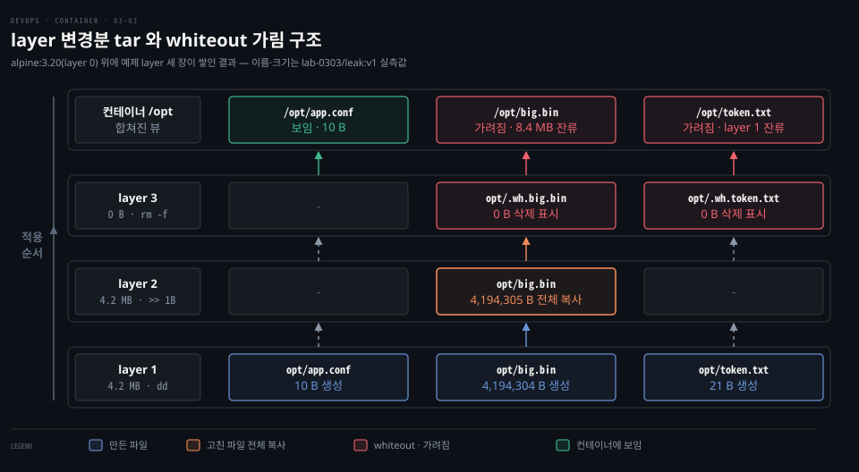

# layer 변경분과 whiteout

---

> 컨테이너 이미지의 각 layer 는 앞 상태와의 변경분(changeset)을 담은 tar 아카이브입니다. 앞 `RUN` 에서 만든 파일을 뒤 `RUN` 에서 지워도 지운 표시(`.wh.`)만 새 layer 에 얹히므로 크기와 파일 내용이 그대로 남습니다.

## 학습 목표와 범위

> 이 편을 읽고 나면 Dockerfile 에서 지운 파일이 이미지에 남아 있는지 tar 로 확인할 수 있습니다. 남지 않도록 빌드하는 방법도 고를 수 있습니다.

1. 앞 `RUN` 에서 만든 파일을 뒤 `RUN` 에서 지워도 이미지 크기가 줄지 않는 이유를 changeset tar 와 whiteout 으로 설명할 수 있습니다.
2. `docker save` 로 만든 tar 안에서 특정 layer 를 열어 수정된 파일 크기와 `.wh.<이름>` 삭제 표시를 직접 확인할 수 있습니다.
3. config 의 `history` 항목 수와 `rootfs.diff_ids` 수가 다른 이유를 `empty_layer` 로 가리고 `docker history` 와 맞댈 수 있습니다.
4. 임시 파일과 가짜 비밀 값이 최종 이미지에 남지 않도록 단일 `RUN` 정리와 multi-stage 빌드를 적용할 수 있습니다.
5. `rootfs.diff_ids` 로 누적 레이어 식별자 `ChainID` 를 `sha256sum` 으로 직접 계산할 수 있습니다.

이미지 전체의 digest 사슬과 `docker save` 기본 구조는 [03-01 이미지 구조와 digest](03-01.이미지%20구조와%20digest.md) 가 맡습니다. 이 편은 layer 내부와 `history`·`ChainID` 만 다룹니다.


## 1. 지웠는데 남아 있는 파일

> 앞 `RUN` 에서 만든 파일을 뒤 `RUN` 에서 지우면 컨테이너 안에서는 보이지 않습니다. 하지만 이미지 크기는 줄지 않고 `docker save` tar 의 앞 layer 에서 파일 내용까지 그대로 꺼내집니다.

빌드 중 내려받은 설치 파일이나 임시 인증 파일을 다음 `RUN` 에서 `rm` 으로 지웠는데도 이미지 용량이 줄지 않는 일이 잦습니다. 컨테이너를 띄워 `ls` 로 보면 파일이 없지만 이미지 안에는 여전히 들어 있습니다.

이 문제를 직접 재현하려고 작은 `Dockerfile` 을 만듭니다. 첫 `RUN` 은 임시 파일(`/opt/big.bin` 4MiB), 가짜 비밀 값(`/opt/token.txt`), 설정(`/opt/app.conf`)을 만듭니다. 둘째 `RUN` 은 `/opt/big.bin` 끝에 1바이트를 붙이고 셋째 `RUN` 은 앞의 두 파일을 지웁니다.

```bash
# 빈 작업 폴더에서 재현용 Dockerfile 을 작성합니다
cat <<'EOF' > Dockerfile
FROM alpine:3.20
ENV APP_MODE=prod
RUN mkdir -p /opt \
    && dd if=/dev/urandom of=/opt/big.bin bs=1M count=4 status=none \
    && printf 'example-not-a-secret\n' > /opt/token.txt \
    && printf 'mode=prod\n' > /opt/app.conf
RUN printf '1' >> /opt/big.bin
RUN rm -f /opt/big.bin /opt/token.txt
CMD ["sh"]
EOF

# 이미지를 빌드하고 컨테이너 안의 /opt 목록을 확인합니다
docker build --no-cache -t lab-0303/leak:v1 .
docker run --rm lab-0303/leak:v1 ls -la /opt
```

```bash
# 결과 (OrbStack 2.2.5, docker 29.8.2)
total 4
drwxr-xr-x    1 root     root            32 Nov 23 14:05 .
drwxr-xr-x    1 root     root            12 Nov 23 14:05 ..
-rw-r--r--    1 root     root            10 Nov 23 14:05 app.conf
```

컨테이너 안 `/opt` 에는 `app.conf` 한 개만 보입니다. `big.bin` 과 `token.txt` 는 실행 중인 파일시스템에서 사라진 것처럼 보입니다.

이제 이미지 전체 크기와 단계별 이력을 확인합니다. `docker history` 의 `SIZE` 는 풀어 놓은 크기이고 `CONTENT SIZE` 는 압축한 layer 파일 크기의 합입니다.

```bash
# 이미지 전체 크기와 layer 별 이력을 조회합니다
docker image ls lab-0303/leak:v1
docker history lab-0303/leak:v1
```

```bash
# 결과 (OrbStack 2.2.5, docker 29.8.2)
IMAGE              ID             DISK USAGE   CONTENT SIZE   EXTRA
lab-0303/leak:v1   40c304083609       31.3MB         12.5MB

IMAGE          CREATED        CREATED BY                                      SIZE      COMMENT
40c304083609   1 second ago   CMD ["sh"]                                      0B        buildkit.dockerfile.v0
<missing>      1 second ago   RUN /bin/sh -c rm -f /opt/big.bin /opt/token…   0B        buildkit.dockerfile.v0
<missing>      1 second ago   RUN /bin/sh -c printf '1' >> /opt/big.bin # …   4.2MB     buildkit.dockerfile.v0
<missing>      1 second ago   RUN /bin/sh -c mkdir -p /opt     && dd if=/d…   4.2MB     buildkit.dockerfile.v0
<missing>      1 second ago   ENV APP_MODE=prod                               0B        buildkit.dockerfile.v0
<missing>      7 months ago   CMD ["/bin/sh"]                                 0B        buildkit.dockerfile.v0
<missing>      7 months ago   ADD alpine-minirootfs-3.20.10-aarch64.tar.gz…   10.5MB    buildkit.dockerfile.v0
```

`CONTENT SIZE` 가 `12.5MB` 로 남아 있습니다. `big.bin` 을 만든 줄(`4.2MB`)뿐 아니라 1바이트만 붙인 줄도 `4.2MB` 를 차지했습니다. `rm -f` 줄은 `0B` 만 더했을 뿐 앞의 `8.4MB` 를 지우지 못했습니다. `4.1MB` 는 바닥인 `alpine:3.20` layer 를 압축한 크기이므로, 2절에서 layer 파일을 직접 재어 이 합을 맞춰 봅니다.

`docker save` 로 이미지를 tar 로 내보낸 뒤 앞 layer 에서 `/opt/token.txt` 를 직접 꺼내 봅니다. 실행할 때마다 빌드 시각, digest 해시, `/dev/urandom` 을 압축한 끝 바이트 수는 달라집니다.

```bash
# 이미지를 tar 로 저장하고 풀어서 첫 번째 RUN layer(인덱스 1)에서 token.txt 를 읽습니다
docker save lab-0303/leak:v1 -o leak.tar
mkdir -p unpacked
tar -xf leak.tar -C unpacked

# manifest.json 의 Layers[1] 경로를 뽑아 tar -xOf 로 표준 출력에 찍습니다
L1=$(jq -r '.[0].Layers[1]' unpacked/manifest.json)
tar -xOf "unpacked/$L1" opt/token.txt
```

```bash
# 결과 (OrbStack 2.2.5, docker 29.8.2)
example-not-a-secret
```

컨테이너에서 지운 줄 알았던 가짜 비밀 값 `example-not-a-secret` 이 그대로 출력되었습니다. 이미지 tar 를 가진 사람은 누구나 앞 layer 를 열어 지워진 파일을 읽을 수 있습니다.


## 2. layer 는 변경분 tar

> OCI 이미지의 layer 하나는 앞 상태와의 변경분(changeset)을 묶은 tar 아카이브입니다. 고친 파일은 전체가 다시 담기고 지운 파일은 `.wh.<이름>` 빈 파일(whiteout)로 가려집니다.

**changeset**(변경분)은 직전 파일시스템 상태와 비교해 새로 추가되거나 수정되거나 삭제된 항목만 모은 기록입니다. **whiteout** 은 하위 layer 에 있던 파일이나 디렉터리를 상위 layer 에서 보이지 않게 가리는 빈 표시 파일입니다.

아래 도식은 예제 이미지 `lab-0303/leak:v1` 의 `alpine:3.20` 위에 layer 세 장이 쌓인 모습입니다. 행 머리의 크기(`4.2 MB`·`0 B`)는 `docker history` 의 `SIZE` 입니다. 각 layer tar 안의 실제 엔트리 이름과 최종 컨테이너 `/opt` 결과를 함께 나타냅니다.



그림의 맨 아래 `layer 1` 이 세 파일을 모두 만듭니다. 가운데 `layer 2` 는 `opt/big.bin` 한 파일만 다시 담습니다. 위쪽 `layer 3` 은 두 `.wh.` 표시를 얹습니다. 맨 위 합쳐진 `/opt` 에서는 `app.conf` 만 보이며 나머지 둘은 가려집니다.

### 추가와 수정의 전체 파일 복사

OCI image-spec 의 `layer.md` 는 추가와 수정을 changeset tar 안에서 똑같이 취급한다고 정합니다.[^layer-add-mod] 바이트 단위 델타를 저장하지 않고 추가되거나 수정된 파일과 디렉터리 전체를 담습니다.[^layer-entirety]

`unpacked` 폴더에 있는 `layer 1` 과 `layer 2` 의 tar 목록을 `tar -tvzf` 로 열어 파일 크기를 비교합니다.

```bash
# layer 1 과 layer 2 의 경로를 manifest.json 에서 뽑아 tar 목록과 바이트 크기를 확인합니다
L1=$(jq -r '.[0].Layers[1]' unpacked/manifest.json)
L2=$(jq -r '.[0].Layers[2]' unpacked/manifest.json)
tar -tvzf "unpacked/$L1"
tar -tvzf "unpacked/$L2"

# layer 0~2 blob 파일(gzip 으로 압축한 파일)의 바이트 크기를 잽니다
for i in 0 1 2; do wc -c < "unpacked/$(jq -r ".[0].Layers[$i]" unpacked/manifest.json)" | tr -d ' '; done
```

```bash
# 결과 (OrbStack 2.2.5, docker 29.8.2)
drwxr-xr-x  0 0      0           0 Nov 23 23:16 opt/
-rw-r--r--  0 0      0          10 Nov 23 23:16 opt/app.conf
-rw-r--r--  0 0      0     4194304 Nov 23 23:16 opt/big.bin
-rw-r--r--  0 0      0          21 Nov 23 23:16 opt/token.txt
drwxr-xr-x  0 0      0           0 Nov 23 23:16 opt/
-rw-r--r--  0 0      0     4194305 Nov 23 23:16 opt/big.bin
4092319
4195931
4195785
```

`layer 1` 의 `opt/big.bin` 은 `4,194,304` 바이트입니다. `printf '1'` 로 1바이트만 붙인 `layer 2` 의 `opt/big.bin` 은 `4,194,305` 바이트입니다.

gzip 으로 압축한 layer 파일은 바닥 `layer 0` 이 `4,092,319` 바이트, `layer 1` 이 `4,195,931` 바이트, `layer 2` 가 `4,195,785` 바이트입니다. 여기에 `layer 3` 의 `148` 바이트를 더하면 `12,484,183` 바이트로 1절의 `CONTENT SIZE` `12.5MB` 와 맞습니다.

난수는 압축되지 않아서 `layer 1`·`layer 2` 가 원본(`4,194,304` 바이트)보다 조금 큽니다. 끝자리는 `/dev/urandom` 내용에 따라 실행마다 달라집니다.

1바이트만 붙여도 전체 파일이 새 layer 에 복사되므로, 큰 파일을 단계마다 고치면 고칠 때마다 그 파일 크기만큼 이미지가 불어납니다.

### 삭제 표시 whiteout

뒤 `RUN` 에서 앞 layer 의 파일을 지워도 앞 layer tar 는 바뀌지 않습니다. 1절에서 꺼낸 `token.txt` 가 그 증거입니다. 대신 새 layer 는 삭제 대상 파일의 기본 이름 앞에 `.wh.` 를 붙인 크기 0바이트의 빈 일반 파일로 삭제를 기록합니다.[^layer-whiteout]

`layer 3` tar 를 열어 삭제 표시가 어떻게 들어 있는지 확인합니다.

```bash
# layer 3(인덱스 3)의 tar 엔트리 목록을 봅니다
L3=$(jq -r '.[0].Layers[3]' unpacked/manifest.json)
tar -tvzf "unpacked/$L3"
wc -c < "unpacked/$L3" | tr -d ' '
```

```bash
# 결과 (OrbStack 2.2.5, docker 29.8.2)
drwxr-xr-x  0 0      0           0 Nov 23 23:16 opt/
----------  0 0      0           0 Jan  1  1970 opt/.wh.big.bin
----------  0 0      0           0 Jan  1  1970 opt/.wh.token.txt
148
```

`opt/.wh.big.bin` 과 `opt/.wh.token.txt` 가 각각 크기 `0` 바이트로 들어 있습니다. `layer 3` blob 파일 자체의 크기는 `wc -c` 로 재면 `148` 바이트에 불과합니다.

`layer.md` 는 whiteout 적용 규칙을 세 가지로 정합니다.

- 하위 layer 에만 적용: whiteout 은 자신보다 아래 부모 layer 의 대상만 가립니다. 같은 layer 안에 함께 들어 있는 파일은 가리지 못합니다.[^layer-lower]
- 적용 뒤 숨김: whiteout 을 적용하고 나면 `.wh.` 파일 자신도 컨테이너 파일시스템에서 숨겨져야 합니다.[^layer-hide]
- 이름 제약: `.wh.` 접두사가 특수 표시자이므로 `.wh.` 로 시작하는 실제 파일이나 디렉터리는 컨테이너 이미지 안에 만들 수 없습니다.

### 디렉터리 전체를 가리는 opaque whiteout

**opaque whiteout**(불투명 삭제 표시)은 `.wh..wh..opq` 파일 하나로 디렉터리 전체를 가리는 방식입니다. 하위 항목마다 `.wh.` 를 따로 적는 대신 부모 layer 에 있던 그 디렉터리의 모든 자식을 한 번에 가립니다.[^layer-opaque] tar 안에서 항목이 나오는 순서와 상관없이 `.wh..wh..opq` 가 먼저 적용된 뒤 같은 layer 의 새 파일이 만들어집니다.

다만 `layer.md` 는 layer 를 만들 때 명시적 `.wh.<이름>` 을 쓰기를 권고(SHOULD)하고, 읽는 쪽은 둘 다 받아들여야(MUST) 한다고 정합니다.[^layer-explicit]

이 맥에서는 아래 두 줄짜리 Dockerfile 을 BuildKit 으로 빌드하고, `DOCKER_BUILDKIT=0` 을 줘서도 빌드한 뒤 마지막 layer 를 열었습니다.

```dockerfile
FROM alpine:3.20
RUN rm -rf /etc/apk && mkdir /etc/apk && echo new > /etc/apk/new.txt
```

두 경우 모두 `etc/apk/.wh.arch` 같은 개별 `.wh.` 파일만 생겼고 `.wh..wh..opq` 는 없었습니다. 그래서 `.wh..wh..opq` 는 이 한 가지 경우에서 재현하지 못했습니다.


## 3. history 와 layer 맞대기

> config JSON 의 `history` 항목 수와 `rootfs.diff_ids` 수가 다른 이유는 `ENV` 나 `CMD` 처럼 파일시스템을 바꾸지 않는 단계가 `empty_layer: true` 로 기록되어 실제 layer 를 만들지 않기 때문입니다.

**empty_layer** 는 빌드 이력(`history`) 한 줄에 대응하는 실제 파일시스템 layer 가 없음을 뜻하는 불리언 표시입니다.[^config-history] 1절의 `docker history` 에는 줄이 7개 있었지만 `manifest.json` 의 `Layers` 와 `diff_ids` 에는 4개만 들어 있습니다. 이 때문에 어느 Dockerfile 지시가 어느 layer 를 만들었는지 번호만 보고는 바로 이어지지 않습니다.

`jq` 로 config JSON 의 `history` 수와 `rootfs.diff_ids` 수를 셉니다. 각 `history` 항목의 `empty_layer` 값도 함께 뽑습니다.

```bash
# config 파일 경로를 꺼내 history 수와 diff_ids 수를 세고 항목별 empty_layer 를 봅니다
CFG=$(jq -r '.[0].Config' unpacked/manifest.json)
jq '{history_count: (.history | length), diff_ids_count: (.rootfs.diff_ids | length)}' "unpacked/$CFG"
jq -r '.history[] | [(.empty_layer // false), .created_by] | @tsv' "unpacked/$CFG"
```

```bash
# 결과 (OrbStack 2.2.5, docker 29.8.2)
{
  "history_count": 7,
  "diff_ids_count": 4
}
false	ADD alpine-minirootfs-3.20.10-aarch64.tar.gz / # buildkit
true	CMD ["/bin/sh"]
true	ENV APP_MODE=prod
false	RUN /bin/sh -c mkdir -p /opt     && dd if=/dev/urandom of=/opt/big.bin bs=1M count=4 status=none     && printf 'example-not-a-secret\\n' > /opt/token.txt     && printf 'mode=prod\\n' > /opt/app.conf # buildkit
false	RUN /bin/sh -c printf '1' >> /opt/big.bin # buildkit
false	RUN /bin/sh -c rm -f /opt/big.bin /opt/token.txt # buildkit
true	CMD ["sh"]
```

`history` 7개 가운데 `empty_layer` 가 `true` 인 세 줄을 빼면 4개가 남습니다. 이 4개가 `rootfs.diff_ids` 와 `manifest.json` 의 `Layers[0..3]` 에 순서대로 대응합니다.

여기서 `docker history` 를 읽을 때 주의할 점이 있습니다. 앞 절의 `docker history` 출력에서는 `CMD`, `ENV` 뿐 아니라 `RUN rm -f` 줄도 `SIZE` 가 `0B` 로 나왔습니다. 하지만 `empty_layer` 를 보면 `CMD` 와 `ENV` 만 `true` 입니다. `RUN rm -f` 는 `empty_layer` 키가 아예 없습니다. 위 `jq` 의 `// false` 가 키가 없는 줄을 `false` 로 바꿔 보여 줍니다.

키가 없으면 `false` 와 같은 뜻입니다. `.wh.` 파일이 0바이트라서 `docker history` 가 `0B` 로 표시할 뿐 실제로는 `Layers[3]` tar 를 만듭니다.


## 4. 남기지 않는 빌드

> 임시 파일이나 비밀 값을 만든 `RUN` 명령이 끝나기 전에 같은 `RUN` 안에서 지우면, 명령 종료 시점의 스냅샷만 layer tar 에 기록되므로 앞 파일과 `.wh.` 표시가 모두 남지 않습니다.

앞선 `lab-0303/leak:v1` 이 12.5MB 로 부풀고 `token.txt` 를 노출한 이유는 만든 `RUN` 과 지운 `RUN` 이 서로 다른 layer 로 나뉘었기 때문입니다. 이 실측의 BuildKit 은 각 `RUN` 명령이 끝난 뒤의 디렉터리 상태를 직전 상태와 비교해 changeset tar 를 만듭니다. 같은 `RUN` 안에서 만들고 지우면 비교 시점에 두 파일이 아예 존재하지 않으므로 layer tar 에도 기록되지 않습니다.

1절과 똑같은 파일을 만들되 같은 `RUN` 안에서 지우는 `Dockerfile.clean` 으로 `lab-0303/clean:v1` 을 빌드해 비교합니다.

```bash
# 같은 RUN 안에서 만들고 지우는 Dockerfile.clean 을 빌드해 크기와 layer 내용을 확인합니다
cat <<'EOF' > Dockerfile.clean
FROM alpine:3.20
ENV APP_MODE=prod
RUN mkdir -p /opt \
    && dd if=/dev/urandom of=/opt/big.bin bs=1M count=4 status=none \
    && printf 'example-not-a-secret\n' > /opt/token.txt \
    && printf 'mode=prod\n' > /opt/app.conf \
    && rm -f /opt/big.bin /opt/token.txt
CMD ["sh"]
EOF

docker build --no-cache -f Dockerfile.clean -t lab-0303/clean:v1 .
docker image ls lab-0303/clean:v1
docker history lab-0303/clean:v1
docker save lab-0303/clean:v1 -o clean.tar
mkdir -p unpacked-clean && tar -xf clean.tar -C unpacked-clean
jq '.[0].Layers | length' unpacked-clean/manifest.json
tar -tvzf "unpacked-clean/$(jq -r '.[0].Layers[1]' unpacked-clean/manifest.json)"
```

```bash
# 결과 (OrbStack 2.2.5, docker 29.8.2)
IMAGE               ID             DISK USAGE   CONTENT SIZE   EXTRA
lab-0303/clean:v1   9156932d17a8       14.6MB          4.1MB
IMAGE          CREATED                  CREATED BY                                      SIZE      COMMENT
9156932d17a8   Less than a second ago   CMD ["sh"]                                      0B        buildkit.dockerfile.v0
<missing>      Less than a second ago   RUN /bin/sh -c mkdir -p /opt     && dd if=/d…   4.1kB     buildkit.dockerfile.v0
<missing>      Less than a second ago   ENV APP_MODE=prod                               0B        buildkit.dockerfile.v0
<missing>      7 months ago             CMD ["/bin/sh"]                                 0B        buildkit.dockerfile.v0
<missing>      7 months ago             ADD alpine-minirootfs-3.20.10-aarch64.tar.gz…   10.5MB    buildkit.dockerfile.v0
2
drwxr-xr-x  0 0      0           0 Nov 23 23:16 opt/
-rw-r--r--  0 0      0          10 Nov 23 23:16 opt/app.conf
```

`CONTENT SIZE` 가 `12.5MB` 에서 `4.1MB` 로 줄었습니다. 남은 `4.1MB` 는 바닥 `alpine:3.20` layer 입니다. `RUN` layer 의 `docker history` 크기는 `4.1kB` 이고 layer 는 바닥과 `RUN` 두 장뿐입니다. `Layers[1]` tar 안에도 `opt/` 와 `opt/app.conf` 만 남았습니다. `big.bin`, `token.txt`, `.wh.` 파일은 하나도 없습니다.

빌드 전용 도구나 중간 산출물까지 따로 떼어 내려면 multi-stage 빌드를 씁니다. 첫 `builder` stage 에서 만든 파일 가운데 필요한 것만 `COPY --from=builder` 로 복사합니다. 그러면 앞 stage 의 layer 는 최종 이미지에 들어가지 않습니다. 위 `lab-0303/multi:v1` 도 layer 가 두 장입니다. `Layers[1]` 에는 `opt/app.conf` 만 있어서 이 예제에서는 `big.bin` 과 `token.txt` 가 남지 않았습니다.

```bash
# builder stage 의 임시 파일은 빼고 app.conf 만 최종 stage 로 복사합니다
cat <<'EOF' > Dockerfile.multi
FROM alpine:3.20 AS builder
RUN mkdir -p /opt \
    && dd if=/dev/urandom of=/opt/big.bin bs=1M count=4 status=none \
    && printf 'example-not-a-secret\n' > /opt/token.txt \
    && printf 'mode=prod\n' > /opt/app.conf

FROM alpine:3.20
COPY --from=builder /opt/app.conf /opt/app.conf
CMD ["sh"]
EOF

docker build --no-cache -f Dockerfile.multi -t lab-0303/multi:v1 .
docker image ls lab-0303/multi:v1
docker save lab-0303/multi:v1 -o multi.tar
mkdir -p unpacked-multi && tar -xf multi.tar -C unpacked-multi
jq '.[0].Layers | length' unpacked-multi/manifest.json
tar -tvzf "unpacked-multi/$(jq -r '.[0].Layers[1]' unpacked-multi/manifest.json)"
```

```bash
# 결과 (OrbStack 2.2.5, docker 29.8.2)
IMAGE               ID             DISK USAGE   CONTENT SIZE   EXTRA
lab-0303/multi:v1   4450c341e8b6       14.6MB          4.1MB
2
drwxr-xr-x  0 0      0           0 Nov 23 23:16 opt/
-rw-r--r--  0 0      0          10 Nov 23 23:16 opt/app.conf
```

세 방식의 측정 결과는 다음과 같습니다. multi-stage 빌드의 캐시 설계와 stage 분리 패턴은 예정 편 `02-01.레이어 캐시와 multi-stage`([artifact README](../README.md))가 다룹니다.

| 이미지 | CONTENT SIZE | 최종 이미지에 남는 layer 수 | `big.bin` · `token.txt` 잔류 여부 |
|---|---|---|---|
| `lab-0303/leak:v1` | `12.5MB` | 4 | layer 1·2 tar 에 내용 잔류, layer 3 에 `.wh.` |
| `lab-0303/clean:v1` | `4.1MB` | 2 | 남지 않음 |
| `lab-0303/multi:v1` | `4.1MB` | 2 | 최종 stage 에 남지 않음 |


## 5. ChainID

> `ChainID` 는 layer 한 장의 압축 전 해시(`DiffID`)가 아니라 바닥 layer 부터 현재 layer 까지 순서대로 적용한 결과를 묶어 가리키는 누적 해시입니다.

**ChainID** 는 여러 changeset 을 바닥부터 순서대로 쌓아 적용한 결과 파일시스템을 하나로 식별하는 합성 해시입니다.[^config-chainid] `config.md` 는 `ChainID` 를 다음 재귀 식으로 정의합니다.

```bash
# OCI image-spec v1.1.1 config.md 의 ChainID 정의
ChainID(L₀) = DiffID(L₀)
ChainID(L₀|...|Lₙ₋₁|Lₙ) = Digest(ChainID(L₀|...|Lₙ₋₁) + " " + DiffID(Lₙ))
```

단독 layer `C` 의 해시만으로는 그 layer 가 `A|B|C` 로 쌓인 결과인지 다른 바닥 `x|C` 위에 얹힌 결과인지 구분할 수 없습니다. `ChainID` 는 이전 `ChainID` 와 현재 `DiffID` 사이에 공백 한 칸을 넣어 SHA-256 으로 다시 해시합니다. 따라서 바닥이나 순서가 바뀌면 값이 달라집니다.[^config-chainid]

`lab-0303/leak:v1` 의 config 파일에서 `rootfs.diff_ids` 를 꺼내 첫 두 단계(`c0`, `c1`)와 전체 4단계의 `ChainID` 를 계산합니다. `sha256sum` 입력에 줄바꿈이 들어가면 해시가 달라지므로 `printf '%s %s'` 를 씁니다.

```bash
# unpacked/$CFG 의 diff_ids[0..3] 으로 각 단계의 ChainID 를 계산합니다
CFG=$(jq -r '.[0].Config' unpacked/manifest.json)
d0=$(jq -r '.rootfs.diff_ids[0]' "unpacked/$CFG")
d1=$(jq -r '.rootfs.diff_ids[1]' "unpacked/$CFG")
d2=$(jq -r '.rootfs.diff_ids[2]' "unpacked/$CFG")
d3=$(jq -r '.rootfs.diff_ids[3]' "unpacked/$CFG")

c0="$d0"
c1="sha256:$(printf '%s %s' "$c0" "$d1" | sha256sum | awk '{print $1}')"
c2="sha256:$(printf '%s %s' "$c1" "$d2" | sha256sum | awk '{print $1}')"
c3="sha256:$(printf '%s %s' "$c2" "$d3" | sha256sum | awk '{print $1}')"

printf "c0=%s\nc1=%s\nc2=%s\nc3=%s\n" "$c0" "$c1" "$c2" "$c3"
```

```bash
# 결과 (OrbStack 2.2.5, docker 29.8.2 — d1~d3 이 매 빌드마다 바뀌므로 c1~c3 도 달라집니다)
c0=sha256:88b4fba61c4c714a2fc173ddf7e9324a257304696830bf41ad28ecc58c11c95f
c1=sha256:a036ed20e9e353d9f22f7131cd5d679bd2d2fc8529ceb26b24554fc4e684d5ff
c2=sha256:319281bdce2f1bf8423df8d5e8cd16d43c2b3a61b70bbfce0fe24a1dd60f86ac
c3=sha256:06154d83a554aeeb3c0a6c79932c6eac66c4cbd5ec66657dbd414064c571b0e1
```

명세는 `ChainID` 가 layer 자체의 해시와 순서대로 적용한 결과를 함께 다루기 위해 쓰인다고 설명합니다. 다만 이 맥의 containerd snapshotter 가 로컬 디스크의 스냅샷 키 이름으로 `ChainID` 를 어떻게 쓰는지는 직접 확인하지 못했습니다.


## 6. 한계와 다루지 않은 것

> 이 편은 이미지 tar 안의 changeset 형식과 config 메타데이터만 다루며, 다른 압축 알고리즘이나 실행 중 커널 파일시스템의 구현은 범위 밖입니다.

- `tar+zstd` layer: OCI v1.1.1 은 `zstd` 압축(`application/vnd.oci.image.layer.v1.tar+zstd`)을 정의하고 `manifest.md` 가 지원을 권장합니다. 이 편은 Docker 기본 `tar+gzip` 만 재었습니다.[^layer-zstd]
- 실행 중 OverlayFS 삭제 표시: 커널 OverlayFS 는 실행 중인 컨테이너의 upperdir 에서 삭제를 문자 장치(`c 0,0`)로 표시합니다. 이 편은 이미지 파일 형식의 `.wh.` 직렬화만 다루고 커널 동작은 재지 않았습니다.
- sparse 파일·하드링크·중복 금지: `layer.md` 는 sparse 파일을 쓰지 말 것을 권고하고 같은 경로의 중복 엔트리를 금지합니다. 하드링크는 tar 타입 `1` 로 기록하며 layer 밖을 가리키면 추출에 실패할 수 있지만 직접 시험하지는 않았습니다.
- 재지 않은 것: `.wh..wh..opq` 생성 조건과 containerd 로컬 저장소의 `ChainID` 스냅샷 이름은 확인하지 못했습니다. `alpine:3.20` 외 빌더(`buildah`·`kaniko` 등)의 whiteout 생성 동작도 범위 밖입니다.


## 7. 관련 실습

> 이 편은 별도 실습 저장소를 두지 않고 본문의 명령을 그대로 실습으로 씁니다.

본문 명령은 `alpine:3.20` 공개 이미지만 씁니다. 실행 환경은 macOS arm64, OrbStack 2.2.5, Docker 29.8.2(`overlayfs`)입니다. `jq`, `sha256sum`, `tar` 를 함께 쓰며 2026-11-23 에 돌렸습니다.

빈 작업 폴더에서 1절부터 순서대로 붙여 넣으면 전체가 실행됩니다. 끝나면 만든 이미지 세 개를 이름을 찍어 지웁니다.

```bash
# 실습에서 만든 lab-0303 이미지 세 개만 지웁니다
docker rmi lab-0303/leak:v1 lab-0303/clean:v1 lab-0303/multi:v1
```


## 8. 검증과 복습

> Phase 4 자답과 회차별 복습 기록은 본문에 쌓지 않고 `_review/` 에 남깁니다.

- **Phase 4 결과**: 아직 없습니다.
- **다음 보완점**: `.wh..wh..opq` 를 생성하는 빌더 사례를 찾습니다. containerd snapshotter 내부 `ChainID` 저장 키도 확인해 보강합니다.


## 면접 질문

> 다섯 질문에 먼저 스스로 답해 보세요. 자답이 끝나면 아래 정답 절로 내려갑니다.

1. 앞 `RUN` 에서 만든 큰 파일이나 비밀 파일을 다음 `RUN` 에서 `rm` 으로 지웠는데도 이미지 크기가 줄지 않고 파일 내용까지 꺼내지는 이유는 무엇입니까?
2. 기존 파일 끝에 1바이트만 추가했는데도 새 layer 크기가 파일 전체 크기만큼 커지는 이유는 무엇입니까?
3. config JSON 의 `history` 항목 수와 `rootfs.diff_ids` 수가 다른 이유와, `docker history` 의 `0B` 줄 가운데 실제 layer 가 있는 경우를 어떻게 구분합니까?
4. 임시 파일이나 비밀 값을 이미지 layer 에 남기지 않으려면 Dockerfile 을 어떻게 바꿔야 합니까?
5. layer 한 장을 식별하는 `DiffID` 가 있는데도 `ChainID` 를 따로 정의하는 이유는 무엇입니까?


## 정답 (자답 후 펼치기)

> 위 면접 질문 다섯 개에 먼저 자답한 뒤 아래를 읽으세요.

### 정답 1 — 지워도 앞 layer 에 남는 이유

앞 `RUN` 이 만든 layer tar 는 그대로 남고 바뀌지 않기 때문입니다. 뒤 `RUN` 에서 파일을 지우면 새 layer tar 에는 삭제 대상 이름 앞에 `.wh.` 가 붙은 0바이트 whiteout 파일만 들어갑니다. 컨테이너가 뜰 때는 whiteout 이 앞 layer 의 파일을 가려 보이지 않게 할 뿐, 이미지 tar 에서 앞 layer 를 열면 원본 파일 내용이 그대로 남아 있습니다.

### 정답 2 — 수정 시 파일 전체가 복사되는 이유

OCI `layer.md` 의 changeset tar 는 바이트 단위 델타가 아니라 추가되거나 수정된 파일 전체를 담기 때문입니다. 이번 실험에서도 4,194,304 바이트 파일에 1바이트만 붙였더니 다음 layer tar 에 4,194,305 바이트 파일 전체가 다시 들어갔습니다.

### 정답 3 — history 와 diff_ids

`ENV` 와 `CMD` 같은 지시는 파일시스템 변경을 만들지 않기 때문입니다. 이 단계들은 `history` 배열에 `empty_layer: true` 로 기록되고 `rootfs.diff_ids` 에는 들어가지 않습니다. `docker history` 에서 `0B` 로 보이는 줄이라도 `RUN rm -f` 처럼 whiteout 만 만든 단계는 `empty_layer` 가 `true` 가 아닙니다. 실제 layer blob 이 존재하는지는 config JSON 의 `empty_layer` 값으로 구분합니다.

### 정답 4 — layer 에 남기지 않는 빌드 방법

임시 파일이나 비밀 값을 만든 `RUN` 안에서 명령이 끝나기 전에 함께 지워야 합니다. 이 실측의 BuildKit 은 `RUN` 종료 시점의 파일시스템 스냅샷만 앞 상태와 비교해 tar 로 묶습니다. 따라서 같은 `RUN` 안에서 지우면 그 파일도 `.wh.` 파일도 layer 에 남지 않습니다. 빌드 산출물만 필요하다면 multi-stage 빌드로 최종 stage 에 필요한 파일만 `COPY --from` 합니다.

### 정답 5 — ChainID 가 필요한 이유

`DiffID` 하나만으로는 그 layer 가 어떤 부모 layer 들 위에 어떤 순서로 쌓였는지 보장할 수 없기 때문입니다. `ChainID` 는 이전 `ChainID` 와 현재 layer 의 `DiffID` 를 공백 한 칸으로 이어 다시 해시한 누적 해시입니다. 따라서 바닥 layer 나 적용 순서가 달라지면 값이 바뀝니다.


## 참고 자료

[^layer-add-mod]: OCI Image Spec v1.1.1, layer (2026-11-23 확인) — "Additions and Modifications are represented the same in the changeset tar archive." <https://github.com/opencontainers/image-spec/blob/v1.1.1/layer.md#change-types>
[^layer-entirety]: OCI Image Spec v1.1.1, layer (2026-11-23 확인) — changeset tar 에는 "Added and modified files and directories in their entirety" 와 whiteout 으로 표시한 삭제만 담습니다. <https://github.com/opencontainers/image-spec/blob/v1.1.1/layer.md#representing-changes>
[^layer-whiteout]: OCI Image Spec v1.1.1, layer (2026-11-23 확인) — "A whiteout file is an empty file with a special filename that signifies a path should be deleted." <https://github.com/opencontainers/image-spec/blob/v1.1.1/layer.md#whiteouts>
[^layer-lower]: OCI Image Spec v1.1.1, layer (2026-11-23 확인) — "Whiteout files MUST only apply to resources in lower/parent layers." <https://github.com/opencontainers/image-spec/blob/v1.1.1/layer.md#whiteouts>
[^layer-hide]: OCI Image Spec v1.1.1, layer (2026-11-23 확인) — "Once a whiteout is applied, the whiteout itself MUST also be hidden." <https://github.com/opencontainers/image-spec/blob/v1.1.1/layer.md#whiteouts>
[^layer-opaque]: OCI Image Spec v1.1.1, layer (2026-11-23 확인) — `.wh..wh..opq` 가 같은 디렉터리 아래 부모 layer 의 모든 자식을 가립니다. <https://github.com/opencontainers/image-spec/blob/v1.1.1/layer.md#opaque-whiteout>
[^layer-explicit]: OCI Image Spec v1.1.1, layer (2026-11-23 확인) — layer 생성 시 명시적 whiteout 을 쓰기를 권고(SHOULD)하고 소비 시 둘 다 받아야(MUST) 합니다. <https://github.com/opencontainers/image-spec/blob/v1.1.1/layer.md#opaque-whiteout>
[^config-history]: OCI Image Spec v1.1.1, config (2026-11-23 확인) — "This field is used to mark if the history item created a filesystem diff." <https://github.com/opencontainers/image-spec/blob/v1.1.1/config.md#properties>
[^config-chainid]: OCI Image Spec v1.1.1, config (2026-11-23 확인) — "This ensures that we have handles referring to both the layer itself, as well as the result of the application of a series of changesets." <https://github.com/opencontainers/image-spec/blob/v1.1.1/config.md#layer-chainid>
[^layer-zstd]: OCI Image Spec v1.1.1, layer (2026-11-23 확인) — zstd 압축 layer mediaType 과 sparse 파일 권고 규칙입니다. <https://github.com/opencontainers/image-spec/blob/v1.1.1/layer.md#zstd-media-types>

- [03-01 이미지 구조와 digest](03-01.이미지%20구조와%20digest.md) — index·manifest·config·layer 가 digest 로 이어지는 전체 구조
- [03-02 레지스트리 통신과 오프라인 반입](03-02.레지스트리%20통신과%20오프라인%20반입.md) — 완성된 이미지를 저장소와 오프라인 매체로 옮기는 절차
- [01-03 이미지 빌더 종류와 선택](01-03.이미지%20빌더%20종류와%20선택.md) — 이미지를 빌드하는 도구별 구조 차이
