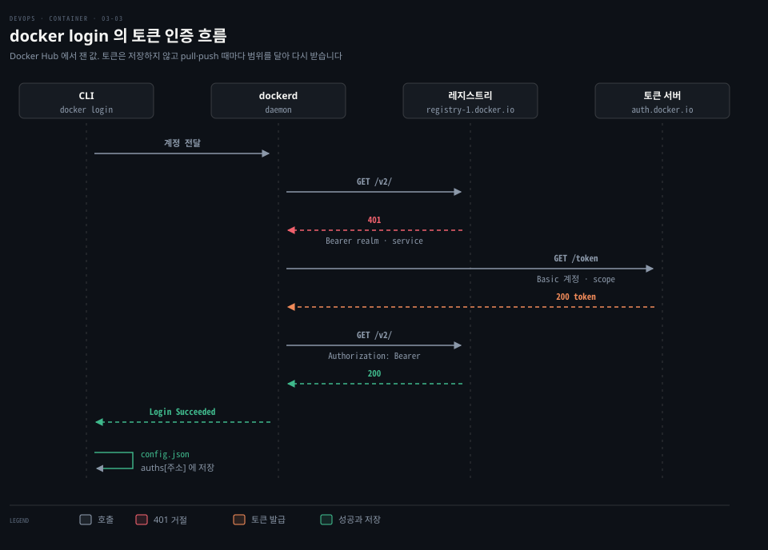

# 레지스트리 통신과 오프라인 반입

---

> 사내 HTTP 레지스트리에서 받은 이미지를 폐쇄망으로 옮겨 올리는 길에서 터진 세 실패를 레지스트리 인증, daemon 의 전송 설정, 받는 쪽 도구 선택으로 나눠 풀어 설명합니다.

## 학습 목표와 범위

> 읽고 나면 docker login, pull, load 가 실패할 때 어느 층의 문제인지 가려 고치고, 받는 서버에 docker 가 없어도 이미지를 올리는 길을 고를 수 있습니다. 
>
> 이미지 안의 조각(manifest·config·layer)과 이미지 ID 가 머신마다 다른 이유는 [03-01](03-01.이미지%20구조와%20digest.md)이 맡고, 이 편은 그 이미지를 레지스트리와 주고받는 길만 다룹니다.

1. `GET /v2/` 의 401 응답에서 시작하는 토큰 인증 순서를 설명하고, docker login 이 남기는 것과 남기지 않는 것을 구분할 수 있습니다.
2. insecure-registries 와 no-proxy 가 각각 어떤 요청을 바꾸는지 설명합니다. login 은 되는데 pull 이 실패하는 사슬도 짚을 수 있습니다.
3. save, 체크섬, load 또는 copy 로 이어지는 반입 절차를 직접 실행하고, 손상된 파일을 load 전에 걸러 낼 수 있습니다.
4. 받는 서버에 있는 도구(docker·podman·skopeo)에 맞춰 반입 방법을 고를 수 있습니다.


## 1. 반입 길에서 터진 세 실패

> 이미지를 pull 로 받아 파일로 만들고 폐쇄망 레지스트리에 올리는 여섯 단계에서 로그인 실패, 로그인 뒤 pull 실패, 받는 서버의 docker 부재가 차례로 터졌습니다.

레지스트리는 이미지를 이름과 태그로 저장하고 내려 주는 HTTP 서버입니다. 폐쇄망은 외부 인터넷과 끊긴 내부망이고, 반입은 밖에서 만든 파일을 그 망 안으로 옮겨 들이는 일입니다. 사내 원천 레지스트리에서 폐쇄망 레지스트리까지의 길은 다음 여섯 단계입니다.

1. pull: 작업 PC 가 원천 레지스트리에서 이미지를 받습니다.
2. save: 받은 이미지를 `tar.gz` 파일 하나로 만듭니다.
3. 매체: USB 나 sftp 로 파일을 폐쇄망으로 옮깁니다.
4. 체크섬: 옮기는 동안 파일이 깨지지 않았는지 해시로 확인합니다.
5. load 또는 copy: 받는 서버가 파일에서 이미지를 꺼냅니다.
6. push: 폐쇄망 레지스트리에 올립니다.

이 길을 처음 걸을 때 사용한 머신은 셋이었습니다. 값은 2026-11-23 에 잰 것이고, 사내 주소는 `registry.internal.example` 같은 대체 이름으로 바꿔 적습니다.

| 머신 | OS | 컨테이너 도구 | 이미지 저장 방식(store) |
|---|---|---|---|
| 작업 PC | macOS arm64 | OrbStack 2.2.5, docker 29.8.2 | containerd store |
| 서버 A | Ubuntu 24.04 | docker 없음, skopeo 1.13.3(수동 설치) | 없음 |
| 서버 B | RHCOS 9.6 | docker 27.3.1, podman, skopeo | classic store |

store 는 dockerd 가 이미지 조각을 디스크에 두는 방식입니다. 같은 이미지라도 store 마다 이미지 ID 가 달라지는데, 이 차이는 03-01 에서 다룹니다.

### 로그인이 거절됨

사내 레지스트리는 두 곳 모두 HTTP 로만 열려 있었습니다. 처음 `docker login` 을 치자 daemon 이 HTTPS 로 먼저 붙었다가 HTTP 응답을 받고 멈췄습니다. 원인은 §3 의 insecure-registries 에서 풉니다.

```bash
# 결과 (작업 PC, 사내 측정, insecure 등록 전 docker login)
Error response from daemon: Get "https://registry.internal.example:5000/v2/": http: server gave HTTP response to HTTPS client
```

### 로그인은 되는데 pull 이 거절됨

insecure 를 등록하자 로그인은 성공했습니다. 그런데 이름으로 쓴 Harbor 주소에서만 pull 이 Bad Gateway(502)로 실패했습니다. IP 와 포트로 쓴 레지스트리는 같은 PC 에서 pull 이 됐습니다.

```bash
# 결과 (작업 PC, 사내 측정, insecure 등록 뒤 docker pull)
Error response from daemon: failed to resolve reference "harbor.internal.example/library/node:20.11.1-alpine": failed to do request: Head "https://harbor.internal.example/v2/library/node/manifests/20.11.1-alpine": Bad Gateway
```

로그인과 pull 이 같은 레지스트리를 향하는데 결과가 갈린 이유는 §3 의 proxy 절에서 풉니다.

### 받는 서버에 docker 가 없음

서버 A 에는 docker 가 없어서 `docker load` 를 칠 수 없었습니다. 폐쇄망은 apt 도 막혀 있어 설치로 풀 수도 없었습니다. 이 막힘은 §4 에서 skopeo 로 풉니다.


## 2. 레지스트리와 말하는 법

> 레지스트리는 `GET /v2/` 에 401 로 토큰 발급처를 알려 주고, 클라이언트는 그곳에서 받은 토큰을 Bearer 헤더에 실어 다시 요청합니다. docker login 은 이 왕복이 계정으로 성립하는지 확인한 뒤 계정만 저장합니다.

아래 도식은 `docker login` 한 번에 네 참가자 사이를 오가는 메시지입니다.

CLI 는 사용자가 치는 docker 명령이고 dockerd 는 요청을 실제로 보내는 daemon 입니다. 레지스트리는 이미지를 저장한 서버입니다. 토큰 서버는 레지스트리가 `realm` 으로 가리킨 발급처입니다.



401 은 실패가 아니라 인증 방법을 알려 주는 정상 응답입니다. 도식의 두 번째 `GET /v2/` 가 같은 요청에 Bearer 토큰만 더한 것이고, 이 요청이 200 으로 돌아와야 로그인이 성공합니다. 토큰 서버는 레지스트리와 같은 호스트일 수도 있고 다른 호스트일 수도 있습니다.

### 토큰 흐름

`/v2/` 는 레지스트리가 Registry API v2 를 지원하는지 묻는 경로입니다. 계정 없이 이 경로를 부르면 레지스트리는 401 과 함께 `WWW-Authenticate` 헤더로 토큰을 받을 곳을 알려 줍니다.[^token-auth] 공개 레지스트리인 Docker Hub 에서 직접 확인했습니다.

```bash
# 계정 없이 /v2/ 의 응답 헤더만 본다 (-s 진행 표시 끔, -I 헤더만)
curl -sI https://registry-1.docker.io/v2/
```

```bash
# 결과 (Docker Hub, 2026-11-23, 헤더 일부)
HTTP/2 401
docker-distribution-api-version: registry/2.0
www-authenticate: Bearer realm="https://auth.docker.io/token",service="registry.docker.io"
```

`realm` 이 토큰 발급 주소이고 `service` 는 토큰을 쓸 대상 이름입니다. 클라이언트는 realm 에 service 와 scope 를 질의로 달아 토큰을 요청합니다. scope 는 어느 저장소에 어떤 권한이 필요한지를 `repository:이름:pull` 꼴로 적은 범위입니다. 공개 이미지라 이 요청은 계정 없이도 200 으로 돌아옵니다.

```bash
# realm 에 service 와 scope 를 달아 토큰을 요청한다 (공개 이미지라 계정이 필요 없다)
curl -s "https://auth.docker.io/token?service=registry.docker.io&scope=repository:library/busybox:pull"
```

```bash
# 결과 (Docker Hub, 2026-11-23, JSON 의 token 앞부분만)
{"token":"eyJhbGciOiJSUzI1NiIs…
```

계정이 있으면 이 요청에 Basic 인증 헤더가 붙습니다. Basic 은 `계정:비밀번호` 를 base64 로 바꾼 것이라 암호화가 아닙니다. realm 이 `http://` 로 시작하면 이 헤더가 평문으로 망을 지나가므로, 사내망 밖에서는 HTTP 레지스트리에 로그인하지 않습니다.

사내 두 레지스트리를 계정 없이 부른 응답도 같은 모양이었고 realm 만 달랐습니다. 값은 2026-11-23 사내 측정이며 주소는 대체 이름입니다.

| 레지스트리 | `/v2/` 응답 | realm |
|---|---|---|
| `registry.internal.example:5000` | 401 | `http://registry.internal.example:5000/v2/token` |
| `harbor.internal.example` | 401 | `http://harbor.internal.example/service/token`, service 는 `harbor-registry` |

두 realm 이 모두 `http://` 이므로 토큰 요청도 평문 HTTP 로 나갑니다. 토큰은 저장하지 않고 pull 과 push 때마다 그 작업의 scope 로 새로 받습니다. 토큰이 범위를 가지는 이유는 탈취돼도 쓸 수 있는 저장소와 권한이 그 한 건으로 묶이기 때문입니다.

### 자격증명 저장

토큰 대신 저장되는 것은 계정입니다. 로그인이 성공하면 CLI 가 `~/.docker/config.json` 의 `auths` 에 레지스트리 주소를 key 로 적습니다.[^docker-login]

이 작업 PC 는 `credsStore` 가 `osxkeychain` 이라서 비밀번호가 키체인에 갑니다. `auths` 의 값은 모두 빈 객체였습니다(7개 항목, 2026-11-23 측정).

```json
{
  "auths": {
    "registry.internal.example:5000": {}
  },
  "credsStore": "osxkeychain"
}
```

`credsStore` 가 없으면 docker 는 계정을 `config.json` 안에 base64 로 저장합니다. 공식 문서는 이 방식이 덜 안전하다고 적습니다.[^docker-login] 서버에서 로그인할 때는 credential helper 가 설치돼 있는지 먼저 봅니다.

key 는 주소 문자열 그대로입니다. 사내 실측에서 `auths` 의 key 는 로그인할 때 쓴 `IP:포트` 와 Harbor 이름이었습니다. 같은 레지스트리를 포트를 빼거나 IP 를 이름으로 바꿔 부르면 다른 key 라서 저장된 계정이 쓰이지 않습니다.


## 3. daemon 의 전송 설정

> insecure-registries 는 TLS 검증을 건너뛰고 HTTP 로 다시 붙는 것을 허용하는 설정이고, no-proxy 는 요청에 쓴 문자열로 판정되므로 같은 서버도 IP 로 부르는지 이름으로 부르는지에 따라 다른 길로 갑니다.

인증은 레지스트리와 나누는 대화이고, 그 대화가 어떤 길로 나가는지는 daemon 설정이 정합니다. §1 의 첫 두 실패가 모두 이 층의 일이었습니다.

### insecure-registries

dockerd 는 레지스트리 주소가 insecure 목록에 없으면 HTTPS 로만 붙습니다. insecure 레지스트리는 TLS 를 쓰지 않거나, daemon 이 모르는 CA 의 인증서를 쓰는 레지스트리입니다.[^dockerd-insecure] 사내 두 곳은 `http://…/v2/` 가 401 로 응답하고 `https://…` 는 연결이 거부됐으므로 HTTP 전용입니다. 그래서 목록에 없는 상태의 로그인이 §1 의 첫 오류로 끝났습니다.

설정 파일의 위치는 환경마다 다릅니다. OrbStack 은 `~/.orbstack/config/docker.json` 을 읽습니다. Linux 의 docker 는 `/etc/docker/daemon.json` 을 읽습니다.

```json
{
  "insecure-registries": [
    "registry.internal.example:5000",
    "harbor.internal.example"
  ]
}
```

daemon 은 시작할 때만 이 파일을 읽으므로 고친 뒤에 재시작합니다. 반영됐는지는 `docker info` 의 목록으로 확인합니다.

```bash
# daemon 재시작 (OrbStack)
orb restart docker

# daemon 재시작 (Linux)
sudo systemctl restart docker

# 반영 확인
docker info
```

```bash
# 결과 (작업 PC, 사내 측정, docker info 의 해당 부분)
 Insecure Registries:
  harbor.internal.example
  registry.internal.example:5000
  127.0.0.0/8
  ::1/128
```

목록에 있는 주소는 TLS 검증을 건너뛰고 HTTPS 가 안 되면 HTTP 로 다시 시도합니다. 목록에 없는 주소는 HTTPS 로만 붙고 HTTP 로 다시 시도하지 않습니다.

insecure 는 전송 방식을 정하는 설정입니다. `docker login` 이 대신할 수 없으므로 로그인에 성공해도 등록은 따로 필요합니다.

### proxy 와 no-proxy

insecure 를 등록한 뒤 로그인은 성공했는데 이름으로 쓴 Harbor 의 pull 만 Bad Gateway 가 났습니다. 원인은 OrbStack daemon 이 모든 요청을 프록시로 보내도록 설정돼 있다는 데 있었습니다. 작업 PC 의 `docker info` 가 그 설정을 보여 줍니다.

```bash
# 결과 (작업 PC, OrbStack 2.2.5, docker info 의 해당 부분, 사내 측정)
 HTTP Proxy: http://proxy.orb.internal:8305
 HTTPS Proxy: http://proxy.orb.internal:8305
 No Proxy: localhost,127.0.0.1,127.0.0.0/8,::1,10.0.0.0/8,172.16.0.0/12,192.168.0.0/16,0.250.250.0/24,*.orb.internal,*.local,gateway.docker.internal,host.internal,host.docker.internal,host.lima.internal,docker.for.mac.localhost,docker.for.mac.host.internal
```

No Proxy 목록에 맞는 요청만 프록시를 건너뜁니다. 같은 서버라도 요청에 어떤 문자열로 썼는지가 목록과의 대조를 가릅니다.

| 레지스트리를 쓴 문자열 | No Proxy 목록과 대조 | 실제 길 |
|---|---|---|
| `IP:포트` | `10.0.0.0/8` 에 걸림 | 프록시를 거치지 않고 직접 |
| 이름(`harbor.internal.example`) | 걸리는 항목 없음 | 프록시를 거침 |

원인은 네 단계로 이어졌고, 마지막 수정이 통과하면서 확인됐습니다.

1. IP 로 쓴 레지스트리는 `10.0.0.0/8` 에 걸려 프록시를 거치지 않습니다.
2. no-proxy 는 요청에 쓴 문자열로 판단합니다. 이름으로 쓴 Harbor 는 가리키는 IP 가 같은 대역이어도 프록시를 탑니다.
3. 프록시가 Harbor 의 443 에 붙지 못하고(작업 PC 에서 직접 443 에 붙어도 `Connection refused`) 502 를 돌려줍니다.
4. containerd 의 pull 은 502 를 받으면 HTTP 로 다시 시도하지 않습니다. 로그인은 dockerd 의 레지스트리 코드가 처리하는데, 그쪽은 HTTP 로 다시 시도해서 성공했습니다.

네 번째 단계가 login 은 되는데 pull 이 실패한 이유입니다. 같은 insecure 등록 아래에서 두 경로의 재시도 조건이 달랐습니다.

처음 시도한 수정은 통하지 않았습니다. OrbStack 의 제외 설정에 Harbor 를 넣고 daemon 을 재시작했습니다. `docker info` 의 No Proxy 는 그대로였고 pull 도 같은 502 였습니다.

```bash
# 헛수정 (No Proxy 가 그대로이고 pull 도 같은 502)
orb config set network.proxy.exclude harbor.internal.example
orb restart docker
```

된 수정은 daemon 설정 파일에 `proxies` 의 `no-proxy` 를 직접 쓰는 것입니다.[^daemon-proxy] 이 필드는 환경 변수의 값을 필드 단위로 덮어씁니다. 그래서 기존 목록 전체를 그대로 두고 끝에 Harbor 를 붙여야 하며, Harbor 만 적으면 `localhost` 와 사설 대역이 목록에서 빠집니다.

```json
{
  "proxies": {
    "no-proxy": "localhost,127.0.0.1,…기존 목록 전체…,harbor.internal.example"
  }
}
```

재시작 뒤 `docker info` 의 HTTP Proxy 와 HTTPS Proxy 는 그대로였고 No Proxy 끝에만 Harbor 가 붙었습니다. 이어서 pull 이 성공했습니다.

이 확인은 OrbStack 에서만 했습니다. 리눅스 서버의 daemon 이 프록시를 어디서 읽는지는 보지 않았으므로, 서버에서는 `docker info` 의 No Proxy 를 먼저 읽습니다.


## 4. 오프라인 반입 절차

> save 로 만든 tar.gz 에 체크섬을 남기고 옮긴 쪽에서 확인한 뒤, 받는 서버에 있는 도구에 맞춰 load 나 copy 로 올립니다.

반입에서 실패가 잘 나는 자리는 세 곳입니다. 파일 이름을 짓는 변수, 옮기는 동안의 손상, 받는 쪽에 없는 도구입니다.

아래 명령은 공개 이미지 `busybox:1.36` 과 `node:20.11.1-alpine` 으로 돌렸습니다. 원천 레지스트리 이름으로 다시 태그했고 2026-11-23 에 작업 PC(OrbStack)에서 쟀습니다.

### save 와 파일 이름

파일 이름은 이미지 이름에서 레지스트리 주소를 떼고 `/` 와 `:` 를 `_` 로 바꿔 만듭니다. 주소의 `IP:포트` 에 있는 `:` 가 파일 이름에 들어가면 매체에 따라 문제가 되기 때문입니다.

```bash
# 원천 레지스트리 이름으로 쓴 이미지 (예시)
img=registry.internal.example:5000/library/node:20.11.1-alpine

# 첫 / 까지 가장 짧게 잘라 레지스트리 주소를 뗀다 (${변수#패턴})
echo "${img#*/}"

# / 와 : 를 한 글자씩 _ 로 바꾼다
echo "${img#*/}" | tr '/:' '__'

# 확장자까지 붙여 변수 f 에 담는다
f=$(echo "${img#*/}" | tr '/:' '__').tar.gz
echo "$f"
```

```bash
# 결과 (작업 PC)
library/node:20.11.1-alpine
library_node_20.11.1-alpine
library_node_20.11.1-alpine.tar.gz
```

주소를 파일 이름에서 떼도 이미지 이름은 잃지 않습니다. tar 안의 `manifest.json` 이 `RepoTags` 에 전체 이름을 적어 두고, `docker load` 가 그 이름으로 이미지를 되살립니다.

busybox 로 만든 tar 의 `RepoTags` 는 `registry.internal.example:5000/library/busybox:1.36` 이었습니다.

```bash
# 이미지를 tar 로 만들고 gzip 으로 묶는다 (--platform 은 받아 둔 플랫폼을 고른다)
docker save --platform linux/amd64 "$img" | gzip > "$f"
```

`--platform` 이 필요한 경우가 있습니다. containerd store 는 index(플랫폼 목록)는 알아도 내용은 pull 한 플랫폼 것만 받아 둡니다.

맥이 arm64 라서 index 가 있는 이미지를 `--platform` 없이 pull 하면 arm64 가 옵니다. 이때 플랫폼 없는 save 는 받지 않은 manifest 를 찾다 `content digest … not found` 로 실패했습니다(메인 세션 측정).

이번 재측정에서는 같은 이미지의 arm64 내용이 로컬에 이미 있어 이 오류가 재현되지 않았습니다. 사내 원천의 node 처럼 index 없는 단일 amd64 이미지는 이 오류가 나지 않습니다.

`node:20.11.1-alpine` 으로 만든 파일은 47,728,201 바이트(약 46MB)였습니다. gzip 을 풀면 47,955,456 바이트였습니다.

거의 줄지 않은 이유는 tar 안 레이어 네 개가 이미 gzip 이기 때문입니다. 레이어 blob 네 개의 첫 두 바이트가 모두 `1f8b`(gzip 표지)였고, 파일 이름은 그 파일의 sha256 앞 12자리와 같았습니다. containerd store 의 save 는 받은 압축 레이어를 그대로 담습니다. classic store 의 save 는 재지 않았습니다.

### 체크섬 기록과 확인

USB 나 sftp 로 옮기는 동안 파일이 깨질 수 있습니다. 깨진 파일을 load 하면 어디서 실패할지 알 수 없으므로, 보내기 전에 해시를 남기고 받은 뒤 확인합니다.

```bash
# 보내는 쪽: 해시와 파일 이름을 한 줄씩 SHA256SUMS 에 남긴다
sha256sum *.tar.gz > SHA256SUMS

# 받는 쪽: 같은 폴더에서 줄마다 다시 계산해 맞대 본다 (-c 확인 모드)
sha256sum -c SHA256SUMS
```

```bash
# 결과 (작업 PC, 온전한 파일)
library_busybox_1.36.tar.gz: OK
```

손상은 직접 만들어 확인했습니다. 파일 한 바이트를 덮어쓴 복사본에서 `-c` 가 FAILED 를 내고 종료 코드 1 로 끝났습니다.

```bash
# 복사본의 101번째 바이트를 X 로 덮어써 손상을 흉내 낸다
#   of=...         덮어쓸 파일
#   bs=1           1바이트 단위로 쓴다
#   seek=100       앞의 100바이트를 건너뛴다
#   conv=notrunc   파일 길이를 줄이지 않는다
printf 'X' | dd \
  of=library_busybox_1.36.tar.gz \
  bs=1 \
  seek=100 \
  conv=notrunc

sha256sum -c SHA256SUMS
```

```bash
# 결과 (작업 PC, 손상된 파일)
sha256sum: WARNING: 1 computed checksum did NOT match
library_busybox_1.36.tar.gz: FAILED
```

`FAILED` 가 뜬 파일은 다시 옮깁니다. `SHA256SUMS` 를 같은 매체에 함께 옮기면 우연한 손상은 잡지만 고의 변조는 못 막습니다. 이 한계는 §5 에서 다룹니다.

### 받는 쪽 도구 비교

받는 서버에 무엇이 있는지는 폐쇄망에서 먼저 확인할 일입니다. apt 가 막혀 있으므로 없는 도구는 파일과 함께 반입해야 합니다. 서버 A 의 skopeo 도 2026-07-22 에 수동으로 설치한 것이었습니다.

```bash
# docker: 로컬에 이미지를 올린 뒤 대상 이름으로 태그하고 push 한다
docker load -i library_node_20.11.1-alpine.tar.gz
docker tag \
  registry.internal.example:5000/library/node:20.11.1-alpine \
  registry.closed.example:5000/library/node:20.11.1-alpine
docker push registry.closed.example:5000/library/node:20.11.1-alpine
```

```bash
# skopeo: 파일을 레지스트리로 바로 복사한다 (daemon 이 필요 없고 로컬에 이미지가 남지 않는다)
#   --dest-tls-verify=false   목적지가 HTTP 라서 HTTPS 요구를 끈다
skopeo copy \
  --dest-tls-verify=false \
  docker-archive:library_node_20.11.1-alpine.tar.gz \
  docker://registry.closed.example:5000/library/node:20.11.1-alpine
```

| 도구 | 받는 쪽에 필요한 것 | 로컬에 남는 것 | 특징 |
|---|---|---|---|
| docker | dockerd(root daemon) | 이미지와 태그 | 같은 이름:태그가 있으면 태그가 새 이미지로 옮겨 감 |
| podman | daemon 없음 | 이미지와 태그 | `load`·`tag`·`push` 명령이 docker 와 같음 |
| skopeo | daemon 없음, 바이너리 하나 | 없음 | tar 를 레지스트리로 바로 복사. 서버 A 의 1.13.3 이 gzip 된 tar 를 바로 읽음 |

skopeo 의 `docker-archive:` 가 gzip 된 파일을 바로 읽는지는 서버 A 에서 확인했습니다. `skopeo inspect docker-archive:x.tar.gz`(busybox)가 `amd64` 와 레이어 1개를 돌려줬습니다.

`--dest-tls-verify` 는 공식 문서의 옵션 설명과 대조했고 직접 돌리지는 않았습니다.[^skopeo-copy]

docker 의 마지막 칸이 실제로 어떻게 보이는지는 작업 PC 에서 직접 확인했습니다. 같은 이름과 태그(`demo/app:1`)로 내용이 다른 이미지를 먼저 만들어 두고, 다른 내용의 tar 를 load 했습니다.

```bash
# 같은 이름:태그에 v2 를 올려 둔 상태에서 v1 tar 를 load 한다
docker load -i app-v1.tar

# dangling 이미지까지 보려면 -a 를 붙인다
docker image ls -a
```

```bash
# 결과 (작업 PC, containerd store, 관련 줄만)
Loaded image: demo/app:1
demo/app:1       8b0475a3572f
<none>:<none>    2c455dc6db6b
```

태그 `demo/app:1` 이 load 한 v1 로 옮겨 갔습니다. `docker run demo/app:1 cat /ver` 가 `v1` 을 돌려줬습니다.

방금까지 그 태그를 쥐고 있던 v2(`2c455dc6db6b`)는 `<none>:<none>` 으로 남았습니다. `-a` 가 없으면 이 줄은 목록에 나오지 않았습니다. 반입을 반복하는 서버에는 이렇게 이름 없는 이미지가 디스크에 쌓입니다.


## 5. 한계와 다루지 않은 것

> 체크섬은 우연한 손상만 막고 고의 변조는 막지 못하며, 이 편은 폐쇄망에 이미지를 옮기는 수동 반입만 다루고 온라인 대안은 다루지 않습니다.

SHA256SUMS 를 이미지 파일과 같은 매체로 옮기면 파일을 바꾼 사람이 해시도 함께 바꿀 수 있습니다. 고의 변조까지 막으려면 이미지나 해시 파일에 서명하거나, 해시를 다른 경로(별도 매체, 사람이 읽어 주는 방식)로 전달해야 합니다. 서명 도구는 이 편의 범위 밖입니다.

Harbor 의 복제 규칙이나 프록시 캐시처럼 레지스트리가 알아서 이미지를 가져오는 온라인 대안도 다루지 않았습니다. 사내 원천과 폐쇄망이 직접 이어지지 않는 환경을 전제로 했기 때문입니다.

이 편의 측정에는 세 가지 한계가 있습니다. 사내 레지스트리의 응답과 서버 A·B 에서 돌린 값은 이 PC 에서 다시 재지 못해 2026-11-23 사내 측정을 그대로 옮겼습니다. proxy 사슬은 OrbStack 2.2.5 에서 확인한 것이라 리눅스 daemon 의 프록시 설정 경로는 직접 보지 않았습니다. HTTP 목적지에 podman 으로 push 할 때의 insecure 설정은 다루지 않았습니다.


## 6. 검증과 복습

> Phase 4 자답과 회차별 복습은 본문에 쌓지 않고 `_review/` 에 남깁니다.

- **Phase 4 결과**: 아직 자답하지 않았습니다. 기록은 `write/_review/{날짜}/` 에 남깁니다.
- **다음 보완점**: 서명으로 변조를 막는 방법, classic store 에서 save 가 레이어를 압축하는지 확인


## 면접 질문

> 다섯 질문에 먼저 스스로 답해 보세요. 자답이 끝나면 아래 정답 절로 내려갑니다.

1. `docker login` 은 성공했는데 같은 레지스트리의 pull 이 Bad Gateway 로 실패합니다. 어디를 의심하고 무엇으로 확인하나요?
2. 레지스트리가 `GET /v2/` 에 401 을 돌려주는 것이 정상인 이유와, 그 뒤에 클라이언트가 하는 일을 순서대로 설명해 보세요.
3. insecure-registries 를 등록했는데도 로그인이 실패한다면 어떤 경우가 남나요? 반대로 로그인이 성공해도 insecure 등록이 필요한 이유는 무엇인가요?
4. `SHA256SUMS` 를 이미지 파일과 같은 USB 에 담아 옮겼을 때 막을 수 있는 것과 막을 수 없는 것은 무엇인가요?
5. 받는 서버에 docker 가 없고 apt 도 막혀 있습니다. 어떤 선택지가 있고, 도구마다 로컬에 무엇이 남나요?


## 정답 (자답 후 펼치기)

> 위 면접 질문 다섯 개에 먼저 자답한 뒤 아래를 읽으세요.

### 정답 1 — login 성공 뒤 pull 실패

로그인과 pull 은 다른 코드 경로로 같은 레지스트리에 붙고, 502 를 받았을 때의 재시도 조건이 다르기 때문입니다. 로그인은 dockerd 의 레지스트리 코드가 처리해서 HTTP 로 다시 시도해 성공했습니다. pull 은 containerd 가 처리하며 502 를 받으면 HTTP 로 다시 시도하지 않습니다.

먼저 `docker info` 에서 Proxy 와 No Proxy 를 읽습니다. 레지스트리를 이름으로 쓰면 IP 로 쓸 때와 달리 No Proxy 의 대역에 걸리지 않아 프록시를 탑니다. 프록시가 목적지 포트에 붙지 못하면 502 를 돌려줍니다.

고치는 곳은 daemon 설정 파일의 `proxies.no-proxy` 입니다. 기존 목록 전체에 레지스트리를 덧붙여야 합니다.

### 정답 2 — 401 응답과 토큰 순서

401 은 실패가 아니라 레지스트리가 인증 방법을 알려 주는 정상 응답입니다. 응답의 `WWW-Authenticate` 헤더에 `Bearer realm=…,service=…` 가 들어 있어서 클라이언트가 토큰을 어디서 받을지 알 수 있습니다.

클라이언트는 realm 에 service 와 scope 를 달아 토큰을 요청하고(계정이 있으면 Basic 헤더를 더합니다), 받은 토큰을 `Authorization: Bearer` 로 실어 `GET /v2/` 를 다시 부릅니다. 200 이 오면 로그인이 성공하고, CLI 가 계정을 `config.json` 의 `auths` 에 저장합니다. 토큰은 저장하지 않고 pull 과 push 때마다 그 저장소의 scope 로 다시 받습니다.

### 정답 3 — 로그인과 insecure 의 관계

insecure 등록이 있어도 로그인이 실패하는 경우는 daemon 이 설정을 읽지 못한 때입니다. 파일을 고친 뒤 daemon 을 재시작하지 않았거나, 등록한 주소 문자열이 로그인에 쓴 문자열(포트 포함)과 다르면 목록에 걸리지 않습니다. `docker info` 의 Insecure Registries 에 그 문자열이 있는지 확인합니다.

반대로 로그인이 성공해도 insecure 등록은 필요합니다. insecure 는 TLS 검증과 HTTP 재시도를 허용하는 전송 설정이라서 로그인이 대신하지 않고, 목록에 없는 주소는 HTTPS 로만 붙습니다. 등록 전 로그인이 `server gave HTTP response to HTTPS client` 로 끝난 것이 이 설명의 증거입니다.

### 정답 4 — 같은 USB 에 담은 SHA256SUMS

우연한 손상은 막습니다. USB 나 전송 중에 한 바이트라도 바뀌면 `sha256sum -c` 가 그 파일에 FAILED 를 내고 종료 코드 1 로 끝나므로 load 전에 알 수 있습니다. 이번 실험에서 한 바이트를 덮어쓴 복사본이 바로 FAILED 로 걸렸습니다.

고의 변조는 막지 못합니다. 이미지 파일을 바꾼 사람이 같은 USB 의 `SHA256SUMS` 도 새 해시로 바꿀 수 있기 때문입니다. 이를 막으려면 서명하거나 해시를 다른 경로로 전달해야 합니다.

### 정답 5 — docker 가 없는 서버의 선택지

도구가 이미 있으면 그것을 쓰고, 없으면 파일과 함께 도구를 반입합니다. docker 는 root daemon 이 있어야 하고 load 하면 로컬에 이미지와 태그가 남습니다. 같은 이름과 태그가 이미 있으면 태그가 새 이미지로 옮겨 가고 옛 이미지는 `<none>` 으로 남습니다.

podman 은 daemon 없이 `load`·`tag`·`push` 를 docker 와 같은 명령으로 씁니다. skopeo 는 바이너리 하나로 `skopeo copy docker-archive:파일 docker://주소` 를 실행해 tar 를 레지스트리로 바로 올리며 로컬에 이미지가 남지 않습니다. 서버 A 는 docker 가 없어서 수동 설치한 skopeo 를 썼습니다.


## 참고 자료

[^token-auth]: Docker Registry Token Authentication Specification (2026-11-23 확인) — `WWW-Authenticate` 의 Bearer 와 토큰 요청 순서. <https://distribution.github.io/distribution/spec/auth/token/>
[^docker-login]: docker login 공식 문서 (2026-11-23 확인) — 자격증명 저장소와 `config.json` 저장. <https://docs.docker.com/reference/cli/docker/login/>
[^dockerd-insecure]: dockerd 공식 문서 「Insecure registries」 (2026-11-23 확인). <https://docs.docker.com/reference/cli/dockerd/#insecure-registries>
[^daemon-proxy]: Docker daemon 프록시 설정 공식 문서 (2026-11-23 확인) — `proxies` 와 `no-proxy`. <https://docs.docker.com/engine/daemon/proxy/>
[^skopeo-copy]: skopeo-copy(1) (2026-11-23 확인) — `docker-archive:` 와 `--dest-tls-verify`. <https://github.com/containers/skopeo/blob/main/docs/skopeo-copy.1.md>

- [이미지 구조와 digest](03-01.이미지%20구조와%20digest.md) — 이 편이 옮기는 이미지 안의 manifest·config·layer 와, store 마다 이미지 ID 가 다른 이유
- [이미지 빌더 종류와 선택](01-03.이미지%20빌더%20종류와%20선택.md) — 빌더가 레지스트리 인증을 맡는 방식
