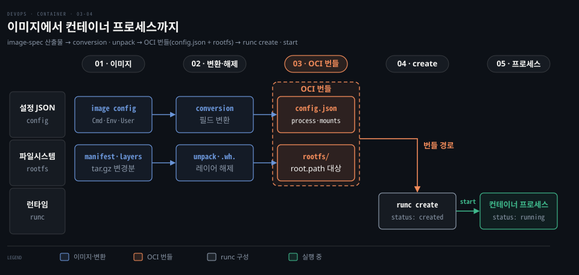
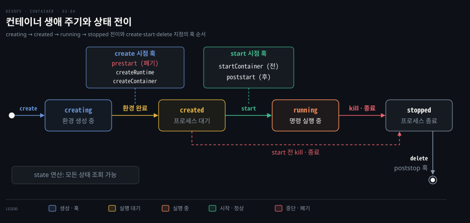

# 번들과 컨테이너 생애 주기

---

> OCI 런타임 명세(`runtime-spec`)는 이미지를 다루지 않습니다. 로컬 번들(`config.json` 과 `rootfs`)만 받아 컨테이너 환경과 생애 주기를 실행하며, `create`·`start`·`kill`·`delete` 가 네 상태와 여섯 훅을 순서대로 밟습니다.

## 학습 목표와 범위

> 이 편을 읽고 나면 OCI 런타임 번들의 구성과 상태 전이를 설명하고, `config.json` 을 보고 컨테이너의 실행 조건을 읽을 수 있습니다. 쿠버네티스 CRI·`crictl` 과 커널 격리 원리는 정본 문서로 넘깁니다.

1. OCI 명세 셋 가운데 `runtime-spec` 이 맡는 범위와 번들의 두 필수 요소를 설명할 수 있습니다.
2. `image-spec` 의 config 필드가 `config.json` 의 어느 키로 변환되는지 찾아낼 수 있습니다.
3. `creating`·`created`·`running`·`stopped` 상태 전이와 다섯 연산의 허용 상태 및 여섯 훅 실행 순서를 예측할 수 있습니다.
4. `config.json` 공통 필드와 `linux` 설정의 역할을 구분하고 커널 격리 원리 정본과 연결할 수 있습니다.

이미지 digest 구조는 [03-01 이미지 구조와 digest](03-01.이미지%20구조와%20digest.md) 가 맡습니다. layer 변경분은 [03-02 layer 변경분과 whiteout](03-02.layer%20변경분과%20whiteout.md) 가 다룹니다. 레지스트리 통신은 [03-03 레지스트리 통신과 오프라인 반입](03-03.레지스트리%20통신과%20오프라인%20반입.md) 이 맡습니다.


## 1. 런타임 명세가 정하는 것

> OCI `runtime-spec` 은 이미지 형식이나 레지스트리 통신을 전혀 알지 못합니다. 로컬 디스크의 번들 디렉터리 하나를 받아 컨테이너를 띄우고 수명주기를 관리하는 규칙만 정합니다.

레지스트리에서 pull 한 이미지는 압축된 layer tar 와 JSON 조각일 뿐이라 저수준 런타임이 곧장 실행할 수 없습니다. 레지스트리에서 받은 이미지가 어떤 모양이 되어야 런타임이 실행할 수 있나? 이 질문에 답하려면 먼저 OCI 명세 셋의 차이를 갈라야 합니다.

### 세 OCI 명세 비교

| 명세 | 정하는 대상 | 다른 명세와의 차이 | 기준 태그 |
|---|---|---|---|
| `image-spec` | index·manifest·config·layer 형식과 digest | 레지스트리 API 나 호스트 실행 상태는 다루지 않습니다 | `v1.1.1` |
| `distribution-spec` | 레지스트리 pull·push HTTP API | 로컬 디스크 저장이나 컨테이너 실행은 다루지 않습니다 | `v1.1.1` |
| `runtime-spec` | 번들 형식, `config.json`, 상태와 생애 주기 | 이미지 tar 나 레지스트리, CLI 인자 형식은 다루지 않습니다 | `v1.3.0` |

`spec.md` 는 이 명세가 컨테이너의 설정·실행 환경·생애 주기를 정한다고 적습니다.[^spec] 이 편에서는 읽을 파일을 기준으로 셋으로 묶습니다.

- 번들 형식(`bundle.md`): 런타임이 읽을 `config.json` 과 루트 파일시스템 배치
- 런타임과 생애 주기(`runtime.md`): 컨테이너 상태 JSON, 네 상태, 다섯 기본 연산, 실행 타임라인
- 설정 스키마(`config.md` · `config-linux.md`): 공통 필드와 Linux·Windows 등 플랫폼별 설정

명세는 CLI 명령줄 문법을 강제하지 않습니다.[^runtime-ops] **runc** 가 이 명세를 구현한 참조 구현입니다. containerd·CRI-O·Podman 같은 **runtime caller**(런타임 호출자)가 `runc` 호환 CLI 로 저수준 런타임을 부릅니다.[^glossary-caller]


## 2. 번들 config.json 과 rootfs

> 번들은 한 디렉터리의 루트에 둔 `config.json` 과 `root.path` 가 가리키는 루트 파일시스템으로 이뤄집니다. 고수준 도구가 `image-spec` 의 config 와 layer 를 풀어 이 두 조각을 만듭니다.

컨테이너 이미지는 압축된 여러 layer 와 이미지 설정 JSON 으로 나뉘어 있어 런타임에 그대로 넘기면 실행되지 않습니다. 아래 도식은 OCI 이미지의 `manifest`·`config`·`layers` 가 변환과 해제를 거쳐 번들로 모이고, `runc create` 와 `runc start` 를 지나 프로세스가 되는 흐름입니다.



왼쪽 두 줄이 이미지 입력입니다. 가운데 주황 점선 상자(`OCI 번들`)에서 `config.json` 과 `rootfs/` 로 모입니다. 그 뒤 `runc create` 가 `created` 상태를 만들고 `runc start` 가 `running` 프로세스를 띄웁니다.

### 번들 디렉터리의 두 필수 요소

**번들**(filesystem bundle)은 호스트의 로컬 파일시스템에 미리 풀어 둔 디렉터리 구조입니다.[^bundle] 명세는 두 산출물을 요구합니다.

- `config.json`: 반드시 번들 디렉터리 루트에 있어야 하며 이름이 `config.json` 으로 고정입니다.[^bundle]
- 루트 파일시스템: `config.json` 의 `root.path` 가 가리키는 디렉터리입니다. POSIX 에서는 관례상 `rootfs` 를 권고합니다.[^config-root]

번들을 감싼 바깥 디렉터리 자체는 번들의 일부가 아닙니다. 번들을 tar 로 묶으면 두 산출물이 상위 디렉터리 없이 아카이브 루트에 놓입니다.[^bundle] `rootfs` 디렉터리는 [03-02 layer 변경분과 whiteout](03-02.layer%20변경분과%20whiteout.md) 의 layer tar 를 바닥부터 풀고 `.wh.` whiteout 을 적용한 결과입니다.[^conversion]

### 이미지 config 에서 config.json 변환

`image-spec` 의 `conversion.md` 는 이미지 설정 JSON 을 런타임 `config.json` 으로 옮기는 규칙을 정합니다.[^conversion] 대상 미디어 타입은 `application/vnd.oci.image.config.v1+json` 입니다. 레이어 추출과 설정 변환은 서로 독립입니다.

| 이미지 config 필드 | 런타임 `config.json` 대상 | 변환 규칙 |
|---|---|---|
| `Config.WorkingDir` | `process.cwd` | 값을 그대로 복사합니다 |
| `Config.Env` | `process.env` | 그대로 복사합니다. 같은 변수명은 구현 기본값으로 덮지 않는 편이 맞습니다 |
| `Config.Entrypoint` | `process.args` | 실행 명령 앞부분으로 들어가며 `Cmd` 가 있으면 뒤에 이어 붙입니다 |
| `Config.Cmd` | `process.args` | `Entrypoint` 없이 단독이면 그대로 쓰고, 함께 있으면 뒤에 붙입니다 |
| `Config.User` | `process.user.*` | 숫자면 `uid`·`gid` 로 복사합니다. 이름이면 `/etc/passwd` 등으로 해석합니다 |
| `Config.Labels` | `annotations` | annotation 으로 옮기며, 아래 줄의 키와 값이 충돌하면 `Config.Labels` 가 우선합니다 |
| 플랫폼 필드와 작성 정보, `Config.StopSignal` | `annotations` | 각각 정해진 `org.opencontainers.image.*` 키에 넣습니다 |
| `Config.ExposedPorts` | `annotations` | 선택 변환이며 `org.opencontainers.image.exposedPorts` 로 기록합니다 |
| `Config.Volumes` | `mounts` | 선택 변환이며 지정 경로가 루트 FS 에 섞이지 않게 마운트로 가립니다 |

표의 플랫폼 필드는 `os`, `architecture`, `variant`, `os.version`, `os.features` 이고 작성 정보는 `author`, `created` 입니다.[^conversion]

`Config.User` 에 이름(문자열)이 적혔는데 `rootfs` 의 `/etc/passwd` 등에서 사용자를 찾지 못하면 변환기는 오류를 내야 합니다.[^conversion] 반대로 `Config.User` 가 숫자 `uid` 를 주면 `additionalGids` 를 임의로 바꾸지 않아야 합니다.[^conversion]


## 3. 상태와 생애 주기

> OCI 런타임은 컨테이너 상태를 `creating`·`created`·`running`·`stopped` 넷으로 나누고, 다섯 필수 연산과 여섯 훅을 정해진 순서로 실행합니다. `create` 는 격리 환경만 만들고 사용자 명령은 `start` 때 실행합니다.

명세에 따르면 환경을 만들지 못한 `create` 는 오류를 내야 하고, 정지하지 않은 컨테이너의 `delete` 도 오류를 내야 합니다.[^runtime-ops] 다만 6절에서 잰 runc 1.1.15 는 `created` 상태의 `delete` 를 받아 줍니다. 아래 상태 기계는 `create`·`start`·`kill`·`delete` 가 네 상태를 옮기는 경로와 여섯 훅이 끼어드는 시점을 보입니다.



`create` 로 환경이 만들어지면 훅 세 종류가 차례로 돈 뒤 `created` 에 멈춥니다. `start` 를 불러야 `running` 으로 넘어갑니다. `kill` 이나 프로세스 종료로 `stopped` 가 된 뒤에야 `delete` 로 자원을 회수합니다. 도식에 없는 훅 실패 경로는 다릅니다. `prestart` 부터 `poststart` 까지의 훅이 실패하면 런타임은 컨테이너를 정지하고, `delete` 호출을 기다리지 않은 채 정리 단계(생애 주기 12단계)로 넘어갑니다.[^lifecycle]

### 상태 JSON 구조와 네 가지 상태

런타임이 `state` 조회로 돌려주는 JSON 에는 네 필수 필드(`ociVersion`·`id`·`status`·`bundle`)가 있습니다. 여기에 Linux `created`·`running` 에서만 필수인 `pid` 와 선택 필드 하나(`annotations`)가 더해집니다.[^runtime-state]

- `ociVersion` (필수): 상태가 따르는 `runtime-spec` SemVer 버전
- `id` (필수): 호스트 안에서 유일해야 하는 컨테이너 식별자
- `status` (필수): `creating`·`created`·`running`·`stopped` 중 하나
- `pid` (Linux `created`·`running` 필수): 컨테이너 프로세스의 PID
- `bundle` (필수): 호스트의 번들 디렉터리 절대 경로
- `annotations` (선택): 컨테이너에 붙은 키-값 메타데이터

`pid` 는 훅의 실행 위치에 따라 기준이 다릅니다. 런타임 네임스페이스에서 도는 훅에는 호스트 쪽 PID 를 넘깁니다. 컨테이너 네임스페이스에서 도는 훅에는 컨테이너 안 PID 를 넘깁니다.[^runtime-state]

### 다섯 필수 연산과 허용 상태

명세는 런타임이 반드시 지원해야 하는 연산을 다섯으로 정합니다.[^runtime-ops]

| 연산 | 허용 상태 | 동작과 실패 조건 |
|---|---|---|
| `state <id>` | 컨테이너 존재 시 모두 | 상태 JSON 을 반환합니다. ID 가 없거나 컨테이너가 없으면 오류를 냅니다 |
| `create <id> <bundle>` | 새 ID 일 때만 | `process` 를 뺀 설정을 모두 적용해야 합니다. `process.args` 는 `start` 전에 적용하면 안 되고, 나머지 `process` 필드는 적용해도 됩니다. 이후 `config.json` 을 고쳐도 반영되지 않습니다 |
| `start <id>` | `created` 만 허용 | `process` 에 적은 명령을 실행합니다. `created` 가 아니거나 `process` 가 비어 있으면 오류입니다 |
| `kill <id> <signal>` | `created` 또는 `running` | 컨테이너 프로세스에 시그널을 보냅니다. 그 밖의 상태면 아무 일도 하지 않고 오류입니다 |
| `delete <id>` | `stopped` 만 허용 | `create` 때 만든 자원을 회수하고 ID 를 비웁니다. 컨테이너가 안 만든 외부 자원은 지우지 않습니다 |

인용한 `runtime.md` 의 연산·생애 주기 절은 `create` 와 `start` 를 나눈 이유를 적지 않습니다. 다만 둘이 나뉘어 있어서 호출자에게는 사용자 프로세스가 뜨기 전에 환경을 확인하거나 손볼 틈이 생깁니다. 이 문장은 연산 정의에서 끌어낸 해석입니다.

### 여섯 훅과 실행 네임스페이스

**훅**(hook)은 생애 주기의 정해진 시점에 런타임이 대신 실행하는 외부 프로그램입니다.[^config-hooks] 모든 훅은 표준 입력(`stdin`)으로 컨테이너 상태 JSON 을 받아 현재 상태를 읽습니다.[^config-hooks]

| 훅 이름 | 실행 시점 | 실행 네임스페이스 | 실패 시 동작 |
|---|---|---|---|
| `prestart` | `create` 중 환경 생성 뒤, `pivot_root` 전 (**폐기됨**) | 런타임 | 오류 반환 뒤 정리(12단계)로 이동 |
| `createRuntime` | `create` 중 환경 생성 뒤, `pivot_root` 전 | 런타임 | 오류 반환 뒤 정리(12단계)로 이동 |
| `createContainer` | `create` 중 `createRuntime` 뒤, `pivot_root` 전 | 컨테이너 | 오류 반환 뒤 정리(12단계)로 이동 |
| `startContainer` | `start` 중 사용자 명령 실행 직전 | 컨테이너 | 오류 반환 뒤 정리(12단계)로 이동 |
| `poststart` | `start` 중 사용자 명령 실행 뒤, 반환 전 | 런타임 | 오류 반환 뒤 정리(12단계)로 이동 |
| `poststop` | `delete` 중 컨테이너 삭제 뒤, 반환 전 | 런타임 | 경고만 기록하고 나머지 훅 계속 진행 |

`prestart` 는 `createRuntime`·`createContainer`·`startContainer` 로 세분화되면서 폐기(deprecated)되었습니다.[^config-hooks] `createContainer` 는 경로(`path`)를 런타임 네임스페이스에서 찾고 실행은 컨테이너 네임스페이스에서 합니다. `startContainer` 만 경로 탐색과 실행을 모두 컨테이너 네임스페이스에서 합니다.[^config-hooks]


## 4. config.json 공통 필드

> `config.json` 최상위의 `ociVersion`·`root`·`process`·`mounts`·`annotations` 는 공통 명세인 `config.md` 가 정의하고, `hooks` 는 그 안의 POSIX 플랫폼 항목입니다. 무엇을 실행할지와 루트 파일시스템 및 추가 마운트 순서를 이 필드들이 정합니다.

`ociVersion` 은 SemVer v2.0.0 문자열로 필수입니다. 주(major) 버전 안에서는 하위·상위 호환을 지키지만 `1.1` 설정은 `1.0` 만 지원하는 런타임에서 돌지 않습니다.[^config-ver]

### process 와 user

`process` 는 `create` 때는 선택이지만 `start` 를 부를 때는 필수입니다.[^config-process]

- `args` (비 Windows 최소 1개 필수): `execvp` 의 `argv` 와 같아 첫 원소가 실행 파일입니다.
- `env` (선택): `KEY=VALUE` 꼴의 환경 변수 목록입니다.
- `cwd` (필수): 실행 파일이 시작할 작업 디렉터리로 반드시 절대 경로여야 합니다.
- `terminal` (선택, 기본 `false`): `true` 면 Linux 등에서 가상 터미널(pty)을 할당해 표준 입출력에 잇습니다.
- `user` (POSIX): `uid`·`gid` 는 컨테이너 네임스페이스 안의 숫자 ID 로 필수입니다. 선택 필드로 `umask` 와 `additionalGids` 가 있습니다.

### root 와 mounts

`root` 는 Windows Hyper-V 컨테이너를 빼면 모든 플랫폼에서 필수입니다.[^config-root] `root.path` 는 POSIX 에서 절대 경로이거나 번들 기준 상대 경로(`rootfs`)입니다. 지정한 위치에 디렉터리가 실제로 있어야 합니다. `root.readonly` 를 `true` 로 두면 컨테이너 안 루트 파일시스템이 읽기 전용이 됩니다.

`mounts` 는 `root` 위에 추가로 붙일 마운트 배열이며 런타임은 배열에 적은 순서대로 마운트해야 합니다.[^config-mounts] 항목마다 컨테이너 안 경로 `destination`(필수)과 원본 `source`, 플래그 `options`, POSIX `type` 을 둡니다. Linux 는 `idmap`·`ridmap` 옵션과 `uidMappings`·`gidMappings` 도 지원합니다.[^config-mounts]

### hooks 와 annotations

`hooks` 의 각 항목은 `path`(절대 경로, 필수)와 `args`·`env` 를 갖습니다. 중단 시간 제한인 `timeout` 은 0보다 큰 초 단위 정수입니다.[^config-hooks] `annotations` 는 빈 키를 쓸 수 없는 키-값 맵입니다. `org.opencontainers.*` 접두사는 명세가 예약해 둡니다.[^config-annotations]


## 5. Linux 설정

> `linux` 객체와 Linux 전용 `process` 필드는 커널 격리 장치에 넘길 선언값만 적습니다. 각 장치의 커널 동작 원리는 보안·OS 정본 문서가 맡으므로 여기서는 명세가 요구하는 키와 규칙만 짚습니다.

### 격리 — namespaces 와 cgroupsPath

`linux.namespaces` 배열은 컨테이너에 새로 만들거나 합류할 네임스페이스 `type` 을 나열합니다.[^linux-ns] 명세가 지원을 권고(SHOULD)하는 타입은 `pid`·`network`·`mount`·`ipc`·`uts`·`user`·`cgroup`·`time` 여덟 가지입니다.

`path` 를 비우면 런타임이 그 타입의 새 네임스페이스를 만듭니다. 반대로 `path` 에 `/proc/<pid>/ns/net` 같은 절대 경로를 적으면 기존 네임스페이스에 합류합니다. 배열에 빠진 타입은 런타임 네임스페이스를 물려받습니다. 같은 `type` 을 두 번 적으면 오류입니다.[^linux-ns] `user` 네임스페이스를 쓸 때는 `linux.uidMappings`·`gidMappings` 에 `containerID`·`hostID`·`size` 를 적습니다. 네임스페이스 격리 원리는 [namespace와 루트 디렉토리](../../../../08_cloud/book/container-security/04-01.namespace와%20루트%20디렉토리%20—%20격리를%20만드는%20두%20장치.md#1-namespace란-무엇인가) 와 [user namespace 매핑](../../../../08_cloud/book/container-security/04-02.나머지%20namespace와%20호스트에서%20본%20컨테이너.md#2-user-namespace--컨테이너-root를-호스트-비특권으로) 에서 다룹니다.

`linux.cgroupsPath` 는 컨테이너를 붙일 cgroup 경로입니다. `/` 로 시작하면 cgroup 마운트 기준 상대 경로로 해석합니다. 상대 경로면 런타임이 정한 위치를 기준으로 해석해도 됩니다.[^linux-cgroups] 자원 한도는 `linux.resources` 아래에 적습니다. 하위 키로 `memory`·`cpu`·`pids`·`blockIO`·`hugepageLimits`·`network`·`rdma`·`devices` 를 둡니다. cgroup v2 직접 설정은 `unified` 맵으로 적습니다. cgroup 동작과 v2 구조는 [Control Group](../../../../08_cloud/book/container-security/03-01.Control%20Group%20—%20자원을%20제한해%20굶기기를%20막다.md#2-계층과-컨트롤러--자원-종류마다-하나씩) 에서 다룹니다.

### 권한 — capabilities 와 seccomp

Linux `process.capabilities` 는 다섯 집합을 문자열 배열로 적습니다. 집합 이름은 `effective`·`bounding`·`inheritable`·`permitted`·`ambient` 입니다.[^config-linux-proc] 줄 수 없는 capability 가 있으면 런타임은 반드시(MUST) 경고를 남겨야 합니다. 그 이유만으로 실패하지는 않는 것이 권고(SHOULD NOT)입니다.[^config-linux-proc] 권한 상승 차단은 같은 `process` 안의 `noNewPrivileges` 불리언으로 켭니다. capability 원리는 [Linux capability](../../../../08_cloud/book/container-security/02-01.Linux%20시스템%20콜·권한·capability%20—%20컨테이너%20보안의%20바닥.md#4-linux-capability--통짜-권한을-조각으로) 에서 다룹니다.

`linux.seccomp` 는 시스템 콜 필터를 선언합니다.[^linux-seccomp] `defaultAction`(필수)과 `defaultErrnoRet`(기본 `EPERM`), `architectures`, `flags` 를 둡니다. 개별 규칙은 `syscalls[]` 배열의 `names`·`action`·인자 조건 `args[]` 로 적습니다. `SCMP_ACT_NOTIFY` 를 쓰면 통지용 유닉스 소켓 경로 `listenerPath` 를 함께 둡니다. seccomp 원리는 [seccomp 시스템 콜 제한](../../../../08_cloud/book/container-security/08-01.컨테이너%20격리%20강화%20—%20샌드박싱의%20세%20갈래.md#2-seccomp--시스템-콜을-좁히다) 에서 다룹니다.

### 보호 — maskedPaths 와 devices

`linux.maskedPaths` 와 `linux.readonlyPaths` 는 컨테이너 네임스페이스 기준 절대 경로 배열입니다.[^linux-masked] 앞의 것은 컨테이너 안에서 읽지 못하게 가립니다(`/proc/kcore` 등). 뒤의 것은 읽기 전용으로 묶습니다(`/proc/sys` 등).

`linux.devices` 는 컨테이너 안에서 반드시 쓸 수 있어야 하는 장치를 나열합니다.[^linux-devices] 노드를 `mknod` 로 만들지 bind mount 나 심볼릭 링크로 제공할지는 런타임이 고릅니다.

각 항목에서 `type`(`c`·`b`·`u`·`p`)과 `path` 는 필수이고, `major`·`minor` 는 `type` 이 `p` 가 아니면 필수입니다. 10진수 `fileMode` 와 `uid`·`gid` 는 선택입니다. 이 배열과 기본 장치 8종 어느 쪽에도 없는 장치 노드는 접근할 수 있다고 보장되지 않습니다(원문 표현은 `MAY NOT access`).

런타임은 기본 장치 8종도 추가로 제공해야 합니다. 항상 필요한 것은 `/dev/null`·`/dev/zero`·`/dev/full`·`/dev/random`·`/dev/urandom`·`/dev/tty`·`/dev/ptmx` 일곱입니다. 여덟째 `/dev/console` 은 `terminal` 을 켰을 때 만듭니다.[^linux-devices]


## 6. 실측 — runc 번들 실행 절차

> runc 1.1.15(지원 spec 1.2.0) 실측에서 `status` 는 `created` → `running` → `stopped` 로 바뀌었습니다. 다만 `created` 상태의 `delete` 는 명세와 달리 오류 없이 컨테이너를 지웠습니다.

명세 문서만 읽고는 `runc` 가 `status` 와 `pid` 를 실제로 어떻게 채우는지 확인하지 못합니다. 그래서 번들 하나를 만들어 연산을 차례로 밟았습니다.

2026-11-28 에 OrbStack Docker 29.8.2(linux/arm64) 위의 특권 컨테이너 `oci0304-lab` 안에서 실행했습니다. 이미지 `debian:stable` 과 `alpine:3.24` 는 둘 다 `linux/arm64` 였습니다. 컨테이너 안 환경은 Debian 13.8, 커널 `7.2.12-orbstack-00394-gbecdd6130068`, cgroup v2 입니다.

이 runc 가 보고하는 spec 은 1.2.0 이라 앞 절들의 기준 태그 v1.3.0 보다 낮습니다. 아래 관찰은 v1.3.0 적합성 시험이 아니라 이 버전 한 벌의 동작입니다. 출력의 시각·PID·digest 는 실행할 때마다 달라집니다.

실습 컨테이너를 띄우고 runc 와 `ps` 를 설치합니다.

```bash
# 호스트: 실습 컨테이너를 띄웁니다
docker run -d --name oci0304-lab --privileged debian:stable sleep infinity

# 호스트: runc 와 ps(procps)를 설치합니다
docker exec oci0304-lab sh -c 'apt-get update && apt-get install -y runc procps'

# 컨테이너: runc 버전과 지원 spec 버전을 확인합니다
runc --version
```

```bash
# 결과
runc version 1.1.15+ds1
commit: 1.1.15+ds1-2+deb13u1
spec: 1.2.0
go: go1.24.4
libseccomp: 2.6.0
```

아래부터 호스트라고 적지 않은 명령은 컨테이너 안의 번들 디렉터리 `/tmp/oci-runtime-0304/bundle` 에서 실행합니다. 결과 블록의 `[exit 1]` 줄은 명령 출력이 아니라 실행 스크립트가 덧붙인 종료 코드입니다.

### 번들 만들기 — layer 하나와 runc spec

`rootfs` 는 `alpine:3.24` 의 layer 로 만듭니다. 이 이미지는 layer 가 하나라 whiteout 을 적용할 대상이 없어 tar 를 한 번 푸는 것으로 끝납니다.

```bash
# 호스트: alpine 이미지를 tar 로 저장하고 layer 경로를 확인합니다
docker image save --platform linux/arm64 alpine:3.24 -o alpine.tar
mkdir -p img && tar -xf alpine.tar -C img
cat img/manifest.json; echo
```

```bash
# 결과
[{"Config":"blobs/sha256/f7bbaec1bd0330a8dba26f03e05f421bb3c8b807bb41873df3c3b0c3d1083d8f","RepoTags":["alpine:3.24"],"Layers":["blobs/sha256/d3531b7a4f217bdc3426c57bcff84c170f086f456a39689d4a615c6d026c4be0"]}]
```

컨테이너 안 명령은 `docker exec -it oci0304-lab bash` 로 연 셸에서, 호스트 명령은 다른 터미널에서 실행합니다.

```bash
# 컨테이너: rootfs 폴더를 만듭니다
mkdir -p /tmp/oci-runtime-0304/bundle/rootfs && cd /tmp/oci-runtime-0304/bundle

# 호스트: Layers 에 적힌 blob 하나를 rootfs 에 풉니다
docker exec -i oci0304-lab \
  tar -xzf - -C /tmp/oci-runtime-0304/bundle/rootfs \
  < img/blobs/sha256/d3531b7a4f217bdc3426c57bcff84c170f086f456a39689d4a615c6d026c4be0

# 컨테이너: 기본 config.json 을 만들고 번들의 두 요소를 확인합니다
runc spec; ls
```

```bash
# 결과
config.json
rootfs
```

이번 실습에서는 이미지 config blob 을 번들에 넣지 않았습니다. 따라서 `runc spec` 이 만든 값은 alpine 이미지의 설정을 변환한 결과가 아닙니다. 아래는 `cat config.json` 출력에서 앞 절과 맞댈 부분만 남긴 것입니다.

```bash
cat config.json
```

```bash
# 결과 (발췌)
{
	"ociVersion": "1.2.0",
	"process": {
		"terminal": true,
		"user": {
			"uid": 0,
			"gid": 0
		},
		"args": [
			"sh"
		],
		"env": [
			"PATH=/usr/local/sbin:/usr/local/bin:/usr/sbin:/usr/bin:/sbin:/bin",
			"TERM=xterm"
		],
		"cwd": "/",
		"capabilities": {
			"bounding": [
...
			"ambient": [
...
		"noNewPrivileges": true
	},
	"root": {
		"path": "rootfs",
		"readonly": true
	},
	"hostname": "runc",
...
		"namespaces": [
			{
				"type": "pid"
			},
			{
				"type": "network"
			},
			{
				"type": "ipc"
			},
			{
				"type": "uts"
			},
			{
				"type": "mount"
			},
			{
				"type": "cgroup"
			}
		],
...
```

- `ociVersion` 은 `1.2.0` 이고 `terminal` 은 `true`, `args` 는 `["sh"]` 입니다.
- 전체 출력의 `capabilities` 에는 `bounding`·`effective`·`permitted`·`ambient` 넷이 있고 `inheritable` 은 없습니다. 명세에서 다섯 집합은 모두 선택 필드입니다.[^config-linux-proc]
- `namespaces` 는 여섯 개입니다. 빠진 `user` 와 `time` 은 5절의 규칙대로 런타임 네임스페이스를 물려받습니다.

터미널 없이 오래 사는 프로세스로 바꾸려고 두 값을 고칩니다.

```bash
# terminal 을 끄고 args 를 sleep 60 으로 바꾼 뒤 확인합니다
sed -i -e 's/"terminal": true/"terminal": false/' -e 's/"sh"$/"sleep", "60"/' config.json
grep -n -e '"terminal"' -e '"sleep"' config.json
```

```bash
# 결과
4:		"terminal": false,
10:			"sleep", "60"
```

### create 와 start 사이의 프로세스

`terminal` 이 `false` 인 이 실행에서 컨테이너 프로세스는 `runc create` 의 표준 입출력을 물려받았습니다. 그래서 입력은 `/dev/null`, 출력은 로그 파일로 돌립니다. `--pid-file` 은 컨테이너 프로세스의 PID 를 파일에 남깁니다.

```bash
# lab1 을 만들고 상태를 확인합니다
runc create \
  --pid-file /tmp/oci-runtime-0304/lab1.pid \
  lab1 \
  </dev/null >/tmp/oci-runtime-0304/lab1.log 2>&1
runc state lab1
```

```bash
# 결과
{
  "ociVersion": "1.2.0",
  "id": "lab1",
  "pid": 3930,
  "status": "created",
  "bundle": "/tmp/oci-runtime-0304/bundle",
  "rootfs": "/tmp/oci-runtime-0304/bundle/rootfs",
  "created": "2026-11-27T15:13:46.909077504Z",
  "owner": ""
}
```

명세의 필드인 `ociVersion`·`id`·`pid`·`status`·`bundle` 에 더해 `rootfs`·`created`·`owner` 가 붙었습니다. 명세는 추가 속성을 허용합니다.[^runtime-state]

```bash
# 그 PID 가 지금 무엇을 실행하는지, 표준 입출력이 어디로 가는지 봅니다
ps -o pid,ppid,stat,args -p $(cat /tmp/oci-runtime-0304/lab1.pid)
ls -l /proc/$(cat /tmp/oci-runtime-0304/lab1.pid)/fd
```

```bash
# 결과
    PID    PPID STAT COMMAND
   3930       1 Ssl  runc init
```

```bash
# 결과
total 0
lrwx------ 1 root root 64 Nov 27 15:13 0 -> /dev/null
l-wx------ 1 root root 64 Nov 27 15:13 1 -> /tmp/oci-runtime-0304/lab1.log
l--------- 1 root root 64 Nov 27 15:13 11 -> /
l-wx------ 1 root root 64 Nov 27 15:13 2 -> /tmp/oci-runtime-0304/lab1.log
l--------- 1 root root 64 Nov 27 15:13 5 -> /run/runc/lab1/exec.fifo
lrwx------ 1 root root 64 Nov 27 15:13 7 -> anon_inode:[eventpoll]
lrwx------ 1 root root 64 Nov 27 15:13 8 -> anon_inode:[eventfd]
```

`created` 상태의 프로세스는 `sleep` 이 아니라 `runc init` 입니다. 사용자 명령은 아직 실행되지 않았습니다. 1번과 2번 fd 는 `lab1.log` 를 가리키고, 5번 fd 에는 `exec.fifo` 가 열려 있습니다. runc 소스에서 init 프로세스는 이 FIFO 의 반대편이 열릴 때까지 기다립니다.[^runc-fifo]

```bash
# start 를 부르고 같은 PID 를 다시 봅니다
runc start lab1
runc state lab1
ps -o pid,ppid,stat,args -p $(cat /tmp/oci-runtime-0304/lab1.pid)
```

```bash
# 결과
{
  "ociVersion": "1.2.0",
  "id": "lab1",
  "pid": 3930,
  "status": "running",
  "bundle": "/tmp/oci-runtime-0304/bundle",
  "rootfs": "/tmp/oci-runtime-0304/bundle/rootfs",
  "created": "2026-11-27T15:13:46.909077504Z",
  "owner": ""
}
```

```bash
# 결과
    PID    PPID STAT COMMAND
   3930       1 Ss   sleep 60
```

`pid` 는 그대로이고 그 프로세스의 명령만 `runc init` 에서 `sleep 60` 으로 바뀌었습니다.

### running 과 stopped — 거절되는 연산

실행 중인 컨테이너에 `start` 와 `delete` 를 부릅니다. 둘 다 종료 코드 1 로 거절됩니다.

```bash
runc start lab1
```

```bash
# 결과
time="2026-11-27T15:13:47Z" level=error msg="cannot start an already running container"
[exit 1]
```

```bash
runc delete lab1
```

```bash
# 결과
time="2026-11-27T15:13:47Z" level=error msg="cannot delete container lab1 that is not stopped: running"
[exit 1]
```

```bash
# SIGKILL 을 보내고 1초 뒤 상태를 봅니다
runc kill lab1 KILL; sleep 1
runc state lab1
```

```bash
# 결과
{
  "ociVersion": "1.2.0",
  "id": "lab1",
  "pid": 0,
  "status": "stopped",
  "bundle": "/tmp/oci-runtime-0304/bundle",
  "rootfs": "/tmp/oci-runtime-0304/bundle/rootfs",
  "created": "2026-11-27T15:13:46.909077504Z",
  "owner": ""
}
```

`status` 는 `stopped` 이고 이 runc 는 `pid` 를 `0` 으로 보고했습니다. 명세가 `pid` 를 필수로 요구하는 상태는 Linux 기준 `created` 와 `running` 뿐입니다.[^runtime-state] 이어서 멈춘 컨테이너에 `kill` 과 `start` 를 부릅니다.

```bash
runc kill lab1 KILL
```

```bash
# 결과
time="2026-11-27T15:13:48Z" level=error msg="container not running"
[exit 1]
```

```bash
runc start lab1
```

```bash
# 결과
time="2026-11-27T15:13:48Z" level=error msg="cannot start a container that has stopped"
[exit 1]
```

```bash
# stopped 에서는 delete 가 통하고, 지운 뒤의 state 는 실패합니다
runc delete lab1
runc state lab1
```

```bash
# 결과
time="2026-11-27T15:13:48Z" level=error msg="container does not exist"
[exit 1]
```

### created 상태의 delete

같은 번들로 `lab2` 를 만들고 `start` 없이 바로 지웁니다. 명세대로라면 `delete` 는 아무것도 바꾸지 않고 오류를 내야 합니다.[^runtime-ops]

```bash
runc create lab2 </dev/null >/tmp/oci-runtime-0304/lab2.log 2>&1
runc state lab2
```

```bash
# 결과
{
  "ociVersion": "1.2.0",
  "id": "lab2",
  "pid": 4096,
  "status": "created",
  "bundle": "/tmp/oci-runtime-0304/bundle",
  "rootfs": "/tmp/oci-runtime-0304/bundle/rootfs",
  "created": "2026-11-27T15:13:48.507740674Z",
  "owner": ""
}
```

```bash
# 출력도 오류도 없이 끝난 delete 뒤에 상태를 다시 묻습니다
runc delete lab2
runc state lab2
```

```bash
# 결과
time="2026-11-27T15:13:48Z" level=error msg="container does not exist"
[exit 1]
```

`delete` 는 아무 출력 없이 성공했고 컨테이너는 사라졌습니다. runc 1.1.15 의 `delete.go` 는 상태가 `Created` 이면 `--force` 가 없어도 컨테이너를 `SIGKILL` 로 죽이고 지웁니다.[^runc-delete] 「`delete` 가 성공했으니 이미 `stopped` 였다」고 추론하면 이 런타임에서는 틀립니다. 다른 버전이나 다른 런타임은 재지 않았습니다.

### create 뒤에 고친 config.json

`lab3` 를 만든 다음 `config.json` 의 `60` 을 `99` 로 고치고 `start` 를 부릅니다.

```bash
runc create \
  --pid-file /tmp/oci-runtime-0304/lab3.pid \
  lab3 \
  </dev/null >/tmp/oci-runtime-0304/lab3.log 2>&1
sed -i 's/"sleep", "60"/"sleep", "99"/' config.json
runc start lab3
cat /proc/$(cat /tmp/oci-runtime-0304/lab3.pid)/cmdline | tr '\0' ' '; echo
```

```bash
# 결과
sleep 60 
```

실행된 명령은 고치기 전의 `sleep 60` 입니다. `create` 뒤의 `config.json` 수정은 컨테이너에 영향을 주지 않는다는 규칙과 같습니다.[^runtime-ops]

남은 컨테이너를 정리하고 목록이 비었는지 확인합니다.

```bash
runc kill lab3 KILL; sleep 1; runc delete lab3
runc list
```

```bash
# 결과
ID          PID         STATUS      BUNDLE      CREATED     OWNER
```

실습을 마치면 호스트에서 `docker rm -fv oci0304-lab` 으로 컨테이너를 지웁니다.


## 7. 경계 — CRI 와 containerd

> 이 편은 호스트 디스크의 `config.json` 과 `rootfs` 번들을 받아 프로세스를 띄우는 `runtime-spec` 규약까지 다룹니다. 그 위에서 번들을 조립하고 kubelet 과 대화하는 고수준 계층은 쿠버네티스 문서가 맡습니다.

`runtime-spec` 과 `runc` 만으로는 레지스트리에서 이미지를 pull 하거나 Pod 네트워크를 묶지 못합니다. 고수준 런타임인 `containerd` 나 `CRI-O` 가 이미지를 내려받아 `rootfs` 로 풀고 `config.json` 을 생성해 `runc` 에 번들 경로를 넘기는 `runtime caller` 역할을 맡습니다.[^glossary-caller] 한 줄 아래에서 리눅스 커널 격리가 동작하고, 한 줄 위에서 kubelet 이 CRI gRPC 를 부릅니다.

- CRI gRPC 호출 순서와 `containerd-shim`·`conmon` 및 Kata `RuntimeClass` 선택 기준: [Container Runtime — OCI 명세·CRI 통신과 런타임 선택](../../../../08_cloud/book/production-kubernetes/03-01.Container%20Runtime%20%E2%80%94%20OCI%20%EB%AA%85%EC%84%B8%C2%B7CRI%20%ED%86%B5%EC%8B%A0%EA%B3%BC%20%EB%9F%B0%ED%83%80%EC%9E%84%20%EC%84%A0%ED%83%9D.md#3-cri-아키텍처와-파드-기동-흐름)
- 노드에서 `crictl`·`ctr`·`nerdctl` 로 `k8s.io` 네임스페이스와 cgroup 드라이버 불일치를 진단하는 법: [컨테이너 런타임 인터페이스·crictl](../../../../08_cloud/docs/kubernetes/architecture/%EC%BB%A8%ED%85%8C%EC%9D%B4%EB%84%88%20%EB%9F%B0%ED%83%80%EC%9E%84%20%EC%9D%B8%ED%84%B0%ED%8E%98%EC%9D%B4%EC%8A%A4%C2%B7crictl.md#2-cri-호출-경로와-소켓-통신)


## 8. 관련 실습

> 이 편은 별도 실습 저장소를 두지 않습니다. 6절의 `runc` 절차를 OrbStack 의 Debian 컨테이너에서 직접 돌려 확인합니다.

실습에는 Linux 컨테이너를 띄울 Docker 데몬과 특권 컨테이너 안의 `runc` 가 필요합니다. 2026-11-28 에 OrbStack 으로 6절을 실행해 확인했습니다. 실행을 마친 뒤에는 `docker rm -fv oci0304-lab` 으로 시험 컨테이너를 지워야 합니다.


## 9. 검증과 복습

> Phase 4 자답과 회차별 복습 기록은 본문에 쌓지 않고 `_review/` 에 남깁니다.

- **Phase 4 결과**: 아직 없습니다.
- **다음 보완점**: 6절은 runc 1.1.15(spec 1.2.0) 한 벌만 쟀습니다. 여섯 훅의 실행 순서와 네임스페이스는 명세 원문으로만 확인했고 실행으로는 재지 않았습니다.


## 면접 질문

> 네 질문에 먼저 스스로 답해 보세요. 자답이 끝나면 아래 정답 절로 내려갑니다.

1. `runtime-spec` 이 런타임의 입력으로 삼는 것은 무엇이며, 이미지가 그 입력이 되기까지 거치는 두 변환은 무엇입니까?
2. `create` 와 `start` 는 각각 무엇까지 하며, 두 연산 전후에 실행되는 훅은 무엇입니까?
3. `create` 이후에 `config.json` 을 고치면 어떻게 되며, `created` 컨테이너에 `delete` 를 부를 때 명세와 runc 1.1.15 는 어떻게 갈립니까?
4. `process.capabilities` 에 호스트가 줄 수 없는 capability 를 적었을 때와 `poststop` 훅이 실패했을 때 런타임이 즉시 실패하지 않고 다르게 처리하는 방식은 무엇입니까?


## 정답 (자답 후 펼치기)

> 위 면접 질문 네 개에 먼저 자답한 뒤 아래를 읽으세요.

### 정답 1 — 이미지와 분리된 번들 입력

`runtime-spec` 의 입력은 로컬 파일시스템의 번들 디렉터리입니다. `bundle.md` 는 번들 정의가 컨테이너와 설정 데이터를 로컬 파일시스템에 어떻게 두는지만 다룬다고 적습니다.[^bundle]

이미지가 런타임에 들어가기 전에는 고수준 도구가 두 가지 독립 작업을 마쳐야 합니다. 첫째, `layer.md` 규칙대로 changeset tar 를 풀고 `.wh.` whiteout 을 적용해 `rootfs` 를 만듭니다. 둘째, `conversion.md` 규칙대로 이미지 config 의 `Entrypoint`·`Cmd`·`Env`·`WorkingDir`·`User` 를 `config.json` 으로 변환합니다.

### 정답 2 — create 와 start 분리 및 훅

`create` 는 네임스페이스·마운트·cgroup 같은 실행 환경만 구성해 `created` 상태에서 멈춥니다. `start` 가 비로소 `process.args` 를 실행해 `running` 으로 바꿉니다. 명세가 이유를 따로 적지는 않지만, 둘이 나뉘어 있어서 사용자 코드가 뜨기 전에 호출자가 환경을 확인하거나 손볼 틈이 생깁니다.

`create` 시점에는 `createRuntime` 과 `createContainer` 훅이 실행되며 `prestart` 는 폐기되었습니다. `start` 시점에는 명령 실행 직전에 `startContainer` 가 실행되고, 실행 직후 `start` 반환 전에 `poststart` 가 실행됩니다.

### 정답 3 — create 후 불변성과 delete 조건

`runtime.md` 는 `create` 연산 이후 `config.json` 을 고쳐도 이미 생성된 컨테이너에는 영향을 주지 않아야 한다고 규정합니다. 명세는 이유를 따로 적지 않습니다. 6절의 runc 1.1.15 에서는 `create` 뒤에 `args` 를 고쳐도 `start` 가 고치기 전 명령을 실행했습니다.

명세상 `delete` 는 `stopped` 상태에서만 허용되며, `created` 나 `running` 상태인 컨테이너에 `delete` 를 부르면 아무 동작 없이 오류를 내야 합니다. `delete` 가 `create` 때 만든 자원을 회수하는 연산이라, 프로세스를 끝내는 일은 `kill` 이 먼저 맡는 구조로 읽을 수 있습니다. 다만 runc 1.1.15 의 `delete` 는 `created` 컨테이너를 `SIGKILL` 로 죽이고 지웁니다.[^runc-delete]

### 정답 4 — capability 와 poststop

`config.md` 는 부여할 수 없는 capability 가 `process.capabilities` 에 있으면 런타임이 반드시 경고를 기록하라고 정합니다. 그 요청만으로 실패하지는 않는 것이 권고입니다. 반대로 `prestart`·`createRuntime`·`createContainer`·`startContainer`·`poststart` 훅 실패는 오류를 내고 컨테이너를 정지해 정리 단계로 넘깁니다. 반면 `delete` 뒤 실행되는 `poststop` 훅은 실패하더라도 경고만 남기고 나머지 훅과 삭제 흐름을 계속 이어가야 합니다.


## 참고 자료

[^spec]: OCI Runtime Spec v1.3.0, `spec.md` (2026-11-27 확인) — 구성, 실행 환경, 생애 주기 세 축과 지원 플랫폼을 정의합니다. <https://github.com/opencontainers/runtime-spec/blob/v1.3.0/spec.md>
[^bundle]: OCI Runtime Spec v1.3.0, `bundle.md` (2026-11-27 확인) — `config.json` 은 번들 루트에 필수 위치하며 바깥 디렉터리 자체는 번들에 속하지 않습니다. <https://github.com/opencontainers/runtime-spec/blob/v1.3.0/bundle.md>
[^runtime-state]: OCI Runtime Spec v1.3.0, `runtime.md` State (2026-11-27 확인) — `ociVersion`·`id`·`status`·`pid`·`bundle`·`annotations` 와 훅 기준 PID 정의입니다. <https://github.com/opencontainers/runtime-spec/blob/v1.3.0/runtime.md#state>
[^lifecycle]: OCI Runtime Spec v1.3.0, `runtime.md` Lifecycle (2026-11-28 확인) — 훅 실패 시 컨테이너를 정지하고 12단계로 이어 가는 규칙입니다. <https://github.com/opencontainers/runtime-spec/blob/v1.3.0/runtime.md#lifecycle>
[^runc-delete]: runc v1.1.15, `delete.go` (2026-11-28 확인) — 상태가 `Created` 이면 `--force` 없이 `killContainer` 를 부릅니다. <https://github.com/opencontainers/runc/blob/v1.1.15/delete.go#L73-L83>
[^runc-fifo]: runc v1.1.15, `libcontainer/standard_init_linux.go` (2026-11-28 확인) — init 프로세스는 exec FIFO 의 반대편이 열릴 때까지 기다린 뒤 사용자 명령을 `exec` 합니다. <https://github.com/opencontainers/runc/blob/v1.1.15/libcontainer/standard_init_linux.go#L235-L246>
[^runtime-ops]: OCI Runtime Spec v1.3.0, `runtime.md` Operations (2026-11-27 확인) — `state`·`create`·`start`·`kill`·`delete` 다섯 필수 연산과 허용 상태입니다. <https://github.com/opencontainers/runtime-spec/blob/v1.3.0/runtime.md#operations>
[^glossary-caller]: OCI Runtime Spec v1.3.0, `glossary.md` Runtime caller (2026-11-27 확인) — CLI 인터페이스는 명세 밖이며 containerd·CRI-O·Podman 이 `runc` 호환 CLI 로 호출합니다. <https://github.com/opencontainers/runtime-spec/blob/v1.3.0/glossary.md#runtime-caller>
[^conversion]: OCI Image Spec v1.1.1, `conversion.md` (2026-11-27 확인) — `Config.*` 필드를 `config.json` 의 `process`·`annotations`·`mounts` 로 옮기는 규칙입니다. <https://github.com/opencontainers/image-spec/blob/v1.1.1/conversion.md>
[^config-ver]: OCI Runtime Spec v1.3.0, `config.md` Specification version (2026-11-27 확인) — `ociVersion` SemVer v2.0.0 과 주 버전 호환 규칙입니다. <https://github.com/opencontainers/runtime-spec/blob/v1.3.0/config.md#specification-version>
[^config-root]: OCI Runtime Spec v1.3.0, `config.md` Root (2026-11-27 확인) — `root.path` 와 `root.readonly` 규칙입니다. <https://github.com/opencontainers/runtime-spec/blob/v1.3.0/config.md#root>
[^config-mounts]: OCI Runtime Spec v1.3.0, `config.md` Mounts (2026-11-27 확인) — `mounts` 순서 적용 및 Linux `idmap`·`ridmap` 옵션입니다. <https://github.com/opencontainers/runtime-spec/blob/v1.3.0/config.md#mounts>
[^config-process]: OCI Runtime Spec v1.3.0, `config.md` Process (2026-11-27 확인) — `process` 공통 필드 및 POSIX `user` 규칙입니다. <https://github.com/opencontainers/runtime-spec/blob/v1.3.0/config.md#process>
[^config-hooks]: OCI Runtime Spec v1.3.0, `config.md` POSIX-platform Hooks (2026-11-27 확인) — 여섯 훅의 실행 시점, 네임스페이스, `stdin` 상태 JSON 전달 규칙입니다. <https://github.com/opencontainers/runtime-spec/blob/v1.3.0/config.md#posix-platform-hooks>
[^config-annotations]: OCI Runtime Spec v1.3.0, `config.md` Annotations (2026-11-27 확인) — `org.opencontainers` 예약 네임스페이스와 키 규칙입니다. <https://github.com/opencontainers/runtime-spec/blob/v1.3.0/config.md#annotations>
[^config-linux-proc]: OCI Runtime Spec v1.3.0, `config.md` Linux Process (2026-11-27 확인) — `process.capabilities` 다섯 집합과 `noNewPrivileges` 규칙입니다. <https://github.com/opencontainers/runtime-spec/blob/v1.3.0/config.md#linux-process>
[^linux-ns]: OCI Runtime Spec v1.3.0, `config-linux.md` Namespaces (2026-11-27 확인) — 8종 네임스페이스와 `uidMappings`·`gidMappings` 규칙입니다. <https://github.com/opencontainers/runtime-spec/blob/v1.3.0/config-linux.md#namespaces>
[^linux-cgroups]: OCI Runtime Spec v1.3.0, `config-linux.md` Control groups (2026-11-27 확인) — `cgroupsPath` 와 `resources`·`unified` 규칙입니다. <https://github.com/opencontainers/runtime-spec/blob/v1.3.0/config-linux.md#control-groups>
[^linux-seccomp]: OCI Runtime Spec v1.3.0, `config-linux.md` Seccomp (2026-11-27 확인) — `defaultAction`, `syscalls[]`, `listenerPath` 규칙입니다. <https://github.com/opencontainers/runtime-spec/blob/v1.3.0/config-linux.md#seccomp>
[^linux-masked]: OCI Runtime Spec v1.3.0, `config-linux.md` Masked/Readonly Paths (2026-11-27 확인) — `maskedPaths` 와 `readonlyPaths` 규칙입니다. <https://github.com/opencontainers/runtime-spec/blob/v1.3.0/config-linux.md#masked-paths>
[^linux-devices]: OCI Runtime Spec v1.3.0, `config-linux.md` Devices (2026-11-27 확인) — `devices` 배열과 기본 장치 8종 필수 제공 규칙입니다. <https://github.com/opencontainers/runtime-spec/blob/v1.3.0/config-linux.md#devices>

- [03-01 이미지 구조와 digest](03-01.이미지%20구조와%20digest.md) — `config`·`manifest`·`layer` 의 digest 연결 구조를 다룹니다
- [03-02 layer 변경분과 whiteout](03-02.layer%20변경분과%20whiteout.md) — 번들의 `rootfs` 를 만드는 changeset tar 해제 규칙을 다룹니다
- [03-03 레지스트리 통신과 오프라인 반입](03-03.레지스트리%20통신과%20오프라인%20반입.md) — 이미지를 로컬로 가져오는 레지스트리 통신을 다룹니다
- [Container Runtime — OCI 명세·CRI 통신과 런타임 선택](../../../../08_cloud/book/production-kubernetes/03-01.Container%20Runtime%20%E2%80%94%20OCI%20%EB%AA%85%EC%84%B8%C2%B7CRI%20%ED%86%B5%EC%8B%A0%EA%B3%BC%20%EB%9F%B0%ED%83%80%EC%9E%84%20%EC%84%A0%ED%83%9D.md) — 쿠버네티스 CRI 계층과 런타임 선택 기준을 다룹니다
- [컨테이너 런타임 인터페이스·crictl](../../../../08_cloud/docs/kubernetes/architecture/%EC%BB%A8%ED%85%8C%EC%9D%B4%EB%84%88%20%EB%9F%B0%ED%83%80%EC%9E%84%20%EC%9D%B8%ED%84%B0%ED%8E%98%EC%9D%B4%EC%8A%A4%C2%B7crictl.md) — 노드에서 `crictl` 과 `ctr` 로 런타임 상태를 진단합니다
