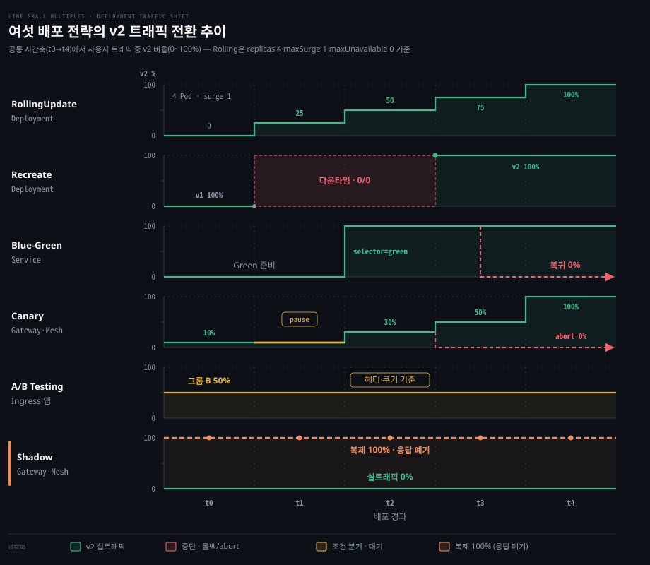
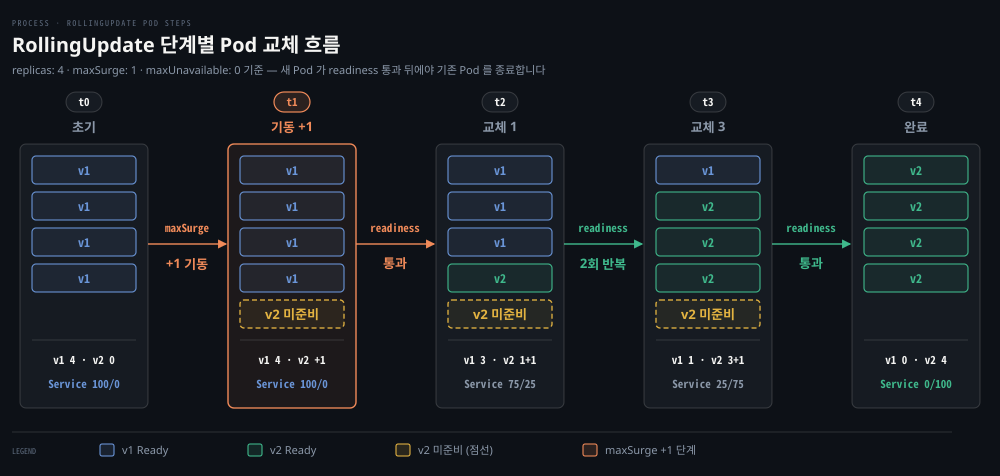
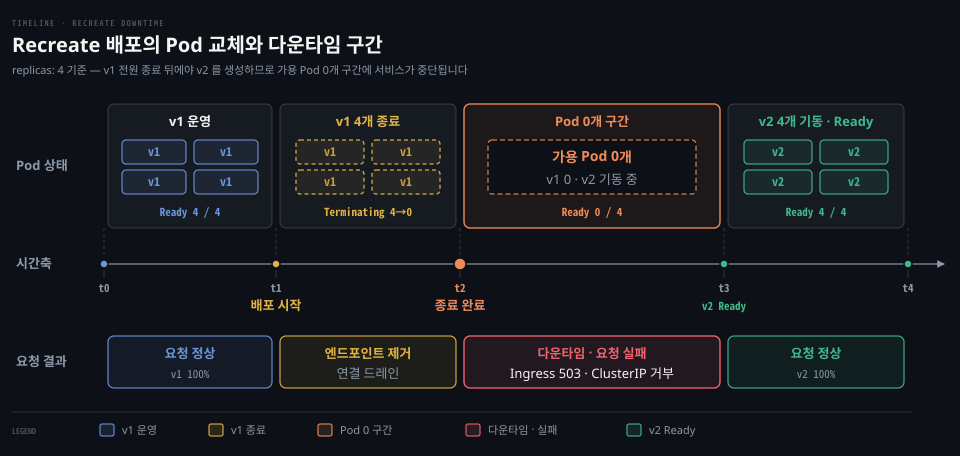
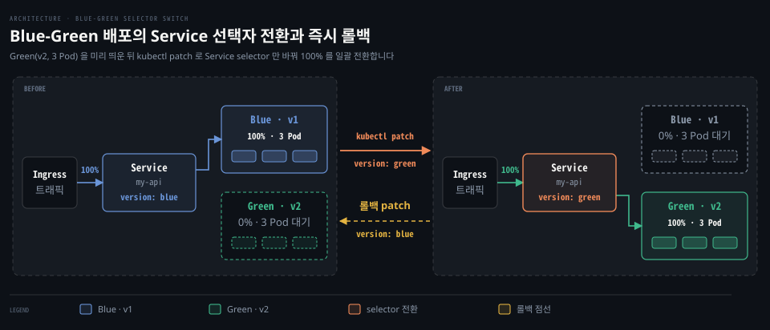
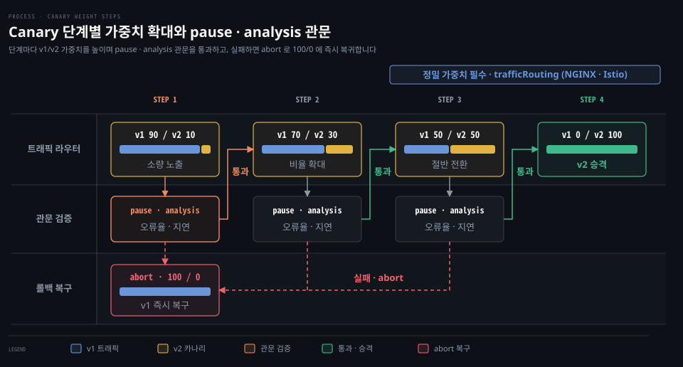
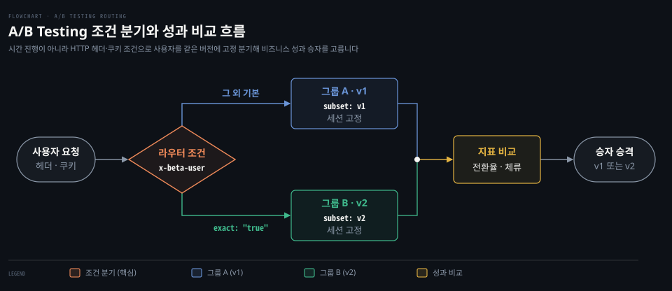
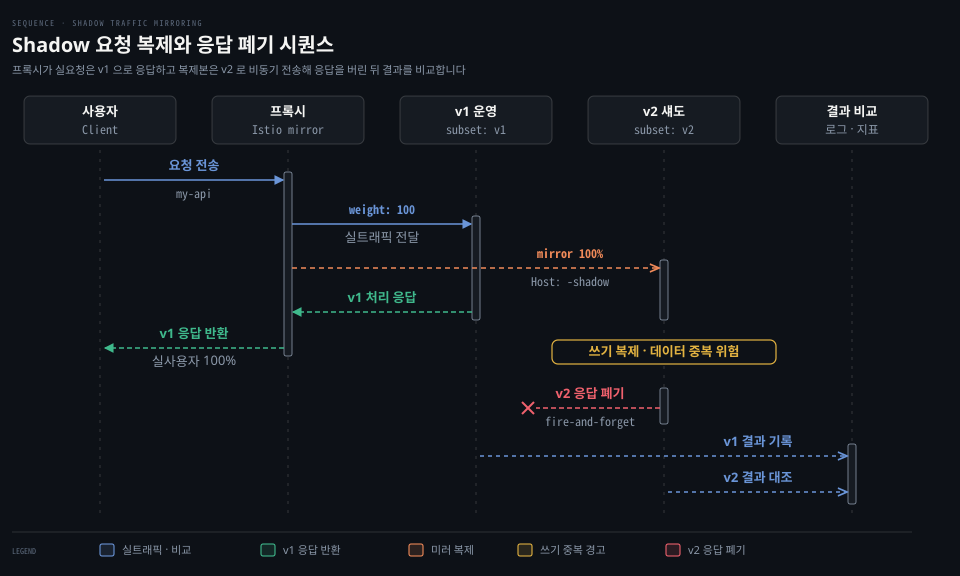

# 배포 전략 비교 — Rolling·Recreate·Blue-Green·Canary·A-B·Shadow

---

> 여섯 배포 전략은 새 버전에 실트래픽을 여는 시점과 트래픽을 가르는 계층에서 갈립니다. 분할 주체가 Pod 수에서 Service, Ingress, Gateway API, Service Mesh 로 올라갈수록 위험을 더 세밀하게 통제할 수 있습니다.

## 학습 목표와 범위

> 이 편은 여섯 배포 전략이 트래픽을 나누는 위치와 비용·리스크 차이를 정리해 상황에 맞는 전략을 고르는 질문에 답합니다. Argo Rollouts 설정은 [01-02 편](./01-02.Argo%20CD%20%EC%99%80%20Argo%20Rollouts%20%E2%80%94%20%EB%8F%99%EA%B8%B0%ED%99%94%EC%99%80%20%EC%A0%90%EC%A7%84%EC%A0%81%20%EB%B0%B0%ED%8F%AC%EC%9D%98%20%EC%97%AD%ED%95%A0%20%EB%82%98%EB%88%94.md), 지표 분석은 [01-03 편](./01-03.%EB%B0%B0%ED%8F%AC%20%EA%B2%80%EC%A6%9D%EA%B3%BC%20%EC%9E%90%EB%8F%99%20%EB%A1%A4%EB%B0%B1%20%E2%80%94%20Health%20Check%20%EC%99%80%20Analysis.md), 롤백 절차는 [01-04 편](./01-04.%EB%B0%B0%ED%8F%AC%20%EB%A1%A4%EB%B0%B1%20%EC%A0%95%EC%B1%85%EA%B3%BC%20%EB%A9%94%EC%BB%A4%EB%8B%88%EC%A6%98.md)으로 넘깁니다.

시리즈 안내: **01-01 전략 비교** → [01-02 Argo CD 와 Rollouts](./01-02.Argo%20CD%20%EC%99%80%20Argo%20Rollouts%20%E2%80%94%20%EB%8F%99%EA%B8%B0%ED%99%94%EC%99%80%20%EC%A0%90%EC%A7%84%EC%A0%81%20%EB%B0%B0%ED%8F%AC%EC%9D%98%20%EC%97%AD%ED%95%A0%20%EB%82%98%EB%88%94.md) → [01-03 검증과 자동 롤백](./01-03.%EB%B0%B0%ED%8F%AC%20%EA%B2%80%EC%A6%9D%EA%B3%BC%20%EC%9E%90%EB%8F%99%20%EB%A1%A4%EB%B0%B1%20%E2%80%94%20Health%20Check%20%EC%99%80%20Analysis.md) → [01-04 롤백 정책](./01-04.%EB%B0%B0%ED%8F%AC%20%EB%A1%A4%EB%B0%B1%20%EC%A0%95%EC%B1%85%EA%B3%BC%20%EB%A9%94%EC%BB%A4%EB%8B%88%EC%A6%98.md)

1. 여섯 배포 전략이 트래픽을 전환하는 단계별 동작과 v1/v2 비율 변화를 설명할 수 있습니다.
2. Deployment, Service, Ingress, Gateway API, Service Mesh, 앱 중 트래픽 분배 계층을 구분할 수 있습니다.
3. Canary 와 A/B Testing 의 목적 차이와 Shadow 배포의 쓰기 요청 중복 위험을 판별할 수 있습니다.
4. 다운타임, 인프라 비용, 트래픽 제어, 롤백 기준에 따라 서비스 상황에 맞는 전략을 고를 수 있습니다.


## 1. 트래픽 분할 계층과 여섯 전략의 흐름

> 새 버전이 Ready 상태가 되는 즉시 트래픽에 섞이면 장애 피해도 함께 커지므로, 트래픽을 가르는 계층을 분리할수록 안전한 배포 전략을 선택할 수 있습니다.



실무에서 배포와 릴리스를 나누지 않으면 Pod 기동과 트래픽 노출이 한 사건으로 묶여 장애가 전체 사용자에게 번집니다. **배포**는 새 코드를 클러스터에 띄우는 일이고, **릴리스**는 실사용자 요청을 그 코드로 보내는 일입니다.

위 그림은 여섯 전략을 위아래로 쌓아 공통 시간축(`t0→t4`) 위에서 v2 트래픽 비율(0~100%) 변화를 나란히 비교합니다. RollingUpdate 는 `replicas: 4` · `maxSurge: 1` · `maxUnavailable: 0` 기준으로 교체마다 0→25→50→75→100% 계단으로 올라갑니다. Recreate 는 `t1~t2` 구간에서 기존 Pod 를 모두 내려 v1·v2 가 모두 0 인 다운타임 띠를 거친 뒤 v2 100% 로 올라갑니다.

Blue-Green 은 Green 준비 동안 0% 를 유지하다가 `selector=green` 전환 순간 100% 로 수직 점프합니다. 문제가 생기면 점선처럼 즉시 0% 로 복귀합니다. Canary 는 10% 에서 `pause` 로 지표를 본 뒤 30→50→100% 로 올립니다. 분석이 실패하면 `abort` 점선으로 0% 까지 되돌립니다. A/B Testing 은 시간과 무관하게 헤더·쿠키 조건으로 그룹 B 에 50% 수평선을 유지합니다. 주황색으로 강조한 Shadow 는 실트래픽을 0% 에 둔 채 100% 복제 요청만 점선으로 보내 응답을 폐기합니다.

Kubernetes 기본 `Deployment` 만 쓰면 새 Pod 가 준비되자마자 `Service` 가 연결할 목록(`EndpointSlice`)에 들어갑니다. 제어 없이 두 버전이 섞이는 일을 막으려면 트래픽을 나누는 주체를 아래 계층 중 어디에 둘지 정해야 합니다.

- Deployment 계층: Pod 수를 줄이거나 늘려 교체 순서를 정합니다.
- Service selector 계층: 라벨 선택자를 바꿔 한 번에 한 버전의 Pod 집합만 연결합니다.
- Ingress·Gateway API 계층: HTTP 요청 가중치나 헤더 조건으로 백엔드 비율을 나눕니다.
- Service Mesh·애플리케이션 계층: 사이드카 프록시나 앱 코드의 피처 플래그로 요청을 가중 분배하거나 비동기로 복제합니다.

Kubernetes 네이티브 `Deployment` 는 `RollingUpdate` 와 `Recreate` 두 전략만 직접 지원합니다[^k8s-deploy]. 나머지 Blue-Green, Canary, A/B Testing, Shadow 는 별도 리소스를 조합해 구현합니다. `Service`, `Ingress`, `Gateway API`, 또는 `Service Mesh` 를 함께 묶어 트래픽 경로를 제어합니다.


## 2. 여섯 배포 전략의 동작과 트래픽 분배

> 각 전략은 트래픽을 나누는 계층과 두 버전의 공존 허용 여부에 따라 구현 방식과 롤백 경로가 달라집니다.

### RollingUpdate — Pod 점진 교체

새 버전으로 바꿀 때 서비스를 멈추지 않으려면 기존 Pod 를 한 번에 끄지 말고 순차적으로 교체해야 합니다. `RollingUpdate` 는 Kubernetes `Deployment` 의 기본 전략입니다[^k8s-deploy]. 이 전략은 이전 버전 Pod 를 관리하는 `ReplicaSet` 을 줄이면서 새 `ReplicaSet` 을 점진적으로 늘립니다.

아래 그림은 `replicas: 4`, `maxSurge: 1`, `maxUnavailable: 0` 설정에서 새 v2 Pod 가 `readinessProbe` 를 통과할 때마다 기존 v1 Pod 가 하나씩 교체되는 흐름입니다.


교체 속도와 가용성은 `maxSurge` 와 `maxUnavailable` 두 필드가 정합니다. `maxSurge` 는 원하는 복제본 수(`replicas`)를 초과해 임시로 더 띄울 수 있는 최대 Pod 수입니다. `maxUnavailable` 은 업데이트 중 불가용 상태여도 되는 최대 Pod 수입니다. 두 필드의 기본값은 모두 `25%` 입니다[^k8s-deploy]. 백분율을 절대 개수로 바꿀 때 `maxSurge` 는 올림, `maxUnavailable` 은 내림으로 계산합니다.

아래 예시는 `replicas: 4` 인 `Deployment` 에서 가용 Pod 수를 유지하며 하나씩 교체하는 일부 YAML 설정입니다.

```yaml
# 가용성을 유지하며 순차 교체하는 Deployment 전략 설정 일부
apiVersion: apps/v1
kind: Deployment
metadata:
  name: my-api
spec:
  replicas: 4
  revisionHistoryLimit: 5      # 보관할 이전 ReplicaSet 수 (기본값 10)
  strategy:
    type: RollingUpdate
    rollingUpdate:
      maxSurge: 1              # 최대 총 5개(4+1) Pod까지 일시 허용
      maxUnavailable: 0        # 새 Pod가 Ready 될 때까지 기존 Pod 유지
```

`maxUnavailable: 0` 으로 두면 새 Pod 가 준비성 검사(`readinessProbe`)를 통과하기 전까지 기존 Pod 를 종료하지 않습니다. 그러나 이 설정만으로 무중단 배포가 완전히 보장되지는 않습니다. `readinessProbe` 가 실제 처리 준비 상태를 확인하지 못하면 미준비 Pod 로 요청이 들어갈 수 있습니다. 반대로 종료되는 Pod 에서 트래픽이 빠지기(`EndpointSlice` 전파) 전에 앱이 연결을 끊으면 요청이 실패합니다.

또한 Kubernetes `Service` 는 준비된 모든 Pod 로 요청을 고르게 보내므로 교체 도중에는 v1 과 v2 가 동시에 트래픽을 받습니다. 문제가 발생하면 이전 `ReplicaSet` 으로 역방향 롤링 교체를 수행해 되돌립니다. `RollingUpdate` 의 내부 전이와 볼륨 잠금 교착은 [Deployment 업데이트 노트](../../../08_cloud/book/kubernetes-in-action/15-02.Deployment%20%EC%97%85%EB%8D%B0%EC%9D%B4%ED%8A%B8%20%E2%80%94%20Recreate%C2%B7RollingUpdate%C2%B7maxSurge.md)에서 다룹니다. `minReadySeconds` 제어는 [rollout 제어 노트](../../../08_cloud/book/kubernetes-in-action/15-03.rollout%20%EC%A0%9C%EC%96%B4%EC%99%80%20%EB%B0%B0%ED%8F%AC%20%EC%A0%84%EB%9E%B5%20%E2%80%94%20pause%C2%B7faulty%C2%B7rollback%C2%B7%EC%A0%84%EB%9E%B5%205%EC%A2%85.md)에서 확인합니다.

### Recreate — 구버전 종료 후 신버전 기동

구버전과 신버전이 같은 데이터베이스 스키마나 잠금 파일을 놓고 동시에 실행되면 데이터 충돌이 납니다. Recreate 전략은 새 버전 Pod 를 하나도 띄우기 전에 기존 Pod 를 전부 먼저 종료합니다[^k8s-deploy].

아래 그림은 `replicas: 4` 인 `Recreate` 배포에서 v1 전원 종료 뒤 가용 Pod 0개 다운타임 구간을 거쳐 v2 가 기동·준비되는 시간축입니다.


두 버전이 겹치는 순간은 없지만 구버전 종료부터 신버전 기동 완료까지 가용 Pod 가 0 개가 되어 서비스가 중단됩니다. 아래 설정처럼 `strategy.type` 을 `Recreate` 로 지정하면 됩니다.

```yaml
# v1과 v2의 동시 실행을 막기 위해 전원 종료 후 기동하는 설정 일부
spec:
  replicas: 4
  strategy:
    type: Recreate
```

엔드포인트가 비어 있는 동안 `Ingress` 프록시는 `503` 오류를 돌려줍니다. 클러스터 내부 `ClusterIP` 는 `kube-proxy` 의 `iptables`·`nftables` 모드에서 연결을 거부합니다. 롤백할 때도 구버전 Pod 를 다시 띄워야 하므로 중단 구간이 다시 발생합니다. 따라서 Recreate 는 두 버전의 동시 실행이 불가능하거나 점검 창을 허용할 수 있는 배치·내부 도구에 맞습니다.

### Blue-Green — Service 선택자 전환

두 버전이 동시에 실트래픽을 받으면 안 되지만 다운타임도 허용할 수 없을 때 Blue-Green 을 씁니다. Blue-Green 배포는 현재 운영 버전(Blue) 옆에 새 버전(Green)을 같은 규모로 완전히 띄웁니다. 검증이 끝나면 `Service` 의 라벨 선택자(`selector`)를 바꿔 트래픽 전체를 한 번에 넘깁니다.

아래 그림은 `Service` 의 `selector` 를 `version: blue` 에서 `version: green` 으로 바꿔 트래픽 100% 를 일괄 전환하고, 이상 시 `blue` 로 즉시 되돌리는 흐름입니다.


Kubernetes 기본 리소스로 구현할 때는 `version` 라벨을 `blue` 와 `green` 으로 나눈 두 `Deployment` 를 만듭니다. 이후 `Service` 의 선택자를 수정해 대상을 바꿉니다.

```yaml
# Blue를 가리키던 Service를 Green으로 전환하는 패치 대상 선택자 구조
apiVersion: v1
kind: Service
metadata:
  name: my-api
spec:
  selector:
    app: my-api
    version: blue              # 전환 시 "green"으로 변경해 일괄 이동
  ports:
    - port: 80
      targetPort: 8080
```

아래 명령은 운영 `Service` 의 선택자를 Green 으로 바꾸고, 이상이 생기면 다시 Blue 로 되돌리는 수동 전환 예시입니다.

```bash
# 검증을 마친 Green으로 운영 트래픽 전체를 전환합니다
kubectl patch service my-api \
  -p '{"spec":{"selector":{"app":"my-api","version":"green"}}}'

# 장애가 발생하면 선택자를 Blue로 되돌려 트래픽을 복구합니다
kubectl patch service my-api \
  -p '{"spec":{"selector":{"app":"my-api","version":"blue"}}}'
```

Blue 와 Green 은 트래픽 전환이 `Service` 선택자 단위라 v1 과 v2 가 한 `Service` 뒤에서 섞이지 않습니다. 문제가 나도 선택자를 Blue 로 되돌리면 즉각 복구됩니다. 그러나 두 환경을 동시에 유지해야 하므로 전환 구간 동안 인프라 자원이 두 배 필요합니다.

노드별 `kube-proxy` 규칙 전파 지연과 기존 연결 유지(`keep-alive`)도 주의해야 합니다. 전환 직후 Blue Pod 를 곧바로 지우면 아직 규칙이 안 바뀐 노드의 요청이 끊길 수 있습니다[^argo-bg]. Argo Rollouts 의 Blue-Green 은 `scaleDownDelaySeconds`(기본 30초)로 구버전 축소를 늦춥니다. `autoPromotionEnabled`(기본 `true`)로 자동 전환 여부도 정합니다[^argo-bg].

`activeService`·`previewService` 예시는 [Blue-Green 정독 노트](../../book/aic_ai-infra-claude/05-02.Blue-Green%20%EB%AC%B4%EC%A4%91%EB%8B%A8%20%EC%A0%84%ED%99%98%EA%B3%BC%20%EC%95%84%ED%82%A4%ED%85%8D%EC%B2%98%20%EA%B2%B0%EC%A0%95%20%EA%B8%B0%EB%A1%9D.md)에서 확인합니다. Argo CD 와 Argo Rollouts 연동 구조는 [01-02 편](./01-02.Argo%20CD%20%EC%99%80%20Argo%20Rollouts%20%E2%80%94%20%EB%8F%99%EA%B8%B0%ED%99%94%EC%99%80%20%EC%A0%90%EC%A7%84%EC%A0%81%20%EB%B0%B0%ED%8F%AC%EC%9D%98%20%EC%97%AD%ED%95%A0%20%EB%82%98%EB%88%94.md)에서 다룹니다.

### Canary — 소량 트래픽 단계 확대

Blue-Green 은 전환 직전까지 안전하지만, 스위치를 넘기는 순간 전체 사용자가 새 버전에 한꺼번에 노출됩니다. Canary 배포는 새 버전에 소량(예: 10%) 트래픽만 먼저 보내 오류율과 지연을 관찰합니다. 이상이 없으면 30%·50%·100% 로 비율을 점진적으로 높입니다.

아래 그림은 트래픽 라우터가 v1/v2 가중치를 90/10 에서 0/100 까지 단계적으로 올리며 `pause`·`analysis` 관문을 거치고, 실패 시 `abort` 로 100/0 에 즉시 복귀하는 흐름입니다.


여기서 자주 놓치는 제약이 트래픽 분할 주체입니다. Kubernetes 기본 `Service` 만으로는 엔드포인트 Pod 수 비율로만 요청이 나뉩니다[^argo-canary]. 그래서 `replicas` 가 4 개일 때 10% 같은 세밀한 비율을 HTTP 요청 단위로 맞출 수 없습니다.

정확한 비율 제어가 필요하면 상위 트래픽 라우터를 둬야 합니다. `Ingress` 컨트롤러는 구현체별 어노테이션으로 가중 분할을 확장합니다[^k8s-ingress]. `Gateway API` `HTTPRoute` 의 `weight` 필드나 Istio 같은 Service Mesh 프록시는 표준 스펙으로 비율을 나눕니다[^gw-shared][^argo-tm]. Service Mesh 는 서비스 간 통신을 사이드카 프록시로 가로채 라우팅과 관측을 맡는 인프라 계층입니다.

```yaml
# Gateway API HTTPRoute에서 v1 90%와 v2 10%로 가중 분할하는 규칙 일부
rules:
  - backendRefs:
      - name: my-api-v1
        port: 80
        weight: 90
      - name: my-api-v2
        port: 80
        weight: 10
```

위처럼 `weight` 로 트래픽을 나누면 소수 사용자에게만 새 버전을 노출해 장애 반경을 좁힐 수 있습니다. 문제가 감지되면 새 버전 가중치를 0 으로 되돌려 즉시 v1 으로 복구합니다. 다만 배포가 끝날 때까지 v1 과 v2 가 실트래픽을 함께 받으므로 API 나 DB 스키마 변경이 포함될 때는 하위 호환이 필요합니다.

Argo Rollouts 의 `Rollout` CRD(Custom Resource Definition) 설정은 [01-02 편](./01-02.Argo%20CD%20%EC%99%80%20Argo%20Rollouts%20%E2%80%94%20%EB%8F%99%EA%B8%B0%ED%99%94%EC%99%80%20%EC%A0%90%EC%A7%84%EC%A0%81%20%EB%B0%B0%ED%8F%AC%EC%9D%98%20%EC%97%AD%ED%95%A0%20%EB%82%98%EB%88%94.md)에서 다룹니다. 단계별 메트릭 검증은 [01-03 편](./01-03.%EB%B0%B0%ED%8F%AC%20%EA%B2%80%EC%A6%9D%EA%B3%BC%20%EC%9E%90%EB%8F%99%20%EB%A1%A4%EB%B0%B1%20%E2%80%94%20Health%20Check%20%EC%99%80%20Analysis.md), Canary 개념 배경은 [Canary 정독 노트](../../book/aic_ai-infra-claude/06-02.%EC%A0%90%EC%A7%84%EC%A0%81%20%EB%B0%B0%ED%8F%AC%20Canary%EC%99%80%20claude-context.md)에서 이어집니다.

### A-B Testing — 사용자 조건 기반 분기

Canary 와 모양은 비슷하지만 풀려는 문제가 다릅니다. A/B Testing 은 시스템 안정성이 아니라 서로 다른 기능이나 UI 의 비즈니스 성과를 비교합니다. 전환율이나 체류 시간을 재려고 특정 사용자 그룹에게만 새 버전을 노출하는 방식입니다.

아래 흐름도는 시간 단계가 아니라 `x-beta-user` 헤더 같은 조건으로 사용자를 그룹 A(`v1`)와 그룹 B(`v2`)에 고정 분기해 성과를 비교하는 과정입니다.


트래픽 비율을 임의로 쪼개는 대신 HTTP 헤더, 쿠키, 지역, 사용자 세그먼트 같은 조건으로 경로를 가릅니다. 아래 예시는 Istio `DestinationRule` 로 나눈 버전 그룹(`subset`)을 헤더 조건으로 분기하는 설정 일부입니다. Ingress 규칙이나 애플리케이션 내부 피처 플래그(Feature Flag)로도 같은 분기를 구현합니다.

```yaml
# 특정 헤더(x-beta-user: true)를 가진 그룹만 v2로 보내는 라우팅 일부
http:
  - match:
      - headers:
          x-beta-user:
            exact: "true"
    route:
      - destination:
          host: my-api
          subset: v2
  - route:
      - destination:
          host: my-api
          subset: v1
```

| 구분 | Canary | A/B Testing |
|---|---|---|
| 핵심 목적 | 새 버전의 장애·성능 회귀 조기 탐지 | 기능·UI 변경의 사용자 성과 비교 |
| 라우팅 기준 | 트래픽 가중치 비율 (`10% → 30%`) | HTTP 헤더·쿠키·사용자 조건 (`x-beta-user`) |
| 세션 일관성 | 요청마다 버전이 바뀔 수 있음 | 한 사용자는 실험 중 같은 버전에 고정 |
| 종료 조건 | 지표 정상이면 100% 승격 | 실험 성과가 높은 안을 채택해 승격 |

한 사용자가 요청할 때마다 v1 과 v2 를 오가면 실험 데이터가 오염됩니다. 따라서 A/B Testing 은 같은 사용자에게 동일 버전을 유지하도록 구성해야 합니다. 실험 중 장애가 나면 조건 분기 규칙을 제거해 즉시 기본 버전으로 되돌립니다.

### Shadow — 응답을 버리는 요청 복제

신규 API 엔진이나 대규모 리팩터링 결과를 실제 트래픽 부하로 검증할 때가 있습니다. 실사용자에게 오류나 지연을 1% 도 노출할 수 없다면 Shadow(Traffic Mirroring) 를 씁니다. 프록시가 실요청을 v1 으로 보내 응답을 돌려주는 동시에 사본을 v2 로 보내고 v2 응답은 버립니다[^istio-mirror].

아래 시퀀스는 Istio 프록시가 실요청 응답을 v1 으로 돌려주는 동시에 `-shadow` 복제본을 v2 로 비동기 전송해 응답을 폐기하고 결과를 비교하는 흐름입니다.


아래 예시는 Istio `VirtualService` 에서 v1 에 100% 를 보내고 v2 로 요청을 복제하는 설정 일부입니다[^istio-mirror].

```yaml
# 실트래픽은 v1이 처리하고 v2에는 사본만 보내 응답을 폐기하는 설정 일부
http:
  - route:
      - destination:
          host: my-api
          subset: v1
        weight: 100
    mirror:
      host: my-api
      subset: v2
    mirrorPercentage:
      value: 100.0
```

Gateway API `HTTPRoute` 에서도 `RequestMirror` 필터로 같은 요청 복제를 구성할 수 있습니다[^gw-httproute]. Istio 와 Envoy 프록시는 복제 요청의 `Host` 헤더 뒤에 `-shadow` 접미사를 붙입니다. 그리고 v2 응답을 기다리지 않고 버리는 방식(fire-and-forget)으로 동작합니다[^istio-mirror].

Shadow 배포에서 가장 조심할 함정은 쓰기 요청의 중복 실행입니다. 프록시가 v2 의 응답을 버릴 뿐이지, v2 애플리케이션은 복제된 요청을 실제로 끝까지 실행하기 때문입니다. 주문 생성, 결제 승인, 메일 발송, 외부 API 호출이 담긴 POST 요청을 그대로 복제하면 데이터가 두 번 저장되거나 결제가 중복 처리됩니다.

따라서 읽기 전용 경로를 미러링하거나 `-shadow` 접미사를 판별해야 합니다. `Host`(또는 `:authority`) 헤더에 붙은 접미사를 확인해 DB 쓰기를 롤백하고 외부 호출을 건너뛰는 격리가 필요합니다. v2 에 오류가 보여도 실트래픽은 v1 이 처리하므로 미러 규칙만 제거하면 영향 없이 중단할 수 있습니다. 세부 동작과 실습 예시는 [Istio 트래픽 제어 노트](../../../08_cloud/book/istio-in-action/05-01.%EC%9C%84%ED%97%98%EC%97%90%20%EB%85%B8%EC%B6%9C%EB%90%98%EB%8A%94%20%ED%8A%B8%EB%9E%98%ED%94%BD%EC%9D%84%20%EC%A4%84%EC%97%AC%20%EA%B0%80%EB%8A%94%20%EC%88%9C%EC%84%9C.md)에서 확인할 수 있습니다.


## 3. 여섯 전략 비교와 상황별 선택

> 다운타임 허용 여부, 추가 인프라 비용, 트래픽 제어 정밀도, 롤백 부담 네 축을 맞춰 보면 서비스 제약에 맞는 전략이 한 가지로 좁혀집니다.

여섯 전략은 우열 관계가 아니라 감수할 비용과 통제 범위의 트레이드오프입니다. 아래 표는 일반 Kubernetes 클러스터 구성을 기준으로 네 축과 적합한 상황을 비교합니다.

| 전략 | 분할 계층 | 다운타임 | 추가 인프라 비용 | 트래픽 제어 정밀도 | 롤백 방식과 속도 | 맞는 상황 |
|---|---|---|---|---|---|---|
| RollingUpdate | Deployment | 거의 없음 (probe·전파 전제) | 낮음 (`maxSurge` 만큼) | 낮음 (Pod 수 단위) | 역방향 롤아웃 (점진적) | 무상태 일반 API, 하위 호환 변경 |
| Recreate | Deployment | 발생 (종료~기동 구간) | 낮음 (추가 자원 없음) | 없음 (전부 교체) | 구버전 재기동 (중단 동반) | 버전 공존 불가 앱, 내부 배치 |
| Blue-Green | Service selector | 거의 없음 (전파 지연 주의) | 높음 (전환 중 2배) | 일괄 전환 (0 ↔ 100%) | 선택자 복원 (즉각, Blue 대기 전제) | 버전 혼재 금지 서비스, 빠른 원복 |
| Canary | Ingress · Gateway API · Mesh | 거의 없음 | 중간 (단계별 새 버전 Pod 추가) | 높음 (요청 비율 세밀 제어) | 가중치 0 복원 (즉각) | 실트래픽 검증, 위험 반경 제한 |
| A/B Testing | Ingress · Mesh · 앱 | 거의 없음 | 중간 (실험군 Pod 추가) | 조건별 분기 (헤더·쿠키) | 조건 규칙 제거 (즉각) | UI·기능 실험, 세그먼트 타깃팅 |
| Shadow | Gateway API · Mesh | 없음 (v1 응답만 반환) | 높음 (복제 비율만큼 추가 처리) | 복제 비율 제어 (응답 폐기) | 미러 규칙 제거 (실트래픽 무영향) | 대규모 리팩터링, 부하·정합성 검증 |

Blue-Green 롤백이 즉각적이라는 말에는 구버전(Blue) Pod 를 바로 지우지 않는다는 전제가 붙습니다. 전환 직후 Blue 를 스케일 다운했다면 롤백 때도 Pod 를 다시 띄우는 시간이 듭니다. Shadow 도 사용자 응답 영향은 없지만, v2 가 복제 요청을 실행하므로 복제 비율만큼 추가 자원을 준비해야 합니다.

- 무중단 배포를 추가 도구 없이 시작하려면 `RollingUpdate` 에 `maxUnavailable: 0` 과 정확한 `readinessProbe` 를 둡니다.
- 구버전과 신버전 공존이 불가능하고 짧은 점검 창을 열 수 있으면 `Recreate` 를 선택합니다.
- 공존은 불가하지만 무중단과 즉각 원복이 필수라면 비용 두 배를 감수하고 `Blue-Green` 을 씁니다.
- 실트래픽 오류를 소수에게만 먼저 확인하고 싶으면 `Canary` 를, 특정 사용자군의 비즈니스 지표를 대조하려면 `A/B Testing` 을 고릅니다.
- 실사용자 응답에 0% 영향을 주면서 실제 요청 패턴으로 새 엔진을 검증하려면 쓰기 격리가 된 `Shadow` 를 씁니다.

전략을 고른 뒤 GitOps 파이프라인에 올리는 절차는 다음 세 편에서 이어집니다. Argo CD 와 Rollouts 역할 나눔은 [01-02 편](./01-02.Argo%20CD%20%EC%99%80%20Argo%20Rollouts%20%E2%80%94%20%EB%8F%99%EA%B8%B0%ED%99%94%EC%99%80%20%EC%A0%90%EC%A7%84%EC%A0%81%20%EB%B0%B0%ED%8F%AC%EC%9D%98%20%EC%97%AD%ED%95%A0%20%EB%82%98%EB%88%94.md)에서 다룹니다. 지표 기반 자동 중단은 [01-03 편](./01-03.%EB%B0%B0%ED%8F%AC%20%EA%B2%80%EC%A6%9D%EA%B3%BC%20%EC%9E%90%EB%8F%99%20%EB%A1%A4%EB%B0%B1%20%E2%80%94%20Health%20Check%20%EC%99%80%20Analysis.md), 장애 후 Git 재일치는 [01-04 편](./01-04.%EB%B0%B0%ED%8F%AC%20%EB%A1%A4%EB%B0%B1%20%EC%A0%95%EC%B1%85%EA%B3%BC%20%EB%A9%94%EC%BB%A4%EB%8B%88%EC%A6%98.md)이 맡습니다.


## 4. 관련 실습

> 이 문서는 여섯 배포 전략의 트래픽 분할 계층과 선택 기준을 비교하는 개념 편이므로 별도 실습 저장소를 두지 않습니다.

실제 클러스터에서 전략별 Pod 교체와 트래픽 전환을 재현하려면 기존 정독 노트의 실습 예제를 활용합니다. `RollingUpdate` 와 `Recreate` 의 Pod 교체 관찰은 [Deployment 업데이트 노트](../../../08_cloud/book/kubernetes-in-action/15-02.Deployment%20%EC%97%85%EB%8D%B0%EC%9D%B4%ED%8A%B8%20%E2%80%94%20Recreate%C2%B7RollingUpdate%C2%B7maxSurge.md)에서 다룹니다. `Istio` 기반 가중치 분배와 요청 미러링 재현은 [Istio 트래픽 제어 노트](../../../08_cloud/book/istio-in-action/05-01.%EC%9C%84%ED%97%98%EC%97%90%20%EB%85%B8%EC%B6%9C%EB%90%98%EB%8A%94%20%ED%8A%B8%EB%9E%98%ED%94%BD%EC%9D%84%20%EC%A4%84%EC%97%AC%20%EA%B0%80%EB%8A%94%20%EC%88%9C%EC%84%9C.md)의 명령으로 검증할 수 있습니다.


## 5. 검증과 복습

> 회차별 자답과 복습 기록은 본문에 쌓지 않고 `_review/` 경로에 남깁니다.

- **Phase 4 결과**: 미진행 (시리즈 1편 초안 작성 직후)
- **다음 보완점**: [01-02 편](./01-02.Argo%20CD%20%EC%99%80%20Argo%20Rollouts%20%E2%80%94%20%EB%8F%99%EA%B8%B0%ED%99%94%EC%99%80%20%EC%A0%90%EC%A7%84%EC%A0%81%20%EB%B0%B0%ED%8F%AC%EC%9D%98%20%EC%97%AD%ED%95%A0%20%EB%82%98%EB%88%94.md) 작성 완료 후 시리즈 네 편의 용어 표기와 상호 링크를 함께 대조합니다.


## 면접 질문

> 아래 질문 4개에 먼저 스스로 답해 본 뒤 파일 끝 정답 절을 읽으세요.

1. Kubernetes `Deployment` 의 `RollingUpdate` 에서 `maxUnavailable: 0` 을 설정하는 이유는 무엇이며, 이 설정만으로 무중단 배포가 보장되지 않는 경우는 언제입니까?
2. Canary 배포에서 `Service` 만 쓸 때보다 `Ingress` 나 `Gateway API`, Service Mesh 를 함께 두어야 하는 이유는 무엇입니까?
3. Canary 배포와 A/B Testing 은 둘 다 일부 요청에만 새 버전을 노출하는데, 어떤 목적과 라우팅 기준으로 갈립니까?
4. Shadow 배포가 실사용자 응답에 0% 영향을 주는데도 결제나 주문 API 에 그대로 적용하면 위험한 이유는 무엇입니까?


## 정답 (자답 후 펼치기)

> 위 질문 4개에 먼저 자답한 뒤 아래를 읽으세요.

### 정답 1 — maxUnavailable 0

`maxUnavailable: 0` 은 새 버전 Pod 가 `readinessProbe` 를 통과해 준비되기 전까지 기존 Pod 를 종료하지 않도록 보장해 가용 용량 감소를 막습니다. 그러나 `readinessProbe` 가 실제 요청 처리 준비 상태를 검사하지 못하거나, 종료되는 Pod 에서 트래픽이 빠지기 전에(`EndpointSlice` 전파 지연) 애플리케이션이 연결을 끊으면 배포 중 오류가 발생할 수 있습니다.

### 정답 2 — Canary 트래픽 라우터

Kubernetes `Service` 는 준비된 Pod 에 요청을 고르게 분산할 뿐 요청 비율을 지정할 수 없습니다. `Service` 만으로는 전체 복제본 수에 비례한 거친 단위(예: Pod 4개면 25% 단위)로만 트래픽이 나뉩니다. 10% 같은 세밀한 가중 분배를 구현하려면 `Ingress`, `Gateway API` `HTTPRoute` 의 `weight`, 또는 Istio 같은 트래픽 라우터가 필요합니다.

### 정답 3 — Canary 와 A/B 차이

Canary 는 새 버전의 오류율과 지연 같은 시스템 안정성을 검증하려고 가중치 비율을 점진적으로 늘립니다. 반면 A/B Testing 은 기능이나 UI 변경의 비즈니스 성과를 비교하려고 HTTP 헤더나 쿠키 같은 조건으로 사용자 그룹을 나누고 같은 사용자에게 동일 버전을 유지하도록 구성합니다.

### 정답 4 — Shadow 배포의 쓰기 요청 위험

프록시는 v2 의 응답만 버릴 뿐 복제된 요청 자체는 v2 애플리케이션에서 끝까지 처리됩니다. 따라서 DB 쓰기나 결제·주문 같은 외부 부수 효과가 있는 요청이 미러링되면 중복 저장이나 이중 처리가 일어나므로, 읽기 전용 경로를 쓰거나 `Host`·`:authority` 헤더의 `-shadow` 접미사를 판별해 쓰기를 격리해야 합니다.


## 참고 자료

[^k8s-deploy]: Kubernetes 공식 문서 [Deployments](https://github.com/kubernetes/website/blob/7c81c4a67b17aa329f277a53b9e9111fb03b0ede/content/en/docs/concepts/workloads/controllers/deployment.md) (커밋 `7c81c4a`) — `.spec.strategy.type` 기본값 `RollingUpdate`, `Recreate` 동작, `maxSurge`/`maxUnavailable` 기본값 `25%` 및 올림/내림 규칙, `revisionHistoryLimit` 기본값 `10`.
[^k8s-ingress]: Kubernetes 공식 문서 [Ingress](https://github.com/kubernetes/website/blob/7c81c4a67b17aa329f277a53b9e9111fb03b0ede/content/en/docs/concepts/services-networking/ingress.md) (커밋 `7c81c4a`) — 표준 스펙은 호스트·경로 라우팅까지 정의하며 추가 기능은 컨트롤러별 어노테이션 확장 영역임.
[^gw-shared]: Gateway API 스펙 [`shared_types.go`](https://github.com/kubernetes-sigs/gateway-api/blob/v1.7.0/apis/v1/shared_types.go) (`v1.7.0`) — `BackendRef.Weight` 기반 가중치 분배 정의.
[^gw-httproute]: Gateway API 스펙 [`httproute_types.go`](https://github.com/kubernetes-sigs/gateway-api/blob/v1.7.0/apis/v1/httproute_types.go) (`v1.7.0`) — `HTTPRequestMirrorFilter` 기반 요청 미러링 정의.
[^argo-bg]: Argo Rollouts 공식 문서 [BlueGreen Deployment Strategy](https://github.com/argoproj/argo-rollouts/blob/v1.10.2/docs/features/bluegreen.md) (`v1.10.2`) — `scaleDownDelaySeconds`(기본 30초)로 노드 iptables 전파 지연 대비, `autoPromotionEnabled`(기본 `true`)로 자동 전환 제어.
[^argo-canary]: Argo Rollouts 공식 문서 [Canary Deployment Strategy](https://github.com/argoproj/argo-rollouts/blob/v1.10.2/docs/features/canary/index.md) (`v1.10.2`) — `trafficRouting` 미사용 시 복제본 수 기반 근사 분배 동작.
[^argo-tm]: Argo Rollouts 공식 문서 [Traffic Management](https://github.com/argoproj/argo-rollouts/blob/v1.10.2/docs/features/traffic-management/index.md) (`v1.10.2`) — NGINX, Istio, Gateway API 등 트래픽 라우터 연동.
[^istio-mirror]: Istio 공식 문서 [Mirroring](https://github.com/istio/istio.io/blob/22a424577bf9dd5a9acf88ff6f8dcfa88d21e762/content/en/docs/tasks/traffic-management/mirroring/index.md) (커밋 `22a4245`) — fire-and-forget 요청 복제, 응답 폐기, `Host` 헤더 `-shadow` 접미사 부여.

- [01-02. Argo CD 와 Argo Rollouts — 동기화와 점진적 배포의 역할 나눔](./01-02.Argo%20CD%20%EC%99%80%20Argo%20Rollouts%20%E2%80%94%20%EB%8F%99%EA%B8%B0%ED%99%94%EC%99%80%20%EC%A0%90%EC%A7%84%EC%A0%81%20%EB%B0%B0%ED%8F%AC%EC%9D%98%20%EC%97%AD%ED%95%A0%20%EB%82%98%EB%88%94.md) — Argo CD 와 Rollouts 의 역할 나눔 및 Canary `trafficRouting` 설정
- [01-04. 배포 롤백 정책과 메커니즘](./01-04.%EB%B0%B0%ED%8F%AC%20%EB%A1%A4%EB%B0%B1%20%EC%A0%95%EC%B1%85%EA%B3%BC%20%EB%A9%94%EC%BB%A4%EB%8B%88%EC%A6%98.md) — 전략별 롤백 절차와 GitOps 상태 재일치
- [Deployment 업데이트 — Recreate·RollingUpdate·maxSurge](../../../08_cloud/book/kubernetes-in-action/15-02.Deployment%20%EC%97%85%EB%8D%B0%EC%9D%B4%ED%8A%B8%20%E2%80%94%20Recreate%C2%B7RollingUpdate%C2%B7maxSurge.md) — `maxSurge`·`maxUnavailable` 반올림 규칙과 볼륨 잠금 교착
- [Blue-Green 무중단 전환과 아키텍처 결정 기록](../../book/aic_ai-infra-claude/05-02.Blue-Green%20%EB%AC%B4%EC%A4%91%EB%8B%A8%20%EC%A0%84%ED%99%98%EA%B3%BC%20%EC%95%84%ED%82%A4%ED%85%8D%EC%B2%98%20%EA%B2%B0%EC%A0%95%20%EA%B8%B0%EB%A1%9D.md) — `activeService`·`previewService` 전환과 자원 2배 계산
- [위험에 노출되는 트래픽을 줄여 가는 순서](../../../08_cloud/book/istio-in-action/05-01.%EC%9C%84%ED%97%98%EC%97%90%20%EB%85%B8%EC%B6%9C%EB%90%98%EB%8A%94%20%ED%8A%B8%EB%9E%98%ED%94%BD%EC%9D%84%20%EC%A4%84%EC%97%AC%20%EA%B0%80%EB%8A%94%20%EC%88%9C%EC%84%9C.md) — Istio 다크 런치·가중치 전환·미러링 실습
