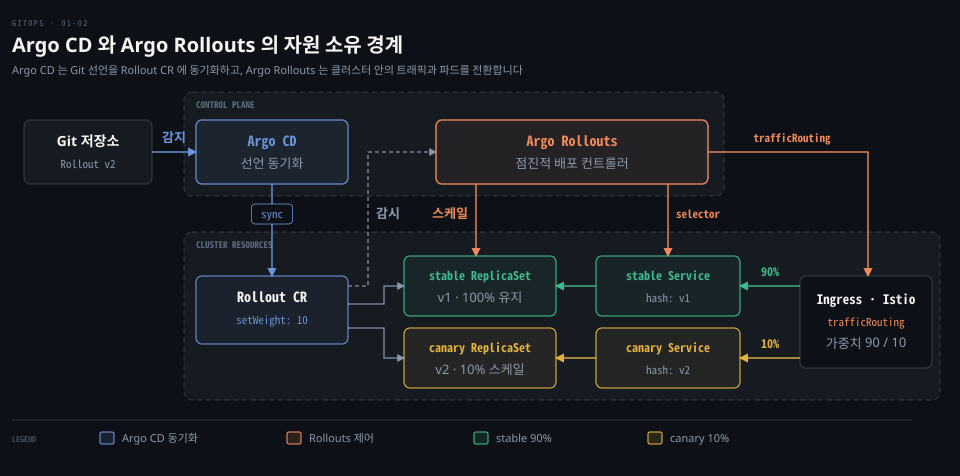

# Argo CD 와 Argo Rollouts — 동기화와 점진적 배포의 역할 나눔

---

> Argo CD 는 Git 선언을 클러스터에 동기화하고, Argo Rollouts 는 클러스터 안에서 `Rollout` 자원의 ReplicaSet 과 트래픽 가중치를 단계별로 전환합니다.

## 학습 목표와 범위

> 이 편은 GitOps 동기화와 점진적 배포 제어의 경계를 다루며, 여섯 전략 비교와 메트릭 분석·롤백 사후 정리는 인접 편으로 넘깁니다.

시리즈 안내: [01-01 전략 비교](./01-01.%EB%B0%B0%ED%8F%AC%20%EC%A0%84%EB%9E%B5%20%EB%B9%84%EA%B5%90%20%E2%80%94%20Rolling%C2%B7Recreate%C2%B7Blue-Green%C2%B7Canary%C2%B7A-B%C2%B7Shadow.md) → **01-02 Argo CD 와 Rollouts** → [01-03 검증과 자동 롤백](./01-03.%EB%B0%B0%ED%8F%AC%20%EA%B2%80%EC%A6%9D%EA%B3%BC%20%EC%9E%90%EB%8F%99%20%EB%A1%A4%EB%B0%B1%20%E2%80%94%20Health%20Check%20%EC%99%80%20Analysis.md) → [01-04 롤백 정책](./01-04.%EB%B0%B0%ED%8F%AC%20%EB%A1%A4%EB%B0%B1%20%EC%A0%95%EC%B1%85%EA%B3%BC%20%EB%A9%94%EC%BB%A4%EB%8B%88%EC%A6%98.md)

1. Argo CD 와 Argo Rollouts, ApplicationSet 의 Progressive Sync 가 맡는 제어 계층을 구분할 수 있습니다.
2. `Rollout` 의 `steps` 와 `trafficRouting` 유무에 따라 `setWeight` 가 어떻게 다르게 동작하는지 비교할 수 있습니다.
3. `promote`·`abort`·`undo` 명령이 바꾸는 자원을 짚고 Argo CD `selfHeal` 과의 충돌 여부를 예측할 수 있습니다.
4. Argo CD 가 `Rollout` 의 `Paused`·`Degraded` 상태를 읽는 방식과 `abort` 뒤 무한 루프가 없는 이유를 설명할 수 있습니다.


## 1. Git 동기화와 점진적 배포의 분리

> Kubernetes `Deployment` 와 Argo CD 만으로는 Canary 트래픽 비율 제어와 중간 멈춤을 실행할 수 없어, 클러스터 안의 점진적 배포 컨트롤러를 따로 둡니다.



위 그림은 상단의 두 컨트롤러가 하단 클러스터 자원 중 어디를 바꾸는지를 보입니다. 파란 화살표는 Argo CD 가 `Git 저장소` 선언을 `Rollout` 커스텀 리소스(CR)로 동기화하는 경로입니다. 주황 화살표는 Argo Rollouts 가 `ReplicaSet`·`Service`·`Ingress · Istio` 를 제어하는 경로입니다. 초록·노랑 화살표는 `Ingress · Istio` 에서 각 `Service` 를 거쳐 `ReplicaSet` 으로 흐르는 90%·10% 트래픽입니다.

표준 Kubernetes `Deployment` 는 `RollingUpdate` 와 `Recreate` 전략만 지원합니다.[^k8s-deploy] Argo CD 가 Git 의 `Deployment` 를 클러스터에 적용하더라도 트래픽의 10% 만 새 버전으로 보내거나 중간에 승인을 기다릴 수는 없습니다.

이 빈틈을 메우려고 점진적 배포 컨트롤러인 Argo Rollouts 를 둡니다. **점진적 배포**(Progressive Delivery)는 새 버전을 소수 트래픽부터 단계별로 노출하며 검증하는 방식입니다. 둘 다 Argo 프로젝트에 속하지만 서로 의존하지 않으므로 Argo Rollouts 단독으로도 동작합니다.[^rollouts-faq]

### Argo CD 와 Argo Rollouts 경계

두 컨트롤러는 같은 `Rollout` 커스텀 리소스(CR)를 사이에 두고 책임을 나눕니다.[^rollouts-arch] **커스텀 리소스**(CR, Custom Resource)는 쿠버네티스 기본 API 를 확장한 사용자 정의 자원입니다.

Argo CD 는 Git 저장소와 클러스터 선언을 맞추는 일만 맡습니다. Argo CD 의 설치 절차와 `Application` 동기화 규칙은 [푸시 배포의 한계와 ArgoCD GitOps](../../book/aic_ai-infra-claude/03-01.%ED%91%B8%EC%8B%9C%20%EB%B0%B0%ED%8F%AC%EC%9D%98%20%ED%95%9C%EA%B3%84%EC%99%80%20ArgoCD%20GitOps%20%E2%80%94%20%EC%84%A4%EC%B9%98%C2%B7%EC%97%B0%EA%B2%B0%C2%B7%EB%A1%A4%EB%A7%81%C2%B7%EB%A1%A4%EB%B0%B1.md)와 [Application 동기화](../../book/argocd-up-and-running/05-01.Application%20%EB%8F%99%EA%B8%B0%ED%99%94%20%E2%80%94%20%EC%9E%90%EB%8F%99%20%EB%8F%99%EA%B8%B0%ED%99%94%C2%B7Sync%20Option%C2%B7Hook%C2%B7Sync%20Wave%20%EC%99%80%20%EC%B0%A8%EC%9D%B4%20%EB%AC%B4%EC%8B%9C.md)에서 다룹니다.

Argo Rollouts 는 Git 저장소 주소를 모릅니다.[^rollouts-faq] 대신 클러스터의 `Rollout` CR 에서 `.spec.template` 변경을 감시합니다. 변경을 감지하면 새 `ReplicaSet` 을 만들고 `Service` selector 와 트래픽 라우터를 조작합니다. 일반 `Deployment` 리소스는 건드리지 않습니다.

| 구분 축 | Argo CD | Argo Rollouts |
|---|---|---|
| 감시 대상 | Git 저장소와 클러스터 차이 | 클러스터 안의 `Rollout` CR |
| 조작 대상 | 클러스터 매니페스트 전체 | `ReplicaSet` · `Service` · 라우터 가중치 |
| Git 쓰기 여부 | 읽기 전용 | 읽지도 쓰지도 않음 |
| 적용 단위 | `Application` 단위 동기화 | 단일 워크로드 내부 단계 전환 |

### Argo CD Progressive Sync 구분

이름이 비슷해서 혼동하기 쉬운 기능이 Argo CD `ApplicationSet` 의 **Progressive Sync**(`RollingSync`)입니다. `ApplicationSet` 은 템플릿 하나로 여러 `Application` 을 자동 생성하는 리소스입니다. Progressive Sync 는 단일 서비스 트래픽을 10% 씩 나누는 도구가 아닙니다.

Progressive Sync 는 여러 `Application` 을 라벨 그룹별로 묶어 순차 동기화하는 Beta 기능입니다.[^argocd-ps] 예를 들어 `database` 앱이 `Healthy` 가 된 뒤 `backend` 앱을 sync 하는 식으로 배포 순서를 줄 세웁니다.

Progressive Sync 는 Argo Rollouts 나 기본 `ReplicaSet` 컨트롤러와 직접 통합하는 기능이 아닙니다.[^argocd-ps] 다중 앱의 sync 순서는 [Application 여럿을 순서대로](../../book/argocd-up-and-running/10-01.Application%20%EC%97%AC%EB%9F%BF%EC%9D%84%20%EC%88%9C%EC%84%9C%EB%8C%80%EB%A1%9C%20%E2%80%94%20%ED%97%AC%EC%8A%A4%20%EC%B2%B4%ED%81%AC%C2%B7App-of-Apps%20sync%20wave%C2%B7Progressive%20Sync.md)에서 다룹니다. 단일 앱 내부의 트래픽 분할은 Argo Rollouts 가 맡습니다.


## 2. Rollout CR 과 Canary 단계

> `Deployment` 스펙에 `strategy.canary` 를 둔 `Rollout` 을 쓰면 `setWeight` 와 `pause` 로 단계를 나누며, 정확한 비율 분배는 `trafficRouting` 이 결정합니다.

기존 `Deployment` 를 그대로 둔 채 `steps` 를 적으면 Kubernetes API 서버가 알 수 없는 필드라며 거부합니다. 점진적 배포를 쓰려면 먼저 클러스터에 Argo Rollouts 컨트롤러를 설치해야 합니다. 그다음 워크로드의 `kind` 를 `Rollout`(`apiVersion: argoproj.io/v1alpha1`)으로 바꿉니다.

Argo Rollouts 의 `v1alpha1` 표기는 불안정하다는 뜻이 아닙니다. 공식 FAQ 는 현행 API 를 사실상 안정 상태로 유지하며 하위 호환을 깨는 변경 계획이 없다고 밝힙니다.[^rollouts-faq]

### 설치와 Rollout 기본 필드

컨트롤러는 클러스터마다 `argo-rollouts` 네임스페이스에 설치합니다. Argo CD 와 달리 중앙 클러스터에 컨트롤러를 하나만 두고 외부 클러스터의 `Rollout` 을 원격 제어할 수는 없습니다.[^rollouts-faq]

아래 명령은 공식 매니페스트로 컨트롤러와 CRD(Custom Resource Definition, 커스텀 리소스 스키마 정의)를 설치하는 예제입니다. CLI 플러그인(`kubectl-argo-rollouts`)은 별도로 설치한 뒤 버전을 확인합니다.

```bash
# argo-rollouts 네임스페이스 생성 및 컨트롤러 설치
kubectl create namespace argo-rollouts
kubectl apply -n argo-rollouts \
  -f https://github.com/argoproj/argo-rollouts/releases/download/v1.10.2/install.yaml

# 별도 설치한 kubectl 플러그인 버전 확인
kubectl argo rollouts version
```

`Rollout` 매니페스트는 `Deployment` 와 같은 `replicas`·`selector`·`template` 구조를 그대로 씁니다. 그 아래에 `strategy.canary` 를 추가해 Canary 전략을 선언합니다.[^rollouts-canary] Blue-Green(`strategy.blueGreen`) 과의 기본 비교는 [Blue-Green 무중단 전환과 아키텍처 결정 기록](../../book/aic_ai-infra-claude/05-02.Blue-Green%20무중단%20전환과%20아키텍처%20결정%20기록.md)에 있습니다.

아래는 기존 버전용 `stableService` 와 새 버전용 `canaryService` 를 분리한 일부 YAML 예제입니다. `steps` 로 10%·30%·50% 단계를 선언했습니다.

```yaml
# Rollout Canary 기본 구조 (trafficRouting 미설정 상태)
apiVersion: argoproj.io/v1alpha1
kind: Rollout
metadata:
  name: my-api
spec:
  replicas: 4
  revisionHistoryLimit: 5      # 기본값은 10
  selector:
    matchLabels:
      app: my-api
  template:
    metadata:
      labels:
        app: my-api
    spec:
      containers:
        - name: my-api
          image: my-api:v2
          ports:
            - containerPort: 8080
  strategy:
    canary:
      stableService: my-api-stable   # 기존 안정 ReplicaSet 을 가리킬 Service
      canaryService: my-api-canary   # 신규 canary ReplicaSet 을 가리킬 Service
      steps:
        - setWeight: 10
        - pause:
            duration: 5m             # 5분 대기 후 다음 단계로 진행
        - setWeight: 30
        - pause:
            duration: 5m
        - setWeight: 50
        - pause: {}                  # 수동 promote 까지 무한 대기
```

`steps` 의 마지막에 `- setWeight: 100` 을 따로 적지 않아도 됩니다. 모든 단계가 끝나면 컨트롤러가 새 버전을 `stable` 로 승격합니다.[^rollouts-canary]

컨트롤러는 `stableService` 와 `canaryService` 의 selector 에 각 ReplicaSet 해시를 자동 주입합니다. 이때 쓰는 라벨이 `rollouts-pod-template-hash` 입니다.[^rollouts-istio]

### trafficRouting 유무와 가중치

`trafficRouting` 블록 없이 `setWeight: 10` 만 적으면 정확한 10% 트래픽 분배가 보장되지 않습니다. 이때 컨트롤러는 Ingress 나 서비스 메시를 건드리지 않고 Pod 수 비율로 가중치를 근사합니다.[^rollouts-canary]

트래픽 라우터가 없으면 컨트롤러는 `setWeight` 비율과 총 `replicas` 에 가장 가까운 정수로 canary 파드 수를 맞춥니다. 두 정수의 차이가 같으면 올림합니다. `replicas: 4` 의 10% 는 0.4 개라서 canary 파드가 0 개(0%)로 반올림됩니다. 파드 1 개를 띄워도 25% 가 되어 10% 를 만들 수 없습니다. `replicas: 10` 이어야 canary 1 개와 stable 9 개로 10% 근사가 맞습니다.[^rollouts-canary]

정밀한 가중치 제어가 필요하면 `trafficRouting` 으로 NGINX Ingress 나 Istio 같은 라우터를 연결합니다.[^rollouts-tm] 연결 시 동작이 크게 달라지는 지점이 두 가지 있습니다.

- 라우터 가중치 갱신: 컨트롤러가 NGINX `canary-weight` 나 Istio `VirtualService` 의 `weight` 를 직접 바꿉니다. 그래서 Pod 수가 적어도 10% 분배가 정확합니다.[^rollouts-nginx][^rollouts-istio]
- stable 100% 유지: 기본값에서는 stable ReplicaSet 의 `replicas` 를 줄이지 않습니다. `abort` 시 파드 재기동 없이 트래픽만 즉시 되돌리기 위해서입니다. 축소가 필요하면 `dynamicStableScale: true` 를 켭니다.[^rollouts-tm][^rollouts-canary]

| 비교 항목 | Basic Canary (미연동) | `trafficRouting` 연동 |
|---|---|---|
| 비율 구현 수단 | stable·canary 파드 개수 비율 | Ingress · Service Mesh 가중치 |
| 4 replicas 에서 10% 표현 | 불가 (파드 단위 반올림 오차) | 가능 (라우터가 HTTP(L7) 요청 분배) |
| stable ReplicaSet 스케일 | 단계에 따라 축소 (`maxSurge`·`maxUnavailable`) | 기본 100% 유지 (`dynamicStableScale` 로 변경) |
| 헤더 기반·미러링 지원 | 불가 | 가능 (`setHeaderRoute` · `setMirrorRoute`) |

아래는 Istio `VirtualService` 의 `primary` 라우트에 가중치를 위임하는 일부 설정입니다.[^rollouts-istio]

```yaml
# strategy.canary 아래에 추가하는 Istio 트래픽 라우팅 설정
strategy:
  canary:
    stableService: my-api-stable
    canaryService: my-api-canary
    trafficRouting:
      istio:
        virtualService:
          name: my-api-vsvc
          routes:
            - primary        # VirtualService 안의 HTTP 라우트 이름
    steps:
      - setWeight: 10
      - pause:
          duration: 5m
```

이 설정에서는 `setWeight: 10` 단계마다 컨트롤러가 `my-api-vsvc` 의 가중치를 stable 90·canary 10으로 갱신합니다.

### pause 와 수동 제어 명령

`pause` 단계는 배포가 잠시 멈춰 관찰과 검증을 기다리는 구간입니다. `duration` 에 `"s"`·`"m"`·`"h"` 단위를 줄 수 있고 단위를 빼면 초(`s`)로 해석합니다. `{}` 처럼 비워 두면 누군가 `promote` 할 때까지 무기한 멈춥니다.[^rollouts-canary]

다음은 `kubectl argo rollouts` 플러그인으로 진행 상태를 보고 승격·중단·되돌리기를 실행하는 명령입니다. 각 명령이 어느 대상을 고치는지 주석으로 구분했습니다.

```bash
# Rollout 상태와 ReplicaSet·AnalysisRun 트리를 실시간 관찰
kubectl argo rollouts get rollout my-api --watch

# 멈춘 Rollout 을 다음 단계로 진행 (--full 을 붙이면 남은 단계 건너뛰고 100% 승격)
kubectl argo rollouts promote my-api

# 진행 중인 배포를 즉시 중단하고 트래픽과 활성 버전을 stable 로 복구
kubectl argo rollouts abort my-api

# 이전 리비전의 spec.template 으로 새 롤아웃을 시작 (Argo CD selfHeal 주의)
kubectl argo rollouts undo my-api
```

`abort` 와 `undo` 는 둘 다 예전 버전으로 돌리지만 작동 방식이 다릅니다. `abort` 는 `steps` 진행만 멈추고 트래픽을 기존 `stable` ReplicaSet 으로 돌립니다. `Rollout` 의 `.spec.template` 은 바꾸지 않습니다.[^rollouts-abort]

반면 `undo` 는 `.spec.template` 자체를 이전 리비전으로 패치해 새 롤아웃을 시작합니다.[^rollouts-undo] Argo CD 의 `selfHeal` 은 클러스터 자원이 Git 선언과 달라지면 자동으로 Git 상태로 덮어쓰는 옵션입니다. `selfHeal: true` 환경에서는 바뀐 `.spec.template` 이 드리프트로 잡혀 Argo CD 가 곧바로 Git 버전으로 되돌립니다. GitOps 환경에서 수동 복구 뒤의 처리 순서는 [01-04 롤백 정책](./01-04.%EB%B0%B0%ED%8F%AC%20%EB%A1%A4%EB%B0%B1%20%EC%A0%95%EC%B1%85%EA%B3%BC%20%EB%A9%94%EC%BB%A4%EB%8B%88%EC%A6%98.md)에서 다룹니다.

| 명령 | 변경하는 대상 | Argo CD `selfHeal` 충돌 | 주 용도 |
|---|---|---|---|
| `promote` | `status.pauseConditions` 제거 | 없음 (`spec` 불변) | 수동 `pause` 해제·다음 단계 진행 |
| `abort` | 트래픽·활성 ReplicaSet 복원 | 없음 (`spec` 불변) | 장애 시 즉시 `stable` 복귀 |
| `undo` | `spec.template` 과거 리비전 패치 | 발생 (`OutOfSync` → 재적용) | Argo CD 미사용 클러스터 롤백 |


## 3. Argo CD 의 Rollout 상태 판정

> Argo CD 는 내장 Lua 헬스 체크로 `Rollout` 의 `Paused` 를 `Suspended` 로 읽어 들입니다. `abort` 뒤에는 `spec.template` 이 Git 과 같으므로 무한 동기화 루프가 돌지 않습니다.

별도 헬스 체크가 없으면 `pause: {}` 에 멈춘 배포가 계속 `Progressing` 으로 보여 Sync Wave(배포 순서 제어)나 알림 판단이 어긋납니다. 이를 막으려고 Argo CD 는 `argoproj.io/Rollout` 용 기본 헬스 스크립트(`health.lua`)를 내장합니다.

### Rollout 상태와 Argo CD Health

Argo CD v3.6.3 의 `Rollout` 헬스 체크는 `.status.phase` 와 조건을 네 상태로 매핑합니다.[^argocd-health]

| Rollout 상태 (`.status.phase` 등) | Argo CD Health | 의미 |
|---|---|---|
| `Progressing` (또는 세대 반영 대기) | `Progressing` | 새 `ReplicaSet` 생성 또는 단계 이동 중 |
| `Paused` (또는 `pauseConditions` 존재) | `Suspended` | `pause` 단계에서 시간 대기 또는 승인 대기 중 |
| `Healthy` | `Healthy` | 모든 단계 완료 후 새 버전이 `stable` 로 승격됨 |
| `Degraded` (`RolloutAborted` · `InvalidSpec`) | `Degraded` | `abort` 실행, 잘못된 스펙, 진행 제한 시간 초과 |

Argo CD UI 와 CLI 는 `Rollout` 전용 Resource Action 도 제공합니다. `kubectl argo rollouts` 플러그인 없이도 `argocd app actions run` 을 실행할 수 있습니다. 지원하는 액션은 `resume`·`abort`·`pause`·`promote-full`·`restart`·`retry`·`skip-current-step` 입니다.[^argocd-actions]

### 중단 뒤 동기화 루프가 없는 이유

Git 변경을 자동 반영하는 `auto-sync` 와 `selfHeal` 이 켜져 있어도 `abort` 뒤 무한 루프는 돌지 않습니다.[^rollouts-faq]

1. Git 저장소가 `v2` 로 바뀌면 Argo CD 가 클러스터의 `Rollout` `.spec.template` 을 `v2` 로 sync 합니다.
2. Argo Rollouts 컨트롤러가 `v2` 를 Canary 로 배포하다가 `abort` 를 만납니다.
3. Argo Rollouts 는 트래픽과 활성 파드를 `v1` 으로 되돌리고 `status.phase` 를 `Degraded` 로 표시합니다. 이때 Git 도 수정하지 않고 `Rollout` 의 `.spec.template` 도 `v2` 그대로 둡니다.
4. Argo CD 가 비교할 때 Git 의 `v2` 와 클러스터 `Rollout` 의 `.spec.template`(`v2`) 은 일치합니다.

결과적으로 Argo CD 화면에는 `Synced` 와 `Degraded` 가 나란히 뜹니다. Git 과 선언이 같으므로 재동기화 루프는 돌지 않습니다. 이후 `v3` 수정 배포(Roll Forward)나 `git revert` 로 정합성을 맞추는 절차는 [01-04 롤백 정책](./01-04.%EB%B0%B0%ED%8F%AC%20%EB%A1%A4%EB%B0%B1%20%EC%A0%95%EC%B1%85%EA%B3%BC%20%EB%A9%94%EC%BB%A4%EB%8B%88%EC%A6%98.md)에서 다룹니다.


## 4. 한계와 다루지 않은 것

> Argo Rollouts 는 단일 `Rollout` 리소스 안의 트래픽과 ReplicaSet 만 제어하며, 다중 서비스 의존성과 지표 판정 기준은 범위 밖입니다.

- 서비스 간 동시 롤백 불가: Rollout 하나는 자기 워크로드만 압니다. 백엔드 배포 실패에 맞춰 프런트엔드까지 함께 되돌리려면 별도 오케스트레이션이 필요합니다. 서비스 간 전후방 호환성을 유지하는 것이 기본 해법입니다.[^rollouts-faq]
- 지표 기반 자동 판정 세부: 시간 대기(`pause`)만으로는 새 버전의 오류율이나 지연 증가를 잡지 못합니다. `AnalysisTemplate`·`AnalysisRun` 과 Prometheus 연동은 [01-03 검증과 자동 롤백](./01-03.%EB%B0%B0%ED%8F%AC%20%EA%B2%80%EC%A6%9D%EA%B3%BC%20%EC%9E%90%EB%8F%99%20%EB%A1%A4%EB%B0%B1%20%E2%80%94%20Health%20Check%20%EC%99%80%20Analysis.md)에서 다룹니다.
- 롤백 후 Git 재일치 절차: `abort` 뒤 `Synced / Degraded` 상태를 해소하는 운영 정책은 여기서 다루지 않습니다. `git revert` 나 Roll Forward 절차는 [01-04 롤백 정책](./01-04.%EB%B0%B0%ED%8F%AC%20%EB%A1%A4%EB%B0%B1%20%EC%A0%95%EC%B1%85%EA%B3%BC%20%EB%A9%94%EC%BB%A4%EB%8B%88%EC%A6%98.md)에서 다룹니다.


## 5. 관련 실습

> 이 문서는 Argo CD 와 Argo Rollouts 의 역할 경계와 제어 구조를 설명하는 개념 문서로, 별도 실습 저장소를 두지 않습니다.

로컬 kind(Kubernetes in Docker) 클러스터에 Argo CD 와 Argo Rollouts 를 함께 설치하면 동작을 직접 검증할 수 있습니다. `trafficRouting` 이 없는 `replicas: 4` Rollout 과 Istio 또는 NGINX 연동 Rollout 을 번갈아 배포해 봅니다. 그다음 `kubectl argo rollouts get rollout my-api --watch` 로 파드 수와 가중치를 봅니다. 마지막으로 `abort` 직후 `argocd app get` 으로 `Synced / Degraded` 상태를 대조합니다.


## 6. 검증과 복습

> 회차별 자답과 복습 기록은 본문에 남기지 않고 `_review/` 경로에서 관리합니다.

- **Phase 4 결과**: 미진행 (초안 작성 직후)
- **다음 보완점**: kind 클러스터에서 `abort` 직후 `Synced / Degraded` 상태를 직접 캡처합니다.


## 결정 치트시트

> 트래픽 정밀도와 제어 방식, GitOps 환경 여부에 따라 선택할 설정과 명령을 정리합니다.

| 상황 | 선택 | 이유 |
|---|---|---|
| 소규모 `replicas` 로 정확한 10% 분배 필요 | `trafficRouting` (NGINX · Istio) 추가 | 라우터 미연동 시 파드 수 반올림 오차로 10% 표현 불가 |
| 사람 확인 뒤 다음 단계로 진행 | `pause: {}` + `kubectl argo rollouts promote` | 시간 만료가 아니라 명시적 승격 전까지 대기 유지 |
| Canary 배포 중 즉시 차단 필요 | `kubectl argo rollouts abort` (또는 Argo CD 액션) | `spec.template` 을 건드리지 않아 `selfHeal` 충돌 없이 복구 |
| 여러 `Application` 의 배포 순서 제어 | Argo CD `ApplicationSet` `RollingSync` | 단일 앱 트래픽 분할이 아니라 앱 간 sync 순서 제어용 |


## 면접 질문

> 아래 질문에 먼저 자답한 뒤 파일 끝 정답 절을 확인합니다.

1. Argo CD 와 Argo Rollouts 는 GitOps 파이프라인에서 각각 무엇을 소유하고 무엇을 건드리지 않습니까?
2. `replicas: 4` 인 Canary `Rollout` 에서 `trafficRouting` 없이 `setWeight: 10` 을 적으면 왜 정확히 10% 로 나뉘지 않습니까?
3. Argo CD `selfHeal: true` 환경에서 `kubectl argo rollouts abort` 와 `undo` 의 결과는 어떻게 다릅니까?
4. Argo Rollouts 가 `abort` 로 이전 버전 파드를 살렸는데도 Argo CD 와 무한 동기화 루프가 돌지 않는 이유는 무엇입니까?


## 정답 (자답 후 펼치기)

> 위 질문 4개에 먼저 자답한 뒤 아래를 읽으세요.

### 정답 1 — Argo CD 와 Rollouts 경계

Argo CD 는 Git 저장소와 클러스터 매니페스트 사이의 선언 동기화만 맡으며 `Rollout` CR 을 클러스터에 반영합니다. Argo Rollouts 는 Git 을 읽거나 쓰지 않고 클러스터의 `Rollout` CR 만 감시하며, `ReplicaSet` 스케일과 `Service` selector 와 트래픽 라우터 가중치를 직접 변경합니다.

### 정답 2 — trafficRouting 과 가중치

`trafficRouting` 이 없으면 Argo Rollouts 는 HTTP(L7) 라우터를 쓰지 않고 stable 과 canary `ReplicaSet` 의 파드 개수를 조절해 비율을 근사합니다. 전체 4개 중 10% 는 0.4 개이므로 0 개(0%)로 반올림되고, 1 개를 띄워도 25% 가 됩니다. 소수 파드에서도 정확한 비율을 내고 stable 파드를 100% 유지하려면 NGINX 나 Istio 같은 `trafficRouting` 연동이 필요합니다.

### 정답 3 — abort 와 undo 차이

`abort` 는 `Rollout` 의 `steps` 진행만 멈추고 트래픽과 활성 버전을 `stable` 로 돌리며 `.spec.template` 은 바꾸지 않으므로 `selfHeal` 과 충돌하지 않습니다. 반면 `undo` 는 `.spec.template` 자체를 이전 리비전으로 패치하므로 Git 선언과 어긋나 `OutOfSync` 가 되고, `selfHeal: true` 가 즉시 Git 버전으로 되돌립니다.

### 정답 4 — abort 뒤 무한 루프가 없는 이유

Argo Rollouts 가 `abort` 하면 실제 트래픽과 파드는 기존 버전으로 돌아가고 상태는 `Degraded` 가 되지만, 클러스터에 저장된 `Rollout` 의 `.spec.template` 은 여전히 Git 의 새 버전과 같습니다. 따라서 Argo CD 는 Git 과 클러스터가 `Synced` 상태라고 판단해 재동기화를 반복하지 않습니다.


## 참고 자료

[^k8s-deploy]: Kubernetes 공식 문서 [Deployments](https://github.com/kubernetes/website/blob/7c81c4a67b17aa329f277a53b9e9111fb03b0ede/content/en/docs/concepts/workloads/controllers/deployment.md) (커밋 `7c81c4a`) — Deployment 기본 전략(`RollingUpdate`, `Recreate`) 사양.
[^rollouts-faq]: Argo Rollouts v1.10.2 [FAQ](https://github.com/argoproj/argo-rollouts/blob/v1.10.2/docs/FAQ.md) — Argo CD 비의존성, `v1alpha1` 안정성, 클러스터별 설치 필수, `abort` 뒤 무한 루프 미발생 설명.
[^rollouts-arch]: Argo Rollouts v1.10.2 [Architecture](https://github.com/argoproj/argo-rollouts/blob/v1.10.2/docs/architecture.md) — 컨트롤러가 `Rollout` 만 감시하고 `Deployment` 를 건드리지 않는 구조.
[^argocd-ps]: Argo CD v3.6.3 [Progressive Syncs](https://github.com/argoproj/argo-cd/blob/v3.6.3/docs/operator-manual/applicationset/Progressive-Syncs.md) — `RollingSync` 는 Application 단위 순차 sync 기능이며 Argo Rollouts 통합용이 아님을 명시.
[^rollouts-canary]: Argo Rollouts v1.10.2 [Canary Deployment Strategy](https://github.com/argoproj/argo-rollouts/blob/v1.10.2/docs/features/canary/index.md) — `setWeight` 파드 수 근사 계산, `pause` 단위, `dynamicStableScale`.
[^rollouts-istio]: Argo Rollouts v1.10.2 [Istio Traffic Management](https://github.com/argoproj/argo-rollouts/blob/v1.10.2/docs/features/traffic-management/istio.md) — `rollouts-pod-template-hash` 주입과 `VirtualService` 가중치 제어.
[^rollouts-tm]: Argo Rollouts v1.10.2 [Traffic Management](https://github.com/argoproj/argo-rollouts/blob/v1.10.2/docs/features/traffic-management/index.md) — `trafficRouting` 사용 시 stable ReplicaSet 100% 유지 동작.
[^rollouts-nginx]: Argo Rollouts v1.10.2 [Nginx Traffic Management](https://github.com/argoproj/argo-rollouts/blob/v1.10.2/docs/features/traffic-management/nginx.md) — canary Ingress `canary-weight` 애너테이션 제어.
[^rollouts-abort]: Argo Rollouts v1.10.2 [Rollouts Abort](https://github.com/argoproj/argo-rollouts/blob/v1.10.2/docs/generated/kubectl-argo-rollouts/kubectl-argo-rollouts_abort.md) — `abort` 시 `.spec.template` 이 새 버전으로 남는 동작.
[^rollouts-undo]: Argo Rollouts v1.10.2 [Rollouts Undo](https://github.com/argoproj/argo-rollouts/blob/v1.10.2/docs/generated/kubectl-argo-rollouts/kubectl-argo-rollouts_undo.md) — 이전 리비전으로 롤백 실행.
[^argocd-health]: Argo CD v3.6.3 [Rollout Health Check](https://github.com/argoproj/argo-cd/blob/v3.6.3/resource_customizations/argoproj.io/Rollout/health.lua) — `Paused` → `Suspended`, `RolloutAborted` → `Degraded` 매핑.
[^argocd-actions]: Argo CD v3.6.3 [Rollout Resource Actions](https://github.com/argoproj/argo-cd/tree/v3.6.3/resource_customizations/argoproj.io/Rollout/actions) — `resume`, `abort`, `pause`, `promote-full`, `restart`, `retry`, `skip-current-step` 액션 목록.

- [01-01. 배포 전략 비교](./01-01.%EB%B0%B0%ED%8F%AC%20%EC%A0%84%EB%9E%B5%20%EB%B9%84%EA%B5%90%20%E2%80%94%20Rolling%C2%B7Recreate%C2%B7Blue-Green%C2%B7Canary%C2%B7A-B%C2%B7Shadow.md) — 여섯 가지 배포 전략의 트래픽 분할 위치와 비용 비교
- [01-03. 배포 검증과 자동 롤백](./01-03.%EB%B0%B0%ED%8F%AC%20%EA%B2%80%EC%A6%9D%EA%B3%BC%20%EC%9E%90%EB%8F%99%20%EB%A1%A4%EB%B0%B1%20%E2%80%94%20Health%20Check%20%EC%99%80%20Analysis.md) — `AnalysisTemplate` 과 Prometheus 지표 기반 자동 `abort`
- [01-04. 배포 롤백 정책과 메커니즘](./01-04.%EB%B0%B0%ED%8F%AC%20%EB%A1%A4%EB%B0%B1%20%EC%A0%95%EC%B1%85%EA%B3%BC%20%EB%A9%94%EC%BB%A4%EB%8B%88%EC%A6%98.md) — `abort` 와 Rollback 뒤 Git 상태 재수렴 정책
- [점진적 배포 Canary와 claude-context](../../book/aic_ai-infra-claude/06-02.%EC%A0%90%EC%A7%84%EC%A0%81%20%EB%B0%B0%ED%8F%AC%20Canary%EC%99%80%20claude-context.md) — `Rollout` Canary 실습과 `InvalidSpec` 사례
- [Application 여럿을 순서대로](../../book/argocd-up-and-running/10-01.Application%20%EC%97%AC%EB%9F%BF%EC%9D%84%20%EC%88%9C%EC%84%9C%EB%8C%80%EB%A1%9C%20%E2%80%94%20%ED%97%AC%EC%8A%A4%20%EC%B2%B4%ED%81%AC%C2%B7App-of-Apps%20sync%20wave%C2%B7Progressive%20Sync.md) — App-of-Apps 와 `ApplicationSet` `RollingSync` 상세
