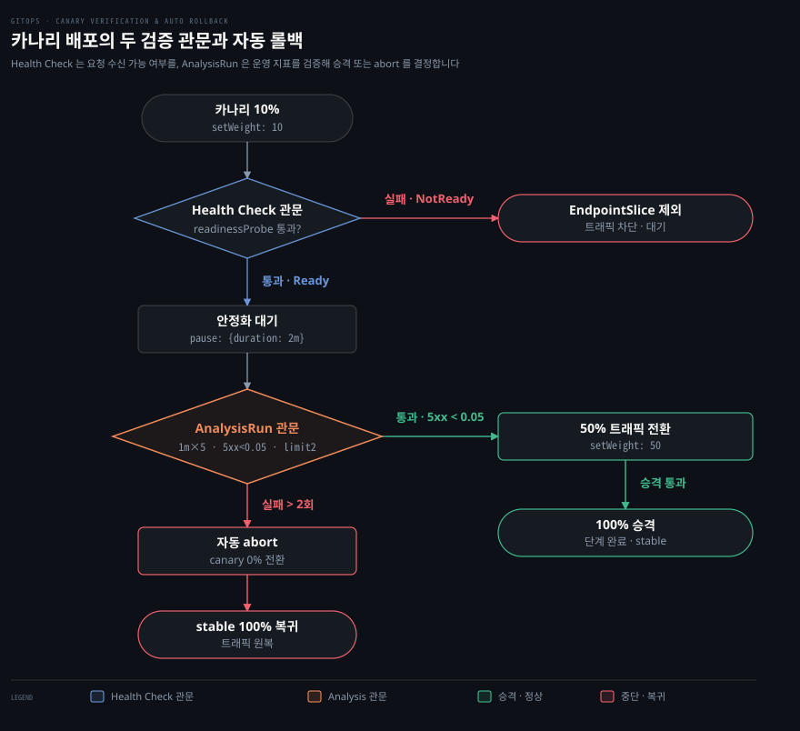

# 배포 검증과 자동 롤백 — Health Check 와 Analysis

---

> Pod 가 트래픽을 받을 수 있는지 확인하는 Health Check 와 실제 운영 지표가 정상인지 검증하는 Analysis 는 역할이 다릅니다. Argo Rollouts 는 `AnalysisTemplate` 으로 지표를 주기적으로 판정해 이상 시 카나리 승격을 멈추고 stable 버전으로 자동 복귀합니다.

## 학습 목표와 범위

> 읽고 나면 Probe 기반 Health Check 와 메트릭 기반 Analysis 의 경계를 가르고 `AnalysisTemplate` 으로 자동 롤백 조건을 설계할 수 있습니다. Rollout 기본 설정과 자동 롤백 뒤 Git 을 맞추는 절차는 앞뒤 편으로 넘깁니다.

시리즈 안내: [01-01 전략 비교](./01-01.%EB%B0%B0%ED%8F%AC%20%EC%A0%84%EB%9E%B5%20%EB%B9%84%EA%B5%90%20%E2%80%94%20Rolling%C2%B7Recreate%C2%B7Blue-Green%C2%B7Canary%C2%B7A-B%C2%B7Shadow.md) → [01-02 Argo CD 와 Rollouts](./01-02.Argo%20CD%20%EC%99%80%20Argo%20Rollouts%20%E2%80%94%20%EB%8F%99%EA%B8%B0%ED%99%94%EC%99%80%20%EC%A0%90%EC%A7%84%EC%A0%81%20%EB%B0%B0%ED%8F%AC%EC%9D%98%20%EC%97%AD%ED%95%A0%20%EB%82%98%EB%88%94.md) → **01-03 검증과 자동 롤백** → [01-04 롤백 정책](./01-04.%EB%B0%B0%ED%8F%AC%20%EB%A1%A4%EB%B0%B1%20%EC%A0%95%EC%B1%85%EA%B3%BC%20%EB%A9%94%EC%BB%A4%EB%8B%88%EC%A6%98.md)

1. Pod 의 `readinessProbe` 통과만으로 배포 성공을 보장할 수 없는 이유를 트래픽 유입과 장애 전파 순서로 설명할 수 있습니다.
2. `setWeight` 부터 `AnalysisRun` 판정과 `abort` 까지 이어지는 자동 롤백 흐름을 단계별로 추적할 수 있습니다.
3. `AnalysisTemplate` 의 `interval`, `count`, `failureLimit` 설정으로 판정 결과를 예측할 수 있습니다.
4. Prometheus 쿼리의 라벨 전제, 저트래픽 오차, Error Budget 기준으로 안전한 분석 조건을 작성할 수 있습니다.


## 1. Pod 기동 성공과 배포 실패의 간극

> 신규 버전 Pod 가 `Running` 이고 `readinessProbe` 까지 통과해도 실제 API 요청에서 HTTP 5xx 오류나 응답 지연을 일으킬 수 있습니다. Health Check 는 기동과 수신 준비만 확인하므로 운영 지표를 검증하는 Analysis 가 따로 필요합니다.

### readinessProbe 가 통과한 뒤 터지는 장애

신규 카나리 Pod 가 `/readyz` 요청에 `200 OK` 를 돌려주면 kubelet 은 Pod 를 `Ready` 로 표시합니다.[^k8s-probes] EndpointSlice 컨트롤러는 이 신호를 보고 새 Pod 의 IP 를 Service 백엔드 목록에 넣습니다.[^k8s-lifecycle]

하지만 `/readyz` 가 정상이더라도 주문 API 가 직렬화 버그나 외부 쿼리 오류로 `HTTP 500` 을 반환할 수 있습니다. 이 경우 컨테이너 프로세스는 살아 있으므로 `livenessProbe` 도 실패하지 않습니다. Pod 는 `Ready` 를 유지한 채 오류 응답을 계속 내보냅니다.

### Probe 와 Analysis 역할 비교

| 구분 | Health Check (Probe) | Analysis (Metric) |
|---|---|---|
| 검증 대상 | 프로세스 기동·포트 응답·트래픽 수신 가능 여부 | HTTP 5xx 오류율·P95 지연·자원 급증·비즈니스 지표 |
| 판단 주체 | 노드의 kubelet (`startup`·`liveness`·`readiness`) | Argo Rollouts 컨트롤러 (`AnalysisRun`) |
| 실패 시 동작 | 컨테이너 재시작 또는 EndpointSlice 제외 | 카나리 진행 중단(`abort`) 및 stable 복귀 또는 일시 정지 |
| 한계 | 비즈니스 로직 오류와 전체 응답 품질을 보지 못함 | 메트릭 수집 지연과 저트래픽 구간 오탐에 취약함 |

따라서 두 검증은 대체 관계가 아니라 순서대로 작동하는 이중 관문입니다. `livenessProbe` 와 `startupProbe` 의 백오프 동작은 [liveness·startup probe 노트](../../../08_cloud/book/kubernetes-in-action/06-02.liveness%C2%B7startup%20probe%EB%A1%9C%20%EC%BB%A8%ED%85%8C%EC%9D%B4%EB%84%88%20%EA%B1%B4%EA%B0%95%20%EC%9C%A0%EC%A7%80.md)에서 다룹니다. `minReadySeconds` 로 결함 확산을 늦추는 원리는 [rollout 제어와 배포 전략 노트](../../../08_cloud/book/kubernetes-in-action/15-03.rollout%20%EC%A0%9C%EC%96%B4%EC%99%80%20%EB%B0%B0%ED%8F%AC%20%EC%A0%84%EB%9E%B5%20%E2%80%94%20pause%C2%B7faulty%C2%B7rollback%C2%B7%EC%A0%84%EB%9E%B5%205%EC%A2%85.md)에서 볼 수 있습니다.


## 2. 카나리 검증과 자동 롤백 흐름

> 카나리 배포는 Health Check 관문과 Analysis 관문을 차례로 통과해야 트래픽 비중을 올립니다. 두 번째 관문인 `AnalysisRun` 이 실패 판정을 내리면 Rollout 은 `abort` 를 실행해 트래픽을 stable 100% 로 되돌립니다.

아래 흐름도는 `setWeight: 10` 직후 두 관문이 승격과 `abort` 를 가르는 경로를 보여 줍니다.



파란색 마름모가 첫째 관문인 Health Check 이고 주황색 마름모가 둘째 관문인 Analysis 입니다. 둘째 관문에서 실패 횟수가 `failureLimit` 인 `2` 를 넘으면 빨간색 경로를 따라 자동 중단과 트래픽 원복이 일어납니다.

### 첫째 관문인 readinessProbe 와 안정화 대기

Rollout 이 `setWeight: 10` 단계에 들어가면 먼저 카나리 ReplicaSet 의 Pod 가 `readinessProbe` 를 통과해야 합니다. 통과하지 못하면 EndpointSlice 에서 빠져 트래픽이 들어가지 않고 진행도 멈춥니다.

Pod 가 `Ready` 가 된 뒤 바로 지표를 조회하면 Prometheus 스크랩 주기가 채 돌지 않아 표본이 비어 있습니다. 그래서 `analysis` 단계 앞에 `pause: {duration: 2m}` 같은 안정화 대기 구간을 둡니다. 이 시간 동안 10% 실사용 트래픽이 쌓여 다음 관문의 입력이 됩니다.

### 둘째 관문인 AnalysisRun 과 자동 abort

안정화 대기가 끝나면 컨트롤러가 `AnalysisTemplate` 을 바탕으로 `AnalysisRun` 리소스를 생성합니다.[^argo-analysis] 1분 간격으로 5회 측정하며 `HTTP 5xx` 비율이 `0.05` 미만인지 검사합니다. 모든 측정을 무사히 넘겨 `Successful` 이 되면 `setWeight: 50` 단계를 거쳐 `stable` 로 100% 승격합니다.

반대로 실패가 허용 횟수를 넘으면 `AnalysisRun` 상태가 `Failed` 가 됩니다. 이때 Argo Rollouts 는 즉시 배포를 `abort` 하고 카나리 가중치를 `0` 으로 낮춥니다. 트래픽은 전량 stable 버전으로 돌아가고 Rollout 상태는 `Degraded` 로 바뀝니다.

주의할 점은 자동 `abort` 가 클러스터 트래픽만 되돌릴 뿐 Git 저장소 매니페스트는 고치지 않는다는 사실입니다. 자동 롤백 뒤 Git 과 클러스터 상태를 다시 맞추는 절차는 [01-04.배포 롤백 정책과 메커니즘](./01-04.%EB%B0%B0%ED%8F%AC%20%EB%A1%A4%EB%B0%B1%20%EC%A0%95%EC%B1%85%EA%B3%BC%20%EB%A9%94%EC%BB%A4%EB%8B%88%EC%A6%98.md)에서 다룹니다.


## 3. AnalysisTemplate 구조와 판정

> `AnalysisTemplate` 은 무엇을 얼마나 자주 측정하고 어떤 조건에서 실패로 볼지 정의하는 명세입니다. 특히 `failureLimit` 은 실패 처리 전까지 허용하는 최대 실패 횟수이므로 `2` 로 두면 세 번째 실패에서 중단됩니다.

카나리 분석을 구성할 때 `failureLimit: 2` 를 두 번 실패 시 중단으로 오해해 장애가 길어지는 일이 잦습니다. 공식 API 명세와 컨트롤러 소스를 기준으로 실행 방식과 필드 경계값을 정확히 잡아야 합니다.[^argo-types]

### CRD 역할과 인라인·백그라운드 실행 방식

Argo Rollouts 는 분석 명세와 실행 기록을 별도 CRD 로 나눕니다. **AnalysisTemplate** 은 네임스페이스 안에서 재사용하는 분석 명세입니다. **ClusterAnalysisTemplate** 은 클러스터 전역에서 공유하는 명세이고, **AnalysisRun** 은 실제 배포마다 생성되는 일회성 실행 리소스입니다.

실행 시점은 두 가지로 갈립니다.

- 인라인 분석(Inline Analysis): `steps` 배열 안에 `- analysis:` 항목으로 넣습니다. 해당 단계에 도달했을 때 `AnalysisRun` 을 시작하고 끝날 때까지 다음 단계로 넘어가지 않습니다.
- 백그라운드 분석(Background Analysis): `strategy.canary.analysis` 에 정의합니다. `startingStep` 으로 시작 시점을 정하며, 카나리 진행 중 뒤에서 지표를 계속 검사하다 이상 시 즉시 중단합니다.

`count: 0` 의 동작은 두 방식에서 다릅니다. 백그라운드 분석에서는 Rollout 이 끝날 때까지 무한히 측정하라는 뜻입니다. 반면 인라인 분석에 `count: 0` 을 두면 분석 자체가 실행되지 않습니다.[^argo-analysis]

### 핵심 필드와 경계값 판정 규칙

`Metric` 스펙의 주요 필드와 Argo Rollouts v1.10.2 기준 기본값은 다음과 같습니다.[^argo-types]

| 필드 | 의미 | 기본값과 경계 규칙 |
|---|---|---|
| `interval` | 연속 측정 사이의 대기 시간 | 생략하고 `count` 도 없으면 1회만 측정하고 종료 |
| `count` | 총 측정 횟수 | `interval` 만 두고 생략하면 중단 전까지 계속 실행 |
| `initialDelay` | `AnalysisRun` 시작 후 첫 측정 전 대기 | 메트릭별로 초기 워밍업 지연 부여 가능 |
| `successCondition` | 측정 1회가 성공인지 판정하는 불리언 식 | Expr 문법 사용. 예: `result[0] < 0.05` |
| `failureCondition` | 측정 1회가 실패인지 명시하는 불리언 식 | `successCondition` 과 함께 둘 때 둘 다 거짓이면 `Inconclusive` |
| `failureLimit` | 허용하는 최대 실패 측정 횟수 | 기본 `0`. `result.Failed > failureLimit` 일 때 전체 `Failed`[^argo-logic] |
| `inconclusiveLimit` | 허용하는 최대 미결(`Inconclusive`) 횟수 | 기본 `0`. 초과 시 전체 `Inconclusive` 로 끝나며 Rollout 일시 정지 |
| `consecutiveErrorLimit` | 연속 측정 에러(쿼리 타임아웃 등) 허용 횟수 | 기본 `4`. 5회 연속 에러 시 전체 `Error` 로 끝나며 `abort` |

여기서 `failureLimit: 2` 는 "실패 2회 시 중단"이 아니라 "2회까지 허용하고 3회째 실패 시 중단"을 뜻합니다. 컨트롤러 코드가 `result.Failed > failureLimit` 조건으로 비교하기 때문입니다.[^argo-logic]

두 조건을 함께 두었을 때 어느 쪽도 참이 아니거나, 두 조건을 모두 생략하면 결과는 **Inconclusive** 로 남습니다. 반면 아래 예제처럼 `successCondition` 만 단독으로 두면 조건이 거짓일 때 곧바로 `Failed` 가 됩니다. `AnalysisRun` 이 `Inconclusive` 로 끝나면 Rollout 은 `abort` 되지 않습니다. 대신 현재 단계에서 `Paused` 상태로 멈춰 운영자의 수동 판단을 기다립니다.[^argo-analysis]

### YAML 예제와 인라인 검증 연결

아래는 1분 간격으로 5회 동안 5xx 오류율 5% 미만을 검증하는 `AnalysisTemplate` 부분 설정 예제입니다. `Rollout` 의 기본 필드와 트래픽 라우터 연동은 [01-02 편](./01-02.Argo%20CD%20%EC%99%80%20Argo%20Rollouts%20%E2%80%94%20%EB%8F%99%EA%B8%B0%ED%99%94%EC%99%80%20%EC%A0%90%EC%A7%84%EC%A0%81%20%EB%B0%B0%ED%8F%AC%EC%9D%98%20%EC%97%AD%ED%95%A0%20%EB%82%98%EB%88%94.md)에서 다룹니다.

```yaml
# HTTP 5xx 오류율을 1분 간격 5회 검사해 2회 초과 실패 시 중단하는 AnalysisTemplate
apiVersion: argoproj.io/v1alpha1
kind: AnalysisTemplate
metadata:
  name: error-rate-check
spec:
  args:
    - name: latest-hash  # Rollout 에서 새 ReplicaSet 해시를 주입받는 인자
  metrics:
    - name: error-rate
      interval: 1m       # 측정 주기
      count: 5           # 총 5회 측정 (5분간 검증)
      successCondition: len(result) == 0 || result[0] < 0.05
      failureLimit: 2    # 2회까지 실패 허용, 3회째 실패 시 AnalysisRun Failed
      provider:
        prometheus:
          address: http://prometheus.monitoring:9090
          query: |
            sum(rate(http_requests_total{
              status=~"5..",
              rollouts_pod_template_hash="{{args.latest-hash}}"
            }[5m]))
            /
            clamp_min(
              sum(rate(http_requests_total{
                rollouts_pod_template_hash="{{args.latest-hash}}"
              }[5m])),
              0.001
            )
```

이제 위 템플릿을 `Rollout` 의 카나리 `steps` 안에 인라인 단계로 연결하는 부분 설정입니다.

```yaml
# setWeight 10 이후 2분 안정화 대기를 거쳐 error-rate-check 를 실행하는 Rollout steps 발췌
strategy:
  canary:
    steps:
      - setWeight: 10
      - pause:
          duration: 2m   # 초기 스크랩 표본 확보를 위한 대기
      - analysis:
          templates:
            - templateName: error-rate-check
          args:
            - name: latest-hash
              valueFrom:
                podTemplateHashValue: Latest  # 컨트롤러가 카나리 ReplicaSet 해시 자동 주입
      - setWeight: 50
      - pause:
          duration: 5m   # 마지막 단계 통과 후 컨트롤러가 stable 로 100% 승격
```

이 구성에서는 `setWeight: 10` 직후 2분 동안 기다린 다음 5분간(`1m × 5회`) `error-rate-check` 가 실행됩니다. 5회 중 실패가 2회 이하이면 `setWeight: 50` 으로 넘어가고, 3회 실패하면 그 자리에서 `abort` 됩니다.


## 4. Prometheus 쿼리 전제와 저트래픽 함정

> PromQL 이 카나리 트래픽만 분리하려면 Pod 나 메트릭에 버전 구분 라벨이 있어야 합니다. 요청이 아주 적은 구간에서는 분모 0 나눗셈과 빈 벡터 `[]` 반환으로 오탐이 나므로 방어 식을 넣어야 합니다.

### 카나리 메트릭 분리와 라벨 전제

실무에서 `version="canary"` 같은 고정 라벨을 PromQL 에 그대로 넣었다가 빈 그래프만 보는 사례가 많습니다. Argo Rollouts 컨트롤러는 카나리 Pod 에 `version="canary"` 라벨을 자동으로 붙이지 않습니다. 대신 ReplicaSet 마다 고유한 `rollouts-pod-template-hash` 라벨을 부여합니다.

고정 라벨을 쓰려면 ServiceMonitor 나 Istio `destination_service` 가 카나리 서비스 이름을 분리해 줘야 합니다. Pod 해시 라벨을 쓰려면 Prometheus 스크랩 설정으로 `rollouts_pod_template_hash` 를 메트릭에 복사합니다. 그다음 `podTemplateHashValue: Latest` 인자를 넘기면 컨트롤러가 새 ReplicaSet 해시로 자동 치환합니다.[^argo-analysis]

### 저트래픽 구간의 0 나눗셈과 빈 벡터 방어

트래픽이 뜸한 야간이나 스테이징 환경에서는 두 가지 오류 패턴이 나타납니다.

- 분모 0 나눗셈(`NaN`): 전체 요청 `rate` 가 `0` 이면 `0 / 0` 이 되어 Prometheus 가 `NaN` 을 돌려줍니다. `clamp_min(분모, 0.001)` 로 분모 하한을 두면 `0 / 0.001 = 0` 이 되어 `NaN` 을 피할 수 있습니다.
- 빈 벡터(`[]`) 인덱스 에러: 카나리 Pod 가 뜬 직후라 아예 해당 라벨의 시계열이 없으면 Prometheus 는 빈 배열 `[]` 을 반환합니다. 이때 `result[0] < 0.05` 만 적으면 인덱스 참조가 실패해 측정이 `Error` 로 빠집니다.

공식 문서는 정책에 따라 빈 배열 허용 식과 실패 식을 갈라 쓰도록 안내합니다.[^argo-analysis] 요청 없는 상태를 통과로 보려면 `len(result) == 0 || result[0] < 0.05` 를 씁니다. 반대로 데이터 부재를 실패로 보려면 `len(result) > 0 && result[0] < 0.05` 로 씁니다.

또 하나 유의할 점은 **소수 표본 왜곡**입니다. 5분 창에서 요청이 2건뿐인데 그중 1건이 `500` 이면 오류율이 `50%` 로 계산됩니다. 저트래픽 서비스에서는 `sum(increase(...)) >= 20` 같은 최소 요청 수 조건을 함께 확인해야 합니다. 또는 `failureLimit` 과 관찰 창 길이를 늘려 표본을 확보합니다.


## 5. SLI·SLO·Error Budget 연결

> `successCondition` 의 임계값을 감으로 정하면 정상 변동에 배포가 막히거나 장애 배포가 통과합니다. 서비스의 SLI 와 Error Budget 소진 속도를 기준으로 허용 오류율과 관찰 창을 정해야 합니다.

### 정적 임계값 대신 SLO 기반 기준 세우기

운영 서비스의 신뢰성 목표는 세 지표로 정의합니다.

- **SLI**: 측정 지표로, 전체 요청 대비 정상 응답 비율 같은 실측값입니다.
- **SLO**: 목표 수치로, 일정 기간 동안 달성해야 하는 SLI 하한선입니다.
- **Error Budget**: 허용 실패 예산으로, `100% - SLO` 에 해당하는 실패 권리입니다.

예를 들어 30일 가용성 SLO 가 `99.9%` 라면 한 달 동안 전체 요청의 `0.1%` 만 실패할 수 있습니다. SLI·SLO 와 Burn Rate 계산식은 [SLO와 알림 노트](../../../06_observability/01_Foundations/01-04.SLO%EC%99%80%20%EC%95%8C%EB%A6%BC%20%E2%80%94%20Error%20Budget,%20Burn%20Rate.md)에서 자세히 다룹니다.

카나리 분석에 이 개념을 연결하면 임계값 근거가 분명해집니다. 트래픽 `10%` 를 받는 카나리에서 오류율 `5%` 가 5분간 이어지면 전체 서비스 관점에서는 순간 `0.5%` 오류율이 발생합니다. 이는 한 달 Error Budget 을 빠르게 태우는 수준이므로 즉시 `abort` 해야 할 신호가 됩니다. 반대로 평소 정상 노이즈가 `0.3%` 인 배치·연동 API 에 `0.1%` 임계값을 걸면 배포마다 오탐 롤백이 반복됩니다.

### 검증 지표 유형과 SLO 연결 기준

| 검증 항목 | 대표 신호 | 판정 방식과 SLO 연결 포인트 |
|---|---|---|
| HTTP 5xx | 서버 오류 비율 | 가용성 SLI 직결. `result[0] < 0.05` 같은 오류율 상한으로 제어 |
| Latency | P95·P99 응답 시간 | 지연 SLO 연결. 히스토그램 버킷 기반 `histogram_quantile` 사용 |
| CPU·Memory | 자원 사용률 급증 | 장애 원인 보조 지표. 누수나 OOM 전조 시 `failureCondition` 설정 |
| Application Metrics | 결제·주문 실패 건수 | 비즈니스 SLI. 인프라가 정상이어도 기능 결함 시 차단 |


## 6. 한계와 다루지 않은 것

> 메트릭 기반 자동 분석은 수집 지연과 비동기 처리 결함을 놓칠 수 있고 Git 저장소 상태를 되돌리지 않습니다. Rollout 기본 구조와 자동 롤백 뒤 Git 을 맞추는 작업은 시리즈의 다른 편에서 다룹니다.

자동 분석에는 세 가지 한계가 있습니다.

- 수집 지연과 콜드 스타트: 메트릭 스크랩 주기와 JVM 워밍업 구간이 겹치면 초기 지연이 높아져 정상 버전이 `abort` 될 수 있습니다.
- 비동기 워크로드 사각지대: 카프카 컨슈머나 배치 워커는 HTTP 응답 코드가 없으므로 컨슈머 랙이나 실패 카운터를 따로 붙여야 합니다.
- 극저트래픽 환경의 표본 부족: 트래픽이 너무 적어 고정 임계값이 흔들리면 `Experiment` 로 baseline 과 canary 를 나란히 비교해야 합니다.

`Rollout` CRD 기본 구조와 `stableService`·`canaryService` 분리는 [01-02 편](./01-02.Argo%20CD%20%EC%99%80%20Argo%20Rollouts%20%E2%80%94%20%EB%8F%99%EA%B8%B0%ED%99%94%EC%99%80%20%EC%A0%90%EC%A7%84%EC%A0%81%20%EB%B0%B0%ED%8F%AC%EC%9D%98%20%EC%97%AD%ED%95%A0%20%EB%82%98%EB%88%94.md)에서 다룹니다. 자동 `abort` 가 일어난 뒤 Git 과 클러스터가 어긋난 상태를 복구하는 절차는 [01-04 편](./01-04.%EB%B0%B0%ED%8F%AC%20%EB%A1%A4%EB%B0%B1%20%EC%A0%95%EC%B1%85%EA%B3%BC%20%EB%A9%94%EC%BB%A4%EB%8B%88%EC%A6%98.md)에서 다룹니다.


## 7. 관련 실습

> 이 문서는 배포 검증 경계와 `AnalysisTemplate` 판정 기준을 다룬 개념 문서로 별도 실습 저장소를 두지 않습니다.

실제 동작을 확인하려면 로컬 kind 클러스터에 Argo Rollouts 와 Prometheus 를 띄운 뒤 검증합니다. `/readyz` 는 `200 OK` 를 반환하지만 `/api` 요청에 `HTTP 500` 을 내보내는 카나리 이미지를 배포합니다. `setWeight: 10` 과 `pause: 2m` 뒤 `AnalysisRun` 이 3회 실패로 자동 `abort` 되는지 관찰합니다. Rollout 상태가 `Degraded` 로 바뀌는 모습은 `kubectl argo rollouts get rollout <이름> --watch` 로 확인합니다.


## 8. 검증과 복습

> 회차별 자답과 복습 기록은 본문에 쌓지 않고 `_review/` 경로에 남깁니다.

- **Phase 4 결과**: 미진행 (초안 작성 직후)
- **다음 보완점**: 로컬 클러스터에서 `Inconclusive` 판정 시 Rollout 이 `Paused` 상태로 머무는 장면을 로그로 확인해 보강합니다.


## 핵심 개념 점검

> 답을 보기 전에 아래 네 질문에 먼저 자답해 보세요.

1. 신규 카나리 Pod 가 `readinessProbe` 를 통과해 `Ready` 상태가 되었음에도 배포가 실패할 수 있는 이유는 무엇입니까?
2. `interval: 1m`, `count: 5`, `failureLimit: 2` 로 설정한 `AnalysisTemplate` 은 몇 번째 실패 측정에서 `Failed` 가 됩니까?
3. `successCondition` 과 `failureCondition` 을 모두 만족하지 못한 측정이 나오면 Rollout 은 어떤 상태로 바뀝니까?
4. 저트래픽 환경에서 카나리 Pod 를 검증하는 PromQL 에 `clamp_min` 과 `len(result)` 방어 식을 함께 넣어야 하는 이유는 무엇입니까?


## 정답 (자답 후 펼치기)

> 위 핵심 개념 점검 질문 4개에 먼저 자답한 뒤 아래를 읽으세요.

### 정답 1 — Probe 와 Analysis 차이

`readinessProbe` 는 컨테이너가 요청을 받을 수 있는 최소 기동 상태만 확인하기 때문입니다. `/readyz` 가 `200 OK` 를 돌려주어 EndpointSlice 에 등록되더라도 실제 비즈니스 요청 경로에서 `HTTP 500` 오류나 응답 지연이 발생할 수 있으므로, 운영 메트릭을 검사하는 `Analysis` 관문이 따로 필요합니다.

### 정답 2 — failureLimit 경계값

3회째 실패 측정에서 `Failed` 가 됩니다. 왜냐하면 `failureLimit` 은 실패 처리 전까지 허용하는 최대 실패 횟수이고, Argo Rollouts 컨트롤러는 `result.Failed > failureLimit` 조건을 넘을 때만 `Failed` 로 전환하기 때문입니다.

### 정답 3 — Inconclusive 판정 동작

자동 `abort` 되지 않고 `Paused` 상태로 일시 정지합니다. 두 조건을 함께 두었을 때 어느 쪽도 만족하지 못한 측정은 `Inconclusive` 로 판정됩니다. 이 횟수가 `inconclusiveLimit`(기본 `0`)을 넘으면 `AnalysisRun` 이 `Inconclusive` 로 끝나고 운영자의 수동 재개나 중단을 기다립니다.

### 정답 4 — 저트래픽 0 나눗셈과 빈 벡터 방어

요청이 전혀 없을 때 발생하는 두 가지 평가 오류를 막기 위해서입니다. 기존 시계열의 `rate` 가 `0` 이면 `clamp_min` 이 `0 / 0` 으로 인한 `NaN` 을 막아 줍니다. 아직 시계열 자체가 수집되지 않아 Prometheus 가 빈 벡터 `[]` 를 돌려주면 `len(result)` 조건이 `result[0]` 인덱스 참조 에러를 막아 줍니다.


## 참고 자료

[^k8s-probes]: Kubernetes 공식 문서 [Configure Liveness, Readiness and Startup Probes](https://v1-34.docs.kubernetes.io/docs/tasks/configure-pod-container/configure-liveness-readiness-startup-probes/) — `readinessProbe` 의 트래픽 수신 제어 동작.
[^k8s-lifecycle]: Kubernetes 공식 문서 [Pod Lifecycle](https://v1-34.docs.kubernetes.io/docs/concepts/workloads/pods/pod-lifecycle/) — `Ready` condition 과 서비스 엔드포인트 반영 관계.
[^argo-analysis]: Argo Rollouts v1.10.2 공식 문서 [Analysis & Progressive Delivery](https://github.com/argoproj/argo-rollouts/blob/v1.10.2/docs/features/analysis.md) — Inline·Background 분석, `count: 0`, `Inconclusive`, 빈 배열 처리.
[^argo-types]: Argo Rollouts v1.10.2 소스 [`analysis_types.go`](https://github.com/argoproj/argo-rollouts/blob/v1.10.2/pkg/apis/rollouts/v1alpha1/analysis_types.go#L90-L128) — `Metric` 필드 구조와 `failureLimit`·`inconclusiveLimit`·`consecutiveErrorLimit` 기본값.
[^argo-logic]: Argo Rollouts v1.10.2 소스 [`analysis.go`](https://github.com/argoproj/argo-rollouts/blob/v1.10.2/analysis/analysis.go#L658-L686) — `result.Failed > failureLimit` 및 `Inconclusive`·`ConsecutiveError` 비교 로직.

- [01-02.Argo CD 와 Argo Rollouts — 동기화와 점진적 배포의 역할 나눔](./01-02.Argo%20CD%20%EC%99%80%20Argo%20Rollouts%20%E2%80%94%20%EB%8F%99%EA%B8%B0%ED%99%94%EC%99%80%20%EC%A0%90%EC%A7%84%EC%A0%81%20%EB%B0%B0%ED%8F%AC%EC%9D%98%20%EC%97%AD%ED%95%A0%20%EB%82%98%EB%88%94.md) — `Rollout` 기본 구조와 `setWeight`·트래픽 라우터 연동
- [01-04.배포 롤백 정책과 메커니즘](./01-04.%EB%B0%B0%ED%8F%AC%20%EB%A1%A4%EB%B0%B1%20%EC%A0%95%EC%B1%85%EA%B3%BC%20%EB%A9%94%EC%BB%A4%EB%8B%88%EC%A6%98.md) — 자동 `abort` 뒤 Git 과 클러스터 상태를 다시 맞추는 절차
- [liveness·startup probe로 컨테이너 건강 유지](../../../08_cloud/book/kubernetes-in-action/06-02.liveness%C2%B7startup%20probe%EB%A1%9C%20%EC%BB%A8%ED%85%8C%EC%9D%B4%EB%84%88%20%EA%B1%B4%EA%B0%95%20%EC%9C%A0%EC%A7%80.md) — Probe 종류별 동작과 지수 백오프 원리
- [SLO와 알림 — Error Budget, Burn Rate](../../../06_observability/01_Foundations/01-04.SLO%EC%99%80%20%EC%95%8C%EB%A6%BC%20%E2%80%94%20Error%20Budget,%20Burn%20Rate.md) — SLI·SLO·Error Budget 과 Burn Rate 계산
- [점진적 배포 Canary와 claude-context](../../book/aic_ai-infra-claude/06-02.%EC%A0%90%EC%A7%84%EC%A0%81%20%EB%B0%B0%ED%8F%AC%20Canary%EC%99%80%20claude-context.md) — Canary `steps` 구성과 `abort` 실습 맥락
