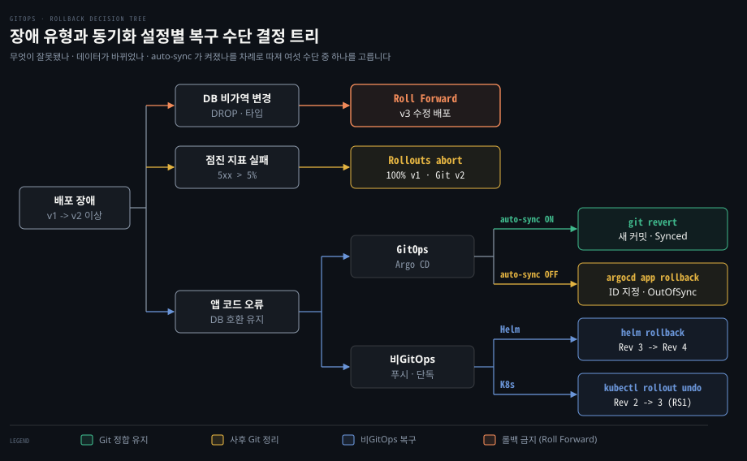

# 배포 롤백 정책과 메커니즘

---

> GitOps 환경에서는 클러스터만 되돌리면 자동 동기화가 장애 버전을 다시 밀어 올립니다. 복구 수단 선택과 Git 재일치 절차, DB 호환성까지 함께 설계해야 합니다.

## 학습 목표와 범위

> 장애 성격에 맞는 복구 수단을 고르고, Argo Rollouts 중단이나 Argo CD 롤백 뒤 Git 과 클러스터 상태를 다시 맞추는 절차를 설계합니다. 배포 전략 비교는 01-01 편에서, Analysis 세부 설정은 01-03 편에서 다룹니다.

시리즈 안내: [01-01 전략 비교](./01-01.%EB%B0%B0%ED%8F%AC%20%EC%A0%84%EB%9E%B5%20%EB%B9%84%EA%B5%90%20%E2%80%94%20Rolling%C2%B7Recreate%C2%B7Blue-Green%C2%B7Canary%C2%B7A-B%C2%B7Shadow.md) → [01-02 Argo CD 와 Rollouts](./01-02.Argo%20CD%20%EC%99%80%20Argo%20Rollouts%20%E2%80%94%20%EB%8F%99%EA%B8%B0%ED%99%94%EC%99%80%20%EC%A0%90%EC%A7%84%EC%A0%81%20%EB%B0%B0%ED%8F%AC%EC%9D%98%20%EC%97%AD%ED%95%A0%20%EB%82%98%EB%88%94.md) → [01-03 검증과 자동 롤백](./01-03.%EB%B0%B0%ED%8F%AC%20%EA%B2%80%EC%A6%9D%EA%B3%BC%20%EC%9E%90%EB%8F%99%20%EB%A1%A4%EB%B0%B1%20%E2%80%94%20Health%20Check%20%EC%99%80%20Analysis.md) → **01-04 롤백 정책**

1. Rollback 과 Roll Forward, Traffic Rollback, Feature Flag 끄기를 구분하고 Roll Forward 선택 기준을 판단할 수 있습니다.
2. ReplicaSet `rollout undo` 와 `argocd app rollback`, Rollouts `abort`, `git revert`, `helm rollback` 의 동작과 제약을 비교할 수 있습니다.
3. Rollouts 자동 중단(`abort`) 이나 `argocd app rollback` 뒤 Git 과 클러스터가 어긋나는 양상을 구분하고 재일치 절차를 실행할 수 있습니다.
4. 비가역적 DB 스키마 변경에서 Expand and Contract 패턴과 Release Freeze 로 롤백 불가 상황을 예방할 수 있습니다.


## 1. 복구 방식 구분과 클러스터 충돌

> 배포 장애를 되돌릴 때 이전 이미지 복원만 떠올리면 DB 장애가 악화되거나 GitOps 동기화 루프에 부딪힙니다.

배포 직후 오류가 터졌을 때 `kubectl rollout undo` 로 이전 파드만 띄우면 끝날 것 같지만 두 가지 장벽에 부딪힙니다. 첫째는 이미 바뀐 DB 스키마 때문에 구버전 앱이 깨지는 문제입니다. 둘째는 Git 선언 상태를 기준으로 클러스터를 덮어쓰는 GitOps 컨트롤러와의 충돌입니다.

### 복구 방식 구분과 Roll Forward 기준

장애 복구는 항상 이전 버전으로 되돌리는 단일 행위가 아닙니다. 문제의 위치와 되돌릴 수 있는 범위에 따라 다섯 가지 주요 방식을 가릅니다.

| 복구 방식 | 동작 | 주로 쓰는 상황 |
|---|---|---|
| Rollback | 이전 안정 버전(`v1`)으로 워크로드를 복원 | 신규 애플리케이션 코드 결함 |
| Roll Forward | 결함을 고친 새 버전(`v3`)을 수정 배포 | DB 스키마 변경 등으로 롤백이 더 위험한 경우 |
| Traffic Rollback | 라우팅 가중치·선택자만 기존 버전으로 복귀 | Canary·Blue-Green 배포 중 이상 |
| Feature Flag 끄기 | 재배포 없이 문제 기능의 활성화 토글만 차단 | 특정 기능 플래그에 국한된 장애 |
| Database Rollback | 마이그레이션 다운 스크립트나 보정 쿼리 실행 | 비파괴적 스키마·데이터 오류 |

실행 주체에 따라 두 가지 제어 형태로도 나눕니다. 자동 롤백(Automatic Rollback)은 관측 지표 임계치로 무인 배포 피해를 줄입니다. 수동 롤백(Manual Rollback)은 운영자가 원인을 판단해 승인 기반으로 복구할 때 씁니다.

**Rollback** 은 `v1 → v2(장애) → v1` 경로로 검증된 과거 상태로 돌아가므로 복구가 빠릅니다. 반면 **Roll Forward** 는 `v1 → v2(장애) → v3(수정)` 경로로 새 버전을 만들어 나갑니다.

Roll Forward 를 고르는 기준은 세 가지입니다.
- **비가역 스키마 변경**: `v2` 가 컬럼을 삭제했거나 데이터 형식을 바꿔 `v1` 코드가 현재 DB 를 읽을 수 없을 때 선택합니다.
- **데이터 손상 위험**: `v2` 가 새로 쓴 레코드를 `v1` 이 처리하다 덮어쓰거나 누락할 가능성이 있을 때 선택합니다.
- **단순 핫픽스 우위**: 롤백 스크립트를 검증하는 시간보다 1~2줄 수정 후 `v3` 를 배포하는 편이 더 빠르고 안전할 때 선택합니다.

### 클러스터만 되돌릴 때 생기는 GitOps 충돌

푸시 기반 배포에서는 `kubectl rollout undo` 나 `helm rollback` 으로 클러스터 워크로드만 즉시 되돌렸습니다. 그러나 **GitOps** 는 Git 저장소를 선언적 배포의 단일 진실 원천(SSOT, Single Source of Truth)으로 삼습니다.

클러스터 상태만 과거 버전으로 돌리면 Git 선언과 클러스터 실제 상태가 달라지는 **드리프트**(drift)가 발생합니다. Argo CD 는 이 상태를 `OutOfSync` 로 표시합니다.

Argo CD 의 `syncPolicy.automated` 가 켜져 있으면 상황은 더 까다로워집니다. Argo CD 공식 문서는 자동 동기화가 켜진 Application 에 대해 롤백 실행을 금지합니다.[^argocd-autosync] UI 에서 Rollback 을 누르면 Argo CD 가 먼저 자동 동기화를 끕니다. 그 결과 이후 새 커밋을 푸시해도 자동 배포가 멈춘 채 방치될 위험이 생깁니다.

`selfHeal` 이 켜진 상태에서는 `kubectl` 로 클러스터만 되돌려도 컨트롤러가 곧바로 Git 의 `v2` 로 덮어씁니다. 따라서 GitOps 환경의 롤백 정책은 클러스터 차단과 함께 Git 정합성 복구까지 포함해야 합니다.


## 2. 롤백 메커니즘 다섯 가지

> 롤백 도구는 쿠버네티스 워크로드, Helm 릴리스, Argo CD 이력, Argo Rollouts 트래픽, Git 커밋 등 다루는 층위가 서로 다릅니다.

각 도구가 무엇을 되돌리고 어떤 이력을 남기는지 모른 채 섞어 쓰면 복구가 도중에 막히거나 변경 이력이 사라집니다. 아래 다섯 메커니즘의 작동 범위와 전제 조건을 층위별로 짚습니다.

### Deployment 와 ReplicaSet 롤백

쿠버네티스 `Deployment` 는 파드 템플릿(`.spec.template`)이 바뀔 때마다 새 `ReplicaSet` 을 만들고 이전 것을 보관합니다. 보관 개수는 `spec.revisionHistoryLimit` 이 정하며 기본값은 10입니다.[^k8s-deploy]

```bash
# 배포 이력과 리비전별 변경 내역을 확인합니다
kubectl rollout history deployment/my-api

# 직전 리비전으로 되돌립니다
kubectl rollout undo deployment/my-api

# 특정 리비전(예: 2)으로 되돌립니다
kubectl rollout undo deployment/my-api --to-revision=2
```

`kubectl rollout undo` 는 Deployment 의 Pod 템플릿(`.spec.template`)만 이전 리비전으로 되돌립니다. 이때 기존 ReplicaSet 을 재활용하면서 Deployment 리비전 번호는 새 번호(예: 2 → 3)로 올라갑니다. 복제본 수(`replicas`), 배포 전략(`strategy`), `minReadySeconds`, `ConfigMap`, DB 스키마는 되돌리지 않습니다.[^k8s-deploy]

롤아웃이 `pause` 상태인 Deployment 는 `resume` 하기 전까지 `rollout undo` 를 실행할 수 없습니다.[^k8s-deploy] 이 방식은 Argo CD 가 없거나 `selfHeal` 이 꺼진 환경에서만 유지됩니다. 상세한 동작은 [15-03 노트](../../../08_cloud/book/kubernetes-in-action/15-03.rollout%20%EC%A0%9C%EC%96%B4%EC%99%80%20%EB%B0%B0%ED%8F%AC%20%EC%A0%84%EB%9E%B5%20%E2%80%94%20pause%C2%B7faulty%C2%B7rollback%C2%B7%EC%A0%84%EB%9E%B5%205%EC%A2%85.md)에서 다룹니다.

### Helm 릴리스 롤백과 Argo CD 제약

Helm 은 배포할 때마다 릴리스 상태를 Secret 에 스냅샷으로 저장하고 리비전 번호를 1씩 올립니다. `helm rollback` 은 과거 리비전을 지우지 않고 그 매니페스트로 **새 리비전을 생성**합니다.[^helm-rollback]

```bash
# 릴리스의 배포 이력을 조회합니다
helm history my-api -n production

# 리비전 2 의 상태로 되돌립니다 (리비전 번호 생략 또는 0 이면 직전 리비전)
helm rollback my-api 2 -n production

# 롤백 후 현재 릴리스 상태와 리비전 번호를 확인합니다
helm status my-api -n production
```

예를 들어 리비전 1(`v1`), 2(`v2`), 3(`v3`)이 쌓였을 때 `helm rollback my-api 2` 를 실행합니다. 그러면 `v2` 내용을 담은 리비전 4가 새로 생깁니다. 자세한 Secret 구조와 옵션은 [Helm 릴리스 운영](../iac/Helm%20%EB%A6%B4%EB%A6%AC%EC%8A%A4%20%EC%9A%B4%EC%98%81.md)에서 다룹니다.

주의할 점은 Argo CD 로 Helm 차트를 배포할 때입니다. Argo CD 는 내부적으로 `helm template` 으로 YAML 을 렌더링해 적용하므로 클러스터에 Helm 릴리스 Secret 이 남지 않습니다.

같은 이유로 Argo CD 는 `helm.sh/hook: pre-rollback` 과 `post-rollback` 훅을 지원하지 않습니다.[^argocd-helm] Helm 롤백 훅에 의존해 DB 복구 스크립트를 실행하려는 설계는 Argo CD 에서 동작하지 않습니다.

### Argo CD History 와 app rollback

Argo CD 는 성공한 동기화 이력을 Application 상태에 기록하며 CLI 로 조회하고 되돌릴 수 있습니다.

```bash
# Application 의 동기화 이력 ID 를 확인합니다
argocd app history my-api

# 특정 이력 ID(예: 4)로 롤백합니다 (ID 생략 시 직전 이력)
argocd app rollback my-api 4
```

`argocd app history` 는 이력 ID, 배포 시각, Git 커밋 리비전을 출력합니다.[^argocd-cli-history] `argocd app rollback` 은 지정한 ID 의 Git 리비전과 파라미터를 클러스터에 다시 동기화합니다.[^argocd-cli-rollback]

실행 전 `syncPolicy.automated` 를 반드시 꺼야 합니다. 자동 동기화가 켜진 상태에서 CLI 나 API 로 롤백을 호출하면 요청이 거부됩니다. Argo CD 서버는 `rollback cannot be initiated when auto-sync is enabled` 오류를 반환합니다.[^argocd-autosync][^argocd-cli-rollback]

권한 통제가 필요하면 `argocd-cm` ConfigMap 의 `server.rbac.rollback.enforce.enable` 값을 `'true'` 로 켭니다. 기본값에서는 롤백이 `sync` 권한을 씁니다. 이 옵션을 켜면 `rollback` 권한을 따로 분리해 승인자만 되돌리게 제한할 수 있습니다.[^argocd-rbac]

### Argo Rollouts abort 와 자동 분석 요약

Argo Rollouts 는 점진적 배포 도중 문제가 나면 `abort` 로 트래픽을 즉시 안정 버전(`stable`)으로 돌립니다. Canary 와 Blue-Green 의 기본 설정은 [01-02 편](./01-02.Argo%20CD%20%EC%99%80%20Argo%20Rollouts%20%E2%80%94%20%EB%8F%99%EA%B8%B0%ED%99%94%EC%99%80%20%EC%A0%90%EC%A7%84%EC%A0%81%20%EB%B0%B0%ED%8F%AC%EC%9D%98%20%EC%97%AD%ED%95%A0%20%EB%82%98%EB%88%94.md)에서 다룹니다.

```bash
# 진행 중인 Rollout 을 즉시 중단하고 stable 버전으로 복귀합니다
kubectl argo rollouts abort my-api
```

운영 환경에서는 `AnalysisTemplate` 이 Prometheus 의 5xx 오류율이나 지연시간을 주기적으로 검사합니다. 실패가 `failureLimit` 을 초과하면 컨트롤러가 자동으로 `abort` 를 실행합니다. 그 결과 Rollout 은 `Degraded` 가 되고 트래픽 100% 는 `stable` 로 회수됩니다.[^argo-analysis] 세부 설정과 쿼리는 [01-03 편](./01-03.%EB%B0%B0%ED%8F%AC%20%EA%B2%80%EC%A6%9D%EA%B3%BC%20%EC%9E%90%EB%8F%99%20%EB%A1%A4%EB%B0%B1%20%E2%80%94%20Health%20Check%20%EC%99%80%20Analysis.md)에서 다룹니다.

수동 `abort` 역시 승격을 멈추고 이전 ReplicaSet 을 활성 상태로 돌립니다. 다만 `.spec.template` 은 새 버전(`v2`)에 둡니다.[^rollouts-abort] 반면 `.spec.template` 을 직접 패치하는 `undo` 와 `selfHeal` 충돌은 [01-02 편](./01-02.Argo%20CD%20%EC%99%80%20Argo%20Rollouts%20%E2%80%94%20%EB%8F%99%EA%B8%B0%ED%99%94%EC%99%80%20%EC%A0%90%EC%A7%84%EC%A0%81%20%EB%B0%B0%ED%8F%AC%EC%9D%98%20%EC%97%AD%ED%95%A0%20%EB%82%98%EB%88%94.md#pause-%EC%99%80-%EC%88%98%EB%8F%99-%EC%A0%9C%EC%96%B4-%EB%AA%85%EB%A0%B9)에서 다룹니다.[^rollouts-undo]

Git 을 과거 버전으로 되돌릴 때 Canary 단계와 분석을 처음부터 다시 돌리면 복구가 늦어집니다. 이를 막으려면 Rollout 에 `spec.rollbackWindow.revisions` 를 지정합니다. 최근 리비전 범위 안의 롤백은 단계와 분석을 건너뛰고 즉시 전환됩니다.[^rollouts-rollback]

### Git revert 기반 표준 롤백

`git revert` 는 문제가 된 커밋의 변경 사항을 반대로 되돌리는 **새 커밋**을 생성해 원격 저장소에 푸시합니다.

```bash
# 문제가 된 배포 커밋을 취소하는 새 커밋을 만들고 푸시합니다
git revert <장애-커밋-SHA> --no-edit && git push
```

`git reset --hard` 나 강제 푸시와 달리 기존 히스토리를 지우지 않으므로 누가 언제 왜 되돌렸는지 감사 이력이 남습니다. Argo CD 의 `auto-sync` 를 끄지 않고도 클러스터가 자연스럽게 이전 정상 버전으로 수렴하므로 GitOps 표준 복구 경로입니다. 실제 실습 흐름은 [03-01 노트](../../book/aic_ai-infra-claude/03-01.%ED%91%B8%EC%8B%9C%20%EB%B0%B0%ED%8F%AC%EC%9D%98%20%ED%95%9C%EA%B3%84%EC%99%80%20ArgoCD%20GitOps%20%E2%80%94%20%EC%84%A4%EC%B9%98%C2%B7%EC%97%B0%EA%B2%B0%C2%B7%EB%A1%A4%EB%A7%81%C2%B7%EB%A1%A4%EB%B0%B1.md)에서 확인합니다.


## 3. 복구 수단 선택과 Git 재일치 절차

> 장애 시 긴급 차단과 표준 복구 수단을 결정 트리로 먼저 가르고, 클러스터를 먼저 되돌린 경우에는 사후 Git 재일치까지 마쳐야 복구가 끝납니다.



위 결정 트리는 무엇이 잘못됐는지, 데이터가 바뀌었는지, 자동 동기화가 켜졌는지를 차례로 따집니다. 세 갈림을 거쳐 여섯 수단 중 하나에 닿는 흐름을 왼쪽에서 오른쪽으로 보여 줍니다.

첫째 갈래에서 DB 스키마나 데이터가 비가역적으로 바뀌었다면 롤백을 금지하고 **Roll Forward**(`v3` 수정 배포) 로 갑니다. 둘째 갈래에서 Canary 나 Blue-Green 지표가 실패했다면 **Rollouts abort** 로 트래픽을 즉시 `v1` 으로 회수합니다. 셋째 갈래의 호환 가능한 앱 오류는 Argo CD `auto-sync` 활성 여부와 배포 도구에 따라 네 명령 중 하나로 분기합니다.

### 메커니즘별 비교와 선택 기준

선택한 메커니즘마다 복구 속도와 Git 정합성 유지 여부, 사후 정리 부담이 다릅니다.

| 메커니즘 | 복구 속도 | Git 정합성 | 자동화 여부 | 권장 상황 |
|---|---|---|---|---|
| `git revert` | Git 폴링·동기화 대기(수십 초~3분) | 유지 (`Synced`) | CI 또는 수동 커밋 | 일반 운영 장애의 표준 롤백 |
| `Argo Rollouts abort` | 즉각 (트래픽 가중치·선택자 복원) | `Synced` / `Degraded` | `AnalysisTemplate` 자동화 | Canary·Blue-Green 지표 이상 |
| `argocd app rollback` | 빠름 (이전 리비전 즉시 동기화) | `OutOfSync` (`auto-sync` 꺼짐) | 수동 전용 | Git 수정 여유 없는 긴급 복구 |
| `helm rollback` | 빠름 (이전 매니페스트로 새 리비전 생성) | 해당 없음 (푸시 배포) | `helm upgrade --rollback-on-failure` | Helm CLI 직접 관리 환경 |
| `kubectl rollout undo` | 빠름 (이전 ReplicaSet 재활용) | `OutOfSync` (`selfHeal` 시 덮임) | 수동 전용 | Argo CD 미사용 클러스터 |

### 중단과 롤백 뒤 Git 재일치

`Rollouts abort` 는 클러스터의 트래픽과 파드만 `v1` 으로 복구할 뿐 Git 파일을 수정하지 않습니다.[^rollouts-faq] `Synced / Degraded` 가 되고 무한 동기화 루프가 돌지 않는 원리는 [01-02 편](./01-02.Argo%20CD%20%EC%99%80%20Argo%20Rollouts%20%E2%80%94%20%EB%8F%99%EA%B8%B0%ED%99%94%EC%99%80%20%EC%A0%90%EC%A7%84%EC%A0%81%20%EB%B0%B0%ED%8F%AC%EC%9D%98%20%EC%97%AD%ED%95%A0%20%EB%82%98%EB%88%94.md#%EC%A4%91%EB%8B%A8-%EB%92%A4-%EB%8F%99%EA%B8%B0%ED%99%94-%EB%A3%A8%ED%94%84%EA%B0%80-%EC%97%86%EB%8A%94-%EC%9D%B4%EC%9C%A0)에서 다룹니다.

하지만 클러스터는 실제로 `v1` 파드를 띄운 채 멈춰 있고 Git 은 여전히 장애 버전인 `v2` 를 가리킵니다. 이를 방치하면 다음 변경 때 혼선이 생기므로, 아래 순서로 Git 과 클러스터 상태를 다시 맞춥니다.

1. `kubectl argo rollouts status my-api` 로 트래픽이 100% `stable` (`v1`) 로 돌아왔는지 확인합니다.
2. 원인을 고칠 수 없으면 `git revert <장애-커밋-SHA> && git push` 로 Git 을 `v1` 으로 되돌립니다.
3. 고친 코드를 바로 배포할 수 있으면 `v3` 이미지 태그로 수정 커밋을 푸시해 Roll Forward 합니다.
4. Argo CD 가 새 커밋을 동기화하면 Rollout 이 `Degraded` 에서 벗어나 `Healthy` 상태로 수렴하는지 확인합니다.

`argocd app rollback` 을 쓴 뒤의 정리 절차는 한 단계가 더 필요합니다. 롤백 실행 중 `syncPolicy.automated` 가 꺼지고 앱이 `OutOfSync` 로 남기 때문입니다.[^argocd-autosync]

1. `git revert <장애-커밋-SHA> && git push` 로 Git 저장소를 실제 운영 중인 이전 버전(`v1`)에 맞춥니다.
2. Argo CD 에서 Refresh 를 눌러 Application 이 `Synced` / `Healthy` 가 되었는지 확인합니다.
3. 꺼 두었던 자동 동기화를 `argocd app set <앱이름> --sync-policy automated` 로 다시 켭니다.


## 4. DB 비가역성과 운영 정책 한계

> 애플리케이션 코드는 이전 이미지로 되돌릴 수 있지만, 이미 실행된 파괴적 DB 스키마 변경은 코드 롤백만으로 복구되지 않습니다.

롤백 정책이 현장에서 가장 자주 실패하는 지점은 DB 스키마 변경이 낀 배포입니다. `v2` 가 컬럼을 삭제(`DROP COLUMN`)하거나 컬럼 타입을 바꾼 뒤 롤백하면, 살아난 `v1` 앱이 사라진 컬럼을 조회하며 연속 오류를 일으킵니다.

### DB 비가역성과 Expand and Contract

DB 변경이 낀 배포에서 롤백 가능성을 유지하려면 배포 전부터 하위 호환성과 전방 호환성을 설계해야 합니다. **Expand and Contract** 패턴은 파괴적 변경을 한 번에 적용하지 않고 세 단계 배포로 쪼개 구버전과 신버전이 함께 도는 구간을 지킵니다.

1. **Expand(확장)**: 새 컬럼이나 테이블을 추가만 하고 기존 컬럼은 건드리지 않습니다. `NOT NULL` 제약이나 컬럼 삭제는 미룹니다.
2. **Migrate(이행)**: 신버전(`v2`)이 구컬럼과 새 컬럼에 모두 쓰기(dual write)를 하거나 양쪽을 읽게 배포합니다. 기존 데이터 이관(backfill)을 마칠 때까지 `v1` 과 `v2` 가 공존합니다.
3. **Contract(수축)**: `v2` 가 100% 승격되고 롤백할 일이 없어진 다음 배포에서 구컬럼을 삭제합니다.

여기에 마이그레이션 도구(Flyway·Liquibase)의 버전 관리(Database Migration Versioning)를 맞춰야 합니다. 이미 Contract 나 파괴적 변경이 실행됐다면 코드를 되돌리지 않습니다. 대신 수정 버전을 빠르게 올리는 **Roll Forward** 가 안전합니다.

### Release Freeze 와 동시 배포 통제

기술적 메커니즘만으로 막기 어려운 위험은 **Release Freeze**(릴리스 동결) 정책으로 통제합니다. 대규모 트래픽 행사, 연말 정산, 또는 주요 장애 복구 기간처럼 변경 리스크를 감당하기 어려운 시기에 비긴급 운영 배포를 일시 중단하는 규칙입니다.

Error Budget 은 서비스가 허용하는 실패 예산입니다. 예산을 다 썼을 때 신규 배포를 멈추고 안정화에 집중하는 기준은 [SLO와 알림 — Error Budget, Burn Rate](../../../06_observability/01_Foundations/01-04.SLO%EC%99%80%20%EC%95%8C%EB%A6%BC%20%E2%80%94%20Error%20Budget,%20Burn%20Rate.md)에서 다룹니다.

여러 마이크로서비스가 얽혀 있을 때도 한계가 있습니다. Argo Rollouts 는 단일 `Rollout` 단위로만 동작합니다. 따라서 백엔드 롤백에 맞춰 프론트엔드까지 자동으로 함께 되돌리지 않습니다.[^rollouts-faq] 서비스 간 API 는 최소 한 버전 이상 하위 호환을 유지해야 독립 롤백이 가능합니다.


## 5. 관련 실습

> 이 문서는 배포 롤백 메커니즘과 정책 판단 기준을 다루는 개념 문서로 별도 실습 저장소를 두지 않습니다.

문서만으로 확인하기 어려운 `argocd app rollback` 거부 오류와 Rollouts 중단 뒤 `Synced / Degraded` 상태 전환은 로컬 kind 클러스터로 검증할 수 있습니다. 먼저 500 오류를 반환하는 Canary 이미지를 배포해 `AnalysisTemplate` 자동 `abort` 가 일어난 뒤 `git revert` 로 `Healthy` 가 복구되는지 확인합니다. 이어서 `automated` 가 켜진 앱에서 롤백이 거절되는 오류를 확인한 뒤 자동 동기화를 끄고 롤백과 재활성화를 마치는 흐름을 시험합니다.


## 6. 검증과 복습

> 회차별 자답과 복습 기록은 본문에 남기지 않고 `_review/` 경로에 분리해 기록합니다.

- **Phase 4 결과**: 미진행 (초안 재구성 직후)
- **다음 보완점**: kind 클러스터에 Argo CD `v3.6.3` 과 Argo Rollouts `v1.10.2` 를 설치해 `argocd app rollback` 오류 문구와 `abort` 후 상태 전환을 직접 관측해 보강합니다.


## 결정 치트시트

> 장애 유형과 배포 환경 조건에 따라 첫 복구 수단과 사후 조치를 선택합니다.

| 상황 | 선택 | 이유 |
|---|---|---|
| `DROP` 등 비가역 DB 변경 동반 | Roll Forward (`v3` 수정 배포) | 구버전(`v1`) 코드가 바뀐 스키마와 호환되지 않음 |
| Canary 중 5xx 에러율 임계 초과 | `Rollouts abort` 후 `git revert` 또는 Roll Forward | 트래픽을 즉시 `stable` 로 돌리고 Git 정합성 복구 |
| GitOps(`auto-sync` ON) + 일반 코드 버그 | `git revert && git push` | 감사 이력을 남기고 자동 동기화를 끄지 않음 |
| Git 수정 여유 없는 긴급 장애(GitOps) | `auto-sync` 끄고 `argocd app rollback` | 즉시 이전 이력으로 복구하되 사후 `git revert`·재활성화 필수 |
| Helm CLI 로 직접 배포·관리하는 환경 | `helm rollback <릴리스> <리비전>` | 새 리비전을 생성해 이전 매니페스트 전체 복원 |
| Argo CD 미사용 단일 Deployment 환경 | `kubectl rollout undo deployment/<이름>` | 이전 ReplicaSet 의 Pod 템플릿으로 즉시 복귀 |


## 면접 질문

> 아래 세 질문에 먼저 스스로 답한 뒤 파일 끝 정답 절을 읽으세요.

1. Argo CD 에서 `auto-sync` 가 켜진 Application 에 `argocd app rollback` 을 바로 실행할 수 없는 이유와, UI Rollback 을 누른 뒤 꼭 해야 하는 후속 조치는 무엇입니까?
2. Argo Rollouts 가 `abort` 로 `Synced / Degraded` 상태가 된 뒤 Git 과 클러스터를 다시 맞추는 두 가지 경로와 `rollbackWindow` 의 역할은 무엇입니까?
3. 데이터베이스 컬럼을 삭제한 배포에서 장애가 발생했을 때 `kubectl rollout undo` 나 `git revert` 대신 Roll Forward 를 선택해야 하는 이유와, 이를 사전에 피하는 패턴은 무엇입니까?


## 정답 (자답 후 펼치기)

> 위 질문 3개에 먼저 자답한 뒤 아래를 읽으세요.

### 정답 1 — Argo CD 롤백과 자동 동기화

자동 동기화가 켜져 있으면 클러스터를 이전 리비전으로 되돌리자마자 컨트롤러가 Git 의 최신 커밋으로 다시 덮어쓰기 때문입니다. 그래서 Argo CD 서버는 `automated` 가 켜진 앱에 대해 롤백을 거부하며, UI 는 실행 전 `automated` 를 끕니다. 롤백 뒤 앱은 `OutOfSync` 이자 자동 동기화 꺼짐 상태로 남으므로, 사후에 `git revert` 로 Git 을 맞추고 자동 동기화를 다시 켜야 후속 배포가 정상 반영됩니다.

### 정답 2 — Rollouts 중단과 Git 재일치

`abort` 뒤에는 클러스터가 `v1` 으로 동작해도 Git 선언은 `v2` 에 머물러 `Degraded` 상태가 유지됩니다. 원인을 곧바로 고칠 수 없으면 `git revert` 로 Git 을 `v1` 으로 되돌리고, 수정 배포가 가능하면 `v3` 태그를 푸시해 Roll Forward 합니다. 이때 `spec.rollbackWindow.revisions` 를 설정해 두면 최근 리비전으로 되돌릴 때 Canary 단계와 분석을 건너뛰고 즉시 전환합니다.

### 정답 3 — DB 비가역성과 스키마 진화

코드와 달리 이미 실행된 `DROP COLUMN` 이나 타입 변경은 이전 컨테이너 이미지를 띄워도 복원되지 않으며, 살아난 구버전이 사라진 컬럼을 참조해 오류가 커집니다. 이때는 수정 버전을 배포하는 Roll Forward 를 택해야 합니다. 사전에 이를 피하려면 새 컬럼을 추가하고 구·신버전이 공존한 뒤 다음 배포에서 구컬럼을 지우는 Expand and Contract 패턴을 씁니다.


## 참고 자료

[^argocd-autosync]: Argo CD v3.6.3 공식 문서 [Automated Sync Policy](https://github.com/argoproj/argo-cd/blob/v3.6.3/docs/user-guide/auto_sync.md) — "Rollback cannot be performed against an application with automated sync enabled."
[^argocd-cli-rollback]: Argo CD v3.6.3 CLI 문서 [argocd app rollback](https://github.com/argoproj/argo-cd/blob/v3.6.3/docs/user-guide/commands/argocd_app_rollback.md) 및 서버 구현 `server/application/application.go` — `automated` 활성 시 `rollback cannot be initiated when auto-sync is enabled` 반환.
[^argocd-cli-history]: Argo CD v3.6.3 CLI 문서 [argocd app history](https://github.com/argoproj/argo-cd/blob/v3.6.3/docs/user-guide/commands/argocd_app_history.md) — Application 배포 이력 ID 와 리비전 조회.
[^argocd-rbac]: Argo CD v3.6.3 운영 매뉴얼 [RBAC Configuration](https://github.com/argoproj/argo-cd/blob/v3.6.3/docs/operator-manual/rbac.md) — `server.rbac.rollback.enforce.enable: 'true'` 설정.
[^argocd-helm]: Argo CD v3.6.3 공식 문서 [Helm](https://github.com/argoproj/argo-cd/blob/v3.6.3/docs/user-guide/helm.md) — `helm.sh/hook: pre-rollback`, `post-rollback` 미지원 명시.
[^k8s-deploy]: Kubernetes 공식 문서 [Deployments](https://github.com/kubernetes/website/blob/7c81c4a67b17aa329f277a53b9e9111fb03b0ede/content/en/docs/concepts/workloads/controllers/deployment.md) — `revisionHistoryLimit`(기본 10), Pod 템플릿 단위 롤백, `paused` 롤백 불가 명시.
[^helm-rollback]: Helm v4.3.2 소스 [`pkg/cmd/rollback.go`](https://github.com/helm/helm/blob/v4.3.2/pkg/cmd/rollback.go) — 리비전 생략 또는 `0` 지정 시 직전 릴리스로 새 리비전 생성.
[^argo-analysis]: Argo Rollouts v1.10.2 공식 문서 [Analysis & Progressive Delivery](https://github.com/argoproj/argo-rollouts/blob/v1.10.2/docs/features/analysis.md) — `AnalysisTemplate`, `failureLimit`, 자동 `abort` 동작.
[^rollouts-abort]: Argo Rollouts v1.10.2 CLI 문서 [`kubectl argo rollouts abort`](https://github.com/argoproj/argo-rollouts/blob/v1.10.2/docs/generated/kubectl-argo-rollouts/kubectl-argo-rollouts_abort.md) — 중단 후 `.spec.template` 이 새 버전에 남는 동작.
[^rollouts-undo]: Argo Rollouts v1.10.2 CLI 문서 [`kubectl argo rollouts undo`](https://github.com/argoproj/argo-rollouts/blob/v1.10.2/docs/generated/kubectl-argo-rollouts/kubectl-argo-rollouts_undo.md) — 이전 리비전으로 Rollout 스펙을 되돌리는 동작.
[^rollouts-faq]: Argo Rollouts v1.10.2 공식 문서 [FAQ — Rollbacks](https://github.com/argoproj/argo-rollouts/blob/v1.10.2/docs/FAQ.md) — `abort` 시 Git 미수정, `Degraded` 표시, 무한 루프 미발생, 단일 Rollout 단위 한계.
[^rollouts-rollback]: Argo Rollouts v1.10.2 공식 문서 [Rollback Windows](https://github.com/argoproj/argo-rollouts/blob/v1.10.2/docs/features/rollback.md) — `spec.rollbackWindow.revisions` 로 단계·분석 생략 고속 롤백.

- [01-01. 배포 전략 비교 — Rolling·Recreate·Blue-Green·Canary·A-B·Shadow](./01-01.%EB%B0%B0%ED%8F%AC%20%EC%A0%84%EB%9E%B5%20%EB%B9%84%EA%B5%90%20%E2%80%94%20Rolling%C2%B7Recreate%C2%B7Blue-Green%C2%B7Canary%C2%B7A-B%C2%B7Shadow.md) — 여섯 배포 전략과 트래픽 분할 위치 비교
- [01-02. Argo CD 와 Argo Rollouts — 동기화와 점진적 배포의 역할 나눔](./01-02.Argo%20CD%20%EC%99%80%20Argo%20Rollouts%20%E2%80%94%20%EB%8F%99%EA%B8%B0%ED%99%94%EC%99%80%20%EC%A0%90%EC%A7%84%EC%A0%81%20%EB%B0%B0%ED%8F%AC%EC%9D%98%20%EC%97%AD%ED%95%A0%20%EB%82%98%EB%88%94.md) — Rollout CRD 와 Argo CD Health 판정 경계
- [01-03. 배포 검증과 자동 롤백 — Health Check 와 Analysis](./01-03.%EB%B0%B0%ED%8F%AC%20%EA%B2%80%EC%A6%9D%EA%B3%BC%20%EC%9E%90%EB%8F%99%20%EB%A1%A4%EB%B0%B1%20%E2%80%94%20Health%20Check%20%EC%99%80%20Analysis.md) — `AnalysisTemplate` 필드와 PromQL 기반 자동 중단 규칙
- [푸시 배포의 한계와 ArgoCD GitOps](../../book/aic_ai-infra-claude/03-01.%ED%91%B8%EC%8B%9C%20%EB%B0%B0%ED%8F%AC%EC%9D%98%20%ED%95%9C%EA%B3%84%EC%99%80%20ArgoCD%20GitOps%20%E2%80%94%20%EC%84%A4%EC%B9%98%C2%B7%EC%97%B0%EA%B2%B0%C2%B7%EB%A1%A4%EB%A7%81%C2%B7%EB%A1%A4%EB%B0%B1.md) — `git revert` 와 UI Rollback 실습 사례
- [Helm 릴리스 운영](../iac/Helm%20%EB%A6%B4%EB%A6%AC%EC%8A%A4%20%EC%9A%B4%EC%98%81.md) — `helm rollback` 리비전 생성과 릴리스 Secret 이력 관리
