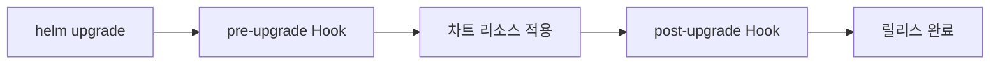
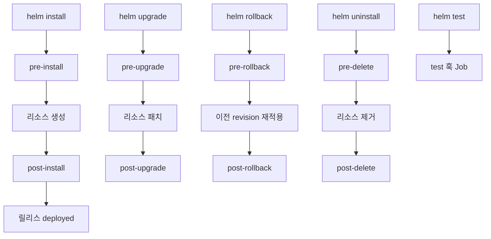
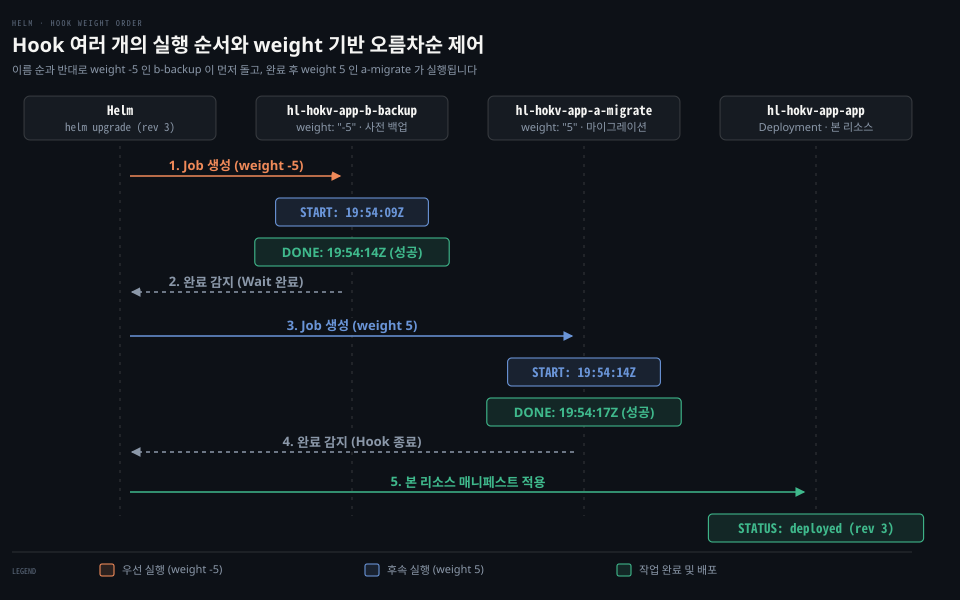
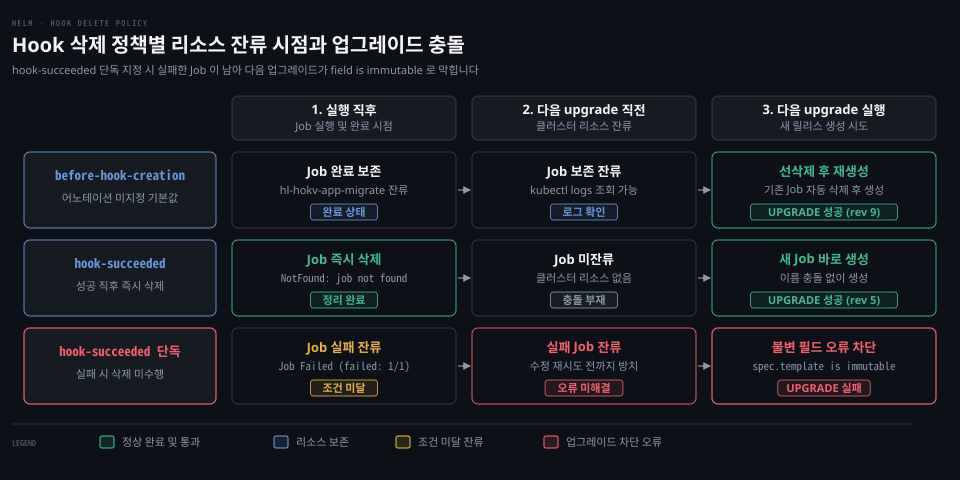
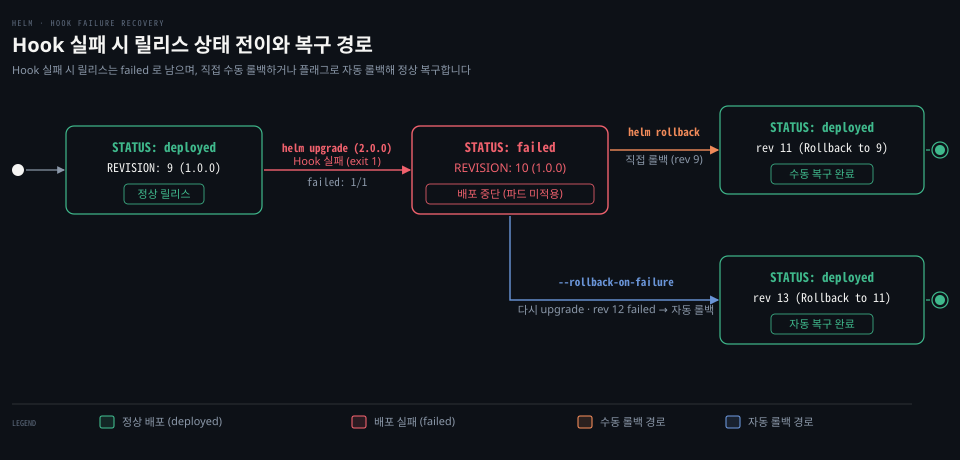

# Helm Hook

---

> 배포 앞뒤에 정해진 순서로 돌아야 하는 일회성 작업(DB 마이그레이션, 검증)을 차트에 넣는 방법을 다룹니다. Hook 리소스가 릴리스 리소스와 다르게 다뤄지는 점, weight 순서, delete-policy, 실패와 복구, `helm test` 를 실측으로 확인합니다.

## 학습 목표와 범위

> 배포 순서 의존성을 Hook 으로 제어하고, Hook 이 실패했을 때 릴리스를 복구하는 역량을 갖춥니다.

1. 릴리스 리소스와 Hook 리소스가 어떻게 다르게 관리되는지 설명할 수 있습니다.
2. Hook 9종의 실행 시점을 구분하고 pre-upgrade Job 이 Deployment 보다 먼저 끝나는 순서를 확인할 수 있습니다.
3. `helm.sh/hook-weight` 로 같은 시점 Hook 여러 개의 순서를 정할 수 있습니다.
4. `helm.sh/hook-delete-policy` 값별로 Hook 리소스가 언제 지워지는지 알고, 남은 Job 때문에 나는 오류를 풀 수 있습니다.
5. Hook 실패 때 릴리스 상태를 읽고 롤백, `--no-hooks`, `--timeout` 으로 대응할 수 있습니다.
6. `helm test` 로 배포 직후 검증을 돌리고 종료 코드로 판정할 수 있습니다.

실측은 단일 노드 kind v1.35.0 클러스터와 Helm v4.1.4 에서 했습니다. Helm 3 에서는 돌려 보지 않았고, 차이는 해당 자리의 각주에 적습니다.

실습 차트 `hl-chart` 는 Deployment·Service·ConfigMap 에 Hook Job 과 test Pod 를 더한 작은 차트입니다. values 스위치로 각 Hook 을 켭니다. `Z` 가 붙은 시각과 컨테이너 안 `date` 는 UTC 입니다.


## 1. 배포 앞뒤에 먼저 끝나야 하는 일이 있을 때

> DB 스키마 변경처럼 새 버전보다 먼저 끝나야 하는 작업이 일반 리소스와 같이 배포되면 순서가 보장되지 않습니다.

`kubectl apply` 로 매니페스트를 한꺼번에 내면 Deployment 와 마이그레이션 Job 이 거의 동시에 만들어집니다. 새 파드가 아직 없는 컬럼을 읽다가 CrashLoopBackOff 에 빠지면 롤아웃이 멈춥니다. 이 순서를 CI 스크립트에 흩어 두면 차트만 봐서는 배포 절차를 알 수 없습니다. Hook 은 이 일회성 작업을 차트 안에 두고 `helm install` 이나 `helm upgrade` 한 번에 정해진 시점에 실행하게 합니다.



Hook 은 `helm.sh/hook` 어노테이션이 붙은 평범한 매니페스트입니다. 어노테이션이 없으면 릴리스 리소스이고, 있으면 Hook 이라 릴리스 매니페스트에서 빠집니다. 공식 문서도 Hook 이 만든 리소스를 릴리스의 일부로 추적하거나 관리하지 않는다고 적습니다[^helm-hook-mgmt].

| 비교 항목 | 릴리스 리소스 (Deployment, Service) | Hook 리소스 (Job, Pod) |
|---|---|---|
| 조회 | `helm get manifest` | `helm get hooks` |
| 업그레이드·롤백 | 선언 상태로 패치 | 지정한 시점에 한 번 실행 |
| `helm uninstall` | 함께 삭제 | 자동으로 지워지지 않음. `hook-delete-policy` 로 정함 (8절 실측) |

pre-install Hook 을 켜고 설치한 뒤, 두 조회 명령이 무엇을 보여 주는지 맞대 봅니다.

```bash
# 릴리스와 pre-install Hook Job 을 함께 설치합니다
#   -n                  배포할 네임스페이스
#   --create-namespace  네임스페이스가 없으면 만듦
#   --set               values 를 명령줄에서 덮어씀
helm install hl-hokv-app ./charts/hl-chart \
  -n hl-hokv \
  --create-namespace \
  --set preInstallHook.enabled=true \
  | grep -E '^(STATUS|REVISION)'
```

```bash
# 결과
STATUS: deployed
REVISION: 1
```

```bash
# 릴리스 매니페스트에 든 리소스 종류를 봅니다
helm get manifest hl-hokv-app -n hl-hokv | grep -E '^kind:'
```

```bash
# 결과
kind: ConfigMap
kind: Service
kind: Deployment
```

```bash
# 릴리스 매니페스트와 따로 보관된 Hook 리소스를 봅니다
helm get hooks hl-hokv-app -n hl-hokv | grep -E '^kind:|^    "helm.sh/hook"'
```

```bash
# 결과
kind: Pod
    "helm.sh/hook": test
kind: Job
    "helm.sh/hook": pre-install
```

`get manifest` 에는 세 리소스뿐이고 pre-install Job 은 `get hooks` 에만 있습니다. `get hooks` 에 test Pod 가 같이 나오는 것은 `helm test` 용 Pod(7절)도 Hook 의 한 종류이기 때문입니다.


## 2. 어느 시점에 무엇을 거는가

> 같은 일도 배포 앞에 두느냐 뒤에 두느냐에 따라 효과가 반대가 되므로 Hook 은 시점으로 고릅니다.

스키마는 새 버전이 뜨기 전에 고쳐야 하지만 캐시 워밍은 뜬 뒤에 해야 합니다. Helm 은 설치·업그레이드·삭제·롤백의 앞뒤와 `helm test` 시점, 모두 9종을 정의합니다[^helm-hooks-official].



| Hook 종류 | 실행 시점 | 대표 용도 |
|---|---|---|
| `pre-install` | 템플릿 렌더 뒤, 리소스 생성 전 | 초기 스키마 생성, 연결·권한 검증 |
| `post-install` | 모든 리소스 로드 뒤 | 관리자 계정 생성, 샘플 데이터 적재, smoke test |
| `pre-upgrade` | 템플릿 렌더 뒤, 리소스 갱신 전 | DB 마이그레이션, 비호환 설정 사전 검사 |
| `post-upgrade` | 모든 리소스 갱신 뒤 | 캐시 워밍, 배포 후 검증 Job, 알림 |
| `pre-delete` | 삭제 요청 뒤, 리소스 제거 전 | 외부 시스템 등록 해제, 백업 트리거 |
| `post-delete` | 릴리스 리소스 삭제 뒤 | 외부 DNS 레코드 정리 |
| `pre-rollback` | 롤백 요청 뒤, 리소스 롤백 전 | DB 다운그레이드 가능 여부 확인 |
| `post-rollback` | 롤백 리소스 적용 뒤 | 롤백 상태 보고 |
| `test` | `helm test` 실행 시 | 엔드포인트 응답 확인 |

시점 열은 공식 문서 표를 옮긴 것이고, 이 문서에서 직접 돌린 시점은 pre-install(1절)·pre-upgrade·test(7절)입니다. 나머지 여섯은 돌려 보지 않았습니다.

Hook Job 은 일반 Job 에 어노테이션만 더한 형태입니다. 실습 차트의 pre-upgrade Job 에서 Hook 과 관련된 부분만 뽑으면 다음과 같습니다.

```yaml
apiVersion: batch/v1
kind: Job
metadata:
  name: {{ .Release.Name }}-migrate
  annotations:
    "helm.sh/hook": pre-upgrade
    "helm.sh/hook-weight": "-5"
    "helm.sh/hook-delete-policy": before-hook-creation
spec:
  backoffLimit: 0   # 실패해도 재시도하지 않음
  template: {spec: {restartPolicy: Never, containers: [{name: migrate, image: "busybox:1.36"}]}}
```

이제 업그레이드하면서 순서를 봅니다. Job 이 새 버전 Deployment 보다 먼저 끝나는지는 `Job 완료` 시각과 새 ReplicaSet 생성 시각으로 비교합니다. 5초 걸리는 Job 으로 만들어 차이가 보이게 했습니다.

```bash
# app.version 을 올리고 5초 걸리는 pre-upgrade Job 을 함께 실행합니다
#   preUpgradeHook.sleep  Job 이 대기할 초
helm upgrade hl-hokv-app ./charts/hl-chart \
  -n hl-hokv \
  --set app.version=1.1.0 \
  --set preUpgradeHook.enabled=true \
  --set preUpgradeHook.sleep=5 \
  --set preUpgradeHook.deletePolicy=before-hook-creation \
  | grep -E '^(STATUS|REVISION)'
```

```bash
# 결과
STATUS: deployed
REVISION: 2
```

```bash
# Hook Job 의 생성·완료 시각을 봅니다
kubectl get job hl-hokv-app-migrate -n hl-hokv \
  -o jsonpath='{.metadata.creationTimestamp}{"  Job 생성\n"}{.status.completionTime}{"  Job 완료\n"}'
```

```bash
# 결과
2026-11-20T19:54:01Z  Job 생성
2026-11-20T19:54:08Z  Job 완료
```

```bash
# ReplicaSet 생성 시각을 생성순으로 봅니다
kubectl get rs -n hl-hokv \
  --sort-by=.metadata.creationTimestamp \
  -o custom-columns=NAME:.metadata.name,CREATED:.metadata.creationTimestamp
```

```bash
# 결과
NAME                        CREATED
hl-hokv-app-app-97f7d7797   2026-11-20T19:54:01Z
hl-hokv-app-app-c6f897c5c   2026-11-20T19:54:09Z
```

Job 은 `:01` 에 만들어져 `:08` 에 끝났습니다. 1.1.0 ReplicaSet 은 그 뒤인 `:09` 에 생겼고, 첫 ReplicaSet 은 설치 때 만든 것입니다. 스키마 작업이 끝나기 전에는 새 버전 파드가 뜨지 않았다는 뜻입니다. Helm 이 Hook Job 완료를 기다린다는 공식 문서 설명[^helm-hook-wait]과 같습니다.


## 3. Hook 여러 개의 실행 순서

> 같은 시점에 Hook 이 둘 이상이면 어느 쪽이 먼저 도는지 정해 두지 않으면 백업보다 마이그레이션이 먼저 돌 수 있습니다.

Helm 은 같은 시점의 Hook 을 `helm.sh/hook-weight` 오름차순(음수 → 양수)으로 하나씩 실행합니다. 값은 문자열로 적고 기본은 0 입니다. weight 가 같으면 리소스 종류, 이름 순으로 정렬합니다[^helm-hook-sort]. Job 과 Pod 는 성공적으로 끝나야 다음 Hook 을 만들기 때문에 앞 Hook 이 실패하면 뒤 Hook 은 시작하지 않습니다.

아래 실측에서 Helm 은 weight `-5` 인 Job 이 끝난 뒤에야 weight `5` 인 Job 을 만들고, 둘이 모두 끝난 뒤 본 리소스를 적용했습니다.


순서가 weight 에서 나오는지 가리려고 이름을 일부러 뒤집었습니다. weight `-5` 인 백업 Job 은 `b-backup`, weight `5` 인 마이그레이션 Job 은 `a-migrate` 입니다. 이름 순이라면 `a-migrate` 가 먼저 돌아야 합니다.

```bash
# weight 가 다른 pre-upgrade Job 둘을 켭니다
helm upgrade hl-hokv-app ./charts/hl-chart \
  -n hl-hokv \
  --set weightHooks.enabled=true \
  | grep -E '^(STATUS|REVISION)'
```

```bash
# 결과
STATUS: deployed
REVISION: 3
```

```bash
# Job 을 시작 시각순으로 놓고 시작·완료 시각을 봅니다
kubectl get job -n hl-hokv \
  --sort-by=.status.startTime \
  -o custom-columns=NAME:.metadata.name,START:.status.startTime,DONE:.status.completionTime
```

```bash
# 결과
NAME                    START                  DONE
hl-hokv-app-migrate     2026-11-20T19:54:01Z   2026-11-20T19:54:08Z
hl-hokv-app-b-backup    2026-11-20T19:54:09Z   2026-11-20T19:54:14Z
hl-hokv-app-a-migrate   2026-11-20T19:54:14Z   2026-11-20T19:54:17Z
```

`b-backup`(weight -5)이 `:09` 에 시작해 `:14` 에 끝났습니다. `a-migrate`(weight 5)는 같은 `:14` 에 시작했습니다. 이름 순과 반대로 weight 가 앞섰고 앞 Job 이 끝난 뒤에야 뒤 Job 이 시작했습니다. 맨 위 `hl-hokv-app-migrate` 는 2절의 Job 이 남은 것으로 4절에서 다룹니다.

순서가 필요한 사전 작업은 `hook-weight` 로 단계를 나눕니다. 순서가 중요하지 않아도 weight 를 0 으로 명시하라는 것이 공식 문서의 권장입니다[^helm-hook-sort].


## 4. 끝난 Hook 리소스는 누가 지우는가

> Hook 이 만든 Job 을 아무도 지우지 않으면 다음 배포에서 같은 이름의 Job 과 부딪쳐 업그레이드가 실패합니다.

Helm 은 Hook 이 끝나도 리소스를 릴리스가 소유한 것으로 보지 않으므로 직접 지우지 않습니다. 어떤 시점에 지울지는 `helm.sh/hook-delete-policy` 어노테이션이 정합니다. 쉼표로 여러 개를 함께 적을 수 있습니다.

| 정책 값 | 지우는 시점 | 비고 |
|---|---|---|
| `before-hook-creation` | 같은 이름의 Hook 을 새로 만들기 직전 | 어노테이션이 없을 때의 기본값[^helm-delete-policy-default] |
| `hook-succeeded` | Hook 이 성공한 직후 | 성공 로그도 함께 사라짐 |
| `hook-failed` | Hook 이 실패한 직후 | 실패 로그도 함께 사라져 디버깅이 어려움. 이 문서에서는 돌리지 않았음 |

삭제 정책에 따라 리소스 잔류 여부가 결정되며 실패한 Job 이 남으면 다음 업그레이드가 차단됩니다.

2절의 `before-hook-creation` Job 이 남은 채 `hook-succeeded` 만 적고 업그레이드하면 이름이 같아 실패합니다. 출력은 `grep` 과 `sed` 로 줄였고 생략한 자리는 `{...}` 로 표시했습니다.

```bash
# 남은 Job 이 있는 채로 hook-succeeded 단독 정책을 씁니다
helm upgrade hl-hokv-app ./charts/hl-chart \
  -n hl-hokv \
  --set preUpgradeHook.enabled=true \
  --set preUpgradeHook.deletePolicy=hook-succeeded \
  2>&1 | grep '^Error' | sed -E 's/Invalid value: \{.*\}: field/Invalid value: {...}: field/'
```

```bash
# 결과
Error: UPGRADE FAILED: pre-upgrade hooks failed: warning: Hook pre-upgrade hl-chart/templates/pre-upgrade-hook.yaml failed: Job.batch "hl-hokv-app-migrate" is invalid: spec.template: Invalid value: {...}: field is immutable
```

`field is immutable` 은 Job 의 `spec.template` 이 생성 뒤 수정할 수 없는 필드라는 뜻입니다. 오류가 수정 거부 형태이므로, Helm 4 는 남은 Job 을 새 내용으로 갱신하려다 거부당한 것으로 읽힙니다[^helm-immutable-diff]. 이 시도는 실패한 revision 으로 기록됩니다. `before-hook-creation` 을 함께 적으면 남은 Job 을 먼저 지우고 새로 만들어 통과합니다. 명령줄에서 쉼표는 `--set` 의 구분자라 `\,` 로 이스케이프합니다.

```bash
# 두 정책을 함께 적어 재시도합니다
#   \,   --set 값 안에서 쉼표를 문자 그대로 쓰는 이스케이프
helm upgrade hl-hokv-app ./charts/hl-chart \
  -n hl-hokv \
  --set preUpgradeHook.enabled=true \
  --set 'preUpgradeHook.deletePolicy=before-hook-creation\,hook-succeeded' \
  | grep -E '^(STATUS|REVISION)'
```

```bash
# 결과
STATUS: deployed
REVISION: 5
```

```bash
# 성공한 Job 이 바로 지워졌는지 봅니다
kubectl get job hl-hokv-app-migrate -n hl-hokv
```

```bash
# 결과
Error from server (NotFound): jobs.batch "hl-hokv-app-migrate" not found
```

같은 함정이 실패한 Job 에서도 납니다. `hook-succeeded` 만 적은 Job 이 실패하면 성공 조건이 안 맞아 지워지지 않습니다. 고쳐서 다시 올리면 남은 Job 때문에 같은 오류로 막힙니다.

```bash
# hook-succeeded 단독 정책으로 실패하는 Job 을 돌립니다
helm upgrade hl-hokv-app ./charts/hl-chart \
  -n hl-hokv \
  --set preUpgradeHook.enabled=true \
  --set preUpgradeHook.fail=true \
  --set preUpgradeHook.deletePolicy=hook-succeeded
```

```bash
# 결과
level=WARN msg="upgrade failed" name=hl-hokv-app error="pre-upgrade hooks failed: resource Job/hl-hokv/hl-hokv-app-migrate not ready. status: Failed, message: Job Failed. failed: 1/1"
Error: UPGRADE FAILED: pre-upgrade hooks failed: resource Job/hl-hokv/hl-hokv-app-migrate not ready. status: Failed, message: Job Failed. failed: 1/1
```

```bash
# 원인을 고쳤다고 치고(fail 을 끔) 같은 정책으로 재시도합니다
helm upgrade hl-hokv-app ./charts/hl-chart \
  -n hl-hokv \
  --set preUpgradeHook.enabled=true \
  --set preUpgradeHook.deletePolicy=hook-succeeded \
  2>&1 | grep '^Error' | sed -E 's/Invalid value: \{.*\}: field/Invalid value: {...}: field/'
```

```bash
# 결과
Error: UPGRADE FAILED: pre-upgrade hooks failed: warning: Hook pre-upgrade hl-chart/templates/pre-upgrade-hook.yaml failed: Job.batch "hl-hokv-app-migrate" is invalid: spec.template: Invalid value: {...}: field is immutable
```

정책 어노테이션을 아예 빼면 기본값인 `before-hook-creation` 이 적용됩니다. 같은 값으로 두 번 연속 업그레이드해도 두 번 다 통과했고, Job 어노테이션에는 `hook` 종류만 있고 정책이 없습니다.

```bash
# 정책 없이 pre-upgrade Hook 을 두 번 연속 실행합니다
for i in 1 2; do
  helm upgrade hl-hokv-app ./charts/hl-chart \
    -n hl-hokv \
    --set preUpgradeHook.enabled=true \
    | grep -E '^(STATUS|REVISION)'
done
```

```bash
# 결과
STATUS: deployed
REVISION: 8
STATUS: deployed
REVISION: 9
```

```bash
# Job 에 붙은 어노테이션을 봅니다
kubectl get job hl-hokv-app-migrate -n hl-hokv -o jsonpath='{.metadata.annotations}'
```

```bash
# 결과
{"helm.sh/hook":"pre-upgrade"}
```

정리하면 이름이 고정된 Hook Job 에는 `before-hook-creation` 을 항상 넣습니다. 성공 흔적을 치우려면 `hook-succeeded` 를 더하고, 로그를 읽어야 하는 실패 흔적은 남기려고 `hook-failed` 는 넣지 않습니다.


## 5. Hook 이 실패하면 배포는 어떻게 되는가

> 마이그레이션 Hook 이 실패했는데 새 버전이 그대로 올라가면 깨진 스키마 위에서 서비스가 돕니다.

`pre-install`·`pre-upgrade` Hook 이 실패하면 릴리스는 `failed` 로 전이됩니다. 복구는 수동 롤백이나 `--rollback-on-failure` 로 합니다[^helm-hook-wait].

일부러 실패하는 Job 으로 `app.version=2.0.0` 업그레이드를 시도해 봅니다.

```bash
# 실패하는 pre-upgrade Hook 과 함께 새 버전을 올립니다
#   preUpgradeHook.fail  true 면 Job 이 exit 1 로 끝남
helm upgrade hl-hokv-app ./charts/hl-chart \
  -n hl-hokv \
  --set app.version=2.0.0 \
  --set preUpgradeHook.enabled=true \
  --set preUpgradeHook.fail=true \
  --set preUpgradeHook.deletePolicy=before-hook-creation
```

```bash
# 결과
level=WARN msg="upgrade failed" name=hl-hokv-app error="pre-upgrade hooks failed: resource Job/hl-hokv/hl-hokv-app-migrate not ready. status: Failed, message: Job Failed. failed: 1/1"
Error: UPGRADE FAILED: pre-upgrade hooks failed: resource Job/hl-hokv/hl-hokv-app-migrate not ready. status: Failed, message: Job Failed. failed: 1/1
```

`failed: 1/1` 은 Job 의 파드가 한 번 실패했다는 뜻입니다. 이 Job 은 `backoffLimit: 0` 이라 재시도하지 않았습니다. 릴리스 상태와 이력을 봅니다[^helm-list-default-diff].

```bash
# 릴리스 상태를 봅니다
helm list -n hl-hokv
```

```bash
# 결과
NAME       	NAMESPACE	REVISION	UPDATED                             	STATUS	CHART         	APP VERSION
hl-hokv-app	hl-hokv  	10      	2026-11-21 04:54:30.300463 +0900 KST	failed	hl-chart-0.1.0	1.0.0      
```

실패한 시도도 revision 10 으로 남고 상태는 `failed` 입니다. 새 버전이 적용되지 않았는지는 Deployment 의 버전 라벨로 확인합니다. 원인은 Job 로그에 있습니다.

```bash
# 실패 원인을 Job 로그에서 읽습니다
kubectl logs job/hl-hokv-app-migrate -n hl-hokv
```

```bash
# 결과
[pre-upgrade] 마이그레이션 실패 시뮬레이션: 스키마 충돌 발생
```

```bash
# Deployment 가 요청한 2.0.0 이 아니라 기존 버전으로 남았는지 봅니다
kubectl get deploy hl-hokv-app-app -n hl-hokv \
  -o jsonpath='{.metadata.labels.app\.kubernetes\.io/version}{"\n"}'
```

```bash
# 결과
1.0.0
```

Hook 에서 막혔기 때문에 Deployment 는 `1.0.0` 그대로입니다. 복구는 두 가지입니다. 원인을 고쳐 다시 업그레이드하거나, 직전 revision 으로 롤백합니다. revision 을 생략하면 바로 앞 revision(여기서는 9)으로 돌아갑니다(`helm rollback --help`).

```bash
# 직전 revision 으로 롤백합니다
helm rollback hl-hokv-app -n hl-hokv
```

```bash
# 결과
Rollback was a success! Happy Helming!
```

```bash
# 롤백이 새 revision 으로 기록되었는지 봅니다
helm history hl-hokv-app -n hl-hokv --max 3 | cut -c1-150 | sed 's/ *$//'
```

```bash
# 결과
REVISION	UPDATED                 	STATUS    	CHART         	APP VERSION	DESCRIPTION
9       	Sat Nov 21 04:54:27 2026	superseded	hl-chart-0.1.0	1.0.0      	Upgrade complete
10      	Sat Nov 21 04:54:30 2026	failed    	hl-chart-0.1.0	1.0.0      	Upgrade "hl-hokv-app" failed: pre-upgrade hooks failed: resource Job/hl-hokv/h
11      	Sat Nov 21 04:54:33 2026	deployed  	hl-chart-0.1.0	1.0.0      	Rollback to 9
```

롤백은 revision 9 를 되살려 revision 11 로 쌓이며 실패한 10 은 이력에 남습니다. 생략 시 대상은 바로 앞이라 실패본일 수 있으니 `helm history` 로 확인하고 번호를 명시하는 편이 안전합니다. 실패할 때마다 사람이 롤백하지 않으려면 `--rollback-on-failure` 를 붙입니다[^helm-rollback-flag-diff].

```bash
# 실패하면 자동으로 마지막 성공 revision 으로 되돌립니다
#   --rollback-on-failure  업그레이드가 실패하면 직전 성공 릴리스로 롤백
helm upgrade hl-hokv-app ./charts/hl-chart \
  -n hl-hokv \
  --set app.version=2.0.0 \
  --set preUpgradeHook.enabled=true \
  --set preUpgradeHook.fail=true \
  --set preUpgradeHook.deletePolicy=before-hook-creation \
  --rollback-on-failure
```

```bash
# 결과
level=WARN msg="upgrade failed" name=hl-hokv-app error="pre-upgrade hooks failed: resource Job/hl-hokv/hl-hokv-app-migrate not ready. status: Failed, message: Job Failed. failed: 1/1"
Error: UPGRADE FAILED: release hl-hokv-app failed, and has been rolled back due to rollback-on-failure being set: pre-upgrade hooks failed: resource Job/hl-hokv/hl-hokv-app-migrate not ready. status: Failed, message: Job Failed. failed: 1/1
```

```bash
# 실패 revision 뒤에 롤백 revision 이 자동으로 붙었는지 봅니다
helm history hl-hokv-app -n hl-hokv --max 3 | cut -c1-150 | sed 's/ *$//'
```

```bash
# 결과
REVISION	UPDATED                 	STATUS    	CHART         	APP VERSION	DESCRIPTION
11      	Sat Nov 21 04:54:33 2026	superseded	hl-chart-0.1.0	1.0.0      	Rollback to 9
12      	Sat Nov 21 04:54:33 2026	failed    	hl-chart-0.1.0	1.0.0      	Upgrade "hl-hokv-app" failed: pre-upgrade hooks failed: resource Job/hl-hokv/h
13      	Sat Nov 21 04:54:37 2026	deployed  	hl-chart-0.1.0	1.0.0      	Rollback to 11
```

revision 12 가 `failed` 로 남고 곧바로 revision 13 `Rollback to 11` 이 배포됐습니다.


## 6. Hook 건너뛰기와 대기 제한

> 외부 시스템 때문에 Hook 이 계속 실패하거나 끝나지 않는데 긴급 배포가 필요하면 Hook 을 우회하거나 기다리는 시간을 제한해야 합니다.

`--no-hooks` 는 그 명령에서 Hook 을 실행하지 않고 릴리스 리소스만 적용합니다. 실패하도록 켠 Hook 이 있어도 건너뜁니다. `helm uninstall` 과 `helm rollback` 에도 같은 옵션이 있습니다.

```bash
# 실패하도록 켠 Hook 을 건너뛰고 배포합니다
#   --no-hooks  차트의 pre/post Hook 을 실행하지 않음
helm upgrade hl-hokv-app ./charts/hl-chart \
  -n hl-hokv \
  --set preUpgradeHook.enabled=true \
  --set preUpgradeHook.fail=true \
  --set preUpgradeHook.deletePolicy=before-hook-creation \
  --no-hooks \
  | grep -E '^(STATUS|REVISION)'
```

```bash
# 결과
STATUS: deployed
REVISION: 14
```

Hook 을 건너뛰면 그 Hook 이 하던 검증과 마이그레이션도 건너뛴 것이므로, 스키마가 이미 맞춰졌다고 확신할 때만 씁니다.

Hook 이 끝나지 않을 때는 `--timeout` 이 기다리는 시간을 정합니다. Helm 4 의 기본값은 5분입니다. `--wait` 를 주지 않아도 Hook Job 은 끝날 때까지 기다립니다. Helm 4 `--wait` 는 `watcher`·`hookOnly`·`legacy` 값을 받고 기본이 `hookOnly` 입니다. Helm 3.16 소스의 `--wait` 는 값이 없는 on/off 플래그입니다[^helm-wait-diff]. 15초 걸리는 Job 에 3초 제한을 걸어 봅니다.

```bash
# 15초 걸리는 Hook 에 3초 제한을 겁니다
#   --timeout  Hook 대기를 포함한 개별 쿠버네티스 작업의 대기 한계 (기본 5m0s)
helm upgrade hl-hokv-app ./charts/hl-chart \
  -n hl-hokv \
  --set preUpgradeHook.enabled=true \
  --set preUpgradeHook.sleep=15 \
  --set preUpgradeHook.deletePolicy=before-hook-creation \
  --timeout 3s
```

```bash
# 결과
level=WARN msg="upgrade failed" name=hl-hokv-app error="pre-upgrade hooks failed: resource Job/hl-hokv/hl-hokv-app-migrate not ready. status: InProgress, message: Job in progress\ncontext deadline exceeded"
Error: UPGRADE FAILED: pre-upgrade hooks failed: resource Job/hl-hokv/hl-hokv-app-migrate not ready. status: InProgress, message: Job in progress
context deadline exceeded
```

`context deadline exceeded` 는 Helm 이 기다리다 시간이 다 됐다는 뜻입니다. Helm 이 포기해도 Job 은 멈추지 않습니다.

```bash
# 타임아웃 뒤 Job 상태를 봅니다
kubectl get job hl-hokv-app-migrate -n hl-hokv
```

```bash
# 결과
NAME                  STATUS    COMPLETIONS   DURATION   AGE
hl-hokv-app-migrate   Running   0/1           3s         3s
```

Job 은 `Running` 으로 계속 돕니다. 그래서 Job 쪽에도 `activeDeadlineSeconds` 로 한도를 걸어 두어야 한다는 것이 이 실측에서 나오는 결론입니다. 이 필드는 쿠버네티스 Job 의 것이고 이 문서에서 돌려 보지는 않았습니다. 이어지는 7절을 위해 정상 revision 으로 되돌립니다.

```bash
# 타임아웃으로 실패한 상태에서 직전 revision 으로 복구합니다
helm rollback hl-hokv-app -n hl-hokv
```

```bash
# 결과
Rollback was a success! Happy Helming!
```


## 7. helm test 로 배포 직후 검증하기

> Pod 가 Running 이어도 서비스가 실제로 응답하는지는 별개이고, 사람이 curl 로 확인하면 파이프라인이 그 결과를 받지 못합니다.

`helm.sh/hook: test` 가 붙은 Pod 나 Job 은 `helm test` 를 실행할 때만 만들어집니다. 실습 차트의 test Pod 는 `wget` 으로 Service 의 80 포트에 요청해 nginx 응답이 있으면 성공 메시지를 찍습니다. 응답이 없으면 비정상 종료합니다.

```bash
# test Pod 로그까지 함께 출력합니다
#   --logs  테스트가 모두 끝난 뒤 test Pod 로그를 출력
helm test hl-hokv-app -n hl-hokv --logs
```

```bash
# 결과
NAME: hl-hokv-app
LAST DEPLOYED: Sat Nov 21 04:54:40 2026
NAMESPACE: hl-hokv
STATUS: deployed
REVISION: 16
DESCRIPTION: Rollback to 14
TEST SUITE:     hl-hokv-app-test-connection
Last Started:   Sat Nov 21 04:54:41 2026
Last Completed: Sat Nov 21 04:54:43 2026
Phase:          Succeeded

POD LOGS: hl-hokv-app-test-connection
서비스 응답 확인 완료: 200 OK
```

`Phase: Succeeded` 는 test Pod 가 종료 코드 0 으로 끝났다는 뜻입니다. `--logs` 는 모든 테스트가 끝난 뒤 정리 전에 test Pod 의 로그를 함께 찍습니다.

실패하는 모습은 test Pod 가 없는 포트(8080)를 부르도록 바꿔서 봅니다.

```bash
# test 가 부를 포트를 80 에서 8080 으로 바꿉니다
#   testHook.port  test Pod 가 요청할 Service 포트
helm upgrade hl-hokv-app ./charts/hl-chart \
  -n hl-hokv \
  --set testHook.port=8080 \
  | grep -E '^(STATUS|REVISION)'
```

```bash
# 결과
STATUS: deployed
REVISION: 17
```

```bash
# 실패하는 test 를 실행하고 종료 코드를 바로 찍습니다
helm test hl-hokv-app -n hl-hokv ; echo "종료 코드: $?"
```

```bash
# 결과
NAME: hl-hokv-app
LAST DEPLOYED: Sat Nov 21 04:54:43 2026
NAMESPACE: hl-hokv
STATUS: deployed
REVISION: 17
DESCRIPTION: Upgrade complete
TEST SUITE:     hl-hokv-app-test-connection
Last Started:   Sat Nov 21 04:54:43 2026
Last Completed: Sat Nov 21 04:54:48 2026
Phase:          Failed
Error: resource Pod/hl-hokv/hl-hokv-app-test-connection not ready. status: Failed, message: pod hl-hokv-app-test-connection failed
종료 코드: 1
```

```bash
# 실패한 test Pod 의 상태를 봅니다
kubectl get pod hl-hokv-app-test-connection -n hl-hokv
```

```bash
# 결과
NAME                          READY   STATUS   RESTARTS   AGE
hl-hokv-app-test-connection   0/1     Error    0          5s
```

`Phase: Failed` 와 종료 코드 1 이 나왔으므로 CI 에서 `helm test` 를 이으면 실패 때 파이프라인이 멈춥니다. 릴리스 STATUS 는 `deployed` 그대로라 자동 롤백은 없고, 되돌릴지는 파이프라인이 정해야 합니다. test Pod 는 끝난 뒤에도 남아 `kubectl logs` 로 다시 읽을 수 있습니다.


## 8. Hook 으로 하지 말아야 할 것과 운영 규칙

> 오래 걸리거나 사람이 개입해야 하는 작업을 Hook 에 넣으면 배포 한 번이 그 작업만큼 늘어지고, 실패하면 릴리스가 같이 실패합니다.

릴리스를 지우면 Hook 리소스가 어떻게 되는지부터 확인합니다.

```bash
# 릴리스를 삭제합니다
helm uninstall hl-hokv-app -n hl-hokv
```

```bash
# 결과
release "hl-hokv-app" uninstalled
```

```bash
# 릴리스를 지운 뒤 네임스페이스에 남은 Job 과 Pod 를 봅니다
kubectl get job,pod -n hl-hokv
```

```bash
# 결과
NAME                              STATUS     COMPLETIONS   DURATION   AGE
job.batch/hl-hokv-app-a-migrate   Complete   1/1           3s         34s
job.batch/hl-hokv-app-b-backup    Complete   1/1           5s         39s
job.batch/hl-hokv-app-migrate     Running    0/1           11s        11s

NAME                                  READY   STATUS        RESTARTS   AGE
pod/hl-hokv-app-a-migrate-992np       0/1     Completed     0          34s
pod/hl-hokv-app-app-97f7d7797-s9zzd   1/1     Terminating   0          31s
pod/hl-hokv-app-b-backup-gcwxs        0/1     Completed     0          39s
pod/hl-hokv-app-migrate-2sbmc         1/1     Running       0          11s
pod/hl-hokv-app-test-connection       0/1     Error         0          5s
```

Deployment 파드는 `Terminating` 이지만 Hook 이 만든 Job 과 test Pod 는 그대로 남았습니다. 6절 타임아웃 시도의 `migrate` Job 은 아직 `Running` 입니다. 공식 문서는 `helm uninstall` 에 기대지 말라고 합니다. 대신 `hook-delete-policy` 나 Job 의 TTL(`ttlSecondsAfterFinished`)을 쓰라고 안내합니다[^helm-hook-mgmt]. Argo CD 로 배포한다면 TTL 대신 `hook-delete-policy` 를 쓰라는 경고가 있습니다[^argo-ttl].

운영 규칙은 다섯 가지입니다.

1. **Job 으로 만든다**: 단독 Pod 보다 Job 이 성공·실패 판정과 재시도 횟수(`backoffLimit`) 지정이 분명합니다.
2. **멱등하게 쓴다**: 타임아웃이나 재시도로 Hook 이 다시 돌아도 같은 결과가 나와야 합니다.
3. **짧게 둔다**: Hook 이 도는 동안 `helm` 명령이 끝나지 않습니다. 수십 분 걸리는 백필이나 사람 승인은 배포 밖의 별도 워크플로우로 뺍니다. Hook 은 "이 작업이 실패하면 본 리소스를 적용하면 안 되는가"에 예일 때 맞습니다.
4. **한도를 이중으로 건다**: Job 에 `activeDeadlineSeconds`, Helm 에 `--timeout` 을 겁니다. 6절처럼 Job 만 남아 도는 일을 막습니다.
5. **삭제 정책을 정한다**: `before-hook-creation,hook-succeeded` 를 기본으로 하고, 실패 Job 은 로그를 읽도록 남깁니다.

Argo CD 로 배포하면 Helm 이 아니라 Argo CD 의 sync 가 Hook 을 `kubectl apply` 로 만듭니다. `helm.sh/hook` 어노테이션은 Argo CD Hook 으로 대응됩니다.

- `pre-install`·`pre-upgrade` 는 `PreSync`, `post-install`·`post-upgrade` 는 `PostSync` 에 대응합니다.
- `helm.sh/hook-weight` 는 sync wave 에 대응합니다.
- `pre-rollback`·`post-rollback`·`test` 는 지원하지 않아 무시됩니다.
- install 과 upgrade 를 구분하지 못해 `pre-install` 과 `pre-upgrade` 가 함께 실행됩니다.
- Argo CD Hook 을 하나라도 정의하면 Helm Hook 은 모두 무시됩니다[^argo-helm-hook].

단계와 wave 의 정렬 규칙은 [Argo CD Application 동기화](../../book/argocd-up-and-running/05-01.Application%20%EB%8F%99%EA%B8%B0%ED%99%94%20%E2%80%94%20%EC%9E%90%EB%8F%99%20%EB%8F%99%EA%B8%B0%ED%99%94%C2%B7Sync%20Option%C2%B7Hook%C2%B7Sync%20Wave%20%EC%99%80%20%EC%B0%A8%EC%9D%B4%20%EB%AC%B4%EC%8B%9C.md)에서 다룹니다.


## 결정 치트시트

> 하려는 일에서 Hook 시점과 제어 방법을 고르는 기준입니다.

| 하려는 일 | 선택 | 본문 |
|---|---|---|
| 새 버전이 뜨기 전에 DB 스키마를 고친다 | `pre-upgrade` Job | 2절 |
| 설치 직후 관리자 계정을 한 번 만든다 | `post-install` Job | 2절 |
| 백업 → 마이그레이션처럼 순서가 있다 | `hook-weight` (음수가 먼저) | 3절 |
| 재시도하면 `field is immutable` 이 난다 | `before-hook-creation,hook-succeeded` | 4절 |
| 실패하면 사람 없이 이전 revision 으로 돌린다 | `--rollback-on-failure` (Helm 3 은 `--atomic`) | 5절 |
| Hook 이 계속 막혀 긴급 배포가 필요하다 | `--no-hooks` (그 Hook 일은 직접 챙긴다) | 6절 |
| Hook 이 오래 걸린다 | `--timeout` 과 Job `activeDeadlineSeconds` | 6절 |
| 배포 직후 응답을 자동 검증한다 | `helm test` 종료 코드 | 7절 |
| 수십 분 걸리는 백필·사람 승인 | Hook 에 넣지 않고 별도 워크플로우 | 8절 |


## 실무 적용 포인트

> 팀 차트의 Hook Job 템플릿에 바로 반영할 한 가지입니다.

### 한 가지 실행

모든 Hook Job 에 `before-hook-creation,hook-succeeded` 정책을 넣고 `backoffLimit` 과 `activeDeadlineSeconds` 를 적습니다.

### 사용하는 상황

- DB 마이그레이션이 애플리케이션 롤아웃보다 먼저 끝나야 할 때
- 배포 직후 `helm test` 로 검증한 뒤 승격할 때

### 주의할 점

- Hook 리소스는 `helm uninstall` 로 지워지지 않으므로 삭제 정책 없이 두면 네임스페이스에 남습니다(8절 실측).
- Argo CD 로 배포하면 Helm Hook 이 Argo CD Hook 으로 바뀌고 rollback·test 시점은 무시됩니다.
- `--no-hooks` 로 건너뛴 Hook 의 일은 사람이 직접 확인해야 합니다.


## 면접 질문

> Helm Hook 의 관리 방식, 순서와 정리, 실패 대응에 관한 질문입니다.

1. Hook 리소스와 일반 릴리스 리소스는 어떻게 다르게 관리됩니까?
2. `hook-weight` 와 `hook-delete-policy` 는 각각 무엇을 정하며, 재시도 때 `field is immutable` 이 나는 이유는 무엇입니까?
3. pre-upgrade Hook 이 실패하면 릴리스와 클러스터는 어떻게 되고, 어떻게 복구합니까?


## 정답 (자답 후 펼치기)

> 위 면접 질문 3개에 먼저 자답한 뒤 아래를 읽으세요.

### 정답 1 — Hook 과 일반 리소스의 관리 차이

일반 릴리스 리소스는 `helm get manifest` 에 등록되어 업그레이드와 롤백으로 갱신되고 `helm uninstall` 로 함께 지워집니다. Hook 리소스는 `helm get hooks` 로 따로 보이고 지정한 시점에 한 번 실행되며, 릴리스가 소유하지 않아 `helm uninstall` 로도 지워지지 않습니다. 정리는 `hook-delete-policy` 가 맡습니다.

### 정답 2 — weight 와 삭제 정책

`hook-weight` 는 같은 시점의 Hook 을 숫자 오름차순으로 하나씩 실행하게 하고, 앞 Hook 이 끝나야 뒤 Hook 이 시작합니다. `hook-delete-policy` 는 끝난 Hook 리소스를 언제 지울지 정합니다. 정책이 없으면 `before-hook-creation` 이 적용되어 다음 실행 직전에 지워집니다.

Job 의 `spec.template` 은 만든 뒤 수정할 수 없습니다. `hook-succeeded` 만 적은 Job 이 실패해 남거나, `before-hook-creation` 으로 돌린 Job 이 끝난 채 남은 상태에서 정책을 `hook-succeeded` 만으로 바꾸면 같은 이름의 Job 이 그대로 있습니다. 다음 업그레이드가 이 Job 을 새 내용으로 갱신하려다 `field is immutable` 로 실패합니다. `before-hook-creation` 을 함께 적으면 남은 Job 을 먼저 지워 해결됩니다.

### 정답 3 — Hook 실패 시 릴리스 상태와 복구

pre-upgrade Hook 이 실패하면 Helm 은 리소스를 적용하지 않고 revision 을 `failed` 로 남깁니다. 그래서 Deployment 는 이전 버전 그대로입니다.

복구는 `kubectl logs` 로 원인을 읽는 데서 시작합니다. 고쳐서 다시 업그레이드하거나 `helm rollback` 으로 직전 정상 revision 에 돌아갑니다. 사람 없이 되돌리려면 `--rollback-on-failure`(Helm 3 은 `--atomic`)를, 급하면 `--no-hooks` 를 씁니다.


## 참고 자료

[^helm-hook-mgmt]: Helm 공식 문서 Chart Hooks — "The resources that a hook creates are currently not tracked or managed as part of the release." 이어서 "you cannot rely upon helm uninstall to remove the resources. To destroy such resources, you need to either add a custom helm.sh/hook-delete-policy annotation to the hook template file, or set the time to live (TTL) field of a Job resource." <https://helm.sh/docs/topics/charts_hooks/>
[^helm-hooks-official]: Helm 공식 문서 The Available Hooks 표(9종). <https://helm.sh/docs/topics/charts_hooks/#the-available-hooks>
[^helm-hook-wait]: 같은 문서 — "If the resource is a Job or Pod kind, Helm will wait until it successfully runs to completion. And if the hook fails, the release will fail. This is a blocking operation, so the Helm client will pause while the Job is run."
[^helm-hook-sort]: 같은 문서 — "The library sorts hooks by weight (assigning a weight of 0 by default), by resource kind and finally by name in ascending order." 또 "It is considered good practice to add a hook weight, and set it to 0 if weight is not important." Helm 3.2.0 이후 같은 weight 의 Hook 은 일반 리소스와 같은 순서로 설치된다고도 적습니다.
[^helm-delete-policy-default]: 같은 문서 Hook deletion policies — "If no hook deletion policy annotation is specified, the before-hook-creation behavior applies by default." Helm 3.16.0 소스(`pkg/action/hooks.go`)도 정책이 없으면 `before-hook-creation` 으로 채웁니다.
[^helm-immutable-diff]: 이 오류 문구는 Helm 4.1.4 에서 확인했습니다. Helm 3 에서는 확인하지 않았습니다. Helm 3.16.0 소스는 Hook 리소스를 `KubeClient.Create` 로 만들고 있어 문구가 다를 수 있습니다. <https://raw.githubusercontent.com/helm/helm/v3.16.0/pkg/action/hooks.go>
[^helm-list-default-diff]: `helm list` 기본 출력이 다릅니다. Helm 3.16.0 소스 도움말은 "By default, it lists only releases that are deployed or failed."(`-a`, `--all` 로 전체)이고, Helm 4.1.4 `helm list --help` 는 "By default, it lists all releases in any status." 이며 `-a` 는 없습니다. <https://raw.githubusercontent.com/helm/helm/v3.16.0/cmd/helm/list.go>
[^helm-rollback-flag-diff]: Helm 3.16.0 소스는 `--atomic` ("if set, upgrade process rolls back changes made in case of failed upgrade. The --wait flag will be set automatically if --atomic is used")입니다. Helm 4.1.4 `helm upgrade --help` 는 `--rollback-on-failure` ("if set, Helm will rollback the upgrade to previous success release upon failure.")입니다. Helm 4.1.4 에서 `--atomic` 을 주면 "Flag --atomic has been deprecated, use --rollback-on-failure instead" 경고가 나오고, 플래그는 아직 받아들여졌습니다. <https://raw.githubusercontent.com/helm/helm/v3.16.0/cmd/helm/upgrade.go>
[^helm-wait-diff]: Helm 4.1.4 `helm upgrade --help` 는 "--wait WaitStrategy[=watcher] ... Values: 'watcher', 'hookOnly', and 'legacy'. (default hookOnly)", Helm 3.16.0 소스는 `f.BoolVar(&client.Wait, "wait", false, ...)` 입니다. `--timeout` 설명은 두 버전 모두 "time to wait for any individual Kubernetes operation (like Jobs for hooks)" 이고 기본은 5분입니다.
[^argo-helm-hook]: Argo CD v3.6.1 Helm 문서 Helm Hooks 절 — pre-install·pre-upgrade 는 PreSync, post-install·post-upgrade 는 PostSync, `hook-weight` 는 sync-wave 와 같고 pre-rollback·post-rollback·test-success·test-failure 는 Not supported. "If you define any Argo CD hooks, all Helm hooks will be ignored." "by default, apps that have pre-install and pre-upgrade will have those hooks run at the same time." <https://github.com/argoproj/argo-cd/blob/v3.6.1/docs/user-guide/helm.md>
[^argo-ttl]: Argo CD v3.6.1 Sync Waves 문서 — "Stick to the hook-delete-policy annotation for cleaning up hooks and avoid ttlSecondsAfterFinished on hook Jobs." <https://github.com/argoproj/argo-cd/blob/v3.6.1/docs/user-guide/sync-waves.md>

- [Helm 릴리스 운영](Helm%20%EB%A6%B4%EB%A6%AC%EC%8A%A4%20%EC%9A%B4%EC%98%81.md) — install, upgrade, rollback 과 릴리스 이력
- [Helm values와 렌더 검증](Helm%20values%EC%99%80%20%EB%A0%8C%EB%8D%94%20%EA%B2%80%EC%A6%9D.md) — values 주입과 렌더 검증
- [Helm 차트 작성](Helm%20%EC%B0%A8%ED%8A%B8%20%EC%9E%91%EC%84%B1.md) — 차트 구조와 템플릿 문법
- [Helm 차트 의존성과 저장소](Helm%20%EC%B0%A8%ED%8A%B8%20%EC%9D%98%EC%A1%B4%EC%84%B1%EA%B3%BC%20%EC%A0%80%EC%9E%A5%EC%86%8C.md) — 서브차트와 저장소
- [Kustomize](Kustomize.md) — 템플릿 없이 overlay 로 환경 차이를 다루는 방식
