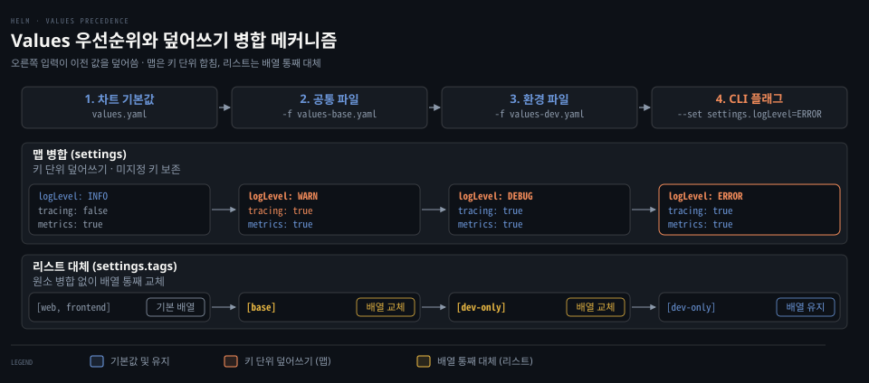
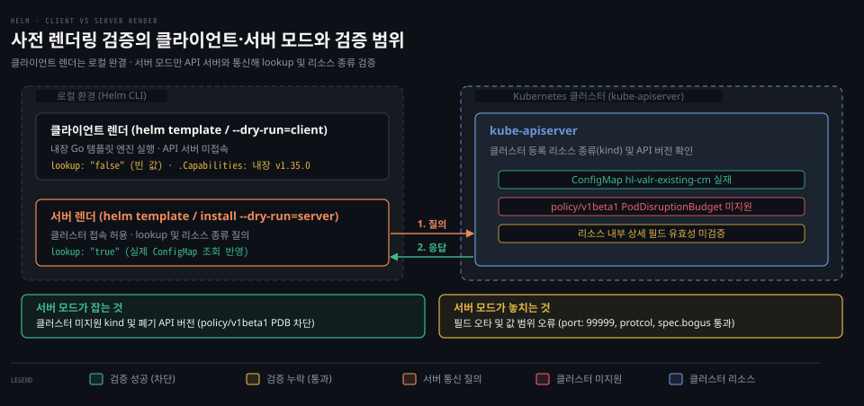
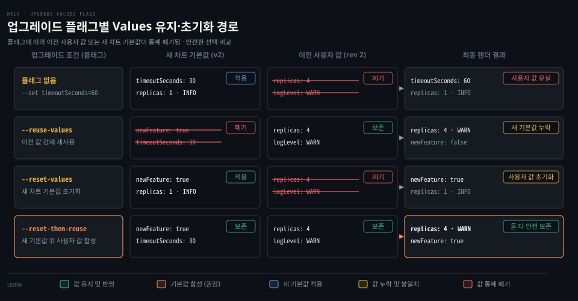

# Helm values와 렌더 검증

---

> 차트 기본값, `-f` 파일, `--set` 계열 플래그가 어떤 순서로 덮이는지 보고, 배포 전에 `helm template`·`--dry-run`·`values.schema.json`으로 잘못된 값을 걸러 내는 방법을 실제 출력으로 확인합니다.

## 학습 목표와 범위

> 차트에 값을 넣는 규칙을 알아야 최종 값을 예측할 수 있고, 예측한 값을 배포 전에 렌더로 확인할 수 있습니다.

1. 차트 기본값, `-f`, `--set` 계열이 덮이는 순서를 알고 최종 값을 예측합니다.
2. `helm template`과 `--dry-run`이 클러스터를 쓰는지에 따라 무엇을 잡고 무엇을 놓치는지 구분합니다.
3. 배포된 릴리스의 값을 조회하고, `helm upgrade` 가 이전 값을 어떻게 다루는지 압니다.
4. `values.schema.json`으로 잘못된 값을 렌더 전에 막습니다.

모든 명령과 출력은 kind v1.35.0 단일 노드 클러스터와 Helm v4.1.4 에서 실행한 결과입니다. Helm 3 은 직접 실행하지 않았습니다. Helm 3 의 동작은 GitHub helm/helm 의 해당 버전 소스 태그를 읽어 대조했고, 어느 버전의 어느 파일인지 각주에 적었습니다. 실습 차트 `demo-chart` 는 이 문서를 위해 직접 만들었으며 파일은 필요한 절에서 보입니다.


## 1. 차트 기본값과 메타데이터 조회

> 차트를 가져와 설치하기 전에 `helm show` 로 받는 값의 이름과 기본 자료형을 먼저 봅니다.

오픈소스 차트나 사내 공용 차트를 처음 설치할 때는 어떤 키를 덮어써야 하는지 모릅니다. 아카이브를 풀어 `values.yaml` 을 열지 않아도 `helm show` 가 같은 내용을 보여 줍니다.

```bash
# 차트 이름과 버전 같은 메타데이터를 봅니다
helm show chart ./demo-chart

# 차트가 받는 기본값 전체를 봅니다 (빈 줄은 뺍니다)
helm show values ./demo-chart | grep -v '^$'
```

```bash
# 결과
apiVersion: v2
appVersion: 1.0.0
description: A Helm chart for values and render verification lab
name: demo-app
version: 0.1.0
replicaCount: 1
image:
  repository: nginx
  tag: ""
  pullPolicy: IfNotPresent
settings:
  logLevel: INFO
  features:
    metrics: true
    tracing: false
  tags:
    - web
    - frontend
configData: {}
newFeature: false
legacyPdb: false
```

출력에서 덮어쓸 키의 경로와 기본 자료형을 읽습니다. 환경마다 다른 값만 골라 사용자 values 파일이나 플래그로 덮습니다. 나머지는 기본값에 맡깁니다. `tag: ""` 처럼 비워 둔 값은 템플릿이 다른 값으로 채운다는 신호입니다. 채우는 방식은 3절에서 봅니다.

저장소 차트라면 이름을 `저장소/차트` 형식으로 쓰며, 저장소 인덱스가 오래됐으면 `helm repo update` 를 먼저 실행합니다. 저장소는 [Helm 차트 의존성과 저장소](Helm%20%EC%B0%A8%ED%8A%B8%20%EC%9D%98%EC%A1%B4%EC%84%B1%EA%B3%BC%20%EC%A0%80%EC%9E%A5%EC%86%8C.md)에서 다룹니다.


## 2. Values 우선순위와 덮어쓰기 규칙

> 같은 키가 여러 곳에 있으면 나중 입력이 이깁니다. 맵은 키 단위로 합쳐지고 리스트는 통째로 바뀌는 차이가 가장 자주 사고를 냅니다.

환경별 배포에서는 공통 파일, 환경 파일, CI 가 넘기는 값이 한꺼번에 들어옵니다. 우선순위를 모르면 의도하지 않은 값으로 파드가 뜹니다.
우선순위는 나중 입력이 덮어쓰며, 맵은 키 단위로 합쳐지고 리스트는 통째로 바뀝니다.


### 병합 순서

우선순위는 차트 `values.yaml`, `-f` 파일, `--set` 순이며, 같은 플래그를 여러 번 쓰면 오른쪽 것이 이깁니다(`helm install --help`). `--set` 계열끼리는 플래그 종류가 순서를 정합니다. 소스는 `--set-json`, `--set`, `--set-string`, `--set-file`, `--set-literal` 순으로 합칩니다[^set-order]. 그래서 명령줄에 적은 순서와 무관하게 뒤쪽 종류가 이깁니다. 이 순서는 소스로만 확인했고 실행하지는 않았습니다.

다음 두 파일로 순서를 확인합니다. 공통 파일 `values-base.yaml` 은 `WARN` 로그 수준과 추적 기능을 켜고, 개발 파일 `values-dev.yaml` 은 로그 수준과 태그만 바꿉니다.

```yaml
# values-base.yaml
replicaCount: 2
settings:
  logLevel: WARN
  features:
    tracing: true
  tags:
    - base

# values-dev.yaml
settings:
  logLevel: DEBUG
  tags:
    - dev-only
```

렌더하는 `templates/configmap.yaml` 의 `data` 는 값을 키로 그대로 옮기므로 병합 결과가 출력에 드러납니다. `metadata` 는 생략했습니다.

```yaml
# demo-chart/templates/configmap.yaml (data 부분)
data:
  LOG_LEVEL: {{ .Values.settings.logLevel | quote }}
  FEATURE_METRICS: {{ .Values.settings.features.metrics | quote }}
  FEATURE_TRACING: {{ .Values.settings.features.tracing | quote }}
  NEW_FEATURE: {{ .Values.newFeature | quote }}
  TAGS: {{ join "," .Values.settings.tags | quote }}
  {{- range $key, $val := .Values.configData }}
  {{ $key }}: {{ $val | quote }}
  {{- end }}
```

두 파일을 순서대로 넘겨 렌더합니다. 둘째 명령은 같은 파일 위에 `--set` 을 더한 것입니다.

```bash
# values 파일 두 개를 순서대로 적용해 ConfigMap 의 값만 골라 봅니다
#   -f, --values      values 파일 지정, 여러 번 쓸 수 있음
#   -s, --show-only   지정한 템플릿의 결과만 출력
helm template demo-app ./demo-chart \
  -f values-base.yaml \
  -f values-dev.yaml \
  -s templates/configmap.yaml | grep -E 'LOG_LEVEL|FEATURE_|TAGS'

# 파일 두 개 위에 --set 으로 로그 수준만 다시 덮습니다
helm template demo-app ./demo-chart \
  -f values-base.yaml \
  -f values-dev.yaml \
  --set settings.logLevel=ERROR \
  -s templates/configmap.yaml | grep -E 'LOG_LEVEL|FEATURE_TRACING|TAGS'
```

```bash
# 결과
  LOG_LEVEL: "DEBUG"
  FEATURE_METRICS: "true"
  FEATURE_TRACING: "true"
  TAGS: "dev-only"
  LOG_LEVEL: "ERROR"
  FEATURE_TRACING: "true"
  TAGS: "dev-only"
```

첫 출력에서 `LOG_LEVEL` 은 뒤의 `values-dev.yaml` 이 이겼습니다. `FEATURE_TRACING` 은 `values-dev.yaml` 에 없지만 `values-base.yaml` 의 `true` 가 남았습니다. `FEATURE_METRICS` 는 차트 기본값이 남았습니다. 맵은 키 단위로 합쳐지기 때문입니다. 반면 `TAGS` 는 `base` 가 사라지고 `dev-only` 만 남았습니다. 리스트는 합쳐지지 않고 가장 높은 우선순위의 배열로 통째로 바뀝니다. 둘째 출력에서는 `--set` 이 파일보다 높은 우선순위로 `LOG_LEVEL` 한 값만 `ERROR` 로 바꿨고 나머지는 그대로입니다.

### --set 문법과 흔한 실수

중첩 키는 점(`.`)으로 잇습니다. 리스트 원소는 `[0]` 인덱스로 가리킵니다. 여러 값은 쉼표로 구분합니다.

```bash
# 중첩 키와 리스트 인덱스를 한 번에 덮습니다
helm template demo-app ./demo-chart \
  --set 'settings.logLevel=ERROR,settings.tags[0]=custom-a,settings.tags[1]=custom-b' \
  -s templates/configmap.yaml | grep -E 'LOG_LEVEL|TAGS'

# 인덱스 0 만 지정했을 때 기본값 두 개가 어떻게 되는지 봅니다
helm template demo-app ./demo-chart \
  --set 'settings.tags[0]=only-one' \
  -s templates/configmap.yaml | grep TAGS

# 이스케이프 없이 쉼표가 든 값을 넘기면 구문 오류가 납니다
helm template demo-app ./demo-chart \
  --set 'configData.hosts=a,b' \
  -s templates/configmap.yaml

# 쉼표 앞에 역슬래시를 붙이면 값 하나로 읽힙니다
helm template demo-app ./demo-chart \
  --set 'configData.hosts=a\,b' \
  -s templates/configmap.yaml | grep hosts
```

```bash
# 결과
  LOG_LEVEL: "ERROR"
  TAGS: "custom-a,custom-b"
  TAGS: "only-one"
Error: failed parsing --set data: key "b" has no value
  hosts: "a,b"
```

두 번째 명령처럼 리스트 원소 하나만 인덱스로 덮어도 리스트 전체가 바뀝니다. 기본값이 두 개인 `settings.tags` 에 `[0]` 만 지정하면 나머지 하나는 남지 않습니다.

값에 쉼표가 들어 있으면 Helm 은 다음 `키=값` 이 시작된 것으로 읽습니다. 쉼표를 이스케이프하지 않은 세 번째 명령은 구문 오류가 났습니다. 쉼표를 역슬래시로 이스케이프한 네 번째 명령은 `a,b` 한 값으로 읽혔습니다.

### 자료형 제어와 파일·JSON 주입

`--set` 은 값을 보고 자료형을 고릅니다. 자료형이 보이도록 설치 없이 `--dry-run=client --debug` 로 사용자 값만 뽑습니다. 설정 파일 내용을 그대로 넣을 때는 `--set-file`, 객체나 배열을 한 번에 넘길 때는 `--set-json` 을 씁니다.

```bash
# --set 이 값마다 고른 자료형을 USER-SUPPLIED VALUES 로 확인합니다
helm install hl-valr-type ./demo-chart \
  --dry-run=client \
  --debug \
  --set configData.port=8080,configData.ratio=1.20,configData.enabled=true,configData.zip=007 2>&1 | sed -n '/USER-SUPPLIED VALUES/,/^$/p'

# 파일 내용 전체를 한 값으로 넣습니다
helm template demo-app ./demo-chart \
  --set-file 'configData.appProperties=./config-files/app.properties' \
  -s templates/configmap.yaml | grep appProperties

# JSON 객체로 맵 하나를 통째로 넘깁니다
helm template demo-app ./demo-chart \
  --set-json 'settings.features={"metrics":false,"tracing":true}' \
  -s templates/configmap.yaml | grep FEATURE
```

```bash
# 결과
USER-SUPPLIED VALUES:
configData:
  enabled: true
  port: 8080
  ratio: "1.20"
  zip: "007"
  appProperties: "database.url=jdbc:postgresql://db:5432/app\ncache.enabled=true\n"
  FEATURE_METRICS: "false"
  FEATURE_TRACING: "true"
  NEW_FEATURE: "false"
```

첫 출력에서 `8080` 과 `true` 는 정수와 불리언으로, `1.20` 과 `007` 은 문자열로 들어갔습니다. `--set-file` 은 파일 내용 전체를 줄바꿈(`\n`)까지 한 값으로 넣었고, `--set-json` 은 맵 하나를 통째로 바꿨습니다. `true` 처럼 불리언으로 읽히면 곤란한 문자열은 `--set-string` 으로 문자열을 강제합니다. 숫자처럼 보이는 `1.20` 이나 `007` 은 `--set` 으로 넘겨도 문자열이어서 이 경우 `--set-string` 이 꼭 필요하지는 않습니다.


## 3. 환경별 파일 분리와 값 설계

> 공통 값은 한 파일에 두고 환경 파일에는 달라지는 값만 적습니다. 값 구조는 템플릿이 읽기 쉬운 쪽으로 정합니다.

환경마다 values 파일을 통째로 복사하면 공통 설정을 바꿀 때 모든 파일을 고쳐야 합니다. 한 곳이 빠지면 환경끼리 어긋납니다. 2절의 `values-base.yaml` 처럼 공통 파일을 두고 환경 파일에는 차이만 적습니다. 그리고 `-f values-base.yaml -f values-prod.yaml` 로 넘깁니다. 차트 기본 `values.yaml` 을 개발 환경 기준으로 두고 운영만 별도 파일로 덮어도 같은 구조입니다.

### 평면 구조와 중첩 구조

Helm 공식 Best Practices 는 대부분 평면 구조를 권합니다. 중첩 값은 템플릿이 단계마다 존재 여부를 확인해야 해서 읽기 어렵고, 관련 값이 많고 그중 하나 이상이 필수일 때만 중첩을 쓰라고 합니다[^bp-flat]. 이 문서의 `demo-chart` 는 `image`·`settings` 를 묶는 중첩 구조입니다. 중첩의 대가는 부모 키가 사라지면 렌더가 깨지는 데서 드러납니다.

```bash
# 부모 키 settings.features 를 null 로 지워 렌더가 깨지는지 봅니다
helm template demo-app ./demo-chart \
  --set settings.features=null \
  -s templates/configmap.yaml 2>&1 | grep 'nil pointer'
```

```bash
# 결과
    nil pointer evaluating interface {}.metrics
```

템플릿이 `.Values.settings.features.metrics` 를 바로 읽기 때문에 `features` 가 없으면 nil pointer 오류가 납니다. 방어하려면 단계마다 `default` 나 `if` 를 넣어야 합니다. 선택 기능은 `enabled: false` 처럼 꺼진 기본값으로 둡니다. 키마다 의미와 예시를 주석으로 적습니다.

### 기본값을 차트 메타데이터로 채우기

이미지 태그가 대표적입니다. `image.tag` 기본값을 빈 문자열로 둡니다. 템플릿은 `{{ .Values.image.tag | default .Chart.AppVersion }}` 로 읽습니다. 태그를 지정하지 않으면 `Chart.yaml` 의 `appVersion` 이 쓰입니다.

```bash
# 태그를 비워 두면 appVersion(1.0.0) 이 이미지 태그가 되는지 봅니다
helm template demo-app ./demo-chart \
  -s templates/deployment.yaml | grep image:

# 태그를 지정하면 그 값이 쓰이는지 봅니다
helm template demo-app ./demo-chart \
  --set image.tag=1.25.0 \
  -s templates/deployment.yaml | grep image:
```

```bash
# 결과
          image: "nginx:1.0.0"
          image: "nginx:1.25.0"
```

앱 버전을 올릴 때 `Chart.yaml` 의 `appVersion` 만 고치면 되고 values 파일은 그대로 둡니다.


## 4. 렌더링 결과 사전 검증

> `helm template` 은 기본이 클라이언트 렌더이고 `--dry-run=server` 는 API 서버를 거칩니다. 서버를 거쳐도 잡히는 것은 리소스 종류와 API 버전이 전부입니다.

values 를 고친 뒤 매니페스트가 의도대로 나오는지 배포 전에 보지 않으면 장애가 클러스터에서 드러납니다. 검증 명령은 `helm template`, `helm install --dry-run`, `helm upgrade --dry-run` 입니다. 갈림길은 명령 이름이 아니라 클러스터에 접속하느냐입니다.
클라이언트 렌더는 로컬에서 완결되고, 서버 모드만 API 서버에 연결해 lookup 과 리소스 종류를 검증합니다.


### 클라이언트 렌더와 서버 렌더

`helm template` 은 기본적으로 API 서버와 통신하지 않습니다. 다음 실행은 존재하지 않는 kubeconfig 로 돌렸는데도 렌더됩니다. 템플릿의 `lookup` 함수는 클러스터에서 ConfigMap `hl-valr-existing-cm` 을 찾아 있으면 `"true"` 를 냅니다. 이 차트의 `templates/lookup.yaml` 은 다음과 같습니다.

```yaml
# demo-chart/templates/lookup.yaml (apiVersion·kind·metadata 생략)
{{- $cm := lookup "v1" "ConfigMap" .Release.Namespace "hl-valr-existing-cm" -}}
data:
  clusterConnected: {{ if $cm }}"true"{{ else }}"false"{{ end }}
  kubeVersion: {{ .Capabilities.KubeVersion.Version | quote }}
```

네임스페이스 `hl-valr-ns` 와 ConfigMap `hl-valr-existing-cm` 은 `kubectl create` 로 미리 만들어 두었습니다(`--from-literal=status=ready`). 먼저 존재하지 않는 kubeconfig 로 클라이언트 렌더를 하고, 이어서 같은 템플릿을 `--dry-run=server` 로 렌더합니다. Helm 4.1.4 의 `helm template` 은 이 플래그도 받습니다.

```bash
# kubeconfig 가 없는 상태로 클라이언트 렌더를 실행합니다
KUBECONFIG=/nonexistent helm template demo-app ./demo-chart \
  -n hl-valr-ns \
  -s templates/lookup.yaml | grep -E 'clusterConnected|kubeVersion'

# 서버 모드를 줘서 lookup 이 클러스터를 읽게 합니다
helm template demo-app ./demo-chart \
  -n hl-valr-ns \
  --dry-run=server \
  -s templates/lookup.yaml | grep -E 'clusterConnected|kubeVersion'
```

```bash
# 결과
  clusterConnected: "false"
  kubeVersion: "v1.35.0"
  clusterConnected: "true"
  kubeVersion: "v1.35.0"
```

클라이언트 렌더에서는 `lookup` 이 빈 결과를 내서 `"false"` 이고, 서버 모드에서는 클러스터를 읽어 `"true"` 입니다.

`kubeVersion` 은 두 실행에서 같은 `v1.35.0` 입니다. kubeconfig 가 없는 첫 실행에서도 이 값이 나왔습니다. 따라서 클라이언트 렌더의 `.Capabilities` 는 클러스터가 아니라 Helm 에 내장된 기본값입니다. 서버 모드가 클러스터 값을 읽는지는 둘이 같아 확인하지 못했습니다. 대상 버전을 직접 정하는 `helm template --kube-version` 도 `--help` 에 있지만 실행하지 않았습니다.

### install --dry-run 의 모드

`helm install --dry-run` 도 같은 규칙입니다. 서버 모드는 API 서버와 통신하고 클라이언트 모드는 접속하지 않습니다. 릴리스를 실제로 만들지는 않아서 `STATUS` 가 `pending-install` 입니다.

```bash
# 서버 모드로 설치를 시뮬레이션합니다
helm install hl-valr-dry ./demo-chart \
  -n hl-valr-ns \
  --dry-run=server | grep -E 'STATUS|DESCRIPTION'

# 클라이언트 모드에서는 lookup 이 어떻게 나오는지 봅니다
helm install hl-valr-dry ./demo-chart \
  -n hl-valr-ns \
  --dry-run=client | grep -E 'clusterConnected|kubeVersion'

# 모드를 지정하지 않은 --dry-run 의 경고와 lookup 결과를 봅니다
helm install hl-valr-dry ./demo-chart \
  -n hl-valr-ns \
  --dry-run 2>&1 | grep -E 'WARN|clusterConnected'
```

```bash
# 결과
STATUS: pending-install
DESCRIPTION: Dry run complete
  clusterConnected: "false"
  kubeVersion: "v1.35.0"
level=WARN msg="--dry-run is deprecated and should be replaced with '--dry-run=client'"
  clusterConnected: "false"
```

옵션 없는 `--dry-run` 은 `WARN` 경고를 내고 `clusterConnected: "false"` 로 클라이언트 모드와 같게 동작했습니다. 경고는 Helm 4.1.4 가 `--dry-run=client` 로 바꾸라고 내는 것입니다.

Helm 3.13.0 소스에서 `--dry-run` 은 문자열 플래그입니다. 값이 없으면 `client` 이고 `server` 는 클러스터 접속을 허용합니다. 3.12.3 에서는 불리언 플래그였습니다[^dry-run]. 위 경고 문구는 Helm 3.19.0 의 `install.go` 에서 찾지 못했습니다. Helm 4 에서 생긴 경고로 보이지만 Helm 3 바이너리는 실행하지 않았습니다.

### 서버 모드가 잡는 것과 놓치는 것

서버 모드가 `template` 보다 더 잡는 것은 클러스터가 모르는 리소스 종류와 API 버전입니다. 클러스터 업그레이드로 사라진 `policy/v1beta1` 의 PodDisruptionBudget 을 렌더하는 값 `legacyPdb=true` 로 확인합니다. 반대로 필드 오류는 서버 모드도 통과합니다. 별도 차트 `bad-chart` 의 Service 에 세 가지 오류를 넣었습니다. 포트 `99999`, 오타 난 `protcol`, 존재하지 않는 `spec.bogus` 필드입니다.

```bash
# 템플릿 렌더 단계에서는 옛 apiVersion 이 그대로 출력됩니다
helm template demo-app ./demo-chart \
  --set legacyPdb=true \
  -s templates/pdb-legacy.yaml | grep -E 'apiVersion|kind'

# 클라이언트 모드는 통과합니다
helm install hl-valr-pdb ./demo-chart \
  -n hl-valr-ns \
  --set legacyPdb=true \
  --dry-run=client | grep -E 'STATUS|DESCRIPTION'

# 서버 모드는 클러스터가 모르는 kind 와 버전 조합에서 실패합니다
helm install hl-valr-pdb ./demo-chart \
  -n hl-valr-ns \
  --set legacyPdb=true \
  --dry-run=server

# 필드 오류가 든 Service 는 서버 모드를 통과하는지 봅니다
helm install hl-valr-bad ./bad-chart \
  -n hl-valr-ns \
  --dry-run=server | grep -E 'STATUS|DESCRIPTION'
```

```bash
# 결과
apiVersion: policy/v1beta1
kind: PodDisruptionBudget
STATUS: pending-install
DESCRIPTION: Dry run complete
Error: INSTALLATION FAILED: unable to build kubernetes objects from release manifest: resource mapping not found for name: "hl-valr-pdb-pdb" namespace: "" from "": no matches for kind "PodDisruptionBudget" in version "policy/v1beta1"
ensure CRDs are installed first
STATUS: pending-install
DESCRIPTION: Dry run complete
```

PodDisruptionBudget 은 클라이언트 모드를 통과하고 서버 모드에서 막혔습니다. `bad-chart` 는 오류가 셋이나 있는데도 `--dry-run=server` 가 성공했습니다.

따라서 서버 모드에 기대는 검증은 "클러스터에 없는 리소스 종류와 API 버전" 에 한정됩니다. 필드 형식과 값 범위는 `helm lint`, 스키마 도구, 실제 적용 단계에서 따로 잡아야 합니다. 이 결과는 Helm 4.1.4 에서만 확인했고 Helm 3 에서는 확인하지 않았습니다.

### 렌더 실패 추적

렌더가 실패하면 `--debug` 가 유효하지 않은 YAML 도 출력해 줍니다. 아래 값은 키 이름에 `: ` 가 들어가 ConfigMap 이 깨지는 경우입니다. `--debug` 없이는 11번째 줄이 어떤 줄인지 보이지 않습니다.

```bash
# 키에 콜론이 든 값을 넘겨 YAML 파싱 오류를 일으킵니다
helm template demo-app ./demo-chart \
  --set 'configData.a: b=1' \
  -s templates/configmap.yaml

# --debug 를 붙여 깨진 YAML 을 그대로 출력하고 마지막 2줄만 봅니다
helm template demo-app ./demo-chart \
  --set 'configData.a: b=1' \
  -s templates/configmap.yaml \
  --debug 2>&1 | tail -2
```

```bash
# 결과
Error: YAML parse error on demo-app/templates/configmap.yaml: error converting YAML to JSON: yaml: line 11: mapping values are not allowed in this context

Use --debug flag to render out invalid YAML
  a: b: "1"
Error: YAML parse error on demo-app/templates/configmap.yaml: error converting YAML to JSON: yaml: line 11: mapping values are not allowed in this context
```

오류는 렌더된 파일의 `line 11` 을 가리킵니다. `--debug` 출력에서 `Error` 바로 위 `a: b: "1"` 이 그 줄이고, 키 안의 `: ` 가 매핑 구분자로 읽혀 깨졌습니다.


## 5. 배포된 릴리스의 Values 확인

> 떠 있는 릴리스에 실제로 들어간 값은 `helm get values` 로 보고, 리비전을 지정해 과거 값도 봅니다.

운영 중인 파드가 예상과 다르게 동작할 때는 values 파일이 아니라 클러스터에 들어간 값을 확인해야 합니다. Helm 은 릴리스마다 Secret 에 값과 매니페스트를 저장하므로 과거 리비전도 조회됩니다. 이해를 위해 `-f values-base.yaml` 위에 `--set replicaCount=3` 을 더해 설치합니다. 파일의 `replicaCount` 는 2 라서 3 이 보이면 `--set` 이 이긴 것입니다.

```bash
# 파일과 --set 을 함께 써서 릴리스를 설치합니다
helm install hl-valr-app ./demo-chart \
  -n hl-valr-ns \
  -f values-base.yaml \
  --set replicaCount=3 | grep -E 'STATUS|REVISION'

# 설치 때 사용자가 넘긴 값만 조회합니다
helm get values hl-valr-app -n hl-valr-ns

# 차트 기본값과 사용자 값을 합친 최종 계산 값을 조회합니다
helm get values hl-valr-app -n hl-valr-ns --all | grep -E 'pullPolicy|newFeature|replicaCount|logLevel'
```

```bash
# 결과
STATUS: deployed
REVISION: 1
USER-SUPPLIED VALUES:
replicaCount: 3
settings:
  features:
    tracing: true
  logLevel: WARN
  tags:
  - base
  pullPolicy: IfNotPresent
newFeature: false
replicaCount: 3
  logLevel: WARN
```

기본 조회는 사용자가 넘긴 값(`USER-SUPPLIED VALUES`)만 보여 줍니다. 차트 기본값까지 합친 최종 값은 `-a`(`--all`) 로 보며, 출력이 길어 네 키만 골랐습니다. 사용자가 지정하지 않은 `pullPolicy`, `newFeature` 도 `--all` 에는 나옵니다.

리비전을 올린 뒤에는 `--revision` 으로 과거 값을 조회합니다. 아래에서 리비전 2 를 `replicaCount=4` 로 올리고 리비전 1 의 값을 봅니다.

```bash
# 같은 파일에 replicaCount 만 4 로 올려 리비전 2 를 만듭니다
helm upgrade hl-valr-app ./demo-chart \
  -n hl-valr-ns \
  -f values-base.yaml \
  --set replicaCount=4 | grep -E 'STATUS|REVISION'

# 리비전 1 에 적용됐던 replicaCount 를 조회합니다
helm get values hl-valr-app -n hl-valr-ns --revision 1 | grep replicaCount
```

```bash
# 결과
STATUS: deployed
REVISION: 2
replicaCount: 3
```

리비전 2 는 `--set replicaCount=4` 로 올렸고, 리비전 1 의 `replicaCount` 는 3 이었음이 출력에 보입니다.

### 렌더 결과와 get manifest 비교

`helm get manifest` 는 클러스터에 기록된 최종 매니페스트입니다. 같은 값으로 `helm template` 을 돌려 diff 를 뜨면 두 결과의 차이만 남습니다.

```bash
# 설치된 매니페스트와 같은 값으로 렌더한 결과를 비교합니다
diff <(helm get manifest hl-valr-app -n hl-valr-ns) <(helm template hl-valr-app ./demo-chart -n hl-valr-ns -f values-base.yaml --set replicaCount=4)
```

```bash
# 결과
20c20
<   clusterConnected: "true"
---
>   clusterConnected: "false"
44d43
< 
```

차이는 두 곳입니다. `clusterConnected` 는 설치 때는 클러스터를 읽어 `"true"`, 클라이언트 렌더에서는 `"false"` 입니다. `44d43` 은 `get manifest` 끝에 붙는 빈 줄 하나입니다. 나머지는 같으므로 `lookup` 을 쓰지 않는 차트라면 `template` 렌더가 실제 적용 내용을 대신 보여 줍니다.


## 6. 업그레이드 시 Values 유지와 초기화

> `helm upgrade` 에서 플래그 없이 `--set` 만 넘기면 이전 사용자 값이 사라지고, `--reuse-values` 는 새 차트의 기본값을 버립니다. 안전한 선택은 `--reset-then-reuse-values` 나 값 파일 명시입니다.

차트 버전을 올리거나 값 하나만 바꾸는 업그레이드에서 이전 릴리스의 값이 어떻게 처리되는지 모르면 설정이 조용히 바뀝니다. 새 차트 `demo-chart-v2` 는 기본값 `newFeature` 를 `true` 로 바꾸고 `settings.timeoutSeconds: 30` 을 새로 추가했습니다. 현재 릴리스는 리비전 2 입니다. 사용자 값은 5절의 `values-base.yaml` 과 `replicaCount=4` 입니다.
플래그에 따라 새 차트 기본값이나 이전 사용자 값이 통째로 폐기되므로 합성 경로를 확인해야 합니다.


### 세 가지 플래그 비교

`--reuse-values` 는 지난 릴리스의 값을 쓰고 이번 명령의 값만 얹습니다. `--reset-values` 는 사용자 값을 버리고 새 차트 기본값 위에 이번 명령의 `--set`·`-f` 만 얹습니다. `--reset-then-reuse-values` 는 새 차트 기본값, 이전 사용자 값, 이번 명령의 `--set`·`-f` 순으로 쌓습니다. 세 번째는 비교하려고 리비전 2 로 되돌린(`rollback`, 새 리비전 5) 뒤 실행하므로 리비전 6 이 됩니다. 출력은 명령마다 `REVISION` 줄 뒤에 그 리비전의 매니페스트 줄이 이어지는 묶음입니다.

```bash
# 이전 릴리스의 값을 재사용해 v2 차트로 올립니다
helm upgrade hl-valr-app ./demo-chart-v2 \
  -n hl-valr-ns \
  --reuse-values | grep REVISION

# 새 차트의 값이 반영됐는지 렌더된 매니페스트에서 봅니다
helm get manifest hl-valr-app -n hl-valr-ns --revision 3 | grep -E 'LOG_LEVEL|NEW_FEATURE|TIMEOUT_SECONDS|replicas:'

# 사용자 값을 모두 버리고 차트 기본값으로 올립니다
helm upgrade hl-valr-app ./demo-chart-v2 \
  -n hl-valr-ns \
  --reset-values | grep REVISION

helm get manifest hl-valr-app -n hl-valr-ns --revision 4 | grep -E 'LOG_LEVEL|NEW_FEATURE|TIMEOUT_SECONDS|replicas:'

# 사용자 값이 살아 있는 리비전 2 로 되돌립니다
helm rollback hl-valr-app 2 -n hl-valr-ns

# 새 차트 기본값 위에 이전 사용자 값을 얹어 올립니다
helm upgrade hl-valr-app ./demo-chart-v2 \
  -n hl-valr-ns \
  --reset-then-reuse-values | grep REVISION

helm get manifest hl-valr-app -n hl-valr-ns --revision 6 | grep -E 'LOG_LEVEL|NEW_FEATURE|TIMEOUT_SECONDS|replicas:'
```

```bash
# 결과
REVISION: 3
  LOG_LEVEL: "WARN"
  NEW_FEATURE: "false"
  TIMEOUT_SECONDS:
  replicas: 4
REVISION: 4
  LOG_LEVEL: "INFO"
  NEW_FEATURE: "true"
  TIMEOUT_SECONDS: "30"
  replicas: 1
Rollback was a success! Happy Helming!
REVISION: 6
  LOG_LEVEL: "WARN"
  NEW_FEATURE: "true"
  TIMEOUT_SECONDS: "30"
  replicas: 4
```

첫 묶음(리비전 3)이 `--reuse-values` 결과입니다. `NEW_FEATURE` 는 `true` 대신 이전 `false` 이고 `TIMEOUT_SECONDS` 는 비었습니다. `pkg/action/upgrade.go` 의 `reuseValues` 가 네 분기를 차례로 검사한 결과입니다[^reuse]. 둘째 `ReuseValues` 는 `CoalesceValues` 로 `oldVals` 를 다시 만듭니다. 이어 `CoalesceTables` 로 이전 값을 합치고 `chart.Values = oldVals` 로 덮습니다. 새 차트 기본값이 빠져 새 키를 읽으면 `nil` 이 될 수 있습니다.

리비전 4(`--reset-values`)에는 새 기본값이 모두 반영됐습니다. 대신 `replicas` 가 4에서 1로, `LOG_LEVEL` 이 `WARN` 에서 `INFO` 로 돌아갔습니다. 첫 분기인 `ResetValues` 가 `current.Config` 를 무시하고 `newVals` 만 돌려주기 때문입니다. 이 분기가 맨 앞이라 `--reuse-values` 와 함께 줘도 `--reset-values` 가 이깁니다(`helm upgrade --help`).

리비전 6은 `NEW_FEATURE: "true"`·`TIMEOUT_SECONDS: "30"` 과 이전 `WARN`·`4` 를 남겼습니다. `ResetThenReuseValues` 가 `chart.Values` 를 두고 `CoalesceTables` 로 `current.Config` 를 합칩니다. `--reset-then-reuse-values` 는 Helm 3.14.0 에 추가됐고 앞 두 플래그와 함께 쓰면 무시됩니다[^reset-reuse]. 3.14 이전 클라이언트에는 없으므로 CI 이미지의 Helm 버전을 먼저 확인합니다.

### 플래그 없이 올릴 때

플래그를 하나도 주지 않을 때는 이번 명령에 값이 있는지가 갈립니다. 네 번째 분기가 `newVals` 가 비어 있고 `current.Config` 가 있으면 이전 사용자 값을 그대로 복사합니다. 값이 하나라도 있으면 `newVals` 만 돌려줍니다(로그 줄 생략)[^reuse].

```go
if len(newVals) == 0 && len(current.Config) > 0 {
    newVals = current.Config
}
return newVals, nil
```

```bash
# 플래그도 값도 없이 올리면 이전 사용자 값이 유지되는지 봅니다
helm upgrade hl-valr-app ./demo-chart-v2 \
  -n hl-valr-ns | grep REVISION

helm get manifest hl-valr-app -n hl-valr-ns --revision 7 | grep -E 'LOG_LEVEL|NEW_FEATURE|TIMEOUT_SECONDS|replicas:'

# --set 하나만 넘기면 이전 사용자 값이 어떻게 되는지 봅니다
helm upgrade hl-valr-app ./demo-chart-v2 \
  -n hl-valr-ns \
  --set settings.timeoutSeconds=60 | grep REVISION

helm get manifest hl-valr-app -n hl-valr-ns --revision 8 | grep -E 'LOG_LEVEL|NEW_FEATURE|TIMEOUT_SECONDS|replicas:'
```

```bash
# 결과
REVISION: 7
  LOG_LEVEL: "WARN"
  NEW_FEATURE: "true"
  TIMEOUT_SECONDS: "30"
  replicas: 4
REVISION: 8
  LOG_LEVEL: "INFO"
  NEW_FEATURE: "true"
  TIMEOUT_SECONDS: "60"
  replicas: 1
```

위 출력은 두 업그레이드의 결과가 이어져 있습니다. 리비전 7 은 값이 유지됐습니다. 리비전 8 은 `timeoutSeconds` 만 60 으로 바뀌었고 `LOG_LEVEL` 과 `replicas` 는 기본값으로 돌아갔습니다. 값 하나만 바꾸려다 이전 사용자 값 전체를 잃는 흔한 사고입니다. 운영 습관으로는 플래그에 기대지 않고 버전 관리하는 `-f values-*.yaml` 을 매번 명시하는 편이 안전합니다.


## 7. 스키마 기반 입력값 유효성 검증

> `values.schema.json` 은 최종 값에 대해 타입·범위·열거·필수를 검사합니다. 스키마에 적지 않은 키의 오타는 잡지 못합니다.

값 오타나 잘못된 타입은 렌더 단계에서 깨지거나, 렌더가 통과해도 파드 생성이 실패한 뒤에야 드러납니다. 차트 루트에 `values.schema.json` 을 두면 그 전에 걸러집니다. Helm 문서의 스키마 예는 JSON Schema draft-07 입니다. 검증은 `helm install`·`upgrade`·`lint`·`template` 에서 일어납니다. 검사 대상은 `values.yaml` 이 아니라 최종 `.Values` 입니다[^schema]. 이 차트의 스키마는 다음과 같습니다.

```json
{
  "$schema": "https://json-schema.org/draft-07/schema#",
  "type": "object",
  "required": ["replicaCount", "settings"],
  "properties": {
    "replicaCount": { "type": "integer", "minimum": 1 },
    "settings": {
      "type": "object",
      "properties": {
        "logLevel": { "type": "string", "enum": ["DEBUG", "INFO", "WARN", "ERROR"] }
      }
    }
  }
}
```

`helm lint`, `helm template`, `helm install` 은 같은 스키마로 값을 막습니다. 최솟값, 열거형, 타입, 필수 값을 차례로 어겨 봅니다. 마지막 명령은 스키마에 없는 키를 `logLevle` 로 오타 낸 경우입니다.

```bash
# replicaCount=0 으로 최솟값 1 을 어기게 하고 오류 줄만 봅니다
helm lint ./demo-chart --set replicaCount=0 2>&1 | grep -E 'ERROR|failed'

# enum 에 없는 로그 수준을 넘기고 오류 줄만 봅니다
helm template demo-app ./demo-chart \
  --set settings.logLevel=TRACE 2>&1 | grep -E 'Error|- at'

# 정수 자리에 문자열을 넘깁니다
helm install hl-valr-schema ./demo-chart \
  -n hl-valr-ns \
  --dry-run=client \
  --set replicaCount=abc 2>&1 | grep -E 'Error|- at'

# 필수 키 replicaCount 를 null 로 지워 누락시킵니다
helm template demo-app ./demo-chart \
  --set replicaCount=null 2>&1 | grep -E 'Error|- at'

# 오타 난 키를 넘겨도 오류가 나지 않는지 봅니다
helm template demo-app ./demo-chart \
  --set settings.logLevle=DEBUG \
  -s templates/configmap.yaml | grep LOG_LEVEL
```

```bash
# 결과
[ERROR] values.yaml: - at '/replicaCount': minimum: got 0, want 1
[ERROR] templates/: values don't meet the specifications of the schema(s) in the following chart(s):
Error: 1 chart(s) linted, 1 chart(s) failed
Error: values don't meet the specifications of the schema(s) in the following chart(s):
- at '/settings/logLevel': value must be one of 'DEBUG', 'INFO', 'WARN', 'ERROR'
Error: INSTALLATION FAILED: values don't meet the specifications of the schema(s) in the following chart(s):
- at '/replicaCount': got string, want integer
Error: values don't meet the specifications of the schema(s) in the following chart(s):
- at '': missing property 'replicaCount'
  LOG_LEVEL: "INFO"
```

앞의 네 명령은 스키마가 막았고, 마지막 명령은 막지 못했습니다. 스키마에 적지 않은 키는 어떤 값이든 통과하므로 오타 난 `logLevle` 은 에러 없이 무시되고 기본값 `INFO` 가 그대로 쓰입니다.

오타까지 막으려면 객체마다 `"additionalProperties": false` 를 넣어야 합니다. 이 차트의 스키마에는 넣지 않아 이 문서에서는 실행하지 않았습니다. 검증을 끄는 `--skip-schema-validation` 플래그가 `helm install --help` 에 있습니다.

따라서 스키마는 "완벽한 차단" 이 아니라 타입·범위·필수·열거를 막는 안전망입니다. CI 에서 `helm lint` 를 돌려 PR 단계에서 걸러 냅니다.


## 8. 변경 내역 렌더링과 Diff 비교

> values 를 고친 뒤 이전 값과 새 값으로 각각 렌더하고 `diff` 로 비교하면 어떤 필드가 바뀌는지 배포 전에 확인합니다.

값 한 줄을 고쳤을 때 어떤 리소스의 어느 필드가 바뀌는지 모르면 예상 밖의 변경이 운영에 나갑니다. 이전 values 와 새 values 로 `helm template` 을 각각 실행한 결과를 `diff -u` 로 비교합니다. 파일로 저장하지 않고 프로세스 치환 `<( )` 으로 명령 출력을 바로 넘깁니다.

```bash
# 기존 values 와 변경한 values 로 각각 렌더해 바뀐 줄(- 와 +)만 비교합니다
diff -u \
  <(helm template hl-valr-app ./demo-chart -f values-prod-old.yaml) \
  <(helm template hl-valr-app ./demo-chart -f values-prod-new.yaml) | grep -E '^[-+] '
```

```bash
# 결과
-  LOG_LEVEL: "WARN"
+  LOG_LEVEL: "ERROR"
-  replicas: 3
+  replicas: 5
```

`LOG_LEVEL` 이 `WARN` 에서 `ERROR` 로, `replicas` 가 3에서 5로 바뀐다는 사실이 배포 전에 드러납니다. CI 에서는 이 diff 를 Pull Request 코멘트로 올려 코드 리뷰에서 인프라 변경점을 검토하게 합니다. 렌더 결과를 Git 에 커밋하면 diff 리뷰가 쉽지만 저장소가 커집니다. 차트만 두고 Argo CD 같은 도구가 렌더하게 하면 저장소가 가볍지만 PR 에서 렌더 결과를 따로 만들어 붙여야 합니다. 렌더 결과를 kubeconform 같은 스키마 검사기에 환경별로 넘기는 방법도 있습니다. 이 기기에 kubeconform 이 없어 실행하지 않았습니다.


## 결정 치트시트

> 목적에 맞는 명령과 플래그를 고르는 표입니다. 근거는 괄호 안의 절에 있습니다.

| 상황 | 선택 | 이유 |
|---|---|---|
| 값이 어떤 순서로 덮이는지 확인 (2절) | `helm template -f ... --set ...` | 같은 입력으로 렌더해 최종 값을 직접 봄 |
| 값에 쉼표가 든 `--set` (2절) | `\,` 로 이스케이프 | 이스케이프가 없으면 `no value` 구문 오류 |
| 불리언처럼 보이는 값을 문자열로 (2절) | `--set-string` | `--set` 은 `true` 를 불리언으로 읽음 |
| 배포 전 빠른 렌더 검증 (4절) | `helm template` | 클러스터 없이 실행, CI 에 적합 |
| `lookup` 이나 존재하지 않는 API 버전 검증 (4절) | `--dry-run=server` | 클러스터를 읽고 kind·apiVersion 이 없으면 실패 |
| 필드 오타와 값 범위 검증 (4절·7절) | `helm lint` 와 `values.schema.json` | 서버 dry-run 도 통과시킴 |
| 떠 있는 릴리스의 실제 값 (5절) | `helm get values --all` | 기본값까지 합친 최종 값 |
| 차트 버전을 올리며 사용자 값 유지 (6절) | `--reset-then-reuse-values` 또는 `-f` 명시 | `--reuse-values` 는 새 기본값을 버림 |
| 변경 영향 검토 (8절) | `helm template` 두 번 + `diff -u` | 바뀌는 필드만 남김 |


## 실무 적용 포인트

> 파이프라인과 업그레이드 명령에 바로 넣을 수 있는 지침입니다.

### 한 가지 실행

CI 에 `helm lint` 와 `helm template` 단계를 넣고, PR 에서는 이전 값과 새 값의 `diff -u` 를 코멘트로 남깁니다. 이 두 단계만으로 7절·8절의 검증 대부분을 자동화합니다.

### 사용하는 상황

- 새 차트 버전을 운영에 올리기 전에 값 변경 영향을 볼 때
- 개발·스테이징·운영 values 를 공통 파일과 환경 파일로 나눌 때

### 주의할 점

- 리스트는 인덱스 하나만 지정해도 통째로 바뀝니다. 유지할 원소까지 모두 적습니다.
- `helm upgrade` 에서 `--set` 하나만 넘기면 이전 사용자 값이 사라집니다. `-f` 파일을 매번 명시하거나 `--reset-then-reuse-values` 를 씁니다.
- `--reuse-values` 는 새 차트 기본값을 버립니다. 차트 버전을 올릴 때 단독으로 쓰지 않습니다.
- `--dry-run=server` 가 성공해도 필드 오류는 남아 있을 수 있습니다.
- 스키마에 적지 않은 키의 오타는 통과합니다.


## 면접 질문

> values 병합 규칙, 렌더 검증, 업그레이드 값 처리에 관한 핵심 질문입니다.

1. values 를 병합할 때 맵과 리스트는 어떻게 다르게 처리됩니까?
2. `helm template` 과 `helm install --dry-run` 은 무엇이 다르며 서버 모드는 무엇을 잡습니까?
3. `helm upgrade` 에서 `--reuse-values` 가 일으키는 문제와 안전한 대안은 무엇입니까?


## 정답 (자답 후 펼치기)

> 위 질문 3개에 먼저 자답한 뒤 아래를 읽으세요.

### 정답 1 — 맵과 리스트의 병합

맵은 키 단위로 재귀 병합되므로 높은 우선순위 파일이 일부 키만 적어도 나머지 키는 유지됩니다. 리스트는 원소 단위로 합칠 수 없고 높은 우선순위의 리스트가 통째로 바뀝니다. `--set 'settings.tags[0]=x'` 처럼 인덱스 하나만 지정해도 같은 결과이므로 유지할 원소까지 모두 다시 적어야 합니다.

### 정답 2 — template 과 dry-run 의 차이

`helm template` 은 기본적으로 클러스터에 접속하지 않아 kubeconfig 없이 실행되고 `lookup` 은 빈 결과를 냅니다. `--dry-run=client` 도 접속하지 않고, `--dry-run=server` 는 API 서버와 통신해 `lookup` 이 동작하며 클러스터가 모르는 kind·apiVersion 이면 실패합니다. 다만 Helm 4.1.4 에서 서버 모드는 필드 오타와 범위 오류를 잡지 못했으므로 `helm lint` 와 스키마를 함께 씁니다.

### 정답 3 — upgrade 의 값 처리

`--reuse-values` 는 이전 차트의 기본값과 사용자 값을 합친 값을 새 차트 기본값 자리에 넣습니다. 그래서 새 차트가 바꾼 기본값과 추가한 키가 모두 적용되지 않습니다. 대안은 새 기본값 위에 이전 사용자 값을 얹는 `--reset-then-reuse-values`(Helm 3.14.0 이후)이고, 가장 안전한 방법은 버전 관리하는 `-f values-*.yaml` 을 매번 명시하는 것입니다.


## 참고 자료

[^set-order]: Helm 소스 `pkg/cli/values/options.go` 의 `MergeValues` — v3.19.0 과 v4.1.4 에서 `-f` 파일 다음에 `--set-json`, `--set`, `--set-string`, `--set-file`, `--set-literal` 순으로 합칩니다. <https://github.com/helm/helm/blob/v4.1.4/pkg/cli/values/options.go>, `helm install --help` 의 `-f`·`--set` 우선순위 설명.
[^dry-run]: Helm v3.13.0 `cmd/helm/install.go` 175~176행에서 `--dry-run` 은 문자열 플래그이고 값이 없으면 `client`, `server` 는 클러스터 접속을 허용합니다. v3.12.3 `cmd/helm/install.go` 163행은 불리언입니다. <https://github.com/helm/helm/blob/v3.13.0/cmd/helm/install.go>
[^reuse]: Helm `pkg/action/upgrade.go` 의 `reuseValues` — v3.14.0 533~571행(`chart.Values = oldVals` 552행), v3.19.0 552~590행(571행), v4.1.4 604~642행(623행). v3 은 `chartutil`, v4 는 `util` 패키지의 `CoalesceValues`·`CoalesceTables` 를 부릅니다. 플래그 없음 분기(`len(newVals) == 0`)는 v3.14.0 566~568행입니다. <https://github.com/helm/helm/blob/v4.1.4/pkg/action/upgrade.go> · <https://raw.githubusercontent.com/helm/helm/v3.14.0/pkg/action/upgrade.go>
[^reset-reuse]: `--reset-then-reuse-values` 는 v3.13.3 `cmd/helm/upgrade.go` 에 없고 v3.14.0 에 있습니다(두 태그 파일에서 플래그 이름을 찾아 확인). 3.x 문서(helm-www 커밋 60d4db8)의 `helm upgrade` 페이지에 이 플래그 설명과 "If '--reset-values' or '--reuse-values' is specified, this is ignored" 문장이 있습니다. 3.14.0 릴리스 노트에는 이 플래그가 변경 기록 한 줄로만 나오고 주요 변경(Notable Changes) 항목에는 없습니다. <https://github.com/helm/helm/releases/tag/v3.14.0> · <https://raw.githubusercontent.com/helm/helm-www/60d4db89421147aec9fc3fcef9e2d49e2729f50b/versioned_docs/version-3/helm/helm_upgrade.md>
[^schema]: Helm 문서 Charts 의 Schema Files 절. <https://helm.sh/docs/topics/charts/#schema-files>
[^bp-flat]: Helm 문서 Best Practices 의 Flat or Nested Values. <https://helm.sh/docs/chart_best_practices/values/>

- [Helm 릴리스 운영](Helm%20%EB%A6%B4%EB%A6%AC%EC%8A%A4%20%EC%9A%B4%EC%98%81.md) — 릴리스 라이프사이클과 3-way merge 및 롤백
- [Helm 차트 작성](Helm%20%EC%B0%A8%ED%8A%B8%20%EC%9E%91%EC%84%B1.md) — 차트 템플릿과 헬퍼 함수 구조
- [Kustomize](Kustomize.md) — 템플릿 없는 오버레이 방식의 선언적 설정 관리
