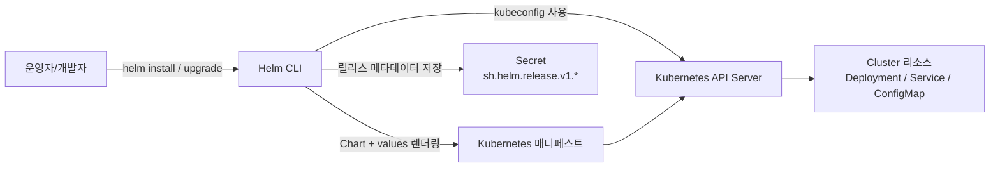
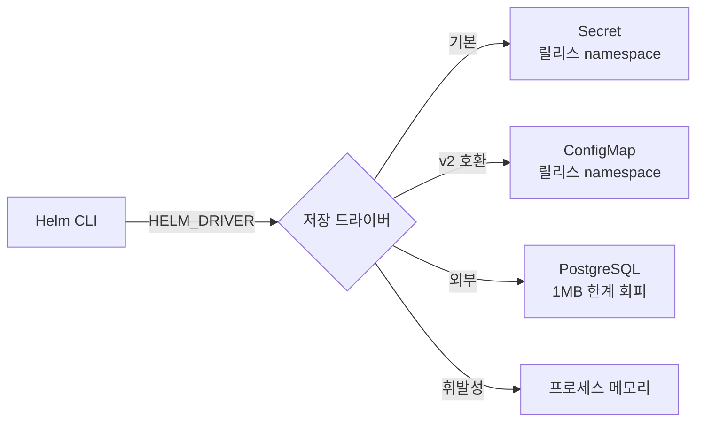
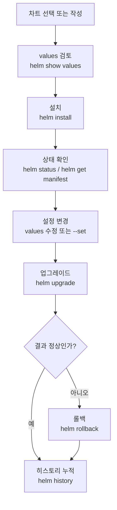
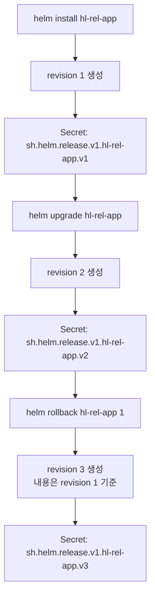
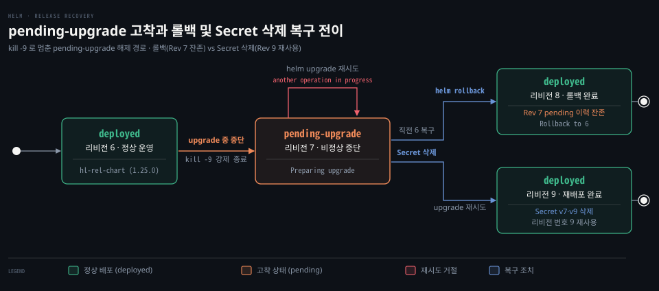
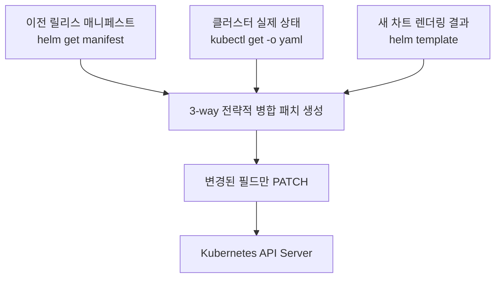
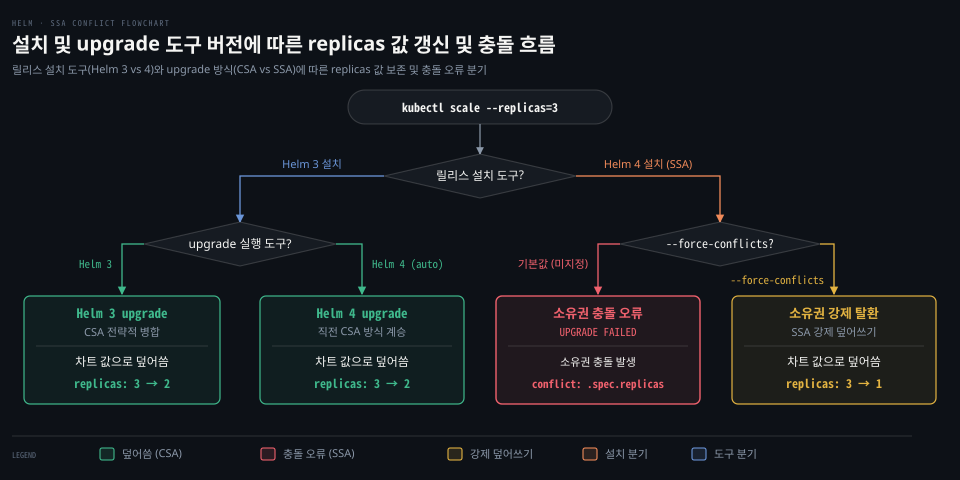

# Helm 릴리스 운영

---

> 차트를 클러스터에 올린 뒤의 일을 다룹니다. 재배포, 배포 완료 확인, 되돌리기, 막힌 릴리스 풀기, 지우기를 실제 출력과 함께 봅니다.

## 학습 목표와 범위

> Helm 릴리스와 리비전이 클러스터에 남는 모양을 이해하고, 배포가 막히거나 충돌할 때 원인을 찾아 풀 수 있습니다.

1. 릴리스 정보가 클러스터의 Secret 에 리비전별로 쌓이는 구조를 설명할 수 있습니다.
2. `upgrade --install`, `--wait`, 실패 시 자동 롤백 옵션으로 CI 배포 명령을 짤 수 있습니다.
3. `pending-upgrade` 로 멈춘 릴리스를 풀고, `kubectl` 로 직접 고친 값이 upgrade 때 어떻게 되는지 판별할 수 있습니다.

긴 출력은 필요한 줄만 골랐고 줄이 빠진 자리는 `...` 로 표시했습니다. 출력은 모두 로컬 kind 클러스터(Kubernetes 1.35 단일 노드)에서 Helm 4.1.4 로 돌린 값입니다. Helm 3 와 비교한 곳은 Helm 3.17.0 바이너리를 `helm3` 라는 이름으로 따로 실행했습니다. 차트 `hl-rel-chart` 는 Deployment 와 Service 만 든 작은 차트이고, ConfigMap 과 PVC 는 값(`keepConfigMap`, `persistence.enabled`)으로 켭니다. 릴리스·네임스페이스 이름은 `hl-rel` 접두를 씁니다.


## 1. 릴리스와 리비전이 클러스터에 남는 모양

> Helm 은 리소스 묶음을 릴리스 하나로 보고, 배포할 때마다 리비전을 Secret 으로 쌓습니다.

`kubectl apply` 로 Deployment, Service, ConfigMap 을 따로 올리면 이 셋이 한 배포였다는 기록이 남지 않습니다. 되돌릴 때 어느 파일이 함께 바뀌었는지는 사람이 기억해야 합니다. 환경마다 같은 YAML 을 복사해 값만 바꾸면 환경 사이도 어긋납니다.

Helm 은 관련 리소스를 **릴리스**(차트가 클러스터에 설치된 인스턴스)로 묶습니다. 배포할 때마다 **리비전**(그 시점의 릴리스 스냅샷) 번호를 1씩 올려 저장합니다.



```bash
# 네임스페이스를 만들며 차트를 처음 설치합니다. 이 배포가 리비전 1이 됩니다
helm install hl-rel-app ./hl-rel-chart \
  --namespace hl-rel \
  --create-namespace
```

```bash
# 결과
NAME: hl-rel-app
LAST DEPLOYED: Sat Nov 21 04:10:01 2026
NAMESPACE: hl-rel
STATUS: deployed
REVISION: 1
DESCRIPTION: Install complete
TEST SUITE: None
```

### 릴리스 정보는 어디에 있는가

설치 직후 같은 네임스페이스에 Secret 이 생깁니다. 이름은 `sh.helm.release.v1.<릴리스>.v<리비전>` 이고 안에는 압축된 차트, 사용한 values, 렌더링된 매니페스트가 들어 있습니다.

```bash
# Helm 이 만든 릴리스 Secret 만 라벨로 골라 봅니다
kubectl get secret -n hl-rel -l owner=helm
```

```bash
# 결과
NAME                               TYPE                 DATA   AGE
sh.helm.release.v1.hl-rel-app.v1   helm.sh/release.v1   1      0s
```

```bash
# 이 Secret 의 타입과 라벨을 봅니다. 라벨의 status 가 릴리스 상태입니다
kubectl get secret -n hl-rel sh.helm.release.v1.hl-rel-app.v1 -o jsonpath='{.type}{"\n"}{.metadata.labels}{"\n"}'
```

```bash
# 결과
helm.sh/release.v1
{"modifiedAt":"1795201801","name":"hl-rel-app","owner":"helm","status":"deployed","version":"1"}
```

Helm 2 에서는 클러스터 안에서 도는 서버 Tiller 가 릴리스를 관리했습니다. Helm 3 는 Tiller 를 없애고 CLI 가 사용자의 `kubeconfig` 권한으로 API 서버와 직접 통신합니다. 공식 문서는 Tiller 를 걷어낸 이유로 RBAC 이 기본이 된 클러스터에서 Tiller 를 안전하게 잠그기 어려웠다는 점을 듭니다[^helm-v3-changes]. Helm 3 부터 릴리스 정보의 기본 저장소가 ConfigMap 에서 Secret 으로 바뀌었고, 릴리스 이름은 네임스페이스 안에서만 고유하면 됩니다. 같은 이름의 릴리스를 `dev`·`prod` 네임스페이스에 각각 설치할 수 있다는 뜻입니다.

Argo CD 는 Helm 차트를 보통 `helm template` 으로 렌더링해 매니페스트만 적용합니다. 그래서 Argo CD 로 배포한 앱에는 `sh.helm.release.v1.*` Secret 도 `helm history` 도 없습니다.

### 저장 드라이버와 크기 한계

Secret 은 기본값일 뿐이고, 환경 변수 `HELM_DRIVER` 로 저장소를 바꿀 수 있습니다.



| 드라이버 | 저장소 | 쓰는 때 |
|----------|--------|---------|
| `secret` | 릴리스 네임스페이스의 Secret | 기본값. 일반 운영 |
| `configmap` | 릴리스 네임스페이스의 ConfigMap | Helm 2 호환 |
| `sql` | 외부 PostgreSQL (`HELM_DRIVER_SQL_CONNECTION_STRING` 으로 접속) | 객체 크기 한계를 피하거나 여러 클러스터 이력을 모을 때 |
| `memory` | 프로세스 메모리 | CI 와 단위 테스트 |

Kubernetes 객체 하나는 약 1MB 로 크기가 제한되어, 매니페스트가 아주 큰 차트는 리비전 Secret 을 저장하다 실패할 수 있습니다. 한계에 가까워지면 이력 보관 수를 줄이거나 `sql` 드라이버를 검토합니다. 이 문서에서는 한계를 실측하지 않았습니다.


## 2. 설치와 재배포를 한 명령으로

> `upgrade --install` 은 릴리스가 없으면 설치하고 있으면 새 리비전으로 올립니다.

CI 에서 `helm install` 은 릴리스가 이미 있으면 실패하고 `helm upgrade` 는 릴리스가 없으면 실패합니다. 그래서 `helm list` 로 존재를 확인해 분기하는 스크립트를 쓰기 쉬운데, `--install` 을 붙이면 분기가 필요 없습니다. 같은 명령을 몇 번 실행해도 결과가 같습니다.



```bash
# 릴리스가 없으면 설치하고 있으면 업그레이드합니다
#   --install            릴리스가 없을 때 설치로 동작합니다
#   --create-namespace   네임스페이스가 없으면 만들고, 있으면 그냥 지나갑니다
#   --set                명령줄에서 값을 덮어씁니다
helm upgrade --install hl-rel-app ./hl-rel-chart \
  --namespace hl-rel \
  --create-namespace \
  --set replicaCount=2
```

```bash
# 결과
Release "hl-rel-app" has been upgraded. Happy Helming!
...
REVISION: 2
DESCRIPTION: Upgrade complete
```

`REVISION` 이 2로 올라갔고 `Release "hl-rel-app" has been upgraded` 가 찍혔습니다. 이미 있는 네임스페이스에 `--create-namespace` 를 줘도 오류가 없었습니다.

```bash
# upgrade 가 끝난 직후 Deployment 상태를 봅니다
kubectl get deployment hl-rel-app -n hl-rel
```

```bash
# 결과
NAME         READY   UP-TO-DATE   AVAILABLE   AGE
hl-rel-app   0/2     2            0           1s
```

`UP-TO-DATE` 는 2인데 `READY` 는 0/2 입니다. Helm 은 매니페스트를 API 서버에 넘기자마자 성공을 돌려줬고, 파드는 아직 뜨는 중입니다. 이 간격을 다음 절에서 메웁니다.

운영 배포에서는 두 가지를 습관으로 둡니다.

- 원격 저장소 차트는 `--version` 으로 차트 버전을 고정합니다. 생략하면 그 시점의 최신 버전이 올라갑니다.
- 환경별 값은 `-f values-prod.yaml` 처럼 파일로 명시해 Git 에 함께 둡니다. `-f` 를 여러 개 주면 뒤의 파일이 앞을 덮습니다.

`--reuse-values` 는 이전 릴리스의 값을 재사용해서 차트의 새 기본값이 반영되지 않을 수 있습니다. `--reset-values` 는 값을 차트 기본값으로 되돌립니다. 둘 다 `-f` 로 값을 모두 적는 쪽보다 위험합니다. Helm 4 의 `--reset-then-reuse-values` 는 차트 기본값으로 초기화한 뒤 마지막 릴리스의 값과 명령줄 값을 합칩니다[^helm4-upgrade].


## 3. 배포 완료 확인과 자동 롤백

> `--wait` 로 파드 준비까지 기다리고, 실패하면 직전 리비전으로 자동 복구합니다.

`--wait` 없이 `helm upgrade` 는 이미지 풀 실패나 `CrashLoopBackOff` 가 나도 성공으로 끝납니다. CI 가 배포 장애를 못 보는 이유입니다. Helm 4 의 `--wait` 기본값은 `hookOnly`(훅만 기다림)이고, 값을 주지 않고 `--wait` 만 쓰면 `watcher` 로 리소스 준비까지 기다립니다.

```bash
# 리소스가 준비될 때까지 최대 2분 기다리며 업그레이드합니다
#   --wait      리소스가 준비될 때까지 기다립니다
#   --timeout   기다리는 최대 시간입니다. 넘기면 실패로 처리합니다
helm upgrade --install hl-rel-app ./hl-rel-chart \
  --namespace hl-rel \
  --wait \
  --timeout 2m \
  --set replicaCount=2
```

```bash
# 결과
Release "hl-rel-app" has been upgraded. Happy Helming!
...
REVISION: 3
DESCRIPTION: Upgrade complete
```

```bash
# 같은 Deployment 를 다시 봅니다
kubectl get deployment hl-rel-app -n hl-rel
```

```bash
# 결과
NAME         READY   UP-TO-DATE   AVAILABLE   AGE
hl-rel-app   2/2     2            2           2s
```

이번에는 `READY` 가 2/2 일 때 명령이 끝났습니다. 값이 같은데도 리비전은 3으로 올라갑니다. Helm 은 값이 바뀌었는지와 상관없이 upgrade 마다 새 리비전을 만듭니다. Job 이 든 차트는 `--wait-for-jobs` 를 더해 Job 완료까지 기다립니다.

### 실패하면 자동으로 되돌리기

타임아웃으로 배포가 실패했는데 그대로 두면 새 파드는 못 뜨고 옛 파드만 일부 남은 상태가 됩니다. Helm 3 는 `--atomic` 으로, Helm 4 는 `--rollback-on-failure` 로 직전 리비전 복구까지 맡깁니다. Helm 4 의 소스는 `--atomic` 을 deprecated 로 표시하고 `--rollback-on-failure` 를 쓰라고 안내합니다[^helm4-upgrade]. 두 옵션 모두 `--wait` 를 자동으로 켭니다[^helm3-upgrade].

```bash
# 없는 이미지를 지정해 일부러 실패시키고 자동 롤백되는지 봅니다
#   --rollback-on-failure   실패하면 직전에 성공한 리비전으로 되돌립니다 (Helm 3 의 --atomic)
helm upgrade hl-rel-app ./hl-rel-chart \
  --namespace hl-rel \
  --wait \
  --timeout 5s \
  --rollback-on-failure \
  --set image.repository=invalid-registry.k8s.io/non-exist \
  --set image.tag=invalid
```

```bash
# 결과
level=WARN msg="upgrade failed" name=hl-rel-app error="resource Deployment/hl-rel/hl-rel-app not ready. status: InProgress, message: Pending termination: 1\ncontext deadline exceeded"
Error: UPGRADE FAILED: release hl-rel-app failed, and has been rolled back due to rollback-on-failure being set: resource Deployment/hl-rel/hl-rel-app not ready. status: InProgress, message: Pending termination: 1
context deadline exceeded
```

`rolled back due to rollback-on-failure being set` 가 롤백이 일어났다는 표시입니다. 이력으로 확인합니다.

```bash
# 실패와 자동 롤백이 이력에 어떻게 남았는지 봅니다
helm history hl-rel-app --namespace hl-rel
```

```bash
# 결과
REVISION	UPDATED                 	STATUS    	CHART             	APP VERSION	DESCRIPTION
1       	Sat Nov 21 04:10:01 2026	superseded	hl-rel-chart-0.1.0	1.25.0     	Install complete
2       	Sat Nov 21 04:10:01 2026	superseded	hl-rel-chart-0.1.0	1.25.0     	Upgrade complete
3       	Sat Nov 21 04:10:02 2026	superseded	hl-rel-chart-0.1.0	1.25.0     	Upgrade complete
4       	Sat Nov 21 04:10:03 2026	failed    	hl-rel-chart-0.1.0	1.25.0     	Upgrade "hl-rel-app" failed: resource Deployment/hl-rel/hl-rel-app not ready. status: InProgress, message: Pending termination...
5       	Sat Nov 21 04:10:08 2026	deployed  	hl-rel-chart-0.1.0	1.25.0     	Rollback to 3
```

리비전 4는 `failed` 로 남고, 리비전 5가 "Rollback to 3" 으로 새로 만들어져 `deployed` 입니다. 되돌리기가 4를 지우지 않고 5를 더한다는 점은 5절에서 다시 봅니다. Helm 3.17.0 에서 같은 일을 `--atomic` 으로 해도 이력은 같습니다. `failed` 리비전 뒤에 `Rollback to 3` 리비전이 붙습니다. 오류 메시지만 `rolled back due to atomic being set` 으로 다릅니다.


## 4. 지금 무엇이 떠 있는지 보기

> `list`, `status`, `get` 으로 릴리스 상태, 주입된 값, 렌더링된 매니페스트를 봅니다.

장애 분석은 보통 "지금 어떤 리비전이 어떤 값으로 떠 있는가"에서 시작합니다.

```bash
# 이 네임스페이스의 릴리스 목록을 봅니다 (모든 네임스페이스는 -A)
helm list --namespace hl-rel
```

```bash
# 결과
NAME      	NAMESPACE	REVISION	UPDATED                            	STATUS  	CHART             	APP VERSION
hl-rel-app	hl-rel   	5       	2026-11-21 04:10:08.53429 +0900 KST	deployed	hl-rel-chart-0.1.0	1.25.0
```

`helm list` 의 기본 표시 상태는 버전마다 다릅니다. Helm 3 는 `deployed` 와 `failed` 릴리스만 보여 주고[^helm3-list], Helm 4 는 상태와 관계없이 모두 보여 줍니다[^helm4-list]. `pending-*`·`uninstalled` 릴리스는 Helm 3 에서 `--all` 이나 `--pending`·`--uninstalled` 를 줘야 나타납니다. 8절에서 같은 릴리스를 두 버전으로 나란히 조회합니다.

```bash
# 릴리스 상태와 이 리비전이 만든 리소스 일부를 봅니다
helm status hl-rel-app --namespace hl-rel | head -9
```

```bash
# 결과
NAME: hl-rel-app
LAST DEPLOYED: Sat Nov 21 04:10:08 2026
NAMESPACE: hl-rel
STATUS: deployed
REVISION: 5
DESCRIPTION: Rollback to 3
RESOURCES:
==> v1/Service
NAME         TYPE        CLUSTER-IP     EXTERNAL-IP   PORT(S)   AGE
```

```bash
# 사용자가 -f 나 --set 으로 넘긴 값만 봅니다
helm get values hl-rel-app --namespace hl-rel
```

```bash
# 결과
USER-SUPPLIED VALUES:
replicaCount: 2
```

`helm get values` 는 기본값을 뺀 사용자 값만 보여 줍니다. 과거 시점은 `--revision <번호>` 를 붙입니다. 차트 기본값까지 합친 값은 `--all` 입니다.

`helm get manifest` 는 API 서버에 보낸 최종 YAML 을, `helm get all` 은 값·매니페스트·노트·훅을 한 번에 가져옵니다. 설치 후 안내문은 `helm get notes`, 훅 매니페스트는 `helm get hooks`, 차트 메타데이터는 `helm get metadata` 로 하나씩 봅니다.


## 5. 잘못 나간 배포 되돌리기와 이력 관리

> 롤백은 과거 리비전을 되살리지 않고 그 내용으로 새 리비전을 만듭니다.

수동으로 되돌리다 리소스 하나를 빠뜨리면 복구가 길어집니다. `helm rollback` 은 지정한 리비전의 매니페스트 전체를 다시 적용합니다.



```bash
# 리비전 1 의 상태로 되돌립니다
helm rollback hl-rel-app 1 --namespace hl-rel
```

```bash
# 결과
Rollback was a success! Happy Helming!
```

```bash
# 이력의 마지막 3개를 봅니다
helm history hl-rel-app --namespace hl-rel --max 3
```

```bash
# 결과
REVISION	UPDATED                 	STATUS    	CHART             	APP VERSION	DESCRIPTION
4       	Sat Nov 21 04:10:03 2026	failed    	hl-rel-chart-0.1.0	1.25.0     	Upgrade "hl-rel-app" failed: resource Deployment/hl-rel/hl-rel-app not ready. status: InProgress, message: Pending termination...
5       	Sat Nov 21 04:10:08 2026	superseded	hl-rel-chart-0.1.0	1.25.0     	Rollback to 3
6       	Sat Nov 21 04:10:09 2026	deployed  	hl-rel-chart-0.1.0	1.25.0     	Rollback to 1
```

새 리비전 6 이 `Rollback to 1` 로 생겼고 Secret `...v6` 도 함께 늘었습니다. 리비전 번호는 거꾸로 가지 않고 이력은 한 줄로만 자랍니다. 번호를 생략한 `helm rollback hl-rel-app` 은 번호가 0 인 것으로 보아 직전 리비전(현재 번호 − 1)으로 되돌립니다[^helm3-rollback]. "직전 정상 리비전"이 아니라는 점은 6절에서 확인합니다.

### 이력 보관 개수

upgrade 를 계속하면 리비전 Secret 이 쌓입니다. `--history-max` 의 기본값은 10 이어서(`0` 이면 무제한), 따로 주지 않아도 최근 10개만 남습니다.

```bash
# 리비전이 14개가 되도록 upgrade 를 반복하고 남은 Secret 수를 셉니다
helm install hl-rel-hist ./hl-rel-chart --namespace hl-rel
for i in 1 2 3 4 5 6 7 8 9 10 11 12; do
  helm upgrade hl-rel-hist ./hl-rel-chart --namespace hl-rel --set replicaCount=1 > /dev/null
done
kubectl get secret -n hl-rel -l name=hl-rel-hist --no-headers | wc -l | tr -d ' '
```

```bash
# 결과
10
```

```bash
# 보관 수를 3으로 줄여 upgrade 하면 오래된 Secret 이 지워집니다
#   --history-max   릴리스마다 보관할 리비전 수입니다 (기본 10)
helm upgrade hl-rel-hist ./hl-rel-chart --namespace hl-rel --history-max 3 > /dev/null
kubectl get secret -n hl-rel -l name=hl-rel-hist
```

```bash
# 결과
NAME                                 TYPE                 DATA   AGE
sh.helm.release.v1.hl-rel-hist.v12   helm.sh/release.v1   1      1s
sh.helm.release.v1.hl-rel-hist.v13   helm.sh/release.v1   1      1s
sh.helm.release.v1.hl-rel-hist.v14   helm.sh/release.v1   1      0s
```

리비전 14개를 만들었는데 Secret 은 10개였고, `--history-max 3` 으로 한 번 더 올리자 3개만 남았습니다. 보관 수를 넘은 리비전은 롤백 대상에서도 사라지므로, 몇 단계 전까지 되돌릴지 정해 숫자를 잡습니다. 클라이언트 전체 기본값은 환경 변수 `HELM_MAX_HISTORY` 로 정합니다.


## 6. pending 으로 멈춘 릴리스

> `pending-upgrade` 리비전이 남아 있으면 다음 upgrade 가 거절됩니다. 롤백이나 Secret 삭제로 풉니다.

배포 중단으로 `pending-upgrade` 가 된 릴리스의 고착과 두 가지 복구 경로입니다.


멀쩡하던 릴리스에 upgrade 했더니 `another operation ... is in progress` 로 거절되는 일이 있습니다. Helm 은 배포를 시작할 때 리비전을 `pending-upgrade` 로 기록하고 끝나면 `deployed` 로 바꿉니다. 그 사이에 CI 컨테이너가 강제 종료되면 마지막 갱신이 일어나지 않습니다. 아래는 upgrade 를 백그라운드로 띄워 3초 만에 `kill -9` 로 죽여 이 상황을 만든 것입니다.

```bash
# upgrade 를 시작하고 3초 뒤 강제 종료해 완료 처리를 못 하게 만듭니다
helm upgrade hl-rel-app ./hl-rel-chart \
  --namespace hl-rel \
  --wait \
  --timeout 60s \
  --set image.tag=bad > /dev/null 2>&1 &
sleep 3; kill -9 $!
```

```bash
# 이력의 마지막 3개를 봅니다
helm history hl-rel-app --namespace hl-rel --max 3
```

```bash
# 결과
REVISION	UPDATED                 	STATUS         	CHART             	APP VERSION	DESCRIPTION
5       	Sat Nov 21 04:10:08 2026	superseded     	hl-rel-chart-0.1.0	1.25.0     	Rollback to 3
6       	Sat Nov 21 04:10:09 2026	deployed       	hl-rel-chart-0.1.0	1.25.0     	Rollback to 1
7       	Sat Nov 21 04:10:12 2026	pending-upgrade	hl-rel-chart-0.1.0	1.25.0     	Preparing upgrade
```

```bash
# 이 상태에서 upgrade 를 시도합니다
helm upgrade hl-rel-app ./hl-rel-chart --namespace hl-rel
```

```bash
# 결과
Error: UPGRADE FAILED: another operation (install/upgrade/rollback) is in progress
```

다른 조작이 진행 중이라는 이 오류가 pending 고착의 신호입니다. 푸는 길은 둘입니다.

### 풀기 1: 롤백

```bash
# 번호 없이 롤백하면 현재 리비전 7 의 바로 앞인 6 으로 되돌립니다
helm rollback hl-rel-app --namespace hl-rel
helm history hl-rel-app --namespace hl-rel --max 3
```

```bash
# 결과
Rollback was a success! Happy Helming!
REVISION	UPDATED                 	STATUS         	CHART             	APP VERSION	DESCRIPTION
6       	Sat Nov 21 04:10:09 2026	superseded     	hl-rel-chart-0.1.0	1.25.0     	Rollback to 1
7       	Sat Nov 21 04:10:12 2026	pending-upgrade	hl-rel-chart-0.1.0	1.25.0     	Preparing upgrade
8       	Sat Nov 21 04:10:15 2026	deployed       	hl-rel-chart-0.1.0	1.25.0     	Rollback to 6
```

롤백이 성공해 리비전 8이 `deployed` 가 되었고, 막혀 있던 리비전 7은 `pending-upgrade` 로 이력에 남아 있습니다. 롤백이 7을 정리하지는 않습니다. 이력에 남은 pending 줄이 거슬리면 아래 방법으로 Secret 을 지웁니다.

### 풀기 2: pending Secret 삭제

```bash
# 한 번 더 같은 방식으로 멈춘 뒤 pending 상태의 Secret 을 라벨로 찾습니다
kubectl get secret -n hl-rel -l name=hl-rel-app,status=pending-upgrade
```

```bash
# 결과
NAME                               TYPE                 DATA   AGE
sh.helm.release.v1.hl-rel-app.v7   helm.sh/release.v1   1      6s
sh.helm.release.v1.hl-rel-app.v9   helm.sh/release.v1   1      3s
```

옛 pending 리비전 7과 새로 멈춘 리비전 9가 함께 잡혔습니다. 이 상태에서 upgrade 하면 다시 `another operation ... is in progress` 로 거절됩니다. pending Secret 을 지우고 upgrade 합니다.

```bash
# pending 상태 Secret 을 지워 잠금을 풀고 다시 upgrade 합니다
kubectl delete secret -n hl-rel -l name=hl-rel-app,status=pending-upgrade
helm upgrade hl-rel-app ./hl-rel-chart --namespace hl-rel
```

```bash
# 결과
secret "sh.helm.release.v1.hl-rel-app.v7" deleted from hl-rel namespace
secret "sh.helm.release.v1.hl-rel-app.v9" deleted from hl-rel namespace
Release "hl-rel-app" has been upgraded. Happy Helming!
...
REVISION: 9
DESCRIPTION: Upgrade complete
```

지운 리비전 번호(9)가 비어 있어서 새 upgrade 가 그 번호를 다시 썼습니다. Secret 삭제는 이력을 직접 고치는 일이라, 삭제 전에 `-l` 라벨이 지우려는 것만 고르는지 `get` 으로 먼저 확인합니다. 최초 설치 도중 멈춘 `pending-install` 은 돌아갈 리비전이 없어 롤백이 안 될 수 있는데, 이 경우는 실측하지 않았습니다.


## 7. 직접 고친 값과 upgrade 충돌

> 차트가 소유하지 않은 필드는 남고, 차트가 정한 필드는 Helm 버전에 따라 덮어쓰거나 충돌합니다.

운영자가 장애 대응으로 `kubectl scale` 을 쓰거나 메시 사이드카가 주석을 붙이면, 다음 upgrade 가 그 값을 지우는지가 문제입니다. Helm 3 와 4 는 적용 방식이 다릅니다.



Helm 3 는 이전 매니페스트, 라이브 상태, 새 매니페스트 셋으로 패치를 만드는 3-way strategic merge patch 를 씁니다[^helm-3-way-merge]. 클라이언트가 패치를 계산해 보내는 방식(CSA)입니다.

Helm 4 는 Kubernetes 의 Server-Side Apply(SSA)를 씁니다. 필드마다 소유자를 API 서버가 기록합니다. `--server-side` 의 기본값은 `auto` 입니다. 제안서(HIP 0023)에 따르면 install 은 SSA 를 쓰고, upgrade 와 rollback 은 직전 릴리스가 쓴 방식을 따릅니다[^hip-0023].

### 차트에 없는 필드

```bash
# 차트에 없는 어노테이션을 직접 붙이고 upgrade 한 뒤 남았는지 봅니다
kubectl annotate deployment hl-rel-app -n hl-rel custom.ops/injected-by="developer"
helm upgrade hl-rel-app ./hl-rel-chart --namespace hl-rel --set service.port=8080
kubectl get deployment hl-rel-app -n hl-rel -o jsonpath='{.metadata.annotations.custom\.ops/injected-by}{"\n"}'
```

```bash
# 결과
developer
```

어노테이션은 차트가 정하지 않은 필드라 Helm 4 의 upgrade 뒤에도 남았습니다. 이 실측은 Helm 4 에서만 했고, Helm 3 가 라이브 상태를 함께 본다는 설명은 공식 문서 인용으로만 받칩니다.

### 차트가 정한 필드의 충돌

차트가 지정한 필드를 `kubectl` 로 바꾼 뒤의 Helm 버전별 적용 방식과 충돌 흐름입니다.


```bash
# kubectl 로 replicas 를 바꾼 뒤 차트를 upgrade 합니다
kubectl scale deployment hl-rel-app -n hl-rel --replicas=3
helm upgrade hl-rel-app ./hl-rel-chart --namespace hl-rel --set service.port=8081
```

```bash
# 결과
level=WARN msg="upgrade failed" name=hl-rel-app error="conflict occurred while applying object hl-rel/hl-rel-app apps/v1, Kind=Deployment: Apply failed with 1 conflict: conflict with \"kubectl\" with subresource \"scale\" using apps/v1: .spec.replicas"
Error: UPGRADE FAILED: conflict occurred while applying object hl-rel/hl-rel-app apps/v1, Kind=Deployment: Apply failed with 1 conflict: conflict with "kubectl" with subresource "scale" using apps/v1: .spec.replicas
```

차트가 `.spec.replicas` 를 정해 두었기 때문에 필드 소유자가 `kubectl` 의 scale 로 바뀐 상태에서 SSA 가 충돌 오류를 냅니다. 충돌을 Helm 쪽 값으로 강제하려면 `--force-conflicts` 를 줍니다.

```bash
# 소유권 충돌을 Helm 값으로 덮어쓰며 upgrade 합니다
#   --force-conflicts   서버 측 적용에서 필드 소유권 충돌을 강제로 덮어씁니다
helm upgrade hl-rel-app ./hl-rel-chart \
  --namespace hl-rel \
  --set service.port=8081 \
  --force-conflicts
kubectl get deployment hl-rel-app -n hl-rel -o jsonpath='{.spec.replicas}{"\n"}'
```

```bash
# 결과
Release "hl-rel-app" has been upgraded. Happy Helming!
...
REVISION: 12
DESCRIPTION: Upgrade complete
1
```

replicas 가 차트 값 1 로 돌아갔습니다. 같은 일을 Helm 3 로 설치한 릴리스에서 비교합니다.

```bash
# Helm 3 로 설치한 릴리스의 replicas 를 3 으로 바꾼 뒤, Helm 3 와 Helm 4 로 차례로 upgrade 합니다
helm3 install hl-rel-h3 ./hl-rel-chart --namespace hl-rel --set replicaCount=2 > /dev/null
kubectl scale deployment hl-rel-h3 -n hl-rel --replicas=3
helm3 upgrade hl-rel-h3 ./hl-rel-chart --namespace hl-rel --set replicaCount=2 --set service.port=8081 > /dev/null
kubectl get deployment hl-rel-h3 -n hl-rel -o jsonpath='{.spec.replicas}{"\n"}'
kubectl scale deployment hl-rel-h3 -n hl-rel --replicas=3
helm upgrade hl-rel-h3 ./hl-rel-chart --namespace hl-rel --set replicaCount=2 --set service.port=8082 > /dev/null
kubectl get deployment hl-rel-h3 -n hl-rel -o jsonpath='{.spec.replicas}{"\n"}'
```

```bash
# 결과
2
2
```

첫 줄이 Helm 3 upgrade 뒤, 둘째 줄이 Helm 4 upgrade 뒤의 replicas 입니다.

정리하면 다음과 같습니다.

| 릴리스를 설치한 도구 | upgrade 도구 | `kubectl scale` 로 바꾼 replicas |
|---|---|---|
| Helm 4 | Helm 4 | 충돌 오류. `--force-conflicts` 로 차트 값을 강제하거나 `--server-side=false` |
| Helm 3 | Helm 3 | 오류 없이 차트 값으로 덮어씀 (3 → 2) |
| Helm 3 | Helm 4 (`auto`) | 오류 없이 차트 값으로 덮어씀. 직전 릴리스가 CSA 라 CSA 로 이어감 |

세 번째 줄 릴리스에 `--force-conflicts` 를 주면 오류가 났습니다. 오류 문구는 `forceConflicts enabled when serverSideApply disabled` 입니다. 직전 리비전이 CSA 면 SSA 옵션을 쓸 수 없습니다.

운영 중에 replicas 를 `kubectl` 로 자주 바꾼다면 차트에서 `replicas` 를 비우고 HPA 에 맡기는 쪽이 충돌 자체를 없앱니다. 불변 필드(`Deployment.spec.selector`, `Service.spec.clusterIP`)를 차트에서 바꾸면 패치가 실패합니다. 이때 쓰는 Helm 3 의 `--force` 는 Helm 4 에서 `--force-replace` 로 이름이 바뀌었습니다[^helm4-upgrade]. 교체 방식으로 갱신하므로 서비스 영향을 먼저 따져야 합니다.


## 8. 지우기와 남는 것

> `uninstall` 은 릴리스가 만든 리소스를 지우지만, 이력과 일부 리소스는 남길 수 있습니다.

`helm uninstall` 은 릴리스의 리소스와 리비전 Secret 을 함께 지웁니다. 지운 뒤에도 "언제 어떤 값으로 떠 있었는지"를 남기려면 `--keep-history` 를 줍니다.

```bash
# 정책 주석이 붙은 ConfigMap 과 PVC 를 켠 채 upgrade 합니다
helm upgrade hl-rel-app ./hl-rel-chart \
  --namespace hl-rel \
  --set persistence.enabled=true \
  --set keepConfigMap=true \
  --set service.port=8081 \
  --force-conflicts > /dev/null
kubectl get pvc,cm -n hl-rel -l app.kubernetes.io/instance=hl-rel-app
```

```bash
# 결과
NAME                                    STATUS    VOLUME   CAPACITY   ACCESS MODES   STORAGECLASS   VOLUMEATTRIBUTESCLASS   AGE
persistentvolumeclaim/hl-rel-app-data   Pending                                      local-path     <unset>                 0s
```

```bash
# 이력을 남기며 릴리스를 지웁니다
#   --keep-history   리소스는 지우되 릴리스 Secret(이력)은 남깁니다
helm uninstall hl-rel-app --namespace hl-rel --keep-history
```

```bash
# 결과
These resources were kept due to the resource policy:
[ConfigMap] hl-rel-app-preserved-config

release "hl-rel-app" uninstalled
```

```bash
# 지운 뒤 PVC 와 ConfigMap 이 어떻게 됐는지 봅니다
kubectl get pvc,cm -n hl-rel
```

```bash
# 결과
NAME                                    DATA   AGE
configmap/hl-rel-app-preserved-config   1      0s
configmap/kube-root-ca.crt              1      19s
```

차트가 템플릿으로 만든 PVC 는 릴리스와 함께 지워졌고, `"helm.sh/resource-policy": keep` 어노테이션을 단 ConfigMap 은 남았습니다. 설정 파일이나 암호화 키처럼 실수로 지우면 복구가 어려운 리소스에 이 어노테이션을 둡니다. Helm 이 릴리스 관리 목록에서만 빼고 실제 객체는 건드리지 않습니다.

### 지운 릴리스가 목록에 보이는가

```bash
# 같은 네임스페이스를 Helm 4 와 Helm 3 로 각각 조회합니다
helm list --namespace hl-rel
helm3 list --namespace hl-rel
```

```bash
# 결과
NAME       	NAMESPACE	REVISION	UPDATED                             	STATUS     	CHART             	APP VERSION
hl-rel-app 	hl-rel   	13      	2026-11-21 04:10:20.607554 +0900 KST	uninstalled	hl-rel-chart-0.1.0	1.25.0
hl-rel-h3  	hl-rel   	3       	2026-11-21 04:10:20.337509 +0900 KST	deployed   	hl-rel-chart-0.1.0	1.25.0
hl-rel-hist	hl-rel   	14      	2026-11-21 04:10:11.98603 +0900 KST 	deployed   	hl-rel-chart-0.1.0	1.25.0
NAME       	NAMESPACE	REVISION	UPDATED                             	STATUS  	CHART             	APP VERSION
hl-rel-h3  	hl-rel   	3       	2026-11-21 04:10:20.337509 +0900 KST	deployed	hl-rel-chart-0.1.0	1.25.0
hl-rel-hist	hl-rel   	14      	2026-11-21 04:10:11.98603 +0900 KST 	deployed	hl-rel-chart-0.1.0	1.25.0
```

Helm 4 는 `uninstalled` 릴리스를 목록에 보여 주고, Helm 3 는 기본 목록에서 뺍니다. Helm 3 에서 지운 릴리스를 보려면 `--uninstalled` 를 줍니다.

### StatefulSet 의 PVC

위 PVC 는 차트가 직접 만든 리소스라 지워졌습니다. StatefulSet 의 `volumeClaimTemplates` 로 만들어진 PVC 는 Kubernetes 가 만든 것이어서 릴리스에 속하지 않습니다.

```bash
# volumeClaimTemplates 를 쓰는 StatefulSet 차트를 설치했다가 지웁니다
helm install hl-rel-sts ./hl-rel-sts --namespace hl-rel
helm uninstall hl-rel-sts --namespace hl-rel
kubectl get pvc -n hl-rel
```

```bash
# 결과
NAME                STATUS    VOLUME   CAPACITY   ACCESS MODES   STORAGECLASS   VOLUMEATTRIBUTESCLASS   AGE
data-hl-rel-sts-0   Pending                                      local-path     <unset>                 0s
```

릴리스는 지워졌지만 `data-hl-rel-sts-0` 은 그대로 있습니다. 데이터까지 정리하려면 `kubectl delete pvc` 를 직접 실행합니다.


## 결정 치트시트

> 운영 상황별로 어떤 명령과 옵션을 고를지 정리합니다.

| 상황 | 명령 | 이유 (본문 절) |
|---|---|---|
| CI 에서 설치와 재배포를 한 번에 | `helm upgrade --install <릴리스> <차트> -f <값> --wait --timeout 5m` | 분기가 없고 파드 준비까지 기다립니다 (2·3절) |
| 실패하면 직전 리비전으로 복구 (Helm 4) | `... --rollback-on-failure --timeout 5m` | `--wait` 가 함께 켜집니다 (3절) |
| 실패하면 직전 리비전으로 복구 (Helm 3) | `... --atomic --timeout 5m` | Helm 4 에서는 deprecated 입니다 (3절) |
| 지금 어떤 값으로 떠 있는지 | `helm get values <릴리스> -n <ns>`, `helm status` | 사용자 값과 리소스 상태 (4절) |
| 직전 리비전으로 되돌리기 | `helm rollback <릴리스> -n <ns>` | 번호 생략은 현재 번호 − 1 입니다 (5절) |
| `another operation ... in progress` | `helm rollback <릴리스>` 또는 pending Secret 삭제 | pending 리비전이 남은 것입니다 (6절) |
| `kubectl scale` 값과 충돌 (Helm 4) | `--force-conflicts` 또는 `--server-side=false` | SSA 소유권 충돌입니다 (7절) |
| 지운 뒤에도 이력을 남기기 | `helm uninstall <릴리스> --keep-history` | `helm list --uninstalled` 로 봅니다 (8절) |


## 실무 적용 포인트

> 이 문서에서 하나만 가져간다면 CI 배포 명령의 모양입니다.

### 한 가지 실행

CI 배포 명령을 `upgrade --install` 에 `--wait` 와 `--timeout` 을 붙인 한 형태로 통일합니다. 실패 시 복구 옵션은 클러스터의 Helm 버전에 맞춰 `--rollback-on-failure` 나 `--atomic` 을 더합니다.

### 주의할 점

- `--wait` 가 없으면 이미지 풀 실패나 크래시 루프에도 파이프라인이 성공으로 끝납니다.
- 현업 클러스터와 Argo CD 가 Helm 3 인 곳이 많아, 옵션 이름과 `helm list` 기본 표시가 로컬 Helm 4 와 다를 수 있습니다. 문서의 명령을 붙여 넣기 전에 `helm version` 을 확인합니다.
- CI 가 upgrade 도중 죽으면 `pending-*` 가 남습니다. 파이프라인에 `helm history` 로 상태를 보는 단계를 두면 원인을 빨리 찾습니다.
- 차트 템플릿의 PVC 는 uninstall 로 지워지고, StatefulSet 의 PVC 와 `resource-policy: keep` 리소스는 남습니다. 데이터가 걸린 릴리스는 지우기 전에 어느 쪽인지 확인합니다.


## 면접 질문

> 답은 아래 정답 절에 모았습니다. 먼저 자답한 뒤 확인합니다.

1. Helm v3 에서 Tiller 가 없어진 배경과 보안상 이점은 무엇입니까?
2. `helm install` 과 `kubectl apply` 는 릴리스 관리와 롤백 관점에서 어떻게 다릅니까?
3. CI/CD 에서 `helm upgrade --install` 에 `--wait` 와 `--timeout` 을 붙이는 이유는 무엇입니까?
4. Helm 릴리스와 네임스페이스는 어떤 관계이고, 릴리스 정보는 어디에 저장됩니까?


## 정답 (자답 후 펼치기)

> 위 질문 4개에 먼저 답한 뒤 읽습니다.

### 정답 1 — Tiller 제거 이유와 보안 개선

Helm 2 의 Tiller 는 클러스터 안에서 모든 릴리스를 관리하는 서버였습니다. 공식 문서는 RBAC 이 기본이 된 뒤 Tiller 를 운영 환경에서 잠그기 어려웠고, 기본 설정이 사용자에게 의도하지 않은 넓은 권한을 줄 수 있었다고 설명합니다[^helm-v3-changes]. 릴리스 정보는 API 서버에서 읽고 쓰면 되므로 중간 서버가 필요 없다고 판단해 Helm 3 가 제거했습니다.

그 결과 배포는 사용자 본인의 `kubeconfig` 인증과 RBAC 권한으로만 일어나, 사용자가 가진 권한 이상을 Helm 이 행사하지 못합니다. 릴리스 정보의 기본 저장소도 Secret 이 되어, 클러스터에서 Secret 암호화를 켜면 릴리스 메타데이터도 함께 보호됩니다[^helm-v3-changes]. Secret 이라는 것만으로 암호화되는 것은 아닙니다.

### 정답 2 — install 과 apply 의 차이

`kubectl apply` 는 파일 단위로 리소스를 만들고 갱신할 뿐 그 리소스들이 한 배포였다는 기록을 남기지 않습니다. `kubectl rollout undo` 는 Deployment 만 되돌리므로 Service 나 ConfigMap 은 이전 YAML 을 직접 다시 적용해야 합니다.

Helm 은 리소스를 릴리스로 묶어 리비전을 Secret 에 쌓습니다. `helm rollback` 은 그 리비전의 매니페스트 전체를 다시 적용합니다. 다만 모든 리소스를 하나의 원자적 트랜잭션으로 바꿔 주지는 않습니다. upgrade 가 중간에 실패하면 릴리스는 `failed` 로 기록됩니다. 이미 적용된 리소스는 자동으로 되돌아가지 않고, 자동 복구는 `--atomic`·`--rollback-on-failure` 를 줘야 일어납니다.

### 정답 3 — upgrade --install 활용

CI 는 같은 명령을 여러 번 돌려도 결과가 같아야 합니다. `install` 은 릴리스가 있으면, `upgrade` 는 릴리스가 없으면 실패하므로 `--install` 로 분기를 없앱니다. `--wait` 는 API 서버 접수가 아니라 파드 준비까지 기다리고, `--timeout` 은 무한 대기를 막습니다. `--wait` 가 없으면 이미지 풀 실패에도 성공으로 끝납니다. 실패 시 복구가 필요하면 Helm 3 는 `--atomic`, Helm 4 는 `--rollback-on-failure` 를 더합니다.

### 정답 4 — 릴리스와 네임스페이스 관계

릴리스는 네임스페이스에 속합니다. 이름은 같은 네임스페이스 안에서만 고유하면 되어 `dev` 와 `prod` 에 같은 이름을 설치할 수 있습니다. 릴리스 Secret `sh.helm.release.v1.<이름>.v<리비전>` 은 `-n` 으로 지정한 네임스페이스에 저장됩니다. 차트가 ClusterRole 같은 클러스터 범위 리소스를 만들어도 릴리스 Secret 은 그 네임스페이스에만 있습니다. 템플릿에 `namespace: production` 처럼 값을 박아 두면 다른 네임스페이스에 설치할 때 충돌하므로 `{{ .Release.Namespace }}` 를 씁니다.


## 참고 자료

[^helm-v3-changes]: Helm Documentation. "Changes since Helm 2". <https://helm.sh/docs/faq/changes_since_helm2/>. 원문: "we could simply fetch information from the Kubernetes API server, render the Charts client-side, and store a record of the installation in Kubernetes", "In Helm 3, Secrets are now used as the default storage driver".
[^helm-3-way-merge]: Helm Documentation. "Improved Upgrade Strategy: 3-way Strategic Merge Patches". <https://helm.sh/docs/faq/changes_since_helm2/#improved-upgrade-strategy-3-way-strategic-merge-patches>. 원문: "Helm considers the old manifest, its live state, and the new manifest when generating a patch."
[^helm3-upgrade]: Helm 3.17.0 소스 `cmd/helm/upgrade.go`. <https://github.com/helm/helm/blob/v3.17.0/cmd/helm/upgrade.go>. 원문: "The --wait flag will be set automatically if --atomic is used".
[^helm4-upgrade]: Helm 4.1.4 소스 `pkg/cmd/upgrade.go`. <https://github.com/helm/helm/blob/v4.1.4/pkg/cmd/upgrade.go>. `--atomic` 과 `--force` 에 `MarkDeprecated` 로 "use --rollback-on-failure instead", "use --force-replace instead" 를 단 줄이 있습니다.
[^helm3-list]: Helm 3.17.0 소스 `cmd/helm/list.go`. <https://github.com/helm/helm/blob/v3.17.0/cmd/helm/list.go>. 원문: "By default, it lists only releases that are deployed or failed."
[^helm4-list]: Helm Documentation. "helm list". <https://helm.sh/docs/helm/helm_list/>. 원문: "By default, it lists all releases in any status."
[^helm3-rollback]: Helm 3.17.0 소스 `cmd/helm/rollback.go`. <https://github.com/helm/helm/blob/v3.17.0/cmd/helm/rollback.go>. 원문: "If this argument is omitted or set to 0, it will roll back to the previous release."
[^hip-0023]: Helm Improvement Proposal. "HIP 0023: Utilize Server Side Apply for installs/upgrades". <https://github.com/helm/community/blob/main/hips/hip-0023.md>. 원문: "Helm will default to `true` for installs, enabling SSA." "And `auto` for upgrade and rollbacks".

- [Helm values와 렌더 검증](Helm%20values%EC%99%80%20%EB%A0%8C%EB%8D%94%20%EA%B2%80%EC%A6%9D.md) — 환경별 values 오버라이드 우선순위와 템플릿 정적 검증 방법
- [Helm 차트 작성](Helm%20%EC%B0%A8%ED%8A%B8%20%EC%9E%91%EC%84%B1.md) — Go 템플릿 문법과 사용자 정의 차트 개발 가이드
- [Helm Hook](Helm%20Hook.md) — 데이터베이스 마이그레이션 등 생명주기 훅 제어 기법
- [Helm 차트 의존성과 저장소](Helm%20%EC%B0%A8%ED%8A%B8%20%EC%9D%98%EC%A1%B4%EC%84%B1%EA%B3%BC%20%EC%A0%80%EC%9E%A5%EC%86%8C.md) — OCI 레지스트리 활용과 서브차트 의존성 관리
- [Kustomize](Kustomize.md) — 템플릿 없이 오버레이 방식으로 다중 환경을 구성하는 선언적 도구와의 비교
