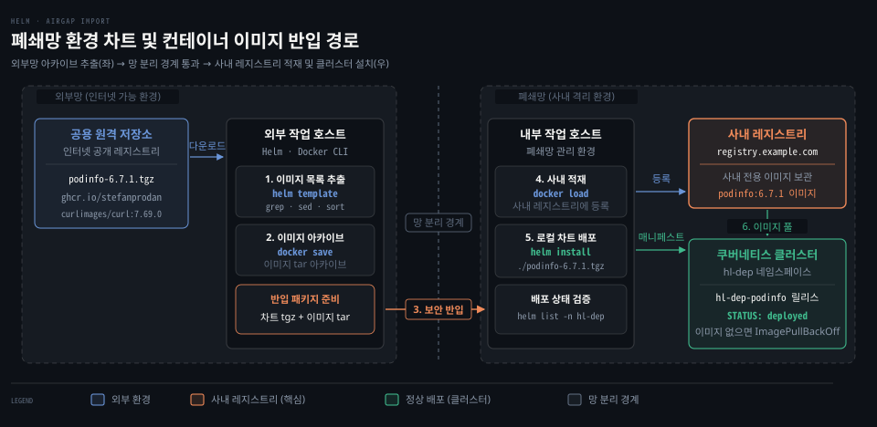
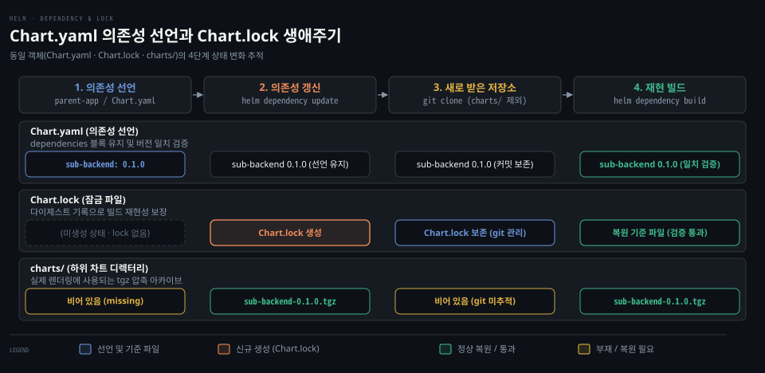
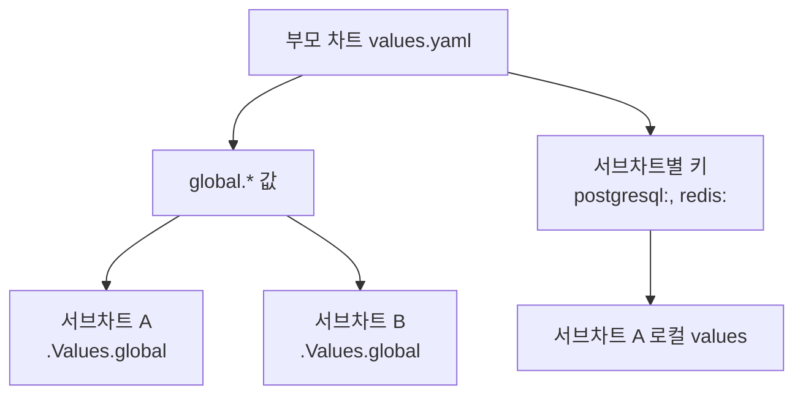

# Helm 차트 의존성과 저장소

---

> Helm 차트 저장소 탐색과 OCI 레지스트리 배포, 서브차트 의존성과 라이브러리 차트 구성 원리를 다룹니다.

## 학습 목표와 범위

> 원격 저장소 관리와 폐쇄망 차트 반입, OCI 배포 및 서브차트 의존성 제어 전 과정을 다룹니다.

1. 원격 HTTP 저장소와 OCI 레지스트리를 등록하고 차트 아카이브를 패키징해 배포할 수 있습니다.
2. 폐쇄망 환경에서 차트 아카이브와 컨테이너 이미지를 누락 없이 추출해 설치할 수 있습니다.
3. Chart.yaml 의존성과 Chart.lock 파일을 활용해 서브차트 버전과 부모-자식 설정값을 제어할 수 있습니다.
4. Application 차트와 Library 차트의 구조적 차이를 파악하고 공통 템플릿을 분리할 수 있습니다.

실측 환경은 단일 노드 kind v1.35.0 클러스터와 Helm v4.1.4 CLI입니다. 현업 클러스터와 Argo CD에는 Helm 3가 많습니다. 그래서 4에서 달라지는 곳은 공식 문서 원문을 각주로 달았습니다. 릴리스 운영은 [Helm 릴리스 운영](Helm%20%EB%A6%B4%EB%A6%AC%EC%8A%A4%20%EC%9A%B4%EC%98%81.md)에서 다룹니다. 템플릿 작성은 [Helm 차트 작성](Helm%20%EC%B0%A8%ED%8A%B8%20%EC%9E%91%EC%84%B1.md)에서, 훅 제어는 [Helm Hook](Helm%20Hook.md)에서 다룹니다.


## 1. 차트 저장소 등록과 탐색

> 원격 저장소를 등록해 차트를 검색하고 설치 전 메타데이터와 설정값을 사전 검증합니다.

공용 차트를 도입할 때 저장소 주소나 설정 구조를 확인하지 않고 설치하면 배포 실패로 이어집니다. 저장소 등록과 탐색 명령으로 차트 규격을 먼저 파악해야 합니다.

```bash
# 원격 차트 저장소를 로컬 색인에 등록합니다
helm repo add podinfo https://stefanprodan.github.io/podinfo

# 등록된 저장소 목록을 조회합니다
helm repo list
```

```bash
# 결과
"podinfo" has been added to your repositories
NAME   	URL                                   
podinfo	https://stefanprodan.github.io/podinfo
```

저장소가 등록되면 로컬 캐시를 갱신하고 원하는 차트와 배포 가능한 버전 목록을 검색합니다.

```bash
# 저장소 색인을 최신 상태로 갱신합니다
helm repo update podinfo

# 배포 가능한 버전 목록 상위 5개를 확인합니다
#   --versions   사용 가능한 모든 버전 출력
helm search repo podinfo/podinfo --versions | head -n 5
```

```bash
# 결과
Hang tight while we grab the latest from your chart repositories...
...Successfully got an update from the "podinfo" chart repository
Update Complete. ⎈Happy Helming!⎈
NAME           	CHART VERSION	APP VERSION	DESCRIPTION                      
podinfo/podinfo	6.17.0       	6.17.0     	Podinfo Helm chart for Kubernetes
podinfo/podinfo	6.16.0       	6.16.0     	Podinfo Helm chart for Kubernetes
podinfo/podinfo	6.15.0       	6.15.0     	Podinfo Helm chart for Kubernetes
podinfo/podinfo	6.14.1       	6.14.1     	Podinfo Helm chart for Kubernetes
```

출력에서 `CHART VERSION`과 `APP VERSION`을 분리해서 확인해야 합니다. 전자는 차트 패키지 버전이고 후자는 실행 대상 컨테이너 버전입니다. 설치 전에는 반드시 `helm show`로 차트 메타데이터와 기본 values 구조를 확인합니다.

```bash
# 차트 기본 values 설정 상위 12줄을 확인합니다
helm show values podinfo/podinfo | head -n 12

# 등록된 저장소를 삭제합니다
helm repo remove podinfo
```

```bash
# 결과
# Default values for podinfo.

replicaCount: 1
logLevel: info
host: #0.0.0.0
backend: #http://backend-podinfo:9898/echo
backends: []

image:
  repository: ghcr.io/stefanprodan/podinfo
  tag: 6.17.0
  pullPolicy: IfNotPresent
"podinfo" has been removed from your repositories
```

기본값을 확인한 뒤 필요한 항목만 별도 values 파일로 오버라이드합니다.

### 공용 저장소 신뢰도 판단

오픈소스 차트를 도입할 때는 유지보수 주체와 배포 이력을 확인해야 합니다. 아래 표의 게시일은 각 저장소의 `index.yaml` 에서 가장 늦은 `created` 값을 2026-11-21에 읽은 것입니다.

| 저장소 | 공식 URL | 대표 차트 | 마지막 차트 게시 |
|---|---|---|---|
| Bitnami | `https://charts.bitnami.com/bitnami` | nginx, postgresql, redis, kafka | 2026-11-20 (HTTP 302로 Broadcom 주소에 넘김) |
| ingress-nginx | `https://kubernetes.github.io/ingress-nginx` | ingress-nginx | 2026-03-19 |
| prometheus-community | `https://prometheus-community.github.io/helm-charts` | kube-prometheus-stack | 2026-11-20 |
| jetstack | `https://charts.jetstack.io` | cert-manager | 2026-11-17 |
| argo | `https://argoproj.github.io/argo-helm` | argo-cd, argo-workflows | 2026-11-19 |

ingress-nginx는 8개월째 새 차트가 없으니 도입 전에 프로젝트 상태를 따로 확인합니다. 어느 저장소든 Artifact Hub에서 다운로드 수와 최근 릴리스 일자를 대조해 방치된 차트를 걸러냅니다.

### 저장소 주소가 잘못되었을 때

존재하지 않는 도메인이나 잘못된 URL을 지정하면 `index.yaml` 수신에 실패하며 즉시 중단됩니다.

```bash
# 잘못된 주소로 저장소 등록을 시도합니다
helm repo add bad-repo https://invalid.domain.example/charts
```

```bash
# 결과
Error: looks like "https://invalid.domain.example/charts" is not a valid chart repository or cannot be reached: Get "https://invalid.domain.example/charts/index.yaml": dial tcp: lookup invalid.domain.example: no such host
```

DNS 조회가 실패하거나 HTTP 응답이 비정상이면 색인 등록이 차단됩니다. 통신 경로와 URL 오타를 점검해야 합니다.


## 2. 차트 아카이브 보관과 버전 고정

> 차트를 로컬 tgz 파일로 내려받아 저장소 의존성을 끊고 버전을 고정합니다.

원격 저장소에만 의존하면 상위 저장소의 예기치 않은 차트 삭제나 무단 버전 변경에 취약해집니다. `helm pull`로 차트 아카이브를 로컬에 내려받아 보관해야 합니다.

```bash
# 특정 버전의 차트를 tgz 아카이브 파일로 다운로드합니다
#   --version   내려받을 차트 버전 지정
helm pull podinfo/podinfo --version 6.7.1
```

현재 폴더에 `podinfo-6.7.1.tgz` 가 생깁니다. 차트 내부 템플릿과 기본 설정을 직접 검토하려면 압축을 풀어 확인합니다.

```bash
# 아카이브를 지정 폴더에 압축 해제합니다
#   --untar      다운로드 후 압축 해제 수행
#   --untardir   압축을 풀 대상 디렉터리 경로
helm pull podinfo/podinfo \
  --version 6.7.1 \
  --untar \
  --untardir ./unpacked-podinfo
```

풀린 `podinfo/` 폴더 목록은 [ls 명령 시트](../../../02_os/docs/cmd/file/ls.md)의 `ls -F` 로 봅니다. `Chart.yaml`, `values.yaml`, `templates/` 등이 들어 있습니다.

### 버전을 고정해야 하는 이유

버전을 명시하지 않으면 Helm은 기본적으로 최신 버전을 내려받습니다. SemVer 규칙에서 메이저나 마이너 버전이 올라가면 values 키 이름이나 필수 필드가 변경될 수 있습니다.

CI/CD 파이프라인과 운영 환경에서는 항상 `--version`으로 버전을 고정해야 동일한 매니페스트가 재현됩니다. 내려받은 tgz 파일은 사내 형상 관리나 아티팩트 스토리지에 등록해 영구 보관합니다.

### 존재하지 않는 버전을 요청했을 때

색인에 없는 버전을 요구하면 다운로드가 실패합니다.

```bash
# 저장소 색인에 존재하지 않는 버전 번호를 요청합니다
helm pull podinfo/podinfo --version 99.99.99
```

```bash
# 결과
Error: chart "podinfo" matching 99.99.99 not found in podinfo index. (try 'helm repo update'): no chart version found for podinfo-99.99.99
```


## 3. 폐쇄망 환경 차트와 이미지 반입

> 외부 인터넷이 단절된 클러스터에 로컬 tgz 차트와 필요 컨테이너 이미지를 반입해 설치합니다.

보안망이나 사내 폐쇄망 클러스터는 외부 차트 저장소와 퍼블릭 컨테이너 레지스트리에 접근할 수 없습니다. 차트 tgz 파일과 렌더링에 필요한 컨테이너 이미지 목록을 외부망에서 미리 추출해 함께 반입해야 합니다.
외부망에서 아카이브와 이미지 목록을 추출하고 사내 레지스트리에 적재해 배포하는 반입 경로입니다.


차트만 반입하고 이미지를 빠뜨리면 파드가 `ImagePullBackOff` 에 빠집니다.

### 렌더 결과에서 필수 이미지 목록 추출

클러스터 API 서버와 통신하지 않는 `helm template`으로 매니페스트를 생성한 뒤 이미지 줄을 추출합니다.

```bash
# 템플릿 렌더 결과에서 컨테이너 이미지 주소 목록을 추출합니다
helm template hl-dep-extract ./podinfo-6.7.1.tgz | \
  grep -E '^[[:space:]]*image:' | \
  sed -e 's/^[[:space:]]*image:[[:space:]]*//' -e 's/"//g' | \
  sort -u
```

```bash
# 결과
curlimages/curl:7.69.0
ghcr.io/stefanprodan/podinfo:6.7.1
giantswarm/tiny-tools
stefanprodan/grpc_health_probe:v0.3.0
```

목록의 `curlimages/curl` 과 `giantswarm/tiny-tools` 는 `helm test` 때만 뜨는 훅 파드의 이미지입니다. 테스트를 돌리지 않는다면 반입하지 않아도 됩니다.

이미지 목록은 렌더에 넣은 values에 따라 바뀝니다. 같은 명령에 `--set image.repository=registry.example.com/podinfo` 를 더하면 podinfo 줄이 `registry.example.com/podinfo:6.7.1` 로 바뀝니다. 사내 레지스트리로 바꿔 설치할 계획이라면 같은 값을 넣어 렌더해야 실제로 필요한 목록이 나옵니다.

추출된 이미지 목록은 외부망에서 `docker save`로 tar 아카이브로 묶은 뒤 폐쇄망 사내 레지스트리에 `docker load`로 등록합니다. 컨테이너 이미지 저장과 로드 명령은 [도커 컨테이너 명령 시트](../../../08_cloud/docs/cmd/container/docker.md)를, 위 파이프의 `grep`·`sed`·`sort` 는 [grep](../../../02_os/docs/cmd/text/grep.md)·[sed](../../../02_os/docs/cmd/text/sed.md)·[sort](../../../02_os/docs/cmd/text/sort%C2%B7uniq%C2%B7wc.md) 시트를 참조합니다.

### 로컬 tgz로 설치

반입한 tgz는 저장소 등록 없이 파일 경로만으로 설치합니다.

```bash
# 반입한 로컬 tgz 아카이브 파일로 차트를 직접 설치합니다
#   --namespace          배포할 네임스페이스 지정
#   --create-namespace   네임스페이스가 없으면 자동 생성
helm install hl-dep-podinfo ./podinfo-6.7.1.tgz \
  --namespace hl-dep \
  --create-namespace

# 설치된 릴리스 상태를 확인합니다
helm list -n hl-dep
```

```bash
# 결과
NAME: hl-dep-podinfo
LAST DEPLOYED: Sat Nov 21 04:06:07 2026
NAMESPACE: hl-dep
STATUS: deployed
REVISION: 1
DESCRIPTION: Install complete
NOTES:
1. Get the application URL by running these commands:
  echo "Visit http://127.0.0.1:8080 to use your application"
  kubectl -n hl-dep port-forward deploy/hl-dep-podinfo 8080:9898
NAME          	NAMESPACE	REVISION	UPDATED                             	STATUS  	CHART        	APP VERSION
hl-dep-podinfo	hl-dep   	1       	2026-11-21 04:06:07.080536 +0900 KST	deployed	podinfo-6.7.1	6.7.1      
```

`STATUS: deployed` 는 매니페스트 적용이 끝났다는 뜻입니다. 이 실측 클러스터는 인터넷이 열려 있어서 이미지를 공용 레지스트리에서 받았으며, 폐쇄망에서 파드가 뜨는지까지는 확인하지 못했습니다.


## 4. OCI 레지스트리 패키징과 배포

> 차트를 OCI 호환 레지스트리에 패키징해 등록하고 컨테이너 이미지와 동일한 인증 체계로 관리합니다.

별도 HTTP 웹 서버로 차트 저장소를 구축하면 계정 권한과 보안 검증 체계가 분리되어 사내 인증 정책이 어긋나는 문제가 생깁니다. OCI(Open Container Initiative) 레지스트리를 쓰면 사내 컨테이너 저장소 도구(Harbor, ECR, GHCR 등)를 그대로 재사용합니다. Helm 3.8부터 OCI 레지스트리 지원이 정식 기능이 되었습니다[^oci-ga].

```bash
# 차트 디렉터리를 버전이 명시된 tgz 파일로 패키징합니다
helm package ./hl-dep-demo

# 생성된 패키지 아카이브를 확인합니다
ls hl-dep-demo-0.1.0.tgz
```

```bash
# 결과
Successfully packaged chart and saved it to: /tmp/hl-dep-lab/hl-dep-demo-0.1.0.tgz
hl-dep-demo-0.1.0.tgz
```

패키징된 차트를 로컬 레지스트리(`registry:2` 컨테이너)에 업로드하고 배포합니다. OCI 경로는 `helm repo add` 단계 없이 `oci://` 주소를 명령에 직접 넘깁니다.

```bash
# OCI 레지스트리에 차트 아카이브를 업로드합니다
#   --plain-http   TLS 인증서가 없는 HTTP 통신 허용
helm push hl-dep-demo-0.1.0.tgz \
  oci://localhost:5001/helm-charts \
  --plain-http

# OCI 레지스트리에서 차트를 내려받습니다
#   --destination   아카이브를 저장할 로컬 디렉터리
helm pull oci://localhost:5001/helm-charts/hl-dep-demo \
  --version 0.1.0 \
  --destination ./oci-pulled \
  --plain-http

# OCI 경로에서 차트를 직접 클러스터에 설치합니다
helm install hl-dep-oci \
  oci://localhost:5001/helm-charts/hl-dep-demo \
  --version 0.1.0 \
  --namespace hl-dep \
  --create-namespace \
  --plain-http
```

```bash
# 결과
Pushed: localhost:5001/helm-charts/hl-dep-demo:0.1.0
Digest: sha256:823fedb9225183d03d3d872b295891b0c411daca249a07e23c989099191bcbdf
Pulled: localhost:5001/helm-charts/hl-dep-demo:0.1.0
Digest: sha256:823fedb9225183d03d3d872b295891b0c411daca249a07e23c989099191bcbdf
Pulled: localhost:5001/helm-charts/hl-dep-demo:0.1.0
Digest: sha256:823fedb9225183d03d3d872b295891b0c411daca249a07e23c989099191bcbdf
NAME: hl-dep-oci
LAST DEPLOYED: Sat Nov 21 04:06:10 2026
NAMESPACE: hl-dep
STATUS: deployed
REVISION: 1
DESCRIPTION: Install complete
TEST SUITE: None
```

`Pulled` 줄이 두 번 나오는 것은 `pull` 과 `install` 이 각자 레지스트리에서 차트를 받기 때문입니다. 두 번 모두 같은 `Digest` 이니 같은 차트를 받았다는 뜻입니다.

### OCI 인증과 버전별 차이

운영 환경에서는 레지스트리 접근에 인증이 필요합니다. 비밀번호를 `-p` 로 명령줄에 쓰면 셸 이력에 남으므로 `--password-stdin` 으로 넘깁니다. 이 실측은 인증 없는 로컬 레지스트리라 로그인은 실행하지 않았고, 명령 꼴은 `helm registry login --help` 의 예시와 같습니다.

```bash
# 비밀번호를 표준 입력으로 받아 로그인합니다
echo "$REGISTRY_TOKEN" | helm registry login registry.example.com -u "$REGISTRY_USER" --password-stdin
```

Helm 4 개요 문서는 `helm registry login` 에 도메인 이름만 넘기도록 바뀐 것을 호환성이 깨지는 변경으로 적습니다[^helm4-login]. 전체 URL을 넘기던 스크립트는 Helm 4로 올릴 때 고쳐야 합니다. 같은 문서는 다이제스트 고정 설치(`oci://…/app@sha256:…`)를 새 기능으로 꼽습니다[^helm4-digest]. 다이제스트가 맞지 않으면 설치하지 않습니다. Helm 3에서 이 형식이 되는지와 로그인 동작은 확인하지 않았습니다.

### OCI 엔드포인트 연결이 거부되었을 때

레지스트리 서비스가 중단되었거나 포트 번호가 틀리면 연결 거부 오류가 발생합니다.

```bash
# 중단된 레지스트리 엔드포인트로 pull을 시도합니다
helm pull oci://localhost:5001/helm-charts/hl-dep-demo \
  --version 0.1.0 \
  --plain-http
```

```bash
# 결과
Error: failed to perform "FetchReference" on source: Get "http://localhost:5001/v2/helm-charts/hl-dep-demo/manifests/0.1.0": dial tcp [::1]:5001: connect: connection refused
```


## 5. 차트 의존성 관리와 빌드

> Chart.yaml 에 서브차트 의존성을 선언하고 Chart.lock 을 통해 빌드 재현성을 보장합니다.

`Chart.yaml` 의존성 선언부터 update를 통한 lock 생성, 저장소 배포, build를 통한 복원 흐름입니다.


데이터베이스나 캐시처럼 앱이 함께 필요로 하는 차트를 따로 설치하면 버전 조합이 사람마다 어긋납니다. 부모 차트의 `Chart.yaml`에 `dependencies` 블록을 선언하면 하위 차트의 이름과 버전이 부모와 함께 버전 관리됩니다.

```yaml
# parent-app/Chart.yaml
apiVersion: v2
name: parent-app
version: 0.1.0
appVersion: "1.0.0"
description: Parent application chart orchestrating subcharts
dependencies:
  - name: sub-backend
    version: 0.1.0
    repository: file://../sub-backend
```

`repository` 에는 `file://` 경로 대신 `https://` 저장소나 `oci://` 주소도 쓸 수 있습니다. podinfo 6.7.1을 `https://` 로 선언해 돌리면 `Downloading podinfo from repo` 줄이 나오고 `dependency list` 의 STATUS 가 `ok` 가 됩니다. 초기 상태에서는 하위 차트 아카이브가 없어 `missing` 으로 표시됩니다. `helm dependency update`로 내려받습니다.

```bash
# 현재 차트의 의존성 상태 목록을 확인합니다
helm dependency list ./parent-app

# 의존성 차트를 내려받고 Chart.lock 파일을 갱신합니다
helm dependency update ./parent-app

# 내려받은 서브차트 아카이브를 확인합니다
ls ./parent-app/charts
```

```bash
# 결과
NAME       	VERSION	REPOSITORY           	STATUS 
sub-backend	0.1.0  	file://../sub-backend	missing
Hang tight while we grab the latest from your chart repositories...
...Successfully got an update from the "podinfo" chart repository
Update Complete. ⎈Happy Helming!⎈
Saving 1 charts
Deleting outdated charts
sub-backend-0.1.0.tgz
```

저장소가 등록돼 있으면 `update` 는 의존성과 무관한 저장소 색인도 함께 갱신해 `podinfo` 줄이 나옵니다. `charts/` 에는 아카이브가, `Chart.lock` 에는 다이제스트가 기록됩니다.

```bash
# 생성된 Chart.lock 내용을 확인합니다
cat ./parent-app/Chart.lock
```

```bash
# 결과
dependencies:
- name: sub-backend
  repository: file://../sub-backend
  version: 0.1.0
digest: sha256:701640481f718e918edf96ec4cc525e2950e58814faed76586c1431490712165
generated: "2026-11-21T04:06:10.633928+09:00"
```

### update와 build 비교

두 명령어는 의존성을 해석하는 기준 파일이 다릅니다.

| 비교 기준 | helm dependency update | helm dependency build |
|---|---|---|
| 기준 파일 | `Chart.yaml` 선언 기준 | `Chart.lock` 잠금 파일 기준 |
| 잠금 파일 처리 | `Chart.lock` 새로 생성 또는 갱신 | `Chart.lock` 불일치 시 오류 반환 |
| 실행 시점 | 의존성 추가·버전 변경 시점 | CI/CD 배포 및 동일 환경 재현 시점 |

`Chart.lock` 이 아예 없으면 `build` 는 `update` 와 똑같이 동작합니다. CI/CD 파이프라인은 고정된 버전을 그대로 복원해야 합니다. 그래서 `Chart.lock` 을 커밋한 뒤 `dependency build`를 사용합니다.

### charts 폴더가 비어 있을 때

`charts/` 는 보통 git에 올리지 않아서 새로 받은 저장소에는 비어 있습니다. 이 상태로 렌더하면 막힙니다.

```bash
# charts 디렉터리를 비운 뒤 렌더를 시도합니다
rm -rf ./parent-app/charts/*
helm template hl-dep-miss ./parent-app
```

```bash
# 결과
Error: an error occurred while checking for chart dependencies. You may need to run `helm dependency build` to fetch missing dependencies: found in Chart.yaml, but missing in charts/ directory: sub-backend
```

메시지가 알려 준 `helm dependency build ./parent-app` 을 실행하면 lock 기준으로 `charts/` 가 다시 채워집니다.

### lock 파일과 선언이 어긋났을 때

`Chart.yaml`의 의존성 버전을 수정하고 `dependency update` 없이 `dependency build`를 돌리면 빌드가 거부됩니다.

```bash
# lock 파일과 Chart.yaml 버전이 불일치하는 상태에서 build를 실행합니다
helm dependency build ./broken-lock-app
```

```bash
# 결과
Error: the lock file (Chart.lock) is out of sync with the dependencies file (Chart.yaml). Please update the dependencies
```

버전을 변경했을 때는 `dependency update` 로 lock을 의도적으로 갱신한 뒤 커밋해야 파이프라인 사고를 막을 수 있습니다.


## 6. 부모 차트와 서브차트 값 전달

> 부모 차트의 values.yaml 에서 서브차트 로컬 값과 global 공통 값을 오버라이드합니다.

부모 차트가 서브차트의 기본 설정값을 직접 덮어쓰지 못하면 환경마다 하위 차트 코드를 매번 수정해야 하는 설정 충돌이 일어납니다. 부모와 자식 간 값 전달 흐름을 이해하고 values 계층을 분리해야 합니다.



도식과 같이 값의 흐름은 두 갈래입니다. 첫째는 서브차트 이름을 키로 쓰는 로컬 오버라이드이고, 둘째는 모든 차트에 전파되는 `global` 영역입니다.

```yaml
# parent-app/values.yaml
sub-backend:
  replicaCount: 3
  service:
    port: 8080
global:
  environment: production
  clusterDomain: cluster.local
```

부모 차트를 렌더링해 서브차트에 값이 어떻게 반영되는지 검증합니다.

```bash
# 부모 차트와 서브차트의 렌더링 결과 중 값 줄만 추립니다
helm template hl-dep-val ./parent-app | grep -E 'port|replicas|env:'
```

```bash
# 결과
  port: "8080"
  replicas: "3"
  env: "production"
```

`sub-backend`의 기본값(포트 80, 복제본 1)이 포트 8080과 복제본 3으로 바뀌었습니다. `global.environment` 값은 자식에도 주입되었습니다. 명령줄에서도 서브차트 이름이 키 앞에 붙어서, `--set sub-backend.replicaCount=5` 는 `replicas: "5"` 로 렌더됩니다.


### 값 전달 규칙과 import-values

값 흐름의 핵심 원칙은 다음과 같습니다.

1. 글로벌 값은 부모에서 자식으로만 흐릅니다. 자식 차트가 정의한 global은 부모나 형제 차트가 참조할 수 없습니다.
2. 부모와 자식 모두 같은 global 키를 정의하면 부모 값이 이깁니다.
3. 자식 차트의 값을 부모 루트로 끌어올리려면 `Chart.yaml`의 `import-values` 를 씁니다.

`import-values` 는 자식의 경로(`child`)를 부모의 경로(`parent`)에 붙입니다. 자식이 `exports` 키 아래에 값을 노출하는 짧은 형식도 있습니다[^import].

```yaml
# import-app/Chart.yaml (dependencies 부분)
dependencies:
  - name: sub-backend
    version: 0.1.0
    repository: file://../sub-backend
    import-values:
      - child: service
        parent: backendService
```

부모 템플릿이 `.Values.backendService.port` 로 자식의 `service.port` 값을 읽도록 만들고 렌더한 결과입니다.

```bash
# 자식의 service.port 가 부모의 backendService.port 로 들어왔는지 확인합니다
helm template hl-dep-imp ./import-app | grep backendPort
```

```bash
# 결과
  backendPort: "80"
```


## 7. 서브차트 제어와 별칭 지정

> alias 로 동일 차트를 다중 인스턴스로 분리하고 condition 과 tags 로 렌더링을 제어합니다.

동일한 차트를 서로 다른 역할로 중복 포함하면 리소스 이름이 충돌해 파드 배포가 실패합니다. `dependencies` 블록에 `alias`를 주면 하나의 서브차트를 서로 다른 이름의 독립 인스턴스로 가져옵니다. 이때 서브차트 안의 `.Chart.Name` 도 alias로 바뀝니다.

```yaml
# alias-app/Chart.yaml (dependencies 부분)
dependencies:
  - name: sub-backend
    version: 0.1.0
    repository: file://../sub-backend
    alias: api-server
    condition: apiServer.enabled
  - name: sub-backend
    version: 0.1.0
    repository: file://../sub-backend
    alias: worker-processor
    condition: workerProcessor.enabled
    tags:
      - background
```

values 에는 `apiServer.enabled: true`, `workerProcessor.enabled: false` 를 두었습니다. `tags.background` 는 `false`, `apiServer.service.port` 는 `9000` 입니다.

기본 상태에서는 `apiServer.enabled: true`만 활성화되어 `api-server` 서브차트만 렌더됩니다.

```bash
# 렌더되는 템플릿 출처와 포트 값만 추려 봅니다
helm template hl-dep-alias ./alias-app | grep -E 'Source|port'
```

```bash
# 결과
# Source: alias-app/charts/api-server/templates/configmap.yaml
  port: "80"
# Source: alias-app/templates/service-map.yaml
```

values에는 `apiServer.service.port: 9000` 을 적었는데 포트는 `80` 입니다. `condition` 이 읽는 경로(`apiServer.enabled`)와 서브차트에 값을 주는 키는 별개이기 때문입니다. 서브차트에 값을 주는 키는 alias 이름(`api-server`)입니다.

```bash
# alias 이름을 키로 포트를 덮어씁니다
helm template hl-dep-alias ./alias-app --set api-server.service.port=9000 | grep port
```

```bash
# 결과
  port: "9000"
```

`--set workerProcessor.enabled=true` 로 켜면 `worker-processor` 가 추가로 렌더됩니다. 두 인스턴스는 서로 다른 이름을 가집니다.

### 조건 우선순위

`condition` 은 values의 불리언 경로로 서브차트를 켜고 끕니다. `condition` 이 values에 있으면 `tags` 는 무시되고, 여러 경로를 적으면 처음으로 존재하는 경로만 쓰입니다[^cond]. 위 실측에서 `tags.background: false` 였어도 `workerProcessor.enabled=true` 가 이겨서 워커가 렌더되었습니다.

condition 경로가 values에 없을 때만 tags가 작동합니다. `null` 로 값을 지워 확인합니다.

```bash
# condition 경로를 지우고 tag 로 워커를 켭니다
helm template hl-dep-alias ./alias-app \
  --set workerProcessor.enabled=null \
  --set tags.background=true | grep Source
```

```bash
# 결과
# Source: alias-app/charts/api-server/templates/configmap.yaml
# Source: alias-app/charts/worker-processor/templates/configmap.yaml
# Source: alias-app/templates/service-map.yaml
```

환경마다 서브차트를 다르게 켜려면 환경별 values 파일에 `postgresql.enabled` 를 `true`/`false` 로 두고 `-f` 로 고릅니다. 운영 환경에서는 `false` 와 함께 외부 DB 주소를 둡니다. 템플릿은 `{{ if .Values.postgresql.enabled }}` 로 연결 정보를 분기합니다.


## 8. 라이브러리 차트 조각 공유

> type: library 차트로 공통 Named Template 을 중앙에서 관리하고 애플리케이션 차트에 주입합니다.

차트마다 동일한 라벨과 보안 정책 템플릿을 복사해 관리하면 규격이 표류하고 단체 수정 누락 위험이 커집니다. 공통 템플릿만 모아 둔 Library 차트를 만들어 의존성으로 참조해야 합니다.

```yaml
# my-lib/Chart.yaml
apiVersion: v2
name: my-lib
version: 0.1.0
type: library
description: Common library chart providing reusable named templates
```

```yaml
# my-lib/templates/_labels.tpl
{{- define "my-lib.standard-labels" -}}
app.kubernetes.io/managed-by: Helm
app.kubernetes.io/part-of: {{ .Values.global.partOf | default "enterprise-platform" }}
app.kubernetes.io/instance: {{ .Release.Name }}
{{- end -}}
```

템플릿 이름에 `my-lib.` 접두를 붙인 것은 소비 차트의 템플릿 이름과 겹치지 않게 하기 위해서입니다.

### Application과 Library 비교

| 항목 | Application 차트 | Library 차트 |
|---|---|---|
| 배포 가능 여부 | `helm install` 가능 | 단독 설치 불가 (`type: library`) |
| 템플릿 매니페스트 | Kubernetes 리소스 YAML 생성 | 리소스 0개, 헬퍼 템플릿(`_*.tpl`)만 제공 |
| 주 용도 | 단독 서비스 또는 복합 서비스 배포 | 공통 라벨·보일러플레이트 함수 공유 |
| 다수 서비스 운영 | 차트마다 동일 템플릿 복제 위험 | 라이브러리 1개 참조로 정의 단일화 |

Library 차트는 배포할 리소스가 없으므로 설치도, 렌더도 거부됩니다.

```bash
# Library 차트의 직접 설치와 렌더를 시도합니다
helm install hl-dep-lib-test ./my-lib
helm template hl-dep-lib-test ./my-lib
```

```bash
# 결과
Error: INSTALLATION FAILED: library charts are not installable
Error: library charts are not installable
```

소비하는 쪽은 라이브러리를 `dependencies` 로 가져오고(`repository: file://../my-lib`) `include` 로 호출합니다. 공통 값은 `global` 에 둡니다.

```yaml
# lib-consumer/values.yaml
global:
  partOf: payment-system
```

```yaml
# lib-consumer/templates/consumer-configmap.yaml
apiVersion: v1
kind: ConfigMap
metadata:
  name: {{ .Release.Name }}-consumer-cfg
  labels:
    {{- include "my-lib.standard-labels" . | nindent 4 }}
data:
  role: "consumer"
```

```bash
# 라이브러리 함수가 주입한 라벨 줄만 확인합니다
helm template hl-dep-consumer ./lib-consumer | grep -E 'part-of|instance'
```

```bash
# 결과
    app.kubernetes.io/part-of: payment-system
    app.kubernetes.io/instance: hl-dep-consumer
```

`part-of` 에 소비 차트의 `global.partOf` 값이 들어갔습니다. 공통 표준을 바꿀 때는 라이브러리 버전을 올립니다. 소비 차트마다 의존성 버전을 올리고 `dependency update` 로 lock을 갱신해야 반영됩니다. 라이브러리를 쓰는 대표적인 경우는 세 가지입니다: 조직 표준 라벨 통일, 이름 생성 함수나 검증 로직의 중앙 관리, 보안 컨텍스트와 네트워크 정책 템플릿 표준화.


## 결정 치트시트

> 저장소 선택과 배포 아티팩트 보관 기준을 상황별로 정리합니다.

| 상황 | 선택 | 이유 |
|---|---|---|
| 공용 오픈소스 소프트웨어를 클러스터에 배포할 때 | 원격 저장소 등록 후 `helm show values` 로 검토 (§1) | 버전 목록 탐색과 기본 values 구조 파악이 용이함 |
| 인터넷 연결이 차단된 폐쇄망 클러스터에 배포할 때 | tgz 아카이브와 `helm template` 이미지 목록 반입 (§2, §3) | 오프라인 환경에서 차트·이미지 누락을 막음 |
| 사내 마이크로서비스 차트를 공유·배포할 때 | OCI 레지스트리 패키징 (§4) | 사내 컨테이너 저장소 인증 체계를 재사용함 |
| CI/CD 파이프라인에서 차트를 검증·배포할 때 | `helm dependency build` 사용 (§5) | `Chart.lock` 기준으로 재현 가능한 빌드를 강제함 |
| 서브차트 값이 안 먹힐 때 | 서브차트 이름 또는 alias를 키로 확인 (§6, §7) | `condition` 경로와 값 주입 키는 별개임 |
| 공통 라벨과 보안 정책을 여러 차트에 공유할 때 | Library 차트 참조 (§8) | Named Template 중복 정의와 표류를 방지함 |


## 실무 적용 포인트

> 실제 운영 배포 환경에서 적용할 하나의 원칙과 주의점을 정리합니다.

### 한 가지 실행

CI/CD 빌드 단계에서 `helm dependency build`를 수행해 `Chart.lock` 정합성을 강제합니다.

### 사용하는 상황

- 폐쇄망 또는 외부 격리 환경으로 배포 아티팩트를 이관할 때
- 마이크로서비스 간 공통 템플릿을 라이브러리로 분리할 때

### 주의할 점

- `Chart.lock`을 형상 관리에 커밋하지 않으면 빌드 재현성이 깨집니다
- `helm dependency build`는 lock 파일과 yaml이 다르면 즉시 중단되므로 버전 변경 뒤에는 update를 먼저 수행해야 합니다
- 레지스트리 로그인에는 `-p` 대신 `--password-stdin` 을 써서 비밀번호가 셸 이력에 남지 않게 합니다
- 이미지 목록은 운영에 쓸 values로 렌더해서 뽑아야 합니다


## 면접 질문

> 저장소 운영과 차트 의존성 구조에 관한 핵심 점검 질문입니다.

1. Helm 저장소에서 차트를 내려받기 전 `helm show values`를 확인해야 하는 이유는 무엇입니까?
2. `helm dependency update`와 `helm dependency build`의 결정적 차이는 무엇입니까?
3. 서브차트 간 동일 인스턴스를 중복 배포하거나 환경별로 켜고 끌 때 alias와 condition을 어떻게 활용합니까?
4. Library Chart와 Application Chart의 차이점과 공통화 설계 시나리오는 무엇입니까?


## 핵심 개념 체크리스트

> 스스로 점검할 핵심 개념 목록입니다.

- [ ] `helm search repo`와 `helm show`로 차트 메타데이터를 확인할 수 있는가?
- [ ] 폐쇄망 환경에서 `helm pull` 아카이브와 렌더링된 이미지 목록을 추출할 수 있는가?
- [ ] OCI 레지스트리에 차트를 패키징하고 배포할 수 있는가?
- [ ] `Chart.lock`과 `helm dependency build`로 재현 가능한 빌드를 구성할 수 있는가?
- [ ] 부모 차트의 values와 `global`을 통해 서브차트 설정을 제어할 수 있는가?
- [ ] Library 차트로 공통 Named Template을 재사용할 수 있는가?


## 정답 (자답 후 펼치기)

> 위 면접 질문 4개에 먼저 자답한 뒤 아래를 읽으세요.

### 정답 1 — 차트 values 사전 확인

`helm show values`로 차트가 정의한 기본 설정 키 구조와 기본값을 먼저 확인해야 합니다. 차트마다 지원하는 설정 구조가 다르고, 오타나 잘못된 키 이름을 지정하면 템플릿 오류가 나거나 설정이 조용히 무시되기 때문입니다.

### 정답 2 — update와 build 비교

`update`는 `Chart.yaml`을 기준으로 의존성을 해석해 `Chart.lock`을 새로 생성하거나 갱신합니다. 반면 `build`는 기존 `Chart.lock`에 명시된 버전을 그대로 복원해 `charts/`를 재구성합니다. `Chart.lock`과 `Chart.yaml`이 어긋나면 `build`는 즉시 실패하므로 CI/CD 빌드 재현성을 보장합니다. lock이 없을 때 `build`는 `update`처럼 동작합니다.

### 정답 3 — alias와 condition 활용

동일한 서브차트를 여러 번 포함할 때는 `alias`를 선언해 리소스 이름 충돌을 방지합니다. 이때 서브차트에 값을 주는 키도 alias 이름입니다. 환경별로 서브차트 배포 여부를 제어할 때는 `condition`에 불리언 경로를 지정해 토글합니다. values에 condition 경로가 있으면 `tags`는 무시되고, 경로가 없을 때만 tags가 작동합니다.

### 정답 4 — Library와 Application 비교

Application Chart는 배포 가능한 Kubernetes 매니페스트를 생성하며 `helm install`로 직접 배포됩니다. Library Chart는 `type: library`로 선언되며 설치와 렌더가 모두 거부되고 헬퍼 템플릿 조각만 제공합니다. 공통 라벨, 명명 규칙, 보안 컨텍스트 설정을 한곳에 두어 서비스 간 템플릿 표류를 막되, 반영하려면 소비 차트마다 의존성 버전을 올려야 합니다.


## 참고 자료

[^oci-ga]: Helm v3.8.0 릴리스 노트, Notable Changes: "OCI registry support for charts is now generally available." <https://github.com/helm/helm/releases/tag/v3.8.0>
[^helm4-login]: Helm 4 Overview - Breaking Changes: "Registry login does not accept full URLs. The helm registry login command must be done with the domain name only in v4." <https://helm.sh/docs/overview/>
[^helm4-digest]: Helm 4 Overview - Enhanced OCI Support: "Install charts by digest for better supply chain security. … Charts with non-matching digests are not installed." <https://helm.sh/docs/overview/>
[^cond]: Helm Charts - Tags and Condition Resolution: "Conditions (when set in values) always override tags. The first condition path that exists wins and subsequent ones for that chart are ignored." <https://helm.sh/docs/topics/charts/>
[^import]: Helm Charts - Importing Child Values via dependencies: 자식 값을 `import-values` 로 부모에 전파하는 `exports` 형식과 child/parent 형식을 설명합니다. <https://helm.sh/docs/topics/charts/>

- [Helm 릴리스 운영](Helm%20%EB%A6%B4%EB%A6%AC%EC%8A%A4%20%EC%9A%B4%EC%98%81.md) — 릴리스 라이프사이클과 기본 명령어
- [Helm 차트 작성](Helm%20%EC%B0%A8%ED%8A%B8%20%EC%9E%91%EC%84%B1.md) — 차트 디렉터리 구조와 값 주입 원리
- [Kustomize](Kustomize.md) — 템플릿 없는 K8s 매니페스트 오버레이 도구
- [도커 컨테이너 명령 시트](../../../08_cloud/docs/cmd/container/docker.md) — 폐쇄망 컨테이너 이미지 저장과 로드
- [ls 명령 시트](../../../02_os/docs/cmd/file/ls.md) — 디렉터리 파일 목록 확인과 속성 조회
