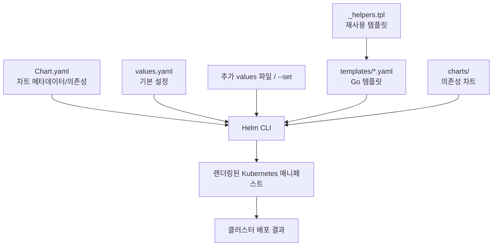
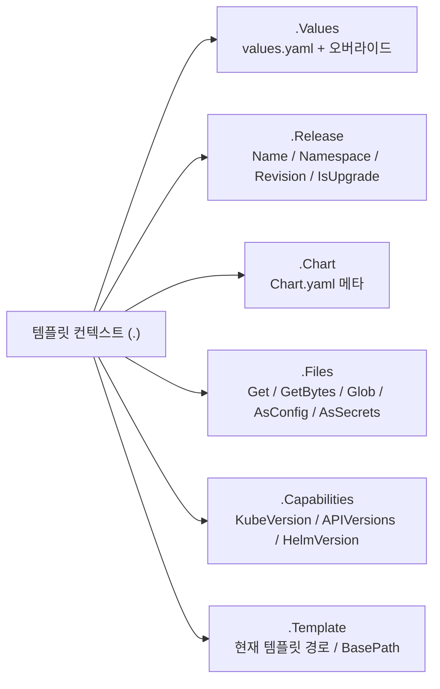
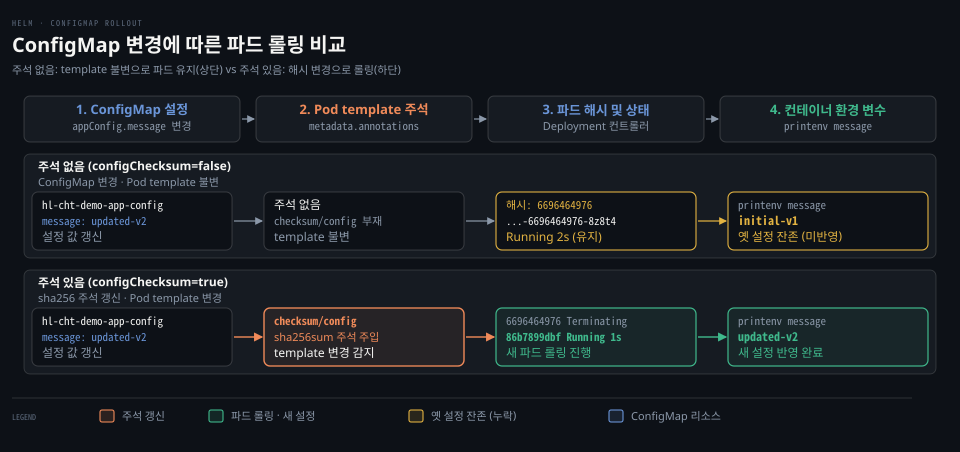
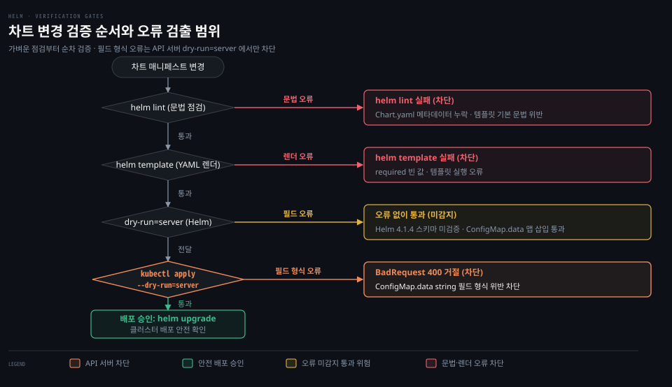

# Helm 차트 작성

---

> Helm 차트를 직접 구성하여 재사용 가능한 쿠버네티스 패키지를 만드는 방법과 템플릿 제어 원리를 다룹니다.

## 학습 목표와 범위

> 차트 폴더 구성부터 템플릿 언어, 헬퍼 재사용, ConfigMap 변경에 따른 파드 롤링, 변경 검증 순서까지 다룹니다.

1. 차트 폴더의 파일별 책임을 설명하고 `version` 과 `appVersion` 을 구분해 올릴 수 있습니다.
2. 내장 객체와 함수, 공백 제어를 쓰고 틀린 템플릿이 내는 실제 오류를 읽을 수 있습니다.
3. ConfigMap 만 바뀌어도 파드가 다시 뜨도록 checksum 주석을 달 수 있습니다.
4. lint, template, 서버 검증이 각각 잡지 못하는 것을 구분할 수 있습니다.

실측 환경은 단일 노드 kind v1.35.0 클러스터와 Helm v4.1.4 CLI 입니다. 문서의 출력은 모두 이 환경에서 실제로 돌린 결과입니다. 렌더 출력 위쪽의 `---`, `# Source`, `apiVersion`, `kind` 줄과 템플릿 소스의 `metadata` 줄은 생략했습니다.

현업 클러스터와 Argo CD 는 Helm 3 인 곳이 많아서, 3 과 4 가 달라지는 곳은 각주로 밝힙니다.

실습 차트 `hl-cht-app` 은 `helm create` 결과에 데모 템플릿을 더한 것이고, 데모 템플릿은 쓰는 절마다 소스를 먼저 보입니다. 릴리스 설치와 롤백은 [Helm 릴리스 운영](Helm%20%EB%A6%B4%EB%A6%AC%EC%8A%A4%20%EC%9A%B4%EC%98%81.md), 훅은 [Helm Hook](Helm%20Hook.md), 서브차트는 [Helm 차트 의존성과 저장소](Helm%20%EC%B0%A8%ED%8A%B8%20%EC%9D%98%EC%A1%B4%EC%84%B1%EA%B3%BC%20%EC%A0%80%EC%9E%A5%EC%86%8C.md)에서 다룹니다.


## 1. 차트 디렉터리 구성과 메타데이터

> 차트 폴더의 파일마다 맡은 일을 확인하고, 두 버전 필드를 언제 올리는지 정합니다.

서비스가 늘면 Deployment 와 Service YAML 이 환경마다 복사본으로 불어납니다. 차트는 이 YAML 을 템플릿과 값으로 나누고 버전을 붙인 패키지입니다. 파일은 렌더링 때 다음 순서로 합쳐집니다.



새 차트는 `helm create` 로 골격을 만들며 시작합니다.

```bash
# 기본 차트 골격을 만듭니다
helm create hl-cht-app

# 폴더 구조를 끝까지 봅니다
find hl-cht-app -maxdepth 2 | sort
```

```bash
# 결과
hl-cht-app
hl-cht-app/.helmignore
hl-cht-app/Chart.yaml
hl-cht-app/charts
hl-cht-app/templates
hl-cht-app/templates/_helpers.tpl
hl-cht-app/templates/deployment.yaml
hl-cht-app/templates/hpa.yaml
hl-cht-app/templates/httproute.yaml
hl-cht-app/templates/ingress.yaml
hl-cht-app/templates/NOTES.txt
hl-cht-app/templates/service.yaml
hl-cht-app/templates/serviceaccount.yaml
hl-cht-app/templates/tests
hl-cht-app/values.yaml
```

파일의 맡은 일은 이름 그대로입니다.

- `Chart.yaml`: 차트 메타데이터
- `values.yaml`: 템플릿이 읽는 기본값
- `templates/`: 매니페스트 템플릿과 `_helpers.tpl` 같은 공유 조각
- `charts/`: 서브차트
- `.helmignore`: 패키징에서 뺄 파일 패턴

`values.schema.json`, `crds/`, `README.md`, `LICENSE` 는 `helm create` 가 만들지 않는 선택 파일입니다.[^chart-files] `values.schema.json` 은 `values.yaml` 의 구조를 JSON Schema 로 검증합니다.

### Chart.yaml 과 두 버전

```bash
# 주석을 빼고 핵심 필드만 봅니다
grep -E '^(apiVersion|name|description|type|version|appVersion):' hl-cht-app/Chart.yaml
```

```bash
# 결과
apiVersion: v2
name: hl-cht-app
description: A Helm chart for Kubernetes
type: application
version: 0.1.0
appVersion: "1.16.0"
```

`apiVersion`, `name`, `version` 은 필수이고 Helm 3 이상이 필요한 차트는 `apiVersion: v2` 입니다.[^chart-fields] 선택 필드는 다음과 같습니다.

- `appVersion`: 담은 앱의 버전
- `type`: `application` 또는 `library`
- `kubeVersion`: 호환하는 쿠버네티스 버전 범위. 설치할 때 검사되어 맞지 않는 클러스터에서는 설치가 실패합니다.[^kubeversion]
- `dependencies`, `annotations`, `deprecated`: 서브차트 목록, 이름을 키로 둔 임의 메타데이터, 사용 중단 표시
- `home`, `sources`, `maintainers`, `icon`: 프로젝트 정보

`version` 은 차트 패키지 자체의 버전입니다. 저장소는 차트를 이름과 버전으로 구분하므로 내용이 바뀌면 `version` 도 바뀌어야 합니다.[^chart-version]

`appVersion` 은 담은 앱의 버전이며 정보용입니다. 차트 버전 계산에 영향이 없고 SemVer 일 필요도 없으며 따옴표로 감싸라고 권합니다.[^app-version] 템플릿이나 기본값만 고치면 `version` 만 올립니다. 앱 이미지만 갱신하면 `appVersion` 을 올립니다. `image.tag` 가 비면 `appVersion` 이 태그가 되어 렌더 결과가 바뀌므로 `version` 도 함께 올립니다.

### .helmignore 와 crds/

`.helmignore` 는 `helm package` 가 차트를 묶을 때 뺄 파일을 정합니다. 이 파일 자신은 패키지에 그대로 들어갑니다. `**` 패턴을 넣으면 `helm package` 가 `Error: double-star (**) syntax is not supported` 로 실패하므로 `*.bak` 처럼 쓰거나 경로를 풀어 적습니다.

`crds/` 의 CRD 는 설치 때만 만들어집니다. 업그레이드와 롤백으로는 설치되지 않고 언인스톨해도 지워지지 않으므로, CRD 스키마 변경은 차트 밖의 별도 절차로 합니다.[^crd]


## 2. 템플릿 내장 객체와 값 주입

> 템플릿이 값을 가져오는 여섯 출처를 실제 렌더 결과로 확인합니다.

매니페스트에 릴리스 이름이나 클러스터 버전을 고정값으로 적으면 환경마다 값이 어긋납니다. 템플릿의 최상위 `.` 아래에는 값의 출처별로 객체가 나뉘어 있습니다.



여섯 객체를 한 ConfigMap 에 찍는 데모 템플릿입니다. `config/banner.txt` 는 차트 루트에 둔 한 줄짜리 텍스트 파일입니다.

```yaml
# templates/builtin-objects.yaml
apiVersion: v1
kind: ConfigMap
metadata:
  name: {{ .Release.Name }}-builtin-demo
  namespace: {{ .Release.Namespace }}
  labels:
    app.kubernetes.io/name: {{ .Chart.Name }}
    app.kubernetes.io/version: {{ .Chart.AppVersion | quote }}
data:
  releaseName: {{ .Release.Name }}
  releaseNamespace: {{ .Release.Namespace }}
  chartName: {{ .Chart.Name }}
  chartVersion: {{ .Chart.Version }}
  kubeVersion: {{ .Capabilities.KubeVersion.Version }}
  templateName: {{ .Template.Name }}
  banner: {{ .Files.Get "config/banner.txt" | quote }}
  serviceType: {{ .Values.service.type }}
  isInstall: {{ .Release.IsInstall | quote }}
  isUpgrade: {{ .Release.IsUpgrade | quote }}
  hasIngressV1: {{ .Capabilities.APIVersions.Has "networking.k8s.io/v1/Ingress" | quote }}
```

```bash
# 내장 객체 값을 ConfigMap 에 렌더링합니다
#   -s   렌더링할 템플릿 파일 하나만 고름
helm template hl-cht-demo ./hl-cht-app -s templates/builtin-objects.yaml
```

```bash
# 결과
metadata:
  name: hl-cht-demo-builtin-demo
  namespace: default
  labels:
    app.kubernetes.io/name: hl-cht-app
    app.kubernetes.io/version: "1.16.0"
data:
  releaseName: hl-cht-demo
  releaseNamespace: default
  chartName: hl-cht-app
  chartVersion: 0.1.0
  kubeVersion: v1.35.0
  templateName: hl-cht-app/templates/builtin-objects.yaml
  banner: "Welcome to Helm Chart Lab!\n"
  serviceType: ClusterIP
  isInstall: "true"
  isUpgrade: "false"
  hasIngressV1: "false"
```

객체별로 출력에서 읽을 것은 다음과 같습니다.

- `.Values`: `values.yaml` 과 `--set` 같은 오버라이드를 합친 값입니다. `serviceType` 이 기본값 `ClusterIP` 로 나왔습니다.
- `.Release`: 릴리스 이름과 네임스페이스입니다. `IsInstall` 과 `IsUpgrade` 로 최초 설치에서만 만들 리소스나 업그레이드에서만 도는 마이그레이션을 가릅니다. `helm template` 은 설치로 취급하므로 `isInstall` 이 `true` 입니다.
- `.Chart`, `.Template`: `Chart.yaml` 의 필드와 렌더 중인 템플릿의 경로입니다. 경로는 오류를 추적할 때 씁니다.
- `.Capabilities`: 클러스터의 쿠버네티스 버전과 지원 API 목록입니다. `hasIngressV1` 이 `false` 인 것은 `helm template` 이 API 목록을 클러스터에 묻지 않아서입니다. `--api-versions` 로 목록을 넘기면 `true` 가 되는 것을 확인했습니다.

`.Files` 는 `templates/` 밖의 일반 파일을 읽습니다. `Glob` 으로 파일 묶음을 고르고 `AsConfig` 를 붙이면 ConfigMap 의 `data` 용 `파일이름: 내용` 형태가 됩니다. `AsSecrets` 는 Secret 용 형태를 만듭니다.[^files]


## 3. 템플릿 함수와 공백 제어

> 값이 없거나 형식이 다를 때 쓰는 함수와, 들여쓰기가 틀렸을 때 나는 실제 오류를 확인합니다.

값이 비어 있거나 중첩된 맵을 그대로 찍으면 YAML 이 깨집니다. Helm 은 Go 템플릿 함수에 Sprig 라이브러리 함수를 더해 제공합니다. 자주 쓰는 함수는 넷입니다.

- `default`: 빈 값 대신 쓸 값을 정합니다.
- `required`: 빈 값에서 렌더링을 멈추고 메시지를 냅니다.
- `quote`: 큰따옴표로 감쌉니다.
- `toYaml`: 맵이나 리스트를 여러 줄 YAML 로 바꾸므로 `nindent` 와 함께 씁니다.

```yaml
# templates/functions-demo.yaml (enableRequiredCheck 를 켤 때만 required 가 실행됨)
data:
  defaultReplica: {{ .Values.unassignedReplica | default 1 | quote }}
  quotedString: {{ .Values.service.type | quote }}
  resources.yaml: |
    {{- toYaml .Values.customResources | nindent 4 }}
  {{- if .Values.enableRequiredCheck }}
  secretToken: {{ required "A valid .Values.dbPassword is required!" .Values.dbPassword | quote }}
  {{- end }}
```

```bash
# default, quote, toYaml + nindent 의 결과를 봅니다
helm template hl-cht-demo ./hl-cht-app -s templates/functions-demo.yaml
```

```bash
# 결과
data:
  defaultReplica: "1"
  quotedString: "ClusterIP"
  resources.yaml: |
    limits:
      cpu: 200m
      memory: 256Mi
    requests:
      cpu: 100m
      memory: 128Mi
```

`unassignedReplica` 는 `values.yaml` 에 없는 키라서 `default 1` 이 쓰였습니다. 이제 `dbPassword`(기본값은 빈 문자열)를 `required` 로 검사하도록 `enableRequiredCheck` 를 켭니다.

```bash
# 필수값이 비었을 때의 오류를 확인합니다
#   --set   values 를 명령줄에서 덮어씀
helm template hl-cht-demo ./hl-cht-app \
  -s templates/functions-demo.yaml \
  --set enableRequiredCheck=true
```

```bash
# 결과
Error: execution error at (hl-cht-app/templates/functions-demo.yaml:11:18): A valid .Values.dbPassword is required!

Use --debug flag to render out invalid YAML
```

오류의 괄호는 템플릿 파일과 줄:열이고, 뒤가 `required` 에 적은 메시지입니다. 메시지에 값 이름을 적어 두면 배포 담당자가 바로 고칠 수 있습니다.

### toYaml 에 nindent 를 빼면

```yaml
# templates/toyaml-bad.yaml (showBadToYaml 를 켤 때만 렌더링)
data:
  resources.yaml: |
    {{ toYaml .Values.customResources }}
```

```bash
# nindent 없이 toYaml 을 쓴 결과를 렌더링합니다
helm template hl-cht-demo ./hl-cht-app \
  -s templates/toyaml-bad.yaml \
  --set showBadToYaml=true
```

```bash
# 결과
data:
  resources.yaml: |
    limits:
  cpu: 200m
  memory: 256Mi
requests:
  cpu: 100m
  memory: 128Mi
```

`toYaml` 의 결과는 여러 줄인데 첫 줄만 템플릿 자리의 들여쓰기를 받고, 나머지 줄은 0번째 칸으로 떨어집니다.

`nindent` 를 빼먹은 템플릿은 오류 없이 렌더링되므로 더 위험합니다. 설치하면 비로소 실패합니다.

```bash
# 같은 차트를 설치해 보고, 실패한 릴리스 기록을 지웁니다
#   -n   설치할 네임스페이스
helm install hl-cht-bad ./hl-cht-app \
  -n hl-chtv-test \
  --set showBadToYaml=true
helm uninstall hl-cht-bad -n hl-chtv-test
```

```bash
# 결과
Error: INSTALLATION FAILED: failed to create typed patch object (hl-chtv-test/hl-cht-bad-toyaml-bad; /v1, Kind=ConfigMap): .requests: field not declared in schema
```

`.requests: field not declared in schema` 는 `requests` 가 ConfigMap 의 최상위 필드로 읽혔다는 뜻입니다.

### 공백 제어

템플릿 구문 앞뒤에 붙이는 하이픈은 공백과 줄바꿈을 지웁니다. `{{-` 는 앞쪽을, `-}}` 는 뒤쪽을 지웁니다.

```yaml
# templates/whitespace-demo.yaml
data:
  withoutHyphen: |
{{ range .Values.extraEnv }}
    {{ .name }}: {{ .value }}
{{ end }}
  withHyphen: |
    {{- range .Values.extraEnv }}
    {{ .name }}: {{ .value }}
    {{- end }}
```

```bash
# 하이픈 유무에 따른 줄바꿈 차이를 렌더링합니다
helm template hl-cht-demo ./hl-cht-app -s templates/whitespace-demo.yaml
```

```bash
# 결과
data:
  withoutHyphen: |

    APP_MODE: standalone

    LOG_LEVEL: info

  withHyphen: |
    APP_MODE: standalone
    LOG_LEVEL: info
```

하이픈이 없는 `withoutHyphen` 은 `range` 줄과 `end` 줄의 줄바꿈이 항목마다 남아 값에 빈 줄이 끼었습니다. 이 출력은 올바른 YAML 이라 오류가 나지 않고, 앱이 읽는 설정 파일에 빈 줄이 섞이는 문제로 나타납니다. 반복문과 조건문의 줄에는 `{{-` 를 습관으로 붙입니다.


## 4. 조건문과 반복문 컨텍스트

> `if`, `with`, `range` 안에서 `.` 이 바뀌는 문제와 `$` 로 루트를 잡는 법을 확인합니다.

환경에 따라 리소스를 켜고 끄거나 리스트 항목마다 반복할 때 `if`, `with`, `range` 를 씁니다. `if` 는 점을 바꾸지 않습니다. `with` 는 점을 대상 값으로 좁히고 `range` 는 항목 하나씩으로 바꿉니다.

```yaml
# templates/flow-demo.yaml
data:
  {{- if eq .Values.appConfig.envName "production" }}
  environment: "Running in Production Mode"
  {{- else }}
  environment: "Running in Development Mode"
  {{- end }}
  {{- with .Values.appConfig }}
  appMessage: {{ .message | quote }}
  releaseFromWith: {{ $.Release.Name | quote }}
  {{- end }}
  {{- range $key, $val := .Values.appConfig }}
  config-{{ $key }}: {{ $val | quote }}
  {{- end }}
  envList.yaml: |
    {{- range .Values.extraEnv }}
    - name: {{ .name }}
      value: {{ .value }}
      scopeRelease: {{ $.Release.Name }}
    {{- end }}
```

```bash
# with 와 range 안에서 $ 로 루트 값을 참조합니다
helm template hl-cht-demo ./hl-cht-app -s templates/flow-demo.yaml
```

```bash
# 결과
data:
  environment: "Running in Production Mode"
  appMessage: "initial-v1"
  releaseFromWith: "hl-cht-demo"
  config-envName: "production"
  config-message: "initial-v1"
  envList.yaml: |
    - name: APP_MODE
      value: standalone
      scopeRelease: hl-cht-demo
    - name: LOG_LEVEL
      value: info
      scopeRelease: hl-cht-demo
```

`releaseFromWith` 와 `scopeRelease` 에 릴리스 이름이 들어왔습니다. `$` 는 실행 시작 때의 루트를 가리키므로 블록 안에서도 `$.Release.Name` 이 동작합니다. `range $key, $val := ...` 는 키와 값을 함께 받고, 결과가 `config-envName` 과 `config-message` 입니다.

`$` 없이 `with` 블록 안에서 `.Release.Name` 을 읽으면 어떻게 되는지 봅니다.

```yaml
# templates/scope-bad.yaml (showBadScope 를 켤 때만 렌더링)
data:
  {{- with .Values.appConfig }}
  releaseName: {{ .Release.Name | quote }}
  {{- end }}
```

```bash
# with 블록 안에서 점으로 .Release 를 읽습니다
helm template hl-cht-demo ./hl-cht-app \
  -s templates/scope-bad.yaml \
  --set showBadScope=true
```

```bash
# 결과
Error: hl-cht-app/templates/scope-bad.yaml:8:26
  executing "hl-cht-app/templates/scope-bad.yaml" at <.Release.Name>:
    nil pointer evaluating interface {}.Name

Use --debug flag to render out invalid YAML
```

`with` 안의 `.` 은 `.Values.appConfig` 이므로 `.Release` 가 없어 `nil pointer` 오류가 납니다. 오류에 `executing ... at <.Release.Name>` 이 찍히면 블록 안에서 `.` 이 바뀌었는지부터 의심합니다.


## 5. 헬퍼 템플릿 정의와 재사용

> `define` 로 만든 조각을 `include` 로 부르는 이유를 `template` 과 맞대어 확인합니다.

Deployment, Service, ConfigMap 마다 같은 라벨을 복사해 두면 라벨 하나를 바꿀 때 파일을 전부 고쳐야 합니다. `_` 로 시작하는 파일은 매니페스트로 렌더링되지 않고 공통 조각을 담는 곳으로 쓰입니다. 조각은 `define` 으로 이름을 붙여 선언하며, 다음은 `helm create` 가 만든 `_helpers.tpl` 의 라벨 조각입니다.

```yaml
# templates/_helpers.tpl 의 일부 (본문은 helm create 가 채움)
{{- define "hl-cht-app.labels" -}}
helm.sh/chart: {{ include "hl-cht-app.chart" . }}
{{/* ... 나머지 라벨 ... */}}
{{- end }}
```

조각을 부르는 방법은 `template` 액션과 `include` 함수 둘입니다. 먼저 `template` 으로 `labels:` 아래에 넣어 봅니다.

```yaml
# templates/template-bad.yaml (showBadTemplate 를 켤 때만 렌더링)
metadata:
  labels:
{{ template "hl-cht-app.labels" . }}
```

```bash
# template 액션으로 부른 결과를 렌더링합니다
helm template hl-cht-demo ./hl-cht-app \
  -s templates/template-bad.yaml \
  --set showBadTemplate=true
```

```bash
# 결과
  labels:
helm.sh/chart: hl-cht-app-0.1.0
app.kubernetes.io/name: hl-cht-app
app.kubernetes.io/instance: hl-cht-demo
app.kubernetes.io/version: "1.16.0"
app.kubernetes.io/managed-by: Helm
data:
  mode: "bad-indent"
```

조각의 모든 줄이 0번째 칸에서 시작해 `labels:` 아래 들여쓰기를 잃었습니다. 조각 안에는 들여쓰기가 없으므로 호출 쪽에서 `nindent` 로 넣어야 하는데, `template` 은 결과를 바로 출력해서 문자열로 넘기지 못합니다. 파이프를 붙이면 어떻게 되는지 봅니다.

```yaml
# templates/template-pipe.yaml (showBadPipe 를 켤 때만 렌더링)
  labels:
    {{ template "hl-cht-app.labels" . | nindent 4 }}
```

```bash
# template 액션에 nindent 파이프를 붙여 봅니다
helm template hl-cht-demo ./hl-cht-app \
  -s templates/template-pipe.yaml \
  --set showBadPipe=true
```

```bash
# 결과
Error: hl-cht-app/templates/template-pipe.yaml:7:48
  executing "hl-cht-app/templates/template-pipe.yaml" at <4>:
    wrong type for value; expected string; got common.Values

Use --debug flag to render out invalid YAML
```

`.` 에 파이프가 먼저 적용된 것으로 읽혀, 문자열이 아닌 값이 `nindent` 로 들어갔다는 오류가 납니다. `template` 에는 파이프를 쓸 수 없다는 뜻입니다.

| 비교 기준 | `template` 액션 | `include` 함수 |
|-----------|-----------------|----------------|
| 파이프 결합 | 불가 | 가능 |
| 반환 | 결과를 바로 출력 | 문자열로 반환 |
| 들여쓰기 | 맞출 수 없음 | `nindent` 로 맞춤 |

`include` 에 `nindent` 를 붙이면 같은 조각이 올바른 깊이에 들어갑니다. 두 번째 인자 `.` 는 조각에 넘기는 컨텍스트입니다.

```yaml
# templates/helpers-demo.yaml
metadata:
  labels:
    {{- include "hl-cht-app.labels" . | nindent 4 }}
```

```bash
# include 와 nindent 를 함께 쓴 결과를 렌더링합니다
helm template hl-cht-demo ./hl-cht-app -s templates/helpers-demo.yaml
```

```bash
# 결과
  labels:
    helm.sh/chart: hl-cht-app-0.1.0
    app.kubernetes.io/name: hl-cht-app
    app.kubernetes.io/instance: hl-cht-demo
    app.kubernetes.io/version: "1.16.0"
    app.kubernetes.io/managed-by: Helm
data:
  includeSuccess: "include with nindent properly indented"
```


## 6. ConfigMap 변경 감지와 파드 롤링

> ConfigMap 만 바뀌었을 때 파드가 그대로인 문제를 checksum 주석으로 풉니다.

설정 값을 바꿔도 Deployment 의 `spec.template` 이 불변이면 파드가 다시 뜨지 않습니다.


데모 Deployment 는 ConfigMap `app-config` 를 `envFrom` 으로 읽습니다. checksum 주석은 `configChecksum` 값으로 켜고 끕니다.

```yaml
# templates/deployment.yaml 의 일부
spec:
  template:
    metadata:
      annotations:
        {{- if .Values.configChecksum }}
        checksum/config: {{ include (print $.Template.BasePath "/app-configmap.yaml") . | sha256sum }}
        {{- end }}
    spec:
      containers:
        - name: {{ .Chart.Name }}
          envFrom:
            - configMapRef:
                name: {{ .Release.Name }}-app-config
```

`$.Template.BasePath` 는 `templates/` 디렉터리 경로입니다. `include` 가 ConfigMap 템플릿을 렌더링해 문자열로 받고 `sha256sum` 이 SHA256 해시를 계산합니다.[^checksum]
먼저 주석이 없는 경우로 문제를 재현합니다. `configChecksum=false` 로 설치하고 `message` 만 바꿔 업그레이드합니다. Helm 4 의 `helm upgrade` 는 지난 값을 이어받지 않으므로 `configChecksum` 도 다시 적습니다.

```bash
# checksum 주석 없이 설치하고 파드가 뜰 때까지 기다립니다
#   -n                  설치할 네임스페이스
#   --create-namespace  네임스페이스가 없으면 만듦
helm install hl-cht-demo ./hl-cht-app \
  -n hl-chtv-test \
  --create-namespace \
  --set configChecksum=false
kubectl rollout status deploy/hl-cht-demo-hl-cht-app -n hl-chtv-test
kubectl get pods -n hl-chtv-test -l app.kubernetes.io/instance=hl-cht-demo

# message 만 바꿔 업그레이드한 뒤 파드, ConfigMap 값, 파드의 환경 변수를 봅니다
helm upgrade hl-cht-demo ./hl-cht-app \
  -n hl-chtv-test \
  --set configChecksum=false \
  --set appConfig.message=updated-v2
kubectl rollout status deploy/hl-cht-demo-hl-cht-app -n hl-chtv-test
kubectl get pods -n hl-chtv-test -l app.kubernetes.io/instance=hl-cht-demo
kubectl get configmap hl-cht-demo-app-config \
  -n hl-chtv-test \
  -o jsonpath='{.data.message}{"\n"}'
kubectl exec deploy/hl-cht-demo-hl-cht-app -n hl-chtv-test -- printenv message
```

```bash
# 결과
NAME                                      READY   STATUS    RESTARTS   AGE
hl-cht-demo-hl-cht-app-6696464976-8z8t4   1/1     Running   0          1s
NAME                                      READY   STATUS    RESTARTS   AGE
hl-cht-demo-hl-cht-app-6696464976-8z8t4   1/1     Running   0          2s
updated-v2
initial-v1
```

앞 표가 설치 직후이고 뒤 표가 업그레이드 뒤입니다. ConfigMap 은 `updated-v2` 로 바뀌었지만 파드는 같은 이름 그대로이고 환경 변수는 `initial-v1` 에 머물러 있습니다. 환경 변수는 파드가 시작할 때 한 번 읽히기 때문입니다. 이제 checksum 주석을 켜서 업그레이드합니다.

```bash
# checksum 주석을 켜고 업그레이드한 뒤 파드와 환경 변수를 봅니다
helm upgrade hl-cht-demo ./hl-cht-app \
  -n hl-chtv-test \
  --set appConfig.message=updated-v2
kubectl rollout status deploy/hl-cht-demo-hl-cht-app -n hl-chtv-test
kubectl get pods -n hl-chtv-test -l app.kubernetes.io/instance=hl-cht-demo
kubectl exec deploy/hl-cht-demo-hl-cht-app -n hl-chtv-test -- printenv message
```

```bash
# 결과
NAME                                      READY   STATUS        RESTARTS   AGE
hl-cht-demo-hl-cht-app-6696464976-8z8t4   1/1     Terminating   0          3s
hl-cht-demo-hl-cht-app-86b7899dbf-hrxwq   1/1     Running       0          1s
updated-v2
```

주석이 생겨 파드 템플릿이 바뀌면서 새 파드가 떴고 환경 변수가 `updated-v2` 로 갱신됐습니다. ConfigMap 내용이 바뀔 때만 해시가 달라져 롤링됩니다. `replicaCount` 만 바꿀 때는 해시가 유지됩니다(Helm v4.1.4 실측). 이미지 태그도 ConfigMap 을 건드리지 않으니 같다고 보지만 돌려 보지는 않았습니다. 이 절의 릴리스는 7절에서 이어 씁니다.

해시는 `include` 한 파일의 렌더 결과만 봅니다. ConfigMap 이나 Secret 이 둘 이상이면 각각 annotation 을 두거나 여러 파일 결과를 이어 붙여 해시해야 합니다. 라이브러리 차트에서는 `$.Template.BasePath` 로 파일에 접근할 수 없어 이 방식을 쓰지 못합니다.[^checksum] ConfigMap 파일 이름을 바꾸면 annotation 경로도 함께 고쳐야 렌더 오류가 나지 않습니다. volume 으로 마운트한 ConfigMap 은 환경 변수와 달리 파드 재시작 없이 파일이 갱신될 수 있습니다[^checksum]. 앱이 파일을 다시 읽어야 반영되는지는 확인하지 못했습니다.


## 7. 차트 변경 검증 순서

> 차트를 고친 뒤 lint, template, 서버 검증을 돌리고 각 단계가 못 잡는 것을 구분합니다.

6절의 릴리스를 두고 가벼운 점검부터 순차 검증을 돌려 틀린 템플릿이 걸리는 관문을 봅니다.


```yaml
# templates/bad-schema.yaml (showBadSchema 를 켤 때만 렌더링)
data:
  limits:
    {{- toYaml .Values.customResources.limits | nindent 4 }}
```

ConfigMap 의 `data` 는 문자열 값만 받는데 이 템플릿은 `limits` 아래에 맵을 넣습니다. 첫째 단계는 정적 점검인 `helm lint` 입니다.

```bash
# 차트 구조와 템플릿 문법을 점검합니다
helm lint ./hl-cht-app --set showBadSchema=true

# 틀린 템플릿을 렌더링합니다
helm template hl-cht-demo ./hl-cht-app \
  --set showBadSchema=true \
  -s templates/bad-schema.yaml
```

```bash
# 결과
==> Linting ./hl-cht-app
[INFO] Chart.yaml: icon is recommended

1 chart(s) linted, 0 chart(s) failed
data:
  limits:
    cpu: 200m
    memory: 256Mi
```

`lint` 는 필수 메타데이터와 템플릿 문법만 보고 클러스터에 묻지 않으며, `[INFO]` 줄은 권고입니다. `template` 도 통과했고 YAML 도 올바릅니다. 틀린 것은 ConfigMap 이 요구하는 필드 형식이라 텍스트 렌더링으로는 알 수 없습니다. 셋째 단계로 Helm 의 `--dry-run=server` 를 돌립니다.

```bash
# 서버 시뮬레이션 모드로 업그레이드를 돌리고 앞 6줄만 봅니다
#   -n          대상 네임스페이스
#   --set       values 를 명령줄에서 덮어씀
#   --dry-run   시뮬레이션 방식 (none, client, server)
helm upgrade hl-cht-demo ./hl-cht-app \
  -n hl-chtv-test \
  --set showBadSchema=true \
  --dry-run=server | head -n 6
```

```bash
# 결과
Release "hl-cht-demo" has been upgraded. Happy Helming!
NAME: hl-cht-demo
LAST DEPLOYED: Sat Nov 21 04:02:25 2026
NAMESPACE: hl-chtv-test
STATUS: pending-upgrade
REVISION: 5
```

`--dry-run=server` 는 클러스터에 연결합니다. 그런데 이 환경의 Helm 4.1.4 에서는 틀린 필드 형식을 잡지 못하고 통과했습니다.[^dryrun] 스키마 검증은 렌더링한 매니페스트를 `kubectl apply --dry-run=server` 에 넘겨야 얻습니다.

```bash
# 렌더링 결과를 API 서버에 시험 적용합니다
#   --dry-run   server 면 API 서버가 검증하고 저장은 하지 않음
#   -f -        표준 입력의 매니페스트를 사용
helm template hl-cht-demo ./hl-cht-app \
  --set showBadSchema=true \
  -s templates/bad-schema.yaml | kubectl apply \
  --dry-run=server \
  -n hl-chtv-test \
  -f -
```

```bash
# 결과
Error from server (BadRequest): error when creating "STDIN": ConfigMap in version "v1" cannot be handled as a ConfigMap: json: cannot unmarshal object into Go struct field ConfigMap.data of type string
```

API 서버가 `data` 의 값이 문자열이어야 한다고 거절했습니다. 시험 없이 실제로 업그레이드하면 같은 이유로 실패합니다.

```bash
# 실제 업그레이드는 같은 이유로 실패합니다 (같은 오류가 두 줄로 나와 Error 줄만 옮김)
helm upgrade hl-cht-demo ./hl-cht-app \
  -n hl-chtv-test \
  --set showBadSchema=true
```

```bash
# 결과
Error: UPGRADE FAILED: failed to create resource: failed to create typed patch object (hl-chtv-test/hl-cht-demo-bad-schema; /v1, Kind=ConfigMap): .data.limits: expected string, got &value.valueUnstructured{Value:map[string]interface {}{"cpu":"200m", "memory":"256Mi"}}
```

검증이 끝나면 실습 릴리스와 네임스페이스를 지웁니다.

```bash
# 실습 릴리스와 네임스페이스를 삭제합니다
#   -n       대상 네임스페이스
#   --wait   삭제가 끝날 때까지 기다림
helm uninstall hl-cht-demo -n hl-chtv-test
kubectl delete ns hl-chtv-test --wait=true
```


## 결정 치트시트

> 차트를 쓰다 마주치는 선택지와 판단 기준을 한 표로 모았습니다.

| 상황 | 선택 | 이유 | 본문 |
|------|------|------|------|
| 라벨 같은 공통 조각을 호출 | `include` 와 `nindent` | `template` 은 파이프를 쓸 수 없어 들여쓰기를 못 맞춥니다 | 5절 |
| `toYaml` 로 중첩 값을 출력 | 앞에 `nindent N` | 빼면 오류 없이 렌더링되고 설치에서 실패합니다 | 3절 |
| 설정이 바뀌면 파드를 다시 띄움 | `checksum/config` 주석 | ConfigMap 만 바뀌면 파드 템플릿이 그대로입니다 | 6절 |
| 필수 값 누락을 막음 | `required` 와 안내 메시지 | 렌더링 단계에서 멈추고 메시지로 해결책을 알립니다 | 3절 |
| `with` 와 `range` 안에서 루트 값 | `$.Release` 처럼 `$` | 블록 안의 `.` 은 다른 값입니다 | 4절 |
| 템플릿만 고침 또는 이미지 태그만 갱신 | 앞은 `version`, 뒤는 `appVersion` 과 `version` | 패키지 내용이 바뀌면 버전도 바뀌어야 합니다 | 1절 |
| 필드 형식까지 배포 전에 점검 | `helm template` 결과를 `kubectl apply --dry-run=server` 에 전달 | `lint` 와 `template` 은 스키마를 보지 않습니다 | 7절 |


## 실무 적용 포인트

> 차트를 새로 쓰거나 고칠 때 지킬 규칙입니다.

### 한 가지 실행

`toYaml` 과 헬퍼 호출은 항상 `... | nindent N` 으로 끝냅니다. 빼면 `helm template` 이 오류 없이 통과하므로 클러스터에 닿기 전에는 모릅니다.

### 주의할 점

- `kubectl apply --dry-run=server` 는 클러스터에 연결해야 하므로 CI 에서는 클러스터에 접근할 수 있는 단계에 둡니다.
- 이 문서의 `--dry-run=server` 결과는 Helm 4.1.4 와 kind v1.35.0 에서 본 것입니다. Helm 3 에서는 확인하지 않았습니다.


## 면접 질문

> Helm 차트 설계와 템플릿 처리 방식을 묻는 질문입니다.

1. `_helpers.tpl` 에서 `define`, `template`, `include` 는 어떻게 다르며 어느 호출 방식을 쓰고, 이유는 무엇입니까?
2. `Chart.yaml` 의 `version` 과 `appVersion` 은 무엇이 다르며, 각각 언제 올립니까?


## 정답 (자답 후 펼치기)

> 위 면접 질문 2개에 먼저 자답한 뒤 아래를 읽으세요.

### 정답 1 — 헬퍼 템플릿 호출 방식

`define` 은 이름 붙은 조각을 선언할 뿐 출력하지 않습니다. `template` 은 조각을 바로 출력하는 기본 액션이라 파이프를 붙이면 오류가 나고, 파이프 없이 쓰면 0번째 칸에 출력되어 YAML 구조가 깨집니다. `include` 는 문자열을 돌려주므로 `nindent` 로 깊이를 맞출 수 있어 모든 헬퍼 호출에 `include` 와 `nindent` 를 씁니다.

### 정답 2 — 버전 필드 분리

`version` 은 차트 패키지의 버전이고 `appVersion` 은 담은 앱의 버전입니다. 저장소가 차트를 이름과 버전으로 구분하므로 템플릿·기본값·의존성이 바뀌면 `version` 을 올립니다. `appVersion` 은 정보용이라 SemVer 일 필요가 없습니다.

앱 이미지만 갱신할 때는 `appVersion` 을 올리고, 렌더 결과가 바뀌므로 `version` 도 함께 올립니다. SemVer 를 따르는 `version` 은 호환이 깨지면 MAJOR, 기능 추가는 MINOR, 수정은 PATCH 를 올립니다.


## 참고 자료

[^chart-files]: Helm 차트 문서의 파일 구조 목록은 `values.schema.json` 을 "OPTIONAL: A JSON Schema for imposing a structure on the values.yaml file" 로, `crds/` 를 "Custom Resource Definitions" 로 적습니다. <https://helm.sh/docs/topics/charts/>

[^chart-fields]: 필드 목록은 차트 문서의 Chart.yaml 절에 있습니다. 같은 문서는 "The apiVersion field should be v2 for Helm charts that require at least Helm 3." 라고 적고, `dependencies` 와 `annotations` 와 `deprecated` 도 선택 필드로 올립니다. <https://helm.sh/docs/topics/charts/>

[^kubeversion]: "Helm will validate the version constraints when installing the chart and fail if the cluster runs an unsupported Kubernetes version." <https://helm.sh/docs/topics/charts/>

[^chart-version]: "A version should follow the SemVer 2 standard but it is not strictly enforced." 와 "Packages in repositories are identified by name plus version." <https://helm.sh/docs/topics/charts/>

[^app-version]: "Needn't be SemVer. Quotes recommended." 와 "Note that the appVersion field is not related to the version field." 와 "This field is informational, and has no impact on chart version calculations." <https://helm.sh/docs/topics/charts/>

[^crd]: "CRDs are never installed on upgrade or rollback. Helm will only create CRDs on installation operations. CRDs are never deleted." <https://helm.sh/docs/topics/charts/>

[^files]: 차트 템플릿 가이드의 파일 접근 절이 `.Files.Glob` 의 `AsConfig` 를 ConfigMap 에, `AsSecrets` 를 Secret 에 쓰는 예를 보입니다. <https://helm.sh/docs/chart_template_guide/accessing_files/>

[^dryrun]: Helm 4.1.4 의 `helm install --help` 는 `--dry-run=server` 를 "simulates the operation on the server, requiring cluster connectivity" 라고 설명합니다. 이 옵션은 Helm 4 에서 생긴 것이 아닙니다. Helm 3.13.0 릴리스 노트가 "The `--dry-run` flag now has multiple options which can enable Helm to connect to a Kubernetes instance." 라고 적습니다. <https://github.com/helm/helm/releases/tag/v3.13.0>

[^checksum]: Helm 공식 팁 문서가 `sha256sum` 으로 ConfigMap 변경 시 Deployment annotation 을 갱신하는 방법과, 라이브러리 차트에서는 `$.Template.BasePath` 파일에 접근할 수 없는 제약을 설명합니다. <https://raw.githubusercontent.com/helm/helm-www/60d4db89421147aec9fc3fcef9e2d49e2729f50b/versioned_docs/version-3/howto/charts_tips_and_tricks.md> · <https://raw.githubusercontent.com/helm/helm-www/60d4db89421147aec9fc3fcef9e2d49e2729f50b/versioned_docs/version-3/chart_template_guide/function_list.md> ConfigMap 마운트 갱신은 쿠버네티스 ConfigMap 문서의 "Mounted ConfigMaps are updated automatically" 절입니다. 마운트된 키는 eventually 갱신되고 환경 변수로 쓴 값은 파드 재시작이 필요합니다. <https://kubernetes.io/docs/concepts/configuration/configmap/>

- [Helm 릴리스 운영](Helm%20%EB%A6%B4%EB%A6%AC%EC%8A%A4%20%EC%9A%B4%EC%98%81.md) — 릴리스 라이프사이클 관리와 배포 상태 추적
- [Helm values와 렌더 검증](Helm%20values%EC%99%80%20%EB%A0%8C%EB%8D%94%20%EA%B2%80%EC%A6%9D.md) — values 오버라이드 계층과 스키마 유효성 검사
- [Helm Hook](Helm%20Hook.md) — 배포 전후 작업 자동화와 실행 순서 제어
- [Helm 차트 의존성과 저장소](Helm%20%EC%B0%A8%ED%8A%B8%20%EC%9D%98%EC%A1%B4%EC%84%B1%EA%B3%BC%20%EC%A0%80%EC%9E%A5%EC%86%8C.md) — 서브차트 관리와 OCI 레지스트리 패키징
- [Kustomize](Kustomize.md) — 템플릿 없는 오버레이 방식의 쿠버네티스 매니페스트 관리
