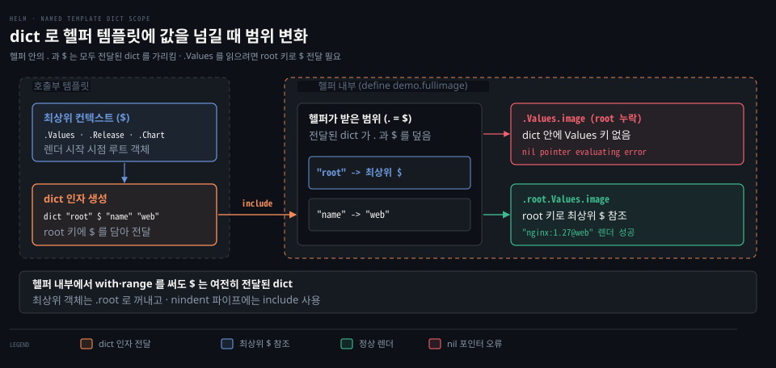

# Helm 템플릿 값 검증

---

> 잘못된 값을 클러스터에 올리기 전에 렌더 단계에서 막는 `required`·`fail`, 헬퍼에 여러 값을 넘기는 `dict`, 차트 파일을 읽는 `.Files` 의 동작과 함정을 다룹니다.

## 학습 목표와 범위

> 렌더 단계 값 검증, 헬퍼 범위 전달, 차트 파일 접근의 경계와 실측 예외를 구분합니다.

1. `required` 와 `fail` 이 매니페스트 생성 전에 값을 거르는 방식과 `helm lint` 가 못 잡는 이유를 설명할 수 있습니다.
2. `dict` 와 `"root" $` 로 named template 에 여러 값을 넘기면서 `.Values` 접근을 유지할 수 있습니다.
3. `.Files.Get`·`.Files.Glob` 의 접근 제한 파일이 에러 대신 빈 문자열을 내는 동작을 `required` 로 막을 수 있습니다.

예제 출력은 Helm v4.1.4 에서 `helm template` 과 `helm lint` 로 확인한 결과이며, 다른 버전은 확인하지 않았습니다. 기본 템플릿 함수·헬퍼·내장 객체 문법은 [Helm 차트 작성](Helm%20%EC%B0%A8%ED%8A%B8%20%EC%9E%91%EC%84%B1.md)에서 다룹니다. 스키마 기반 입력 검사(`values.schema.json`)는 [Helm values와 렌더 검증](Helm%20values%EC%99%80%20%EB%A0%8C%EB%8D%94%20%EA%B2%80%EC%A6%9D.md) 7절에서 다룹니다.


## 1. required 와 fail 로 값 검증

> 빈 값 하나는 `required`, 여러 값의 조건이나 열거형 검사는 `if` 와 `fail` 로 렌더 단계에서 중단시킵니다.

`values.yaml` 에서 `database.host` 를 비워 둔 채 배포하면 템플릿은 빈 문자열을 그대로 YAML 에 넣습니다. 값 오타(`mode: ha` 대신 `mode: HA`)도 렌더를 조용히 통과합니다. 파드가 뜬 뒤에야 접속 실패로 드러나므로 문제 지점과 원인 변경 사이의 거리가 멀어집니다.

`required` 는 값이 비었을 때 에러 메시지를 내고 렌더를 멈추는 함수입니다.[^required-def] 기본 문법과 출력 형식은 [Helm 차트 작성](Helm%20%EC%B0%A8%ED%8A%B8%20%EC%9E%91%EC%84%B1.md) 3절에서 봅니다.

`fail` 은 조건과 상관없이 빈 문자열과 지정한 텍스트 에러를 돌려줍니다.[^fail-def] 그래서 `if` 조건문과 함께 씁니다. 두 함수 모두 `helm install`·`helm upgrade`·`helm template` 의 렌더 시점에 실행됩니다. 매니페스트가 만들어지기 전에 파일 경로와 줄 번호를 찍으며 멈춥니다.

```yaml
# values.yaml
database:
  enabled: false
  host: ""
mode: standard
```

```yaml
# templates/validate.yaml
{{- if .Values.database.enabled }}
{{- $_ := required "database.host is required when database.enabled=true" .Values.database.host }}
{{- end }}
{{- if not (has .Values.mode (list "standard" "ha")) }}
{{- fail (printf "mode must be standard or ha, got %q" .Values.mode) }}
{{- end }}
```

`$_ :=` 로 반환값을 버리는 것은 `required` 가 돌려주는 값을 출력 YAML 에 찍지 않으려는 관용입니다. 두 검증 조건을 어기면 렌더가 멈춥니다.

```bash
# enabled=true 이지만 host 가 빈 경우와 허용되지 않은 mode 를 넘긴 경우를 검증합니다
helm template demo ./demo --set database.enabled=true

helm template demo ./demo --set mode=weird
```

```bash
# 결과
Error: execution error at (demo/templates/validate.yaml:2:10): database.host is required when database.enabled=true
Error: execution error at (demo/templates/validate.yaml:5:4): mode must be standard or ha, got "weird"
```

두 명령 모두 종료 코드는 1 이어서(Helm v4.1.4 실측) CI 단계가 그대로 실패합니다.

### 검증 도구 비교와 함정

| 검사 대상 | 쓰는 도구 | 놓치기 쉬운 점 |
|---|---|---|
| 타입·범위·단일 필수 키 | `values.schema.json` | 값 사이의 조건부 조합은 표현이 까다로움 |
| 조건부 필수 값 (`enabled=true` 일 때 `host`) | `required` 또는 `fail` | `required` 는 `0` 을 빈 값으로 막음 |
| 허용 목록·복합 조건 | `if` + `fail` | `helm lint` 가 실패로 잡지 못함 |

- **`helm lint` 우회**: `mode=weird` 로 `helm lint` 를 돌리면 `level=INFO msg="funcMap fail"` 한 줄만 찍힙니다. 결과는 `0 chart(s) failed` 이고 종료 코드는 0 입니다. `--strict` 를 붙여도 같습니다(Helm v4.1.4 실측). 공식 lint 페이지에는 종료 코드 정의가 없습니다. 값 검증은 반드시 `helm template` 으로 확인합니다.
- **`required` 의 `0` 과 `false` 처리**: `""` 와 `n: 0` 은 `n required` 오류(종료 코드 1)로 막혔습니다(Helm v4.1.4 실측). 반면 `b: false` 는 `b: false` 로 통과했습니다(종료 코드 0). `0` 이 막히는 소스 분기와 Helm 3 동작은 확인하지 못했습니다. `0` 을 유효한 값으로 허용할 키에는 `required` 대신 `hasKey` 와 `fail` 을 조합하는 쪽이 안전합니다.
- **오류 메시지 정보**: 위 예제의 `got "weird"` 처럼 키 이름, 기대 형식, 받은 값을 함께 찍어야 합니다. 그래야 어느 키를 고칠지 바로 알 수 있습니다.
- **`values.schema.json` 과 분담**: 타입·범위 검증은 `values.schema.json` 이 맡습니다. 상세 예제는 [Helm values와 렌더 검증](Helm%20values%EC%99%80%20%EB%A0%8C%EB%8D%94%20%EA%B2%80%EC%A6%9D.md) 7절에 있습니다. `required`·`fail` 은 스키마로 쓰기 어려운 값 사이의 조건 검사에 씁니다.


## 2. dict 로 헬퍼 템플릿에 값 전달

> named template 은 인자를 하나만 받으므로, 값이 여러 개 필요하면 `dict` 로 묶고 최상위 객체는 `"root" $` 로 함께 넘깁니다.

`define` 으로 만든 헬퍼는 `include`·`template` 호출에서 넘긴 값 하나만 받습니다. 라벨 헬퍼에 이름과 티어를 따로 넘기려 해도 인자 자리가 하나뿐이라 막힙니다. 점(`.`) 대신 다른 값을 넘기면 헬퍼 안에서 `.Values` 와 `.Release` 를 잃습니다.

공식 문서는 named template 이 호출 시 넘긴 범위(scope)를 그대로 받는다고 설명합니다.[^named-scope] 헬퍼 내부에서는 `$` 도 전역 범위가 아니라 호출자가 넘긴 값을 가리킵니다. `dict` 는 키와 값 쌍을 받아 맵을 만드는 함수입니다.[^dict-def] 따라서 `dict` 로 만든 맵을 넘기면 헬퍼 안에서 `.name`, `.tier` 로 값을 꺼냅니다. `.Values` 를 쓰려면 `"root" $` 로 최상위 컨텍스트를 함께 넘겨야 합니다.


공식 문서에서 `dict` 로 여러 값을 넘기는 패턴을 직접 적은 문장은 확인하지 못했습니다. 위 두 공식 규칙에서 도출한 사용법을 Helm v4.1.4 실측으로 확인했습니다.

```yaml
# templates/_helpers.tpl
{{- define "demo.labels" -}}
app: {{ .name }}
tier: {{ .tier | default "backend" }}
{{- end -}}

{{- define "demo.fullimage" -}}
{{ .root.Values.image.repository }}:{{ .root.Values.image.tag }}@{{ .name }}
{{- end -}}
```

```yaml
# templates/configmap.yaml (일부)
metadata:
  labels:
    {{- include "demo.labels" (dict "name" "demo" "tier" "web") | nindent 4 }}
```

`demo.labels` 호출의 렌더 결과는 `app: demo`, `tier: web` 입니다. `"root" $` 를 넣은 `demo.fullimage` 호출 결과는 다음과 같습니다.

```yaml
# 템플릿 호출식
{{ include "demo.fullimage" (dict "root" $ "name" "web") | quote }}
```

```bash
# 결과
"nginx:1.27@web"
```

### dict 사용 시 흔한 함정

- **`"root"` 키 누락**: `dict` 에서 `"root"` 를 빼면 헬퍼 안 `.Values` 가 `nil` 이 되어 실패합니다(Helm v4.1.4 실측). 오류는 `nil pointer evaluating interface {}.image` 로 나옵니다.
- **헬퍼 내부 `$` 의 의미**: 헬퍼 안에서 `with` 나 `range` 로 범위가 바뀌면 `$` 도 헬퍼가 받은 맵을 가리킵니다. 최상위 객체는 항상 `root` 키로 꺼내는 규칙을 두면 혼동하지 않습니다.
- **`template` 대신 `include`**: `include` 는 결과를 문자열로 돌려줍니다.[^named-scope] 그래서 `nindent` 같은 파이프에 이을 수 있습니다. 둘의 비교는 [Helm 차트 작성](Helm%20%EC%B0%A8%ED%8A%B8%20%EC%9E%91%EC%84%B1.md) 5절에 있습니다.


## 3. Files 로 차트 안 파일 읽기

> `.Files.Get`·`.Files.Glob` 은 차트 안 설정 파일을 읽어 ConfigMap 에 넣지만, `templates/` 와 `.helmignore` 대상은 에러 없이 빈 문자열을 냅니다.

설정 파일을 템플릿이나 values 에 복사해 두면 값이 수정될 때 두 곳이 어긋나는 문제가 생깁니다. 차트 디렉터리에 원본 파일을 두고 렌더 시점에 읽으면 한 곳만 고치면 됩니다. `.Files` 내장 객체 개요는 [Helm 차트 작성](Helm%20%EC%B0%A8%ED%8A%B8%20%EC%9E%91%EC%84%B1.md) 2절에서 다룹니다.

`.Files.Get` 은 지정한 경로의 파일 내용을 문자열로 돌려줍니다. 공식 문서는 `range tuple` 로 여러 설정 파일 이름과 내용을 나란히 찍는 예제를 보입니다.[^accessing-files]

```yaml
data:
  {{- $files := .Files }}
  {{- range tuple "config1.toml" "config2.toml" "config3.toml" }}
  {{ . }}: |-
    {{ $files.Get . }}
  {{- end }}
```

`.Files.Glob` 은 패턴에 맞는 파일 묶음을 `Files` 타입으로 돌려줍니다. 그래서 반환값에도 `AsConfig` 나 `AsSecrets` 같은 `Files` 메서드를 연쇄로 부를 수 있습니다.[^accessing-files] `AsConfig` 는 ConfigMap 의 `data` 용으로 파일 이름을 키, 내용을 값으로 만듭니다. `AsSecrets` 는 같은 일을 Secret 용 base64 인코딩으로 수행합니다.

### Glob 과 AsConfig 최소 예제

```bash
# 차트 디렉터리 구조
demo/
  Chart.yaml
  config/
    app.properties      # log.level=info
    feature.properties  # feature.x=on
  files/
    secret.txt
  templates/
    configmap.yaml
  .helmignore           # files/
```

```yaml
# templates/configmap.yaml
apiVersion: v1
kind: ConfigMap
metadata:
  name: demo-config
data:
  {{- (.Files.Glob "config/*").AsConfig | nindent 2 }}
```

```bash
# config/ 아래 파일 묶음을 ConfigMap data 로 렌더링합니다
helm template demo ./demo -s templates/configmap.yaml
```

```bash
# 결과
data:
  app.properties: |
    log.level=info
  feature.properties: |
    feature.x=on
```

### 접근 제한과 빈 문자열 함정

공식 문서는 `templates/` 아래 파일과 `.helmignore` 로 제외한 파일에 접근할 수 없다고 적습니다.[^accessing-files] 문서는 읽으려 했을 때 어떻게 되는지는 적지 않습니다. Helm v4.1.4 에서 실측하면 에러가 아니라 빈 문자열이 나옵니다. 다른 버전의 동작은 확인하지 못했습니다.

```yaml
# templates/files-access-check.yaml (각 경로를 인용 부호로 감싸 확인)
tpl: {{ .Files.Get "templates/role.yaml" | quote }}
ign: {{ .Files.Get "files/secret.txt" | quote }}
cfg: {{ .Files.Get "config/app.properties" | quote }}
```

```bash
# 결과 (files/ 가 .helmignore 에 들어 있는 상태)
tpl: ""
ign: ""
cfg: "log.level=info\n"
```

파일 이름 오타나 `.helmignore` 제외가 있으면 ConfigMap 값이 경고 없이 비는 사고로 이어집니다. 꼭 있어야 하는 파일은 `required` 로 감싸 빈 문자열에서 렌더를 멈춥니다.

```yaml
{{ required "files/secret.txt must exist" (.Files.Get "files/secret.txt") }}
```

`.helmignore` 에 걸린 파일은 `helm package` 결과물에도 포함되지 않습니다. 그래서 로컬 디렉터리로 렌더할 때와 패키징된 차트로 렌더할 때의 결과가 달라질 수 있습니다.


## 결정 치트시트

> 상황별로 어떤 검증 함수나 파일 읽기 방식을 고를지 정리한 표입니다.

| 상황 | 선택 | 이유 | 본문 |
|---|---|---|---|
| 타입·범위·단일 필수 값 검증 | `values.schema.json` | JSON Schema 로 구조와 기본 제약을 검사 | 1절 |
| 조건부 필수 값 검증 | `required` (단, `0` 은 `hasKey`+`fail`) | `required` 는 `0` 을 막고 `false` 는 통과 | 1절 |
| 열거형·복합 조건 검증 | `if` + `fail` + `helm template` | `helm lint` 는 `fail` 을 오류로 잡지 않음 | 1절 |
| 헬퍼에 인자 여럿과 루트 객체 전달 | `(dict "root" $ "key" val)` | 헬퍼 안 `.` 과 `$` 가 모두 넘긴 값으로 바뀜 | 2절 |
| 설정 파일 묶음을 ConfigMap 에 주입 | `(.Files.Glob "...") .AsConfig` + `required` | 접근 제한·오타 시 에러 없이 `""` 이 나옴 | 3절 |


## 실무 적용 포인트

> 템플릿 검증과 파일 읽기를 파이프라인에 넣을 때 지킬 기준입니다.

### 한 가지 실행

CI 에는 `helm lint` 뿐 아니라 반드시 `helm template` 을 함께 둡니다. `fail` 로 막은 값 오류는 `helm lint --strict` 에서도 종료 코드 0 으로 통과하기 때문입니다.

### 주의할 점

- 숫자 `0` 이 정상 입력인 키(`replicaCount: 0` 등)에는 `required` 를 쓰지 않습니다.
- `dict` 로 헬퍼를 부를 때는 최상위 객체를 `"root"` 키에 일관되게 담아 `nil pointer` 오류를 막습니다.
- `.Files.Get` 대상 경로가 `.helmignore` 에 걸리면 패키지 빌드 뒤에만 값이 빌 수 있으므로 필수 파일은 `required` 로 감쌉니다.


## 면접 질문

> 렌더 단계 검증, 헬퍼 범위 전달, 차트 파일 읽기의 예외 동작을 확인하는 질문입니다.

1. 템플릿에 `fail` 검증을 넣었는데도 `helm lint --strict` 가 통과하는 이유와 CI 에서 보완하는 방법은 무엇입니까?
2. `include` 로 헬퍼에 `dict` 를 넘길 때 `"root" $` 를 같이 넣지 않으면 왜 `.Values` 참조가 실패합니까?
3. `.Files.Get` 으로 `.helmignore` 대상 파일을 읽으면 어떤 결과가 나오며 어떻게 방어합니까?


## 정답 (자답 후 펼치기)

> 위 면접 질문 3개에 먼저 자답한 뒤 아래를 읽으세요.

### 정답 1 — lint 한계와 template

`helm lint` 는 차트 메타데이터와 템플릿 구문은 점검하지만 `if` + `fail` 로 작성한 사용자 정의 값 검증은 실패로 잡지 않습니다. Helm v4.1.4 실측에서도 `--strict` 여부와 무관하게 종료 코드 0 으로 통과했습니다. 따라서 CI 에서 `helm template` 을 함께 실행해야 `fail` 과 `required` 가 종료 코드 1 로 잘못된 값을 막습니다.

### 정답 2 — dict 와 헬퍼 내부의 $ 범위

named template 을 `include` 로 부르면 넘긴 값 하나가 헬퍼 안의 `.` 이 됩니다. 공식 문서 규칙상 헬퍼 안의 `$` 역시 전역 루트가 아니라 호출에서 넘긴 범위를 가리킵니다. `dict` 만 넘기고 `"root" $` 를 빼면 헬퍼 안 `.Values` 는 전달된 `dict` 에서 `Values` 키를 찾다가 `nil pointer evaluating` 오류로 실패합니다.

### 정답 3 — 접근 제한 파일의 빈 문자열 반환과 방어

`.Files.Get` 은 `templates/` 아래 파일이나 `.helmignore` 로 제외한 파일을 읽을 때 렌더 에러를 내지 않고 빈 문자열 `""` 을 돌려줍니다(Helm v4.1.4 실측). 이 동작 때문에 설정 값이 조용히 비거나 로컬 렌더와 패키지 렌더가 달라질 수 있으므로, 필수 파일 읽기는 `required` 로 감싸 빈 문자열일 때 즉시 실패하게 만듭니다.


## 참고 자료

[^required-def]: Helm 공식 문서가 `required` 를 템플릿 렌더 시 필수 값을 선언하는 함수로 정의하며 `{{ required "A valid foo is required!" .Values.foo }}` 예제를 보입니다. <https://raw.githubusercontent.com/helm/helm-www/60d4db89421147aec9fc3fcef9e2d49e2729f50b/versioned_docs/version-3/howto/charts_tips_and_tricks.md> · <https://raw.githubusercontent.com/helm/helm-www/60d4db89421147aec9fc3fcef9e2d49e2729f50b/versioned_docs/version-3/chart_template_guide/function_list.md>

[^fail-def]: Helm 함수 목록 문서가 `fail` 을 "Unconditionally returns an empty `string` and an `error` with the specified text." 로 정의합니다. <https://raw.githubusercontent.com/helm/helm-www/60d4db89421147aec9fc3fcef9e2d49e2729f50b/versioned_docs/version-3/chart_template_guide/function_list.md>

[^named-scope]: Helm named templates 가이드가 전달된 scope 규칙("In the context of the named template, `$` will refer to the scope you passed in and not some global scope.")과 `template` 대신 `include` 를 쓰는 이유를 설명합니다. <https://raw.githubusercontent.com/helm/helm-www/60d4db89421147aec9fc3fcef9e2d49e2729f50b/versioned_docs/version-3/chart_template_guide/named_templates.md>

[^dict-def]: Helm 함수 목록 문서가 `dict` 를 키-값 쌍 목록으로 맵을 만드는 함수로 정의합니다. <https://raw.githubusercontent.com/helm/helm-www/60d4db89421147aec9fc3fcef9e2d49e2729f50b/versioned_docs/version-3/chart_template_guide/function_list.md>

[^accessing-files]: Helm 파일 접근 가이드가 `.Files.Get` 반복문, `.Files.Glob`, `AsConfig`·`AsSecrets` 및 `templates/`·`.helmignore` 접근 제한을 설명합니다. <https://raw.githubusercontent.com/helm/helm-www/60d4db89421147aec9fc3fcef9e2d49e2729f50b/versioned_docs/version-3/chart_template_guide/accessing_files.md>

- [Helm 차트 작성](Helm%20%EC%B0%A8%ED%8A%B8%20%EC%9E%91%EC%84%B1.md) — 차트 구조, 내장 객체, 기본 템플릿 함수와 `include`·`nindent`
- [Helm values와 렌더 검증](Helm%20values%EC%99%80%20%EB%A0%8C%EB%8D%94%20%EA%B2%80%EC%A6%9D.md) — `values.schema.json` 스키마 검증과 `helm template` 비교 워크플로우
