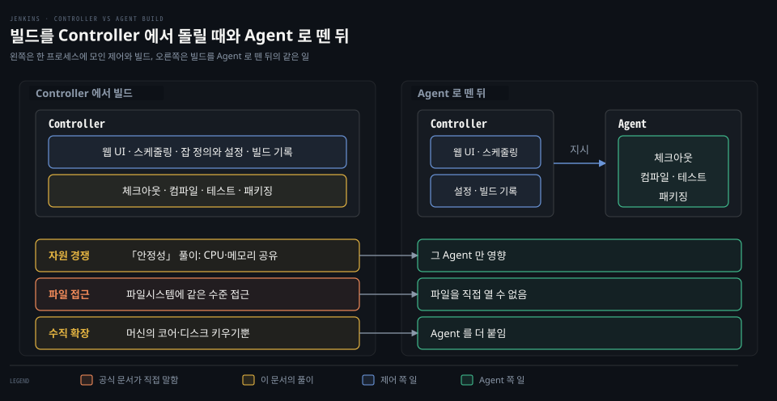
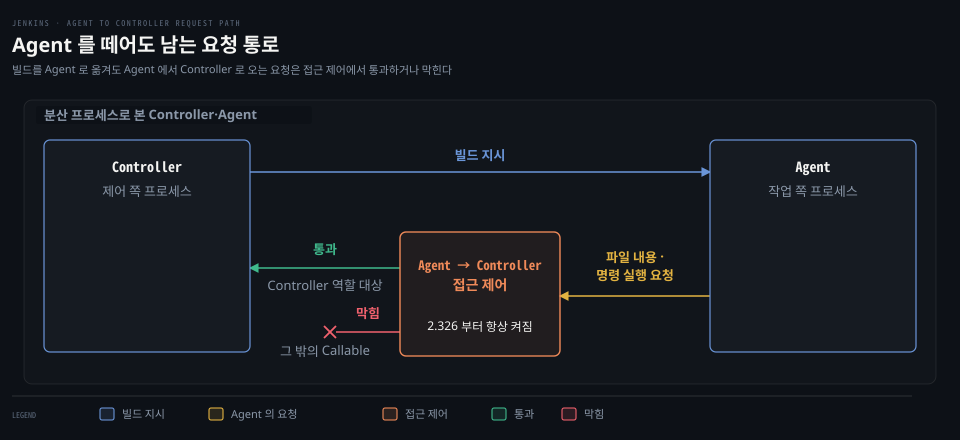
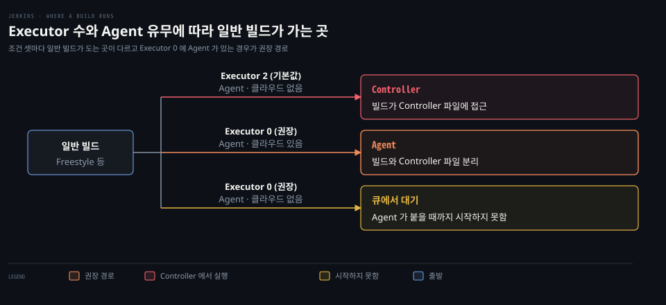
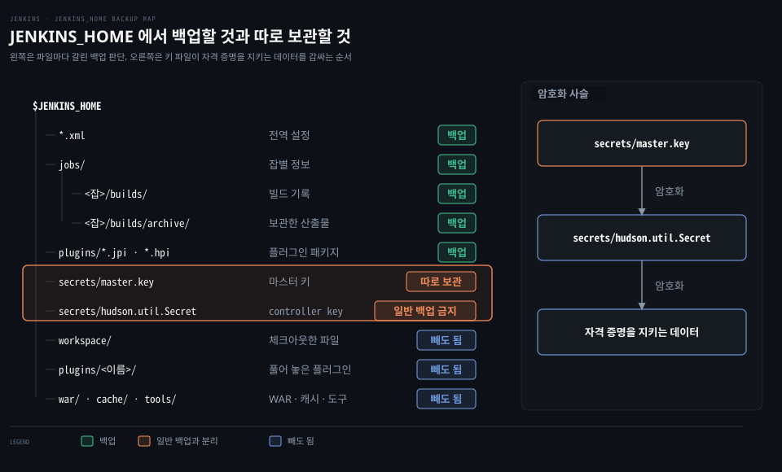
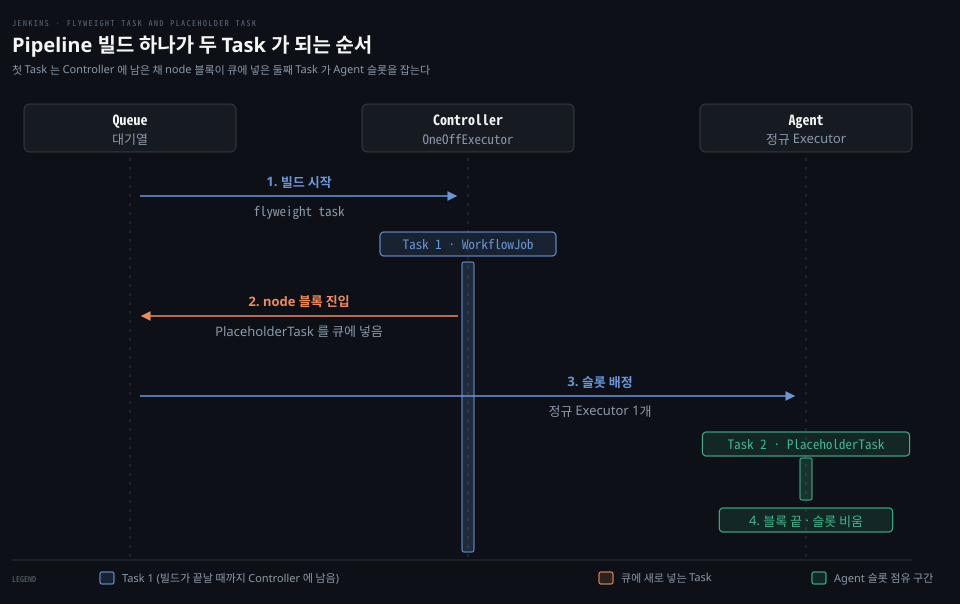

# Controller·Agent·Executor 와 JENKINS_HOME

---

> Jenkins 는 제어를 맡는 Controller 와 빌드를 돌리는 Agent 로 역할을 나누고 영속 상태는 Controller 의 `JENKINS_HOME` 한 곳에 둡니다. 이 분업이 무엇을 막는지, 그리고 어떤 파일을 잃으면 되돌릴 수 없는지를 알아야 운영 판단을 내릴 수 있습니다.

## 학습 목표

> 이 편을 읽고 나면 아래 다섯 가지를 스스로 해낼 수 있습니다.

1. Controller 에서 빌드를 돌리면 생기는 위험을 공식 문서의 근거로 설명할 수 있습니다.
2. Agent 를 떼어 낸 뒤에도 남는 공격 경로와 그것을 막는 Agent → Controller 접근 제어를 설명할 수 있습니다.
3. Built-In Node 의 Executor 를 0 으로 두는 이유와 그때 일반 빌드가 어떻게 되는지 예측할 수 있습니다.
4. 공식 백업 문서를 근거로 `JENKINS_HOME` 에서 백업할 것, 일반 백업과 따로 다룰 것, 빼도 되는 것을 가를 수 있습니다.
5. Pipeline 이 Executor 0 인 Controller 에서도 시작되는 이유와 `node` 블록에서 슬롯을 잡는 시점을 설명할 수 있습니다.

## 1. 분리가 막는 세 위험

> 빌드를 Controller 위에서 돌리면 빌드 하나가 Jenkins 전체의 자원과 파일을 함께 쥡니다. Agent 를 따로 두면 자원 경쟁, 파일 접근, 수직 확장의 한계를 한꺼번에 덜 수 있습니다.

아래 도식은 빌드를 Controller 에서 돌릴 때와 Agent 로 뗄 때 세 위험이 어디에 생기고 어디로 옮겨 가는지 나란히 보여 줍니다.

세 위험 가운데 파일 접근은 공식 문서가 직접 말합니다. 자원 경쟁은 공식 문서가 「Controller 의 안정성」이라고만 적은 것을 이 문서가 풀이했고, 수직 확장은 이 문서의 풀이입니다.

단일 서버에서 모든 빌드를 돌리면 대규모 컴파일과 테스트가 Controller 와 같은 CPU·메모리를 나눠 씁니다. 공식 문서는 Controller 의 안정성을 이유로 Built-In Node 밖에서 빌드하라고 안내합니다. 깨진 빌드 스크립트도 막을 대상으로 적습니다.[^stability] 빌드가 몰려 Controller JVM 이 메모리 부족에 빠지면 웹 화면과 진행 중인 파이프라인이 함께 멈춘다는 증상은 이 문서의 풀이입니다. Spring 에 빗대면 HTTP 요청을 받는 톰캣 스레드풀에서 무거운 배치를 직접 돌리다 웹 서버 전체가 응답하지 않는 상황과 같습니다.

이 문서는 보안 위험이 겉으로 드러나지 않아 더 늦게 발견된다고 풀이합니다. 공식 문서는 빌드 내용을 관리자보다 덜 신뢰받는 사람이 정하는 경우가 많다고 적습니다. 잡 설정 권한이 있는 사용자, 빌드 스크립트 작성자, 테스트 코드 작성자가 그 예입니다.[^build-authors] 또 Built-In Node 에서 도는 빌드는 Jenkins 프로세스와 같은 수준으로 Controller 파일시스템에 접근합니다.[^built-in-node] Jenkins 프로세스가 읽는 파일은 빌드 스크립트도 읽을 수 있다는 뜻입니다. 설정 파일, 다른 프로젝트의 빌드 기록, 암호화 키 파일이 그 예입니다.

마지막 확장 문제도 공식 문서가 이 대목에서 다루지 않는 이 문서의 풀이입니다. 빌드를 한 머신에서만 돌리면 동시 빌드를 늘릴 방법이 그 머신의 코어와 디스크를 키우는 것뿐입니다. Agent 를 따로 두면 Agent 를 더 붙여 동시 빌드를 늘립니다.

그래서 Jenkins 는 책임을 둘로 나눕니다.

- Controller: 웹 UI, 빌드 요청 스케줄링, 잡 정의와 시스템 설정, 빌드 기록 보관을 맡는 제어 쪽 프로세스입니다.
- Agent: Controller 의 지시를 받아 소스를 받고 컴파일·테스트·패키징을 실제로 돌리는 작업 쪽 프로세스입니다.

빌드가 Agent 에서 돌면 빌드가 메모리를 다 써도 그 Agent 만 영향을 받습니다. 빌드 프로세스가 Controller 의 파일을 직접 열 수도 없게 됩니다. Agent 가 요청으로 Controller 의 정보를 얻는 길은 다음 절에서 다룹니다.

## 2. Agent 를 떼어도 남는 경로

> Agent 와 Controller 는 하나의 분산 프로세스처럼 통신하므로 탈취된 Agent 가 Controller 에 명령을 요청하는 길이 남습니다. 이 길은 Agent → Controller 접근 제어가 막습니다.

빌드를 Agent 로 옮겼다고 격리가 끝나지는 않습니다. 공식 문서는 Controller 와 Agent 를 여러 프로세스와 머신에 걸쳐 실행되는 하나의 분산 프로세스처럼 볼 수 있다고 적습니다.[^distributed-process] 그래서 Agent 는 Controller 에 파일 내용 같은 정보를 묻고 특정 명령을 실행해 달라고 요청할 수 있습니다.[^distributed-process]

Built-In Node 에서 빌드하지 않는 것은 버그와 덜 정교한 공격자를 막는 좋은 일반 관행일 뿐입니다. Agent 를 장악한 악의적 사용자는 Controller 의 데이터를 얻거나 명령을 실행할 수 있다고 공식 문서는 설명합니다.[^agent-takeover]

아래 도식은 빌드 지시와 Agent 의 요청이 오가는 방향, 요청이 접근 제어에서 통과하거나 막히는 갈래를 보여 줍니다.

이 요청을 거르는 장치가 **Agent → Controller 접근 제어**입니다. 이 시스템은 Agent 프로세스가 Controller 에 악의적인 명령을 보내지 못하게 막습니다.[^agent-controller] Jenkins 2.326 부터는 끌 수 없이 항상 켜져 있습니다.[^agent-controller-always] 2.325 이전에는 기본으로 켜져 있어도 관리 화면에서 끌 수 있었고, 공식 문서는 끄지 말라고 강하게 권합니다.[^ac-old]

코어 소스에서 Agent 가 Controller 로 보내는 `Callable` 을 검사하는 곳은 `CallableDirectionChecker` 입니다. 이 검사기는 기대 역할에 Controller 역할이 들어 있는 `Callable` 을 통과시킵니다.[^callable-checker]

그 밖의 `Callable` 은 우회 설정에 따라 갈립니다. 꺼져 있으면 `SecurityException` 으로 막고 켜져 있으면 로그만 남기고 통과시킵니다.[^callable-checker] 우회 설정이 꺼진 상태에서는 모든 채널에 원격 클래스 로딩을 허용하지 않도록 설정합니다.[^class-loading] 파일 읽기 요청과 명령 실행 요청이 각각 어느 갈래로 가는지는 이 파일에 없어서 이 문서는 말하지 않습니다.

Pod 를 빌드마다 새로 띄우는 동적 Agent 도 같은 원리를 따릅니다. 한 번 쓰고 버리는 Agent 라도 빌드가 도는 동안에는 Controller 와 연결돼 있습니다. 그동안 Controller 를 지키는 경계가 이 접근 제어입니다. 동적 Agent 의 구성은 [정적 Agent 와 동적 Agent](01-02.정적%20Agent%20와%20동적%20Agent.md) 에서 다룹니다.

## 3. Executor 0 의 의미

> 설치 직후 Built-In Node 에는 Executor 가 두 개 열려 있어 빌드가 Controller 에서 돕니다. 운영에서는 이 값을 0 으로 두고 빌드를 모두 Agent 나 클라우드로 보냅니다.

**Executor** 는 노드에 설정한 수만큼 만들어지는 슬롯 객체입니다. 코어 소스에서 `Executor` 클래스는 `Thread` 를 상속하지만 스레드는 빌드를 받을 때 시작합니다.[^executor-thread] 노드에 설정한 Executor 수만큼 그 노드에서 일반 빌드가 동시에 돕니다. 슬롯이 어느 JVM 에 놓이고 스레드가 언제 시작하는지는 [Executor 와 Agent JVM 의 일 나누기](01-03.Executor%20와%20Agent%20JVM%20의%20일%20나누기.md) 에서 다룹니다.

Built-In Node 의 Executor 수 기본값은 2 입니다.[^default-executors] 별도 Agent 없이 바로 빌드를 시험할 수 있게 하려는 설정입니다. 공식 문서는 이 기본값이 시작을 쉽게 하려는 것일 뿐 오래 쓰기에는 권하지 않는다고 적습니다.[^built-in-default]

아래 도식은 Built-In Node 의 Executor 수와 Agent 유무에 따라 일반 빌드가 도는 곳을 세 경우로 나눠 보여 줍니다.

Executor 가 하나라도 남아 있으면 덜 신뢰받는 빌드 스크립트가 Controller 프로세스 권한으로 돕니다. 코어의 비밀 값 클래스 `hudson.util.Secret` 도 이 경우를 막지 못합니다. javadoc 은 이 클래스가 같은 JVM 안의 코드나 로컬 파일에 접근하는 공격자를 막으려는 것이 아니라고 적습니다.[^secret-class] 그래서 공식 문서는 Built-In Node 의 Executor 수를 0 으로 저장하라고 안내합니다.[^controller-isolation]

같은 안내문은 클라우드나 Agent 를 함께 준비하라고 덧붙입니다. 실행할 곳이 없으면 빌드가 시작되지 못하기 때문입니다.

값을 0 으로 바꾸기 전에 Agent 를 먼저 붙여 두면 배포 파이프라인이 멈추지 않습니다.

## 4. JENKINS_HOME 과 master.key 백업

> 백업은 디렉터리를 통째로 복사하는 일이 아니라 잃었을 때 다시 만들 수 없는 것을 고르는 일입니다. 공식 문서는 설정·빌드 기록·플러그인 패키지를 백업 대상으로, 키 파일은 일반 백업과 따로 다룰 대상으로 나눕니다.

Jenkins 의 설정, 잡 정의, 빌드 기록, 비밀 키는 Controller 의 `JENKINS_HOME` 아래에 모입니다. Agent 에도 작업 디렉터리와 체크아웃한 `workspace` 가 생기지만 Jenkins 의 영속 상태를 담지는 않습니다. 그래서 백업의 중심은 Controller 입니다.

아래 도식은 `JENKINS_HOME` 아래 파일의 백업 판단과 키 파일이 자격 증명을 지키는 데이터를 감싸는 순서를 보여 줍니다.

먼저 따로 다룰 파일이 둘 있습니다.

- `secrets/master.key`: 디스크에 저장된 개별 키를 암호화하는 데만 쓰는 마스터 키입니다. 코어는 이 파일을 기본으로 `$JENKINS_HOME/secrets/master.key` 에 둡니다.[^confidential-store]
- `secrets/hudson.util.Secret`: 공식 문서가 controller key 라고 부르는 파일입니다. 자격 증명을 지키는 데이터를 암호화하는 키이고, 이 파일 자체는 `master.key` 로 암호화돼 있습니다.[^controller-key]

공식 문서는 이 두 파일을 한 대목에서 이어서 다룹니다. controller key 는 SSH 개인 키처럼 다루고 일반 백업에 절대 넣지 말라고 합니다. 이어서 `master.key` 를 따로 백업해 다른 백업과 떨어진 아주 안전한 곳에 두라고 합니다.[^backup-key] 키가 백업과 함께 새어 나가면 백업을 손에 넣은 사람이 모든 정보에 접근할 수 있기 때문입니다.[^backup-leak] 시스템을 복원하려면 `hudson.util.Secret` 파일이 필요하다고도 적습니다.[^restore-need] 다만 `hudson.util.Secret` 파일 자체를 어디에 두라는 말은 그 대목에 없습니다.

이 암호화 순서는 코어 소스에서 확인됩니다. `DefaultConfidentialStore` 는 개별 키를 `master.key` 로 만든 AES 키로 암호화해 `secrets/` 아래 파일에 씁니다.[^store-encrypt] `Secret` 클래스는 값을 암호화할 때 `hudson.util.Secret` 이라는 이름의 개별 키를 씁니다.[^secret-key] 마스터 키로 복호화에 실패한 파일은 읽지 못한 것으로 처리돼 `null` 이 돌아옵니다.[^store-load-fail]

여기까지가 소스가 보여 주는 사실입니다. `master.key` 를 잃으면 `hudson.util.Secret` 을 풀 수 없고 그 키가 지키는 자격 증명 데이터도 풀 수 없다는 결론은 이 문서의 추론입니다.

나머지 파일은 공식 문서의 「Which Files Should Be Backed Up?」 목록을 따르면 됩니다.

| 대상 | 담긴 것 | 공식 문서의 판단 |
|---|---|---|
| `$JENKINS_HOME/*.xml` | `config.xml` 을 비롯한 전역 설정 | 백업. SCM 저장소에 둘 수도 있음[^backup-config] |
| `jobs/<잡>/builds/`, `jobs/<잡>/builds/archive/` | 빌드 기록, 보관한 산출물 | 백업. 산출물은 오래 남겨야 할 때, 크기가 커질 수 있음[^backup-jobs] |
| `plugins/*.jpi`, `plugins/*.hpi` | 설치한 플러그인 패키지와 그 버전 | 백업[^backup-plugins] |
| `workspace/`, 옛 배치의 `jobs/<잡>/workspace/` | SCM 에서 체크아웃한 파일 | 보통 불필요. 복원 뒤 새로 체크아웃[^backup-workspace] |
| `war/`, `cache/`, `tools/`, `plugins/<이름>/` | 풀어 놓은 WAR, 캐시, 도구, 플러그인 압축 해제본 | 불필요. `plugins/<이름>/` 은 다음 재시작에 채워지고 WAR 와 도구는 복원 때 다시 받거나 풀면 됨[^backup-regenerated] |

공식 문서는 `workspace` 를 `jobs` 소절에 적습니다. 새로 설치한 Jenkins 는 작업 공간을 `$JENKINS_HOME/workspace` 아래에 두고 옛 배치는 잡 폴더 아래에 둡니다.[^workspace-layout] 복원 때 버전을 그대로 맞추려면 빼도 되는 WAR 와 도구도 드물게 백업해 둘 수 있다고 공식 문서가 덧붙입니다.[^backup-same-version]

이 문서는 플러그인 패키지를 백업하는 이유를 버전으로 풀이합니다. 공식 문서가 이 패키지를 「시스템에서 쓰는 특정 버전」이라고 적기 때문입니다. Update Center 에서 다시 받으면 최신 버전이 깔려 백업한 설정과 맞지 않을 수 있습니다. 빼도 되는 것은 패키지를 풀어 놓은 하위 디렉터리입니다.

## 5. Flyweight 와 일반 Task

> Pipeline 잡은 Executor 를 쓰지 않는 flyweight task 라서 Executor 0 인 Controller 에서도 시작됩니다. 일반 Executor 는 스크립트가 `node` 블록에 들어갈 때 따로 요청합니다.

Executor 를 0 으로 두어도 Pipeline 빌드가 바로 시작되는 것을 보면 3절의 도식과 어긋나 보입니다. 이 차이는 큐가 다루는 작업 종류에서 나옵니다.

아래 도식은 Pipeline 빌드 하나가 Controller 에서 시작한 첫 Task 에서 `node` 블록이 넣은 둘째 Task 로 이어지는 순서를 보여 줍니다.

### Executor 없이 시작하는 flyweight

`Queue.FlyweightTask` 는 Executor 를 소비하지 않는 Task 를 표시하는 인터페이스입니다.[^flyweight-queue] 큐는 이 Task 를 정규 Executor 슬롯에 넣지 않습니다. Controller 의 `Computer` 가 그 자리에서 만드는 `OneOffExecutor` 에서 시작합니다.[^oneoff-start] `OneOffExecutor` 의 javadoc 도 정규 Executor 를 소비하지 않는 Task 를 처리하려고 임시로 더하는 Executor 라고 적습니다.[^oneoff-class]

코어에는 이와 짝을 이루는 `HeavyweightTask` 같은 인터페이스가 없습니다. 표시가 없는 Task 는 `makeBuildable` 이 「regular heavyweight task」라는 주석 아래에서 `BuildableRunnable` 로 처리합니다.[^no-heavyweight] 이 문서는 그 경로를 정규 Executor 를 쓰는 일반 Task 로 풀이합니다.

Pipeline 잡 `WorkflowJob` 은 `Queue.FlyweightTask` 를 구현하고 배정 라벨로 Controller 자신의 라벨을 돌려줍니다.[^workflowjob] 큐는 배정 라벨이 Controller 자신의 라벨이면 Controller 의 `Computer` 에서 flyweight task 를 시작합니다. 시작 조건은 두 가지입니다. Controller 의 `Computer` 가 있어야 합니다. Controller 노드의 `canTake` 도 막지 않아야 합니다.[^flyweight-self-label][^node-can-take]

Executor 수는 이 조건에 들어 있지 않습니다. 코어 javadoc 은 Executor 를 0 으로 둔 노드에는 `Computer` 가 없다고 적되 Built-In Node 만은 예외로 둡니다. Built-In Node 는 flyweight task 를 돌릴 폴백으로 늘 `Computer` 를 가집니다.[^builtin-computer] 그래서 노드 속성이 거부하지 않는 기본 설정에서는 Pipeline 빌드가 Executor 수와 상관없이 Controller 에서 시작합니다.

시작한 뒤 Groovy 스크립트는 `AsynchronousExecution` 으로 넘어가 네이티브 스레드를 붙잡지 않고 진행합니다. 이때 `OneOffExecutor` 는 `completed` 가 불릴 때까지 활성 상태로 남습니다.[^async-execution] `WorkflowRun` 도 `AsynchronousExecution` 을 만들어 던집니다. 빌드가 끝나면 `completed` 를 불러 마칩니다.[^workflowrun-async]

### node 블록이 넣는 PlaceholderTask

스크립트가 `node` 블록이나 `agent` 선언에 들어가면 Pipeline 은 `PlaceholderTask` 라는 일반 Task 를 큐에 새로 넣습니다.[^placeholder-task] 이 Task 가 실행하는 `PlaceholderExecutable` 은 블록이 도는 동안 Agent 의 정규 Executor 하나를 차지합니다. 블록이 끝나면 `completed` 를 불러 슬롯을 비웁니다.[^placeholder-occupies]

그동안 첫 Task 는 끝나지 않고 Controller 에 남아 있어서 한 빌드가 두 Task 로 동시에 살아 있습니다. 실행기 목록에 두 줄로 보이는지는 `displayCell` 이 정합니다. `PlaceholderExecutable` 은 늘 보이게 하고 첫 Task 는 `blocksRestart()` 결과를 따릅니다.[^display-cell]

슬롯을 잡은 뒤 step 이 Agent 에서 도는 흐름은 [Executor 와 Agent JVM 의 일 나누기](01-03.Executor%20와%20Agent%20JVM%20의%20일%20나누기.md) 에서 다룹니다. 표시 형식은 [Queue 상태 전이와 Executor 로 가는 길](02-02.Queue%20상태%20전이와%20Executor%20로%20가는%20길.md) 에서 봅니다.

| 비교 항목 | Pipeline 잡 (flyweight) | `node` 블록의 `PlaceholderTask` |
|---|---|---|
| 슬롯 | 정규 Executor 를 쓰지 않음 (`OneOffExecutor`) | 정규 Executor 1개 |
| 실행 위치 | Controller | 라벨이 맞는 Agent |
| 하는 일 | Groovy 스크립트 해석, `stage`·`when` 판단, 단계 호출 | `sh`·`bat` 같은 명령 실행, 체크아웃, 컴파일 |
| 쓰는 자원 | Controller 메모리와 CPU | Agent 의 CPU·메모리·디스크 |

### 슬롯을 쓰지 않는 Groovy 의 비용

슬롯을 쓰지 않는다고 비용이 없는 것은 아닙니다. 공식 모범 사례 문서는 Pipeline 의 Groovy 코드가 늘 Controller 에서 돌며 Controller 의 메모리와 CPU 를 쓴다고 적습니다.[^groovy-on-controller] 큰 반복문이나 대용량 파일 파싱을 Groovy 로 쓰면 그 부하가 모두 Controller 에 쌓입니다. 그런 일은 `sh` 단계로 Agent 의 셸에 넘깁니다.

## 면접에서 받을 만한 질문

1. Controller 에서 빌드를 돌리면 생기는 위험 세 가지는 무엇이며 그중 가장 늦게 드러나는 위험은 무엇입니까?
2. 빌드를 모두 Agent 로 옮긴 뒤에도 Controller 가 공격받을 수 있는 경로는 무엇이며 Jenkins 는 그것을 어떻게 막습니까?
3. Built-In Node 의 Executor 를 0 으로 두고 Agent 를 하나도 붙이지 않으면 Freestyle 빌드와 Pipeline 빌드는 각각 어떻게 됩니까?
4. 키 파일(`master.key`, `hudson.util.Secret`)을 일반 백업과 따로 다루라는 이유는 무엇이며 `plugins/` 디렉터리는 무엇을 백업하고 무엇을 빼야 합니까?
5. Pipeline 스크립트 안에 큰 Groovy 반복문을 쓰면 왜 위험하며 `node` 블록 안의 `sh` 와는 무엇이 다릅니까?

> 다섯 질문에 먼저 스스로 답해 보세요. 자답이 끝나면 아래 §정답 (자답 후 펼치기) 으로 내려갑니다.

## 정답 (자답 후 펼치기)

> 위 §면접에서 받을 만한 질문 의 다섯 개에 먼저 자답한 뒤 아래를 읽으세요.

### 정답 1 — 분리 이유와 늦게 드러나는 위험

세 위험은 자원 경쟁, 파일 접근, 수직 확장의 한계입니다. 이 문서의 풀이로는 자원 경쟁은 화면 응답 지연이나 메모리 부족으로 곧바로 드러나고 확장 한계는 큐 적체로 보이지만 파일 접근은 흔적이 덜 남습니다. 공식 문서가 직접 말하는 위험은 파일 접근이고 자원 경쟁은 「안정성」을 푼 것입니다. Built-In Node 에서 도는 빌드는 Jenkins 프로세스와 같은 수준으로 Controller 파일시스템에 접근하므로 빌드 스크립트가 설정이나 키 파일을 읽어 가도 눈에 띄는 장애 증상이 없을 수 있습니다.

### 정답 2 — Agent → Controller 접근 제어

Agent 와 Controller 는 하나의 분산 프로세스처럼 동작해서 Agent 가 Controller 에 파일 내용을 묻거나 명령 실행을 요청할 수 있습니다. 따라서 Agent 를 장악한 공격자는 이 통로로 Controller 를 노릴 수 있습니다. Agent → Controller 접근 제어가 Agent 가 보내는 악의적 명령을 막으며 2.326 부터는 항상 켜져 있습니다.

### 정답 3 — Executor 0 과 flyweight

Freestyle 빌드는 정규 Executor 가 필요한 일반 Task 이므로 실행할 곳이 없어 큐에서 기다립니다. Pipeline 잡은 `Queue.FlyweightTask` 이고 배정 라벨이 Controller 자신이라 노드 속성이 막지 않는 기본 설정에서는 `OneOffExecutor` 에서 바로 시작합니다. 스크립트가 `node` 블록에 닿으면 `PlaceholderTask` 가 큐에 들어가고 붙은 Agent 가 없으니 이 Task 가 큐에서 기다립니다.

### 정답 4 — master.key 와 플러그인 백업

`master.key` 는 디스크의 개별 키를 암호화하는 마스터 키이고 `hudson.util.Secret` 은 그 마스터 키로 암호화한 controller key 입니다. 공식 문서는 controller key 를 일반 백업에 넣지 말고 `master.key` 를 따로 안전한 곳에 두라고 합니다. 키가 백업과 함께 새면 백업을 가진 사람이 모든 정보에 접근할 수 있기 때문입니다. `master.key` 를 잃으면 자격 증명 데이터를 풀 수 없다는 것은 이 문서의 추론입니다.

`plugins/` 에서는 버전을 고정하는 `*.jpi`·`*.hpi` 패키지를 백업하고 재시작 때 다시 채워지는 `plugins/<이름>/` 하위 디렉터리는 뺍니다.

### 정답 5 — Groovy 부하와 `sh` 의 차이

Pipeline 의 Groovy 코드는 늘 Controller 에서 돌며 Controller 의 메모리와 CPU 를 씁니다. 큰 반복문은 그 부하를 모두 Controller 에 지웁니다. `node` 블록 안의 `sh` 는 Agent 의 정규 Executor 를 잡은 `PlaceholderTask` 아래에서 Agent 의 셸 프로세스로 돌므로 부하가 Agent 에 남습니다.

## 관련 문서

- [정적 Agent 와 동적 Agent](01-02.정적%20Agent%20와%20동적%20Agent.md) — 빌드를 돌릴 노드를 정적 노드와 동적 Pod 로 구성하는 방법
- [Executor 와 Agent JVM 의 일 나누기](01-03.Executor%20와%20Agent%20JVM%20의%20일%20나누기.md) — Executor 슬롯이 어느 JVM 에 놓이는지와 step 이 Agent 에서 도는 흐름
- [Stapler 와 URL 이 doBuild 에 닿는 길](02-01.Stapler%20와%20URL%20이%20doBuild%20에%20닿는%20길.md) — 웹 요청이 Controller 안의 메서드로 이어지는 원리
- [Queue 상태 전이와 Executor 로 가는 길](02-02.Queue%20상태%20전이와%20Executor%20로%20가는%20길.md) — 빌드 요청이 큐에서 거치는 상태와 식별자
- [Executor 배정과 동적 Pod](02-03.Executor%20배정과%20동적%20Pod.md) — 큐 아이템이 조건에 맞는 Executor 와 동적 Agent 를 찾는 과정

[^built-in-node]: Jenkins User Handbook, Controller Isolation, 「Not building on the built-in node」. "Any builds running on the built-in node have the same level of access to the controller file system as the Jenkins process." <https://www.jenkins.io/doc/book/security/controller-isolation/>
[^agent-controller]: Jenkins User Handbook, Controller Isolation, 「Agent → Controller Access Control」. "the Agent → Controller Access Control system prevents agent processes from being able to send malicious commands to the Jenkins controller." <https://www.jenkins.io/doc/book/security/controller-isolation/>
[^agent-controller-always]: 같은 문서. "This system is always enabled since Jenkins 2.326" <https://www.jenkins.io/doc/book/security/controller-isolation/>
[^executor-thread]: Jenkins core 2.580.2 `Executor.java`. "Thread that executes builds. Since 1.536, {@link Executor}s start threads on-demand." / `public class Executor extends Thread implements ModelObject, IExecutor {` <https://github.com/jenkinsci/jenkins/blob/jenkins-2.580.2/core/src/main/java/hudson/model/Executor.java#L86-L93>
[^default-executors]: Jenkins core 2.580.2 `Jenkins.java`. "Number of executors of the built-in node." / `private int numExecutors = 2;` <https://github.com/jenkinsci/jenkins/blob/jenkins-2.580.2/core/src/main/java/jenkins/model/Jenkins.java#L399-L401>
[^secret-class]: Jenkins core 2.580.2 `Secret.java` javadoc. "This is not meant as a protection against code running in the same VM, nor against an attacker who has local file system access on Jenkins master." <https://github.com/jenkinsci/jenkins/blob/jenkins-2.580.2/core/src/main/java/hudson/util/Secret.java#L58-L59>
[^controller-isolation]: Jenkins User Handbook, Controller Isolation. "Set the number of executors to 0 and save. Make sure to also set up clouds or build agents to run builds on, otherwise builds won’t be able to start." <https://www.jenkins.io/doc/book/security/controller-isolation/>
[^confidential-store]: Jenkins core 2.580.2 `DefaultConfidentialStore.java` javadoc. "The sole purpose of the master key is to encrypt individual keys on the disk." <https://github.com/jenkinsci/jenkins/blob/jenkins-2.580.2/core/src/main/java/jenkins/security/DefaultConfidentialStore.java#L58-L65> / "The master key is stored by default in <code>$JENKINS_HOME/secrets/master.key</code>" <https://github.com/jenkinsci/jenkins/blob/jenkins-2.580.2/core/src/main/java/jenkins/security/DefaultConfidentialStore.java#L29>
[^controller-key]: Jenkins User Handbook, Backing-up/Restoring Jenkins. "The controller key is used to encrypt data in the secrets directory that secures credentials. It is stored in the $JENKINS_HOME/secrets/hudson.util.Secret file in the $JENKINS_HOME/secrets/ directory and encrypted with master.key" <https://www.jenkins.io/doc/book/system-administration/backing-up/>
[^backup-key]: 같은 문서. "You should treat your controller key like you treat your SSH private key and NEVER include it in a regular backup. Instead, back up the master.key file separately and store it in a very secure location away from your other backups." <https://www.jenkins.io/doc/book/system-administration/backing-up/>
[^backup-config]: 같은 문서. "Configuration files can also be stored in an SCM repository" <https://www.jenkins.io/doc/book/system-administration/backing-up/>
[^backup-plugins]: 같은 문서. "./plugins/*.jpi — Plugin packages with specific versions used on your system" <https://www.jenkins.io/doc/book/system-administration/backing-up/>
[^backup-workspace]: 같은 문서. "It is usually not necessary to back up these files. You can perform a clean checkout after restoring the system." <https://www.jenkins.io/doc/book/system-administration/backing-up/>
[^backup-regenerated]: 같은 문서, `./plugins/xxx` 항목. "These will be automatically populated on the next restart" <https://www.jenkins.io/doc/book/system-administration/backing-up/>
[^flyweight-queue]: Jenkins core 2.580.2 `Queue.java`. "Marks {@link Task}s that do not consume {@link Executor}." / `public interface FlyweightTask extends Task {}` <https://github.com/jenkinsci/jenkins/blob/jenkins-2.580.2/core/src/main/java/hudson/model/Queue.java#L1970-L1975>
[^workflowjob]: workflow-job 1624.ve973eb_34e031 `WorkflowJob.java`. `Queue.FlyweightTask,` <https://github.com/jenkinsci/workflow-job-plugin/blob/1624.ve973eb_34e031/src/main/java/org/jenkinsci/plugins/workflow/job/WorkflowJob.java#L105-L111> / `return j.getSelfLabel();` <https://github.com/jenkinsci/workflow-job-plugin/blob/1624.ve973eb_34e031/src/main/java/org/jenkinsci/plugins/workflow/job/WorkflowJob.java#L453-L459>
[^async-execution]: Jenkins core 2.580.2 `AsynchronousExecution.java` javadoc. "Special means of indicating that an executable will proceed in the background without consuming a native thread ({@link Executor})." / "{@link Executor#isActive} will remain true (even though {@link Executor#isAlive} is not) until {@link #completed} is called." <https://github.com/jenkinsci/jenkins/blob/jenkins-2.580.2/core/src/main/java/jenkins/model/queue/AsynchronousExecution.java#L45-L47>
[^placeholder-task]: workflow-durable-task-step 1479.v56e587f413a_7 `ExecutorStepExecution.java`. `final PlaceholderTask task = new PlaceholderTask(getContext(), step.getLabel());` / `Queue.getInstance().schedule2(task, 0).getCreateItem();` <https://github.com/jenkinsci/workflow-durable-task-step-plugin/blob/1479.v56e587f413a_7/src/main/java/org/jenkinsci/plugins/workflow/support/steps/ExecutorStepExecution.java#L132-L134> 클래스 선언은 `public static final class PlaceholderTask implements ContinuedTask, Serializable, AccessControlled {` <https://github.com/jenkinsci/workflow-durable-task-step-plugin/blob/1479.v56e587f413a_7/src/main/java/org/jenkinsci/plugins/workflow/support/steps/ExecutorStepExecution.java#L478>
[^groovy-on-controller]: Jenkins User Handbook, Pipeline Best Practices, 「Avoiding complex Groovy code in Pipelines」. "For a Pipeline, Groovy code always executes on controller which means using controller resources(memory and CPU)." <https://www.jenkins.io/doc/book/pipeline/pipeline-best-practices/>
[^stability]: Jenkins User Handbook, Controller Isolation. "To ensure the stability of the Jenkins controller, builds should be executed on other nodes than the built-in node." / "Setting up distributed builds in Jenkins is a great start for protecting the Jenkins controller from malicious (or just broken) build scripts" <https://www.jenkins.io/doc/book/security/controller-isolation/>
[^build-authors]: 같은 문서. "What exactly happens during a build is often controlled by people less trusted than a Jenkins administrator:" <https://www.jenkins.io/doc/book/security/controller-isolation/>
[^distributed-process]: 같은 문서, 「Agent → Controller Access Control」. "The Jenkins controller and agents can be thought of as a distributed process which executes across multiple discrete processes and machines." / "This allows an agent to ask the controller process for information available to it, for example, the contents of files, etc., and even to have the controller run certain commands when requested by the agent." <https://www.jenkins.io/doc/book/security/controller-isolation/>
[^agent-takeover]: 같은 문서. "while not building on the built-in node is a good general practice to protect from bugs and less sophisticated attackers, an agent process taken over by a malicious user would still be able to obtain data or execute commands on the Jenkins controller." <https://www.jenkins.io/doc/book/security/controller-isolation/>
[^ac-old]: 같은 문서. "In Jenkins 2.325 and earlier, it is enabled by default, but can be disabled in the web UI" / "It is strongly recommended that you not disable the Agent → Controller Access Control system." <https://www.jenkins.io/doc/book/security/controller-isolation/>
[^callable-checker]: Jenkins core 2.580.2 `CallableDirectionChecker.java`. `if (expected.contains(Roles.MASTER)) {` / `if (BYPASS) {` / `from agent to controller is prohibited.` <https://github.com/jenkinsci/jenkins/blob/jenkins-2.580.2/core/src/main/java/jenkins/security/s2m/CallableDirectionChecker.java#L45-L55> 우회 설정 이름은 `private static final String BYPASS_PROP = CallableDirectionChecker.class.getName() + ".allow";` <https://github.com/jenkinsci/jenkins/blob/jenkins-2.580.2/core/src/main/java/jenkins/security/s2m/CallableDirectionChecker.java#L30>
[^class-loading]: 같은 파일. "Installs {@link CallableDirectionChecker} to every channel." / `if (!BYPASS) {` / `builder.withRemoteClassLoadingAllowed(false);` <https://github.com/jenkinsci/jenkins/blob/jenkins-2.580.2/core/src/main/java/jenkins/security/s2m/CallableDirectionChecker.java#L58-L70>
[^built-in-default]: Jenkins User Handbook, Controller Isolation, 「Not building on the built-in node」. "Out of the box, Jenkins is set up to run builds on the built-in node." / "This is to make it easier to get started with Jenkins, but is inadvisable longer term:" <https://www.jenkins.io/doc/book/security/controller-isolation/>
[^store-encrypt]: Jenkins core 2.580.2 `DefaultConfidentialStore.java`. `return new File(rootDir, "master.key");` <https://github.com/jenkinsci/jenkins/blob/jenkins-2.580.2/core/src/main/java/jenkins/security/DefaultConfidentialStore.java#L44-L50> / `sym.init(Cipher.ENCRYPT_MODE, masterKey);` <https://github.com/jenkinsci/jenkins/blob/jenkins-2.580.2/core/src/main/java/jenkins/security/DefaultConfidentialStore.java#L98-L108> / `return new File(rootDir, key.getId());` <https://github.com/jenkinsci/jenkins/blob/jenkins-2.580.2/core/src/main/java/jenkins/security/DefaultConfidentialStore.java#L164-L166>
[^secret-key]: Jenkins core 2.580.2 `Secret.java`. "The key that encrypts the data on disk." / `private static final CryptoConfidentialKey KEY = new CryptoConfidentialKey(Secret.class.getName());` <https://github.com/jenkinsci/jenkins/blob/jenkins-2.580.2/core/src/main/java/hudson/util/Secret.java#L301-L304> / `Cipher cipher = KEY.encrypt(iv);` <https://github.com/jenkinsci/jenkins/blob/jenkins-2.580.2/core/src/main/java/hudson/util/Secret.java#L128-L136>
[^store-load-fail]: Jenkins core 2.580.2 `DefaultConfidentialStore.java` `load`. `if (x.getCause() instanceof BadPaddingException) {` / `return null; // broken somehow` <https://github.com/jenkinsci/jenkins/blob/jenkins-2.580.2/core/src/main/java/jenkins/security/DefaultConfidentialStore.java#L139-L142>
[^restore-need]: Jenkins User Handbook, Backing-up/Restoring Jenkins. "If you need to restore a system from a backup, you will need this file." 앞 문장이 controller key 를 `$JENKINS_HOME/secrets/hudson.util.Secret` 파일이라고 적으므로 "this file" 은 그 파일입니다. <https://www.jenkins.io/doc/book/system-administration/backing-up/>
[^backup-leak]: 같은 문서. "if someone else accesses your backups and has this key, they have full access to all your information." <https://www.jenkins.io/doc/book/system-administration/backing-up/>
[^backup-jobs]: 같은 문서. "The $JENKINS_HOME/jobs directory contains information related to all the jobs you create in Jenkins." / "Contains build records" / "Contains archived artifacts" / "Back this up if it is important to retain these artifacts long-term" / "These can be very large and may make your backups very large" <https://www.jenkins.io/doc/book/system-administration/backing-up/> 공식 문서는 이 항목을 `./builds`, `./builds/archive` 로만 적고 잡 이름 단계를 적지 않습니다. 잡별 폴더 아래라는 표기는 코어의 기본 경로 `"${ITEM_ROOTDIR}/builds"` 를 따랐습니다. <https://github.com/jenkinsci/jenkins/blob/jenkins-2.580.2/core/src/main/java/jenkins/model/Jenkins.java#L5809>
[^workspace-layout]: Jenkins core 2.580.2 `Jenkins.java`. `"${ITEM_ROOTDIR}/" + WORKSPACE_DIRNAME` / `"${JENKINS_HOME}/workspace/${ITEM_FULL_NAME}"` <https://github.com/jenkinsci/jenkins/blob/jenkins-2.580.2/core/src/main/java/jenkins/model/Jenkins.java#L5812-L5820> / "if this is a fresh install, use more modern default layout that's consistent with agents" <https://github.com/jenkinsci/jenkins/blob/jenkins-2.580.2/core/src/main/java/jenkins/model/Jenkins.java#L915-L919>
[^backup-same-version]: Jenkins User Handbook, Backing-up/Restoring Jenkins. "some disaster recovery experts recommend against doing any upgrades while restoring the system" / "you can make an infrequent backup of the system and all downloaded tools" <https://www.jenkins.io/doc/book/system-administration/backing-up/>
[^oneoff-start]: Jenkins core 2.580.2 `Computer.java`. `OneOffExecutor e = new OneOffExecutor(this);` / `e.start(p);` <https://github.com/jenkinsci/jenkins/blob/jenkins-2.580.2/core/src/main/java/hudson/model/Computer.java#L1292-L1296> / `Queue.java`. `c.startFlyWeightTask(new WorkUnitContext(p).createWorkUnit(p.task));` <https://github.com/jenkinsci/jenkins/blob/jenkins-2.580.2/core/src/main/java/hudson/model/Queue.java#L1930-L1932>
[^oneoff-class]: Jenkins core 2.580.2 `OneOffExecutor.java` javadoc. "{@link Executor} that's temporarily added to carry out tasks that doesn't consume regular executors" <https://github.com/jenkinsci/jenkins/blob/jenkins-2.580.2/core/src/main/java/hudson/model/OneOffExecutor.java#L29-L33>
[^no-heavyweight]: Jenkins core 2.580.2 `Queue.java` `makeBuildable`. `// regular heavyweight task` / `return new BuildableRunnable(p);` <https://github.com/jenkinsci/jenkins/blob/jenkins-2.580.2/core/src/main/java/hudson/model/Queue.java#L1862-L1865> 같은 태그의 `core/src/main` 전체에서 `heavyweight` 를 대소문자 구분 없이 찾으면 `Queue.java` 와 `AsynchronousExecution.java` 의 주석 두 곳만 나오고 그 이름의 타입은 없습니다.
[^flyweight-self-label]: Jenkins core 2.580.2 `Queue.java` `makeFlyWeightTaskBuildable`. `if (lbl != null && lbl.equals(h.getSelfLabel()) && masterComputer != null) {` / `return createFlyWeightTaskRunnable(p, masterComputer);` <https://github.com/jenkinsci/jenkins/blob/jenkins-2.580.2/core/src/main/java/hudson/model/Queue.java#L1882-L1886>
[^workflowrun-async]: workflow-job 1624.ve973eb_34e031 `WorkflowRun.java`. `throw sleep();` / `private AsynchronousExecution sleep() {` <https://github.com/jenkinsci/workflow-job-plugin/blob/1624.ve973eb_34e031/src/main/java/org/jenkinsci/plugins/workflow/job/WorkflowRun.java#L389-L393> / `asynchronousExecution.completed(null);` <https://github.com/jenkinsci/workflow-job-plugin/blob/1624.ve973eb_34e031/src/main/java/org/jenkinsci/plugins/workflow/job/WorkflowRun.java#L1406-L1413>
[^placeholder-occupies]: workflow-durable-task-step 1479.v56e587f413a_7 `ExecutorStepExecution.java`. `PlaceholderExecutable` 클래스 javadoc. "Occupies {@link Executor} while workflow uses this build agent." <https://github.com/jenkinsci/workflow-durable-task-step-plugin/blob/1479.v56e587f413a_7/src/main/java/org/jenkinsci/plugins/workflow/support/steps/ExecutorStepExecution.java#L1075-L1080> / `@Override protected void finished(StepContext bodyContext) throws Exception {` <https://github.com/jenkinsci/workflow-durable-task-step-plugin/blob/1479.v56e587f413a_7/src/main/java/org/jenkinsci/plugins/workflow/support/steps/ExecutorStepExecution.java#L1031> / `Timer.get().submit(() -> execution.completed(null));` <https://github.com/jenkinsci/workflow-durable-task-step-plugin/blob/1479.v56e587f413a_7/src/main/java/org/jenkinsci/plugins/workflow/support/steps/ExecutorStepExecution.java#L995>
[^node-can-take]: Jenkins core 2.580.2 `Node.java`. `public CauseOfBlockage canTake(Queue.BuildableItem item) {` / `c = prop.canTake(item);` <https://github.com/jenkinsci/jenkins/blob/jenkins-2.580.2/core/src/main/java/hudson/model/Node.java#L431-L459>
[^builtin-computer]: Jenkins core 2.580.2 `Computer.java` javadoc. "if a {@link Node} is configured (probably temporarily) with 0 executors, you won't have a {@link Computer} object for it (except for the built-in node, which always gets its {@link Computer} in case we have no static executors and we need to run a {@link Queue.FlyweightTask}" <https://github.com/jenkinsci/jenkins/blob/jenkins-2.580.2/core/src/main/java/hudson/model/Computer.java#L156-L159> / `AbstractCIBase.java`. `if (n.getNumExecutors() > 0 || n == Jenkins.get()) {` <https://github.com/jenkinsci/jenkins/blob/jenkins-2.580.2/core/src/main/java/hudson/model/AbstractCIBase.java#L161-L162>
[^display-cell]: workflow-job 1624.ve973eb_34e031 `WorkflowRun.java`. `return blocksRestart();` <https://github.com/jenkinsci/workflow-job-plugin/blob/1624.ve973eb_34e031/src/main/java/org/jenkinsci/plugins/workflow/job/WorkflowRun.java#L436-L439> / workflow-durable-task-step 1479.v56e587f413a_7 `ExecutorStepExecution.java`. `@Override public boolean displayCell() {` <https://github.com/jenkinsci/workflow-durable-task-step-plugin/blob/1479.v56e587f413a_7/src/main/java/org/jenkinsci/plugins/workflow/support/steps/ExecutorStepExecution.java#L1203-L1205>
