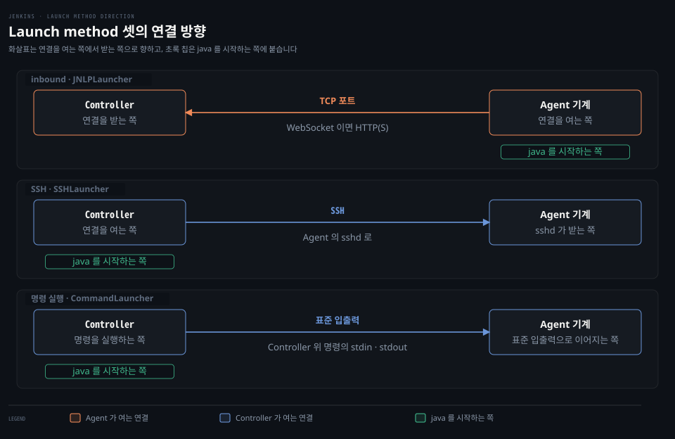
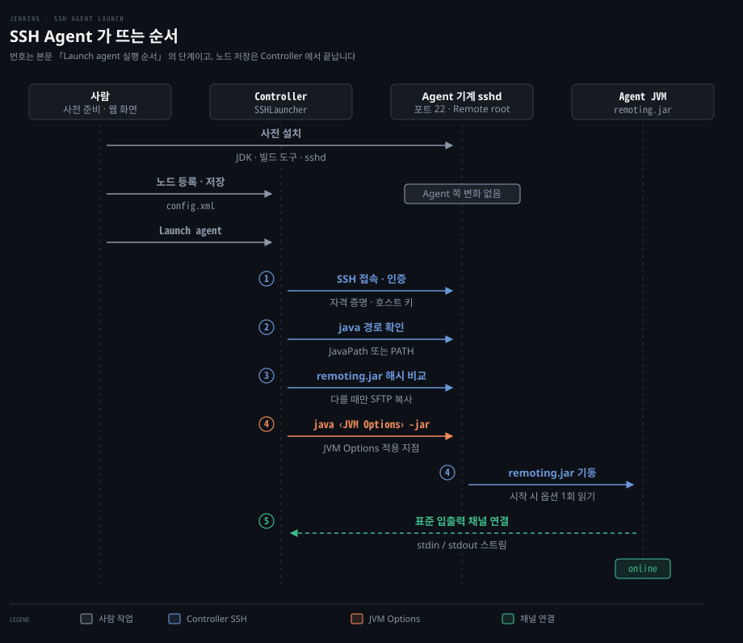
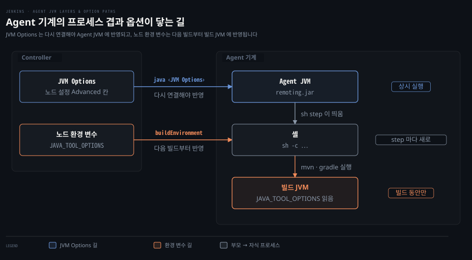
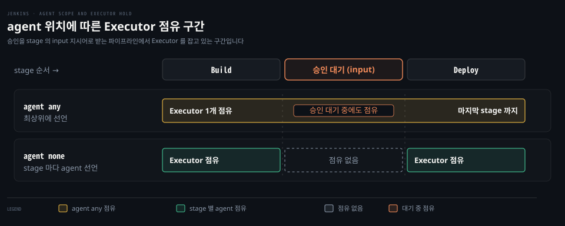

# 정적 Agent 와 동적 Agent

---

> Controller 의 Executor 를 0 으로 두면 빌드를 돌릴 노드를 따로 마련해야 합니다. 이 편은 Agent 의 Launch method 와 Availability 정책, SSH 기동 순서와 JVM 두 겹, 상시 노드와 동적 Pod 의 맞교환, 그리고 Label 과 `agent` 지시어를 다룹니다.

## 학습 목표

> 이 편을 읽고 나면 아래 여덟 가지를 스스로 해낼 수 있습니다.

1. Launch method 세 가지의 연결 방향과 WebSocket 경로를 구분할 수 있습니다.
2. SSH Agent 를 띄울 때 사람과 Controller 가 각각 무엇을 준비하고 실행하는지 설명할 수 있습니다.
3. JVM Options 변경 뒤 재연결이 필요한 이유와 노드 환경 변수의 적용 시점 차이를 구분할 수 있습니다.
4. Agent 노드에서 Agent JVM 과 빌드 JVM 이 나뉘는 이유와 각 옵션 설정 자리를 구분할 수 있습니다.
5. 정적 Agent 와 동적 Agent 가 비용, 격리, 기동 지연에서 무엇을 맞바꾸는지 비교할 수 있습니다.
6. Availability 세 가지(`Always`·`Schedule`·`Demand`)와 `Always` 의 재연결 조건을 설명할 수 있습니다.
7. Label 이 노드를 검사한 결과가 아니라 관리자가 붙인 문자열이라는 점과 과도한 세분화의 비용을 설명할 수 있습니다.
8. Declarative Pipeline 의 `agent` 지시어와 빌드 이미지 원칙이 각각 어떤 실패를 막는지 설명할 수 있습니다.


## 1. Agent 가 Controller 에 붙는 길

> 빌드는 Agent 가 돌리고, Agent 는 Controller 와 연결돼 있어야 일을 받습니다. 그 연결을 Controller 가 여는지 Agent 가 여는지에 따라 네트워크 요구가 달라집니다.

Controller 에서 빌드를 돌리지 않는 이유는 [Controller·Agent·Executor 와 JENKINS_HOME](01-01.Controller·Agent·Executor%20와%20JENKINS_HOME.md) 에서 다뤘습니다. 공식 문서도 Controller 의 Executor 를 0 으로 두고 Executor 는 Agent 쪽에 설정하라고 권합니다.[^using-agents-zero] 그러면 빌드가 갈 곳은 Agent 뿐입니다.

**Agent** 는 Controller 에 접속하는 작은 Java 클라이언트 프로세스입니다. 공식 문서는 Agent 가 언제든 끊길 수 있다고 가정합니다.[^managing-nodes]

용어도 정리해 둡니다. 예전 문서의 `master` 는 지금 Controller 라고 부릅니다. 내장 노드 이름도 2.307 과 2.319.1 에서 "built-in node" 로 바뀌었습니다.[^builtin-migration]

### Launch method 세 가지

노드 설정 화면의 Launch method 는 세 가지이고 연결 방향, `java` 실행 주체, JVM 옵션을 넣는 자리가 모두 다릅니다. 연결 방향과 `java` 를 시작하는 쪽은 아래 도식에 그렸고 JVM 옵션을 넣는 자리까지 합쳐 그 아래 표에 맞댔습니다.


| 방식 | 누가 연결을 시작하나 | 누가 java 를 띄우나 | JVM 옵션을 넣는 자리 | 쓰는 경우 |
|---|---|---|---|---|
| Launch agent by connecting it to the controller (inbound · WebSocket) | Agent[^jnlp-launcher] | Agent 쪽 스크립트·서비스·컨테이너[^managing-nodes-inbound] | Agent 쪽 실행 명령[^managing-nodes-inbound] | Controller 에서 Agent 로 들어가는 길이 막혔거나 동적 Pod 일 때 |
| Launch agents via SSH | Controller[^ssh-configure-flow] | Controller 가 SSH 로 실행[^ssh-launcher-start] | 노드 설정의 JVM Options 칸[^ssh-configure-jvm] | Controller 에서 Agent SSH 포트로 바로 접속할 수 있을 때 |
| Launch agent via execution of command on the controller | Controller[^cmd-launcher] | Controller 가 실행한 명령[^cmd-launcher-help] | 실행할 명령 문자열이나 래퍼 스크립트[^cmd-launcher-help] | SSH 플러그인 대신 RSH 나 커스텀 래퍼로 입출력을 이을 때 |

구현 위치를 보면 inbound 방식인 `JNLPLauncher` 는 Jenkins core 에 들어 있습니다.[^jnlp-launcher] SSH 방식인 `SSHLauncher` 는 `ssh-agents` 플러그인이 맡습니다.[^ssh-launcher-display] 명령 실행 방식인 `CommandLauncher` 는 지금은 `command-launcher` 플러그인으로 분리돼 있습니다.[^cmd-launcher]

`CommandLauncher` 는 Controller 위에서 지정한 단일 명령을 `ProcessBuilder` 로 실행합니다.[^cmd-launcher] 그 프로세스의 입출력이 Agent 쪽 `agent.jar` 와 이어지면 채널이 열립니다.[^cmd-launcher-help] `SSHLauncher` 가 SSH 로 `remoting.jar` 를 띄우는 다섯 단계는 [SSH Agent 가 뜨는 순서](#2-ssh-agent-가-뜨는-순서) 에 정리했습니다.

Kubernetes 플러그인은 Pod 의 Agent 를 inbound 방식으로 띄워 컨테이너가 먼저 접속하게 합니다.[^k8s-inbound] Pod 는 만들어졌다 사라지는 자원이고 Pod 마다 자기 IP 를 받습니다.[^k8s-pod-ip] 이 문서는 빌드마다 새 Pod 가 뜨는 동적 Agent 에는 Controller 가 미리 알아 둘 접속 주소가 없다고 봅니다. 그래서 컨테이너가 먼저 접속하는 inbound 가 맞는다고 풀이합니다. inbound 에서 WebSocket 을 고르면 TCP 포트 대신 HTTP(S) 로 붙습니다.[^jnlp-websocket][^k8s-websocket]


## 2. SSH Agent 가 뜨는 순서

> Agent 기계에는 Jenkins 를 설치하지 않고 JDK 와 빌드 도구, sshd 만 미리 깔아 둡니다. 나머지는 Launch agent 때 Controller 가 SSH 로 들어가 `remoting.jar` 를 맞추고 실행합니다.

SSH 노드에서 JVM Options 를 바꾼 뒤 Save 만 누르면 새 옵션이 적용되지 못합니다. 사전 준비부터 표준 입출력 채널 연결까지의 기동 순서를 아래 도식에 그렸고 번호는 아래 「Launch agent 실행 순서」 의 단계와 같습니다.


### Agent 기계 준비와 역할 분담

Agent 기계에 Jenkins 서버 본체를 따로 설치할 필요는 없습니다. 플러그인 문서는 Agent 에 `remoting.jar` 를 돌릴 JDK 나 JRE 만 요구합니다.[^ssh-prereq] 여기에 작업 디렉터리 권한과 SSH 접속 경로를 미리 엽니다. 빌드와 테스트에 필요한 컴파일러나 도구는 사람이 노드에 설치합니다.[^managing-nodes]

| 무엇을 준비하는가 | 누가 | 언제 |
|---|---|---|
| JDK, 빌드 도구, sshd, 작업 디렉터리 권한 | 사람 (Agent 기계) | 호스트 구성 시[^ssh-prereq] |
| 노드 등록(호스트·자격 증명·Remote root·Label·JVM Options) | 사람 (Controller 화면) | 노드 추가·수정 시[^ssh-fields][^ssh-configure-jvm] |
| `remoting.jar` 해시 비교·배포와 프로세스 실행 | Controller (`SSHLauncher`) | 연결할 때마다 자동[^ssh-configure-flow] |

### Launch agent 실행 순서

Controller 에서 Launch agent 를 누르면 `SSHLauncher` 가 다섯 단계를 실행합니다.[^ssh-configure-flow]

1. SSH 접속: 호스트, 포트, 자격 증명, 호스트 키 검증 설정으로 sshd 에 접속합니다.[^ssh-configure-flow]
2. `java` 확인: `JavaPath` 설정이 있으면 그 경로를 쓰고, 비어 있으면 기본 `java` 명령을 씁니다.[^ssh-launcher-java] 플러그인 문서는 사용자의 기본 `java` 버전을 확인한다고 설명합니다.[^ssh-configure-flow]
3. `remoting.jar` 비교와 복사: SFTP 로 Remote root 를 확인해 없으면 만듭니다. 기존 파일과 MD5 해시가 다를 때만 덮어쓰며, SFTP 를 쓰지 못하면 SCP 로 복사합니다.[^ssh-launcher-copy]
4. `java <JVM Options> -jar remoting.jar` 실행: 작업 디렉터리에서 `remoting.jar` 를 띄웁니다. 이때 설정된 JVM Options 를 명령줄에 끼워 넣습니다.[^ssh-launcher-start]
5. 표준 입출력 채널 연결: SSH 세션의 `stdout` 과 `stdin` 을 `SlaveComputer.setChannel` 에 넘깁니다. 이 스트림으로 Remoting 채널이 열립니다.[^ssh-launcher-channel]

### JVM Options 와 환경 변수의 적용 시점

JVM 옵션은 `java` 프로세스가 시작될 때 한 번만 읽힙니다. 노드 설정 화면에서 Save 를 누르면 Controller 가 노드의 `config.xml` 파일만 갱신합니다.[^node-save] Agent 기계에 이미 떠 있는 `remoting.jar` 프로세스는 명령줄이 바뀌지 않습니다.

새 JVM Options 를 적용하려면 연결을 끊고 Launch agent 를 다시 실행해야 합니다.[^ssh-troubleshoot-reconnect] 이때 새로 뜨는 것은 `remoting.jar` 프로세스 하나뿐이므로 Agent 기계를 재부팅하거나 Controller 를 재시작할 필요는 없습니다.

Node Properties 에 넣은 노드 환경 변수는 Agent 기동 명령줄에 붙지 않습니다. 이 변수는 빌드마다 따로 내려갑니다.[^node-env-help][^computer-build-env] 그래서 다시 연결하지 않아도 저장한 다음 빌드부터 적용됩니다. 두 설정 자리와 닿는 JVM 은 [두 JVM 의 옵션 설정 자리](#두-jvm-의-옵션-설정-자리) 의 표에 맞댔습니다.

### inbound Agent 의 옵션 적용

1절에서 본 inbound 연결에서는 Controller 가 SSH 로 `java` 를 띄우지 않습니다. Agent 쪽 시작 스크립트나 서비스, 컨테이너가 `java -jar agent.jar` 를 실행합니다.[^managing-nodes-inbound] 따라서 inbound Agent 의 JVM 옵션을 바꾸려면 Agent 쪽 시작 명령을 고쳐야 합니다. 고친 뒤에는 Agent 프로세스를 직접 다시 띄웁니다.


## 3. Agent 노드의 JVM 두 겹

> Agent 기계 위에는 연결을 유지하는 Agent JVM 과 빌드를 돌리는 빌드 JVM 이 따로 뜹니다. 그래서 Agent JVM 옵션은 JVM Options 칸에, 빌드 도구 옵션은 노드 환경 변수 `JAVA_TOOL_OPTIONS` 에 나누어 넣습니다.

한 노드에서 두 JVM 의 수명과 설정 경로를 섞으면 빌드 옵션을 넣으려다 Agent 연결을 끊거나 반대로 빌드 도구에 옵션이 닿지 않습니다. 아래 도식은 Agent 기계 위에 프로세스가 겹으로 서는 모양과 옵션을 넣는 두 자리가 닿는 JVM 을 보입니다.


기계 위에서 **Agent JVM** (`remoting.jar`) 은 늘 떠서 채널을 지킵니다.[^managing-nodes] 반면 **빌드 JVM** (`mvn`, `gradle`, `java` 등) 은 `sh` step 이 실행될 때만 새로 떴다가 빌드가 끝나면 사라집니다.

Pipeline 의 Groovy 스크립트 자체는 Controller 에서 해석됩니다. `sh` 같은 step 만 Agent 로 넘어가는 구조는 [Controller·Agent·Executor 와 JENKINS_HOME](01-01.Controller·Agent·Executor%20와%20JENKINS_HOME.md) 의 5절에서 다룹니다. `sh` step 의 셸 종료 코드 처리와 격리 층은 [sh step 이 실패를 삼키는 이유](03-03.sh%20step%20이%20실패를%20삼키는%20이유.md) 의 3절에서 다룹니다.

### 두 JVM 을 나눈 네 가지 이유

`sh` step 은 Controller 가 Remoting 채널로 보낸 요청입니다. 이 요청을 받은 Agent JVM 이 자기 기계에서 새 셸(`sh -c ...`)을 띄웁니다.[^agent-launch][^durable-shell] 그 셸이 빌드 도구를 부를 때 빌드 JVM 이 뜹니다. 종료 코드는 결과 파일에 적히고 `exitStatus` 가 그 파일을 확인합니다.[^durable-result] 요청이 채널을 건너는 순서와 결과 파일은 [Executor 와 Agent JVM 의 일 나누기](01-03.Executor%20와%20Agent%20JVM%20의%20일%20나누기.md) 의 2절에서 다룹니다.

아래 표의 네 가지 이유는 공식 문서가 밝힌 설계 이유가 아니라 두 프로세스의 수명·JDK·종료 동작·동시 실행이 다르다는 사실에서 이 문서가 풀이한 것입니다.

| 구분 기준 | Agent JVM 과 빌드 JVM 분리 | 한 JVM 으로 합쳤다면 |
|---|---|---|
| 수명 | 연결은 며칠 유지, 빌드는 끝날 때 종료 | 빌드 JVM 이 끝날 때 Agent 연결도 끊김 |
| JDK·힙·클래스패스 | Agent 는 Controller 호환 Java, 빌드는 프로젝트별 설정 | 모든 빌드가 Agent JVM 의 JDK 와 힙에 묶임 |
| 장애 격리 | 빌드 실패가 채널 프로세스로 번지지 않음 | 빌드의 `OutOfMemoryError` 나 `System.exit` 가 노드를 끊음 |
| 동시 실행 | Executor 슬롯 여럿이 보낸 `sh` 마다 Agent 쪽에서 별도 OS 프로세스가 뜸[^durable-shell] | executor 여럿이 한 JVM 힙을 나눠 씀 |

공식 매뉴얼은 Executor 를 "사실상 Agent 안의 스레드"라고 비유합니다.[^managing-nodes-executor] 하지만 이 스레드 자체는 Controller JVM 에 있고 Agent 에서는 Controller 가 보낸 step 만 실행됩니다. 자세한 구조는 [Executor 와 Agent JVM 의 일 나누기](01-03.Executor%20와%20Agent%20JVM%20의%20일%20나누기.md) 에 있습니다.

### 두 JVM 의 옵션 설정 자리

프로세스가 둘이니 옵션을 넣는 자리도 둘이고 닿는 JVM 과 반영 시점이 다릅니다. 위 도식의 두 길을 표로 맞대면 다음과 같습니다.

| 설정 자리 | 닿는 JVM | 반영 시점 |
|---|---|---|
| 노드 설정의 JVM Options 칸[^ssh-configure-jvm] | Agent JVM 하나. `java <JVM Options> -jar remoting.jar` 명령줄에 붙음[^ssh-launcher-start] | 연결을 끊고 Launch agent 를 다시 실행한 뒤[^ssh-troubleshoot-reconnect] |
| 노드 환경 변수 `JAVA_TOOL_OPTIONS`[^node-env-help] | 이 변수가 보이는 환경에서 뜨는 JVM. 빌드 셸 안의 `mvn`·`gradle` 이 해당함. Agent JVM 의 명령줄에는 없음[^ssh-launcher-start] | 저장한 다음 빌드부터. `Computer.buildEnvironment` 가 빌드마다 내려줌[^computer-build-env] |
| 노드 환경 변수 `MAVEN_OPTS` | Maven 을 실행하는 JVM 만[^maven-opts] | 저장한 다음 빌드부터[^node-env-help] |

`JAVA_TOOL_OPTIONS` 는 `JNI_CreateJavaVM` 이 옵션을 인자 앞에 붙이는 방식으로 적용됩니다.[^java-tool-options] 공식 문서는 명령줄을 바꾸기 어려운 곳에서 뜨는 VM 을 위해 이 변수를 둔다고 설명합니다. 이 문서는 그 설명을 이 변수가 보이는 환경에서 뜨는 JVM 마다 적용된다는 뜻으로 풀이합니다.

반면 `MAVEN_OPTS` 는 Maven 을 실행하는 JVM 에만 쓰입니다.[^maven-opts] 그래서 Agent JVM 의 힙은 JVM Options 칸에서, 빌드 JVM 의 옵션은 노드 환경 변수에서 바꿉니다. 두 반영 시점이 갈리는 이유는 [JVM Options 와 환경 변수의 적용 시점](#jvm-options-와-환경-변수의-적용-시점) 에서 설명합니다.


## 4. 정적과 동적의 비용·격리 교환

> 상시 노드는 바로 빌드를 받지만 놀 때도 비용이 들고 빌드 사이에 상태가 남습니다. 빌드마다 띄우는 Pod 는 깨끗한 환경과 사용한 만큼의 비용을 얻는 대신 Pod 를 띄우는 시간을 냅니다.

정적 Agent 는 상시 켜 둔 가상 머신이나 물리 서버를 노드로 등록한 것입니다. 노드가 이미 연결돼 있으므로 큐에서 Executor 가 배정되면 빌드가 곧바로 시작합니다. 대신 빌드가 없는 시간에도 서버 비용이 나갑니다. 여러 빌드가 같은 호스트를 쓰므로 앞 빌드가 남긴 파일이나 프로세스가 다음 빌드에 영향을 줄 수도 있습니다.

동적 Agent 는 빌드 요청이 들어올 때 노드를 만들고 일이 끝나면 지웁니다. Kubernetes 플러그인은 Agent 를 Pod 로 띄웁니다. 그 Pod 에는 Agent 를 돌리는 `jnlp` 컨테이너가 늘 하나 들어 있습니다.[^k8s-overview] 매 빌드가 새 컨테이너에서 출발하므로 이전 빌드의 흔적이 넘어오지 않습니다. 대신 Pod 를 스케줄하고 이미지를 받고 Agent 가 접속하는 시간이 비용으로 듭니다. 이 시간은 클러스터와 이미지 크기에 따라 달라서 고정된 값으로 말할 수 없습니다.

동적 Agent 에도 조절 손잡이가 있습니다. `idleMinutes` 를 주면 마지막 단계가 끝난 뒤 그 시간 동안 Pod 를 남겨 다음 빌드가 재사용합니다.[^k8s-idle] 기동 시간을 줄이는 대신 격리와 비용 절감을 일부 내주는 설정입니다. 또 드물게 Controller 에 등록되지 않은 Pod 가 남아 계속 재접속을 시도할 수 있습니다. 플러그인의 정리 기능은 API 서버 부하 때문에 기본으로 꺼져 있으니 직접 켤지 정해야 합니다.[^k8s-gc]

| 비교 항목 | 정적 Agent | 동적 Agent (Kubernetes Pod) |
|---|---|---|
| 수명 | 상시 가동 | 빌드 요청 때 생성, 끝나면 삭제 |
| 비용 | 노는 시간에도 서버 비용 | 빌드가 도는 동안의 CPU·메모리 |
| 격리 | 작업 디렉터리와 호스트 상태가 쌓임 | 빌드마다 새 컨테이너 |
| 기동 지연 | 노드가 이미 연결돼 있어 바로 시작 | Pod 스케줄, 이미지 받기, 접속 시간 |
| 환경 갱신 | 호스트의 OS·도구를 직접 관리 | 이미지 태그를 바꿔 갱신 |

큐 아이템이 Pod 로 이어지는 과정은 [Executor 배정과 동적 Pod](02-03.Executor%20배정과%20동적%20Pod.md) 에서 다룹니다.


## 5. 노드 Availability 세 가지

> Availability 는 Jenkins 가 노드를 언제 온라인으로 올리고 내릴지 정하는 `RetentionStrategy` 입니다. 정적 노드는 세 가지 정책 가운데 하나를 고르고, 동적 Pod 는 전용 전략으로 한 번 쓰거나 유휴 뒤 지웁니다.

상시 노드가 밤새 놀거나 연결이 끊긴 채 방치되면 서버 비용과 대기 시간이 함께 커집니다. 이 두 문제는 `RetentionStrategy` 로 다룹니다.

노드 설정의 Availability 는 내부에서 이 전략 구현체를 고릅니다. 주기 작업 `ComputerRetentionWork` 가 기본 60초 간격으로 각 노드의 `check()` 를 부릅니다. `check()` 는 다음 검사까지 기다릴 분(0~60분)을 돌려줄 수 있고 그 노드는 그만큼 건너뜁니다.[^retention-work]

### RetentionStrategy 세 가지

노드 설정 화면의 Availability 선택지마다 구현 클래스와 동작 기준이 정해져 있습니다.

| UI 선택지 | 구현 클래스 | 동작 기준 |
|---|---|---|
| Keep this agent online as much as possible | `RetentionStrategy.Always`[^retention-always] | 오프라인이면 주기적으로 재연결 시도 |
| Bring this agent online according to a schedule | `SimpleScheduledRetentionStrategy`[^retention-schedule] | cron 시작 시각부터 지정 분 동안 온라인 |
| Bring this agent online when in demand, and take offline when idle | `RetentionStrategy.Demand`[^retention-demand] | 큐 대기 기준을 넘으면 올리고 유휴 기준을 넘으면 내림 |

**Keep this agent online as much as possible** 은 노드가 끊기면 자동으로 다시 붙이려 합니다. `Always.check` 는 오프라인이고 연결 중이 아닐 때 `isLaunchSupported()` 를 확인합니다. 이 값이 참이면 `tryReconnect()` 를 부릅니다.[^retention-always]

`SSHLauncher` 는 이 값이 참입니다.[^ssh-launcher-display] `CommandLauncher` 는 이 메서드를 따로 정하지 않아 기본값 참을 물려받습니다.[^launcher-default] Controller 가 처음 5회는 주기마다, 뒤에는 12주기마다 재연결합니다.[^slave-try-reconnect] 반면 `JNLPLauncher` 는 거짓이라 Agent 가 직접 다시 붙어야 합니다.[^jnlp-launcher]

**Bring this agent online according to a schedule** 는 정해진 시간 창에서만 노드를 켭니다. 구현은 `SimpleScheduledRetentionStrategy` 입니다. 이 클래스는 `startTimeSpec` 시각부터 `upTimeMins` 동안 켭니다.[^retention-schedule] `upTimeMins` 최소값은 1분입니다.

종료 시각에 `keepUpWhenActive` 가 켜져 있고 빌드가 돌면 새 빌드를 막습니다. 이때 `isAcceptingTasks()` 를 거짓으로 두어 진행 중인 빌드만 마친 뒤 연결을 끊습니다.[^retention-schedule]

**Bring this agent online when in demand, and take offline when idle** 는 일이 몰릴 때만 노드를 켭니다. `inDemandDelay`(최소 0분) 는 큐 작업이 기다리는 기준입니다. 온라인 유휴 노드가 받지 못한 큐 작업이 이 분을 넘겨 기다리면 오프라인 노드를 띄웁니다.[^retention-demand][^demand-help] `idleDelay`(최소 1분) 는 노드가 유휴 상태가 된 뒤 연결을 끊을 때까지의 시간입니다.[^retention-demand][^demand-help]

`Demand` 는 오프라인 노드의 `isLaunchSupported()` 가 참일 때만 큐 대기를 따져 노드를 올립니다.[^retention-demand] `JNLPLauncher` 는 이 값이 거짓입니다.[^jnlp-launcher] 그래서 inbound 노드는 Controller 가 띄울 방법이 없고 `Demand` 로도 올릴 수 없습니다. Agent 가 직접 붙어야 합니다.

### 배정 차단과 동적 Pod 연결

`RetentionStrategy` 는 연결 유지뿐 아니라 배정 여부에도 관여합니다. `Node.canTake` 는 라벨만 봅니다. `RetentionStrategy.isAcceptingTasks()` 는 따로 봅니다.[^computer-accepting] 배정 검사 순서는 [Executor 배정과 동적 Pod](02-03.Executor%20배정과%20동적%20Pod.md) 에서 다룹니다.

Kubernetes 동적 Pod 는 노드 설정의 세 선택지 대신 전용 전략을 씁니다. `idleMinutes` 가 0 이면 `OnceRetentionStrategy` 가 한 번만 쓰고 내립니다. 0 보다 크면 `CloudRetentionStrategy` 가 유휴 시간을 잽니다. 회수 조건은 [podRetention·Garbage Collection](02-04.podRetention·Garbage%20Collection.md) 에서 다룹니다.


## 6. Label 은 관리자가 붙인 약속

> Label 은 Jenkins 가 노드를 검사해 얻은 사실이 아니라 관리자가 노드 설정에 적은 문자열입니다. 라벨을 지나치게 쪼개면 특정 노드 앞에만 대기열이 생깁니다.

빌드마다 필요한 컴파일러나 런타임이 다르므로 맞는 노드로 보내야 합니다. 공식 문서는 Label 을 운영체제나 하드웨어 같은 기준으로 노드를 묶는 수단으로 설명하고 라벨은 Agent 설정 화면에서 붙입니다.[^labels] 큐가 노드를 고를 때도 잡의 라벨 식이 그 노드를 포함하는지만 봅니다.[^node-label] 실제로 Docker 가 깔렸는지는 확인하지 않습니다.

라벨 칸에는 이름표 여러 개를 공백으로 나눠 적습니다. `Label.parse` 가 이 문자열을 공백 기준 토큰으로 잘라 이름표 집합을 만듭니다.[^label-parse] 그래서 `linux docker` 라고 적으면 `linux`·`docker` 두 이름표가 되고, 잡이 둘 중 하나만 지정해도 그 노드로 갈 수 있습니다.

그래서 어긋나는 방향이 둘입니다. Docker 가 없는 노드에 `docker` 라벨을 달면 빌드가 그 노드로 가서 셸 단계에서 실패합니다. 도구가 있는데 라벨을 빠뜨리면 빌드는 맞는 노드를 찾지 못하고 큐에 남습니다.

흔한 함정은 과도한 세분화입니다. `linux-arm64-jdk17-mvn39-docker24` 처럼 도구를 모두 이어 붙인 라벨은 만족하는 노드가 한 대뿐이기 쉽습니다. 그러면 다른 노드가 놀아도 그 한 대 앞에만 대기열이 쌓입니다. 라벨은 운영체제나 아키텍처 같은 굵은 축으로 나누고 잡에서 `linux && docker` 처럼 식으로 조합합니다.[^label-expr]

노드 쪽에서도 받는 일을 제한할 수 있습니다. 노드 사용 모드에는 「Only build jobs with label expressions matching this node」 가 있습니다. 이 모드에서는 라벨 식이 맞는 잡만 그 노드에 배정됩니다.[^usage-mode] 특수 장비가 달린 노드를 일반 빌드가 차지하지 않게 할 때 씁니다.


## 7. agent 지시어와 슬롯 점유

> Declarative Pipeline 의 `agent` 를 최상위에 두면 파이프라인 전체가 한 노드를 잡고 `agent none` 이면 각 stage 가 자기 노드를 따로 잡습니다. 어디에 두느냐가 Executor 를 잡는 시간을 바꿉니다.

`agent` 는 파이프라인 전체나 특정 stage 가 어디서 돌지를 정하며 놓인 자리에 따라 범위가 달라집니다.[^agent-section] 아래 도식은 stage 셋짜리 파이프라인에서 `agent` 를 둔 자리별로 Executor 를 잡는 구간을 비교합니다. 가운데 stage 는 `input` 지시어로 승인을 받습니다.


지시어별 의미는 다음과 같습니다.

- `agent any`: 사용할 수 있는 아무 Agent 에서 실행합니다.
- `agent { label 'linux && docker' }`: 라벨 식에 맞는 Agent 에서 실행합니다.
- `agent none`: 최상위에 두면 파이프라인 전체에 쓸 Agent 를 잡지 않습니다. 이때 각 stage 가 자기 `agent` 를 가져야 합니다.[^agent-none]

최상위에 `agent any` 를 두면 첫 stage 부터 마지막 stage 까지 Executor 하나가 잡혀 있습니다. 승인 대기처럼 노드가 필요 없는 구간에도 슬롯이 묶입니다. stage 마다 다른 `agent` 를 또 선언하면 그 stage 는 바깥 노드와 별개로 새 노드를 요청합니다. 공식 문서의 `reuseNode` 옵션 설명이 이 기본 동작을 보여 줍니다. 이 값을 켜야 stage 의 컨테이너가 새 노드 대신 최상위 노드에서 돕니다.[^reuse-node]

최상위에 `agent none` 을 두고 stage 마다 필요한 `agent` 를 적으면 각 stage 가 도는 동안에만 Executor 를 잡습니다. `input` 지시어는 stage 가 `agent` 블록에 들어가기 전에 멈춥니다.[^input-directive] 그래서 그 stage 가 승인을 기다리는 동안에는 Executor 를 잡지 않습니다. 도식의 승인 대기 칸이 이 경우입니다.

`agent none` 으로 stage 별 `agent` 를 쓸 때 큐에 들어가는 Task 의 정체는 [Controller·Agent·Executor 와 JENKINS_HOME](01-01.Controller·Agent·Executor%20와%20JENKINS_HOME.md) 의 「Flyweight 와 일반 Task」 에서 다룹니다.


## 8. 실행환경을 이미지로 고정하기

> 동적 Agent 를 써도 이미지 안의 도구가 흔들리면 같은 커밋의 빌드 결과가 달라집니다. 도구 분리, 버전 고정, 사설 레지스트리가 각각 다른 실패를 막습니다.

빌드 도구와 배포 도구를 이미지 하나에 모두 넣으면 이미지가 커집니다. 이미지를 받는 시간은 Pod 기동 시간에 그대로 더해집니다. 한 도구의 보안 패치가 다른 단계의 이미지까지 다시 만들게 하기도 합니다. 그래서 단계마다 필요한 도구만 담은 이미지를 따로 둡니다.

```groovy
// 도구 분리 — stage 마다 필요한 이미지만 지정
pipeline {
    agent none
    stages {
        stage('Build') {
            agent { docker { image 'maven:3.9.6-eclipse-temurin-17' } }
            steps {
                sh 'mvn -B clean package'
            }
        }
        stage('Deploy') {
            agent { docker { image 'registry.example.com/ci/kubectl:1.29.2' } }
            steps {
                sh 'kubectl apply -f k8s/'
            }
        }
    }
}
```

버전 고정은 `latest` 같은 가변 태그를 쓰지 않는 것입니다. 가변 태그는 가리키는 이미지가 바뀌므로 코드를 고치지 않았는데 어제 성공한 빌드가 오늘 깨질 수 있습니다. 위 예의 `maven:3.9.6-eclipse-temurin-17` 처럼 도구와 런타임 버전까지 태그에 고정합니다.

사설 레지스트리는 외부 저장소의 받기 제한이나 장애, 태그 삭제에서 빌드를 떼어 놓습니다. 검증한 빌드 이미지를 조직의 레지스트리에 올리고 파이프라인은 그 레지스트리만 봅니다. 위 예의 `registry.example.com` 이 그 자리입니다.


## 면접에서 받을 만한 질문

1. SSH 로 붙는 Agent 와 inbound 로 붙는 Agent 는 연결을 누가 여는지에서 어떻게 다르며 Kubernetes 플러그인은 왜 inbound 를 씁니까?
2. SSH Agent 설정에서 JVM Options 를 바꾼 뒤 Save 만 누르면 적용되지 않고 다시 연결해야 하는 이유와, 노드 환경 변수가 다른 점은 무엇입니까?
3. 정적 Agent 노드 위에서 Agent JVM 과 빌드 JVM 을 둘로 나누는 이유는 무엇이며 각 JVM 의 옵션은 어디에 넣습니까?
4. 정적 Agent 와 동적 Agent 가 맞바꾸는 것은 무엇이며 `idleMinutes` 는 그 맞교환에서 어느 쪽으로 기우는 설정입니까?
5. Label 이 "관리자가 붙인 약속"이라는 말은 무슨 뜻이며 라벨이 어긋나면 어떤 두 가지 증상이 나타납니까?
6. 최상위 `agent any` 와 `agent none` 은 Executor 를 잡는 시간이 어떻게 다르며, 최상위 `agent any` 아래 stage 에 다른 `agent` 를 쓰면 무엇이 일어납니까?
7. 빌드 이미지의 도구 분리, 버전 고정, 사설 레지스트리는 각각 어떤 실패를 막습니까?
8. Launch method 세 가지(`JNLPLauncher`·`SSHLauncher`·`CommandLauncher`)는 `java` 실행 주체와 JVM 옵션 위치가 어떻게 다르며, inbound WebSocket 은 어느 포트로 붙습니까?
9. Availability `Keep this agent online as much as possible` (`Always`) 에서 inbound Agent 가 끊겼을 때 Controller 가 직접 재연결하지 않는 이유와 `Demand` 의 두 지연 값은 무엇입니까?

> 아홉 질문에 먼저 스스로 답해 보세요. 자답이 끝나면 아래 §정답 (자답 후 펼치기) 으로 내려갑니다.


## 정답 (자답 후 펼치기)

> 위 §면접에서 받을 만한 질문 의 아홉 개에 먼저 자답한 뒤 아래를 읽으세요.

### 정답 1 — 연결 방향과 Kubernetes

SSH 방식은 노드 설정에 적은 호스트로 Controller 가 접속해 Agent 를 띄우므로 Controller 에서 Agent 의 SSH 포트로 가는 길이 필요합니다. inbound 방식은 반대로 Agent 가 Controller 로 먼저 연결을 엽니다. Pod 는 만들어졌다 사라지고 Pod 마다 자기 IP 를 받습니다. 이 문서는 빌드마다 새 Pod 가 뜨는 동적 Agent 에는 Controller 가 미리 알아 둘 접속 주소가 없다고 풀이합니다. 그래서 Kubernetes 플러그인은 Agent 를 inbound 로 띄워 컨테이너가 스스로 Controller 에 접속하게 합니다.

### 정답 2 — JVM Options 와 환경 변수

JVM 옵션은 `java` 프로세스가 시작할 때만 읽힙니다. Save 는 Controller 의 `config.xml` 만 바꿀 뿐 이미 떠 있는 `remoting.jar` 프로세스를 다시 띄우지 않습니다. 따라서 연결을 끊고 Launch agent 를 다시 돌려 Agent 프로세스를 재기동해야 합니다. 반면 노드 환경 변수는 매 빌드를 시작할 때 빌드 환경에 들어가므로 재연결 없이 다음 빌드부터 적용됩니다.

### 정답 3 — Agent JVM 과 빌드 JVM 분리

Agent JVM 은 연결을 유지하며 상시 떠 있고 빌드 JVM 은 `sh` step 이 도는 동안만 떴다 사라집니다. 둘을 나누면 빌드가 끝나거나 `OutOfMemoryError` 로 죽어도 Agent 연결은 유지됩니다. 프로젝트마다 다른 JDK 와 힙을 쓸 수 있고 여러 executor 가 한 JVM 힙을 나눠 쓰지도 않습니다. Agent JVM 옵션은 SSH Launcher 의 JVM Options 칸에, 빌드 JVM 옵션은 노드 환경 변수의 `JAVA_TOOL_OPTIONS` 에 넣습니다.

### 정답 4 — 비용·격리와 기동 지연

정적 Agent 는 이미 연결된 노드라 바로 빌드를 받습니다. 대신 노는 시간에도 비용이 들고 빌드 사이에 호스트 상태가 남습니다. 동적 Agent 는 빌드 때만 Pod 를 만들어 비용과 격리에서 유리합니다. 그 대가로 Pod 를 띄우는 시간이 듭니다. `idleMinutes` 는 Pod 를 정한 시간 동안 남겨 재사용하므로 기동 지연을 줄이는 쪽으로 기웁니다. 그만큼 격리와 비용 절감을 일부 내줍니다.

### 정답 5 — 라벨과 실제 도구의 불일치

Jenkins 는 노드에 어떤 도구가 깔렸는지 검사하지 않고 관리자가 적은 라벨 문자열만 봅니다. 도구가 없는 노드에 라벨을 달면 빌드가 그 노드로 가서 셸 단계에서 실패합니다. 도구가 있는데 라벨을 빠뜨리면 빌드가 맞는 노드를 찾지 못해 큐에 남습니다.

### 정답 6 — agent 위치와 Executor 점유

최상위 `agent any` 는 파이프라인이 끝날 때까지 Executor 하나를 잡습니다. 노드가 필요 없는 구간에도 놓지 않습니다. 최상위 `agent none` 이면 각 stage 가 자기 `agent` 로 도는 동안만 Executor 를 잡습니다. 최상위 `agent any` 아래 stage 에 다른 `agent` 를 쓰면 그 stage 는 바깥 노드를 잡은 채 새 노드를 요청합니다. `reuseNode` 를 켜야 최상위 노드를 다시 씁니다.

### 정답 7 — 이미지 원칙과 막는 실패

도구 분리는 이미지가 커져 기동이 느려지고 한 도구의 갱신이 다른 단계까지 흔드는 문제를 막습니다. 버전 고정은 가변 태그가 다른 이미지를 가리키면서 코드 변경 없이 빌드가 깨지는 문제를 막습니다. 사설 레지스트리는 외부 저장소의 받기 제한, 장애, 태그 삭제에 빌드가 묶이는 문제를 막습니다.

### 정답 8 — Launch method 세 가지

`JNLPLauncher`(inbound) 는 Agent 쪽 스크립트나 컨테이너가 `java` 를 띄우므로 JVM 옵션도 Agent 쪽 실행 명령에 넣습니다. `SSHLauncher` 는 Controller 가 SSH 로 `remoting.jar` 를 띄우므로 노드 설정의 JVM Options 칸에 적습니다. `CommandLauncher` 는 Controller 가 실행한 단일 명령의 표준 입출력으로 채널을 잇고 JVM 옵션도 그 명령이나 래퍼 스크립트에 넣습니다. inbound 에서 WebSocket 을 고르면 별도 TCP 포트 대신 Controller 의 HTTP(S) 엔드포인트로 연결합니다.

### 정답 9 — Always 재연결과 Demand 지연 값

`RetentionStrategy.Always.check` 는 노드가 오프라인이고 연결 중이 아니며 `isLaunchSupported()` 가 참일 때만 `tryReconnect()` 를 부릅니다. `SSHLauncher` 와 `CommandLauncher` 는 이 값이 참이라(`CommandLauncher` 는 기본값을 물려받습니다) Controller 가 재연결을 시도하지만 `JNLPLauncher` 는 거짓이라 Agent 가 직접 다시 붙어야 합니다.

`RetentionStrategy.Demand` 에서 `inDemandDelay` 는 놀고 있는 다른 노드가 못 받는 큐 작업이 몇 분 이상 기다려야 오프라인 노드를 띄울지 정하는 값입니다. `idleDelay` 는 노드가 몇 분 이상 유휴 상태여야 연결을 끊을지 정하는 값입니다.


## 관련 문서

- [Controller·Agent·Executor 와 JENKINS_HOME](01-01.Controller·Agent·Executor%20와%20JENKINS_HOME.md) — Controller 와 Agent 를 나누는 이유와 영속 상태의 위치
- [Executor 와 Agent JVM 의 일 나누기](01-03.Executor%20와%20Agent%20JVM%20의%20일%20나누기.md) — `Node`·`Computer`·`Executor` 와 Agent JVM 이 일을 나누는 구조
- [Executor 배정과 동적 Pod](02-03.Executor%20배정과%20동적%20Pod.md) — 큐 아이템이 Executor 를 배정받고 Pod 가 만들어지는 과정
- [podRetention·Garbage Collection](02-04.podRetention·Garbage%20Collection.md) — `OnceRetentionStrategy`·`CloudRetentionStrategy` 와 동적 Pod 회수 조건
- [sh step 이 실패를 삼키는 이유](03-03.sh%20step%20이%20실패를%20삼키는%20이유.md) — `sh` step 의 셸 종료 코드 처리와 방어층

[^using-agents-zero]: Jenkins User Handbook, Using Jenkins agents, 「Number of executors」. "For Jenkins controllers, it is recommended to set this to 0 to avoid resource contention. Executors should be configured on agents (nodes) instead." <https://www.jenkins.io/doc/book/using/using-agents/>
[^managing-nodes]: Jenkins User Handbook, Managing Nodes. "An agent is a small (170KB single jar) Java client process that connects to a Jenkins controller and is assumed to be unreliable." <https://www.jenkins.io/doc/book/managing/nodes/>
[^ssh-fields]: Jenkins User Handbook, Using Jenkins agents, 「Set up agent1 on Jenkins」. "Remote root directory" / "Labels" / "Usage" / "Launch method" / "Host" / "Credentials" / "Host Key Verification Strategy" (설정 항목 이름을 차례로 인용) <https://www.jenkins.io/doc/book/using/using-agents/>
[^ssh-configure-flow]: SSH Build Agents plugin 3.1097.v868116049892 `doc/CONFIGURE.md`. "Open an SSH connection to the specified host as the specified username. Check the default version of java for that user. Copy the latest remoting.jar via SFTP (falling back to scp if SFTP is not available) Start the remoting process." <https://github.com/jenkinsci/ssh-agents-plugin/blob/3.1097.v868116049892/doc/CONFIGURE.md?plain=1#L6-L9>
[^ssh-prereq]: 같은 문서, 「Prerequisites」. "Before you start to use the plugin with your agents, you need to prepare your agents to run the remoting process." <https://github.com/jenkinsci/ssh-agents-plugin/blob/3.1097.v868116049892/doc/CONFIGURE.md?plain=1#L11-L13>
[^ssh-configure-jvm]: 같은 문서, 「Advanced settings」. "Additional arguments for the JVM such as min and max heap size, garbage collector options, and other tuning settings." <https://github.com/jenkinsci/ssh-agents-plugin/blob/3.1097.v868116049892/doc/CONFIGURE.md?plain=1#L76>
[^ssh-launcher-java]: SSH Build Agents plugin 3.1097.v868116049892 `SSHLauncher.java`. `String java = "java"; if (StringUtils.isNotBlank(javaPath)) { java = expandExpression(computer, javaPath); }` <https://github.com/jenkinsci/ssh-agents-plugin/blob/3.1097.v868116049892/src/main/java/hudson/plugins/sshslaves/SSHLauncher.java#L457-L460>
[^ssh-launcher-copy]: 같은 파일 `copyAgentJar`. `overwrite = !sourceAgentHash.equals(existingAgentHash);` / `"Verified agent jar. No update is necessary."` / `copySlaveJarUsingSCP(listener, workingDirectory);` <https://github.com/jenkinsci/ssh-agents-plugin/blob/3.1097.v868116049892/src/main/java/hudson/plugins/sshslaves/SSHLauncher.java#L702-L744>
[^ssh-launcher-start]: 같은 파일 `startAgent`. `String cmd = "cd \"" + workingDirectory + "\" && " + java + " " + getJvmOptions() + " -jar " + AGENT_JAR` <https://github.com/jenkinsci/ssh-agents-plugin/blob/3.1097.v868116049892/src/main/java/hudson/plugins/sshslaves/SSHLauncher.java#L633-L634>
[^ssh-launcher-channel]: 같은 파일 `startAgent`. `computer.setChannel(session.getStdout(), session.getStdin(), listener.getLogger(), null);` <https://github.com/jenkinsci/ssh-agents-plugin/blob/3.1097.v868116049892/src/main/java/hudson/plugins/sshslaves/SSHLauncher.java#L645>
[^node-save]: Jenkins core 2.580.2 `Node.java` `save` 및 `Nodes.java` `getConfigFile`. `getConfigFile().write(this);` / `return new XmlFile(Jenkins.XSTREAM, new File(dir, "config.xml"));` <https://github.com/jenkinsci/jenkins/blob/jenkins-2.580.2/core/src/main/java/hudson/model/Node.java#L156>
[^ssh-troubleshoot-reconnect]: SSH Build Agents plugin 3.1097.v868116049892 `doc/TROUBLESHOOTING.md`. "Make sure to reconnect the agent after changing the agents commands." <https://github.com/jenkinsci/ssh-agents-plugin/blob/3.1097.v868116049892/doc/TROUBLESHOOTING.md?plain=1#L15>
[^node-env-help]: Jenkins core 2.580.2 `nodeEnvironmentVariables.html`. "Environment variables defined here will be made available to every build executed on this node" <https://github.com/jenkinsci/jenkins/blob/jenkins-2.580.2/war/src/main/webapp/help/system-config/nodeEnvironmentVariables.html#L2-L3>
[^computer-build-env]: Jenkins core 2.580.2 `Computer.java` `buildEnvironment`. "Creates an environment variable override to be used for launching processes on this node." <https://github.com/jenkinsci/jenkins/blob/jenkins-2.580.2/core/src/main/java/hudson/model/Computer.java#L1185-L1202>
[^managing-nodes-inbound]: Jenkins User Handbook, Managing Nodes, 「Launch inbound agent via Windows Scheduler」. `java -jar agent.jar -url <Jenkins URL> -secret <secret key> -name <agent name>` <https://www.jenkins.io/doc/book/managing/nodes/#launch-inbound-agent-via-windows-scheduler>
[^managing-nodes-executor]: 같은 문서, 「Components of Distributed Builds」. "Effectively, it is a thread in the agent." (비유 표현. 실제 스레드 위치는 01-03 참조) <https://www.jenkins.io/doc/book/managing/nodes/#components-of-distributed-builds>
[^durable-shell]: durable-task plugin 686.v80ff80875b_82 `BourneShellScript.java`. `cmd.addAll(Arrays.asList("sh", "-c", "(" + cmdString + ") >&- 2>&- &"));` <https://github.com/jenkinsci/durable-task-plugin/blob/686.v80ff80875b_82/src/main/java/org/jenkinsci/plugins/durabletask/BourneShellScript.java#L272>
[^java-tool-options]: Oracle JDK 17 JVM Tool Interface Specification, 「JAVA_TOOL_OPTIONS」. "Since the command-line cannot always be accessed or modified, for example in embedded VMs or simply VMs launched deep within scripts, a JAVA_TOOL_OPTIONS variable is provided so that agents may be launched in these cases." / "JNI_CreateJavaVM (in the JNI Invocation API) will prepend these options to the options supplied in its JavaVMInitArgs argument." <https://docs.oracle.com/en/java/javase/17/docs/specs/jvmti.html#tooloptions>
[^k8s-inbound]: Kubernetes plugin 4560.vc25b_83890c34 README. "Agents are launched as inbound agents, so it is expected that the container connects automatically to the Jenkins controller." <https://github.com/jenkinsci/kubernetes-plugin/blob/4560.vc25b_83890c34/README.md?plain=1#L16>
[^k8s-websocket]: 같은 README. "If you check **WebSocket** then agents will connect over HTTP(S) rather than the Jenkins service TCP port." <https://github.com/jenkinsci/kubernetes-plugin/blob/4560.vc25b_83890c34/README.md?plain=1#L69>
[^builtin-migration]: Jenkins User Handbook, Built-In Node Name and Label Migration. "the built-in node was renamed from "master node" to "built-in node" in Jenkins 2.307 and in Jenkins 2.319.1." <https://www.jenkins.io/doc/book/managing/built-in-node-migration/>
[^k8s-overview]: 같은 README. "Within these pods, there is always one special container that is running the Jenkins agent." <https://github.com/jenkinsci/kubernetes-plugin/blob/4560.vc25b_83890c34/README.md?plain=1#L123>
[^k8s-idle]: 같은 README. "**idleMinutes** Allows the pod to remain active for reuse until the configured number of minutes has passed since the last step was executed on it." <https://github.com/jenkinsci/kubernetes-plugin/blob/4560.vc25b_83890c34/README.md?plain=1#L362>
[^k8s-gc]: 같은 README, 「Garbage collection」. "As it may generate extra load on the Kubernetes API server, it is disabled by default." <https://github.com/jenkinsci/kubernetes-plugin/blob/4560.vc25b_83890c34/README.md?plain=1#L85>
[^labels]: Jenkins User Handbook, Using Jenkins agents, 「Labels」. "Labels are used to group agents (nodes) based on specific criteria." / "Labels can be assigned in the agent configuration settings." <https://www.jenkins.io/doc/book/using/using-agents/>
[^node-label]: Jenkins core 2.580.2 `Node.java` `canTake`. `Label l = item.getAssignedLabel();` / `if (l != null && !l.contains(this))` <https://github.com/jenkinsci/jenkins/blob/jenkins-2.580.2/core/src/main/java/hudson/model/Node.java#L432-L433>
[^label-expr]: Jenkins User Handbook, Pipeline Syntax, 「agent」. "agent { label 'my-label1 && my-label2' }" <https://www.jenkins.io/doc/book/pipeline/syntax/>
[^label-parse]: Jenkins core 2.580.2 `Label.java` `parse`. "Convert a whitespace-separate list of tokens into a set of {@link Label}s." / `final QuotedStringTokenizer tokenizer = new QuotedStringTokenizer(labels);` <https://github.com/jenkinsci/jenkins/blob/jenkins-2.580.2/core/src/main/java/hudson/model/Label.java#L575-L594>
[^usage-mode]: Jenkins User Handbook, Using Jenkins agents, 「Usage」. "Only build jobs with label expressions matching this node : Jobs will only be assigned if their label matches." <https://www.jenkins.io/doc/book/using/using-agents/>
[^agent-section]: Jenkins User Handbook, Pipeline Syntax, 「agent」. "The agent section specifies where the entire Pipeline, or a specific stage, will execute in the Jenkins environment depending on where the agent section is placed." <https://www.jenkins.io/doc/book/pipeline/syntax/>
[^agent-none]: 같은 문서. "When applied at the top-level of the pipeline block no global agent will be allocated for the entire Pipeline run and each stage section will need to contain its own agent section." <https://www.jenkins.io/doc/book/pipeline/syntax/>
[^input-directive]: Jenkins User Handbook, Pipeline Syntax, 「input」. "The stage will pause after any options have been applied, and before entering the agent block for that stage or evaluating the when condition of the stage." <https://www.jenkins.io/doc/book/pipeline/syntax/#input>
[^reuse-node]: 같은 문서, `reuseNode`. "If true, run the container on the node specified at the top-level of the Pipeline, in the same workspace, rather than on a new node entirely." <https://www.jenkins.io/doc/book/pipeline/syntax/>
[^jnlp-launcher]: Jenkins core 2.580.2 `Messages.properties` 및 `JNLPLauncher.java`. `JNLPLauncher.displayName=Launch agent by connecting it to the controller` / `public boolean isLaunchSupported() { return false; }` <https://github.com/jenkinsci/jenkins/blob/jenkins-2.580.2/core/src/main/java/hudson/slaves/JNLPLauncher.java#L150-L152>
[^jnlp-websocket]: Jenkins User Handbook, Using Jenkins agents 및 Jenkins core 2.580.2 `JNLPLauncher/help-webSocket.html`. "WebSocket connections use the controller’s HTTP(S) endpoint instead." / "Use WebSocket to connect to the Jenkins master rather than the TCP port." <https://www.jenkins.io/doc/book/using/using-agents/>
[^ssh-launcher-display]: SSH Build Agents plugin 3.1097.v868116049892 `Messages.properties` 및 `SSHLauncher.java`. `SSHLauncher.DescriptorDisplayName=Launch agents via SSH` / `public boolean isLaunchSupported() { return true; }` <https://github.com/jenkinsci/ssh-agents-plugin/blob/3.1097.v868116049892/src/main/java/hudson/plugins/sshslaves/SSHLauncher.java#L358-L360>
[^cmd-launcher]: Command Agent Launcher plugin 144.vb_6cb_566c6c04 `Messages.properties` 및 `CommandLauncher.java`. `CommandLauncher.displayName=Launch agent via execution of command on the controller` / `ProcessBuilder pb = new ProcessBuilder(Util.tokenize(command));` / `computer.setChannel(proc.getInputStream(), proc.getOutputStream(), listener.getLogger(), ...` <https://github.com/jenkinsci/command-launcher-plugin/blob/144.vb_6cb_566c6c04/src/main/java/hudson/slaves/CommandLauncher.java#L161-L188>
[^launcher-default]: Jenkins core 2.580.2 `ComputerLauncher.java`. `public boolean isLaunchSupported() { return true; }` (`CommandLauncher.java` 는 이 메서드를 재정의하지 않는다) <https://github.com/jenkinsci/jenkins/blob/jenkins-2.580.2/core/src/main/java/hudson/slaves/ComputerLauncher.java#L65-L67>
[^cmd-launcher-help]: Command Agent Launcher plugin 144.vb_6cb_566c6c04 `CommandLauncher/help-command.html`. "Single command to launch an agent program, which controls the agent computer and communicates with the controller." / "as long as stdin/stdout of the process on the controller will be connected to those of java -jar ~/bin/agent.jar on the agent machine eventually." <https://github.com/jenkinsci/command-launcher-plugin/blob/144.vb_6cb_566c6c04/src/main/resources/hudson/slaves/CommandLauncher/help-command.html#L2-L36>
[^retention-work]: Jenkins core 2.580.2 `GlobalComputerRetentionCheckIntervalConfiguration.java` 및 `ComputerRetentionWork.java`. `private int computerRetentionCheckInterval = 60;` / `final long waitInMins = Math.max(0, Math.min(60, c.getRetentionStrategy().check(c)));` (`check` 반환값을 0~60분으로 제한해 그 노드의 다음 검사 시각으로 저장) <https://github.com/jenkinsci/jenkins/blob/jenkins-2.580.2/core/src/main/java/hudson/slaves/ComputerRetentionWork.java#L54-L78>
[^retention-always]: Jenkins core 2.580.2 `Messages.properties` 및 `RetentionStrategy.java` `Always.check`. `RetentionStrategy.Always.displayName=Keep this agent online as much as possible` / `if (c.isOffline() && !c.isConnecting() && c.isLaunchSupported()) c.tryReconnect();` <https://github.com/jenkinsci/jenkins/blob/jenkins-2.580.2/core/src/main/java/hudson/slaves/RetentionStrategy.java#L171-L175>
[^slave-try-reconnect]: Jenkins core 2.580.2 `SlaveComputer.java` `tryReconnect`. `if (numRetryAttempt < 6 || numRetryAttempt % 12 == 0) {` / `connect(true);` <https://github.com/jenkinsci/jenkins/blob/jenkins-2.580.2/core/src/main/java/hudson/slaves/SlaveComputer.java#L853-L860>
[^retention-schedule]: Jenkins core 2.580.2 `Messages.properties` 및 `SimpleScheduledRetentionStrategy.java`. `SimpleScheduledRetentionStrategy.displayName=Bring this agent online according to a schedule` / `public boolean isAcceptingTasks(SlaveComputer c) { return isOnlineScheduled(); }` <https://github.com/jenkinsci/jenkins/blob/jenkins-2.580.2/core/src/main/java/hudson/slaves/SimpleScheduledRetentionStrategy.java#L172-L235>
[^retention-demand]: Jenkins core 2.580.2 `Messages.properties` 및 `RetentionStrategy.java` `Demand`. `RetentionStrategy.Demand.displayName=Bring this agent online when in demand, and take offline when idle` / `this.inDemandDelay = Math.max(0, inDemandDelay);` / `this.idleDelay = Math.max(1, idleDelay);` / `needComputer = demandMilliseconds > TimeUnit.MINUTES.toMillis(inDemandDelay);` / `if (c.isOffline() && c.isLaunchSupported()) {` / `c.connect(false);` <https://github.com/jenkinsci/jenkins/blob/jenkins-2.580.2/core/src/main/java/hudson/slaves/RetentionStrategy.java#L204-L285>
[^demand-help]: Jenkins core 2.580.2 `inDemandDelay.html` 및 `idleDelay.html`. "The number of minutes for which jobs must have been waiting in the queue before Jenkins will attempt to bring this agent online." / "The number of minutes that this agent must remain idle before Jenkins will take it offline." <https://github.com/jenkinsci/jenkins/blob/jenkins-2.580.2/war/src/main/webapp/help/system-config/master-slave/demand/inDemandDelay.html#L2-L3>
[^computer-accepting]: Jenkins core 2.580.2 `Computer.java` `isAcceptingTasks`. `return getRetentionStrategy().isAcceptingTasks(this) && (node == null || node.isAcceptingTasks());` <https://github.com/jenkinsci/jenkins/blob/jenkins-2.580.2/core/src/main/java/hudson/model/Computer.java#L1647-L1651>
[^k8s-pod-ip]: Kubernetes 문서 저장소 release-1.34 브랜치(커밋 47132eb) `service.md` 도입부(`<!-- overview -->` 구간). "Pods are ephemeral resources (you should not expect that an individual Pod is reliable and durable)." / "Each Pod gets its own IP address (Kubernetes expects network plugins to ensure this)." <https://github.com/kubernetes/website/blob/47132eb5367cfdcba0a3b33a0b3ffc81185bd7e8/content/en/docs/concepts/services-networking/service.md?plain=1#L34-L38>
[^maven-opts]: Apache Maven 문서 「Configuring Apache Maven」, 「MAVEN_OPTS environment variable」. "This variable contains parameters used to start up the JVM running Maven and can be used to supply additional options to it." <https://maven.apache.org/configure.html>
[^agent-launch]: Jenkins core 2.580.2 `Launcher.java` `RemoteLaunchCallable.call`. `LocalLauncher localLauncher = new LocalLauncher(listener);` / `return channel.export(RemoteProcess.class, new RemoteProcess() {` <https://github.com/jenkinsci/jenkins/blob/jenkins-2.580.2/core/src/main/java/hudson/Launcher.java#L1352-L1380>
[^durable-result]: durable-task plugin 686.v80ff80875b_82 `BourneShellScript.java` `scriptLauncherCmd` 와 `ShellController`. `echo $? > '%s.tmp'; mv '%s.tmp' '%s'` / `protected Integer exitStatus(FilePath workspace, TaskListener listener)` / `status = super.exitStatus(workspace, listener);` <https://github.com/jenkinsci/durable-task-plugin/blob/686.v80ff80875b_82/src/main/java/org/jenkinsci/plugins/durabletask/BourneShellScript.java#L235-L312>
