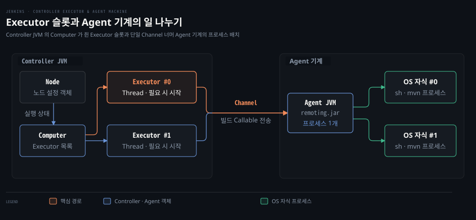
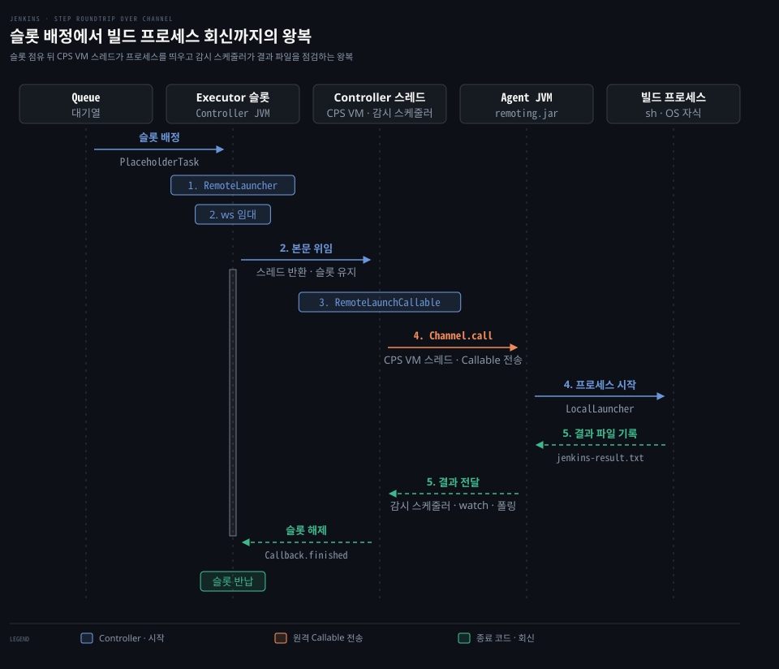
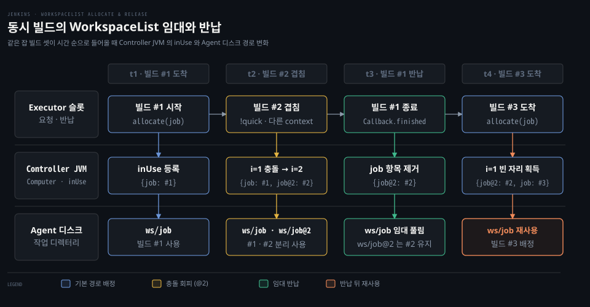
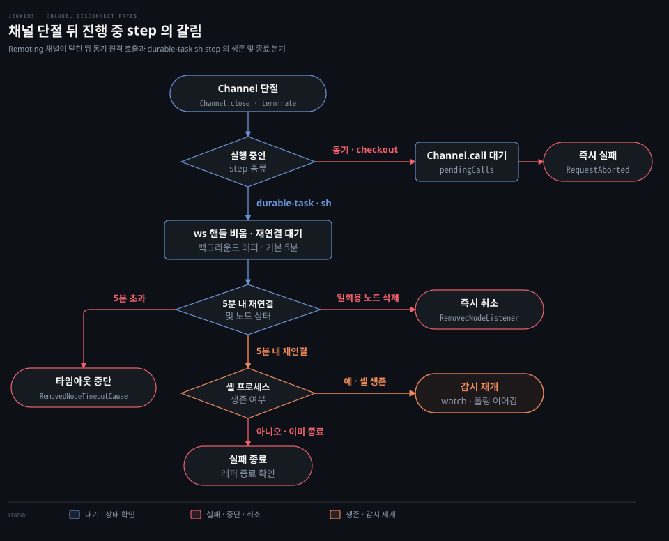

# Executor 와 Agent JVM 의 일 나누기

---

> 노드에 Executor 를 10개 설정하면 Controller JVM 안에 슬롯 객체 10개가 생기고, 스레드는 빌드를 받을 때 시작됩니다. Agent JVM 은 채널로 받은 호출마다 OS 자식 프로세스를 띄워 빌드를 처리합니다.

## 학습 목표

> 이 편을 읽고 나면 아래 다섯 가지를 스스로 설명하고 판단할 수 있습니다.

1. `Node`, `Computer`, `Executor` 가 어느 JVM 에 있는지와 Executor 10개 설정 시 양쪽에 생기는 객체를 설명할 수 있습니다.
2. `PlaceholderTask` 가 슬롯을 잡은 뒤 `RemoteLauncher` 와 `Channel.call` 로 Agent 프로세스를 띄우는 왕복을 설명할 수 있습니다.
3. 같은 잡이 한 노드에서 동시에 돌 때 `WorkspaceList` 가 `@2` 접미사로 디렉터리를 나누는 원리를 설명할 수 있습니다.
4. 채널 단절 시 일반 원격 호출과 `sh` step 의 생존 차이를 구분하고, 재연결 전 안전 절차를 정할 수 있습니다.
5. 노드별 Executor 수를 정할 때 CPU·메모리·I/O 와 빌드 JVM 경합을 근거로 상한을 잡을 수 있습니다.


## 1. Executor 10개와 두 JVM 분업

> 설정의 Executor 수를 10으로 저장해도 Agent JVM 안에 작업 스레드가 미리 뜨지는 않습니다. Controller JVM 의 `Computer` 가 `Executor` 슬롯 객체 10개를 쥐고 필요할 때 스레드를 시작하며, Agent 는 `remoting.jar` 하나가 채널로 일을 받아 처리합니다.

노드 설정에서 Executor 를 10으로 높여도 에이전트 서버에는 `remoting.jar` 프로세스 하나만 뜹니다. 슬롯 10개가 어느 JVM 에 있는지 혼동하면 병목 원인을 잘못된 서버에서 찾게 됩니다.

아래 도식은 Controller JVM 과 Agent 기계가 어떤 객체와 채널로 일을 나누는지 보여 줍니다.


공식 사용자 매뉴얼은 이해를 돕기 위해 Executor 를 사실상 에이전트의 스레드라고 비유합니다.[^managing-nodes-executors] 하지만 실제 코어 코드에서는 슬롯 객체가 Controller JVM 안에 생성됩니다.

Jenkins 코어는 노드 설정, 실행 상태, 작업 슬롯을 세 클래스로 나눕니다.

| 클래스 | 역할과 수명 | 생성 위치 |
|---|---|---|
| `Node` | 사용자가 저장한 노드 설정 객체입니다. 설정이 바뀌면 새로 만듭니다.[^node-computer-javadoc] | Controller JVM |
| `Computer` | 노드의 실행 중 상태를 담습니다. `Executor` 목록을 쥐고 있습니다.[^computer-executors] | Controller JVM |
| `Executor` | `Thread` 를 상속한 빌드 실행 슬롯입니다. 필요할 때 스레드를 시작합니다.[^executor-thread] | Controller JVM |

Controller 의 `Computer` 는 `numExecutors` 만큼 `0` 번부터 번호를 붙여 `Executor` 를 만듭니다.[^computer-executor-loop] 이 시점에는 슬롯 객체 10개만 목록에 담깁니다. 각 슬롯의 스레드는 `Queue` 에서 작업을 받아 `start` 할 때 시작됩니다.[^executor-thread][^executor-start]

반면 에이전트 머신에는 `remoting.jar` 로 띄운 Agent JVM 프로세스 하나가 상주합니다. 이 프로세스는 Controller 와 연결된 `Channel` 끝단을 잡고 원격 요청을 기다립니다. 슬롯 10개를 모두 잡은 빌드 10개가 동시에 돌면 그 요청이 한 `Channel` 위로 모입니다. Agent JVM 은 각 요청마다 OS 자식 프로세스를 띄워 빌드를 처리합니다.

Pipeline 잡 자체는 정규 Executor 를 쓰지 않는 flyweight task 로 시작합니다. 그 구분은 [Controller·Agent·Executor 와 JENKINS_HOME](01-01.Controller%C2%B7Agent%C2%B7Executor%20%EC%99%80%20JENKINS_HOME.md) 에서 다뤘습니다. Queue 가 빈 슬롯을 고르는 규칙은 [Executor 배정과 동적 Pod](02-03.Executor%20%EB%B0%B0%EC%A0%95%EA%B3%BC%20%EB%8F%99%EC%A0%81%20Pod.md) 에 있습니다.


## 2. 슬롯 점유와 Channel 원격 호출 흐름

> Pipeline 의 `node` 블록이 슬롯을 배정받으면 Controller 는 `RemoteLauncher` 와 `Channel.call` 로 `Callable` 을 Agent JVM 에 보냅니다. Agent JVM 은 그 호출을 받아 OS 자식 프로세스를 띄우고, `sh` 의 종료 코드는 결과 파일을 거쳐 Controller 에 전해집니다.

Pipeline Groovy 코드가 Controller 에서 돈다는 사실만 알면 원격 실행 과정이 끊겨 보입니다. 빌드 오류가 났을 때 어느 JVM 이 명령을 보냈고 어느 프로세스가 실패했는지 가려낼 수 없기 때문입니다. Groovy 실행 위치는 [Groovy 는 Jenkins 어디서 도는가](05-01.Groovy%20%EB%8A%94%20Jenkins%20어디서%20도는가.md) 에 정리돼 있습니다.

### Queue 배정에서 결과 판정까지 다섯 단계

아래 도식은 Queue 가 슬롯을 배정한 뒤 step 하나가 Agent 에서 프로세스를 띄우고 회신하는 왕복 순서입니다.


Pipeline 이 `node` 블록에 들어가면 `ExecutorStepExecution` 이 `PlaceholderTask` 를 Queue 에 넣습니다. Queue 가 빈 슬롯을 배정하면 `PlaceholderExecutable` 이 실행되면서 다섯 단계가 이어집니다.[^placeholder-exec]

1. Controller 의 `PlaceholderExecutable` 이 `Slave.createLauncher` 를 호출합니다. 이 메서드가 `RemoteLauncher` 를 돌려줍니다.[^slave-launcher]
2. 이어서 `WorkspaceList` 에서 작업 디렉터리 임대를 받습니다. 그 뒤 `node` 블록 본문 실행을 넘깁니다. 이어서 `AsynchronousExecution` 을 던져 `Executor` 스레드를 놓아줍니다.[^placeholder-exec] 스레드를 놓아도 이 실행이 `Executor` 에 남아 있는 동안 슬롯은 활성 상태로 점유됩니다.[^executor-async] 3~4단계에서 `sh` step 을 시작하는 쪽은 놓인 `Executor` 스레드가 아닙니다. Controller 의 CPS VM 스레드(`CpsVmExecutorService`)입니다.[^cps-vm-thread][^cps-dsl-step]
3. 블록 안에서 `sh` step 이 돌면 `RemoteLauncher.launch` 가 명령어와 환경을 담은 `RemoteLaunchCallable` 을 만듭니다.[^remote-launcher]
4. `Channel.call` 이 이 `Callable` 을 직렬화해 Remoting 채널로 보냅니다.[^channel-call] Agent JVM 에서는 `RemoteLaunchCallable` 이 `LocalLauncher` 로 자식 OS 프로세스를 띄웁니다. 이어서 그 핸들을 `RemoteProcess` 프록시로 내보내 Controller 에 돌려줍니다.[^agent-launch]
5. `sh` 의 step 은 여기서 끝나지 않습니다. 띄워진 셸 래퍼가 스크립트 종료 코드를 `jenkins-result.txt` 에 적습니다.[^durable-task][^file-monitoring-result] Controller 의 step 래퍼는 watch 또는 주기 폴링으로 그 파일을 읽어 stage 를 판정합니다.[^durable-launch] 이 점검(`check`)은 `start` 가 예약한 스케줄러 스레드가 부르므로 CPS VM 스레드가 아닙니다.[^durable-timer] 이 제어 파일 구조는 [sh step 이 실패를 삼키는 이유](03-03.sh%20step%20%EC%9D%B4%20%EC%8B%A4%ED%8C%A8%EB%A5%BC%20%EC%82%BC%ED%82%A4%EB%8A%94%20%EC%9D%B4%EC%9C%A0.md) 에서 다뤘습니다.

### 빌드 동안 Agent JVM 이 맡는 일

결국 Agent JVM 이 빌드 동안 맡는 일은 세 가지입니다. 첫째, 채널로 들어온 `Callable` 을 역직렬화해 실행합니다. 둘째, 셸이나 빌드 도구의 OS 자식 프로세스를 띄웁니다. 셋째, 워크스페이스 파일을 읽고 씁니다.

에이전트 머신에서 Agent JVM 과 빌드 JVM 이 두 겹으로 뜨는 구조는 [정적 Agent 와 동적 Agent](01-02.%EC%A0%95%EC%A0%81%20Agent%20%EC%99%80%20%EB%8F%99%EC%A0%81%20Agent.md) 에서 다룹니다.


## 3. 동시 빌드와 WorkspaceList 분기

> 같은 잡이 한 노드에서 동시에 두 번 돌면 코어의 `WorkspaceList` 가 이미 사용 중인 경로를 피해 `@2` 를 붙인 새 디렉터리를 내줍니다. 구분자 `@` 는 시스템 속성으로 바꿀 수 있습니다.

한 노드의 Executor 여러 개에 같은 잡의 빌드가 동시에 들어오면 작업 폴더가 겹칠 위험이 생깁니다. 두 슬롯이 같은 경로에 소스를 체크아웃하면 파일과 산출물이 서로 뒤섞여 빌드가 깨집니다.

아래 도식은 같은 잡의 빌드 셋이 시간 순으로 들어올 때 `WorkspaceList` 가 경로를 임대하고 반납하는 흐름입니다.


`PlaceholderExecutable` 은 빌드를 시작하기 전에 `computer.getWorkspaceList().allocate(p)` 를 호출해 임대를 받습니다.[^placeholder-exec] `WorkspaceList.allocate` 는 사용 중인 경로 맵(`inUse`)을 확인해 비어 있는 경로를 찾을 때까지 번호를 올립니다.[^workspace-list]

이때 `WorkspaceList` 와 `inUse` 맵은 Controller JVM 의 `Computer` 안에 있습니다.[^computer-wslist] 실제 `workspace/<잡이름>` 과 `@2` 디렉터리는 Agent 기계 디스크에 놓입니다.

```java
// hudson.slaves.WorkspaceList.java — 사용 중인 경로를 피해 @2, @3 ... 할당
for (int i = 1; ; i++) {
    FilePath candidate = i == 1 ? base : base.withSuffix(COMBINATOR + i);
    Entry e = inUse.get(candidate.getRemote());
    if (e != null && !e.quick && e.context != context)
        continue;
    return acquire(candidate, false, context);
}
```

조건식 `e != null && !e.quick && e.context != context` 는 사용 중인 경로를 언제 건너뛸지 정합니다.[^workspace-list] `e.quick` 이 거짓인 일반 임대이고 두 빌드의 `context` 가 다를 때만 다음 번호 `@2` 로 넘어갑니다. 반대로 `quick` 이 참이거나 `context` 가 같으면 `acquire` 로 들어가 대기하거나 잠금 횟수만 올립니다.[^workspace-acquire]

인자 하나짜리 `allocate(p)` 는 호출마다 `new Object()` 를 `context` 로 씁니다. 그래서 빌드끼리는 `context` 가 늘 다릅니다.[^workspace-alloc-ctx]

같은 잡의 빌드 셋이 시간 순으로 들어오는 상황을 따라가 봅니다. 첫 빌드는 기본 경로인 `workspace/<잡이름>` 을 잡습니다. 겹쳐 온 두 번째 빌드는 기본 경로가 이미 사용 중이므로 `COMBINATOR + 2` 를 붙인 `workspace/<잡이름>@2` 를 받습니다.[^workspace-list] 첫 빌드가 끝나 임대를 반납하면 `inUse` 에서 기본 경로가 빕니다.[^workspace-release] 이어 도착한 세 번째 빌드는 다시 `workspace/<잡이름>` 을 배정받습니다.

임시 디렉터리도 같은 규칙을 따릅니다. `WorkspaceList.tempDir` 가 `COMBINATOR + "tmp"` 를 붙여 `workspace/<잡이름>@2@tmp` 로 따로 떼어 줍니다.[^workspace-suffix]

구분자 `COMBINATOR` 의 기본값은 `"@"` 입니다. 코어는 `hudson.slaves.WorkspaceList` 시스템 속성에서 이 값을 읽습니다.[^workspace-suffix] 빌드가 `node` 블록을 마치면 `Callback.finished` 가 임대를 반납해 `inUse` 에서 경로를 지웁니다.[^placeholder-exec]


## 4. 연결 단절과 진행 중 빌드의 운명

> Remoting 채널이 끊기면 동기 원격 호출은 즉시 실패하고, `sh` step 은 기본 5분 동안 재연결을 기다린 뒤에도 복구되지 않으면 중단됩니다. JVM 옵션을 바꾸려고 노드를 끊을 때는 먼저 임시 오프라인으로 막아 슬롯이 모두 빈 뒤 재연결해야 합니다.

JVM 옵션을 적용하거나 노드를 점검하려고 빌드가 도는 중에 연결 끊기를 누르면 진행 중이던 빌드가 깨집니다. 채널이 닫힐 때 빌드의 운명은 실행 중인 step 이 동기 원격 호출인지 durable-task 인지에 따라 갈립니다.

아래 도식은 Remoting 채널이 닫힌 뒤 진행 중이던 동기 호출과 `sh` step 의 운명이 어떻게 갈리는지 보여 줍니다.


관리자가 연결 끊기를 누르면 `SlaveComputer.disconnect` 가 `closeChannel()` 을 불러 `Channel.close()` 를 실행합니다.[^slave-disconnect][^slave-close] 채널이 닫히는 순간 대기 중이던 `Channel.call` 요청에는 `RequestAbortedException` 이 발생합니다.[^request-abort]

채널 반대편에서 받아 이쪽이 실행하던 호출에는 `f.cancel(true)` 로 인터럽트가 걸립니다.[^channel-terminate] 닫힌 채널로 새 호출을 시도하면 `ChannelClosedException` 이 납니다.[^channel-call]

### 일반 호출과 durable-task 의 차이

`checkout` 이나 `junit` 처럼 채널 위에서 동기 호출로 도는 작업은 채널이 닫히는 즉시 예외를 맞고 실패합니다.

반면 `sh` 같은 durable-task step 은 에이전트 디스크의 제어 파일(`jenkins-log.txt`, `jenkins-result.txt`)에 상태를 기록합니다. 이 영속화 원리는 [재기동을 견디는 Pipeline](04-01.%EC%9E%AC%EA%B8%B0%EB%8F%99%EC%9D%84%20%EA%B2%AC%EB%94%94%EB%8A%94%20Pipeline.md) 에 정리돼 있습니다. `DurableTaskStep` 은 Remoting 연결이 끊겨도 바로 실패하지 않습니다. 작업 디렉터리 핸들(`ws`)을 비운 채 노드가 돌아오기를 기다립니다.[^durable-disconnect]

기다리는 상한은 `ExecutorStepExecution.TIMEOUT_WAITING_FOR_NODE_MILLIS` 로 기본 5분입니다.[^node-wait-timeout] 5분 안에 Agent 가 다시 붙고 에이전트 OS 의 셸 프로세스도 살아 있다면 감시를 이어갑니다. 하지만 다음 세 경우에는 `sh` 도 실패합니다.

- 5분 타임아웃 초과: Agent 가 정해진 시간 안에 돌아오지 않으면 `RemovedNodeTimeoutCause` 로 step 을 중단합니다.[^durable-timeout]
- 노드 삭제: 일회용 에이전트(클라우드 에이전트처럼 `AbstractCloudSlave` 이거나 `OnceRetentionStrategy` 를 쓴 노드)가 삭제되면 `RemovedNodeListener` 가 즉시 `node` 블록을 취소합니다. 그 밖의 노드는 같은 5분을 기다린 뒤 취소합니다.[^removed-node]
- 셸 프로세스 종료: `BourneShellScript` 는 셸 래퍼를 `nohup`(Linux 등)과 `>&- 2>&- &` 로 백그라운드에 떼어 띄웁니다.[^durable-detach] 이 구조라면 채널 단절만으로는 래퍼가 바로 죽지 않는다고 이 문서는 풀이합니다. 소스가 직접 말하는 것은 그다음입니다. 래퍼가 로그 파일을 갱신하지 않고 `pid` 파일도 없으면 외부에서 자식 프로세스가 종료됐을 수 있다는 안내를 남기고 종료 코드 `-1` 을 기록합니다. 안내가 드는 예는 에이전트 터미널 세션 중단입니다. 이 경우 재연결 뒤에도 감시할 대상이 없습니다.[^durable-heartbeat]

### 재연결 전 안전한 절차

JVM 옵션을 바꾸려고 에이전트를 재연결할 때는 「Temporarily Offline」(임시 오프라인)을 먼저 씁니다. `Computer.setTemporaryOfflineCause` 설명대로 임시 오프라인은 `Channel` 연결을 살려 둔 채 새 빌드 배정만 막습니다.[^temp-offline] 진행 중인 빌드가 모두 끝나 슬롯 사용량이 0 이 된 뒤 연결을 끊고 다시 띄워야 빌드 손실을 막습니다.


## 5. 노드별 Executor 수 산정 기준

> 공식 문서는 노드당 Executor 1개를 가장 안전한 값으로, 작은 작업 위주일 때만 코어 수만큼 두는 기준을 제시합니다. 슬롯 하나가 OS 자식 프로세스와 빌드 JVM 을 하나씩 더 띄우므로 CPU·메모리·디스크 I/O 를 함께 보고 상한을 잡아야 합니다.

에이전트 스펙이 넉넉해 보인다고 Executor 수를 10개 이상으로 높여 두면 동시 빌드가 몰릴 때 장애가 납니다. 슬롯 수 자체는 Controller 의 스레드 수이지만, 그 수만큼 에이전트 머신에서 빌드 프로세스가 동시에 뜨기 때문입니다.

Jenkins 공식 문서(Managing Nodes)는 노드별 Executor 수를 정할 때 CPU, 메모리, 디스크 I/O, 네트워크 활동을 함께 보라고 안내합니다.[^managing-nodes-executors]

- 노드당 Executor 1개: 가장 안전한 기본 구성입니다. 빌드 사이의 자원 경합과 작업 공간 혼선이 없습니다.
- CPU 코어당 Executor 1개: 각 빌드가 작고 가벼운 작업일 때 고려할 수 있는 상한입니다.
- 다중 Executor 운영 시 관찰: CPU 부하, 메모리 사용량, 디스크 I/O 처리량을 계속 모니터링해야 합니다.

이 기준이 보수적인 이유는 슬롯마다 에이전트에서 무거운 자식 프로세스를 띄우기 때문입니다. Java 프로젝트 빌드 슬롯 하나가 `mvn` 이나 `gradle` 을 실행하면 그 슬롯마다 별도의 빌드 JVM 이 뜹니다. 슬롯을 10개로 두면 한 머신 안에서 Agent JVM 하나에 더해 빌드 JVM 이 최대 10개까지 동시에 메모리를 나눠 씁니다.

클러스터 전체의 컨트롤러 수와 총 Executor 수를 어림잡는 식(`작업 수 × 0.03`)은 [용량 산정과 성능 모니터링](07-03.%EC%9A%A9%EB%9F%89%20%EC%82%B0%EC%A0%95%EA%B3%BC%20%EC%84%B1%EB%8A%A5%20%EB%AA%A8%EB%8B%88%ED%84%B0%EB%A7%81.md) 에서 다룹니다.


## 면접에서 받을 만한 질문

1. 노드에 Executor 를 10개 설정하면 Agent JVM 안에 스레드 10개가 미리 생성됩니까? `Node`, `Computer`, `Executor`, Agent JVM 의 위치를 중심으로 설명해 보세요.
2. Pipeline 의 `node` 블록에서 `sh` step 을 부를 때 `RemoteLauncher` 와 `Channel.call` 은 각각 어떤 일을 합니까?
3. 같은 잡 두 개가 한 에이전트의 서로 다른 Executor 슬롯에 동시에 배정되면 워크스페이스 충돌을 어떻게 피합니까?
4. Agent 연결이 끊겼을 때 `checkout` 같은 일반 호출과 `sh` step 의 동작은 어떻게 다릅니까? 에이전트 JVM 옵션을 바꾸려고 재연결할 때 안전한 순서는 무엇입니까?
5. 한 에이전트 노드의 Executor 수를 CPU 코어 수보다 훨씬 크게 잡으면 안 되는 이유를 공식 문서 기준과 빌드 프로세스 구조로 설명해 보세요.

> 다섯 질문에 먼저 스스로 답해 보세요. 자답이 끝나면 아래 §정답 (자답 후 펼치기) 으로 내려갑니다.


## 정답 (자답 후 펼치기)

> 위 §면접에서 받을 만한 질문 의 다섯 개에 먼저 자답한 뒤 아래를 읽으세요.

### 정답 1 — Executor 와 Agent JVM

Agent JVM 에 스레드 10개가 미리 생성되지 않습니다. `Node` 는 설정 객체이고 `Computer` 는 그 실행 상태를 담는 객체입니다. `Executor` 는 `Thread` 를 상속한 슬롯 객체로 Controller JVM 의 `Computer` 목록에 생기고, 빌드를 받을 때 스레드를 시작합니다. Agent 머신에는 `remoting.jar` 프로세스 하나가 떠서 `Channel` 로 들어오는 `Callable` 마다 OS 자식 프로세스를 띄워 처리합니다.

### 정답 2 — RemoteLauncher 호출

`RemoteLauncher.launch` 는 실행할 명령어, 환경변수, 작업 디렉터리를 직렬화 가능한 `RemoteLaunchCallable` 객체로 감쌉니다. `Channel.call` 은 이 `Callable` 을 Remoting 채널 너머 Agent JVM 으로 보내 실행합니다. 이어서 Agent 쪽 `LocalLauncher` 가 띄운 자식 프로세스의 핸들(`RemoteProcess`)을 Controller 로 돌려줍니다.

### 정답 3 — WorkspaceList 와 @2 접미사

`PlaceholderExecutable` 이 `computer.getWorkspaceList().allocate(p)` 로 워크스페이스를 빌릴 때 `WorkspaceList` 가 현재 사용 중인 경로(`inUse`)를 확인합니다. 기본 경로가 이미 다른 빌드에 할당돼 있으면 `COMBINATOR` 기본값 `@` 와 숫자 `2`, `3` 을 차례로 붙여 `workspace/<잡>@2` 같은 빈 경로를 내주어 파일 덮어쓰기를 막습니다.

### 정답 4 — 단절 생존과 임시 오프라인

일반 동기 `Channel.call` 작업은 채널이 닫히면 `RequestAbortedException` 이나 `ChannelClosedException` 으로 즉시 실패합니다. 반면 `sh` 같은 durable-task 는 에이전트의 제어 파일에 기록을 남기므로 최대 5분 동안 Agent 복귀를 기다립니다. 따라서 재연결할 때는 먼저 임시 오프라인으로 새 빌드 배정만 막아 슬롯이 모두 빌 때까지 기다린 뒤 연결을 끊고 다시 띄워야 합니다.

### 정답 5 — 노드별 Executor 수 상한 근거

Jenkins 공식 문서는 노드당 1개를 가장 안전한 구성으로 두고, 작은 작업일 때만 코어당 1개를 권하며 CPU·메모리·I/O 모니터링을 요구합니다. 슬롯 하나가 에이전트 머신에서 셸과 빌드 JVM 같은 별도 OS 프로세스를 하나씩 더 띄우기 때문에, 슬롯 수가 자원 한계를 넘기면 동시 빌드가 CPU 와 메모리를 두고 경합해 전체가 느려지거나 OOM 이 발생합니다.


## 관련 문서

- [Controller·Agent·Executor 와 JENKINS_HOME](01-01.Controller%C2%B7Agent%C2%B7Executor%20%EC%99%80%20JENKINS_HOME.md) — Flyweight Task 와 정규 Executor 슬롯의 구분
- [정적 Agent 와 동적 Agent](01-02.%EC%A0%95%EC%A0%81%20Agent%20%EC%99%80%20%EB%8F%99%EC%A0%81%20Agent.md) — Agent 연결 방식과 Agent 노드의 JVM 두 겹
- [Executor 배정과 동적 Pod](02-03.Executor%20%EB%B0%B0%EC%A0%95%EA%B3%BC%20%EB%8F%99%EC%A0%81%20Pod.md) — Queue 가 후보 Executor 를 거르고 일관 해시로 배정하는 과정
- [재기동을 견디는 Pipeline](04-01.%EC%9E%AC%EA%B8%B0%EB%8F%99%EC%9D%84%20%EA%B2%AC%EB%94%94%EB%8A%94%20Pipeline.md) — durable-task 제어 파일과 CPS 영속화 구조
- [용량 산정과 성능 모니터링](07-03.%EC%9A%A9%EB%9F%89%20%EC%82%B0%EC%A0%95%EA%B3%BC%20%EC%84%B1%EB%8A%A5%20%EB%AA%A8%EB%8B%88%ED%84%B0%EB%A7%81.md) — 클러스터 전체의 Controller 와 Executor 사이징 기준

[^managing-nodes-executors]: Jenkins User Handbook, Managing Nodes, 「Components of Distributed Builds」. "An executor is a slot for the execution of tasks. Effectively, it is a thread in the agent." / "One executor per node is the safest configuration." / "One executor per CPU core can work well, if the tasks running are small." <https://www.jenkins.io/doc/book/managing/nodes/>
[^node-computer-javadoc]: Jenkins core 2.580.2 `Node.java`. "Nodes are persisted objects that capture user configurations, and instances get thrown away and recreated whenever the configuration changes. Running state of nodes are captured by {@link Computer}s." <https://github.com/jenkinsci/jenkins/blob/jenkins-2.580.2/core/src/main/java/hudson/model/Node.java#L96-L97>
[^computer-executors]: Jenkins core 2.580.2 `Computer.java`. "Represents the running state of a remote computer that holds {@link Executor}s." / `private final CopyOnWriteArrayList<Executor> executors = new CopyOnWriteArrayList<>();` <https://github.com/jenkinsci/jenkins/blob/jenkins-2.580.2/core/src/main/java/hudson/model/Computer.java#L147-L176>
[^computer-executor-loop]: Jenkins core 2.580.2 `Computer.java` 의 executor 생성 루프. `for (int i = 0; i < numExecutors; i++)` / `Executor e = new Executor(this, number);` <https://github.com/jenkinsci/jenkins/blob/jenkins-2.580.2/core/src/main/java/hudson/model/Computer.java#L889-L901>
[^executor-thread]: Jenkins core 2.580.2 `Executor.java`. "Thread that executes builds. Since 1.536, {@link Executor}s start threads on-demand." / `public class Executor extends Thread implements ModelObject, IExecutor {` <https://github.com/jenkinsci/jenkins/blob/jenkins-2.580.2/core/src/main/java/hudson/model/Executor.java#L86-L93>
[^placeholder-exec]: workflow-durable-task-step 1479.v56e587f413a_7 `ExecutorStepExecution.java`. `launcher = node.createLauncher(listener);` / `WorkspaceList.Lease lease = computer.getWorkspaceList().allocate(p);` / `runningTask.execution = new AsynchronousExecution() {` <https://github.com/jenkinsci/workflow-durable-task-step-plugin/blob/1479.v56e587f413a_7/src/main/java/org/jenkinsci/plugins/workflow/support/steps/ExecutorStepExecution.java#L1080-L1208>
[^slave-launcher]: Jenkins core 2.580.2 `Slave.java` `createLauncher`. `return new RemoteLauncher(listener, channel, isUnix).decorateFor(this);` <https://github.com/jenkinsci/jenkins/blob/jenkins-2.580.2/core/src/main/java/hudson/model/Slave.java#L542-L585>
[^remote-launcher]: Jenkins core 2.580.2 `Launcher.java` `RemoteLauncher`. `RemoteLaunchCallable remote = new RemoteLaunchCallable(` / `return new ProcImpl(getChannel().call(remote));` <https://github.com/jenkinsci/jenkins/blob/jenkins-2.580.2/core/src/main/java/hudson/Launcher.java#L1091-L1140>
[^agent-launch]: Jenkins core 2.580.2 `Launcher.java` `RemoteLaunchCallable.call`. `LocalLauncher localLauncher = new LocalLauncher(listener);` / `return channel.export(RemoteProcess.class, new RemoteProcess() {` <https://github.com/jenkinsci/jenkins/blob/jenkins-2.580.2/core/src/main/java/hudson/Launcher.java#L1352-L1380>
[^channel-call]: Jenkins remoting 3386.v353e57a_1b_ea_0 `Channel.java` `call`. `public <V, T extends Throwable> V call(Callable<V, T> callable) throws IOException, T, InterruptedException` / `throw new ChannelClosedException(` <https://github.com/jenkinsci/remoting/blob/3386.v353e57a_1b_ea_0/src/main/java/hudson/remoting/Channel.java#L1095-L1124>
[^workspace-list]: Jenkins core 2.580.2 `WorkspaceList.java`. `FilePath candidate = i == 1 ? base : base.withSuffix(COMBINATOR + i);` / `public static final String COMBINATOR = SystemProperties.getString(WorkspaceList.class.getName(), "@");` / `public static final String TMP_DIR_SUFFIX = COMBINATOR + "tmp";` <https://github.com/jenkinsci/jenkins/blob/jenkins-2.580.2/core/src/main/java/hudson/slaves/WorkspaceList.java#L185-L193>
[^slave-disconnect]: Jenkins core 2.580.2 `SlaveComputer.java`. `public Future<?> disconnect(OfflineCause cause)` / `closeChannel();` <https://github.com/jenkinsci/jenkins/blob/jenkins-2.580.2/core/src/main/java/hudson/slaves/SlaveComputer.java#L819-L828>
[^slave-close]: Jenkins core 2.580.2 `SlaveComputer.java` `closeChannel`. `c.close();` <https://github.com/jenkinsci/jenkins/blob/jenkins-2.580.2/core/src/main/java/hudson/slaves/SlaveComputer.java#L943-L955>
[^channel-terminate]: Jenkins remoting 3386.v353e57a_1b_ea_0 `Channel.java` `terminate`. `for (Request<?, ?> req : pendingCalls.values()) { req.abort(e); }` / `f.cancel(true);` <https://github.com/jenkinsci/remoting/blob/3386.v353e57a_1b_ea_0/src/main/java/hudson/remoting/Channel.java#L1188-L1197>
[^durable-disconnect]: workflow-durable-task-step 1479.v56e587f413a_7 `DurableTaskStep.java`. "If there is any connection problem to the workspace (including controller restarts and Remoting disconnects), {@link #ws} is nulled out and Jenkins waits until a fresh handle is available." <https://github.com/jenkinsci/workflow-durable-task-step-plugin/blob/1479.v56e587f413a_7/src/main/java/org/jenkinsci/plugins/workflow/steps/durable_task/DurableTaskStep.java#L258-L259>
[^removed-node]: workflow-durable-task-step 1479.v56e587f413a_7 `ExecutorStepExecution.java` `RemovedNodeListener`. `if (isOneShotAgent(node)) {` / `cancelOwnerExecution(node, new RemovedNodeCause());` <https://github.com/jenkinsci/workflow-durable-task-step-plugin/blob/1479.v56e587f413a_7/src/main/java/org/jenkinsci/plugins/workflow/support/steps/ExecutorStepExecution.java#L391-L409>
[^temp-offline]: Jenkins core 2.580.2 `Computer.java`. "Marks the computer as temporarily offline. This retains the underlying {@link Channel} connection, but prevent builds from executing." <https://github.com/jenkinsci/jenkins/blob/jenkins-2.580.2/core/src/main/java/hudson/model/Computer.java#L718-L725>
[^workspace-suffix]: Jenkins core 2.580.2 `WorkspaceList.java`. `public static FilePath tempDir(FilePath ws) {` / `return ws.sibling(ws.getName() + TMP_DIR_SUFFIX);` / `public static final String COMBINATOR = SystemProperties.getString(WorkspaceList.class.getName(), "@");` / `public static final String TMP_DIR_SUFFIX = COMBINATOR + "tmp";` <https://github.com/jenkinsci/jenkins/blob/jenkins-2.580.2/core/src/main/java/hudson/slaves/WorkspaceList.java#L312-L327>
[^request-abort]: Jenkins remoting 3386.v353e57a_1b_ea_0 `Request.java`. `/*package*/ void abort(IOException e) {` / `onCompleted(new Response<>(this, id, 0, new RequestAbortedException(e)));` <https://github.com/jenkinsci/remoting/blob/3386.v353e57a_1b_ea_0/src/main/java/hudson/remoting/Request.java#L357-L358>
[^durable-launch]: workflow-durable-task-step 1479.v56e587f413a_7 `DurableTaskStep.java`. `controller = durableTask.launch(context.get(EnvVars.class), ws, launcher, listener);` / `controller.watch(ws, new HandlerImpl(this, ws, listener), listener);` / `// and we fall back to polling mode` <https://github.com/jenkinsci/workflow-durable-task-step-plugin/blob/1479.v56e587f413a_7/src/main/java/org/jenkinsci/plugins/workflow/steps/durable_task/DurableTaskStep.java#L330-L343>
[^durable-timeout]: workflow-durable-task-step 1479.v56e587f413a_7 `DurableTaskStep.java`. `throw new FlowInterruptedException(Result.ABORTED, false, new ExecutorStepExecution.RemovedNodeTimeoutCause());` <https://github.com/jenkinsci/workflow-durable-task-step-plugin/blob/1479.v56e587f413a_7/src/main/java/org/jenkinsci/plugins/workflow/steps/durable_task/DurableTaskStep.java#L411-L412>
[^node-wait-timeout]: workflow-durable-task-step 1479.v56e587f413a_7 `ExecutorStepExecution.java`. `TIMEOUT_WAITING_FOR_NODE_MILLIS` 의 기본값은 `TimeUnit.MINUTES.toMillis(5)` 입니다. 단위 테스트 실행일 때만 15초입니다. <https://github.com/jenkinsci/workflow-durable-task-step-plugin/blob/1479.v56e587f413a_7/src/main/java/org/jenkinsci/plugins/workflow/support/steps/ExecutorStepExecution.java#L109-L109>
[^executor-start]: Jenkins core 2.580.2 `Executor.java` `start(WorkUnit)`. `this.workUnit = task;` / `super.start();` / `started = true;` <https://github.com/jenkinsci/jenkins/blob/jenkins-2.580.2/core/src/main/java/hudson/model/Executor.java#L810-L819>
[^cps-vm-thread]: workflow-cps 4403.v471713a_cea_19 `CpsVmExecutorService.java`. `new NamingThreadFactory(new DaemonThreadFactory(), "CpsVmExecutorService")` <https://github.com/jenkinsci/workflow-cps-plugin/blob/4403.v471713a_cea_19/plugin/src/main/java/org/jenkinsci/plugins/workflow/cps/CpsVmExecutorService.java#L60-L65>
[^cps-dsl-step]: workflow-cps 4403.v471713a_cea_19 `DSL.java` `invokeStep`. `CpsThread thread = CpsThread.current();` / `StepExecution e = s.start(context);` / `sync = e.start();` <https://github.com/jenkinsci/workflow-cps-plugin/blob/4403.v471713a_cea_19/plugin/src/main/java/org/jenkinsci/plugins/workflow/cps/DSL.java#L245-L339>
[^durable-task]: Jenkins durable-task 686.v80ff80875b_82 `BourneShellScript.java`. `echo $? > '%s.tmp'; mv '%s.tmp' '%s';` <https://github.com/jenkinsci/durable-task-plugin/blob/686.v80ff80875b_82/src/main/java/org/jenkinsci/plugins/durabletask/BourneShellScript.java#L249-L260>
[^file-monitoring-result]: Jenkins durable-task 686.v80ff80875b_82 `FileMonitoringTask.java` `getResultFile`. `return controlDir(workspace).child("jenkins-result.txt");` <https://github.com/jenkinsci/durable-task-plugin/blob/686.v80ff80875b_82/src/main/java/org/jenkinsci/plugins/durabletask/FileMonitoringTask.java#L520-L522>
[^computer-wslist]: Jenkins core 2.580.2 `Computer.java`. `private final WorkspaceList workspaceList = new WorkspaceList();` / `public WorkspaceList getWorkspaceList()` <https://github.com/jenkinsci/jenkins/blob/jenkins-2.580.2/core/src/main/java/hudson/model/Computer.java#L206-L338>
[^workspace-acquire]: Jenkins core 2.580.2 `WorkspaceList.java` `acquire`. `if (e == null || e.context == context)` / `if (e != null)    e.lockCount++;` <https://github.com/jenkinsci/jenkins/blob/jenkins-2.580.2/core/src/main/java/hudson/slaves/WorkspaceList.java#L252-L275>
[^workspace-release]: Jenkins core 2.580.2 `WorkspaceList.java` `_release`. `if (old.lockCount == 0)` / `inUse.remove(p.getRemote());` <https://github.com/jenkinsci/jenkins/blob/jenkins-2.580.2/core/src/main/java/hudson/slaves/WorkspaceList.java#L211-L222>
[^durable-detach]: Jenkins durable-task 686.v80ff80875b_82 `BourneShellScript.java` `scriptLauncherCmd`. `cmd.add("nohup");` / `cmd.addAll(Arrays.asList("sh", "-c", "(" + cmdString + ") >&- 2>&- &"));` <https://github.com/jenkinsci/durable-task-plugin/blob/686.v80ff80875b_82/src/main/java/org/jenkinsci/plugins/durabletask/BourneShellScript.java#L265-L273>
[^durable-heartbeat]: Jenkins durable-task 686.v80ff80875b_82 `BourneShellScript.java` `ShellController.exitStatus`. `if (pidFile.exists()) {` / `"wrapper script does not seem to be touching the log file in "` / `"This may occur if the durable task process was terminated externally, for example by interrupting an interactive terminal session running the agent since the interrupt can terminate forked durable task processes."` / `return recordExitStatus(workspace, -1);` <https://github.com/jenkinsci/durable-task-plugin/blob/686.v80ff80875b_82/src/main/java/org/jenkinsci/plugins/durabletask/BourneShellScript.java#L336-L343>
[^executor-async]: Jenkins core 2.580.2 `Executor.java` `isActive`. `return !started || asynchronousExecution != null || isAlive();` <https://github.com/jenkinsci/jenkins/blob/jenkins-2.580.2/core/src/main/java/hudson/model/Executor.java#L648-L650>
[^durable-timer]: workflow-durable-task-step 1479.v56e587f413a_7 `DurableTaskStep.java`. `setupTimer(watching ? WATCHING_RECURRENCE_PERIOD : MIN_RECURRENCE_PERIOD);` / `check();` / `task = threadPool().schedule(this, recurrencePeriod, TimeUnit.MILLISECONDS);` <https://github.com/jenkinsci/workflow-durable-task-step-plugin/blob/1479.v56e587f413a_7/src/main/java/org/jenkinsci/plugins/workflow/steps/durable_task/DurableTaskStep.java#L346-L713>
[^workspace-alloc-ctx]: Jenkins core 2.580.2 `WorkspaceList.java` `allocate`. `public synchronized Lease allocate(@NonNull FilePath base) throws InterruptedException {` / `return allocate(base, new Object());` <https://github.com/jenkinsci/jenkins/blob/jenkins-2.580.2/core/src/main/java/hudson/slaves/WorkspaceList.java#L174-L176>
