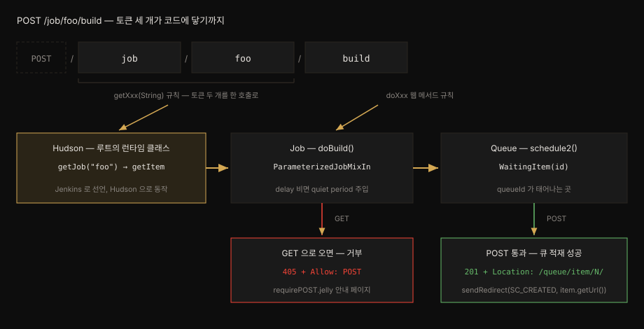

# Stapler 와 URL 이 doBuild 에 닿는 길

---

> Jenkins 에는 Spring MVC 같은 중앙 라우팅 표가 없습니다. 웹 프레임워크 Stapler 가 URL 토큰을 하나씩 읽으며 루트 객체에서 시작하는 객체 그래프를 따라가고 마지막 토큰을 메서드나 뷰로 바꿉니다.

## 학습 목표

> 이 편을 읽고 나면 아래 다섯 가지를 스스로 해낼 수 있습니다.

1. Spring MVC 의 핸들러 표 방식과 Stapler 의 객체 그래프 방식을 비교하고 각각의 비용을 설명할 수 있습니다.
2. Stapler 가 한 토큰을 처리할 때 후보를 보는 순서를 `StaplerProxy` 부터 `StaplerFallback` 까지 말할 수 있습니다.
3. Jenkins 가 2.138.4 와 2.154 부터 Stapler 위에 더한 라우팅 제한이 무엇을 막는지 설명할 수 있습니다.
4. `POST /job/foo/build` 의 세 토큰이 닿는 클래스와 메서드를 소스 수준에서 추적할 수 있습니다.
5. 같은 URL 에 GET 을 보냈을 때 405 가 나는 경우와 나지 않는 경우를 코드 분기로 설명할 수 있습니다.

아래 도식은 요청 토큰이 `Hudson`, `Job`, `Queue` 객체로 이어지는 길입니다. `job` 과 `foo` 는 `Hudson` 의 `getJob` 으로 풀리고 `build` 는 `doBuild` 로 이어진 뒤 `201` 이나 `405` 로 갈라집니다.



가로축은 토큰이 객체 그래프를 한 칸씩 나아가는 순서이고 세로축은 조건에 따른 응답 분기입니다.


## 1. 라우팅 표 대신 객체 그래프

> Spring MVC 는 기동할 때 경로와 메서드의 표를 만들지만 Jenkins 는 요청이 올 때마다 객체 그래프를 따라가며 길을 찾습니다. 그 덕에 확장은 쉽지만 무엇이 URL 로 열리는지가 코드 구조에 따라 정해집니다.

Spring MVC 에서는 컨트롤러 메서드에 `@GetMapping` 같은 어노테이션을 붙입니다. 프레임워크는 기동 시점에 이를 모아 `HandlerMapping` 표를 만들고 요청이 오면 표를 조회해 실행할 메서드를 정합니다.

Jenkins 소스에는 이런 표가 없습니다. Jenkins 의 클래스는 Stapler 로 URL 에 묶이며 싱글턴 `jenkins.model.Jenkins` 인스턴스가 컨텍스트 루트에 묶입니다.[^web-arch] 나머지 객체는 이 루트에서 도달할 수 있는 경로에 따라 URL 을 얻습니다. Stapler 는 리플렉션으로 URL 을 재귀적으로 처리합니다.

| 비교 항목 | Spring MVC | Jenkins (Stapler) |
|---|---|---|
| 길 찾기 | 기동 때 만든 `HandlerMapping` 표 조회 | 요청마다 루트 객체에서 getter·웹 메서드를 따라감 |
| 진입 서블릿 | `DispatcherServlet` | `org.kohsuke.stapler.Stapler` |
| URL 이 열리는 조건 | 매핑 어노테이션을 붙인 메서드 | 루트에서 도달할 수 있고 라우팅 규칙을 통과한 멤버 |
| 새 화면 추가 | 컨트롤러 메서드와 매핑 추가 | 그래프에 객체를 노출하고 뷰나 `doXxx` 를 둠 |

이 구조에서는 플러그인이 객체에 getter 와 뷰만 더해도 새 URL 이 생깁니다. 대신 public 멤버가 의도치 않게 URL 로 열릴 수 있습니다. Jenkins 는 이 비용을 줄이려고 2.138.4 와 2.154 부터 Stapler 자체에는 없는 제한을 더했습니다.[^routing-restriction]

코어의 `TypedFilter` 는 getter 의 반환 타입이 라우팅 대상일 때만 그 getter 를 URL 로 잇습니다.[^typed-filter] 라우팅 대상은 URL 로 쓰일 표시가 있는 타입입니다. 웹 메서드가 있거나 `StaplerProxy` 같은 Stapler 인터페이스를 구현한 타입이 여기에 듭니다. `doXxx` 메서드도 `@WebMethod`, `@RequirePOST` 같은 표시나 웹 요청 매개변수가 있어야 호출됩니다.[^do-action-filter]


## 2. 토큰 하나를 처리하는 순서

> Stapler 는 토큰마다 정해진 순서로 후보를 시험하고 처음 맞는 후보로 한 칸 나아갑니다. `StaplerProxy` 가 가장 먼저, `StaplerFallback` 이 가장 나중에 개입합니다.

요청이 오면 `Stapler` 서블릿의 `service` 가 받아 루트 객체와 함께 `invoke` 를 부릅니다.[^stapler-invoke] Stapler 는 현재 객체의 런타임 클래스를 기준으로 처리기 목록을 만듭니다. 토큰을 하나 소비할 때마다 이 목록을 위에서부터 시험합니다.[^metaclass-order]

1. `StaplerProxy`: 객체가 이 인터페이스를 구현하면 `getTarget()` 이 돌려준 객체로 나머지 URL 을 넘깁니다. 모든 선택지 가운데 우선순위가 가장 높습니다.[^routing-proxy]
2. `StaplerOverridable`: 지정한 대리 객체가 먼저 요청을 처리할 기회를 얻고 처리기가 없으면 원래 객체가 처리합니다.
3. `doXxx` 웹 메서드: 토큰 `build` 는 `doBuild` 를 찾습니다. 토큰이 없는 끝 경로는 `doIndex` 가 받습니다.
4. 뷰: `xxx.jelly` 같은 뷰 파일을 찾아 응답을 그립니다.
5. getter: public 필드, 인자 없는 `getXxx()`, 인자 있는 `getXxx(String)`·`getXxx(int)` 순으로 봅니다. 인자 있는 getter 는 다음 토큰을 인자로 삼아 두 토큰을 한 번에 씁니다.
6. `getDynamic`, `doDynamic`: 위에서 맞는 것이 없을 때 토큰 이름을 인자로 받아 직접 판단합니다.
7. `StaplerFallback`: 모든 처리가 실패하면 마지막으로 다른 객체에 넘깁니다. 우선순위가 가장 낮습니다.[^routing-fallback]

`StaplerProxy` 는 권한 검사에 자주 쓰입니다. `getTarget()` 안에서 권한을 확인한 뒤 `this` 를 돌려주는 방식입니다. 권한이 없는 사용자는 그 객체 아래의 어떤 getter 나 뷰에도 URL 로 닿지 못합니다.[^routing-permission] 하위 URL 마다 검사를 반복하지 않고 그래프의 길목 하나에서 막습니다.


## 3. doBuild 진입과 405 분기

> `POST /job/foo/build` 는 인자 있는 getter 한 번과 웹 메서드 한 번으로 `doBuild` 에 닿습니다. GET 을 거부하는 코드는 어노테이션이 아니라 권한 검사 메서드 안의 분기이며 잡 토큰이 맞으면 GET 도 통과합니다.

첫 두 토큰 `job` 과 `foo` 는 인자 있는 getter 규칙으로 함께 처리됩니다. 공식 문서도 `/job/foo/` 가 `Hudson#getJob("foo")` 의 반환 객체에 묶인다고 예로 듭니다.[^web-arch-getjob] 그런데 `Jenkins.java` 에는 `getJob(String)` 이 없습니다.

루트 객체는 `Jenkins` 를 상속한 `hudson.model.Hudson` 의 인스턴스입니다. Stapler 는 선언 타입이 아니라 객체의 런타임 클래스로 처리기를 찾습니다.[^webapp-metaclass] 그래서 `Hudson` 에 남은 호환용 메서드가 호출됩니다.[^hudson-getjob]

```java
// Hudson.java — URL 호환을 위해 남긴 메서드
@Deprecated
public TopLevelItem getJob(String name) {
    return getItem(name);
}
```

마지막 토큰 `build` 는 웹 메서드 규칙으로 잡 객체의 `doBuild` 에 닿고 표준 구현은 `ParameterizedJobMixIn` 에 있습니다.[^do-build] `doBuild` 는 다음 순서로 요청을 거릅니다.

- `delay` 가 없으면 잡의 quiet period 를 씁니다.
- 잡이 빌드할 수 없는 상태(`isBuildable()` 이 false)면 409 를 돌려줍니다.
- 파라미터가 있는 잡에 POST 가 아닌 요청이 오면 파라미터 입력 화면을 보여 줍니다.
- 나머지는 `BuildAuthorizationToken.checkPermission` 으로 넘깁니다.

```java
// BuildAuthorizationToken.java — 잡 토큰 검사 뒤 POST 강제
if (token != null && token.token != null) {
    String providedToken = req.getParameter("token");
    if (providedToken != null && MessageDigest.isEqual(/* 제출 토큰, 잡 토큰 */))
        return;                       // 토큰이 맞으면 메서드와 무관하게 통과
    if (providedToken != null)
        throw new AccessDeniedException(/* 잘못된 토큰 */);
}
project.checkPermission(Item.BUILD);
if (req.getMethod().equals("POST")) {
    return;
}
// (RequirePOST.ErrorCustomizer 확장 처리는 생략)
rsp.setStatus(HttpServletResponse.SC_METHOD_NOT_ALLOWED);
rsp.addHeader("Allow", "POST");
throw HttpResponses.forwardToView(project, "requirePOST.jelly");
```

잡에 원격 빌드 토큰을 설정했고 요청의 `token` 값이 맞으면 메서드는 맨 앞에서 반환합니다.[^build-auth] 이 경우 GET 도 빌드를 시작합니다. 토큰이 없거나 설정되지 않았으면 `Item.BUILD` 권한을 확인합니다. 이어서 POST 가 아니면 405 와 `Allow: POST` 헤더를 붙여 안내 화면으로 보냅니다.

파라미터가 없는 잡이 검사를 통과하면 `doBuild` 가 `schedule2` 로 큐에 넣습니다. 그리고 큐 아이템 URL 을 담아 201 로 응답합니다. 같은 잡이 이미 큐에 있어 새 아이템이 생기지 않아도 기존 아이템의 URL 로 201 을 돌려줍니다. 소스에는 이 경우 303 으로 바꾸자는 TODO 가 남아 있습니다.[^do-build-201] 큐 안의 일은 [Queue 상태 전이와 Executor 로 가는 길](02-02.Queue%20상태%20전이와%20Executor%20로%20가는%20길.md) 에서 이어집니다.


## 4. 라우팅을 눈으로 확인하는 법

> 코드를 읽는 것만으로는 어떤 객체가 요청을 받았는지 확신하기 어렵습니다. Stapler 의 추적 헤더나 디버거 중단점으로 실제 경로를 확인합니다.

지금까지의 설명은 소스를 읽어 얻은 추론이라 실제 요청이 같은 길을 가는지는 따로 봐야 합니다. 공식 문서는 디버깅용 정적 필드 `org.kohsuke.stapler.Dispatcher.TRACE` 를 안내합니다. 이 값을 켜면 응답에 요청이 어떻게 라우팅됐는지 설명하는 `X-Stapler-Trace-…` 헤더가 붙고 404 화면에도 같은 정보가 나옵니다.[^stapler-trace] `/job/foo/build` 에 요청을 보낸 뒤 헤더를 봅니다. `getJob("foo")` 와 `doBuild` 를 거쳤는지가 거기에 나옵니다.

디버거를 쓴다면 중단점 세 곳이 이 편의 주장을 하나씩 확인합니다.

| 중단점 | 확인할 것 | 확인되는 규칙 |
|---|---|---|
| `org.kohsuke.stapler.Stapler#service` | 화면 요청과 `/api/json` 요청이 모두 여기서 멈춤 | 화면과 API 가 같은 진입점과 객체 그래프를 씀 |
| `Stapler#invoke` 의 `root` 인자 | 선언 타입은 `Object`, 런타임 클래스는 `hudson.model.Hudson` | 처리기는 런타임 클래스로 찾음 |
| `BuildAuthorizationToken#checkPermission` | GET 이면 405 분기, 토큰이 맞으면 첫 `return` | POST 강제와 토큰 예외가 코드 분기임 |


## 면접에서 받을 만한 질문

1. Jenkins 에는 Spring MVC 같은 라우팅 표가 없는데 `POST /job/foo/build` 는 어떻게 Java 메서드에 닿습니까?
2. `getJob(String)` 을 `Jenkins.java` 에서 찾으면 왜 없으며 Stapler 는 이 메서드를 어떻게 찾습니까?
3. 객체 그래프 라우팅은 public 멤버가 의도치 않게 URL 로 열릴 수 있습니다. Jenkins 는 2.138.4·2.154 이후 이를 어떻게 줄였습니까?
4. `StaplerProxy.getTarget()` 에서 권한을 검사하는 방식은 URL 마다 검사 코드를 쓰는 방식보다 무엇이 낫습니까?
5. 빌드 URL 에 GET 을 보내면 언제 405 가 나고 언제 빌드가 시작됩니까?

> 다섯 질문에 먼저 스스로 답해 보세요. 자답이 끝나면 아래 §정답 (자답 후 펼치기) 으로 내려갑니다.


## 정답 (자답 후 펼치기)

> 위 §면접에서 받을 만한 질문 의 다섯 개에 먼저 자답한 뒤 아래를 읽으세요.

### 정답 1 — 객체 그래프 순회와 토큰 해석

Stapler 는 루트의 `Jenkins` 인스턴스에서 출발해 토큰마다 처리기 목록을 위에서부터 시험합니다. `job` 과 `foo` 는 인자 있는 getter 규칙으로 `getJob("foo")` 가 되어 잡 객체를 돌려줍니다. 마지막 `build` 는 웹 메서드 규칙으로 그 잡의 `doBuild()` 가 됩니다.

### 정답 2 — 런타임 클래스 기준 탐색

루트 객체의 실제 클래스는 `Jenkins` 를 상속한 `Hudson` 입니다. Stapler 는 선언 타입이 아니라 런타임 클래스로 처리기를 찾으므로 `Hudson` 에 남은 `getJob(String)` 을 찾아냅니다. 이 메서드는 URL 호환만을 위해 남겨 둔 것이라 javadoc 에 다른 용도로 부르지 말라고 적혀 있습니다.

### 정답 3 — 라우팅 제한

Jenkins 는 Stapler 에 없는 제한을 더했습니다. getter 는 반환 타입이 웹 메서드를 가졌거나 Stapler 인터페이스를 구현한 것처럼 라우팅 대상일 때만 URL 로 이어집니다. `doXxx` 도 웹 메서드 표시나 웹 요청 매개변수가 있어야 호출됩니다. 그래서 우연히 public 인 메서드가 바로 URL 로 열리지 않습니다.

### 정답 4 — 길목 하나에서 막기

URL 마다 검사를 쓰면 새 화면이나 엔드포인트를 더할 때 검사가 빠지기 쉽습니다. `StaplerProxy` 는 그 객체로 들어오는 모든 처리보다 먼저 실행됩니다. `getTarget()` 에서 권한을 확인하면 그 아래의 getter 와 뷰가 늘어나도 한 곳에서 막힙니다.

### 정답 5 — 405 와 토큰 예외

파라미터가 있는 잡이면 GET 은 먼저 파라미터 입력 화면을 받습니다. 그 밖의 요청은 `BuildAuthorizationToken.checkPermission` 으로 갑니다. 잡에 원격 빌드 토큰이 있고 `token` 값이 맞으면 메서드와 무관하게 통과하므로 GET 으로도 빌드가 시작됩니다. 그렇지 않으면 `Item.BUILD` 권한을 본 뒤 POST 가 아닌 요청에 405 와 `Allow: POST` 를 돌려줍니다.


## 관련 문서

- [Controller·Agent·Executor 와 JENKINS_HOME](01-01.Controller·Agent·Executor%20와%20JENKINS_HOME.md) — 요청을 받는 Controller 의 역할과 상태 보관 구조
- [정적 Agent 와 동적 Agent](01-02.정적%20Agent%20와%20동적%20Agent.md) — 빌드가 실제로 도는 Agent 의 연결과 수명
- [Queue 상태 전이와 Executor 로 가는 길](02-02.Queue%20상태%20전이와%20Executor%20로%20가는%20길.md) — `doBuild` 이후 큐 아이템의 상태와 식별자
- [Executor 배정과 동적 Pod](02-03.Executor%20배정과%20동적%20Pod.md) — 큐 아이템이 Executor 와 Pod 를 얻는 과정

[^web-arch]: Jenkins Developer Guide, Web Architecture. "Jenkins classes are bound to URLs by using Stapler. The singleton jenkins.model.Jenkins instance is bound to the context root (most of the time "/") URL, and the rest of the objects are bound according to their reachability from this root object. Stapler uses reflection to recursively determine how to process any given URL." <https://www.jenkins.io/doc/developer/architecture/web/>
[^web-arch-getjob]: 같은 문서. "As a real-world example, the URL /job/foo/ is bound to the object returned by Hudson#getJob("foo")" <https://www.jenkins.io/doc/developer/architecture/web/>
[^routing-restriction]: Jenkins Developer Guide, Routing Requests. "Since Jenkins 2.138.4 and 2.154, Jenkins places restrictions not inherent to Stapler on which methods and fields are eligible for routing." <https://www.jenkins.io/doc/developer/handling-requests/routing/>
[^typed-filter]: Jenkins core 2.580.2 `TypedFilter.java` `keep(Function)`. `boolean isOk = isClassAcceptable(returnType);` <https://github.com/jenkinsci/jenkins/blob/jenkins-2.580.2/core/src/main/java/jenkins/security/stapler/TypedFilter.java#L252-L256>
[^do-action-filter]: Jenkins core 2.580.2 `DoActionFilter.java`. `if (WebMethodConstants.WEB_METHOD_ANNOTATION_NAMES.contains(a.annotationType().getName())) {` / `if (WebMethodConstants.WEB_METHOD_PARAMETERS_NAMES.contains(parameterType.getName())) {` <https://github.com/jenkinsci/jenkins/blob/jenkins-2.580.2/core/src/main/java/jenkins/security/stapler/DoActionFilter.java#L86-L115>
[^stapler-invoke]: Stapler 2123.v539a_775c45c3 `Stapler.java`. `public void invoke(HttpServletRequest req, HttpServletResponse rsp, Object root, String url)` <https://github.com/jenkinsci/stapler/blob/2123.v539a_775c45c3/core/src/main/java/org/kohsuke/stapler/Stapler.java#L710>
[^metaclass-order]: Stapler 2123.v539a_775c45c3 `MetaClass.java` `buildDispatchers`. "// check action <obj>.do<token>(...) and other WebMethods" (L117), "// check public selector methods of the form NODE.getTOKEN()" (L225), "// check public selector methods <obj>.get<Token>(String)" (L350), "// check public selector methods <obj>.getDynamic(<token>,...)" (L572), "// check action <obj>.doDynamic(...)" (L611) <https://github.com/jenkinsci/stapler/blob/2123.v539a_775c45c3/core/src/main/java/org/kohsuke/stapler/MetaClass.java#L117-L611>
[^routing-proxy]: Jenkins Developer Guide, Routing Requests. "This has the highest priority among all possible URL processing options." <https://www.jenkins.io/doc/developer/handling-requests/routing/>
[^routing-fallback]: 같은 문서. "org.kohsuke.stapler.StaplerFallback allows delegating the processing of a URL to another object, similar to StaplerProxy, but has the lowest priority among all possible URL processing options." <https://www.jenkins.io/doc/developer/handling-requests/routing/>
[^routing-permission]: 같은 문서. "getTarget() may also return this, for example to implement permission checks: No getters or views of x will be available to anyone who doesn’t have the necessary permissions via URLs." <https://www.jenkins.io/doc/developer/handling-requests/routing/>
[^webapp-metaclass]: Stapler 2123.v539a_775c45c3 `WebApp.java`. `public MetaClass getMetaClass(Object o) {` / `return getMetaClass(getKlass(o));` <https://github.com/jenkinsci/stapler/blob/2123.v539a_775c45c3/core/src/main/java/org/kohsuke/stapler/WebApp.java#L293-L295>
[^hudson-getjob]: Jenkins core 2.580.2 `Hudson.java` `getJob` javadoc. "Left only for the compatibility of URLs." / "Should not be invoked for any other purpose." <https://github.com/jenkinsci/jenkins/blob/jenkins-2.580.2/core/src/main/java/hudson/model/Hudson.java#L168-L175>
[^do-build]: Jenkins core 2.580.2 `ParameterizedJobMixIn.java`. "Standard implementation of {@link ParameterizedJob#doBuild}." <https://github.com/jenkinsci/jenkins/blob/jenkins-2.580.2/core/src/main/java/jenkins/model/ParameterizedJobMixIn.java#L202-L238>
[^build-auth]: Jenkins core 2.580.2 `BuildAuthorizationToken.java` `checkPermission`. `if (providedToken != null && MessageDigest.isEqual(providedToken.getBytes(StandardCharsets.UTF_8), token.getToken().getBytes(StandardCharsets.UTF_8)))` / `return;` <https://github.com/jenkinsci/jenkins/blob/jenkins-2.580.2/core/src/main/java/hudson/model/BuildAuthorizationToken.java#L114-L140>
[^do-build-201]: Jenkins core 2.580.2 `ParameterizedJobMixIn.java`. "// TODO JENKINS-66105 use SC_SEE_OTHER if !ScheduleResult.created" <https://github.com/jenkinsci/jenkins/blob/jenkins-2.580.2/core/src/main/java/jenkins/model/ParameterizedJobMixIn.java#L230-L236>
[^stapler-trace]: Jenkins Developer Guide, Routing Requests, 「Debugging hints」. "Stapler responses will include X-Stapler-Trace-… headers that explain how the corresponding request was routed." <https://www.jenkins.io/doc/developer/handling-requests/routing/>
