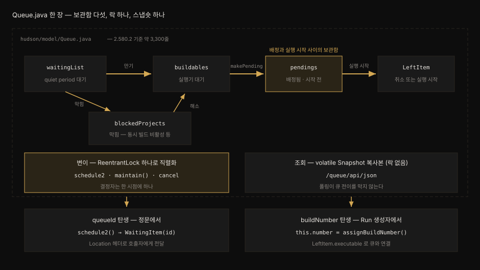
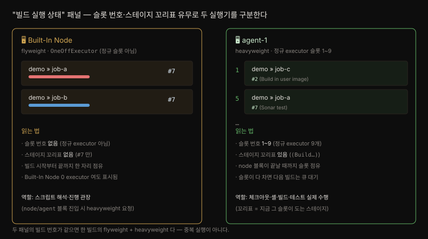

# Queue 상태 전이와 Executor 로 가는 길

---

> 빌드 요청은 큐에 들어온 뒤 대기, 차단, 실행 후보, 배정 완료 단계를 거쳐 Executor 에 닿습니다. 이 편은 그 상태와 단일 락 구조, 두 식별자가 발급되는 지점, 취소 응답의 분기를 소스로 확인합니다.

## 학습 목표

> 이 편을 읽고 나면 아래 다섯 가지를 스스로 해낼 수 있습니다.

1. 큐 아이템이 거치는 네 보관함과 큐를 떠난 기록(`LeftItem`)의 관계를 설명할 수 있습니다.
2. 단일 `ReentrantLock` 과 `volatile Snapshot` 이 변경과 조회를 나누는 방식을 설명할 수 있습니다.
3. 큐가 엄격한 FIFO 가 아닌 이유를 `maintain()` 의 배정 루프로 설명할 수 있습니다.
4. `queueId` 와 `buildNumber` 가 발급되는 코드 지점과 그 사이에 일어나는 일을 설명할 수 있습니다.
5. `cancelItem` 이 204, 500, 404 를 돌려주는 조건을 구분할 수 있습니다.


## 1. 큐 상태 전이와 네 보관함

> 큐 아이템은 상태마다 다른 클래스로 바뀌며 네 보관함 사이를 옮겨 다닙니다. Executor 스레드가 일을 받는 순간 큐를 떠나고, 떠난 기록은 5분 동안 남습니다.

외부 서비스가 빌드를 요청하면 HTTP 201 과 큐 아이템 URL 을 받습니다. 그런데 빌드는 바로 시작하지 않고 한동안 큐에 머물 때가 많습니다. 그 사이 요청이 어떤 상태를 거치는지 모르면 대기 지연이나 중복 실행을 분석하기 어렵습니다.

`Queue.java` 의 클래스 주석은 아이템이 거치는 단계를 직접 그려 둡니다.[^queue-stages]

```pseudocode
(enter) --> waitingList --+--> blockedProjects
                          |        ^
                          |        |
                          |        v
                          +--> buildables ---> pending ---> left
                                   ^              |
                                   |              |
                                   +---(rarely)---+
```

아래 도식은 같은 구조를 보관함과 아이템 클래스 중심으로 다시 그린 것입니다.



각 보관함이 담는 아이템은 다음과 같습니다.

- `waitingList`: quiet period 가 끝나기를 기다리는 `WaitingItem` 입니다. 만료 시각순으로 정렬됩니다.
- `blockedProjects`: quiet period 는 끝났지만 실행을 막는 이유가 있는 `BlockedItem` 입니다.
- `buildables`: 막는 이유가 없어 Executor 를 기다리는 `BuildableItem` 입니다.
- `pendings`: Executor 가 정해졌지만 그 Executor 스레드가 아직 일을 시작하지 않은 `BuildableItem` 입니다.[^queue-pendings-field]
- `leftItems`: 큐를 떠난 아이템의 기록인 `LeftItem` 을 5분 동안 보관하는 캐시입니다.[^queue-leftitems]

그림의 `(rarely)` 화살표는 `pendings` 에서 `buildables` 로 되돌아가는 길입니다. 배정된 노드가 Executor 스레드 시작 전에 사라지면 아이템을 다시 실행 후보로 돌립니다.[^queue-stages] `maintain()` 은 Executor 가 사라진 pending 아이템을 매번 찾아 이 복구를 수행합니다.

`pendings` 는 중복 실행 검사에도 쓰입니다. 동시 빌드를 허용하지 않는 작업이라면 같은 작업이 `buildables` 나 `pendings` 에 있을 때 새 아이템을 막습니다.[^queue-pendings] 다만 소스 주석은 이 검사를 하위 호환용 안전장치로 설명합니다. 원래는 작업의 `getCauseOfBlockage()` 가 진행 중인 빌드를 이유로 막아야 하며 이 검사는 그 구현이 빠졌을 때만 걸립니다.

큐를 떠났다는 것이 곧 빌드가 돌고 있다는 뜻은 아닙니다. Executor 스레드는 먼저 `onStartExecuting` 으로 아이템을 `LeftItem` 으로 바꿉니다. 빌드 객체는 그다음 `createExecutable()` 에서 만들어집니다.[^executor-start] 그래서 `LeftItem` 이 생긴 직후에는 빌드 번호가 아직 없을 수 있습니다.

큐의 내용은 재시작에 대비해 디스크에도 남습니다. `Queue.save()` 는 `JENKINS_HOME` 바로 아래의 `queue.xml` 에 큐를 기록하고 기동할 때 이 파일을 읽어 되살립니다.[^queue-xml]


## 2. 단일 락과 Snapshot 조회

> 큐의 모든 변경은 락 하나 아래에서 차례로 일어나고 조회는 변경 때마다 새로 만든 복사본을 락 없이 읽습니다. Java 의 `CopyOnWriteArrayList` 와 같은 발상입니다.

빌드 요청, 노드 상태 변화, 취소가 동시에 들어오면 큐 상태를 일관되게 지키기 어렵습니다. 보관함마다 따로 락을 걸면 아이템을 옮길 때 락 순서를 맞춰야 하고 조회마다 락을 걸면 화면과 REST 폴링이 변경을 막습니다.

Jenkins 코어는 `Queue` 안의 `ReentrantLock` 하나로 모든 변경을 차례로 처리합니다.[^queue-lock] 새 작업을 넣는 `scheduleInternal` 과 상태를 옮기는 `maintain` 이 이 락을 잡습니다. 취소하는 `cancel` 과 실행 시작을 기록하는 `onStartExecuting` 도 같습니다.

한 시점에 큐를 바꾸는 주체가 하나뿐이라 반쯤 옮겨진 상태가 다른 변경과 섞이지 않습니다.

조회는 `volatile` 필드 `snapshot` 을 읽습니다.[^queue-snapshot] 변경을 끝낼 때마다 `updateSnapshot()` 이 네 보관함을 각각 새 컬렉션으로 복사합니다. 이 복사본으로 새 `Snapshot` 을 만들어 필드에 넣습니다.[^snapshot-copy]

`Queue.getItem(id)` 같은 조회 메서드는 락 없이 이 복사본을 훑습니다. 거기에 없으면 `leftItems` 캐시를 봅니다.[^queue-getitem] 조회는 직전 변경까지의 상태를 봅니다. 폴링이 아무리 잦아도 변경 쪽이 락을 기다리지 않습니다.

아래 표는 이 구조를 Java 표준 라이브러리의 `CopyOnWriteArrayList` 와 나란히 놓은 것입니다. 이 컬렉션도 변경할 때마다 내부 배열을 통째로 복사하고 읽는 쪽은 락 없이 복사본을 봅니다.

| 비교 항목 | Jenkins `Queue` | `java.util.concurrent.CopyOnWriteArrayList` |
|---|---|---|
| 변경 | 락 하나 아래에서 처리 후 새 `Snapshot` 생성 | 변경마다 내부 배열을 새로 복사 |
| 조회 | `volatile snapshot` 을 락 없이 읽음 | 반복자는 만들 때의 배열을 계속 읽음 |
| 맞는 상황 | 조회가 변경보다 훨씬 잦을 때 | 순회가 변경보다 훨씬 잦을 때[^cow] |

상태 이동은 `maintain()` 이 맡습니다. 5초 주기의 `MaintainTask` 가 부르고 새 아이템이 들어오거나 조건이 바뀌면 `scheduleMaintenance()` 로 바로 깨웁니다.[^maintain-task] 한 번의 `maintain()` 은 다음 순서로 일합니다.[^maintain]

1. Executor 조사: 일을 기다리는 Executor 를 모으고 Executor 가 사라진 pending 아이템을 `buildables` 로 돌립니다.
2. 차단 해제: `blockedProjects` 를 정렬해 훑고 막는 이유가 사라진 아이템을 `buildables` 로 옮깁니다.
3. 대기 만료: `waitingList` 앞쪽에서 quiet period 가 끝난 아이템을 꺼냅니다. 막는 이유에 따라 `buildables` 나 `blockedProjects` 로 보냅니다.
4. 정렬: 등록된 `QueueSorter` 가 있으면 `buildables` 를 정렬합니다.
5. 배정: `buildables` 를 앞에서부터 훑으며 Executor 를 고르고 배정되면 `pendings` 로 넘깁니다.

5단계에서 Executor 를 고르는 규칙은 [Executor 배정과 동적 Pod](02-03.Executor%20배정과%20동적%20Pod.md) 에서 다룹니다.


## 3. 큐는 FIFO 인가

> 먼저 실행 후보가 된 아이템이 먼저 검토되지만 먼저 시작한다는 보장은 없습니다. 맞는 Executor 가 없는 아이템은 건너뛰고 다음 아이템을 배정하기 때문입니다.

큐라는 이름 때문에 먼저 들어온 빌드가 먼저 시작한다고 생각하기 쉽습니다. 이 기대가 어긋나면 늦게 요청한 빌드가 먼저 끝나는 상황을 장애로 오해하게 됩니다.

정렬은 확장 지점 `QueueSorter` 가 맡습니다. 코어에는 등록된 구현이 없습니다. 플러그인이 등록하지 않으면 `buildables` 는 들어온 순서를 유지합니다.

정렬기 구현을 돕는 `AbstractQueueSorterImpl` 의 기본 비교도 실행 후보가 된 시각순입니다. javadoc 은 이를 FIFO 라고 부릅니다.[^queue-sorter] 차단된 아이템은 큐에 들어온 시각순으로 정렬됩니다.[^blocked-sort]

순서는 검토 순서일 뿐입니다. 배정 루프는 아이템에 맞는 Executor 가 없으면 그 아이템을 `buildables` 에 남겨 두고 다음 아이템으로 넘어갑니다.[^maintain-skip] 예를 들어 `linux` 라벨 Agent 가 모두 바쁘면 그 라벨을 요구하는 앞 아이템은 기다립니다. 그동안 뒤에 온 `windows` 라벨 아이템이 먼저 시작할 수 있습니다. 한 아이템이 뒤 아이템 전체를 막지 않는 대신, 시작 순서는 요청 순서와 달라집니다.


## 4. queueId 와 buildNumber 의 발급 지점

> `queueId` 는 큐에 들어오는 순간 Jenkins 전체에서 하나씩 늘어나는 번호로 발급됩니다. `buildNumber` 는 Executor 스레드가 일을 받은 뒤 빌드 객체를 만들 때 작업별 번호로 발급됩니다.

외부 서비스가 빌드를 요청한 직후 빌드 번호로 결과를 조회하면 실패하거나 이전 빌드를 읽게 됩니다. 요청 직후 손에 있는 값은 아직 빌드가 생기지 않은 대기표인 `queueId` 뿐입니다.

`queueId` 는 `WaitingItem` 생성자에서 `QueueIdStrategy` 가 발급합니다.[^waiting-item] 다른 구현이 없을 때 쓰는 `DefaultStrategy` 는 `AtomicLong` 카운터를 하나씩 올립니다.[^queue-id] 이 번호는 `doBuild` 가 돌려주는 201 응답의 `Location` 헤더에 큐 아이템 URL 로 실립니다. 그 과정은 [Stapler 와 URL 이 doBuild 에 닿는 길](02-01.Stapler%20와%20URL%20이%20doBuild%20에%20닿는%20길.md) §3 에 있습니다.

같은 작업이 이미 큐에 있으면 새 아이템을 만들지 않습니다. `scheduleInternal` 은 기존 아이템에 새 요청의 정보를 합치고 두 만료 시각 가운데 더 이른 쪽을 남긴 뒤 기존 아이템을 돌려줍니다.[^schedule-fold] 그래서 짧은 간격으로 같은 작업을 여러 번 요청하면 같은 `queueId` 가 돌아옵니다. quiet period 는 이렇게 짧은 시간에 몰린 트리거를 빌드 하나로 합치는 시간입니다. 파라미터가 다른 요청은 별도 아이템이 됩니다.

`buildNumber` 는 훨씬 뒤에 정해집니다. Executor 스레드가 `onStartExecuting` 으로 아이템을 큐에서 떼어 낸 뒤 `createExecutable()` 을 부릅니다.[^executor-start] 이때 만들어지는 `Run` 의 생성자가 `assignBuildNumber()` 를 호출합니다.[^run-number]

| 비교 항목 | `queueId` | `buildNumber` |
|---|---|---|
| 발급 위치 | `WaitingItem` 생성자 (`QueueIdStrategy`) | `Run` 생성자 (`assignBuildNumber()`) |
| 번호 범위 | Jenkins 전체에서 하나 | 작업마다 따로 |
| 발급 시점 | 큐에 들어올 때 | Executor 스레드가 일을 받은 뒤 |
| 확인 경로 | `Location` 헤더의 `/queue/item/{id}/` | `/queue/item/{id}/api/json` 의 `executable.number` |

두 시점 사이에는 quiet period 대기, 차단, 빈 Executor 부족, Agent 연결 같은 시간이 낍니다. 그래서 외부 서비스는 먼저 큐 아이템 API 를 폴링합니다. `LeftItem` 의 `executable` 이 채워지면 그때 빌드 번호 기반 API 로 넘어갑니다.[^left-executable] 큐 아이템 기록은 5분 뒤 사라지므로 폴링 간격이 이보다 길면 번호를 놓칩니다.


## 5. 한 빌드가 두 슬롯에 보이는 이유

> Pipeline 빌드는 Controller 의 임시 Executor 와 Agent 의 정규 Executor 슬롯에 함께 나타날 수 있습니다. 같은 빌드 번호가 두 곳에 보여도 중복 실행이 아니라 한 빌드의 두 부분입니다.

빌드 실행 상태 패널에서 같은 빌드 번호가 Built-In Node 와 Agent 두 곳에 보이면 중복 실행으로 오해하기 쉽습니다. 원인은 Pipeline 이 두 종류의 Task 를 큐에 넣는 데 있습니다. 두 Task 의 정의와 차이는 [Controller·Agent·Executor 와 JENKINS_HOME](01-01.Controller·Agent·Executor%20와%20JENKINS_HOME.md) §5 에서 다루고 여기서는 패널에서 읽는 법만 봅니다.



- 왼쪽 Built-In Node: `WorkflowJob` 자체는 `FlyweightTask` 라서 정규 슬롯이 아닌 `OneOffExecutor` 에서 돕니다. 그래서 Built-In Node 의 Executor 수가 0 이어도 나타납니다.
- 오른쪽 Agent: `node` 블록은 일반 Task 인 `PlaceholderTask` 를 큐에 넣습니다. 이 Task 는 Agent 의 정규 슬롯 하나를 블록이 끝날 때까지 잡습니다.

그림의 heavyweight 는 Jenkins 의 공식 타입 이름이 아니라 일반 Task 를 부르는 비공식 표현입니다. 오른쪽 항목의 괄호 안 꼬리표는 `PlaceholderTask` 의 표시 이름에서 옵니다. 표시 이름은 `part of {0}` 이고 지금 도는 단계를 감싼 stage 나 parallel 가지 이름을 알면 `{0} ({1})` 꼴이 됩니다.[^placeholder-name]


## 6. 취소 요청의 세 갈래 응답

> `POST /queue/cancelItem?id=` 는 아이템이 어디 있는지에 따라 204, 500, 404 로 갈립니다. 404 는 늦었다는 뜻이고 이미 실행 중인 빌드는 빌드의 중단 API 로 멈춥니다.

빌드를 취소하려고 `cancelItem` 을 불렀는데 404 나 500 을 받는 경우가 있습니다. 응답 코드마다 아이템이 있던 위치가 다르므로 코드를 보고 다음 행동을 정해야 합니다.

`Queue.doCancelItem()` 은 먼저 `getItem(id)` 로 아이템을 찾습니다.[^queue-cancel] 이 조회는 네 보관함의 복사본과 `leftItems` 캐시를 봅니다.

| 아이템 위치 | 응답 | 이유 |
|---|---|---|
| `waitingList`, `blockedProjects`, `buildables` | 204 | 보관함에서 빼고 `LeftItem` 으로 기록합니다 |
| `pendings`, 또는 떠난 지 5분 안의 `LeftItem` | 500 `Could not cancel run for id …` | 두 경우 모두 빼낼 보관함이 없어 취소가 실패합니다 |
| 취소 권한이 없음 | 422 | 아이템은 찾았지만 취소할 수 없습니다 |
| 찾지 못함 (5분이 지났거나 없는 id) | 404 | 소스 주석은 이를 늦은 요청으로 보고 무시합니다 |

pending 아이템의 취소가 실패하는 이유는 `BuildableItem.leave()` 가 `buildables` 에서만 아이템을 빼기 때문입니다.[^buildable-leave] `LeftItem.leave()` 는 항상 false 를 돌려줍니다.[^left-leave] 500 이나 404 를 받았다면 아이템이 이미 Executor 로 넘어갔을 수 있습니다. 이때는 큐 아이템 API 로 빌드 번호를 확인하고 `POST /job/{name}/{number}/stop` 으로 실행 중인 빌드를 멈춥니다.[^run-stop]


## 면접에서 받을 만한 질문

1. 큐 아이템이 거치는 보관함을 순서대로 말하고 `pendings` 가 따로 있는 이유를 설명해 보세요.
2. 큐는 변경과 조회의 동시성을 어떻게 나누며 REST 폴링이 잦아도 상태 이동이 늦어지지 않는 이유는 무엇입니까?
3. Jenkins 큐는 FIFO 입니까? 먼저 요청한 빌드가 늦게 시작하는 경우를 예로 들어 설명해 보세요.
4. `queueId` 와 `buildNumber` 는 각각 어디서 발급되며 같은 작업을 짧은 간격으로 두 번 요청하면 `queueId` 는 어떻게 됩니까?
5. `cancelItem` 이 500 을 돌려주는 경우와 404 를 돌려주는 경우는 각각 언제입니까?

> 다섯 질문에 먼저 스스로 답해 보세요. 자답이 끝나면 아래 §정답 (자답 후 펼치기) 으로 내려갑니다.


## 정답 (자답 후 펼치기)

> 위 §면접에서 받을 만한 질문 의 다섯 개에 먼저 자답한 뒤 아래를 읽으세요.

### 정답 1 — 네 보관함과 pendings

아이템은 `waitingList` 에서 quiet period 를 보냅니다. 그 뒤 막는 이유가 있으면 `blockedProjects` 로 가고 없으면 `buildables` 로 갑니다. Executor 가 정해지면 `pendings` 로 옮겨집니다. Executor 스레드가 일을 받으면 `LeftItem` 이 됩니다.

`pendings` 는 배정과 실행 시작 사이의 아이템을 따로 담습니다. 그래서 노드가 그 사이에 사라지면 `buildables` 로 되돌릴 수 있습니다. 중복 실행 검사도 이 보관함까지 봅니다.

### 정답 2 — 단일 락과 Snapshot

모든 변경은 `ReentrantLock` 하나 아래에서 차례로 일어납니다. 변경이 끝날 때마다 네 보관함을 복사한 새 `Snapshot` 이 `volatile` 필드에 들어갑니다. 조회는 락 없이 이 복사본을 읽으므로 폴링이 변경 쪽 락을 기다리게 만들지 않습니다.

### 정답 3 — 검토 순서와 시작 순서

검토 순서는 FIFO 에 가깝지만 시작 순서는 보장되지 않습니다. 코어에는 등록된 `QueueSorter` 가 없어 `buildables` 가 들어온 순서를 유지합니다. 그런데 배정 루프는 맞는 Executor 가 없는 아이템을 건너뜁니다. 그래서 바쁜 라벨을 요구하는 앞 아이템보다 빈 라벨을 요구하는 뒤 아이템이 먼저 시작할 수 있습니다.

### 정답 4 — 두 식별자와 중복 접기

`queueId` 는 `WaitingItem` 생성자에서 `QueueIdStrategy` 의 전역 카운터로 발급됩니다. `buildNumber` 는 Executor 스레드가 일을 받은 뒤 만드는 `Run` 의 생성자에서 작업별 카운터로 발급됩니다. 같은 작업을 짧은 간격으로 다시 요청하면 새 아이템 없이 기존 아이템에 합쳐지므로 같은 `queueId` 가 돌아옵니다.

### 정답 5 — 500 과 404

아이템이 `pendings` 에 있거나 큐를 떠난 지 5분이 안 됐다면 아이템은 찾지만 빼낼 수 없어 500 을 돌려줍니다. 5분이 지나 기록이 사라졌거나 없는 id 면 404 입니다. 두 경우 모두 빌드가 이미 시작됐을 수 있으므로 빌드 번호를 확인해 중단 API 를 써야 합니다.


## 관련 문서

- [Controller·Agent·Executor 와 JENKINS_HOME](01-01.Controller·Agent·Executor%20와%20JENKINS_HOME.md) — Flyweight Task 와 일반 Task 의 차이, Executor 가 스레드라는 사실
- [정적 Agent 와 동적 Agent](01-02.정적%20Agent%20와%20동적%20Agent.md) — `agent` 지시어가 정규 슬롯을 잡는 범위
- [Stapler 와 URL 이 doBuild 에 닿는 길](02-01.Stapler%20와%20URL%20이%20doBuild%20에%20닿는%20길.md) — 웹 요청이 `schedule2` 에 닿고 201 을 받기까지
- [Executor 배정과 동적 Pod](02-03.Executor%20배정과%20동적%20Pod.md) — `maintain()` 5단계에서 Executor 를 고르는 규칙

[^queue-stages]: Jenkins core 2.580.2 `Queue.java` 클래스 javadoc. "Items in queue goes through several stages, as depicted below:" / "However they can move back" / "if the node they are assigned to execute on disappears before their {@link Executor} thread" <https://github.com/jenkinsci/jenkins/blob/jenkins-2.580.2/core/src/main/java/hudson/model/Queue.java#L156-L175>
[^queue-pendings-field]: 같은 파일. "{@link Task}s that are being handed over to the executor, but execution" / "has not started yet." <https://github.com/jenkinsci/jenkins/blob/jenkins-2.580.2/core/src/main/java/hudson/model/Queue.java#L214-L218>
[^queue-leftitems]: 같은 파일. `private final Cache<Long, LeftItem> leftItems = CacheBuilder.newBuilder().expireAfterWrite(5 * 60, TimeUnit.SECONDS).build();` <https://github.com/jenkinsci/jenkins/blob/jenkins-2.580.2/core/src/main/java/hudson/model/Queue.java#L227>
[^queue-pendings]: 같은 파일. "// This check should never pass. And must be remove once we can completely rely on `getCauseOfBlockage`." / `if (!i.task.isConcurrentBuild() && (buildables.containsKey(i.task) || pendings.containsKey(i.task))) {` <https://github.com/jenkinsci/jenkins/blob/jenkins-2.580.2/core/src/main/java/hudson/model/Queue.java#L1232-L1243>
[^executor-start]: Jenkins core 2.580.2 `Executor.java`. `queue.onStartExecuting(Executor.this);` / `Executable _executable = _task.createExecutable();` <https://github.com/jenkinsci/jenkins/blob/jenkins-2.580.2/core/src/main/java/hudson/model/Executor.java#L380-L385>
[^queue-xml]: Jenkins core 2.580.2 `Queue.java`. "Persists the queue contents to the disk." / `return new File(Jenkins.get().getRootDir(), "queue.xml");` <https://github.com/jenkinsci/jenkins/blob/jenkins-2.580.2/core/src/main/java/hudson/model/Queue.java#L464-L521>
[^queue-lock]: 같은 파일. `private final transient ReentrantLock lock = new ReentrantLock();` <https://github.com/jenkinsci/jenkins/blob/jenkins-2.580.2/core/src/main/java/hudson/model/Queue.java#L352>
[^queue-snapshot]: 같은 파일. `private transient volatile Snapshot snapshot = new Snapshot(waitingList, blockedProjects, buildables, pendings);` <https://github.com/jenkinsci/jenkins/blob/jenkins-2.580.2/core/src/main/java/hudson/model/Queue.java#L220>
[^snapshot-copy]: 같은 파일 `Snapshot` 생성자. `this.waitingList = new LinkedHashSet<>(waitingList);` / `this.buildables = new ArrayList<>(buildables);` <https://github.com/jenkinsci/jenkins/blob/jenkins-2.580.2/core/src/main/java/hudson/model/Queue.java#L3125-L3131>
[^queue-getitem]: 같은 파일 `getItem(long)`. `Snapshot snapshot = this.snapshot;` / `return leftItems.getIfPresent(id);` <https://github.com/jenkinsci/jenkins/blob/jenkins-2.580.2/core/src/main/java/hudson/model/Queue.java#L904-L923>
[^cow]: Java SE 21 API, `CopyOnWriteArrayList`. "A thread-safe variant of ArrayList in which all mutative operations (add, set, and so on) are implemented by making a fresh copy of the underlying array." / "may be more efficient than alternatives when traversal operations vastly outnumber mutations" <https://docs.oracle.com/en/java/javase/21/docs/api/java.base/java/util/concurrent/CopyOnWriteArrayList.html>
[^maintain-task]: Jenkins core 2.580.2 `Queue.java`. `long interval = 5000;` (`MaintainTask.periodic`) / "When conditions are changed, this method should be invoked." (`scheduleMaintenance`) <https://github.com/jenkinsci/jenkins/blob/jenkins-2.580.2/core/src/main/java/hudson/model/Queue.java#L3051-L3061>
[^maintain]: 같은 파일 `maintain()`. "// update parked (and identify any pending items whose executor has disappeared)" / "// blocked -> buildable" / "// waitingList -> buildable/blocked" / `s.sortBuildableItems(buildables);` / "// allocate buildable jobs to executors" <https://github.com/jenkinsci/jenkins/blob/jenkins-2.580.2/core/src/main/java/hudson/model/Queue.java#L1598-L1831>
[^queue-sorter]: Jenkins core 2.580.2 `AbstractQueueSorterImpl.java`. "The default implementation does FIFO." / `return Long.compare(lhs.buildableStartMilliseconds, rhs.buildableStartMilliseconds);` <https://github.com/jenkinsci/jenkins/blob/jenkins-2.580.2/core/src/main/java/hudson/model/queue/AbstractQueueSorterImpl.java>
[^blocked-sort]: Jenkins core 2.580.2 `QueueSorter.java`. "A comparator that sorts {@link Queue.BlockedItem} instances based on how long they have been in the queue." <https://github.com/jenkinsci/jenkins/blob/jenkins-2.580.2/core/src/main/java/hudson/model/queue/QueueSorter.java#L22-L29>
[^maintain-skip]: Jenkins core 2.580.2 `Queue.java` `maintain()`. "// if we couldn't find the executor that fits," / "// just leave it in the buildables list and" / "// check if we can execute other projects" <https://github.com/jenkinsci/jenkins/blob/jenkins-2.580.2/core/src/main/java/hudson/model/Queue.java#L1795-L1800>
[^waiting-item]: 같은 파일. `super(project, actions, QueueIdStrategy.get().generateIdFor(project, actions), new FutureImpl(project));` <https://github.com/jenkinsci/jenkins/blob/jenkins-2.580.2/core/src/main/java/hudson/model/Queue.java#L2704>
[^queue-id]: Jenkins core 2.580.2 `QueueIdStrategy.java`. "Default implementation if no extension is found. Simply uses a counter." / `return COUNTER.incrementAndGet();` <https://github.com/jenkinsci/jenkins/blob/jenkins-2.580.2/core/src/main/java/jenkins/model/queue/QueueIdStrategy.java#L48-L56>
[^schedule-fold]: Jenkins core 2.580.2 `Queue.java` `scheduleInternal`. "// make sure to always use the shorter of the available due times" / `return ScheduleResult.existing(duplicatesInQueue.getFirst());` <https://github.com/jenkinsci/jenkins/blob/jenkins-2.580.2/core/src/main/java/hudson/model/Queue.java#L616-L677>
[^run-number]: Jenkins core 2.580.2 `Run.java`. `this.number = project.assignBuildNumber();` <https://github.com/jenkinsci/jenkins/blob/jenkins-2.580.2/core/src/main/java/hudson/model/Run.java#L321>
[^left-executable]: Jenkins core 2.580.2 `Queue.java` `LeftItem`. "If this is representing an item that started executing, this property returns" / "the primary executable (such as {@link AbstractBuild}) that created out of it." <https://github.com/jenkinsci/jenkins/blob/jenkins-2.580.2/core/src/main/java/hudson/model/Queue.java#L2919-L2960>
[^placeholder-name]: workflow-durable-task-step 1479.v56e587f413a_7 `Messages.properties`. `ExecutorStepExecution.PlaceholderTask.displayName=part of {0}` / `ExecutorStepExecution.PlaceholderTask.displayName_label={0} ({1})` <https://github.com/jenkinsci/workflow-durable-task-step-plugin/blob/1479.v56e587f413a_7/src/main/resources/org/jenkinsci/plugins/workflow/steps/durable_task/Messages.properties#L23-L24>
[^queue-cancel]: Jenkins core 2.580.2 `Queue.java` `doCancelItem`. `return HttpResponses.error(HttpServletResponse.SC_INTERNAL_SERVER_ERROR, "Could not cancel run for id " + id);` / "} // else too late, ignore (JENKINS-14813)" <https://github.com/jenkinsci/jenkins/blob/jenkins-2.580.2/core/src/main/java/hudson/model/Queue.java#L764-L779>
[^buildable-leave]: 같은 파일 `BuildableItem.leave`. `boolean r = q.buildables.remove(this);` <https://github.com/jenkinsci/jenkins/blob/jenkins-2.580.2/core/src/main/java/hudson/model/Queue.java#L2903-L2910>
[^left-leave]: 같은 파일 `LeftItem.leave`. "// there's no leave operation" <https://github.com/jenkinsci/jenkins/blob/jenkins-2.580.2/core/src/main/java/hudson/model/Queue.java#L2967-L2970>
[^run-stop]: workflow-job 1624.ve973eb_34e031 `WorkflowRun.java`. `public HttpResponse doStop() {` <https://github.com/jenkinsci/workflow-job-plugin/blob/1624.ve973eb_34e031/src/main/java/org/jenkinsci/plugins/workflow/job/WorkflowRun.java#L962>
