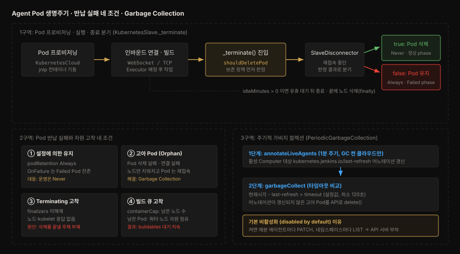

# podRetention·Garbage Collection

---

> 동적 Agent Pod 는 빌드가 끝나면 즉시 삭제되어 자원을 반납하는 것이 기본 동작입니다. 이 편은 Pod 가 삭제되는 내부 종료 경로, 보존 정책과 반납 실패를 부르는 네 가지 조건, 그리고 고아 Pod 를 정리하는 주기적 가비지 컬렉션의 동작 원리를 다룹니다.

## 학습 목표

> 이 편을 읽고 나면 아래 다섯 가지를 스스로 해낼 수 있습니다.

1. Agent Pod 가 프로비저닝된 뒤 연결되고 빌드를 마치고 종료되는 생명주기 경로를 설명할 수 있습니다.
2. `podRetention` 의 다섯 가지 정책과 `idleMinutes` 가 자원 점유와 디버깅 비용에서 무엇을 맞바꾸는지 비교할 수 있습니다.
3. 설정 유지, 고아 Pod, Terminating 고착, 빌드 큐 고착이라는 네 가지 반납 실패 조건을 진단할 수 있습니다.
4. `GarbageCollection` 클래스가 고아 Pod 를 판정하는 TTL 어노테이션 알고리즘과 기본값이 꺼져 있는 이유를 설명할 수 있습니다.
5. 에이전트 자원 누수를 막는 예방 설정과 단계별 점검 순서, 그리고 플러그인에 필요한 RBAC 권한을 구성할 수 있습니다.

아래 도식은 에이전트 Pod 의 프로비저닝과 종료 분기를 보여 줍니다. 네 가지 반납 실패 조건과 가비지 컬렉션의 정리 루프도 함께 담았습니다.



위쪽 구역은 빌드 완료 뒤 `_terminate` 가 보존 정책을 평가해 Pod 를 삭제하거나 남기는 정상 흐름입니다. 아래쪽 구역은 Pod 가 클러스터에 남아 자원을 점유하는 네 가지 조건을 보여 줍니다. 이를 감지해 삭제하는 가비지 컬렉션의 2단계 동작도 나타냅니다.


## 1. 에이전트 Pod 생명주기와 종료 경로

> Kubernetes 플러그인은 빌드마다 Pod 를 만들고, 빌드가 끝나면 보존 정책을 확인한 뒤 Pod 삭제 API 를 호출합니다. 정상적인 동적 에이전트는 이 종료 경로를 거쳐 클러스터 자원을 반환합니다.

빌드가 끝난 에이전트 Pod 가 제때 삭제되지 않으면 클러스터 자원이 고갈됩니다. 새 빌드가 노드를 얻지 못해 큐에 묶이는 사고를 막으려면 에이전트가 어떤 경로로 종료되는지 알아야 합니다.

플러그인 README 는 에이전트마다 Pod 를 하나 만들고 빌드가 끝나면 멈춘다고 적습니다.[^readme-each] 빌드가 들어오면 Controller 의 `KubernetesCloud` 가 에이전트 Pod 를 만듭니다. 이 과정은 [Executor 배정과 동적 Pod](02-03.Executor%20배정과%20동적%20Pod.md) §4 에서 다루었습니다.

Pod 내부에서는 `jnlp` 컨테이너가 뜨며 Controller 쪽으로 인바운드 연결을 엽니다.[^k8s-inbound] 연결이 성공하면 그 노드의 Executor 가 큐의 빌드를 받습니다. 배정된 Executor 위에서 빌드 단계들이 순차적으로 실행됩니다.

노드를 치우는 일은 코어의 `AbstractCloudSlave.terminate()` 가 맡습니다. 이 메서드는 플러그인의 `KubernetesSlave._terminate(TaskListener listener)` 를 부릅니다. 그 결과와 상관없이 `finally` 에서 Jenkins 의 노드 목록에서 노드를 지웁니다.[^cloud-slave-terminate]

`_terminate` 는 먼저 클라우드의 보존 정책을 조회해 Pod 를 지울지 정합니다. 소스 주석은 이 시점의 정상 Pod 라면 JNLP 에이전트가 아직 돌고 있다고 적습니다.[^k8s-terminate]

```java
// https://github.com/jenkinsci/kubernetes-plugin/blob/4560.vc25b_83890c34/src/main/java/org/csanchez/jenkins/plugins/kubernetes/KubernetesSlave.java#L409-L413
        boolean deletePod = getPodRetention(cloud)
                .shouldDeletePod(
                        cloud,
                        () -> KubernetesCloud.getPodResource(client, getNamespace(), name)
                                .get());
```

판정을 받아 둔 뒤 에이전트 채널로 `SlaveDisconnector` 명령을 보냅니다. 에이전트가 JNLP 재접속을 멈추게 하는 명령이고, 응답은 기본 5초(`DISCONNECTION_TIMEOUT`)까지 기다립니다.[^k8s-disconnector]

판정 결과 `deletePod` 가 참이면 `deleteSlavePod` 가 Kubernetes API 로 Pod 삭제를 요청합니다. 반대로 거짓이면 Pod 삭제를 건너뛰고 경고 로그만 남깁니다.

```java
// https://github.com/jenkinsci/kubernetes-plugin/blob/4560.vc25b_83890c34/src/main/java/org/csanchez/jenkins/plugins/kubernetes/KubernetesSlave.java#L443-L451
        if (deletePod) {
            deleteSlavePod(listener, client);
            Metrics.metricRegistry().counter(MetricNames.PODS_TERMINATED).inc();
        } else {
            // Log warning, as the agent pod may still be running
            LOGGER.log(Level.WARNING, "Agent pod {0} was not deleted due to retention policy {1}.", new Object[] {
                name, getPodRetention(cloud)
            });
        }
```

`deleteSlavePod` 는 삭제 요청이 실패하면 경고를 남기고 그대로 돌아갑니다. 소스에는 API 서버가 바쁠 때를 대비해 나중에 다시 시도해야 할 수도 있다는 TODO 주석이 남아 있습니다.[^k8s-delete-fail] 어느 쪽이든 `_terminate` 가 돌아오면 코어가 노드를 지웁니다. Pod 삭제가 실패해도 Jenkins 쪽 노드는 사라진다는 이 차이가 §3 의 고아 Pod 로 이어집니다.


## 2. podRetention 설정과 자원 비용

> `podRetention` 은 빌드가 끝난 에이전트 Pod 를 즉시 지울지 남겨 둘지 결정하는 정책입니다. 실패 원인을 분석하려고 Pod 를 남길 수 있지만, 남겨진 Pod 는 클러스터 자원을 점유합니다.

원인을 보려고 Pod 를 무작정 남겨 두면, 아직 끝나지 않은 Pod 가 노드 자원과 네임스페이스 쿼터를 계속 차지합니다. 반대로 모든 Pod 를 즉시 지우면 장애 원인을 확인하기 어렵습니다.

### 1. 다섯 가지 보존 정책

플러그인이 제공하는 `podRetention` 정책은 이 트레이드오프를 조정하는 다섯 가지 선택지를 둡니다.[^k8s-retention-readme] 각 정책은 `shouldDeletePod` 구현으로 삭제 여부를 반환합니다.

| 비교 항목 | 삭제 조건 | Pod 잔존 상태 | 권장 사용 환경 |
|---|---|---|---|
| `Never` | 항상 삭제 | 남지 않음 | 일반 운영 환경 (Cloud 기본값) |
| `Always` | 삭제하지 않음 | 성공·실패 무관 잔존 | 개발 중 전수 디버깅 |
| `OnFailure` | Pod phase 가 Failed·Unknown 이면 보존 | Failed·Unknown Pod 만 잔존 | Pod 자체의 실패 추적 |
| `Evicted` | `status.reason` 이 Evicted 면 보존 | 축출된 Pod 만 잔존 | 노드 자원 부족 디버깅 |
| `Default` | 상위 Cloud 설정 위임 | Cloud 정책에 따름 | 템플릿 기본값 |

정책별 상세 동작은 다음과 같습니다.

- `Never`: 클라우드 기본값입니다. `shouldDeletePod` 가 항상 `true` 를 반환하여 빌드 종료 시 무조건 Pod 를 삭제합니다.[^never-retention]
- `Always`: `shouldDeletePod` 가 항상 `false` 를 반환합니다. 빌드 성공과 실패에 상관없이 모든 Pod 를 클러스터에 남깁니다.[^always-retention]
- `OnFailure`: Pod 의 `status.phase` 가 `Failed` 나 `Unknown` 일 때만 Pod 를 남깁니다. Pod 정보를 읽지 못해도 남깁니다. 빌드 결과는 보지 않습니다.[^onfailure-retention]
- `Evicted`: Pod 의 `status.reason` 이 `Evicted` 인 경우에만 Pod 를 보존하고 나머지는 삭제합니다.[^evicted-retention]
- `Default`: PodTemplate 기본값입니다. 상위 `KubernetesCloud` 에 설정된 `podRetention` 정책을 그대로 따릅니다.[^default-retention]

`OnFailure` 를 "실패한 빌드의 Pod 를 남기는 설정"으로 읽기 쉽습니다. 하지만 판정은 §1 의 순서대로 에이전트 연결을 끊기 전에 이루어지고, 이때 정상 Pod 는 JNLP 에이전트가 아직 돌고 있습니다. Kubernetes 는 컨테이너가 하나라도 돌고 있으면 phase 를 `Running` 으로 둡니다.[^pod-phase] 그래서 빌드 스크립트만 실패하고 Pod 가 멀쩡하면 `OnFailure` 여도 Pod 는 지워집니다.

### 2. idleMinutes 와 보존 비용

`idleMinutes` 는 빌드가 끝난 Pod 를 바로 지우지 않고 다음 빌드가 재사용하도록 대기시키는 시간입니다. 이에 대한 기본 개념은 [정적 Agent 와 동적 Agent](01-02.정적%20Agent%20와%20동적%20Agent.md) §2 에서 다루었습니다.

내부 코드에서 `idleMinutes` 가 0 이면 `OnceRetentionStrategy` 가 사용되어 단 한 번의 빌드 후 종료됩니다. `idleMinutes` 가 0 보다 크면 `CloudRetentionStrategy` 가 지정된 분 동안 유휴 대기를 유지합니다.[^k8s-determine-retention]

Pod 를 보존하면 디버깅 편의를 얻지만, 그 비용은 남은 Pod 의 phase 에 따라 다릅니다. `Running` 으로 남은 Pod 는 CPU·메모리 request 와 네임스페이스의 `pods` 쿼터를 계속 차지합니다. `pods` 쿼터는 `Failed`·`Succeeded` 가 아닌 Pod 만 세므로, 끝난 Pod 는 쿼터 대신 API 객체로 쌓입니다.[^quota-pods] `idleMinutes` 로 대기 중인 Pod 도 request 를 계속 점유해 다른 Pod 가 스케줄될 여지를 줄입니다.

이를 완화하는 설정이 `activeDeadlineSeconds` 입니다. Kubernetes 는 Pod 가 시작된 뒤 이 시간이 지나면 Pod 를 실패로 표시하고 컨테이너를 멈춥니다.[^pod-active-deadline] 플러그인 README 는 `podRetention` 이 `never()` 나 `onFailure()` 일 때 이 기한이 지나면 Pod 가 지워진다고 적습니다.[^k8s-active-deadline] 기한은 Pod 시작부터 재므로 빌드 시간도 함께 자릅니다. 가장 긴 빌드보다 길게 잡아야 합니다.


## 3. Pod 반납 실패를 부르는 네 조건

> 동적 에이전트 환경에서 자원 회수가 멈추는 원인은 보존 설정, 삭제 경로의 실패, 삭제 뒤 고착, 상한과 쿼터 도달의 네 가지로 나뉩니다. 각 조건이 발생하는 구조를 이해해야 누수를 방지할 수 있습니다.

### 1. 설정에 의한 유지

개발 단계에서 디버깅을 위해 `podRetention` 을 `Always` 로 둔 뒤 방치하는 경우입니다.

`Always` 면 빌드마다 Pod 가 하나씩 남습니다. `OnFailure` 는 Pod 자체가 `Failed`·`Unknown` 일 때만 남기므로 쌓이는 속도는 느립니다. 그래도 노드와의 통신 오류가 잦으면 `Unknown` Pod 가 같은 식으로 쌓입니다. 남긴 Pod 는 §1 의 `finally` 에서 Jenkins 노드 목록에서는 이미 지워졌으므로 Jenkins 화면에는 보이지 않습니다.

`Failed` Pod 의 API 객체는 사람이나 컨트롤러가 지울 때까지 남습니다. 컨트롤 플레인의 PodGC 는 끝난 Pod 수가 임계값을 넘을 때만 이를 치웁니다.[^k8s-podgc]

### 2. 고아 Pod 발생

Jenkins 쪽 노드는 사라졌는데 Pod 는 클러스터에 남는 경우입니다. README 는 드문 경우 Controller 에 선언된 에이전트 없이 Pod 가 남고, 그 Pod 가 누군가 지울 때까지 재접속을 거듭 시도한다고 적습니다.[^k8s-gc-readme] 이러한 Pod 가 고아 Pod(orphan pod) 입니다.

소스에서 보이는 경로는 §1 의 종료 경로가 Pod 삭제에 이르지 못한 경우입니다. 클라우드 설정이 지워졌거나 클러스터 연결에 실패하면 `_terminate` 가 일찍 돌아갑니다. 이때 소스는 클러스터에 자원이 남았을 수 있다는 로그를 남깁니다.[^k8s-leftover] 삭제 API 호출이 실패해도 경고만 남깁니다.[^k8s-delete-fail] 두 경우 모두 코어는 `finally` 에서 노드를 지우므로 Pod 만 남습니다.

### 3. Terminating 상태 고착

Controller 가 정상적으로 Pod 삭제 API 를 호출했음에도 Pod 가 `Terminating` 상태에서 사라지지 않는 현상입니다. `Terminating` 은 kubectl 이 삭제 중인 Pod 에 보여 주는 표시이고, Pod 의 phase 가 아닙니다.[^pod-phase]

첫째 원인은 `metadata.finalizers` 입니다. API 서버는 finalizer 목록이 빌 때까지 객체를 지우지 않습니다. 그 finalizer 를 맡은 컨트롤러가 일을 끝내지 못하면 Pod 는 계속 남습니다.[^k8s-finalizer]

둘째 원인은 노드입니다. 삭제 요청이 오면 kubelet 이 컨테이너를 멈춘 뒤 API 서버에서 Pod 를 지웁니다.[^k8s-pod-termination] 그래서 Pod 가 있던 노드의 kubelet 이 멈췄거나 노드와 통신이 끊기면 삭제를 마무리할 주체가 없습니다. PodGC 가 치우는 대상도 없어진 노드에 묶인 Pod, `out-of-service` taint 가 붙은 준비되지 않은 노드의 종료 중 Pod 처럼 조건이 정해져 있습니다.[^k8s-podgc]

### 4. 빌드 큐의 동반 고착

반납 실패가 쌓이면 새 빌드가 큐에서 오래 기다리게 됩니다. 다만 어느 자원이 막혔는지는 남은 것이 Jenkins 노드인지 Pod 인지에 따라 다릅니다.

[Executor 배정과 동적 Pod](02-03.Executor%20배정과%20동적%20Pod.md) §4 에서 살펴본 것처럼 플러그인은 `containerCap` 상한을 검사합니다. 이 상한이 세는 것은 클러스터의 Pod 가 아니라 Jenkins 가 들고 있는 `KubernetesSlave` 노드입니다. 처음 셀 때 Jenkins 의 노드 목록을 읽고, 노드가 지워지면 수를 줄입니다.[^k8s-limits-count]

그래서 상한에 닿는 원인은 노드로 남은 에이전트입니다. 연결되지 못하고 기다리는 Pod, 끝나지 않는 빌드, `idleMinutes` 로 대기 중인 에이전트가 여기에 듭니다. 이 상태가 되면 새 Pod 계획이 멈춥니다.

§3.1 과 §3.2 처럼 노드는 지워지고 Pod 만 남은 경우는 `containerCap` 에 잡히지 않습니다. 대신 `Running` 으로 남은 Pod 가 네임스페이스 쿼터와 노드 자원을 차지합니다. 쿼터를 넘는 생성 요청은 API 서버가 `403 Forbidden` 으로 거절합니다.[^quota-403] 자원이 모자라면 새 Pod 는 노드를 얻지 못합니다. 어느 쪽이든 Executor 가 생기지 않으므로 빌드는 큐의 `buildables` 에 남아 기다립니다.


## 4. 주기적 가비지 컬렉션의 판단 기준

> Jenkins Kubernetes 플러그인은 컨트롤러와 연결이 끊긴 고아 Pod 를 찾아내 지우는 가비지 컬렉션 기능을 제공합니다. 이 메커니즘은 TTL 어노테이션을 기반으로 동작하지만, API 부하 때문에 기본값은 꺼져 있습니다.

에이전트 Pod 가 컨트롤러와 통신하지 못하고 고아로 남으면 클러스터 자원 누수가 발생합니다. 수동으로 일일이 Pod 를 찾아 지우지 않으려면 자동화된 정리 장치가 필요합니다.

플러그인의 `PeriodicGarbageCollection` 클래스가 이 고아 Pod 를 주기적으로 정리합니다.[^k8s-gc-class] 이 작업은 코어의 `AsyncPeriodicWork` 를 확장하여 1분 주기로 실행됩니다.

가비지 컬렉션의 동작은 두 단계로 이루어집니다.

첫째 단계는 `annotateLiveAgents` 입니다. Controller 는 현재 살아있는 `KubernetesComputer` 목록을 순회하며 각 Pod 에 어노테이션을 패치합니다. 패치는 가비지 컬렉션을 켠 클라우드의 에이전트에만 갑니다.[^gc-annotate]

```pseudocode
kubernetes.jenkins.io/last-refresh = <현재_밀리초_시각>
```

둘째 단계는 `garbageCollect` 입니다. 클라이언트의 기본 네임스페이스와 설정에 추가로 적은 네임스페이스에서, 이 Controller 라벨을 가진 Pod 를 조회합니다.

```java
// https://github.com/jenkinsci/kubernetes-plugin/blob/4560.vc25b_83890c34/src/main/java/org/csanchez/jenkins/plugins/kubernetes/GarbageCollection.java#L155-L166
                            client
                                    .pods()
                                    .inNamespace(ns)
                                    // Only look at pods created by this controller
                                    .withLabel(LABEL_KUBERNETES_CONTROLLER, sanitizeLabel(cloud.getJenkinsUrlOrNull()))
                                    .list()
                                    .getItems()
                                    .stream()
                                    .filter(pod -> {
                                        var lastRefresh = pod.getMetadata()
                                                .getAnnotations()
                                                .get(ANNOTATION_LAST_REFRESH);
```

조회된 Pod 의 `last-refresh` 시각과 현재 시각의 차이가 설정된 `timeout` 을 초과하면 고아 Pod 로 판정하고 삭제합니다.[^k8s-gc-code] `timeout` 은 설정값이고, 120초(`MINIMUM_GC_TIMEOUT`)보다 작게 적으면 120초로 올립니다.[^gc-timeout] 정상적인 에이전트는 1분마다 어노테이션이 갱신되므로, `timeout` 동안 갱신되지 않은 Pod 는 Controller 가 놓친 고아로 간주됩니다.

어노테이션이 아예 없는 Pod 는 구버전 에이전트로 분류되어 삭제 대상에서 제외됩니다.

이 기능이 기본으로 꺼져 있는 이유는 API 서버 부하입니다. README 는 Kubernetes API 서버에 부하를 더할 수 있어서 기본으로 꺼 둔다고 적습니다.[^k8s-gc-readme] 소스를 보면 그 부하의 출처가 보입니다. 켜면 1분마다 살아 있는 에이전트 수만큼 PATCH 를 보냅니다. 네임스페이스마다 LIST 도 한 번 보냅니다.

클라우드 설정의 `garbageCollection` 필드는 초기값이 없고, 이 값이 비어 있는 클라우드는 정리 단계를 건너뜁니다.[^gc-off]


## 5. 예방 설정과 점검 순서 및 권한

> 동적 Pod 환경의 자원 고갈을 방지하려면 안전한 기본 설정을 갖추고 장애 발생 시 단계별 점검 절차를 따라야 합니다. 또한 플러그인이 정상 작동하기 위한 RBAC 권한을 부여해야 합니다.

### 1. 누수 방지를 위한 예방 설정

운영 환경에서는 `podRetention` 을 Cloud 기본값인 `Never` 로 둡니다. `OnFailure` 는 빌드 실패가 아니라 Pod 실패를 남긴다는 점을 기억합니다. Pod 를 남기는 정책을 쓴다면 `activeDeadlineSeconds` 로 수명 상한을 함께 둡니다.

가비지 컬렉션을 켜 두면 §3.2 의 고아 Pod 도 `timeout` 뒤에 지워집니다. 소스대로라면 보존 정책으로 남긴 Pod 도 노드가 지워진 뒤에는 어노테이션 갱신이 멈추므로, 어노테이션이 붙어 있던 Pod 라면 같은 기준으로 지워집니다.[^gc-annotate]

또한 클라우드 설정에서 `containerCap` 과 템플릿별 `instanceCap` 을 적절히 지정합니다. 에이전트 컨테이너에는 CPU 와 메모리의 request 및 limit 을 지정하여 특정 잡이 워커 노드의 전체 자원을 고갈시키지 않도록 격리합니다.

### 2. 장애 발생 시 점검 순서

동적 에이전트 생성 실패나 큐 정체가 의심될 때는 아래 순서로 원인을 좁힙니다.

1. Jenkins 큐 점검: 큐 아이템의 `why` 메시지를 확인하고 현재 Jenkins 에 등록된 Kubernetes 에이전트 수가 `containerCap` 에 도달했는지 확인합니다.
2. 클러스터 Pod 상태 조회: `kubectl get pods` 로 비정상 상태인 Pod 목록을 모읍니다. Terminating 이나 Error 상태가 주 점검 대상입니다.
3. 고아 Pod 대조: Jenkins 노드 관리 화면에 등록되지 않은 Pod 가 클러스터에서 실행 중인지 대조합니다.
4. 고착 원인 분석: `kubectl describe pod` 로 상태를 봅니다. `finalizers` 와 `deletionTimestamp`, Pod 가 있던 노드의 상태를 확인합니다.
5. 로그 점검: Jenkins 시스템 로그에서 `org.csanchez.jenkins.plugins.kubernetes` 가 남긴 `Failed to delete pod for agent` 경고와 남은 자원 경고를 확인합니다.[^k8s-delete-fail]

### 3. 컨트롤러에 필요한 RBAC 권한

Kubernetes 플러그인이 정상 작동하려면 Controller 의 ServiceAccount 에 Pod 를 다룰 권한이 있어야 합니다. README 는 충분한 권한을 가진 ServiceAccount 가 필요하다고 적고 예시 파일을 링크합니다.[^sa-example] 예시 Role 의 규칙은 다음과 같습니다.

- `pods`: `create`, `delete`, `get`, `list`, `patch`, `update`, `watch` 를 줍니다. 소스에서 `delete` 는 §1 의 Pod 삭제와 §4 의 고아 Pod 삭제에 쓰이고, `patch` 는 §4 의 어노테이션 갱신에 쓰입니다.
- `pods/exec`: `pods` 와 같은 일곱 verb 를 줍니다.
- `pods/log`: `get`, `list`, `watch` 를 줍니다.
- `events`: `watch` 를 줍니다.
- `secrets`: `get` 을 줍니다.

Controller 와 에이전트의 ServiceAccount 는 반드시 분리합니다. README 는 에이전트 네임스페이스의 Pod 를 볼 수만 있어도 에이전트로 가장해 Controller 에 붙을 정보를 모을 수 있다고 설명합니다. 그래서 에이전트 Pod 는 자기 네임스페이스에 권한이 있는 ServiceAccount 로 돌면 안 된다고 적습니다.[^k8s-agent-rbac]


## 면접에서 받을 만한 질문

1. Jenkins Kubernetes 플러그인에서 빌드가 끝난 뒤 Agent Pod 가 종료되고 삭제되기까지의 내부 경로를 설명해 보세요.
2. `podRetention` 의 `Never`, `Always`, `OnFailure` 정책이 각각 무엇을 기준으로 삭제를 결정하며, `idleMinutes` 는 자원 회수 관점에서 어떤 대가를 가집니까?
3. 동적 에이전트 Pod 가 반납되지 않고 클러스터에 남는 네 가지 조건과, 이로 인해 빌드 큐가 고착되는 인과관계를 설명해 보세요.
4. `GarbageCollection` 클래스가 고아 Pod 를 식별하는 TTL 어노테이션 알고리즘을 설명하고, 이 기능이 기본으로 꺼져 있는 이유를 말해 보세요.
5. 동적 Pod 누수를 막기 위한 예방 설정 세 가지와, 컨트롤러 ServiceAccount 와 에이전트 Pod ServiceAccount 의 권한을 분리해야 하는 보안상의 이유를 설명해 보세요.

> 위 §면접에서 받을 만한 질문 의 다섯 개에 먼저 자답한 뒤 아래를 읽으세요.


## 정답 (자답 후 펼치기)

> 위 §면접에서 받을 만한 질문 의 다섯 개에 먼저 자답한 뒤 아래를 읽으세요.

### 정답 1 — 에이전트 Pod 종료 경로

코어의 `AbstractCloudSlave.terminate()` 가 `KubernetesSlave._terminate` 를 부릅니다. `_terminate` 는 먼저 `getPodRetention(cloud).shouldDeletePod` 로 보존 정책을 평가합니다. 이어 `SlaveDisconnector` 를 에이전트에 보내 재접속을 멈추게 합니다. 삭제가 결정되었으면 Kubernetes API 로 Pod 삭제를 호출합니다. `_terminate` 가 돌아오면 코어가 `finally` 에서 노드를 지우므로, Pod 삭제가 실패해도 노드는 사라집니다.

### 정답 2 — 보존 설정과 유휴 대기

`Never` 는 빌드 결과와 무관하게 항상 삭제하고, `Always` 는 무조건 보존합니다. `OnFailure` 는 빌드 결과가 아니라 Pod 의 phase 가 `Failed`·`Unknown` 일 때만 보존합니다. `idleMinutes` 는 다음 빌드 재사용을 위해 유휴 Pod 를 살려두므로 기동 지연을 줄여줍니다. 그 대가로 유휴 시간 동안 워커 노드의 CPU 와 메모리 request 를 계속 점유하여 클러스터 자원을 낭비합니다.

### 정답 3 — 반납 실패 네 조건과 빌드 큐 고착

반납 실패 조건은 네 가지입니다. 보존 설정에 의한 유지, 종료 경로가 Pod 삭제에 이르지 못해 생기는 고아 Pod, finalizer 나 노드 장애로 인한 Terminating 고착, 그리고 상한·쿼터 도달에 의한 빌드 큐 고착입니다. `containerCap` 은 Jenkins 에 남은 에이전트 노드를 세므로, 연결 대기·끝나지 않는 빌드·유휴 대기 에이전트가 상한을 채우면 새 Pod 계획이 멈춥니다. 노드 없이 남은 Pod 는 상한 대신 네임스페이스 쿼터와 노드 자원을 차지해 새 Pod 생성이나 스케줄을 막습니다.

### 정답 4 — 가비지 컬렉션의 동작 원리와 비활성화 이유

1분마다 실행되는 `PeriodicGarbageCollection` 은 살아있는 에이전트 Pod 에 현재 시각을 담은 `last-refresh` 어노테이션을 패치합니다. 이어 Controller 라벨을 가진 Pod 들을 조회하여 어노테이션이 설정한 `timeout`(최소 120초) 넘게 갱신되지 않은 대상을 고아 Pod 로 판정해 삭제합니다. README 는 API 서버에 부하를 더할 수 있어서 기본으로 꺼 둔다고 적습니다. 켜면 매분 에이전트마다 PATCH, 네임스페이스마다 LIST 가 나갑니다.

### 정답 5 — 예방 설정과 RBAC 분리 이유

예방 설정으로는 `podRetention: Never` 설정, `activeDeadlineSeconds` 를 통한 수명 상한 지정, 그리고 `containerCap` 및 컨테이너 자원 request/limit 설정이 있습니다. 고아 Pod 가 걱정되면 가비지 컬렉션도 켭니다. 권한을 나누는 이유는 README 의 보안 모델에 있습니다. 에이전트 네임스페이스의 Pod 를 읽을 수만 있어도 에이전트로 가장해 Controller 에 붙을 정보를 모을 수 있으므로, 에이전트 Pod 의 ServiceAccount 에는 자기 네임스페이스 권한을 주지 않습니다.


## 관련 문서

- [정적 Agent 와 동적 Agent](01-02.정적%20Agent%20와%20동적%20Agent.md) — Agent 연결 방식과 Pod 의 수명 설정
- [Executor 배정과 동적 Pod](02-03.Executor%20배정과%20동적%20Pod.md) — 큐 아이템이 Executor 를 배정받고 Pod 가 프로비저닝되는 과정

[^readme-each]: Kubernetes plugin 4560.vc25b_83890c34 README. "The plugin creates a Kubernetes Pod for each agent started, and stops it after each build." <https://github.com/jenkinsci/kubernetes-plugin/blob/4560.vc25b_83890c34/README.md?plain=1#L14>
[^k8s-inbound]: Kubernetes plugin 4560.vc25b_83890c34 README. "Agents are launched as inbound agents, so it is expected that the container connects automatically to the Jenkins controller." <https://github.com/jenkinsci/kubernetes-plugin/blob/4560.vc25b_83890c34/README.md?plain=1#L16>
[^cloud-slave-terminate]: Jenkins core 2.580.2 `AbstractCloudSlave.java` `terminate`. `_terminate(computer instanceof SlaveComputer ? ((SlaveComputer) computer).getListener() : new LogTaskListener(LOGGER, Level.INFO));` / `} finally {` / `Jenkins.get().removeNode(this);` <https://github.com/jenkinsci/jenkins/blob/jenkins-2.580.2/core/src/main/java/hudson/slaves/AbstractCloudSlave.java#L82-L96>
[^k8s-terminate]: Kubernetes plugin 4560.vc25b_83890c34 `KubernetesSlave.java` `_terminate`. "// Prior to termination, determine if we should delete the slave pod based on" / "// Healthy slave pods should still have a JNLP agent running at this point." <https://github.com/jenkinsci/kubernetes-plugin/blob/4560.vc25b_83890c34/src/main/java/org/csanchez/jenkins/plugins/kubernetes/KubernetesSlave.java#L406-L413>
[^k8s-disconnector]: 같은 파일. "// Tell the slave to stop JNLP reconnects." / `Future<Void> disconnectorFuture = ch.callAsync(new SlaveDisconnector());` / `disconnectorFuture.get(DISCONNECTION_TIMEOUT, TimeUnit.SECONDS);`, 기본값은 `Integer.getInteger(KubernetesSlave.class.getName() + ".disconnectionTimeout", 5)` <https://github.com/jenkinsci/kubernetes-plugin/blob/4560.vc25b_83890c34/src/main/java/org/csanchez/jenkins/plugins/kubernetes/KubernetesSlave.java#L422-L428> · <https://github.com/jenkinsci/kubernetes-plugin/blob/4560.vc25b_83890c34/src/main/java/org/csanchez/jenkins/plugins/kubernetes/KubernetesSlave.java#L64-L65>
[^k8s-delete-fail]: 같은 파일 `deleteSlavePod`. `"Failed to delete pod for agent %s/%s: %s"` / "// TODO should perhaps retry later, in case API server is just overloaded currently" <https://github.com/jenkinsci/kubernetes-plugin/blob/4560.vc25b_83890c34/src/main/java/org/csanchez/jenkins/plugins/kubernetes/KubernetesSlave.java#L457-L480>
[^k8s-leftover]: 같은 파일 `_terminate`. "Unable to terminate agent. Cloud may have been removed. There may be leftover resources on the Kubernetes cluster." / "Failed to connect to cloud %s. There may be leftover resources on the Kubernetes cluster." <https://github.com/jenkinsci/kubernetes-plugin/blob/4560.vc25b_83890c34/src/main/java/org/csanchez/jenkins/plugins/kubernetes/KubernetesSlave.java#L379-L404>
[^k8s-retention-readme]: 같은 README. "Controls the behavior of keeping agent pods. Can be 'never()', 'onFailure()', 'always()', 'evicted()', or 'default()'" <https://github.com/jenkinsci/kubernetes-plugin/blob/4560.vc25b_83890c34/README.md?plain=1#L360>
[^never-retention]: Kubernetes plugin 4560.vc25b_83890c34 `Never.java`. `public boolean shouldDeletePod(KubernetesCloud cloud, Supplier<Pod> pod) { return true; }` <https://github.com/jenkinsci/kubernetes-plugin/blob/4560.vc25b_83890c34/src/main/java/org/csanchez/jenkins/plugins/kubernetes/pod/retention/Never.java#L19-L21>
[^always-retention]: Kubernetes plugin 4560.vc25b_83890c34 `Always.java`. `public boolean shouldDeletePod(KubernetesCloud cloud, Supplier<Pod> pod) { return false; }` <https://github.com/jenkinsci/kubernetes-plugin/blob/4560.vc25b_83890c34/src/main/java/org/csanchez/jenkins/plugins/kubernetes/pod/retention/Always.java#L19-L21>
[^onfailure-retention]: Kubernetes plugin 4560.vc25b_83890c34 `OnFailure.java`. `if (pod == null || pod.getStatus() == null) { return false; }` / `boolean hasErrors = pod.getStatus().getPhase().toLowerCase(Locale.getDefault()).matches("(failed|unknown)"); return !hasErrors;` <https://github.com/jenkinsci/kubernetes-plugin/blob/4560.vc25b_83890c34/src/main/java/org/csanchez/jenkins/plugins/kubernetes/pod/retention/OnFailure.java#L31-L36>
[^evicted-retention]: Kubernetes plugin 4560.vc25b_83890c34 `Evicted.java`. `&& pod.getStatus().getReason().toLowerCase(Locale.getDefault()).equals("evicted");` / `return !isEvicted;` <https://github.com/jenkinsci/kubernetes-plugin/blob/4560.vc25b_83890c34/src/main/java/org/csanchez/jenkins/plugins/kubernetes/pod/retention/Evicted.java#L33-L37>
[^default-retention]: Kubernetes plugin 4560.vc25b_83890c34 `Default.java`. `PodRetention parent = cloud.getPodRetention(); if (!(parent instanceof Default)) { return parent.shouldDeletePod(cloud, pod); }` <https://github.com/jenkinsci/kubernetes-plugin/blob/4560.vc25b_83890c34/src/main/java/org/csanchez/jenkins/plugins/kubernetes/pod/retention/Default.java#L22-L25>
[^pod-phase]: Kubernetes documentation, Pod Lifecycle, 「Pod phase」. "`Running` … At least one container is still running, or is in the process of starting or restarting." / "Similarly, when a pod is being deleted, `Terminating` may appear in the `Status` field of some kubectl commands." <https://kubernetes.io/docs/concepts/workloads/pods/pod-lifecycle/#pod-phase>
[^k8s-determine-retention]: Kubernetes plugin 4560.vc25b_83890c34 `KubernetesSlave.java` `determineRetentionStrategy`. `if (podTemplate.getIdleMinutes() == 0) { return new OnceRetentionStrategy(cloud.getRetentionTimeout()); }` <https://github.com/jenkinsci/kubernetes-plugin/blob/4560.vc25b_83890c34/src/main/java/org/csanchez/jenkins/plugins/kubernetes/KubernetesSlave.java#L680-L687>
[^quota-pods]: Kubernetes documentation, Resource Quotas, 「Quota on object count」. "`pods` | The total number of Pods in a non-terminal state that can exist in the namespace. A pod is in a terminal state if `.status.phase in (Failed, Succeeded)` is true." <https://kubernetes.io/docs/concepts/policy/resource-quotas/#quota-on-object-count>
[^pod-active-deadline]: Kubernetes API reference, Pod v1, `activeDeadlineSeconds`. "Optional duration in seconds the pod may be active on the node relative to StartTime before the system will actively try to mark it failed and kill associated containers." <https://kubernetes.io/docs/reference/kubernetes-api/workload-resources/pod-v1/>
[^k8s-active-deadline]: 같은 README. "If `podRetention` is set to `never()` or `onFailure()`, the pod is deleted after this deadline is passed." <https://github.com/jenkinsci/kubernetes-plugin/blob/4560.vc25b_83890c34/README.md?plain=1#L361>
[^k8s-podgc]: Kubernetes documentation, Termination of Pods, 「Garbage collection of Pods」. "For failed Pods, the API objects remain in the cluster's API until a human or controller process explicitly removes them." / "are terminating Pods, bound to a non-ready node tainted with `node.kubernetes.io/out-of-service`." <https://kubernetes.io/docs/concepts/workloads/pods/pod-termination/#pod-garbage-collection>
[^k8s-gc-readme]: 같은 README, 「Garbage collection」. "In some exceptional cases, agent pods can be left behind, with no declared Jenkins agent in the controller. They will try to reconnect over and over, until something deletes them." / "As it may generate extra load on the Kubernetes API server, it is disabled by default." <https://github.com/jenkinsci/kubernetes-plugin/blob/4560.vc25b_83890c34/README.md?plain=1#L81-L86>
[^k8s-finalizer]: Kubernetes documentation, Finalizers, 「How finalizers work」. "Prevents the object from being removed until all items are removed from its `metadata.finalizers` field" <https://kubernetes.io/docs/concepts/overview/working-with-objects/finalizers/#how-finalizers-work>
[^k8s-pod-termination]: Kubernetes documentation, Termination of Pods. "Once the grace period has expired, the KILL signal is sent to any remaining processes, and the Pod is then deleted from the API Server." <https://kubernetes.io/docs/concepts/workloads/pods/pod-termination/>
[^k8s-limits-count]: Kubernetes plugin 4560.vc25b_83890c34 `KubernetesProvisioningLimits.java`. `Jenkins.get().getNodes().stream()` / `.filter(KubernetesSlave.class::isInstance)` / `protected void onDeleted(@NonNull Node node) {` / `instance.unregister(kubernetesNode.getKubernetesCloud(), template, node.getNumExecutors());` <https://github.com/jenkinsci/kubernetes-plugin/blob/4560.vc25b_83890c34/src/main/java/org/csanchez/jenkins/plugins/kubernetes/KubernetesProvisioningLimits.java#L42-L52> · <https://github.com/jenkinsci/kubernetes-plugin/blob/4560.vc25b_83890c34/src/main/java/org/csanchez/jenkins/plugins/kubernetes/KubernetesProvisioningLimits.java#L169-L180>
[^quota-403]: Kubernetes documentation, Resource Quotas. "If creating or updating a resource violates a quota constraint, the control plane rejects that request with HTTP status code `403 Forbidden`." <https://kubernetes.io/docs/concepts/policy/resource-quotas/#how-kubernetes-resourcequotas-work>
[^k8s-gc-class]: Kubernetes plugin 4560.vc25b_83890c34 `GarbageCollection.java`. "Manages garbage collection of orphaned pods." / `Main.isUnitTest ? 5 : TimeUnit.MINUTES.toSeconds(1));` <https://github.com/jenkinsci/kubernetes-plugin/blob/4560.vc25b_83890c34/src/main/java/org/csanchez/jenkins/plugins/kubernetes/GarbageCollection.java#L35-L50>
[^gc-annotate]: Kubernetes plugin 4560.vc25b_83890c34 `KubernetesSlave.java` `annotateTtl`. `Optional.ofNullable(kubernetesCloud.getGarbageCollection()).ifPresent(gc -> {` / `.patch("{\"metadata\":{\"annotations\":{\"" + GarbageCollection.ANNOTATION_LAST_REFRESH` <https://github.com/jenkinsci/kubernetes-plugin/blob/4560.vc25b_83890c34/src/main/java/org/csanchez/jenkins/plugins/kubernetes/KubernetesSlave.java#L575-L586>
[^k8s-gc-code]: 같은 `GarbageCollection.java`. `return Duration.between(Instant.ofEpochMilli(refreshTime), now).compareTo(gc.getDurationTimeout()) > 0;` <https://github.com/jenkinsci/kubernetes-plugin/blob/4560.vc25b_83890c34/src/main/java/org/csanchez/jenkins/plugins/kubernetes/GarbageCollection.java#L177-L179>
[^gc-timeout]: 같은 파일. `public static final int MINIMUM_GC_TIMEOUT = 120;` / `this.timeout = Math.max(timeout, MINIMUM_GC_TIMEOUT);` <https://github.com/jenkinsci/kubernetes-plugin/blob/4560.vc25b_83890c34/src/main/java/org/csanchez/jenkins/plugins/kubernetes/GarbageCollection.java#L42-L87>
[^gc-off]: Kubernetes plugin 4560.vc25b_83890c34 `KubernetesCloud.java`. `private GarbageCollection garbageCollection;` <https://github.com/jenkinsci/kubernetes-plugin/blob/4560.vc25b_83890c34/src/main/java/org/csanchez/jenkins/plugins/kubernetes/KubernetesCloud.java#L172> · `GarbageCollection.java` `Optional.ofNullable(cloud.getGarbageCollection()).ifPresent(gc -> {` <https://github.com/jenkinsci/kubernetes-plugin/blob/4560.vc25b_83890c34/src/main/java/org/csanchez/jenkins/plugins/kubernetes/GarbageCollection.java#L148>
[^sa-example]: 같은 README. "A ServiceAccount with sufficient privileges ([example](src/main/kubernetes/service-account.yml))" <https://github.com/jenkinsci/kubernetes-plugin/blob/4560.vc25b_83890c34/README.md?plain=1#L54> · `service-account.yml` `resources: ["pods"]` / `verbs: ["create","delete","get","list","patch","update","watch"]` … `resources: ["secrets"]` / `verbs: ["get"]` <https://github.com/jenkinsci/kubernetes-plugin/blob/4560.vc25b_83890c34/src/main/kubernetes/service-account.yml#L15-L30>
[^k8s-agent-rbac]: 같은 README, 「Security considerations」. "(Anyone able to view pods will be able to gather all the information needed to connect their own processes to the controller, impersonating the agent.)" / "This implies in particular that agent pods must not run with a service account with permissions to its own namespace." <https://github.com/jenkinsci/kubernetes-plugin/blob/4560.vc25b_83890c34/README.md?plain=1#L859-L861>
