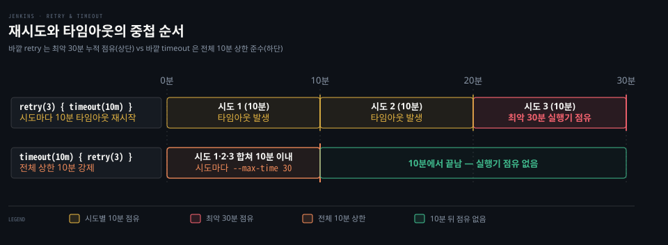
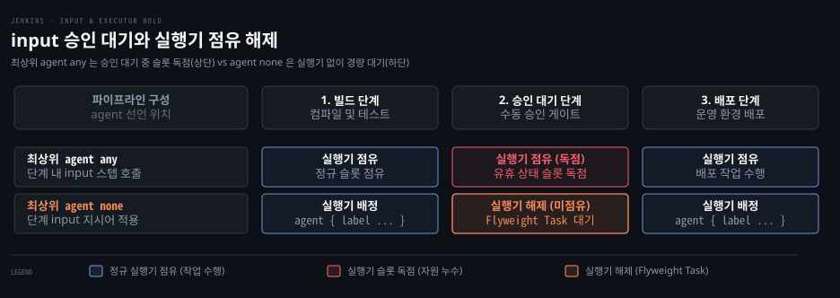

# 병렬·승인·재시도와 실행기 점유

---

> 파이프라인의 제어 블록들은 실행 순서뿐 아니라 에이전트 실행기의 점유 시간을 결정합니다. 이 편은 재시도, 승인, 병렬화, 조건부 실행이 겹칠 때 실행기를 어떻게 보호하는지 다룹니다.

## 학습 목표

> 이 편을 읽고 나면 아래 다섯 가지를 스스로 해낼 수 있습니다.

1. `retry` 와 `timeout` 의 중첩 순서가 실행 시간과 실행기 점유에 미치는 영향을 설명할 수 있습니다.
2. `input` 승인 단계에서 `agent none` 이 실행기 고갈을 막는 원리를 설명할 수 있습니다.
3. `parallel` 과 `failFast` 가 빠른 피드백과 종합 리포트 수집 사이에서 맞바꾸는 것을 비교할 수 있습니다.
4. `when` 절의 `beforeAgent true` 가 고비용 에이전트 점유를 방지하는 동작을 설명할 수 있습니다.
5. Multibranch Pipeline 이 브랜치 수명주기를 자동화하며 지불하는 운영 비용을 판단할 수 있습니다.


## 1. 재시도와 타임아웃의 중첩 순서

> 전체 상한을 거는 `timeout` 안에 일시적 오류를 복구하는 `retry` 를 감싸야 의도치 않은 대기 시간 팽창을 막습니다.

아래 도식은 `retry` 와 `timeout` 의 중첩 순서에 따른 실행기 점유 시간 차이를 보입니다.


외부 API 호출이나 테스트 실행이 간헐적으로 실패할 때 재시도(`retry`)만 두면 위험합니다. 원격 서버가 무응답 상태에 빠졌을 때 한 번의 시도가 무한정 멈출 수 있기 때문입니다. 반대로 각 시도에만 타임아웃을 걸면 재시도가 누적되면서 전체 대기 시간이 늘어납니다.

`retry` 가 바깥이고 `timeout` 이 안쪽이면 시도마다 타임아웃이 새로 시작됩니다.[^workflow-basic-steps] 예를 들어 `retry(3)` 안에 10분 타임아웃을 두면 최악의 경우 30분 동안 실행기(Executor)를 붙잡습니다. 실행기는 빌드 작업을 실행하는 스레드 슬롯이므로 장시간 점유되면 다른 빌드가 큐에서 대기합니다.

안전한 구성은 전체 상한인 `timeout` 을 바깥에 두고 그 안에서 `retry` 를 수행하는 형태입니다.[^pipeline-syntax]

```groovy
timeout(time: 10, unit: 'MINUTES') {
    retry(3) {
        sh 'curl --max-time 30 -f http://api.example.com/deploy'
    }
}
```

이 구조에서는 세 번의 재시도를 모두 합친 총시간이 10분을 넘지 않습니다. 개별 명령어에도 자체 제한(`--max-time 30`)을 두어 단일 시도가 전체 예산을 독점하지 않도록 방어합니다.


## 2. input 승인 대기와 실행기 점유 해제

> 사람의 수동 승인을 기다리는 단계는 에이전트를 배정받기 전에 멈추도록 `input` 지시어를 쓰고 파이프라인 최상위를 `agent none` 으로 두어야 실행기를 붙잡지 않습니다.

아래 도식은 `input` 승인 대기 시 `agent` 선언 위치에 따른 실행기 점유 차이를 보입니다.


운영 환경 배포 전에는 승인권자의 확인을 받는 수동 승인 게이트가 자주 쓰입니다. 하지만 승인자가 자리를 비우면 수 시간 동안 대기 상태가 이어집니다. 파이프라인 최상위에 `agent any` 가 있거나 단계 안에서 에이전트를 잡은 뒤 `input` 스텝을 호출하면, 에이전트 실행기를 쥔 채 대기합니다.

에이전트가 묶이면 아무런 연산을 하지 않으면서도 정규 실행기 슬롯을 독점합니다. 큐에 들어온 다른 프로젝트의 빌드들이 빈 슬롯을 얻지 못해 지연됩니다.

해결책은 두 가지를 함께 쓰는 것입니다. 첫째, 단계에 `input` 지시어를 쓰면 그 단계는 옵션을 적용한 뒤 단계의 에이전트에 들어가기 전에 멈춥니다.[^pipeline-syntax] 둘째, 최상위를 `agent none` 으로 두면 실행기가 불필요하게 배정되지 않습니다.[^pipeline-syntax] 그러면 승인 대기 중에는 에이전트 실행기 없이 컨트롤러의 경량 작업(Flyweight Task)만 남아 웹 요청을 기다립니다.

```groovy
pipeline {
    agent none
    stages {
        stage('Production Approval') {
            options { timeout(time: 2, unit: 'HOURS') }
            input {
                message '프로덕션 배포를 승인하시겠습니까?'
                ok '배포 승인'
                parameters { string(name: 'REASON', defaultValue: '', description: '승인 사유') }
            }
            steps { echo "승인 사유: ${REASON}" }
        }
    }
}
```

무한정 방치되는 것을 막기 위해 단계 `options` 의 `timeout` 으로 승인 유효 시간을 강제합니다. 단계 옵션은 에이전트 배정 전에 적용되므로 이 시간에는 에이전트를 기다리는 시간도 포함됩니다.[^pipeline-syntax] 사유 파라미터를 함께 선언하면 승인 내역을 남길 수 있고, 승인 때 받은 파라미터는 그 단계의 환경에서 쓸 수 있습니다.[^pipeline-syntax] 실제 배포는 승인 뒤 다음 단계에서 `agent { label ... }` 로 에이전트를 새로 배정받아 수행합니다.


## 3. parallel 과 failFast

> `parallel` 은 독립된 단계를 동시에 돌려 대기 시간을 줄이지만 브랜치 수만큼 실행기를 점유하며 `failFast` 는 빠른 실패와 전체 결과 수집을 맞바꿉니다.

단위 테스트, 통합 테스트, 정적 분석을 차례대로 실행하면 전체 빌드 시간이 길어집니다. 독립적인 작업들을 `parallel` 블록으로 묶으면 가장 오래 걸리는 작업의 시간으로 수렴합니다.

하지만 세 갈래를 병렬로 실행하면 실행기 슬롯도 동시에 세 개를 요구합니다. 사용 가능한 에이전트 슬롯이 부족하면 일부 갈래는 큐에 멈춰 병렬화의 이점이 줄어듭니다. 또한 동일한 워크스페이스에서 여러 스텝이 동시에 파일을 쓰면 충돌이 발생하므로 독립된 디렉터리나 에이전트로 격리해야 합니다.

병렬 단계의 실패 대응은 `failFast` 옵션으로 갈립니다.[^pipeline-syntax]

| 옵션 | 실패 시 동작 | 적합한 상황 |
|---|---|---|
| `failFast true` | 한 갈래 실패 즉시 나머지 중단 | 풀 리퀘스트 검증, 빠른 피드백 우선 |
| `failFast false` (기본값) | 한 갈래가 실패해도 끝까지 실행 | 정기 통합 빌드, 종합 리포트 수집 |

`failFast true` 는 불필요한 실행기 낭비를 즉시 막습니다. 반면 전체 테스트 결과 리포트(JUnit XML 등)를 한 번에 확인해야 할 때는 기본값을 유지합니다.


## 4. when 과 beforeAgent 의 절약

> `beforeAgent true` 는 에이전트를 할당받고 코드를 체크아웃하기 전에 조건을 검사하여 불필요한 고비용 실행기 점유를 막습니다.

특정 브랜치 전용 배포 단계에 `when` 조건을 걸어 두어도, 조건에 맞지 않는 다른 브랜치 빌드가 비싼 에이전트를 잠시 점유했다가 건너뛰는 낭비가 생깁니다. 선언적 파이프라인(Declarative Pipeline)의 기본 동작은 단계의 에이전트에 먼저 들어간 뒤 `when` 조건을 평가하기 때문입니다.[^pipeline-syntax]

조건이 맞지 않아 건너뛸 단계인데도 비싼 GPU 노드나 운영 배포용 노드를 큐에서 배정받습니다. 에이전트를 배정받아 들어간 뒤에야 스킵 판정이 내려지므로 자원과 시간이 낭비됩니다.

이 낭비는 `beforeAgent true` 선언으로 해결합니다.[^pipeline-syntax]

```groovy
stage('Deploy to Production') {
    when {
        beforeAgent true
        branch 'main'
    }
    agent { label 'production-deployer' }
    steps {
        sh './deploy.sh production'
    }
}
```

`when` 조건을 먼저 평가하고, 참일 때만 에이전트에 들어갑니다. 조건이 거짓이면 에이전트 배정 자체를 건너뜁니다. 같은 단계에 `input` 지시어가 있으면 `when` 은 기본적으로 `input` 뒤에 평가되므로, 승인 전에 거르려면 `beforeInput true` 를 써야 합니다.[^pipeline-syntax]

모노레포에서는 `changeset` 으로 특정 디렉터리가 바뀐 경우만 실행하도록 제한할 수 있습니다. 다만 첫 빌드에는 비교할 이전 커밋이 없으므로 안전 측으로 전체 단계를 실행하도록 예외 처리를 고려해야 합니다.


## 5. Multibranch 와 운영 비용

> Multibranch Pipeline 은 브랜치별 작업 생성을 자동화하지만, 브랜치 추가·삭제를 반영하려면 재색인(스캔)을 따로 일으켜야 하고 작업이 늘수록 컨트롤러 부담이 커집니다.

브랜치가 수십 개로 늘어나는 환경에서 단일 파이프라인 작업을 수동으로 운영하면 브랜치 생성과 삭제를 제때 반영하기 어렵습니다. 삭제된 브랜치의 작업이 방치되거나 풀 리퀘스트 빌드 설정이 누락될 수 있습니다.

Multibranch Pipeline 은 저장소를 스캔하여 `Jenkinsfile` 이 있는 브랜치마다 하위 작업을 자동으로 만듭니다.[^multibranch] 다만 기본값에서는 브랜치 추가·삭제를 자동으로 다시 색인하지 않으므로, 주기적 재색인을 설정하는 것이 흔한 방법입니다.[^multibranch] 웹훅으로 스캔을 일으키는 방법도 있습니다.

이 편리함에는 비용이 따릅니다. 재색인 주기를 짧게 잡으면 Git 서버에 반복적으로 조회 요청이 갑니다. 브랜치 수가 많아지면 컨트롤러가 관리할 작업과 빌드 기록도 늘어납니다.

따라서 웹훅(Webhook)을 연결해 변경이 있을 때만 스캔하게 하고 재색인 주기는 느슨하게 둡니다. `options` 의 `buildDiscarder` 로 오래된 빌드 기록을 제한하면 컨트롤러 부담을 줄일 수 있습니다.[^pipeline-syntax]


## 면접에서 받을 만한 질문

> 다섯 질문에 먼저 스스로 답해 보세요. 자답이 끝나면 아래 정답 절로 내려갑니다.

1. `retry` 와 `timeout` 을 함께 쓸 때 전체 상한을 두려면 어느 블록이 바깥에 있어야 합니까? 반대로 두었을 때 어떤 문제가 생깁니까?
2. `input` 승인 단계에 `agent none` 이 빠지면 어떤 자원 누수가 발생하며, 승인 단계에 꼭 함께 두어야 할 옵션은 무엇입니까?
3. 병렬 실행에서 `failFast true` 와 `failFast false` 는 각각 어떤 목적으로 쓰이며 무엇을 맞바꿉니까?
4. `when` 절에서 `beforeAgent true` 가 없을 때 고비용 에이전트에서 어떤 낭비가 발생합니까?
5. Multibranch Pipeline 이 일반 파이프라인 작업 대비 자동화해 주는 일과 그 대가로 늘어나는 비용은 무엇입니까?


## 정답 (자답 후 펼치기)

> 위 면접 질문 5개에 먼저 자답한 뒤 아래를 읽으세요.

### 정답 1 — 재시도와 타임아웃의 중첩 순서

전체 실행 상한을 강제하는 `timeout` 이 바깥에 있어야 합니다. 반대로 `retry` 가 바깥에 있으면 각 재시도마다 타임아웃이 새로 시작되어 `타임아웃 시간 × 재시도 횟수`만큼 대기 시간이 불어납니다. 이 시간 동안 실행기 슬롯이 묶여 다른 빌드를 막게 됩니다.

### 정답 2 — input 과 실행기 누수

에이전트 실행기(Executor) 슬롯이 샙니다. 사람이 승인할 때까지 아무 일도 하지 않으면서 정규 실행기 슬롯을 독점합니다. `input` 지시어와 최상위 `agent none` 으로 에이전트에 들어가기 전에 멈추게 해야 하며, 무한 방치를 막는 `timeout` 과 승인 내역을 남기는 파라미터를 함께 두어야 합니다.

### 정답 3 — failFast 의 목적과 트레이드오프

`failFast true` 는 한 갈래가 실패하면 나머지를 즉시 중단하여 불필요한 에이전트 점유를 줄이고 빠른 피드백을 얻습니다. `failFast false` 는 모든 갈래가 끝날 때까지 기다려 전체 테스트의 종합 리포트를 확보합니다. 즉 빠른 실패 피드백과 실패 전체 현황 수집을 맞바꿉니다.

### 정답 4 — beforeAgent 와 노드 점유 낭비

`beforeAgent true` 가 없으면 에이전트에 먼저 들어간 뒤에 조건을 검사합니다. 조건이 맞지 않아 실행하지 않을 단계인데도 비싼 GPU 나 프로덕션 배포용 노드를 큐에서 잡아두는 낭비가 생깁니다.

### 정답 5 — Multibranch 와 운영 비용

Multibranch Pipeline 은 `Jenkinsfile` 이 있는 브랜치마다 작업을 자동으로 만들어 수동 작업 관리를 줄여 줍니다. 그 대가로 브랜치 변화를 반영할 스캔(주기 재색인 또는 웹훅)을 따로 구성해야 하고, 브랜치별 작업과 빌드 기록이 늘어 컨트롤러 부담이 커집니다.


## 관련 문서

- [Controller·Agent·Executor 와 JENKINS_HOME](01-01.Controller·Agent·Executor%20와%20JENKINS_HOME.md) — Flyweight Task 와 일반 Task 의 차이, 실행기가 스레드라는 사실
- [정적 Agent 와 동적 Agent](01-02.정적%20Agent%20와%20동적%20Agent.md) — `agent` 지시어가 정규 슬롯을 잡는 범위
- [Queue 상태 전이와 Executor 로 가는 길](02-02.Queue%20상태%20전이와%20Executor%20로%20가는%20길.md) — 큐에서 실행기로 넘어가는 단계와 단일 락 구조
- [Executor 배정과 동적 Pod](02-03.Executor%20배정과%20동적%20Pod.md) — 실행기를 고르는 규칙과 동적 프로비저닝

[^workflow-basic-steps]: Jenkins Pipeline: Basic Steps 플러그인 문서. `retry: Retry the body up to N times` / `timeout: Enforce time limit` <https://www.jenkins.io/doc/pipeline/steps/workflow-basic-steps/>
[^pipeline-syntax]: Jenkins 공식 문서. Pipeline Syntax — `agent`, `input`, `when`, `parallel`, `options` 지시어 정의 <https://www.jenkins.io/doc/book/pipeline/syntax/>
[^multibranch]: Jenkins 공식 문서. Multibranch Pipeline — 저장소 스캔과 주기적 재색인 설정 <https://www.jenkins.io/doc/book/pipeline/multibranch/>
