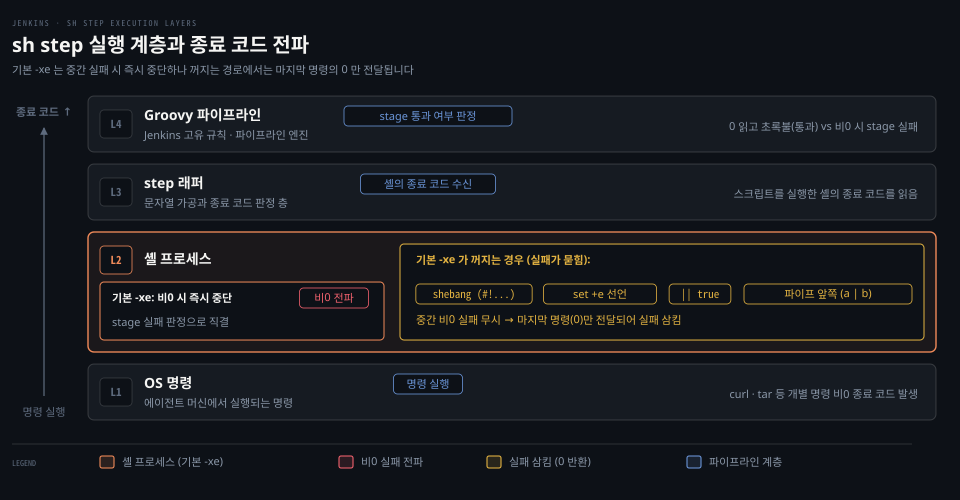
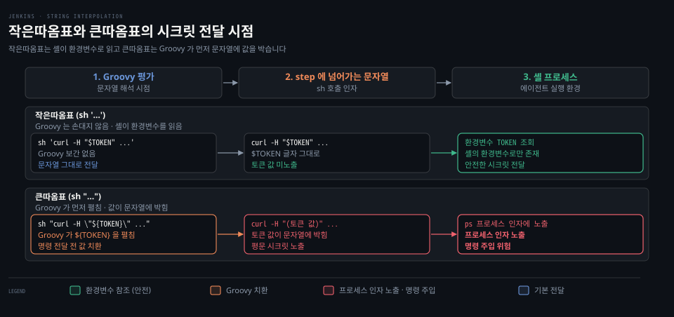

# sh step 이 실패를 삼키는 이유

---

> `sh` step 은 기본으로 셸에 `-xe` 를 붙이므로 평범한 스크립트의 실패는 삼키지 않고, 실패가 묻히는 것은 이 기본이 꺼지는 경로에서입니다. 이 편은 그 경로와 빈 변수·`cd` 실패 사고, 그리고 Groovy 보간이 시크릿을 위험하게 만드는 원리를 살펴봅니다.

## 학습 목표

> 이 편을 읽고 나면 아래 네 가지를 스스로 해낼 수 있습니다.

1. `sh` step 이 빌드 성공을 판정하는 기준과, 기본 `-xe` 가 꺼져 실패가 묻히는 경로를 설명할 수 있습니다.
2. `returnStatus` 와 `returnStdout` 을 사용해 종료 코드와 표준 출력을 분기 조건으로 다룰 수 있습니다.
3. 빈 변수 확장과 `cd` 이동 실패가 워크스페이스 위치 이탈로 이어지는 조건을 예측할 수 있습니다.
4. 작은따옴표 환경변수와 큰따옴표 Groovy 보간의 차이가 시크릿에 어떤 위험을 만드는지 비교할 수 있습니다.

## 1. 종료 코드 판정과 -xe 가 꺼지는 경로

> Jenkins 는 `sh` 가 띄운 셸 프로세스의 종료 코드로 stage 의 통과 여부를 정합니다. 기본 `-xe` 가 중간 실패를 끊어 주지만, 이 기본이 꺼지면 마지막 명령의 종료 코드만 남아 실패가 묻힙니다.

`sh` step 은 에이전트 머신의 셸 프로세스에서 OS 명령을 실행합니다. 파이프라인 엔진은 이 실행 바깥에 문자열 가공과 종료 코드 판정 층을 두릅니다.

아래 도식은 OS 명령부터 Groovy 파이프라인까지의 실행 계층과 기본 -xe 가 꺼져 실패가 삼켜지는 경로를 보입니다.

안쪽 두 층인 셸 프로세스와 OS 명령은 일반 터미널과 같게 동작합니다. 바깥 두 층인 Groovy 파이프라인과 step 래퍼가 Jenkins 고유의 규칙을 더합니다. step 래퍼는 스크립트를 실행한 셸의 종료 코드를 읽어 stage 를 성공 또는 실패로 판정합니다.[^durable-task]

여기서 **셸의 종료 코드**는 스크립트 마지막 명령의 종료 코드와 같습니다. 단, 셸에 `-e` 옵션이 켜져 있으면 비0 종료 코드를 낸 명령에서 스크립트가 바로 멈추고 그 코드가 셸의 종료 코드가 됩니다. 공식 문서에 따르면 `sh` 는 interpreter 를 고르지 않았을 때 시스템 기본 셸을 `-xe` 플래그로 실행합니다.[^sh-xe] 그래서 평범한 스크립트에서는 `curl` 이나 `tar` 가 실패하면 그 자리에서 stage 가 실패합니다.

실패가 묻히는 것은 아래 경우에 이 `-e` 가 없어서입니다.

- **shebang 을 쓴 스크립트**: 첫 줄이 `#!` 로 시작하면 interpreter 를 직접 골랐다는 뜻이라 `-xe` 가 붙지 않습니다.[^sh-xe] Jenkins 소스에서도 스크립트가 `#!` 로 시작하지 않을 때만 `-xe` 를 붙입니다.[^durable-task]
- **`set +e` 를 선언한 스크립트**: 공식 문서가 `-xe` 를 끄는 방법으로 적은 방식입니다.[^sh-xe]
- **`||` 와 `&&` 로 감싼 명령**: `make check || true` 는 실패를 일부러 0 으로 바꿉니다. 공식 문서는 이 방식으로 테스트가 실패해도 `junit` step 이 보고서를 모으게 하는 예를 보입니다.[^jenkinsfile]
- **파이프의 앞쪽 명령**: `-e` 만으로는 `a | b` 의 종료 코드가 `b` 의 것이라 `a` 의 실패가 묻힙니다. `set -o pipefail` 이 앞선 명령의 실패 코드를 파이프 전체의 종료 코드로 올려 줍니다.

이런 스크립트에서는 중간 명령이 실패해도 다음 줄이 계속 돕니다. 마지막 줄이 `echo` 처럼 성공하면 셸은 0 을 반환합니다. Jenkins 는 그 0 만 읽으므로 stage 에 초록불을 켭니다. 실패 원인과 멀리 떨어진 배포 단계에서 뒤늦게 터지는 이유입니다.

그래서 shebang 을 쓸 때는 스크립트 첫머리에 **셸 실행 위생** 옵션 `set -euo pipefail` 을 직접 선언합니다. 각 옵션은 서로 다른 지점을 감지합니다.

- `set -e`: 0 이 아닌 종료 코드를 내는 명령에서 스크립트를 즉시 중단합니다.
- `set -u`: 선언되지 않은 변수를 참조하면 에러를 내며 멈춥니다. 기본 `-xe` 에는 들어 있지 않습니다.
- `set -o pipefail`: 파이프 중간 명령의 실패를 파이프 전체의 종료 코드로 전달합니다.

실패를 빌드 중단이 아닌 정상 분기 조건으로 활용할 때도 있습니다. 이때는 `returnStatus: true` 를 사용해 종료 코드를 정수로 받습니다. 표준 출력을 문자열로 가져와 다음 작업에 넘기려면 `returnStdout: true` 를 지정합니다. 공식 문서도 출력 끝의 개행 때문에 `.trim()` 을 붙이라고 안내합니다.[^sh-xe]

| 옵션 | 반환값 | 주요 활용 목적 |
|---|---|---|
| 기본 실행 | 없음 (비0 종료 시 예외로 step 실패) | 명령 성공을 전제로 다음 단계를 진행할 때 |
| `returnStatus: true` | 정수형 종료 코드 | 실패를 예외가 아닌 조건 분기로 처리할 때 |
| `returnStdout: true` | 표준 출력 문자열 | 명령 실행 결과를 Groovy 변수에 담을 때 |

## 2. 빈 변수와 cd 실패가 부르는 위치 이탈

> 셸은 미설정 변수를 빈 문자열로 조용히 치환하고, `-e` 가 꺼져 있으면 `cd` 실패 뒤에도 원래 자리에서 다음 줄을 실행합니다. 이 두 동작이 겹치면 워크스페이스 전체나 루트 경로를 지우는 사고가 납니다.

파이프라인의 정리 단계에서는 디렉토리를 비우거나 빌드 결과물을 지우는 명령을 자주 둡니다. 변수 검증이나 이동 성공 여부를 확인하지 않으면 의도하지 않은 위치의 파일이 지워집니다.

`cd` 가 실패한 뒤에도 다음 줄이 도는 일은 1절에서 본 `-e` 가 꺼진 스크립트(shebang 이나 `set +e`)에서만 일어납니다. 기본 `-xe` 에서는 `cd` 가 실패하는 순간 스크립트가 멈춥니다.

셸의 기본 동작은 선언되지 않은 변수를 빈 문자열로 확장하는 것입니다. `DIR` 이 비어 있으면 `rm -rf "$DIR/target"` 은 `rm -rf "/target"` 이 됩니다. 따옴표 없는 `rm -rf $DIR/*` 는 `rm -rf /*` 로 확장되어 시스템 전체를 지우려 시도합니다. 이 경우는 기본 `-xe` 에서도 막히지 않습니다. `-e` 는 실패한 명령에만 반응하는데, 빈 변수 치환은 문법상 정상이기 때문입니다. `set -u` 가 있어야 변수가 비어 있을 때 실행이 끊깁니다.

`-e` 가 꺼진 상태에서 `cd` 가 실패하면 셸은 종료되지 않고 직전 작업 디렉토리에 머뭅니다. 다음 줄의 `rm -rf *` 가 돌면 워크스페이스 루트의 소스코드와 산출물이 지워집니다. 막는 방법은 두 가지입니다. `set -e` 로 `cd` 실패 시 셸을 중단시키거나, `cd dir && rm -rf *` 처럼 이동 성공을 다음 명령의 조건으로 묶습니다.

## 3. 셸 안쪽 옵션부터 바깥 격리까지의 방어층

> 리터럴 `cd /` 는 문법적으로 정상 명령이어서 셸 위생 옵션만으로는 차단할 수 없습니다. 이런 명령은 Jenkins 전용 step, 에이전트 분리와 권한 축소, 컨테이너 격리 같은 셸 밖의 층이 맡습니다.

`set -euo pipefail` 은 실패와 미설정 변수를 잡을 뿐, 정상 문법으로 실행된 위험 명령은 거르지 못합니다. 셸 안에서 해결할 수 없는 문제는 셸 밖의 층에서 막아야 합니다.

가장 먼저 둘 층은 셸 `cd` 대신 Jenkins 의 `dir` step 입니다. `dir('build/output') { ... }` 안의 step 은 그 디렉토리를 현재 위치로 씁니다. 경로 인자는 워크스페이스 안의 상대 경로입니다.[^dir-step] 블록이 끝나면 원래 위치로 돌아오므로 `cd` 실패로 위치가 어긋날 일이 줄어듭니다.

삭제는 `deleteDir()` 이 현재 디렉토리를 지웁니다. 특정 디렉토리만 지우려면 `dir` 로 감싸라고 공식 문서가 안내합니다.[^dir-step] 다만 이 step 들이 셸에서 만든 경로 실수를 막아 주는 것은 아니니, 경로를 문자열로 조립한 값은 여전히 확인해야 합니다.

다음 층은 실행 환경의 분리입니다. Jenkins 공식 보안 가이드(Controller Isolation)는 빌드를 built-in node 에서 돌리지 말고 에이전트에서 돌리라고 권고합니다.[^controller-isolation] 빌드가 built-in node 에서 돌면 Jenkins 프로세스와 같은 수준으로 컨트롤러 파일시스템에 접근하기 때문입니다. 에이전트를 root 가 아닌 사용자로 구동하는 것은 일반적인 최소 권한 원칙입니다. 그러면 빌드 스크립트가 `rm -rf /` 를 실행해도 OS 가 쓰기 권한을 거부합니다.

그 바깥에서는 빌드를 컨테이너나 동적 Pod 에 가두면 위험 명령의 영향이 컨테이너 파일시스템에 머뭅니다. 마지막으로 shellcheck 같은 정적 린트 도구로 `cd /` 패턴을 사전에 걸러내는 게이트를 둘 수 있습니다. 이 순서는 시도할 비용이 낮은 것부터 늘어놓은 것이지, 바깥 층일수록 차단이 강하다는 공식 근거가 있는 것은 아닙니다.

## 4. Groovy 문자열 보간과 시크릿 위험

> 작은따옴표 문자열은 Groovy 가 손대지 않고 셸에 넘기므로 시크릿을 환경변수로만 읽게 합니다. 큰따옴표는 Groovy 가 명령을 보내기 전에 값을 문자열에 박아 넣어, 시크릿이 프로세스 인자에 남고 특수문자가 그대로 실행될 수 있습니다.

`withCredentials` 나 `environment` 의 `credentials()` 로 바인딩한 시크릿은 에이전트의 셸에 환경변수로 들어갑니다. 공식 문서는 이렇게 바인딩한 시크릿이 빌드 로그에서 자동으로 가려진다고 설명합니다.[^credentials-plugin] 그런데 그 시크릿을 `sh` 에 어떻게 넘기느냐에 따라 위험이 달라집니다.

아래 도식은 작은따옴표와 큰따옴표에서 시크릿 값이 명령에 바인딩되는 시점과 프로세스 노출 위험의 차이를 보입니다.

작은따옴표 표기(`sh 'curl -H "$TOKEN" ...'`)는 Groovy 가 문자열을 해석하지 않고 그대로 셸에 넘깁니다. 셸이 실행 시점에 환경변수에서 `TOKEN` 값을 읽습니다. 공식 문서는 이 방식을 "single quotes prevent Groovy interpolation; expansion is by Bourne Shell, which is what you want" 라는 주석으로 권장합니다.[^credentials-plugin]

큰따옴표 표기(`sh "curl -H \"${TOKEN}\" ..."`)는 Groovy 가 `${TOKEN}` 을 명령이 에이전트로 가기 전에 펼칩니다. 공식 문서는 이때 시크릿이 프로세스 인자로 복사되어 `ps` 같은 도구로 보이고 값에 든 셸 특수문자가 즉시 실행된다고 설명합니다.[^string-interp] 사용자가 넘긴 파라미터 값을 큰따옴표로 보간하면 SQL 인젝션과 비슷한 명령 주입도 일어납니다.[^string-interp]

| 구분 | 값이 풀리는 시점 | 시크릿에 생기는 일 | 안전한 용도 |
|---|---|---|---|
| 작은따옴표 (`sh '...$VAR'`) | 셸 프로세스 실행 시점 | 셸의 환경변수로만 존재 | 토큰·비밀번호 등 시크릿 |
| 큰따옴표 (`sh "...${VAR}"`) | Groovy 평가 시점 (sh 호출 전) | 명령 문자열과 프로세스 인자에 값이 박힘 | 브랜치명·빌드 번호 등 비민감 문자열 |

로그 마스킹이 큰따옴표에서 정확히 어떻게 달라지는지는 공식 문서가 단정하지 않습니다. 크리덴셜 문서는 "작은따옴표를 쓰면 비밀번호 마스킹과 명령 처리의 복잡함이 줄어든다"고만 설명합니다.[^credentials-plugin] 확인된 위험은 프로세스 인자 노출과 명령 주입이므로, 시크릿은 항상 작은따옴표로 넘깁니다.

명령 추적 옵션 `-x` 도 알아 둘 점이 있습니다. 기본 `-xe` 에는 `-x` 가 들어 있어 실행되는 명령줄이 로그에 찍힙니다.[^sh-xe] 크리덴셜 공식 예제는 토큰을 쓰는 스크립트 첫머리에 `set +x` 를 두어 이 출력을 끕니다.[^string-interp] 시크릿을 다루는 `sh` 는 작은따옴표로 환경변수를 넘기고 `set +x` 로 명령 출력을 끄는 조합이 안전합니다.

## 면접에서 받을 만한 질문

1. `sh` step 에서 여러 명령을 실행할 때 중간 명령이 실패해도 stage 가 성공으로 끝나는 이유는 무엇이며 이를 어떻게 방어합니까?
2. `returnStatus: true` 와 `returnStdout: true` 는 각각 언제 사용하며 기본 `sh` 호출과 반환 동작이 어떻게 다릅니까?
3. `rm -rf "$BUILD_DIR/"` 구문이 위험한 이유와 Jenkins 전용 스텝으로 이를 대체하는 방법을 설명해 보세요.
4. `sh` step 에서 시크릿 값을 다룰 때 작은따옴표 환경변수 방식과 큰따옴표 Groovy 보간 방식의 마스킹 동작 차이는 무엇입니까?

> 네 질문에 먼저 스스로 답해 보세요. 자답이 끝나면 아래 §정답 (자답 후 펼치기) 으로 내려갑니다.

## 정답 (자답 후 펼치기)

> 위 §면접에서 받을 만한 질문 의 네 개에 먼저 자답한 뒤 아래를 읽으세요.

### 정답 1 — 종료 코드 판정과 set -e

Jenkins 는 셸 프로세스의 종료 코드로 stage 의 성공 여부를 정합니다. 그 종료 코드는 `-e` 가 없으면 마지막 명령의 것입니다. `sh` 는 기본으로 `-xe` 를 붙이므로 평범한 스크립트는 중간 실패에서 멈춥니다. 실패가 묻히는 것은 `#!` shebang 으로 이 기본이 빠졌거나, `set +e` 를 선언했거나, `|| true` 로 실패를 0 으로 바꿨거나, 파이프 앞쪽 명령이 실패한 경우입니다. 이런 스크립트에는 `set -e` 로 비0 종료 시 즉시 중단시키고, `set -o pipefail` 로 파이프 중간의 실패까지 전파하도록 설정해 방어합니다.

### 정답 2 — 종료 코드와 출력값 반환

기본 `sh` 호출은 반환값이 없으며 명령이 실패하면 예외를 던져 빌드를 즉시 중단합니다. 반면 `returnStatus: true` 는 종료 코드를 정수로 반환하므로 실패를 예외가 아닌 조건 분기 로직으로 처리할 때 사용합니다. `returnStdout: true` 는 명령의 표준 출력을 Groovy 문자열로 캡처할 때 쓰며 끝에 포함된 개행 문자를 `.trim()` 으로 정리해 사용합니다.

### 정답 3 — 빈 변수 치환과 dir·deleteDir

셸은 설정되지 않은 변수를 빈 문자열로 확장하므로 변수가 비어 있으면 `rm -rf "/"` 처럼 루트를 가리키는 명령이 됩니다. 이 확장은 문법상 정상이라 `-e` 로는 막히지 않고 `set -u` 가 있어야 중단됩니다. 경로를 옮기고 지우는 일은 셸 `cd` 와 `rm` 대신 `dir('경로') { deleteDir() }` 로 하면 `cd` 실패로 위치가 어긋나는 일이 줄어듭니다. 이 step 들은 현재 디렉토리를 기준으로 동작할 뿐 잘못 조립한 경로를 막아 주지는 않으므로, 조립한 경로는 따로 확인해야 합니다.

### 정답 4 — Groovy 보간과 시크릿 마스킹

작은따옴표는 문자열을 그대로 셸에 넘겨 셸이 실행 시점에 환경변수를 풀게 합니다. 공식 문서가 권장하는 방식입니다. 반면 큰따옴표의 Groovy 보간은 명령이 에이전트로 가기 전에 토큰 값을 문자열에 박아 넣습니다. 공식 문서는 이때 값이 프로세스 인자로 복사되어 `ps` 로 보이고 특수문자가 즉시 실행된다고 설명하므로, 시크릿은 항상 작은따옴표로 넘깁니다.

## 관련 문서

- [Controller·Agent·Executor 와 JENKINS_HOME](01-01.Controller·Agent·Executor%20와%20JENKINS_HOME.md) — Flyweight Task 와 일반 Task 의 차이, Controller 와 Agent 의 파일시스템 분리
- [정적 Agent 와 동적 Agent](01-02.정적%20Agent%20와%20동적%20Agent.md) — 빌드 환경 격리와 Agent 노드의 실행 경계
- [Queue 상태 전이와 Executor 로 가는 길](02-02.Queue%20상태%20전이와%20Executor%20로%20가는%20길.md) — 빌드 큐에서 Executor 로 작업이 전달되는 생명주기
- [Executor 배정과 동적 Pod](02-03.Executor%20배정과%20동적%20Pod.md) — 동적 Pod 기반의 ephemeral 워크스페이스와 빌드 격리

[^durable-task]: Jenkins durable-task plugin `BourneShellScript.java`. 스크립트가 `#!` 로 시작하지 않을 때만 셸을 `-xe` 로 호출하고, 실행한 스크립트의 종료 코드(`echo $?`)를 결과 파일에 적고 step 이 이를 읽는 구조. <https://github.com/jenkinsci/durable-task-plugin/blob/master/src/main/java/org/jenkinsci/plugins/durabletask/BourneShellScript.java>
[^sh-xe]: Jenkins Pipeline Steps Reference, `sh`. "Otherwise the system default shell will be run, using the -xe flags (you can specify set +e and/or set +x to disable those)." `returnStatus`·`returnStdout`·`.trim()` 안내도 같은 문서에 수록. <https://www.jenkins.io/doc/pipeline/steps/workflow-durable-task-step/#sh-shell-script>
[^jenkinsfile]: Jenkins User Handbook, Using a Jenkinsfile. `sh 'make check || true'` 로 `sh` step 이 항상 0 을 보게 하는 예. <https://www.jenkins.io/doc/book/pipeline/jenkinsfile/#handling-failure>
[^dir-step]: Jenkins Pipeline Steps Reference, `dir`·`deleteDir`. `dir` 의 `path` 는 "The relative path of the directory in the workspace to use as a new working directory", `deleteDir` 은 "Recursively deletes the current directory and its contents", 특정 디렉토리는 `dir` 로 감싸라는 안내 포함. <https://www.jenkins.io/doc/pipeline/steps/workflow-basic-steps/>
[^controller-isolation]: Jenkins Security Documentation, Controller Isolation. "It is therefore highly advisable to not run any builds on the built-in node, instead using agents" <https://www.jenkins.io/doc/book/security/controller-isolation/>
[^credentials-plugin]: Jenkins Credentials Binding Plugin. "Any secrets in the build log will be masked automatically." 예제 주석에 "single quotes prevent Groovy interpolation; expansion is by Bourne Shell, which is what you want", 본문에 "You should use a single quote instead of a double quote whenever you can." <https://plugins.jenkins.io/credentials-binding/>
[^string-interp]: Jenkins User Handbook, Using a Jenkinsfile, String interpolation. "Groovy string interpolation should never be used with credentials." 큰따옴표 GString 이 명령을 에이전트로 보내기 전에 펼쳐져 시크릿이 프로세스 인자(`ps`)에 복사되고 특수문자가 즉시 실행된다는 설명, 사용자 제어 변수의 보간이 명령 주입이 된다는 경고 포함. 같은 문서 Handling credentials 절에 `set +x` 예제도 있음. <https://www.jenkins.io/doc/book/pipeline/jenkinsfile/#string-interpolation>
