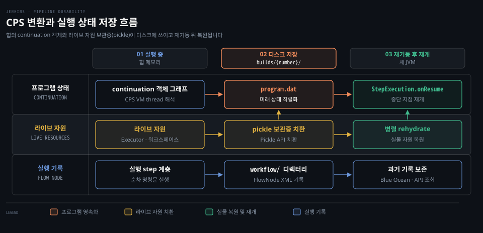

# 재기동을 견디는 Pipeline

---

> JVM 콜 스택은 직렬화할 수 없지만 Jenkins Pipeline 은 CPS 변환으로 실행 흐름을 힙 객체와 디스크 파일로 저장합니다. 이 편은 프로그램 상태 영속화 메커니즘, durable-task 기반 step 재개, durability 모드와 재기동 방식에 따른 복구 분기를 다룹니다.

## 학습 목표

> 이 편을 읽고 나면 아래 다섯 가지를 스스로 해낼 수 있습니다.

1. 콜 스택과 CPS 객체 그래프의 차이를 비교하고 실행 상태가 힙과 디스크로 보존되는 원리를 설명할 수 있습니다.
2. `program.dat` 와 `workflow/` 디렉터리가 각각 무엇을 직렬화하는지 구분할 수 있습니다.
3. Pickle API 가 라이브 자원을 대체하고 재기동 후 복원하는 과정을 설명할 수 있습니다.
4. Resumable step 과 Nonresumable step 의 동작 차이를 durable-task 제어 파일로 설명할 수 있습니다.
5. durability 세 모드의 I/O 비용과 재기동 방식에 따른 복구 결과를 예측할 수 있습니다.


## 1. 실행 중인 빌드와 JVM 재기동

> 일반 Java 프로그램의 실행 상태는 스레드 콜 스택에 머물기 때문에 JVM 이 종료되면 함께 소멸합니다. Pipeline 은 장시간 실행되는 빌드의 손실을 막기 위해 실행 상태의 저장 위치를 근본적으로 바꿉니다.

빌드가 한창 진행 중일 때 호스트 점검이나 메모리 부족으로 Controller 가 갑자기 재기동되는 상황을 만납니다. 이전 세대의 Freestyle 빌드는 Controller 가 내려가는 순간 그 자리에서 실패로 끝납니다. 스레드가 살아 있던 메모리가 JVM 과 함께 통째로 사라지기 때문입니다.

일반 Java 애플리케이션에서 현재 실행 위치와 다음 작업 정보는 스레드의 콜 스택이 들고 있습니다. 지역 변수, 호출 깊이, 복귀 주소는 모두 스택 프레임에 기록됩니다. 하지만 JVM 은 실행 중인 스레드의 콜 스택을 객체처럼 외부로 꺼내거나 직렬화하는 기능을 제공하지 않습니다.

수 분에서 수 시간 동안 이어지는 CI/CD 빌드를 Controller 재기동마다 처음부터 다시 돌리는 것은 큰 낭비입니다. 빌드가 재기동을 견디려면 실행 중인 상태를 디스크에 영속화했다가 새 JVM 에서 다시 읽어 낼 수 있어야 합니다. 콜 스택을 저장할 수 없다면 실행 상태를 스택이 아닌 힙의 일반 객체로 옮겨야 한다는 결론에 도달합니다.


## 2. CPS 변환과 실행 상태 저장

> Pipeline 스크립트는 컴파일 시점에 CPS 로 변환되어 실행 흐름을 힙의 continuation 객체 연쇄로 관리합니다. 이 객체 그래프는 `program.dat` 에 저장되고 직렬화할 수 없는 라이브 자원은 Pickle API 로 보호됩니다.

실행 중인 빌드를 중단 지점에서 다시 살리려면 스레드 콜 스택 밖으로 제어 흐름을 꺼내야 합니다. Jenkins 는 workflow-cps 플러그인으로 Groovy 코드를 CPS 로 컴파일합니다.[^cps-plugin]

CPS 변환을 거친 코드에서 함수는 반환값을 직접 돌려주지 않습니다. 대신 다음에 실행할 작업(continuation)을 명시적 객체로 받아 넘깁니다. 순차적으로 실행되던 명령문들이 현재 상태 객체에서 다음 상태 객체로 제어를 넘기는 연쇄로 바뀝니다. 제어 흐름 자체가 힙에 존재하는 데이터가 되므로 언제든지 객체 그래프를 디스크에 직렬화할 수 있습니다.

이 continuation 객체들을 차례로 해석하고 실행하는 주체는 `CPS VM thread` 라는 전용 스레드 풀입니다.[^cps-plugin] 빌드 스크립트의 모든 로직이 이 스레드 풀에서 실행되므로 복잡한 연산을 스크립트 안에 두면 스레드가 점유되어 전체 빌드가 느려집니다. 변환을 건너뛰는 `@NonCPS` 메서드가 존재하는 이유가 여기에 있습니다.

아래 도식은 실행 중인 continuation 객체와 라이브 자원이 디스크로 영속화되고 재기동 후 복구·재개되는 데이터 흐름을 보입니다.


변환된 실행 상태는 빌드 디렉터리(`builds/{number}/`) 아래 두 갈래로 나뉘어 기록됩니다.

- `program.dat`: 힙에 존재하는 continuation 객체 그래프 전체를 직렬화한 파일입니다.[^cps-plugin] 다음에 무엇을 실행할 것인가라는 미래의 실행 상태를 담습니다.
- `workflow/`: 실행된 step 들의 계층과 순서를 담은 FlowNode XML 파일들의 디렉터리입니다. Blue Ocean 이나 API 가 조회하는 무엇을 실행했는가라는 과거의 기록입니다.

실행 상태 객체 그래프 안에는 직렬화할 수 없는 자원들이 섞여 있습니다. 점유 중인 Agent 의 Executor 슬롯, 워크스페이스 디렉터리, 열린 네트워크 채널이 대표적입니다. 이들은 JVM 이 내려가면 사라질 실체이므로 일반 바이트 스트림으로 저장할 수 없습니다.

Jenkins 는 이를 해결하기 위해 Pickle API 를 제공합니다.[^cps-plugin] 직렬화 시점에 라이브 객체를 안전한 대체물인 pickle(보관증)로 치환하여 `program.dat` 에 기록합니다.

재기동 후 빌드를 복구할 때는 pickle 들을 병렬로 되살리는 rehydrate 과정을 수행합니다. 보관증을 내밀어 Agent 연결과 워크스페이스 실물을 다시 찾아오는 방식입니다. 모든 rehydrate 가 성공하면 `StepExecution.onResume` 이 호출되며 빌드가 중단 지점에서 재개됩니다. 만약 해당 Agent 노드가 재기동 사이에 삭제되었다면 실물을 찾지 못해 rehydrate 가 실패하고 빌드는 재개되지 못합니다.


## 3. 재개되는 step 과 원격 프로세스

> Agent 에서 독립 프로세스로 도는 step 은 Controller 재기동 중에도 살아남아 결과를 보존합니다. 반면 Controller JVM 안에서 실행되는 step 은 재기동 시 에러가 발생하므로 멱등성을 확인한 뒤 재시도로 방어해야 합니다.

Pipeline 이 재개된다고 해서 모든 step 이 동일한 방식으로 되살아나는 것은 아닙니다. 실행 위치와 프로세스 제어 방식에 따라 step 은 크게 두 가지로 나뉩니다.

| 구분 | 대표 step | 실행 위치 | 재기동 후 기본 동작 |
|---|---|---|---|
| Resumable | `sh`, `bat`, `powershell` | Agent 노드의 독립 셸 프로세스 | Controller 복귀 후 프로세스 재연결 및 완료 대기 |
| Nonresumable | `checkout`, `junit`, `archiveArtifacts` 등 Controller JVM 안에서 끝나는 step | Controller JVM 내부 스레드 | 재기동 시 해당 지점에서 에러 발생 |

이 구분은 실행 위치로 가르는 원리입니다. 어떤 step 이 어느 쪽인지 적은 공식 목록은 찾지 못했습니다. 위 대표 step 은 옛 운영 노트의 분류이므로 실제 step 은 플러그인 문서에서 확인해야 합니다.

Resumable step 인 `sh` 는 durable-task 플러그인에 기반을 둡니다.[^durable-task] Controller 는 Agent 노드에 셸 프로세스를 띄울 때 표준 입출력을 직접 소켓 핸들로 붙잡고 있지 않습니다.

대신 Agent 의 워크스페이스 아래 제어 디렉터리에 출력용 `jenkins-log.txt` 와 종료 코드용 `jenkins-result.txt` 파일을 둡니다.[^durable-task] 
셸 프로세스는 Controller 와 완전히 독립된 OS 프로세스로 Agent 에서 계속 동작합니다. Controller 가 재기동되는 동안에도 프로세스는 백그라운드에서 실행을 이어갑니다. Controller 가 다시 기동되면 직렬화된 정보를 읽어 Agent 에 재연결하고 제어 디렉터리의 로그와 종료 코드 파일을 읽어 들여 빌드를 완주합니다. 단 이 복구는 Agent 노드 자체가 살아 있어야만 성립합니다.

Nonresumable step 은 Controller JVM 내부에서 직접 처리되는 비교적 짧은 작업들입니다. 이러한 step 이 실행되는 도중에 Controller 가 내려가면 메모리 상태가 사라지므로 해당 위치에서 예외를 던집니다.

대규모 저장소의 `checkout` 처럼 시간이 수 분 이상 걸리는 Nonresumable step 은 장애의 사각지대가 됩니다. 이 구간을 `retry` 블록으로 감싸면 예외가 났을 때 다시 시도합니다.[^pipeline-steps] 재기동으로 난 에러까지 `retry` 가 받아 주는지는 공식 문서가 보증하지 않으므로, 옛 운영 노트의 방어 패턴으로만 읽고 직접 확인해야 합니다.

```groovy
steps {
    // 예외가 나면 최대 3번까지 다시 시도합니다
    retry(3) {
        checkout scm
    }
}
```

재시도를 적용할 때는 반드시 **멱등성**(idempotency)을 따져야 합니다. `checkout` 은 동일 커밋을 다시 받아오므로 여러 번 실행해도 부작용이 없습니다. 반면 원격 결제 API 호출이나 인프라 생성 명령은 응답을 받기 전에 Controller 가 죽었을 때 재시도하면 중복 요청 사고로 이어집니다. 멱등성이 없는 작업은 무조건 재시도하지 말고 사전에 상태를 검증하거나 전용 방어 옵션을 써야 합니다.


## 4. Durability 세 단계와 쓰기 비용

> 디스크에 상태를 얼마나 자주 안전하게 쓰느냐에 따라 빌드 속도와 장애 생존율이 갈립니다. Jenkins 는 세 가지 내구성 모드를 제공하며 파이프라인의 성격에 맞춰 수준을 선택할 수 있습니다.

매 step 마다 FlowNode 와 `program.dat` 를 디스크에 동기식으로 기록하면 복구 가능성은 극대화됩니다. 하지만 디스크에 자주 쓰는 비용은 Controller 가 NFS·자기 디스크를 쓰거나 Pipeline 을 많이 동시에 돌릴 때 병목이 됩니다.[^scaling-pipeline] 속도와 생존율 사이의 균형을 맞추기 위해 Jenkins 는 세 가지 내구성 모드를 지원합니다.[^scaling-pipeline]

| 내구성 모드 | 디스크 기록 방식 | 복구 가능성 | I/O 부하 | 권장 대상 파이프라인 |
|---|---|---|---|---|
| `MAX_SURVIVABILITY` (기본값) | 매 step 마다 쓰고, 쓸 때 atomic write 사용 | 최고 | 가장 높음 | 가장 중요한 파이프라인 |
| `SURVIVABLE_NONATOMIC` | 매 step 마다 쓰되 atomic write 생략 | 중간 (디스크 쓰기가 끊기면 유실 가능) | 중간 | 네트워크 파일시스템처럼 atomic write 가 느린 환경 |
| `PERFORMANCE_OPTIMIZED` | 매 step 마다 쓰지 않고 atomic write 도 생략 | 정상 종료에서만 재개 | 가장 낮음 | 다시 돌리면 되는 단순 빌드·테스트 |

아무 설정도 하지 않으면 `MAX_SURVIVABILITY` 로 동작합니다. 공식 문서는 이 모드를 예전 Pipeline 의 동작 그대로이자 가장 느린 선택지라고 하고, 중요한 파이프라인에 쓰라고 합니다.

`SURVIVABLE_NONATOMIC` 은 step 마다 쓰되 atomic write 를 생략합니다. 이 때문에 네트워크 파일시스템에서 더 빠릅니다. 대신 OS 가 멈추거나 저장소가 끊기면 버퍼에 있던 데이터가 유실되고 드물게 빌드를 못 읽는 일도 생깁니다.[^scaling-pipeline]

`PERFORMANCE_OPTIMIZED` 는 step 마다 쓰지 않아 디스크 I/O 를 크게 줄입니다. 대신 Controller 가 정상 종료할 때만 실행 중인 Pipeline 을 저장합니다. 예기치 않게 죽으면 step 정보를 잃어 재개하지 못하고 Freestyle 처럼 로그만 남습니다.[^scaling-pipeline]

내구성 수준은 전역 시스템 설정, job 설정, multibranch 의 branch 속성에서 지정하고 구체적인 쪽이 전역을 덮어씁니다. `properties` step 으로도 지정할 수 있으며 설정은 다음 실행부터 적용됩니다.[^scaling-pipeline]

전역 기본값을 무엇으로 둘지는 공식 문서와 옛 운영 노트의 권고가 갈립니다. 공식 문서는 대부분의 파이프라인에 `PERFORMANCE_OPTIMIZED` 를 전역으로 두고 실행 기록이 꼭 필요한 job 이나 branch 에만 `MAX_SURVIVABILITY` 를 지정하라고 합니다.[^scaling-pipeline] 옛 노트는 반대로 전역을 `MAX_SURVIVABILITY` 로 두고 단순 빌드만 낮추라고 합니다.

어느 쪽이든 기준은 같습니다. 죽었을 때 다시 돌리는 비용이 낮은 빌드만 `PERFORMANCE_OPTIMIZED` 로 둡니다. 승인 대기나 배포처럼 다시 돌리기 어려운 빌드는 낮추지 않습니다.

재개 자체를 막으려면 Declarative 의 `disableResume()` 옵션을 지정합니다. 공식 문법 문서는 이 옵션을 「Controller 가 재기동되어도 Pipeline 을 재개하지 않는다」고만 설명합니다.[^syntax] 재개하지 않은 빌드가 어떤 최종 상태(예: ABORTED)로 남는지는 공식 문서에서 확인하지 못했습니다. 중복 실행이 위험한 결제·인프라 변경 작업은 이 옵션으로 자동 재개를 끕니다. 이후 처리는 운영자가 상황을 보고 결정하게 둡니다.


## 5. 재기동 방식별 복구 분기

> 정상 종료는 모든 durability 모드에서 재개를 보장하지만 비정상 종료는 디스크 플러시 여부에 따라 생존이 갈립니다. 클러스터 환경에서는 Agent Pod 의 소멸로 인한 워크스페이스 증발도 함께 대비해야 합니다.

Controller 가 재기동되는 양상에 따라 디스크 상태와 실제 프로세스의 일치 여부가 달라집니다. 종료 방식은 크게 둘로 나뉩니다.

- 정상 종료(Graceful Shutdown): Jenkins 가 정상 종료 절차를 모두 밟는 경우입니다. `/exit` 주소 방문, 서비스 정상 종료 스크립트, SIGTERM·SIGINT 전달이 해당합니다. 실행 중인 Pipeline 이 끝나기를 기다릴 필요가 없어 `/safeExit` 도 필요 없다고 공식 문서가 밝힙니다.[^scaling-pipeline]
- 비정상 종료(Dirty Shutdown): 정상 종료 절차를 밟지 못한 경우입니다. SIGKILL 로 Jenkins 프로세스를 끝내거나 Jenkins 가 든 컨테이너·VM 을 죽이는 경우가 흔합니다. OS 가 치명적으로 실패하거나 OOMKiller 가 java 프로세스를 죽이는 경우도 해당합니다. 컨테이너·VM 을 멈추거나 일시정지하기만 하는 것은 Jenkins 프로세스가 재개될 수 있으면 해당하지 않습니다.[^scaling-pipeline] 이때 디스크에 쓰지 못한 데이터는 유실됩니다.

종료 유형과 durability 모드의 조합에 따라 빌드의 복구 결과는 다음과 같이 나뉩니다.

| 종료 유형 | Durability 모드 | Controller 재기동 후 결과 |
|---|---|---|
| 정상 종료 (`/exit`, SIGTERM) | 세 모드 모두 | 재개 가능. `PERFORMANCE_OPTIMIZED` 도 정상 종료일 때 저장합니다 |
| 비정상 종료 (SIGKILL, 컨테이너 강제 종료) | `MAX_SURVIVABILITY` | 매 step 기록과 atomic write 로 재개를 가장 잘 보장 |
| 비정상 종료 (SIGKILL, 컨테이너 강제 종료) | `SURVIVABLE_NONATOMIC` | 매 step 기록하므로 대체로 재개. 디스크 쓰기가 끊기면 유실될 수 있음 |
| 비정상 종료 (SIGKILL, 컨테이너 강제 종료) | `PERFORMANCE_OPTIMIZED` | step 정보를 잃어 재개 불가. Freestyle 처럼 로그만 남음 |
| 종료 방식 무관 | `disableResume()` 지정 | 재개하지 않음 (최종 상태는 공식 문서에서 확인하지 못함) |

표의 정상 종료·`PERFORMANCE_OPTIMIZED` 칸은 공식 문서와 플러그인 설명문의 문장에 근거합니다. 반면 `SIGKILL` 의 `MAX_SURVIVABILITY`·`SURVIVABLE_NONATOMIC` 칸은 모드별 설계 설명에서 추론한 값입니다. 모드 조합별 실험 결과를 공식 문서가 적은 것은 아닙니다. 이 표의 칸은 지난 운영 노트의 관찰과 맞춰 읽되, 중요한 파이프라인에는 직접 재현해 확인하는 편이 안전합니다.

비정상 종료에서 `PERFORMANCE_OPTIMIZED` 빌드는 공식 문서 표현으로 Freestyle 프로젝트처럼 동작합니다. 재개되지 못하고 Pipeline Graph View 같은 화면에도 나오지 않지만 로그는 남습니다.[^scaling-pipeline]

컨테이너 가상화 환경에서는 Controller 뿐 아니라 Agent 의 수명도 복구의 필수 변수입니다. Kubernetes 클러스터에서 노드 자원이 부족하면 동적 Agent Pod 가 축출되거나 삭제될 수 있습니다. 이때 Pod 로컬 디스크의 워크스페이스도 통째로 사라집니다.

Controller 가 빌드 상태를 복원하더라도 워크스페이스 파일이 없으면 다음 stage 가 산출물을 읽지 못합니다.

이를 방어하려면 stage 간 산출물을 `stash` step 으로 맡겨 두었다가, 새 Pod 가 뜨면 `unstash` 로 내려받아 이어갑니다.[^stash]

단 stash 는 작은 파일용입니다. 큰 파일은 압축 TAR 로 만들어져 Controller 의 CPU 를 많이 씁니다. 대용량 산출물은 Nexus 같은 외부 저장소를 쓰라고 공식 문서가 권합니다.[^stash]


## 면접에서 받을 만한 질문

1. Freestyle 빌드는 Controller 재기동 시 복구되지 못하는데 Pipeline 은 어떻게 중단 지점부터 재개할 수 있습니까?
2. `sh` step 은 Controller 재기동 중에도 어떻게 프로세스를 유지하며 Nonresumable step 과의 구조적 차이는 무엇입니까?
3. Durability 세 가지 모드의 차이를 설명하고, 비정상 종료(dirty shutdown)가 발생했을 때 복구 결과가 어떻게 갈리는지 말해 보세요.
4. `disableResume()` 옵션은 어떤 목적을 위해 사용하며, 이 옵션이 없을 때 비멱등 작업에서 어떤 위험이 발생합니까?
5. Pipeline 상태를 직렬화할 때 Agent 연결이나 워크스페이스 같은 라이브 자원은 어떻게 보관되며, 재기동 후 어떤 조건에서 복구에 실패합니까?

> 다섯 질문에 먼저 스스로 답해 보세요. 자답이 끝나면 아래 §정답 (자답 후 펼치기) 으로 내려갑니다.


## 정답 (자답 후 펼치기)

> 위 §면접에서 받을 만한 질문 의 다섯 개에 먼저 자답한 뒤 아래를 읽으세요.

### 정답 1 — 콜 스택 전환과 CPS 직렬화

Freestyle 빌드의 실행 상태는 스레드 콜 스택에 머물기 때문에 JVM 이 종료되면 스택 프레임이 함께 사라져 복구가 불가능합니다. Pipeline 은 컴파일 시점에 코드를 CPS(Continuation-Passing Style)로 변환하여 실행 흐름을 힙의 continuation 객체 연쇄로 관리합니다. 힙에 존재하는 객체 그래프는 디스크에 직렬화할 수 있으므로 실행 상태를 `program.dat` 파일에 기록해 두었다가 재기동 후 역직렬화하여 중단 지점부터 실행을 이어갑니다.

### 정답 2 — 제어 파일과 실행 위치 차이

`sh` step 은 durable-task 플러그인을 사용하여 Agent 노드에서 독립적인 OS 프로세스로 실행됩니다. Controller 는 소켓 스트림 대신 Agent 로컬 파일(`jenkins-log.txt`, `jenkins-result.txt`)에 로그와 종료 코드를 남기도록 지시합니다.

따라서 Controller 가 재기동되어도 Agent 의 셸 프로세스는 계속 돌며 복귀 후 파일 상태를 읽어 재연결합니다. 반면 Nonresumable step(`checkout`, `junit` 등)은 Controller JVM 내부 스레드에서 직접 돌기 때문에 재기동 시 상태가 유실되어 에러가 발생합니다.

### 정답 3 — 모드별 비용과 생존 여부

`MAX_SURVIVABILITY`(기본값)는 매 step 마다 atomic write 로 기록하여 I/O 비용이 가장 큰 대신 비정상 종료에도 재개 가능성이 가장 높습니다. `SURVIVABLE_NONATOMIC` 은 매 step 기록하되 atomic write 를 생략해 네트워크 스토리지 부하를 줄이는 대신, 디스크 쓰기가 끊기면 데이터를 잃을 수 있습니다. `PERFORMANCE_OPTIMIZED` 는 step 마다 쓰지 않아 가장 빠르지만, dirty shutdown 시 step 정보를 잃어 재개되지 못하고 Freestyle 처럼 로그만 남습니다.

### 정답 4 — disableResume 과 비멱등 작업

결제 API 호출, 인프라 프로비저닝, DB 마이그레이션처럼 한 번 실행된 뒤 다시 수행되면 멱등성이 깨지는 파이프라인에서 사용합니다. `disableResume()` 이 선언되지 않으면 재기동 뒤 Controller 가 중단 지점부터 자동으로 재개하므로, 응답을 받기 전에 끊긴 원격 명령이 다시 호출될 위험이 있습니다. 이 옵션을 켜 두면 재기동 시 자동 resume 을 하지 않으므로, 운영자가 원격 작업이 어디까지 갔는지 직접 확인하고 후속 조치를 정할 수 있습니다.

### 정답 5 — Pickle API 와 Agent 부재

점유 중인 Executor 나 워크스페이스, 네트워크 채널 같은 라이브 자원은 JVM 이 내려가면 사라지므로 직접 직렬화할 수 없습니다. Jenkins 는 직렬화 시점에 이 자원들을 안전한 보관증 객체인 pickle 로 치환해 `program.dat` 에 저장합니다. 재기동 후에는 병렬 rehydrate 과정을 거쳐 Agent 연결과 실물 자원을 다시 찾아옵니다. 만약 Controller 가 내려간 사이에 해당 Agent 노드가 삭제되었거나 K8s Pod 가 축출되었다면 보관증으로 실물을 되찾지 못해 rehydrate 가 실패하고 빌드가 중단됩니다.


## 관련 문서

- [Controller·Agent·Executor 와 JENKINS_HOME](01-01.Controller·Agent·Executor%20와%20JENKINS_HOME.md) — Controller 와 Agent 의 역할 분리, OneOffExecutor 와 슬롯 개념
- [Queue 상태 전이와 Executor 로 가는 길](02-02.Queue%20상태%20전이와%20Executor%20로%20가는%20길.md) — 큐 아이템이 Executor 에 배정되어 빌드 실행에 진입하는 과정

[^cps-plugin]: Jenkins Pipeline workflow-cps-plugin README. "Continuation Passing Style" / "CpsFlowExecution" / "Pickle API" <https://github.com/jenkinsci/workflow-cps-plugin>
[^durable-task]: Jenkins workflow-durable-task-step-plugin 및 durable-task-plugin. "DurableTaskStep" / "FileMonitoringTask" <https://github.com/jenkinsci/workflow-durable-task-step-plugin>
[^pipeline-steps]: Jenkins Pipeline Steps Reference. "retry: Retry the body up to N times" <https://www.jenkins.io/doc/pipeline/steps/workflow-basic-steps/#retry-retry-the-body-up-to-n-times>
[^scaling-pipeline]: Jenkins Scaling Pipeline Guide. "Pipeline Durability Settings" / "Dirty Shutdown vs Clean Restart" <https://www.jenkins.io/doc/book/pipeline/scaling-pipeline/>
[^syntax]: Jenkins Pipeline Syntax. "options" 의 disableResume: Do not allow the pipeline to resume if the controller restarts. <https://www.jenkins.io/doc/book/pipeline/syntax/>
[^stash]: Jenkins Pipeline Steps Reference. "stash: Stash some files to be used later in the build" <https://www.jenkins.io/doc/pipeline/steps/workflow-basic-steps/#stash-stash-some-files-to-be-used-later-in-the-build>
