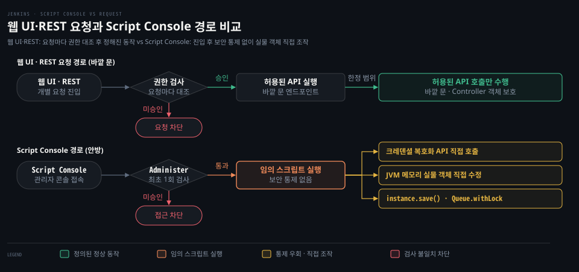

# Groovy 는 Jenkins 어디서 도는가

---

> Pipeline 의 Groovy 코드는 Agent 가 아니라 Controller JVM 에서 실행됩니다. 이 편은 Pipeline DSL, Script Console, init 스크립트가 각각 어떤 권한과 보안 장치 아래에서 도는지 밝히고, CPS 직렬화 제약과 안전한 선언적 대안을 다룹니다.

## 학습 목표

> 이 편을 읽고 나면 아래 다섯 가지를 스스로 설명하고 판단할 수 있습니다.

1. Groovy 코드가 실행되는 세 자리의 권한 차이와 신뢰 경계를 설명할 수 있습니다.
2. Pipeline Groovy 가 Controller JVM 에서 동작한다는 원칙과 Agent 의 역할을 구분할 수 있습니다.
3. Script Security 의 Sandbox 와 In-process Script Approval 이 만드는 보안 위험을 분석할 수 있습니다.
4. CPS 변환의 목적과 NonCPS 메서드 내부에서 Pipeline step 을 호출할 수 없는 원인을 설명할 수 있습니다.
5. Script Console 이 우회하는 보안 장치를 식별하고, JCasC 를 우선해야 하는 기준을 판단할 수 있습니다.


## 1. Groovy 가 실행되는 세 자리와 실행 주체

> Groovy 코드는 Pipeline DSL, Script Console, 초기화 스크립트라는 세 자리에서 각기 다른 보안 장치 아래 실행됩니다. 이 중 Pipeline 의 Groovy 는 Agent 가 아니라 항상 Controller JVM 에서 동작합니다.

"Groovy 한 줄이면 Jenkins 의 모든 기능을 제어할 수 있다"는 말이 있습니다. 하지만 코드가 실행되는 자리에 따라 접근할 수 있는 권한과 신뢰 경계는 완전히 달라집니다. 개발자가 작성한 파이프라인에서는 허용 목록에 없는 API 호출이 막힙니다. 관리자 콘솔에서는 저장된 크레덴셜을 복호화하는 코드도 막는 장치가 없습니다.

Jenkins 에서 Groovy 가 실행되는 자리는 셋으로 나뉩니다.

| 실행 자리 | 실행 주체 | 신뢰 수준 및 보안 경계 | 주 용도 |
|---|---|---|---|
| Pipeline DSL | 일반 개발자 | Sandbox 적용 (Sandbox 를 끄면 관리자 승인 필요) | 빌드 및 배포 파이프라인 오케스트레이션 |
| Script Console | Administer 권한을 가진 관리자 | 접근은 Administer 권한으로 막지만, 들어온 스크립트에는 보안 통제가 없음 | 긴급 장애 대응, 내부 상태 점검, 일회성 데이터 변이 |
| Init Hook (`init.groovy.d/`) | Jenkins 기동 프로세스 | 보안 통제 없음 (초기화 스레드가 SYSTEM 권한)[^init-system] | Controller 시작 직후 초기 설정, 전역 훅 |

세 자리의 핵심 차이는 코드를 쓴 사람을 얼마나 믿느냐입니다. Pipeline DSL 은 Job 설정 권한만 가진 개발자도 쓰므로 Sandbox 라는 차단막이 필요합니다. 반면 Script Console 은 Administer 권한자만 열 수 있습니다[^script-console]. Init Hook 은 서버 파일 시스템에 둔 스크립트라서 실행 중에는 막는 장치가 없습니다.

여기서 가장 중요한 엔진 원칙이 있습니다. 빌드가 원격 Agent 나 동적 Pod 에서 실행되더라도 Pipeline 의 Groovy 코드는 항상 Controller 에서 실행됩니다[^best-practices]. Agent 에서는 `sh` 나 `bat` 같은 step 이 띄운 프로세스가 돕니다. Script Console 은 예외로, 대상을 Controller 나 Agent 런타임 중에 고를 수 있습니다.

이 원칙 때문에 Java 개발자가 자주 걸려 넘어지는 문법 차이가 발생합니다.

- 큰따옴표 GString: `sh "docker build -t ${tag} ."` 문법입니다. Controller 에서 Groovy 변수를 먼저 치환한 뒤 Agent 에 문자열을 넘깁니다[^interp].
- 작은따옴표 문자열: `sh 'echo $BUILD_NUMBER'` 문법입니다. 변수를 치환하지 않고 그대로 넘겨 Agent 의 셸 환경변수를 읽게 만듭니다.

Controller 자원을 아끼고 장애를 막으려면 Groovy 는 흐름 제어에만 써야 합니다. 무거운 빌드 작업은 Agent 의 셸 명령어로 위임합니다.


## 2. Sandbox 와 Script Approval

> Pipeline Groovy 는 Script Security Plugin 이 제공하는 Sandbox 안에서 허용된 안전한 API 만 호출합니다. 차단된 메서드를 관리자가 승인하면 해당 서명이 Controller 전체에 영구 허용되는 위험이 따릅니다.

개발자가 작성한 파이프라인 코드는 기본적으로 Sandbox 라는 가상 격리 계층 안에서 실행됩니다. Script Security Plugin 은 Job 설정 권한만 가진 일반 사용자가 임의의 스크립트를 실행하는 것을 부적절하다고 봅니다[^script-security]. Sandbox 없이 Controller JVM 안에서 스크립트가 돌면 그 사용자가 Controller 의 모든 객체와 파일을 건드릴 수 있기 때문입니다.

Sandbox 에서는 메서드 호출, 객체 생성, 필드 접근마다 승인된 연산의 허용 목록과 대조합니다. 목록에 없는 연산을 시도하면 스크립트가 중단됩니다. 그 연산은 관리자의 승인 대기열에 올라갑니다[^script-security].

차단된 연산이 꼭 필요하면 관리자가 Manage Jenkins » In-process Script Approval 화면에서 해당 서명을 승인합니다. 승인한 연산은 즉시 허용 목록에 들어갑니다.

그러나 이 승인 절차에는 보안 함정이 있습니다. 승인한 서명은 요청한 Job 에만 머물지 않습니다. 전역으로 관리되는 허용 목록에 들어가 Sandbox 를 쓰는 모든 스크립트에 적용됩니다[^script-security]. 한 팀의 편의를 위해 승인한 위험한 API 를 다른 사용자도 호출할 수 있게 됩니다.

허용 목록을 거치지 않는 자리도 있습니다. 「Global Trusted Pipeline Libraries」 에 등록한 trusted Shared Library 는 Sandbox 밖에서 임의의 Java 메서드를 실행할 수 있습니다[^shared-lib]. 이 라이브러리를 고칠 수 있는 사람은 사실상 관리자와 같은 권한을 얻습니다.

특히 외부 URL 에서 스크립트를 동적으로 내려받아 실행하는 코드는 절대 작성하지 말아야 합니다.

```groovy
// 공급망 공격에 노출되는 위험한 코드
new GroovyShell().evaluate(new URL("https://example.com/script.groovy").text)
```

외부 서버가 탈취되면 이 코드가 도는 때마다 공격자의 코드가 Controller 안에서 그대로 실행됩니다. 코드는 버전을 고정한 형상관리 저장소 안에 두는 편이 안전합니다.


## 3. CPS 변환이 깨뜨리는 코드와 NonCPS

> Pipeline 은 Jenkins 재기동 후에도 빌드를 이어가기 위해 코드를 CPS 형태로 변환하고 상태를 디스크에 저장합니다. `@NonCPS` 메서드는 이 변환을 건너뛰지만 내부에서 Pipeline step 을 호출할 수 없습니다.

파이프라인 실행 도중 Jenkins 가 재시작되면, 일반 JVM 프로그램은 콜 스택이 증발해 빌드가 중단됩니다.

Pipeline 은 Groovy CPS 라이브러리가 만든 특수한 인터프리터 위에서 스크립트를 돌려 이 문제를 풉니다[^cps-mismatches]. CPS 는 Continuation Passing Style 의 약어입니다. 현재 상태를 디스크에 저장할 수 있는 형태로 코드를 바꾸는 변환입니다. 상태는 빌드 디렉터리의 `program.dat` 파일에 남습니다. Jenkins 가 재시작되면 거기서 이어서 실행합니다. 저장 시점과 내구성 옵션은 [재기동을 견디는 Pipeline](04-01.재기동을%20견디는%20Pipeline.md) 이 다룹니다.

이 직렬화 메커니즘 때문에 일반적인 Java 및 Groovy 코드가 런타임에 깨지는 현상이 발생합니다.

- 직렬화 불가 객체 보관: 지역 변수는 직렬화되는 상태의 일부입니다. `Matcher` 처럼 `Serializable` 이 아닌 객체를 변수에 담으면 상태를 저장하는 순간 `NotSerializableException` 이 발생합니다[^best-practices].
- 성능 저하: CPS 인터프리터는 상당한 오버헤드를 줍니다. 순수 계산이 많은 코드는 느려집니다[^cps-mismatches].

이 문제를 해결하기 위해 `@NonCPS` 어노테이션을 사용합니다. `@NonCPS` 가 붙은 메서드는 CPS 변환 없이 Groovy 고유 의미대로 실행되므로 변환이 지원하지 못하는 문법을 쓰거나 더 빠르게 돌릴 수 있습니다. 대신 그 메서드는 도중에 상태를 저장할 수 없어, 재기동되면 처음부터 다시 실행해야 합니다[^best-practices].

대가는 호출 방향의 제약입니다. CPS 변환된 코드는 변환되지 않은 코드를 부를 수 있지만 그 반대는 안 됩니다. 변환되지 않은 코드가 CPS 코드를 부르면 CPS 인터프리터가 제대로 동작하지 못합니다. 그래서 `@NonCPS` 메서드 안에서 `node`, `sh` 같은 step 을 부르면 `expected to call … but wound up catching node` 같은 경고와 함께 결과가 비정상이 됩니다[^cps-mismatches]. 생성자 본문도 CPS 변환 대상이 아니므로 같은 이유로 step 을 호출해서는 안 됩니다.


## 4. Script Console 의 권한과 위험

> Script Console 은 Administer 권한이 있어야 열리지만, 일단 열리면 스크립트가 Jenkins 내부 객체를 직접 다루며 보안 통제를 우회합니다. 크레덴셜을 복호화할 수 있고 트랜잭션이 없어 save 와 락 관리를 작성자가 직접 책임져야 합니다.

장애를 해결하려고 Script Console 에 무심코 입력한 코드 한 줄이 Controller 디스크의 설정을 파괴하거나 크레덴셜을 노출할 수 있습니다.

웹 UI 나 REST 는 요청마다 권한 검사를 거치는 바깥 문입니다. 반면 Script Console 은 한 번 열면 Controller 프로세스 안의 객체를 직접 부르는 안방입니다. 문 앞의 검사는 Administer 권한 하나뿐입니다. 그 뒤로는 스크립트가 무엇을 하든 막는 장치가 없습니다[^script-console].

아래 도식은 웹 UI·REST 요청과 Script Console 의 권한 검사 지점과 실행 범위를 비교해 보입니다.


Script Console 의 스크립트는 Controller JVM 메모리의 실물 객체를 직접 수정합니다. 그래서 세 가지 규칙을 이해해야 사고를 막을 수 있습니다.

1. 크레덴셜을 복호화할 수 있습니다. Jenkins 는 크레덴셜을 Controller 에 암호화해 저장합니다. Pipeline 에는 평문이 아니라 크레덴셜 ID 만 넘깁니다[^creds-security]. 그러나 Script Console 의 스크립트는 Controller 안에서 도는 코드이므로 복호화 API 를 직접 부를 수 있습니다. 공식 문서도 Script Console 이 크레덴셜을 복호화할 수 있다고 경고합니다[^script-console]. 변경 내용이 일반 로그에 감사되지 않을 수도 있습니다.
2. 트랜잭션과 롤백이 없습니다. 메모리의 Java 객체 필드를 변경해도 자동으로 디스크에 저장되지 않습니다. `instance.save()` 나 `job.save()` 를 명시적으로 호출해야만 `JENKINS_HOME` 의 XML 파일로 영속화됩니다. 스크립트 실행 도중 예외가 발생하면 롤백되지 않고 절반만 변경된 상태가 메모리에 남습니다.
3. 복합 조작은 `Queue.withLock` 으로 감싸야 합니다. 큐에서 오래된 빌드를 찾아 일괄 취소하는 작업을 할 때, 조건 검사와 취소 호출 사이에 `maintain()` 이 끼어들 수 있습니다. `maintain()` 은 큐의 `ReentrantLock` 을 잡고 상태를 바꿉니다. 조회한 시점의 상태와 취소 시점의 상태가 어긋나지 않도록 같은 락을 직접 쥐어야 합니다[^queue-lock].

```groovy
import hudson.model.Queue

// 큐의 상태 변경과 순회가 섞이지 않도록 단일 락으로 보호합니다
Queue.withLock {
    def q = Queue.getInstance()
    def stale = q.items.findAll { it.inQueueSince < System.currentTimeMillis() - 3600_000 }
    stale.each { q.cancel(it) }
}
```


## 5. Groovy 작성 전에 검토할 선언적 대안

> 명령적 Groovy 스크립트는 높은 유연성을 주지만 코드 변경 추적과 재현성이 떨어집니다. 선언적 YAML 로 설정을 정의하는 JCasC 를 1순위로 고려하고, Groovy 는 불가피한 전역 훅에만 한정해야 합니다.

Groovy 를 사용하면 UI 로 불가능한 조작까지 모두 자동화할 수 있습니다. 하지만 "할 수 있다"는 사실이 "Groovy 로 해야 한다"는 결론으로 이어져서는 안 됩니다. Groovy 초기화 스크립트는 Jenkins 내부 API 를 직접 부르므로, 그 API 가 바뀌는 업그레이드 때 깨질 수 있습니다.

Controller 설정을 코드로 관리할 때는 JCasC 를 1순위로 둡니다[^casc]. Jenkins 설정을 사람이 읽을 수 있는 YAML 파일로 정의해 소스 코드처럼 보관하는 기능입니다.

| 비교 항목 | JCasC (Configuration as Code) | `init.groovy.d/` 스크립트 |
|---|---|---|
| 패러다임 | 선언적 (YAML 파일) | 명령적 (Groovy 실행 코드) |
| 재현성 | 사람이 읽는 YAML 파일 하나가 설정을 정의함 | 코드가 실행되는 순서와 조건에 따라 결과가 달라질 수 있음 |
| 변경 추적 | 키와 값 단위의 명확한 git diff | 로직과 조건문이 섞인 복잡한 코드 diff |
| 멱등성 | 값을 선언하므로 되풀이해 적용해도 같은 설정이 됨 | "이미 존재하는가" 검사를 작성자가 직접 구현 |
| 접근 범위 | 플러그인이 지원하는 설정 모델로 제한 | Controller 내부의 모든 Java API 에 무제한 접근 |

커스터마이징 수단을 선택할 때는 명확한 우선순위 규칙을 따라야 합니다.

1. Controller 전역 설정 및 플러그인 초기화: JCasC YAML 로 선언합니다.
2. 여러 파이프라인에서 공유할 공통 빌드 로직: Shared Library 로 모듈화하고 `@Library('이름@버전')` 으로 버전을 고정합니다.
3. JCasC 로 표현할 수 없는 설정이나 전역 훅: 그 부분에 한해 최소한의 `init.groovy.d/` 스크립트를 작성합니다.
4. Script Console: 운영 중 긴급 장애 분석이나 일회성 데이터 확인에만 쓰고 즉시 이력을 남깁니다.

선언적 수단으로 먼저 풀고 불가능한 경우에만 명령적 Groovy 로 내려가는 태도가 운영 안정성을 지키는 기준입니다.


## 면접에서 받을 만한 질문

1. Pipeline DSL, Script Console, init 스크립트는 실행 주체와 보안 경계가 어떻게 다릅니까?
2. Jenkins 클러스터 환경에서 모든 Groovy 코드가 Controller JVM 에서 실행된다는 원칙이 중요한 이유는 무엇입니까?
3. Script Security 의 In-process Script Approval 이 시스템 전체에 미치는 보안 위험은 무엇입니까?
4. Pipeline Groovy 가 CPS 변환을 거치는 이유와 NonCPS 메서드 내부에서 step 을 호출할 수 없는 원인은 무엇입니까?
5. Controller 설정을 자동화할 때 명령적 Groovy 스크립트보다 JCasC 를 우선해야 하는 이유는 무엇입니까?


## 정답 (자답 후 펼치기)

> 위 §면접에서 받을 만한 질문 의 다섯 개에 먼저 자답한 뒤 아래를 읽으세요.

### 정답 1 — 세 자리의 실행 주체와 보안 경계

Pipeline DSL 은 일반 개발자가 작성하므로 Sandbox 격리 계층 안에서 허용된 API 만 호출할 수 있습니다. Script Console 은 Administer 권한을 가진 관리자만 열 수 있습니다. 열린 뒤에는 스크립트를 막는 장치가 없어 크레덴셜 복호화나 보안 설정 변경까지 가능합니다. Init Hook 은 Jenkins 초기화가 끝날 무렵 자동으로 실행됩니다. 초기화 스레드가 SYSTEM 권한이라 보안 통제 없이 Jenkins 객체를 다룹니다.

### 정답 2 — Controller JVM 실행 원칙

원격 Agent 나 Kubernetes Pod 에서 빌드가 실행되더라도 Pipeline 의 Groovy 코드는 항상 Controller 에서 실행됩니다. Agent 는 `sh` 같은 step 이 띄운 프로세스를 돌립니다. 따라서 Groovy 코드에서 무거운 연산을 하거나 큰 파일을 읽으면 Controller 의 CPU 와 메모리를 씁니다. 큰따옴표 GString 의 `${}` 도 Controller 에서 먼저 치환됩니다.

### 정답 3 — Script Approval 전역 전파

승인된 서명은 요청한 특정 Job 에만 적용되지 않고 전역 허용 목록에 등록됩니다. 한 번 승인되면 Sandbox 를 쓰는 다른 사용자도 자신의 파이프라인에서 그 연산을 호출할 수 있습니다. 그래서 승인 전에 그 서명이 누구에게나 열려도 안전한지 판단해야 합니다.

### 정답 4 — CPS 변환 목적과 NonCPS 제약

Pipeline 은 Jenkins 가 재기동되어도 중단된 위치부터 빌드를 재개할 수 있도록, CPS 변환으로 실행 상태를 빌드 디렉터리의 `program.dat` 에 저장합니다. `@NonCPS` 는 변환 없이 Groovy 고유 의미대로 실행하게 해 주므로 변환이 못 다루는 문법이나 성능이 필요한 계산에 씁니다. 하지만 변환되지 않은 코드가 CPS 변환된 코드를 부르면 CPS 인터프리터가 제대로 동작하지 못합니다. 따라서 `sh` 나 `node` 같은 step 을 `@NonCPS` 메서드 안에서 호출할 수 없습니다.

### 정답 5 — JCasC 선언적 우선 원칙

`init.groovy.d/` 스크립트는 명령적 코드입니다. 작성자가 멱등성을 직접 구현해야 합니다. 변경 의도를 diff 로 파악하기도 어렵습니다. 반면 JCasC 는 선언적 YAML 로 원하는 설정 값만 적습니다. 코드 리뷰가 명확해집니다. 따라서 선언적 도구로 풀 수 있는 설정은 JCasC 로 처리하고, Groovy 는 확장 훅 구현처럼 불가피한 영역에만 국한해야 합니다.


## 관련 문서

- [Controller·Agent·Executor 와 JENKINS_HOME](01-01.Controller·Agent·Executor%20와%20JENKINS_HOME.md) — Controller 와 Agent 의 물리적 분리와 JENKINS_HOME 저장 구조
- [Stapler 와 URL 이 doBuild 에 닿는 길](02-01.Stapler%20와%20URL%20이%20doBuild%20에%20닿는%20길.md) — 외부 웹 요청이 Stapler 라우팅과 권한 검사를 거치는 방식
- [Queue 상태 전이와 Executor 로 가는 길](02-02.Queue%20상태%20전이와%20Executor%20로%20가는%20길.md) — 큐의 단일 ReentrantLock 구조와 maintain() 의 동작 방식

[^script-security]: Script Security Plugin. 허용 목록 대조, 승인 대기열, 전역으로 관리되는 승인 목록은 "Groovy Sandboxing" 과 "Script Approval" 절에 있습니다. <https://plugins.jenkins.io/script-security/>
[^shared-lib]: Pipeline Shared Libraries. 「Global Trusted Pipeline Libraries」 의 trusted 라이브러리는 Sandbox 밖에서 실행됩니다. <https://www.jenkins.io/doc/book/pipeline/shared-libraries/>
[^cps-mismatches]: Pipeline CPS Method Mismatches. CPS 변환, `program.dat`, `@NonCPS` 호출 제약과 경고 문구를 다룬다. <https://www.jenkins.io/doc/book/pipeline/cps-method-mismatches/>
[^best-practices]: Pipeline Best Practices. "For a Pipeline, Groovy code always executes on controller"(Pipeline 의 Groovy 는 항상 Controller 에서 실행됨). 직렬화와 `@NonCPS` 는 "Ensure Persisted Variables Are Serializable" 절에 있습니다. <https://www.jenkins.io/doc/book/pipeline/pipeline-best-practices/>
[^interp]: Using a Jenkinsfile, 「String interpolation」. GString 은 명령을 Agent 로 보내기 전에 `${TOKEN}` 을 확장합니다. <https://www.jenkins.io/doc/book/pipeline/jenkinsfile/#string-interpolation>
[^script-console]: Script Console. 접근은 Administer 권한으로 제어되고, 크레덴셜 복호화와 보안 통제 우회가 가능하며, Controller 와 Agent 런타임에서 실행할 수 있다고 설명합니다. <https://www.jenkins.io/doc/book/managing/script-console/>
[^init-system]: Groovy Hook Scripts. init 스크립트는 "at the end of Jenkins initialization" 에 실행됩니다. <https://www.jenkins.io/doc/book/managing/groovy-hook-scripts/> 초기화 스레드는 `ACL.as2(ACL.SYSTEM2)` 로 "full access in the initialization thread" 를 받습니다. <https://github.com/jenkinsci/jenkins/blob/jenkins-2.580.2/core/src/main/java/jenkins/model/Jenkins.java#L1168>
[^creds-security]: Using Credentials, 「Credential security」. 크레덴셜은 Controller 에 암호화돼 저장되고 Pipeline 에서는 크레덴셜 ID 로만 다룬다. <https://www.jenkins.io/doc/book/using/using-credentials/>
[^queue-lock]: Jenkins core 2.580.2 `Queue.java`. `withLock` 은 L1297, `maintain()` 이 `lock.lock()` 을 잡는 곳은 L1598 부근, `cancel(Item)` 도 같은 락을 잡는다(L750). <https://github.com/jenkinsci/jenkins/blob/jenkins-2.580.2/core/src/main/java/hudson/model/Queue.java#L1297>
[^casc]: Jenkins Configuration as Code Plugin documentation. <https://www.jenkins.io/doc/book/managing/casc/>
