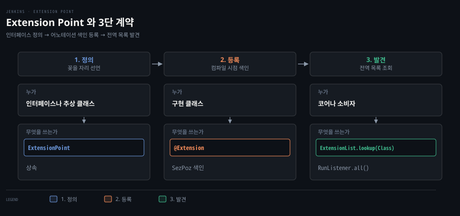

# 전역 Hook·Listener 와 Extension Point

---

> 전사 파이프라인 거버넌스는 Shared Library Wrapper, Implicit Global Library, RunListener, FlowExecutionListener라는 네 가지 경로로 통제 수준을 나눕니다. 이 편은 빌드 수명과 flow 실행 수명의 차이를 분석하고 Jenkins 확장을 지탱하는 3단 계약과 클래스로더 격리 원리를 소스로 확인합니다.

## 학습 목표

> 이 편을 읽고 나면 아래 네 가지를 스스로 설명하고 판단할 수 있습니다.

1. 전역 Hook 의 네 가지 접근법을 강제성과 Jenkinsfile 수정 여부로 비교할 수 있습니다.
2. RunListener 와 FlowExecutionListener 의 관측 수명 차이와 재기동 시 `onResumed` 의 역할을 설명할 수 있습니다.
3. ExtensionPoint 의 3단 계약과 Describable·Descriptor 이중성을 설명할 수 있습니다.
4. 플러그인의 계층형 클래스로더 구조가 제공하는 의존성 격리 수준과 한계를 설명할 수 있습니다.

## 1. 분산된 Jenkinsfile 과 공통 규칙

> 수백 개 저장소에 흩어진 Jenkinsfile 에 공통 보안 검사나 감사 로그를 일일이 심는 작업은 현실적으로 불가능합니다. 팀의 자발적 협조에 기대는 방식은 강제성이 없어 전사 거버넌스 구멍을 만듭니다.

프로젝트가 늘어나 백 개 단위를 넘으면 파이프라인 관리는 분산의 덫에 걸립니다. 각 팀의 저장소마다 Jenkinsfile 이 따로 존재하기 때문입니다. 보안팀이 전사 빌드 시작 시점의 감사 로그나 결과 알림을 요구해도 모든 저장소의 코드를 관리자가 직접 고칠 수는 없습니다.

일부 저장소는 권한이 닫혀 있고 일부는 변경 승인 절차가 길어 수개월이 걸립니다. 각 팀에 새 규칙을 적용해 달라고 요청해도 누락이나 지연이 발생합니다.

결국 개별 Jenkinsfile 을 고치지 않고 외부에서 로직을 끼워 넣는 통제 수단이 필요해집니다. Jenkins 는 이를 위해 파이프라인 래퍼부터 내부 이벤트 리스너까지 다양한 후킹 경로를 제공합니다.

## 2. 네 가지 전역 Hook 의 비교

> 파이프라인에 공통 규칙을 주입하는 방법은 협조를 구하는 래퍼부터 바깥에서 강제하는 리스너까지 네 갈래로 나뉩니다. 통제 수준이 높을수록 개별 파이프라인의 자율성은 줄어들고 오류 시 폭발 반경은 커집니다.

전역 후킹을 선택할 때는 먼저 Jenkinsfile 수정 권한과 강제 대상의 범위를 따져야 합니다. 주요 수단은 네 가지입니다.

Shared Library Wrapper 는 `vars/` 스크립트의 `call()` 클로저로 전체 파이프라인을 감쌉니다. 팀별로 `@Library` 버전을 고정할 수 있어 안전하지만 개별 Jenkinsfile 수정이 필요합니다.

Implicit Global Library 는 전역 설정에서 자동 로드되는 공유 라이브러리입니다. Jenkinsfile 에서 선언 없이 함수를 부를 수 있지만 스스로 실행되지는 않습니다.

`RunListener` 는 코어가 제공하는 빌드 수명주기 감시자입니다.[^run-listener] 플러그인이 `@Extension` 으로 등록하면 Jenkinsfile 수정 없이 모든 빌드에 적용됩니다.

`FlowExecutionListener` 는 workflow-api 플러그인이 제공하는 flow 전용 감시자입니다.[^flow-execution-listener] 두 리스너 모두 Jenkinsfile 은 건드리지 않습니다. 다만 컨트롤러에 플러그인을 설치해야 하므로 관리자 권한이 필요합니다.

아래 표는 네 접근법의 특성과 권장 환경을 비교한 것입니다.

| 접근 방식 | 강제 수준 | 적용 대상 | Jenkinsfile 수정 | 주 용도 |
|---|---|---|---|---|
| Shared Library Wrapper | Opt-in | Pipeline | 필요 (`@Library`) | 표준 템플릿 제공, 팀별 파이프라인 추상화 |
| Implicit Global Library | 권장/혼합 | Pipeline | 불필요(로딩) / 필요(호출) | 전사 공통 함수 배포, 래퍼와 결합 |
| RunListener | 강제 | 모든 빌드 타입 | 불필요 | 전사 감사 로그, 외부 메트릭, 전체 정책 |
| FlowExecutionListener | 강제 | Pipeline 전용 | 불필요 | 파이프라인 flow 분석, 재개(`onResumed`) 감지 |

자발적 표준화를 유도할 때는 Wrapper 패턴이 가장 유리합니다. 반면 보안이나 감사 로그처럼 예외 없이 강제해야 하는 정책이라면 `RunListener` 나 `FlowExecutionListener` 를 골라야 합니다.

## 3. 두 리스너와 관측 수명

> 빌드 객체 자체의 수명과 파이프라인 흐름의 실행 수명은 서로 다른 계층에서 흐릅니다. Freestyle 까지 아우르는 전사 정책은 RunListener 가, 재개를 포함한 흐름 제어는 FlowExecutionListener 가 맡습니다.

빌드 알림을 `RunListener` 로 구현했는데 컨트롤러 재기동 뒤 살아난 파이프라인이 리스너에 아무 신호도 주지 않는 문제가 생깁니다. Freestyle 은 JVM 이 내려가면 끝나지만 Pipeline 은 재기동을 거쳐 이어질 수 있기 때문입니다. 이 차이로 인해 리스너의 관측 대상도 둘로 갈립니다.

`RunListener` 는 빌드 객체(`Run`)의 수명을 감시합니다. 잡는 이벤트는 네 가지입니다.

- `onStarted`: 빌드가 시작된 직후 호출됩니다.
- `onCompleted`: 빌드 결과가 확정된 직후 호출됩니다.
- `onFinalized`: 빌드가 `COMPLETED` 상태로 넘어가 기록이 디스크에 쓰인 뒤 호출됩니다. 이때는 빌드 로그용 `TaskListener` 가 없습니다. 호출 시점은 `onCompleted` 보다 나중입니다.
- `onDeleted`: 빌드가 삭제되기 직전에 호출됩니다.

`RunListener<R>` 는 생성자에서 정한 대상 타입 `R` 의 빌드에만 반응합니다. `Run` 으로 두면 Freestyle 과 Pipeline 을 모두 봅니다. Pipeline 은 `WorkflowRun` 이 `onStarted` 와 `onCompleted` 를 호출합니다.[^workflow-run]

반면 `FlowExecutionListener` 는 Pipeline 의 `FlowExecution` 수명만 감시합니다. `FlowExecution` 은 Jenkinsfile 을 실행하는 flow 객체입니다. 이벤트는 `onCreated`, `onRunning`, `onResumed`, `onCompleted` 넷입니다.[^flow-execution-listener] `onResumed` 는 컨트롤러 재기동 뒤 실행 중이던 파이프라인을 이어 갈 때 불립니다.[^workflow-run] `RunListener` 에는 이런 재개 이벤트가 없습니다.

호출 순서도 다릅니다. `WorkflowRun` 은 flow 를 만들기 전에 `RunListener.onStarted` 를 부릅니다. flow 를 만든 뒤에야 `onCreated` 와 `onRunning` 을 부릅니다.[^workflow-run] 그래서 flow 를 만들지 못한 빌드는 `FlowExecutionListener` 에 시작 이벤트가 가지 않습니다. 이 빌드의 시작은 `RunListener` 만 봅니다.

전역 리스너는 컨트롤러 JVM 안에서 실행됩니다. 코어는 리스너마다 예외를 잡아 경고 로그만 남기므로, 예외가 빌드를 실패시키지는 않습니다.[^listeners-notify] 대신 그 콜백의 일이 조용히 빠집니다. 감사 로그를 보내는 리스너가 예외로 죽어도 빌드는 계속 돌기 때문입니다. 따라서 호출 실패를 경고 로그에서 감시해야 합니다. 콜백은 가볍게 두는 편이 좋습니다. 같은 스레드에서 동기로 불리므로 느린 외부 호출이 빌드 진행을 지연시키기 때문입니다.

## 4. Extension Point 와 3단 계약

> Jenkins 코어는 인터페이스 선언, 어노테이션 색인, 전역 목록 조회의 3단 계약으로 플러그인과 결합합니다. 사용자가 설정하는 확장은 인스턴스 데이터와 싱글턴 메타데이터를 분리하여 다룹니다.

새 플러그인을 설치해도 코어를 다시 빌드하거나 복잡한 등록 절차를 거치지 않습니다. 코어 코드를 수정하지 않고 외부 확장이 시스템에 꽂히는 배경에는 정합한 계약이 작동합니다.

확장은 세 단계로 동작합니다.

아래 도식은 정의, 등록, 발견으로 이어지는 3단 계약의 단계별 주체와 식별자를 보입니다.

첫째는 정의입니다. 인터페이스나 추상 클래스가 `ExtensionPoint` 를 상속해 꽂을 자리를 선언합니다.[^extension-point] 앞서 본 `RunListener` 와 배정 거부권을 쥐는 `QueueTaskDispatcher` 도 모두 이 인터페이스를 상속합니다.

둘째는 등록입니다. 구현 클래스에 `@Extension` 어노테이션을 붙입니다.[^extension] 이 어노테이션은 SezPoz 색인 대상이라, 컴파일할 때 만들어진 색인으로 구현체를 찾습니다. 코어와 플러그인 모두 같은 방식으로 등록합니다.

셋째는 발견입니다. 코어나 소비자가 `ExtensionList.lookup(Class)` 를 호출해 등록된 모든 구현체를 모아 실행합니다.[^extension-list] `RunListener.all()` 도 이 호출을 감싼 것입니다.

설정 화면을 가진 확장은 `Describable` 과 `Descriptor` 로 분리됩니다. Job 마다 달라지는 설정값은 `Describable` 인스턴스에 담깁니다.[^describable] 반면 표시 이름이나 입력 검증(`doCheckXxx`) 같은 메타데이터는 클래스당 하나인 `Descriptor` 가 맡습니다.[^descriptor] 공식 문서는 이 관계를 객체지향의 클래스와 객체에 빗댑니다.[^extensibility]

활성화된 플러그인은 각자 독립된 클래스로더를 받습니다.[^plugin-classloader] 클래스로더는 코어와, 플러그인이 `Plugin-Dependencies` 로 선언한 플러그인에 위임합니다. 서로 의존하지 않는 두 플러그인은 같은 이름의 클래스를 따로 가져도 됩니다. 반면 의존하는 플러그인끼리는 부모 쪽 클래스가 먼저 쓰이므로, 한쪽이 다른 버전의 라이브러리를 기대하면 충돌할 수 있습니다.

## 5. 재기동 뒤 리스너가 놓치는 상태

> 컨트롤러가 재기동되면 메모리에 머물던 리스너 상태는 사라지고 내구성 설정에 따라 재개 이벤트도 갈립니다. 리스너가 상태를 다룰 때는 이 조건을 함께 고려해야 합니다.

리스너를 등록해 두면 모든 상황을 완벽히 감시할 수 있다고 믿기 쉽습니다. 하지만 컨트롤러 재기동이나 비정상 종료가 발생하면 여러 경계 조건이 드러납니다.

첫째는 메모리 상태의 소실입니다. 리스너가 정적 변수나 인메모리 맵에 빌드 통계를 모아 두었다면 재기동 시 완전히 사라집니다. 유지해야 하는 상태는 디스크나 외부 저장소에 따로 기록해야 합니다.

둘째는 파이프라인 내구성과 `onResumed` 의 누락입니다. `onResumed` 는 재개할 수 있는 실행이 로드되어 이어질 때만 불립니다.[^workflow-run] 내구성 설정의 기본값은 `MAX_SURVIVABILITY` 입니다. 이 설정은 step 마다 상태를 씁니다. 반면 `PERFORMANCE_OPTIMIZED` 는 컨트롤러가 정상 종료할 때만 저장합니다. 이 설정에서 컨테이너가 강제 종료되면 step 정보를 잃습니다. 빌드를 재개하지 못하니 재개 이벤트인 `onResumed` 도 기대할 수 없습니다. 자세한 모드별 차이는 `04-01` 편이 다룹니다.

셋째는 점검 시간의 사각지대입니다. 컨트롤러가 내려가 있는 동안 발생한 외부 이벤트나 타임아웃은 리스너가 실시간으로 감지할 수 없습니다.

넷째는 `post` 블록과의 차이입니다. Jenkinsfile 의 `post` 블록은 Jenkinsfile 안에 있습니다. 스크립트를 읽다가 문법 에러가 나면 실행되지 못합니다. 반면 `RunListener.onCompleted` 는 빌드가 끝나는 지점에서 불립니다. `WorkflowRun` 은 빌드를 마무리하는 `finish` 에서 오류가 있었을 때도 `onCompleted` 를 부릅니다.[^workflow-run] 따라서 Jenkinsfile 이 깨진 빌드까지 알림이나 감사 로그에 남기려면 `RunListener` 가 낫습니다.

## 면접에서 받을 만한 질문

> 전역 Hook 과 확장 계약은 아키텍처 설계와 운영 안정성을 묻는 단골 질문입니다. 아래 네 질문에 스스로 답해 보세요.

1. 수백 개 파이프라인에 공통 감사 정책을 적용할 때 Shared Library Wrapper 와 RunListener 중 무엇을 고르며 그 이유는 무엇입니까?
2. RunListener 와 FlowExecutionListener 의 관측 수명 차이를 설명하고 `onResumed` 가 불리지 않는 실패 조건을 들어 보십시오.
3. Jenkins 의 Extension Point 3단 계약을 설명하고 Describable 과 Descriptor 로 클래스를 나누는 이유를 말해 보십시오.
4. 플러그인의 계층형 클래스로더 구조가 버전 충돌을 막는 방식과, 리스너가 인메모리 상태를 다룰 때의 주의점을 설명해 보십시오.

## 정답 (자답 후 펼치기)

> 위 면접 질문 4개에 먼저 자답한 뒤 아래를 읽으세요.

### 정답 1 — 강제성과 폭발 반경의 트레이드오프

Jenkinsfile 수정 권한이 있고 점진적 배포가 필요하다면 Shared Library Wrapper 를 고릅니다. 태그 버전 고정이 가능해 라이브러리 변경이 전사 파이프라인에 즉시 장애를 주지 않기 때문입니다. 반면 레거시나 외부팀 잡까지 예외 없이 정책을 강제해야 한다면 `RunListener` 를 골라야 합니다. `RunListener` 는 Jenkinsfile 수정 없이 모든 빌드를 가로챕니다. 다만 플러그인으로 설치해야 합니다. 리스너 코드의 예외는 코어가 삼키므로 실패를 로그로 감시해야 합니다.

### 정답 2 — 빌드 수명 대 flow 수명과 내구성 제약

`RunListener` 는 빌드(`Run`) 객체의 시작과 종료, 최종화를 관측하므로 Freestyle 을 포함한 모든 빌드에 걸립니다. 반면 `FlowExecutionListener` 는 Pipeline flow 의 실행 수명만 관측하며 재개 이벤트인 `onResumed` 를 제공합니다. `onResumed` 가 불리지 않는 대표 조건은 `PERFORMANCE_OPTIMIZED` 내구성 모드에서 비정상 종료(dirty shutdown)가 일어난 경우입니다. 이 모드는 정상 종료 때만 실행 상태를 저장하므로 재개할 상태가 남지 않습니다.

### 정답 3 — 3단 계약과 데이터·메타데이터 분리

3단 계약은 정의와 등록과 발견으로 이어집니다. 인터페이스가 `ExtensionPoint` 를 상속해 꽂을 자리를 정의합니다. 구현체는 `@Extension` 으로 등록되고 소비자는 `ExtensionList.lookup()` 으로 목록을 발견합니다. 등록은 SezPoz 색인이 맡습니다. 확장을 `Describable` 과 `Descriptor` 로 나누는 이유는 사용처마다 다른 인스턴스 데이터(Job 설정값)와 클래스당 하나만 존재하는 메타데이터(표시 이름, 폼 검증 로직, 전역 설정)의 요구가 갈라지기 때문입니다.

### 정답 4 — 계층 위임 클래스로더와 인메모리 휘발성

Jenkins 플러그인은 독립된 클래스로더를 할당받고 코어와 선언된 의존 플러그인에 위임합니다. 서로 의존하지 않는 플러그인은 같은 이름의 클래스를 따로 가져도 충돌하지 않습니다. 다만 의존 관계가 있으면 부모 쪽 클래스가 먼저 쓰이므로 충돌 여지가 남습니다. 리스너가 인메모리 변수에 데이터를 들고 있으면 컨트롤러 재기동 시 휘발되므로, 영속성이 필요한 상태는 `save()` 로 디스크에 기록하거나 외부 시계열 DB 로 즉시 전송해야 합니다.

## 관련 문서

- [Controller·Agent·Executor 와 JENKINS_HOME](01-01.Controller·Agent·Executor%20와%20JENKINS_HOME.md) — `JENKINS_HOME` 구조와 `plugins/` 디렉토리에 플러그인이 적재되는 원리
- [Queue 상태 전이와 Executor 로 가는 길](02-02.Queue%20상태%20전이와%20Executor%20로%20가는%20길.md) — `QueueTaskDispatcher` 가 `ExtensionList` 로 발견되어 배정 거부권을 행사하는 지점
- [재기동을 견디는 Pipeline](04-01.재기동을%20견디는%20Pipeline.md) — 내구성 모드와 `program.dat` 복원, `onResumed` 발화의 전제 조건
- [Groovy 는 Jenkins 어디서 도는가](05-01.Groovy%20는%20Jenkins%20어디서%20도는가.md) — Controller JVM 에서 도는 코드와 관리자 실행 권한의 경계

[^run-listener]: Jenkins core 2.580.2 `RunListener.java`. `public abstract class RunListener<R extends Run> implements ExtensionPoint` <https://github.com/jenkinsci/jenkins/blob/jenkins-2.580.2/core/src/main/java/hudson/model/listeners/RunListener.java#L70>
[^flow-execution-listener]: workflow-api 1429.v7a_1b_efb_a_f7c5 `FlowExecutionListener.java`. `public abstract class FlowExecutionListener implements ExtensionPoint` 와 `onCreated`·`onRunning`·`onResumed`·`onCompleted` <https://github.com/jenkinsci/workflow-api-plugin/blob/1429.v7a_1b_efb_a_f7c5/src/main/java/org/jenkinsci/plugins/workflow/flow/FlowExecutionListener.java#L16-L58>
[^workflow-run]: workflow-job 1624.ve973eb_34e031 `WorkflowRun.java`. `RunListener.fireStarted`(326행), `FlowExecutionListener.fireCreated`·`fireRunning`(358~360행), `fireResumed`(626행), `RunListener.fireCompleted`(705행) <https://github.com/jenkinsci/workflow-job-plugin/blob/1624.ve973eb_34e031/src/main/java/org/jenkinsci/plugins/workflow/job/WorkflowRun.java#L326>
[^listeners-notify]: Jenkins core 2.580.2 `Listeners.java`. `notify` 가 리스너마다 `catch (Throwable x)` 로 경고 로그만 남김. `RunListener` 의 `fireStarted` 등이 이 메서드를 사용 <https://github.com/jenkinsci/jenkins/blob/jenkins-2.580.2/core/src/main/java/jenkins/util/Listeners.java#L47-L53>
[^extension]: Jenkins core 2.580.2 `Extension.java`. `@Indexable` 이 붙은 어노테이션이고 SezPoz 를 참조 <https://github.com/jenkinsci/jenkins/blob/jenkins-2.580.2/core/src/main/java/hudson/Extension.java#L71>
[^extensibility]: Jenkins developer documentation. "Extensibility" 절의 Extension annotation 과 Descriptors and Describables <https://www.jenkins.io/doc/developer/extensibility/>
[^extension-point]: Jenkins core 2.580.2 `ExtensionPoint.java`. `public interface ExtensionPoint` <https://github.com/jenkinsci/jenkins/blob/jenkins-2.580.2/core/src/main/java/hudson/ExtensionPoint.java#L47>
[^extension-list]: Jenkins core 2.580.2 `ExtensionList.java`. `public static <T> ExtensionList<T> lookup(Class<T> type)` <https://github.com/jenkinsci/jenkins/blob/jenkins-2.580.2/core/src/main/java/hudson/ExtensionList.java#L436>
[^describable]: Jenkins core 2.580.2 `Describable.java`. `public interface Describable<T extends Describable<T>>` <https://github.com/jenkinsci/jenkins/blob/jenkins-2.580.2/core/src/main/java/hudson/model/Describable.java#L35>
[^descriptor]: Jenkins core 2.580.2 `Descriptor.java`. `public abstract class Descriptor<T extends Describable<T>> implements Loadable, Saveable, OnMaster` <https://github.com/jenkinsci/jenkins/blob/jenkins-2.580.2/core/src/main/java/hudson/model/Descriptor.java#L152>
[^plugin-classloader]: Jenkins developer documentation. "The plugin class loader hierarchy" <https://www.jenkins.io/doc/developer/plugin-development/dependencies-and-class-loading/>
