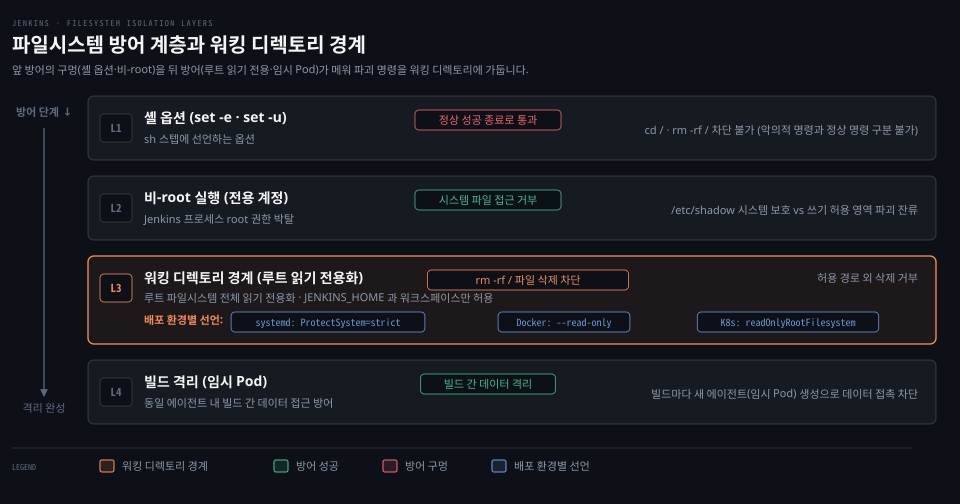
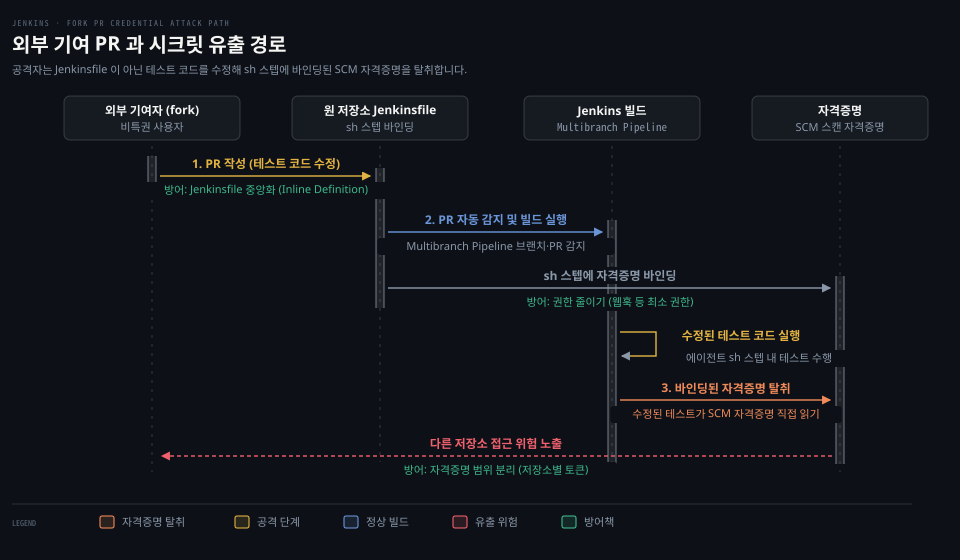

# 빌드 격리와 공격 표면

---

> 빌드는 기본적으로 SYSTEM 권한과 호스트 프로세스 권한을 물려받아 실행되므로, 격리와 입력 검증이 없으면 시스템 전체로 피해가 번집니다. 이 편은 비-root 워킹 디렉토리 격리, 외부 PR 시크릿 보호, crumb 과 CSP, 그리고 노출 포트와 TLS 종단 위치까지 빌드와 웹의 방어선을 정리합니다.

## 학습 목표

> 이 편을 읽고 나면 아래 다섯 가지를 스스로 설명하고 구분할 수 있습니다.

1. 빌드가 기본적으로 내부 SYSTEM 전권으로 실행되는 위험과 `Authorize Project` 플러그인의 한계를 설명할 수 있습니다.
2. 비-root 실행과 워킹 디렉토리 경계가 파괴 명령의 피해를 가두는 원리를 설명할 수 있습니다.
3. Multibranch Pipeline 에서 외부 fork PR 이 시크릿을 탈취하는 경로와 저장소 격리 방어책을 설명할 수 있습니다.
4. 웹 계층의 crumb 토큰과 두 계층의 CSP 가 막는 공격을 구분할 수 있습니다.
5. 노출 포트 축소 방법과 TLS 종단 위치에 따른 인증서 검증 주체를 설명할 수 있습니다.

## 1. 빌드 실행 권한과 SYSTEM 계정

> 빌드는 기본적으로 전권을 가진 SYSTEM 계정 권한으로 실행되므로 트리거 주체와 무관하게 모든 리소스에 접근할 수 있습니다. 이를 특정 사용자 권한으로 묶는 플러그인이 있지만 공식 유지보수 경고가 붙어 있어 에이전트 격리와 병행해야 합니다.

Jenkins 빌드는 내부 `SYSTEM` 유저 권한으로 돕니다. 이 유저는 어느 노드에서든 실행할 수 있습니다. Job 을 만들고 지우며 다른 빌드를 시작하고 취소하는 전권도 가집니다.[^build-auth] 빌드를 요청한 사람의 권한과 무관하게 스크립트 자체가 `SYSTEM` 권한으로 동작합니다.

세밀한 권한 제어가 필요한 환경에서 이 구조는 보안 구멍이 됩니다. 파이프라인 빌드 스텝이 다른 Job 을 호출할 때 권한 없는 작업까지 임의로 제어할 수 있습니다. 공식 문서는 빌드 권한 부여를 쓰지 않거나 빌드가 `SYSTEM` 으로 도는 것 자체가 이런 문제가 생길 수 있다는 징후라고 설명합니다.[^build-auth]

공식 해법은 `Authorize Project` 플러그인입니다. 이 플러그인은 전역 또는 프로젝트별로 빌드에 부여할 권한을 설정하게 해 줍니다. 하지만 공식 문서는 이 플러그인이 활발하게 유지보수되지 않으며 알려진 한계가 있다고 직접 명시합니다.[^build-auth]

따라서 플러그인에만 의존하지 않고 빌드가 도는 환경을 물리적으로 떼어내야 합니다. built-in 노드에서 도는 빌드는 Jenkins 프로세스와 같은 수준으로 컨트롤러 파일시스템에 접근합니다. 그래서 공식 문서는 빌드를 에이전트에서 돌리라고 권고합니다.[^controller-isolation] built-in 노드의 Executor 수를 0 으로 두면 빌드가 컨트롤러 파일시스템에 닿는 통로가 끊깁니다.

에이전트로 쓸 별도 컴퓨터가 없으면 다른 OS 사용자로 에이전트 프로세스를 띄워도 비슷한 효과를 얻습니다. 이때 그 프로세스는 Jenkins 홈 디렉토리를 읽지도 쓰지도 못해야 합니다. `sudo` 로 권한을 올릴 수도 없어야 합니다.[^controller-isolation]

## 2. 워크스페이스 밖을 막는 파일시스템 격리

> 셸 옵션만으로는 정상 실행되는 상위 경로 이동 명령을 막지 못하므로 OS 레벨의 격리가 필요합니다. 비-root 실행과 루트 파일시스템 읽기 전용화라는 두 기둥이 결합해야 파괴 명령의 피해가 워킹 디렉토리 안에 갇힙니다.

파이프라인의 `sh` 스텝에 `set -e` 와 `set -u` 를 선언해도 `cd /` 나 `rm -rf /` 를 막지 못합니다. 루트 디렉토리는 항상 존재하므로 `cd /` 는 에러가 아닌 정상 성공으로 끝나기 때문입니다. 셸 수준에서는 의도적인 악의적 명령과 정상 명령을 구분할 수 없습니다.

아래 도식은 셸 옵션의 한계를 비-root 실행과 워킹 디렉토리 경계로 보완하는 파일시스템 방어 계층을 보입니다.

방어는 비-root 실행과 워킹 디렉토리 경계라는 두 기둥으로 완성됩니다.
- 비-root 실행: Jenkins 프로세스를 root 가 아닌 전용 계정으로 실행합니다. 프로세스가 root 권한이 없으므로 OS 가 `/etc/shadow` 같은 시스템 파일 접근이나 시스템 파괴를 거부합니다.
- 워킹 디렉토리 경계: 루트 파일시스템 전체를 읽기 전용으로 두고 `JENKINS_HOME` 과 워크스페이스만 쓰기를 허용합니다. `rm -rf /` 가 실행되어도 루트가 읽기 전용이므로 파일 삭제가 차단됩니다.

이 두 기둥은 각 배포 환경에서 다음처럼 구현됩니다.
- systemd: `ProtectSystem=strict` 를 지정하면 `/dev`·`/proc`·`/sys` 를 뺀 전체가 읽기 전용이 됩니다. 쓸 경로는 `ReadWritePaths=` 로 엽니다.[^systemd-exec]
- Docker: `--read-only` 로 컨테이너 루트를 읽기 전용으로 마운트합니다. 필요한 쓰기 경로는 `--tmpfs /tmp` 와 볼륨 마운트로 제한해 엽니다.
- Kubernetes: `securityContext` 로 비-root 와 읽기 전용 루트를 선언합니다. `runAsNonRoot: true` 와 `readOnlyRootFilesystem: true` 를 조합합니다. 여기에 빌드마다 새 에이전트(임시 Pod)를 띄우면 빌드끼리 서로의 데이터에 닿지 못합니다.[^securing-builds]

## 3. 외부 기여 PR 과 시크릿 유출 경로

> Jenkinsfile 을 고칠 수 있는 권한은 SCM 자격증명을 마음대로 쓸 수 있는 권한과 같습니다. 자격증명이 바인딩된 `sh` 스텝이 저장소 코드를 실행하면 테스트 코드만 고쳐도 읽힙니다.

외부 기여자가 낸 PR 을 자동으로 빌드하면 그 PR 의 코드가 자격증명 근처에서 실행됩니다. Multibranch Pipeline 은 브랜치와 PR 을 자동 감지해 빌드합니다. 이 프로젝트에는 SCM 스캔 자격증명이 연결되고, 컨트롤러는 그 자격증명으로 스캔하고 에이전트는 체크아웃합니다. 자격증명은 자식 Pipeline Job 에서도 쓸 수 있습니다. 그래서 Jenkinsfile 을 고칠 수 있는 사람은 이 자격증명을 마음대로 쓸 수 있는 사람으로 봐야 합니다.[^securing-scm]

누가 Jenkinsfile 을 고칠 수 있는지는 Branch Source 설정이 정합니다. GitHub Branch Source 는 저장소의 브랜치에 쓸 수 있는 사람을 신뢰합니다.[^securing-scm]

공격 경로는 비특권 사용자가 fork 저장소에서 PR 을 올리는 지점에서 시작됩니다.

아래 도식은 외부 기여 PR 에서 테스트 코드 수정을 통해 자격증명을 탈취하는 경로와 단계별 방어 지점을 보입니다.

1. 비특권 사용자가 fork 저장소에서 PR 을 작성합니다.
2. Jenkinsfile 이 자격증명을 `sh` 스텝에 바인딩해 저장소의 테스트를 돌리도록 되어 있습니다. 공격자는 Jenkinsfile 이 아니라 테스트 코드를 수정해 그 자격증명을 읽어 가게 만듭니다.
3. Multibranch Pipeline 이 이 PR 을 빌드하면 수정된 테스트가 자격증명을 읽습니다.[^securing-scm]

한 저장소의 쓰기 권한이 그 자격증명으로 닿는 다른 저장소의 접근으로 이어집니다. 스캔 자격증명이 저장소 읽기·쓰기보다 큰 권한(웹훅 관리 등)을 가졌다면 그 권한까지 노출됩니다. 공식 문서가 제시하는 방어책은 다음과 같습니다.[^securing-scm]
- 자격증명 범위 분리: 특정 저장소만 접근하는 자격증명(예: GitHub 의 fine-grained personal access token)을 만듭니다. Organization Folder 를 나누고 폴더마다 그 자격증명을 정의합니다. SCM 이 이런 자격증명을 지원하지 않으면 저장소마다 Multibranch Pipeline 을 두고 그 저장소만 접근하는 자격증명을 답니다.
- 권한 줄이기: 자격증명에서 웹훅 권한 같은 것을 빼고 웹훅은 관리자가 수동으로 설정합니다. 권한 상승을 막는 일반 해법은 없다고 공식 문서가 밝힙니다.
- Jenkinsfile 중앙화: Multibranch Pipeline Inline Definition 같은 플러그인으로 파이프라인을 중앙에서 정의합니다. 신뢰하지 않는 사용자가 Jenkinsfile 을 못 고치면 이 문제는 해당하지 않습니다.
- GitHub App Credentials: GitHub Branch Source 플러그인은 이 자격증명에 보안 기능을 더 제공합니다. 세부는 플러그인 문서를 봅니다.

## 4. 웹 계층의 crumb 토큰과 CSP

> 브라우저 세션을 도용하는 CSRF 는 인스턴스 salt 가 결합된 crumb 토큰으로 검증하고, 악성 스크립트 실행은 워크스페이스와 UI 두 계층의 CSP 로 차단합니다. 권한 인가를 웹 브라우저 계층에서 한 겹 더 방어하는 구조입니다.

CSRF 는 로그인된 사용자의 브라우저 세션을 악용해 외부 악성 사이트가 Jenkins 에 위조 요청을 보내는 공격입니다. Jenkins 는 crumb 토큰으로 이를 방어합니다. Default Crumb Issuer 는 사용자명, 웹 세션 ID, 인스턴스 고유 salt 를 조합해 crumb 을 생성합니다.[^csrf-protection] 악성 사이트는 세션 ID 와 salt 를 알 수 없어 유효한 crumb 을 만들지 못합니다.

스크립트 클라이언트가 사용자명과 비밀번호로 인증해 POST 를 보내면 crumb 도 필요합니다. crumb 에 웹 세션 ID 가 들어 있으므로 `/crumbIssuer/api` 로 crumb 을 받아야 합니다. 응답의 `Set-Cookie` 세션 쿠키도 이후 요청에 함께 보냅니다. 반면 API 토큰으로 인증한 요청은 CSRF 보호에서 면제됩니다.[^csrf-protection] 토큰은 브라우저 쿠키처럼 자동으로 실려 나가지 않고 요청자가 직접 넣어야 하므로 위조 요청이 성립하지 않기 때문입니다.

CSP 는 사용자가 제어하는 콘텐츠가 XSS 공격 벡터가 되는 것을 막습니다. Jenkins 의 CSP 는 두 계층으로 나뉩니다.[^configuring-csp][^ui-csp]

| 구분 | 워크스페이스·아티팩트 CSP | UI CSP (2.539+) |
|---|---|---|
| 적용 대상 | 빌드 산출물 HTML 및 파일 | Jenkins 관리 화면 페이지 |
| 기본 상태 | 활성화 (스크립트 전면 차단) | 비활성화 (위반 리포트만 수집) |
| 주 목적 | 산출물 서빙 시 XSS 차단 | 플러그인 호환성 확인 후 보호 |

워크스페이스 CSP 의 기본 헤더 값은 `sandbox allow-same-origin; default-src 'none'; img-src 'self'; style-src 'self';` 입니다.[^configuring-csp] 스크립트·AJAX·폰트·프레임은 막습니다. 이미지와 스타일은 Jenkins 가 서빙하는 파일만 허용하고 인라인은 거부합니다.

Jenkins 는 기본으로 사용자 파일을 UI 와 같은 도메인에서 서빙합니다. 그래서 공식 문서는 이 헤더를 고치기보다 Resource Root URL 을 설정하라고 권합니다.[^ui-csp] 반면 UI CSP 는 플러그인 호환성을 먼저 점검할 수 있도록 리포트 수집 모드로 시작해 점진적으로 적용합니다.

사용자 입력 텍스트는 Markup Formatter 가 렌더링을 제어합니다. 기본값인 Plain Text 는 `<` 와 `&` 를 이스케이프해 스크립트 실행을 원천 차단합니다. 서식이 필요하면 OWASP Markup Formatter 플러그인을 설치합니다. 안전한 태그만 허용하는 Safe HTML 로 전환해 XSS 를 막습니다.[^markup-formatter]

## 5. 노출 포트 축소와 TLS 종단 위치

> 안 쓰는 포트를 닫고 에이전트 연결을 WebSocket 으로 단일화하면 외부 공격 표면이 크게 줄어듭니다. TLS 종단 위치에 따라 인증서 갱신 주기와 클라이언트의 truststore 검증 주체가 달라집니다.

사용하지 않는 포트를 열어 두거나 프록시 없이 컨트롤러를 외부에 직접 노출하면 불필요한 공격 표면이 생깁니다. 컨트롤러는 웹 UI(기본 8080) 외에도 인바운드 에이전트용 TCP 포트와 SSH 서버 포트를 열 수 있습니다.[^exposed-services]

TCP 에이전트 리스너는 대부분의 패키지에서 기본 비활성화이지만 Docker 이미지는 50000 포트로 노출합니다. SSH 서버는 SSH Server 플러그인이 여는 포트이고 기본 비활성화입니다. 인바운드 에이전트를 WebSocket 전송으로 설정하면 별도 TCP 포트도 특별한 보안 설정도 필요 없습니다. UDP 기반 자동 탐색은 보안 취약점으로 2.220 버전에서 완전히 제거되었습니다.[^exposed-services]

TLS 는 컨트롤러 JVM 에 직접 설정하기보다 리버스 프록시나 Ingress 에서 종단하는 구성이 흔합니다. 이 구성이면 인증서를 앞단에서 교체하므로 Jenkins 를 재시작하지 않아도 됩니다.

종단 위치가 바뀌면 검증 주체도 바뀝니다. 파이프라인 `sh` 스텝에서 curl 로 외부를 호출하면 검증하는 쪽은 컨트롤러가 아니라 그 명령을 실행하는 에이전트입니다. 기준은 에이전트 OS 의 truststore 입니다. 에이전트 환경에 사내 CA 인증서가 없으면 SSL 에러가 발생합니다. 이때 `-k` 로 검증을 끄는 안티패턴은 피해야 합니다. 에이전트 이미지에 사내 CA 를 넣거나 ConfigMap 으로 마운트해 신뢰 체인을 완성합니다.

## 면접에서 받을 만한 질문

1. Jenkins 빌드가 기본적으로 내부 SYSTEM 권한으로 도는 위험은 무엇이며, Authorize Project 플러그인에 붙은 공식 경고는 무엇입니까?
2. 셸 옵션 `set -e` 가 `cd /` 나 `rm -rf /` 를 막지 못하는 이유와, 비-root 실행과 파일시스템 경계가 결합해야 하는 이유는 무엇입니까?
3. Multibranch Pipeline 에서 외부 fork 저장소의 PR 빌드가 시크릿을 유출시키는 경로와 이를 막는 격리 원칙을 설명해 보세요.
4. Jenkins 에서 API 토큰으로 요청할 때 왜 crumb 토큰이 면제되며, 워크스페이스 CSP 와 UI CSP 의 기본 동작 차이는 무엇입니까?
5. 운영 환경에서 TLS 종단을 컨트롤러 JVM 대신 프록시나 Ingress 에 위임하는 이유와, 에이전트 내부 curl 호출 시 검증 주체는 어디입니까?

> 다섯 질문에 먼저 스스로 답해 보세요. 자답이 끝나면 아래 §정답 (자답 후 펼치기) 으로 내려갑니다.

## 정답 (자답 후 펼치기)

> 위 §면접에서 받을 만한 질문 의 다섯 개에 먼저 자답한 뒤 아래를 읽으세요.

### 정답 1 — SYSTEM 계정과 권한 한계

빌드는 트리거한 사람의 권한과 무관하게 전권을 가진 내부 SYSTEM 계정으로 실행됩니다. 세밀한 권한 제어 환경에서는 파이프라인의 빌드 스텝으로 권한 밖의 다른 Job 을 임의로 제어하는 권한 상승 사고가 발생할 수 있습니다. `Authorize Project` 플러그인이 실행 계정을 제한하지만, 공식 문서에 활발히 유지보수되지 않고 알려진 한계가 있다고 명시되어 있어 빌드를 에이전트로 격리하는 구조적 분리가 반드시 병행되어야 합니다.

### 정답 2 — 정상 성공 명령과 파일시스템 두 기둥

`set -e` 는 비정상 종료를 잡는 옵션인데 루트 디렉토리는 항상 존재하므로 `cd /` 는 정상 성공으로 끝나 셸이 중단되지 않습니다. 비-root 실행은 프로세스가 시스템 파일을 삭제할 OS 권한을 갖지 못하게 막고, 워킹 디렉토리 경계는 루트 파일시스템을 읽기 전용으로 만들어 지울 대상을 없앱니다. 비-root 만으로는 사용자 소유의 다른 경로가 위험하고 경계만으로는 root 권한 우회가 가능하므로 두 기둥이 함께 서야 워킹 디렉토리로 피해가 제한됩니다.

### 정답 3 — fork PR 시크릿 탈취와 저장소 격리

Jenkinsfile 이 자격증명을 `sh` 스텝에 바인딩해 둔 Multibranch Pipeline 이 fork PR 을 자동 빌드하면, 공격자가 Jenkinsfile 을 건드리지 않고 테스트 코드만 고쳐 자격증명을 읽어 갈 수 있습니다. 코드 수정 권한이 자격증명 접근 권한으로 바뀌기 때문입니다. 이를 막으려면 저장소별로 접근 범위가 좁은 자격증명을 만들어 Organization Folder 나 Multibranch Pipeline 을 나눠 달아야 합니다. Jenkinsfile 을 중앙에서 관리해 사용자가 못 고치게 하는 방법도 있습니다.

### 정답 4 — API 토큰의 CSRF 면제와 두 CSP

CSRF 는 브라우저 세션 쿠키가 요청마다 자동으로 실려나가는 점을 악용합니다. API 토큰은 사용자가 명시적으로 넣어 보내야 하므로 위조 요청이 성립하지 않고, 이런 요청은 CSRF 보호에서 면제됩니다.

워크스페이스·아티팩트 CSP 는 빌드 산출물 HTML 의 스크립트를 막기 위해 기본 활성화되어 있습니다. UI CSP 는 2.539 버전부터 도입되어 플러그인 호환성 점검을 위해 기본 비활성화 상태로 위반 리포트만 수집합니다.

### 정답 5 — TLS 종단과 에이전트 검증

프록시나 Ingress 에서 TLS 를 종단하면 인증서를 앞단에서 교체하므로 컨트롤러를 재시작하지 않아도 됩니다. 또한 파이프라인 `sh` 스텝에서 실행되는 curl 검증의 주체는 컨트롤러가 아닌 에이전트 OS 의 truststore 이므로, 사내 서비스 연동 시 에이전트 컨테이너나 Pod 에 사내 CA 인증서를 마운트해야 합니다.

## 관련 문서

- [Controller·Agent·Executor 와 JENKINS_HOME](01-01.Controller·Agent·Executor%20와%20JENKINS_HOME.md) — 컨트롤러 격리와 Executor 스레드 모델
- [정적 Agent 와 동적 Agent](01-02.정적%20Agent%20와%20동적%20Agent.md) — 동적 Pod 로 워크스페이스 잔류를 막는 구조
- [sh step 이 실패를 삼키는 이유](03-03.sh%20step%20이%20실패를%20삼키는%20이유.md) — 셸 실행 위생과 에러 전파 원리

[^build-auth]: Jenkins core documentation, Access Control for Builds. "Not using build authorization, or having builds run as SYSTEM, is an indicator that problems ... can occur" <https://www.jenkins.io/doc/book/security/build-authorization/>
[^controller-isolation]: Jenkins core documentation, Controller Isolation. "it is highly advisable to not run any builds on the built-in node, instead using agents" <https://www.jenkins.io/doc/book/security/controller-isolation/>
[^securing-builds]: Jenkins core documentation, Securing Builds. "Use cloud providers that create a new agent for every build" <https://www.jenkins.io/doc/book/security/securing-builds/>
[^systemd-exec]: systemd.exec man page. `ProtectSystem=strict`, `ReadWritePaths=` 지시어 설명. <https://man7.org/linux/man-pages/man5/systemd.exec.5.html>
[^securing-scm]: Jenkins core documentation, SCM credentials for Organization Folders and Multibranch Pipelines. "SCM credentials ... are available for arbitrary use by anyone who is able to modify the Jenkinsfile" <https://www.jenkins.io/doc/book/security/securing-org-folders-and-multibranch-pipelines/>
[^csrf-protection]: Jenkins core documentation, CSRF Protection. "Default Crumb Issuer ... encodes username, web session ID, and an instance-specific salt" <https://www.jenkins.io/doc/book/security/csrf-protection/>
[^configuring-csp]: Jenkins core documentation, Configuring Content Security Policy. 워크스페이스·아티팩트 등 사용자 생성 파일에 붙는 기본 `Content-Security-Policy` 헤더 값. <https://www.jenkins.io/doc/book/security/configuring-content-security-policy/>
[^ui-csp]: Jenkins core documentation, Content Security Policy (UI). "by default, CSP enforcement on Jenkins UI pages is disabled" <https://www.jenkins.io/doc/book/security/csp/>
[^markup-formatter]: Jenkins core documentation, Markup Formatters. <https://www.jenkins.io/doc/book/security/markup-formatter/>
[^exposed-services]: Jenkins core documentation, Exposed Services and Ports. 8080·50000 포트 및 2.220 에서의 UDP 제거. <https://www.jenkins.io/doc/book/security/services/>
