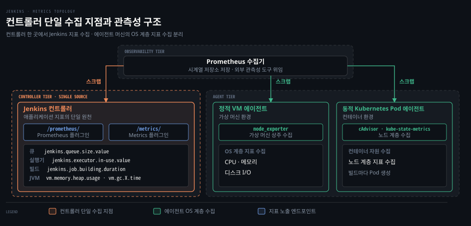

# 용량 산정과 성능 모니터링

---

> 컨트롤러는 빌드를 직접 돌리지 않지만 스케줄링과 웹 요청, 파이프라인 상태 관리로 CPU와 힙을 소비합니다. 이 편은 자원 소비 지점과 배포 형태를 비교하고, 네 그룹의 지표와 수집 구조로 병목을 진단하는 원리를 다룹니다.

## 학습 목표

> 이 편을 읽고 나면 아래 다섯 가지를 스스로 해낼 수 있습니다.

1. 컨트롤러가 빌드를 직접 돌리지 않아도 CPU·힙·디스크를 소비하는 이유를 설명할 수 있습니다.
2. 공식 사이징 추정식이 무엇에 비례하는지와 그 한계, 배포 형태별 트레이드오프를 비교할 수 있습니다.
3. 큐·실행기·빌드·컨트롤러 자원 네 지표 그룹이 부하 상황에서 움직이는 순서를 해석할 수 있습니다.
4. JVM GC 정지가 빌드 스케줄링 중단으로 이어지는 인과 메커니즘을 설명할 수 있습니다.
5. 컨트롤러 단일 수집 지점 구조의 한계와 에이전트 계층 지표 수집 방식을 설명할 수 있습니다.

## 1. 컨트롤러가 소비하는 세 자원

> 컨트롤러는 실제 빌드를 실행하지 않지만 스케줄링, UI 서빙, 상태 직렬화로 CPU와 힙, 디스크를 소비합니다. 빌드 실행 자원과 컨트롤러 조정 자원을 분리해 바라보아야 용량 병목을 막을 수 있습니다.

작은 사양의 가상 머신에 컨트롤러를 띄웠다가 개발팀이 늘어나면 에이전트가 넉넉해도 빌드가 늦어집니다. 웹 화면이 굳고 큐에 작업이 쌓이는 장애가 발생합니다. 컨트롤러가 빌드 스크립트를 직접 돌리지 않는다는 사실 때문에 컨트롤러 자체의 자원 소비를 간과하기 쉽습니다.

컨트롤러는 빌드 실행 대신 다음 네 가지 조정 업무를 전담합니다.

1. 스케줄링: 큐에 쌓인 작업을 정렬하고 빈 실행기를 찾아 배정합니다.
2. 웹 UI 및 API 서빙: 개발자의 브라우저 접근과 웹훅 요청을 처리합니다.
3. 에이전트 상태 감시: 연결된 노드의 상태를 주기적으로 확인하고 통신 채널을 유지합니다.
4. 파이프라인 상태 관리: 실행 중인 파이프라인의 각 단계 객체를 추적하고 디스크에 저장합니다.

이 조정 업무가 소비하는 세 자원은 CPU, 메모리(JVM 힙), 디스크입니다.

CPU는 빌드 연산이 아니라 동시 HTTP 요청 처리와 스케줄링 스레드에 소모됩니다. 개발자 수백 명이 브라우저를 열거나 소스 저장소 웹훅이 동시에 밀려들면 요청 처리 스레드가 CPU를 점유합니다. 큐 상태를 갱신하는 주기적 스케줄링 루프도 CPU를 사용합니다.

메모리는 큐 아이템과 노드 연결 객체, 진행 중인 파이프라인의 단계 상태를 JVM 힙에 유지하는 데 사용됩니다. 공식 문서는 에이전트 연결 하나가 스레드 2~3개를 쓰고 메모리로는 약 2MB 이상이라고 설명합니다.[^hw-rec]

디스크는 `$JENKINS_HOME` 아래에 설정과 빌드 기록, 플러그인을 보관하는 데 쓰입니다.[^hw-rec] 작업과 플러그인이 늘수록 필요한 용량이 커지므로 공식 문서는 빠른 디스크보다 큰 디스크를 권합니다.[^arch-scale] 빌드 처리량을 늘리려면 에이전트를 늘려야 하지만, 조정 능력을 유지하려면 컨트롤러 자원을 따로 확보해야 합니다.

## 2. 사이징 휴리스틱과 배포 형태 비교

> 공식 추정식은 용량 설계의 출발점일 뿐이며 실제 소비는 파이프라인과 플러그인에 따라 갈립니다. 배포 형태는 확장성과 운영 관리 부담의 맞교환으로 결정됩니다.

컨트롤러 사양을 정할 때 단순 공식에만 의존하면 런타임 부하를 감당하지 못합니다. 공식 문서도 사이징은 부정확한 일이라 설명하고 시작점만 제시합니다.[^hw-rec] 그 시작점은 아래 세 가지입니다.

| 대상 | 공식 문서의 추정 | 전제 |
|---|---|---|
| 컨트롤러 수 | 작업 수 ÷ 500 | 컨트롤러 코어 5개, 코어 하나가 작업 100개를 맡는다고 가정 |
| 실행기 수 | 작업 수 × 0.03 | 팀을 40명 단위로 나눈다고 가정 |
| 메모리 | 에이전트 연결 하나당 스레드 2~3개, 약 2MB 이상 | 연결 수에 비례하는 몫만 셈 |

개발자 수만 아는 경우에는 작업 수를 개발자 수 × 3.333 으로 먼저 잡고 위 식에 넣습니다.[^arch-scale]

이 식들이 변수로 삼는 것은 작업 수와 연결 수뿐입니다. 동시에 실행되는 파이프라인 수, 플러그인 개수, 빌드 기록의 양은 반영하지 못합니다. 공식 문서도 빌드와 테스트의 종류에 따라 조정이 필요하다고 덧붙입니다.[^arch-scale] 실제 용량은 운영 중 지표를 관찰해 보정해야 합니다.

배포 형태는 가상 머신과 Kubernetes 컨테이너, 물리 서버 중 하나를 선택합니다.

| 배포 형태 | 강점 | 약점 및 포기하는 점 |
|---|---|---|
| Kubernetes 컨테이너 (Cloud) | 동적 에이전트 확장, Pod 자동 복구, 유휴 자원 비용 절감 | Kubernetes 클러스터 운영 역량 필요, 초기 구성 복잡도 |
| Cloud VM | 친숙한 운영 방식, 컨테이너 전환 과도기에 적합 | 에이전트 정적 점유 시 비용 증가, 수동 스케일링 한계 |
| On-prem VM | 데이터 주권 보장, 내부 네트워크 지연 최소화 | 하드웨어 인프라 자체 관리 부담, 탄력적 자원 확장 한계 |
| On-prem Bare Metal | 최고 수준의 성능과 보안 격리 | 유휴 시간에도 발생하는 고정비, 하드웨어 감가상각과 유지보수 부담 |

Kubernetes 기반 컨테이너 배포는 에이전트 Pod를 필요할 때만 띄워 유휴 비용을 0으로 줄입니다. 반면 물리 서버 배포는 성능과 격리에서 앞서지만 탄력적 비용 조정을 포기합니다. 어떤 배포 형태든 JCasC를 도입하면 컨트롤러 환경을 코드로 재현할 수 있습니다. 수동 설정 실수를 줄여 시스템 신뢰성이 올라갑니다.

## 3. 네 지표 그룹과 부하별 병목 신호

> 지표는 큐, 실행기, 빌드, 컨트롤러 자원의 네 그룹으로 나뉩니다. 대량 트리거 부하는 컨트롤러 힙을 먼저 누르고, 무거운 빌드 스크립트는 에이전트 OS 자원을 먼저 소모합니다.

빌드가 밀릴 때 전체 큐 숫자만 보면 원인이 컨트롤러에 있는지 에이전트에 있는지 알 수 없습니다. 지표를 역할별로 나누어 관찰해야 병목 위치를 판별할 수 있습니다.

Jenkins 지표는 Metrics 플러그인이 Dropwizard Metrics API 로 만듭니다.[^metrics-plugin] Prometheus 플러그인은 Metrics 플러그인의 지표와 자기 지표를 함께 엔드포인트로 노출합니다.[^prometheus-plugin] 아래 표의 이름은 Metrics 플러그인 문서의 이름입니다. Prometheus 쪽에 어떤 이름으로 나오는지는 실제 `/prometheus/` 출력으로 확인합니다.

| 그룹 | 핵심 지표 (Metrics 플러그인 이름) | 답하는 질문 |
|---|---|---|
| 큐 (Queue) | `jenkins.queue.size.value`, `jenkins.queue.buildable.value` | 대기열이 쌓이는가, 유예 시간 중인 항목이 많은가 실행 후보가 많은가 |
| 실행기 (Executor) | `jenkins.executor.count.value`, `jenkins.executor.in-use.value` | 실행 슬롯이 포화 상태인가 |
| 빌드 (Build) | `jenkins.job.building.duration` (빌드 시간을 재는 timer) | 빌드 시간이 특정 작업에서 길어지는가 |
| 컨트롤러 자원 | `vm.memory.heap.usage`, `vm.gc.X.time`, `vm.count` | 컨트롤러 힙과 GC 가 한계에 가까운가 |

부하의 성격에 따라 먼저 움직이는 지표가 다릅니다.

수백 건 이상의 빌드가 동시에 요청되는 대량 트리거 상황에서는 컨트롤러 쪽 지표를 먼저 봐야 합니다. 큐 아이템은 컨트롤러 JVM 안에 있으므로 큐가 쌓이면 힙도 함께 늘기 때문입니다. 요청에 유예 시간(quiet period)이 설정되어 있다면 아이템은 먼저 대기 목록에 들어갑니다. 02-02 편이 보인 상태 전이입니다. 이 구간에서는 `jenkins.queue.size.value` 만 늘어납니다. 실행 후보 수인 `jenkins.queue.buildable.value` 는 낮게 머뭅니다. 큐가 줄어드는 속도는 대략 실행기 수 ÷ 평균 빌드 시간입니다.

반면 빌드 스크립트 자체가 무거운 상황에서는 에이전트가 먼저 포화됩니다. `jenkins.executor.in-use.value` 가 `jenkins.executor.count.value` 에 붙어 있고 빌드 시간 분포가 길어집니다. 컨트롤러 지표만으로는 에이전트 머신의 CPU와 메모리가 부족한지 알 수 없습니다. 그 원인은 에이전트 OS 계층의 지표로 확인해야 합니다.

## 4. GC 정지가 스케줄링 정지인 이유

> 컨트롤러는 단일 JVM 프로세스에서 스케줄링 루프와 웹 요청을 함께 처리합니다. 가비지 컬렉션의 긴 정지는 곧 빌드 배정 중단으로 이어집니다.

파이프라인 실행 중 빌드가 멈추고 웹 UI 응답이 지연되는 현상은 CPU 부족보다 가비지 컬렉션(GC)의 정지 시간에서 자주 비롯됩니다.

Jenkins 컨트롤러는 단일 JVM 위에서 실행됩니다. 큐 상태를 옮기는 `maintain()` 은 5초 주기의 `MaintainTask` 가 부릅니다. 새 아이템이 들어오면 바로 깨우기도 합니다.[^queue-internals] 이 호출은 02-02 편의 단일 락 아래에서 일합니다. 같은 JVM 에서 웹 요청도 처리됩니다.

JVM 에서 모든 애플리케이션 스레드가 멈추는 Stop-the-world 정지가 길어지면 `maintain()` 을 부르는 스레드도 그동안 실행되지 못합니다. 실행기가 비어 있어도 큐에 대기 중인 작업을 배정하지 못합니다.

이 구조는 심각한 되먹임 장애를 유발합니다. 큐에 작업이 급증하면 힙 사용량이 증가합니다. 힙이 부족해지면 Full GC 가 빈번하게 호출되고 정지 시간이 길어집니다. 정지 시간 동안 스케줄링이 중단되어 큐 아이템이 빠져나가지 못하고 더 쌓입니다. 쌓인 큐 아이템이 힙을 추가로 압박하면서 컨트롤러가 완전히 굳어버립니다.

정지 시간과 OOM 에 대비해 쓰는 대표적인 JVM 옵션은 아래와 같습니다. 이 편은 값을 권고하지 않고 옵션의 뜻만 적습니다.

- `-XX:+UseG1GC`: 가비지 컬렉터로 G1 을 고릅니다.
- `-XX:+AlwaysPreTouch`: 기동 시 힙 페이지를 미리 물리 메모리에 올립니다.
- `-XX:+HeapDumpOnOutOfMemoryError`: 메모리가 바닥나면 힙 덤프를 파일로 남깁니다.

## 5. 컨트롤러 단일 수집 지점과 관측성 구조

> 에이전트 배포 환경이 바뀌어도 Jenkins 애플리케이션 지표는 컨트롤러 한 곳에서 수집됩니다. 컨트롤러가 멈추면 지표 수집도 함께 중단되므로 OS 계층 감시와 분리해야 합니다.

에이전트 노드가 늘어나거나 컨테이너 환경으로 바뀌면 지표 수집 경로를 어디에 연결해야 할지 혼란이 생깁니다. 지표 수집 토폴로지는 에이전트 환경과 무관하게 컨트롤러 JVM을 애플리케이션 지표의 단일 원천으로 삼습니다.

아래 도식은 컨트롤러 단일 수집 지점과 에이전트 OS 계층의 관측성 구조를 보입니다.

Jenkins 내부 동작을 나타내는 큐, 실행기, 빌드 시간, JVM 지표는 모두 컨트롤러의 엔드포인트에서 생성됩니다. Metrics 플러그인은 `/metrics/` 아래 서블릿으로 지표를 노출합니다.[^metrics-plugin] Prometheus 플러그인은 기본 `/prometheus/` 경로에서 스크랩을 받습니다. 끝의 슬래시가 빠지면 리다이렉트됩니다.[^prometheus-plugin]

토폴로지에 따라 달라지는 것은 에이전트 머신의 OS 지표 수집 방식입니다.

- 정적 VM 에이전트: 각 가상 머신에 `node_exporter` 를 상주시켜 CPU, 메모리, 디스크 I/O 를 수집합니다.
- 동적 Kubernetes Pod 에이전트: Pod 가 빌드마다 생성되고 사라지므로 Pod 안에 수집기를 상주시킬 수 없습니다. 노드 계층의 cAdvisor 와 kube-state-metrics 를 통해 컨테이너 자원을 수집합니다.
- Prometheus 수집기: 컨트롤러 엔드포인트와 에이전트 OS 수집기를 각각 긁어와 시계열 저장소에 저장하고 대시보드와 경보를 외부 관측성 도구에 위임합니다.

이 구조에서 컨트롤러는 관측성의 단일 장애점(SPOF)이 됩니다. 컨트롤러 JVM 이 긴 GC 정지에 빠지거나 다운되면 모든 Jenkins 지표 스크랩이 동시에 타임아웃됩니다. 따라서 컨트롤러 프로세스의 생존 여부와 OS 자원은 Jenkins 지표와 분리된 외부 모니터링 경로로 감시해야 합니다.

## 면접에서 받을 만한 질문

1. 컨트롤러는 실제 빌드 스크립트를 돌리지 않는데도 동시 요청과 작업이 늘어날 때 CPU와 힙이 병목이 되는 이유는 무엇입니까?
2. 큐 지표에서 `jenkins.queue.size.value` 와 `jenkins.queue.buildable.value` 의 차이는 무엇이며 대량 트리거 직후 두 지표가 어떻게 다르게 움직입니까?
3. JVM GC 정지 시간이 길어질 때 빌드 배정 전체가 멈추는 이유와 되먹임(feedback loop) 현상을 설명해 보세요.
4. Jenkins 배포 형태 중 Container on K8s 가 성능과 비용에서 우위를 갖는 근거와 도입 시 고려해야 할 한계는 무엇입니까?
5. 컨트롤러와 에이전트가 VM과 K8s 로 혼합된 환경에서 Jenkins 애플리케이션 지표의 수집 지점은 몇 곳이며 에이전트 OS 지표 수집 방식은 어떻게 나뉩니까?

> 다섯 질문에 먼저 스스로 답해 보세요. 자답이 끝나면 아래 §정답 (자답 후 펼치기) 으로 내려갑니다.

## 정답 (자답 후 펼치기)

> 위 §면접에서 받을 만한 질문 의 다섯 개에 먼저 자답한 뒤 아래를 읽으세요.

### 정답 1 — 컨트롤러의 자원 소비 지점

컨트롤러는 빌드 연산 대신 동시 웹 UI 접근과 웹훅 처리에 CPU 스레드를 소모합니다. 큐 상태를 갱신하는 스케줄링 루프도 CPU를 씁니다. 힙 메모리에는 큐 아이템과 에이전트 연결 상태, 진행 중인 파이프라인 상태가 있으므로 연결과 동시 실행이 늘수록 힙 소비가 커집니다.

### 정답 2 — 큐 전체 크기와 실행 가능 지표의 분기

`size` 지표는 큐에 있는 작업 전체 수이고, `buildable` 지표는 그중 실행 후보 상태인 수입니다. 유예 시간(quiet period)이 설정되어 있으면 대량 트리거 직후 아이템이 대기 목록에 먼저 들어갑니다. 그때는 `size` 가 늘어도 `buildable` 은 낮게 머뭅니다. 유예 시간이 지나면 `buildable` 이 늘어납니다.

### 정답 3 — GC 정지와 스케줄링 중단의 되먹임 루프

컨트롤러는 단일 JVM 위에서 큐 스케줄링 루프(`maintain()`)와 요청 처리를 함께 실행합니다. Stop-the-world GC 정지가 길어지면 스케줄링 루프도 실행되지 못해 빈 실행기가 있어도 작업을 배정하지 못합니다. 큐에 쌓인 아이템이 힙을 더 차지합니다. 힙 부족이 Full GC 빈도를 높여 정지 시간을 늘리고, 다시 큐 적체를 심화시키는 악순환이 발생합니다.

### 정답 4 — K8s 컨테이너 배포의 우위와 운영 한계

에이전트 Pod 를 빌드 요청 시점에만 동적으로 생성하고 종료 시 파기하므로 유휴 인프라 비용을 최소화합니다. 반면 조직 내에 Kubernetes 클러스터 운영 역량이 부족하다면 운영 복잡도가 높아져 실질적인 운영 효율이 떨어질 수 있습니다.

### 정답 5 — 컨트롤러 단일 소스와 에이전트 계층 수집

Jenkins 애플리케이션 지표는 환경과 무관하게 컨트롤러 JVM 한 곳(`/prometheus/`)에서 수집됩니다. 반면 에이전트 OS 지표는 정적 VM 에이전트의 경우 상주하는 `node_exporter` 로 수집합니다. 동적 K8s Pod 에이전트는 Pod 가 휘발되므로 노드 수준의 cAdvisor 와 kube-state-metrics 로 수집합니다.

## 관련 문서

- [Controller·Agent·Executor 와 JENKINS_HOME](01-01.Controller·Agent·Executor%20와%20JENKINS_HOME.md) — 컨트롤러와 에이전트의 역할 분리, JENKINS_HOME 내부 디스크 구조
- [정적 Agent 와 동적 Agent](01-02.정적%20Agent%20와%20동적%20Agent.md) — 정적 VM 에이전트와 클라우드 동적 프로비저닝의 동작 비교
- [Queue 상태 전이와 Executor 로 가는 길](02-02.Queue%20상태%20전이와%20Executor%20로%20가는%20길.md) — 큐 상태 전이 단계와 `maintain()` 루프, 단일 락 구조
- [Executor 배정과 동적 Pod](02-03.Executor%20배정과%20동적%20Pod.md) — 큐 적재 이후 실행기 배정 규칙과 Kubernetes Pod 동적 프로비저닝

[^hw-rec]: Jenkins 문서 「Hardware Recommendations」. <https://www.jenkins.io/doc/book/scaling/hardware-recommendations/>
[^arch-scale]: Jenkins 문서 「Architecting for Scale」 의 「Calculating how many jobs, controllers, and executors are needed」, 「Scalable storage for controllers」 절. <https://www.jenkins.io/doc/book/scaling/architecting-for-scale/>
[^metrics-plugin]: Jenkins Metrics plugin documentation. <https://plugins.jenkins.io/metrics/>
[^prometheus-plugin]: Jenkins Prometheus metrics plugin documentation. <https://plugins.jenkins.io/prometheus/>
[^queue-internals]: Jenkins core 2.580.2 `Queue.java` 의 `MaintainTask.periodic` 과 `scheduleMaintenance`. <https://github.com/jenkinsci/jenkins/blob/jenkins-2.580.2/core/src/main/java/hudson/model/Queue.java#L3051-L3061>
