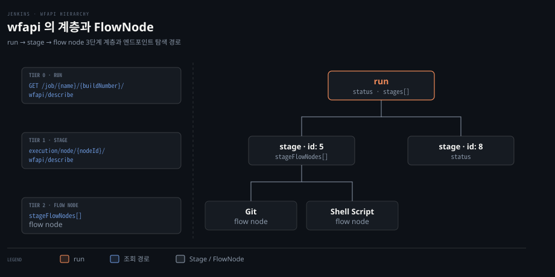

# stage 상태와 로그를 가져오는 wfapi

---

> Jenkins 코어 API 는 빌드를 성공이나 실패라는 단일 결과로만 다루어 stage 단위 진행과 병목을 드러내지 못합니다. 이 편은 보조 REST 계층인 wfapi 로 stage 상태와 FlowNode 로그를 추출하고, Blue Ocean 이 deprecated 된 상황에서 신규 연동의 기준을 세우는 원리를 다룹니다.

## 학습 목표

> 이 편을 읽고 나면 아래 다섯 가지를 스스로 해낼 수 있습니다.

1. 코어 build API 와 wfapi 의 계층 차이와 응답 모델을 설명할 수 있습니다.
2. Blue Ocean 이 deprecated 상태라는 사실이 신규 연동의 의존 대상 선택에 미치는 영향을 설명할 수 있습니다.
3. wfapi 의 run, stage, FlowNode 계층 구조와 HAL 스타일 하이퍼링크의 탐색 방식을 비교할 수 있습니다.
4. consoleText 와 progressiveText 의 증분 읽기 메커니즘을 offset 과 헤더로 설명할 수 있습니다.
5. Jenkins 호출자의 관점에서 SDK 대신 직접 REST 를 택하는 기준과 프록시 헤더 계약을 설명할 수 있습니다.

## 1. 코어 API 가 stage 를 모르는 이유

> 코어 빌드 API 는 Freestyle 시절부터 이어진 `Run` 객체만 다루므로 내부 stage 개념을 알지 못합니다. 파이프라인의 중간 상태와 단계별 소요를 파악하려면 플러그인이 제공하는 보조 계층이 필요합니다.

외부 모니터링 시스템이 빌드 상태를 추적할 때 호출하는 기본 경로는 `GET /job/{name}/{number}/api/json` 입니다. 이 API 는 `building: true`, `result: "SUCCESS"` 처럼 빌드 전체의 결과만 한 덩어리로 반환합니다.

그러나 15분이 걸리는 배포 파이프라인에서 호출자가 알고 싶은 정보는 다릅니다. 어느 stage 가 돌고 있는지, 승인 대기에 멈춰 있는지, 어느 단계에서 병목이 생겼는지를 파악해야 배포 화면을 구성할 수 있습니다.

Jenkins 코어는 Pipeline 이 도입되기 훨씬 전부터 설계되었습니다. 코어 모델인 `Run` 은 작업을 단일 실행 단위로만 추상화합니다. Pipeline 은 코어 위에 플러그인으로 올라간 확장 계층입니다. 그래서 코어 API 는 Pipeline 안의 stage 와 step 구조를 모릅니다.

이 빈틈을 메우는 플러그인이 `Pipeline: REST API`, 즉 `wfapi` 입니다. 이 플러그인은 Pipeline 실행 그래프(`FlowExecution`)에서 stage 구조와 상태를 읽어 JSON 으로 내보냅니다[^wfapi-plugin]. 코어 API 가 건물의 외관 표시등이라면 `wfapi` 는 층별 평면도에 해당합니다.

## 2. Blue Ocean 폐기와 UI·API 수명

> Blue Ocean 은 2026년 7월부터 deprecated 상태이므로 신규 자동화가 기대는 대상으로 삼지 않아야 합니다. 화면은 대체 플러그인에 맡기고, stage 데이터는 wfapi 로 받는 쪽이 안전합니다.

Blue Ocean 은 Pipeline 실행을 그림으로 보여 주던 시각화 플러그인입니다. 이 플러그인이 더 이상 갱신되지 않으면 그 위에 만든 연동도 같이 낡습니다. 그래서 신규 연동에서는 화면 도구의 수명과 데이터를 가져오는 경로를 따로 따져야 합니다.

Jenkins 공식 문서는 Blue Ocean 이 2026년 7월부터 deprecated 상태라고 안내합니다[^blueocean-doc]. 같은 안내에 따르면 보안 수정도 기능 갱신도 더 받지 않습니다. 플러그인 페이지에도 deprecated 표시가 붙어 있습니다[^blueocean-plugin]. 공식 문서는 활발히 유지보수되는 대안으로 `Pipeline Graph View` 를 소개합니다. 다른 보기로는 `Pipeline: Stage View` 를 소개합니다.

대안 화면과 `wfapi` 는 이어져 있습니다. `Pipeline: REST API` 플러그인은 Pipeline 데이터를 읽는 REST 엔드포인트를 정의합니다. 그 데이터를 쓰는 예로 Pipeline Stage View 를 듭니다[^wfapi-plugin]. Stage View 문서도 화면을 구동하는 REST API 의 응답 한도 설정을 따로 설명합니다[^stageview-plugin]. 외부 시스템이 stage 데이터를 직접 조회할 때 `wfapi` 를 부르는 것이 자연스러운 이유입니다.

`wfapi` 가 주는 것은 run, stage, stage 안 flow node 단위의 상태와 로그입니다. Blue Ocean 화면의 모든 기능을 그대로 대체한다는 뜻은 아닙니다. 플러그인 페이지도 대안 플러그인이 완전한 대체재는 아니라고 밝힙니다[^blueocean-plugin]. 기존 화면에서 쓰던 기능이 필요하면 대체 플러그인 문서에서 따로 확인해야 합니다.

## 3. wfapi 의 계층과 FlowNode

> wfapi 는 run, stage, flow node 의 3단계 계층으로 파이프라인을 분해합니다. 각 계층은 HAL 스타일 하이퍼링크로 연결되어 하위 자원을 유기적으로 탐색할 수 있습니다.

### 세 계층의 탐색 경로

`wfapi` 는 코어 API(`/api/json`)와 구별되는 별도 엔드포인트입니다. 먼저 용어 하나를 풉니다. flow node 는 실행 그래프에서 stage 나 step 한 단위를 나타내는 객체입니다.

아래 도식은 wfapi 가 run, stage, flow node 로 분해하는 3단계 계층과 탐색 경로를 보입니다.

파이프라인 실행 1건은 `GET /job/{name}/{buildNumber}/wfapi/describe` 로 조회합니다. 응답에는 실행 전체의 `status` 와 소요 시간이 있습니다. 소요 시간은 `durationMillis` 와 `pauseDurationMillis` 로 나뉩니다. 이어서 `stages[]` 배열이 있습니다[^wfapi-plugin].

`stages[]` 의 각 원소에는 stage 이름과 상태(`status`), 식별자 `id` 가 있습니다. 이 `id` 를 경로 `execution/node/{nodeId}/wfapi/describe` 의 `{nodeId}` 에 넣으면 stage 상세로 내려갑니다. 앞에는 run 과 같은 `/job/{name}/{buildNumber}/` 가 붙습니다.

그 응답의 `stageFlowNodes[]` 에는 stage 안에서 실행된 flow node 가 시작 시각 순으로 들어 있습니다. `Git`, `Shell Script` 같은 항목입니다[^wfapi-plugin].

### FlowNode 식별자의 범위

`nodeId` 는 Jenkins Agent 노드가 아니라 실행 그래프의 `FlowNode` 식별자입니다. 소스 주석은 이 `id` 가 직렬화와 JVM 재시작을 거쳐도 안정적이어야 한다고 적습니다. 같은 주석은 `FlowExecution` 에서 노드를 찾는 키로 이 `id` 를 가리킵니다[^flownode-src].

`FlowExecution` 은 빌드마다 하나입니다. 그래서 같은 구조의 파이프라인은 빌드가 달라도 같은 번호를 받을 수 있습니다. 플러그인 문서의 예시에서도 15번 빌드와 16번 빌드가 모두 stage `id` 로 5, 8, 10 을 씁니다[^wfapi-plugin]. 외부 저장소에 `nodeId` 단독 키를 쓰면 빌드마다 같은 키가 생겨 데이터가 덮어씌워집니다. 키는 `{job}/{buildNumber}/{nodeId}` 복합 키로 잡아야 합니다.

### HAL 스타일 링크와 승인 대기

`wfapi` 응답의 자원에는 `_links` 객체가 붙습니다. 이 객체는 HAL(Hypertext Application Language) 초안을 따릅니다[^wfapi-plugin]. 클라이언트는 하위 URL 을 문자열로 조립하지 않고 응답의 링크를 따라가면 됩니다.

파이프라인이 `input` 스텝에서 멈추면 run 의 `status` 가 `PAUSED_PENDING_INPUT` 이 됩니다. 이때 `pendingInputActions` 링크가 생깁니다. 이 링크를 따라가면 대기 중인 입력의 `proceedUrl` 과 `abortUrl` 이 나옵니다[^wfapi-plugin]. 외부 시스템은 이 URL 로 승인이나 중단 요청을 보냅니다. 승인 대기를 코어 API 와 비교하는 설명은 [08-01](08-01.REST%20API%20로%20빌드를%20부르고%20추적하기.md) 에 있습니다.

## 4. 전체 로그와 증분 읽기

> 실행 중인 빌드를 추적할 때는 매번 전체를 내려받는 `consoleText` 대신 `progressiveText` 로 바이트 offset 만 이어 읽어야 합니다.

### 콘솔 로그와 증분 로그 비교

빌드 콘솔 로그를 가져오는 기본 경로는 `GET /job/{name}/{buildNumber}/consoleText` 입니다. 이 API 는 단순하지만 요청할 때마다 현재까지의 로그를 처음부터 돌려줍니다. 실행 중인 빌드를 반복 호출로 감시하면 같은 앞부분을 계속 다시 받습니다. 로그가 2MB 이고 2초마다 5분간 폴링한다고 가정하면 150번 × 2MB 로 약 300MB 입니다.

반면 `logText/progressiveText?start={n}` 은 읽기 시작할 바이트 위치(`start`)를 지정합니다. 경로 앞에는 `consoleText` 와 같은 `/job/{name}/{buildNumber}/` 가 붙습니다. 응답 헤더 `X-Text-Size` 는 이번 응답이 끝난 위치를 알려 줍니다. `X-More-Data: true` 는 로그가 아직 더 쌓일 수 있다는 표시입니다[^largetext-src].

클라이언트는 직전 응답의 `X-Text-Size` 를 다음 요청의 `start` 로 넘겨 새로 쌓인 부분만 받습니다. 빌드가 끝나면 `X-More-Data` 헤더가 아예 붙지 않습니다. 이 헤더가 없을 때 폴링을 멈춥니다[^largetext-src].

### run 로그와 node 로그 분담

`wfapi` 의 엔드포인트 목록에는 run 전체 로그를 주는 경로가 없습니다. 로그는 `execution/node/{nodeId}/wfapi/log` 처럼 특정 flow node 에 붙어 있습니다[^wfapi-plugin]. 응답에는 `text` 와 함께 `length`, `hasMore` 가 있습니다. Stage View 문서는 이 응답의 반환 문자 수에 상한(`maxReturnChars`)이 있다고 설명합니다. 시작 옵션으로 바꿀 수 있습니다[^stageview-plugin].

빌드 전체 로그가 필요하면 `consoleText` 나 `progressiveText?start=0` 으로 받습니다. 특정 stage 나 step 이 실패한 원인만 볼 때는 해당 flow node 의 `wfapi/log` 를 호출합니다.

## 5. Jenkins 호출자의 세 가지 설계 판단

> 외부 시스템이 Jenkins 를 연동할 때는 클라이언트 라이브러리를 쓸지, 프록시 뒤 주소가 어떻게 만들어지는지, 결과를 어떻게 받을지를 미리 정해야 합니다.

### SDK 와 직접 REST 선택

Jenkins 문서는 REST API 를 감싼 Java 래퍼 라이브러리로 `jenkins-rest` 를 소개합니다[^sdk-ref]. 래퍼는 호출 코드를 줄여 주지만 의존성이 하나 늘어납니다. 편한 범위도 라이브러리가 지원하는 엔드포인트까지입니다. 쓸 API 가 트리거, 상태 조회, 로그 읽기처럼 좁다면 표준 HTTP 클라이언트로 직접 부르는 쪽이 의존성을 줄입니다. 라이브러리가 `wfapi` 를 지원하는지는 사용 전에 직접 확인해야 합니다.

### 프록시와 X-Forwarded 헤더

리버스 프록시 뒤의 Jenkins 는 리다이렉트용 `Location` 헤더에 내부 주소를 담아 돌려줄 수 있습니다. 공식 문서는 이를 막는 방법을 둘 중 하나로 제시합니다[^reverse-proxy-doc].

- 프록시가 응답의 `Location` 을 외부 주소로 바꿔 씁니다.
- 프록시가 요청에 `X-Forwarded-Host` 와 `X-Forwarded-Port` 를 넣고, Jenkins 가 그 값으로 리다이렉트를 만듭니다.

프록시가 `https` 를 `http` 로 바꿔 전달한다면 `X-Forwarded-Proto` 도 필요합니다. 어느 쪽이든 System 설정의 `Jenkins URL` 이 실제 접근 주소와 맞아야 합니다.

### 통제권에 따른 결과 수신 방식

수신 방식은 상대 Jenkins 를 얼마나 바꿀 수 있는지에 달려 있습니다. 상대 설정을 바꿀 수 없다면 이미 받은 API 토큰으로 주기적으로 조회하는 폴링이 가장 적은 요구로 쓸 수 있는 방법입니다.

Jenkinsfile 을 고칠 수 있다면 `post` 블록이나 Shared Library 에서 완료 시점에 외부로 webhook 을 보낼 수 있습니다. webhook 을 받는 쪽은 요청이 Jenkins 에서 온 것이 맞는지 서명이나 토큰으로 검증해야 합니다. 검증 없이 받으면 누구나 같은 URL 로 가짜 완료 알림을 보낼 수 있기 때문입니다.

## 면접에서 받을 만한 질문

1. Jenkins 코어 build API 와 wfapi 의 역할 차이는 무엇이며 코어가 stage 를 모르는 이유는 무엇입니까?
2. Blue Ocean 이 deprecated 된 상황에서 신규 연동은 무엇에 의존해야 하며, 대안 화면과 wfapi 는 어떻게 이어집니까?
3. `wfapi` 의 `nodeId` 를 데이터베이스 저장 키로 쓸 때 주의해야 할 점은 무엇입니까?
4. 실행 중인 빌드 로그를 추적할 때 `consoleText` 대신 `progressiveText` 를 써야 하는 이유와 폴링 종료 조건을 설명해 보세요.
5. 외부 시스템이 Jenkins 연동 시 오픈소스 SDK 대신 직접 REST 를 택할 때 따져 볼 기준은 무엇입니까?

> 다섯 질문에 먼저 스스로 답해 보세요. 자답이 끝나면 아래 §정답 (자답 후 펼치기) 으로 내려갑니다.

## 정답 (자답 후 펼치기)

> 위 §면접에서 받을 만한 질문 의 다섯 개에 먼저 자답한 뒤 아래를 읽으세요.

### 정답 1 — 코어 API 와 wfapi 의 계층 차이

코어 build API 는 `Run` 객체만 다루므로 빌드 전체의 결과(`building`, `result`)만 보여 주고 내부 stage 개념을 알지 못합니다. Pipeline 은 코어 위의 플러그인 엔진으로 실행 그래프를 별도 관리하기 때문입니다. `wfapi` 는 이 실행 엔진의 `FlowExecution` 데이터를 파싱하여 stage 진행 상태, 소요 시간, `PAUSED_PENDING_INPUT` 같은 중간 상태를 세밀하게 노출합니다.

### 정답 2 — 폐기 흐름과 Stage View

Blue Ocean 은 2026년 7월부터 deprecated 상태이고 보안 수정도 기능 갱신도 받지 않습니다. 그래서 신규 연동은 Blue Ocean 이 아니라 `wfapi` 에서 stage 데이터를 받습니다. 화면은 `Pipeline Graph View` 나 `Pipeline: Stage View` 같은 대안에 맡깁니다. `Pipeline: REST API` 플러그인은 Stage View 같은 화면이 쓰는 Pipeline 데이터를 `wfapi` 로 제공합니다. 대안 화면과 외부 연동이 같은 데이터 경로를 공유하므로 외부 시스템도 `wfapi` 를 기준으로 삼는 것이 자연스럽습니다.

### 정답 3 — FlowNode 식별자의 지역성

`nodeId` 는 Jenkins Agent 노드나 Executor 가 아니라 실행 그래프 상의 `FlowNode` 식별자입니다. 이 번호는 빌드마다 하나인 실행 그래프 안에서 노드를 찾는 키입니다. 같은 구조의 파이프라인은 빌드가 달라도 같은 번호를 받을 수 있습니다. 따라서 `{nodeId}` 단독 키를 쓰면 서로 다른 빌드의 데이터가 충돌합니다. `{job}/{buildNumber}/{nodeId}` 처럼 빌드 컨텍스트를 포함한 복합 키로 저장해야 합니다.

### 정답 4 — 증분 로그와 종료 조건

`consoleText` 는 매 요청마다 현재까지의 로그를 처음부터 반환하므로 폴링 시 같은 앞부분을 반복해 받습니다. `progressiveText` 는 `start` 파라미터로 이미 읽은 바이트 위치를 넘겨 새로 쌓인 부분만 받습니다. 응답 헤더 `X-Text-Size` 를 다음 `start` 로 넘깁니다. 빌드가 끝나면 `X-More-Data` 헤더가 붙지 않습니다. 이 헤더가 사라지면 폴링을 종료합니다.

### 정답 5 — SDK 대신 직접 REST 를 택하는 기준

첫째, 필요한 API 폭입니다. 트리거, 상태 조회, 로그 수집처럼 좁은 기능만 쓴다면 직접 작성이 가볍습니다. 둘째, 라이브러리의 지원 범위입니다. 쓰려는 `wfapi` 엔드포인트를 라이브러리가 지원하는지 확인해야 합니다. 없다면 어차피 직접 호출을 섞어야 합니다. 셋째, 호출하는 쪽의 통신 규약입니다. 이미 쓰는 HTTP 클라이언트의 재시도, 로깅, 타임아웃 설정을 그대로 적용할 수 있습니다.

## 관련 문서

- [Stapler 와 URL 이 doBuild 에 닿는 길](02-01.Stapler%20와%20URL%20이%20doBuild%20에%20닿는%20길.md) — 웹 요청이 Jenkins 메서드에 도달하고 201 Created 를 받는 과정
- [Queue 상태 전이와 Executor 로 가는 길](02-02.Queue%20상태%20전이와%20Executor%20로%20가는%20길.md) — 트리거 직후 queueId 발급과 buildNumber 전환 시점
- [Pipeline as Code 와 Declarative 평가 규칙](03-01.Pipeline%20as%20Code%20와%20Declarative%20평가%20규칙.md) — stage 블록이 파이프라인에서 평가되는 규칙
- [인증·인가와 시크릿](06-01.인증·인가와%20시크릿.md) — API 토큰을 통한 인증과 CSRF crumb 면제 규칙
- [REST API 로 빌드를 부르고 추적하기](08-01.REST%20API%20로%20빌드를%20부르고%20추적하기.md) — 코어 API 로 빌드를 트리거하고 상태를 추적하는 방법

[^blueocean-doc]: Jenkins 공식 문서 Blue Ocean 장의 「Blue Ocean status」 안내. <https://www.jenkins.io/doc/book/blueocean/>
[^blueocean-plugin]: Jenkins 플러그인 사이트 Blue Ocean 페이지의 deprecated 표시와 「Blue Ocean status」 안내. <https://plugins.jenkins.io/blueocean/>
[^stageview-plugin]: Jenkins Pipeline: Stage View 플러그인 문서의 「Usage Notes/Limits」 와 API 한도 속성 설명. <https://plugins.jenkins.io/pipeline-stage-view/>
[^wfapi-plugin]: Jenkins Pipeline: REST API 플러그인 문서의 「Resource Hyperlinks」 와 「Available REST Endpoints」. <https://plugins.jenkins.io/pipeline-rest-api/>
[^flownode-src]: workflow-api 플러그인 소스의 `FlowNode.getId()` 주석. <https://github.com/jenkinsci/workflow-api-plugin/blob/master/src/main/java/org/jenkinsci/plugins/workflow/graph/FlowNode.java>
[^largetext-src]: Stapler `LargeText` 소스의 `doProgressiveText` 처리. `start` 파라미터와 `X-Text-Size`, `X-More-Data` 헤더를 다룹니다. <https://github.com/jenkinsci/stapler/blob/master/core/src/main/java/org/kohsuke/stapler/framework/io/LargeText.java>
[^sdk-ref]: Jenkins 공식 문서 「Remote access API」 의 Java API wrappers 절. <https://www.jenkins.io/doc/book/using/remote-access-api/>
[^reverse-proxy-doc]: Jenkins 공식 문서 「Reverse proxy configuration troubleshooting」. <https://www.jenkins.io/doc/book/system-administration/reverse-proxy-configuration-troubleshooting/>
