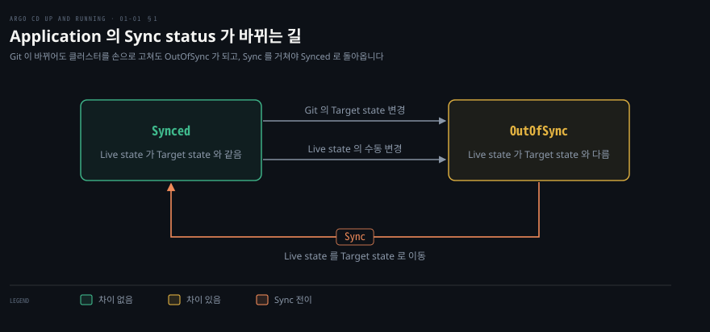
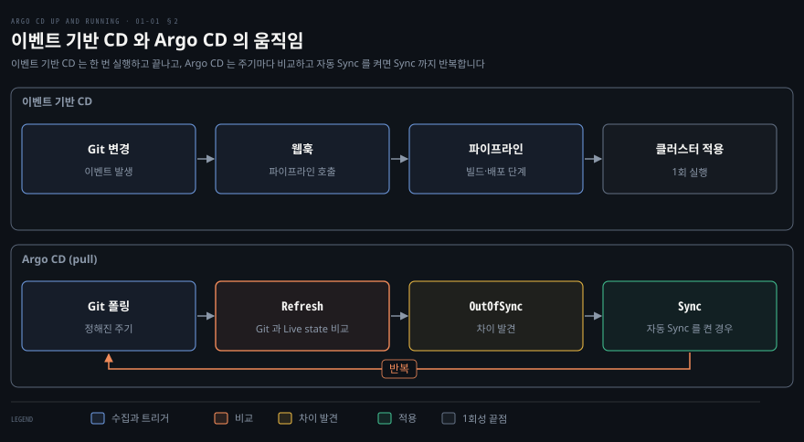

# Argo CD 가 푸는 문제 — GitOps 원칙과 Argo 생태계
---

## 핵심 요약

> Argo CD 는 Git 에 적은 원하는 상태를 클러스터가 계속 따라가게 만들어서, 손으로 적용한 설정이 남기는 어긋남을 막습니다.

Application 은 Git 의 Target state 와 클러스터의 Live state 를 비교해 Synced 와 OutOfSync 를 가릅니다. GitOps 는 OpenGitOps v1.0.0 의 네 원칙으로 정리됩니다. 이벤트가 파이프라인을 한 번 실행하고 끝나는 방식과 달리 주기적인 조정 루프로 움직입니다. Argo CD 는 Argo 프로젝트의 도구 넷 가운데 하나이고 Flux 와는 Helm 을 다루는 방식이 갈립니다. 이 노트의 값은 2026-11-06 에 공식 페이지에서 확인한 기준이며 Argo CD 최신 릴리스는 v3.6.1 입니다.[^ver]

## 학습 목표

이 내용을 읽고 나면:

1. 손으로 적용한 쿠버네티스 설정과 클러스터 난립이 Argo CD 가 나온 배경임을 설명할 수 있습니다.
2. Target state·Live state·Sync status 로 구성 드리프트를 감지하는 과정을 설명할 수 있습니다.
3. OpenGitOps 네 원칙을 공식 문구와 함께 말할 수 있습니다.
4. 이벤트 기반 CD 와 pull 방식 GitOps 의 차이를 조정 루프로 설명할 수 있습니다.
5. Flux 와 Argo CD 가 Helm 을 다루는 방식의 차이와 Argo 프로젝트 네 도구의 역할을 구별할 수 있습니다.

## 본문 정리

### 1. 구성 드리프트를 Application 단위로 막기

쿠버네티스는 원하는 상태를 선언하는 방식인데도 운영은 명령형으로 흘러서, 손으로 적용한 설정이 기록 없이 쌓입니다. 사람들은 `ssh` 로 하던 일을 `kubectl` 로 바꿔서 YAML 을 직접 적용했고 그 변경은 대부분 추적되지 않았습니다.

클러스터가 늘면 이 문제가 커집니다. 가상 머신이 난립하던 때처럼 클러스터도 난립(cluster sprawl)했습니다. 모든 것을 한 곳에 올리는 중앙 클러스터 대신 클러스터를 필요할 때 만들고 버리는 소모품으로 보는 clusters as cattle 이 자리 잡았습니다. 그래서 여러 클러스터에 걸친 배포를 추적하고 버전을 매기는 도구가 필요해졌고 Argo CD 는 그 자리에서 나온 도구입니다.

Argo CD 는 쿠버네티스용 선언적 지속적 전달(continuous delivery, CD) 도구이고 GitOps 를 구현합니다.[^overview] GitOps 는 Git 저장소에 적은 선언을 기준 상태로 삼아 시스템을 관리하는 방식입니다. Argo CD 는 Deployment·Service·Namespace 처럼 따로 관리되던 오브젝트를 **Application** 하나로 묶어 하나의 배포 단위로 다룹니다.

Application 의 상태 비교는 용어 다섯 개로 읽습니다. **Target state** 는 Git 에 적힌 원하는 상태이고 **Live state** 는 클러스터에서 실제로 도는 상태입니다. 둘이 같으면 Sync status 가 `Synced` 이고 다르면 `OutOfSync` 입니다. Sync 는 Live state 를 Target state 로 옮기는 동작입니다. Refresh 는 Git 의 최신 코드와 Live state 를 맞대어 무엇이 다른지 찾는 동작입니다.[^concepts]

차이를 찾는 일은 application controller 가 맡습니다. 이 컨트롤러는 쿠버네티스 컨트롤러로서 실행 중인 애플리케이션의 Live state 를 Target state 와 계속 비교합니다. `OutOfSync` 를 찾으면 바로잡는 조치를 선택적으로 할 수 있습니다.[^arch] 자동 Sync 정책을 켠 Application 은 Git 에 새 커밋이 생겨 `OutOfSync` 가 되면 스스로 Sync 합니다.[^auto] 같은 커밋에서 손으로 바뀐 Live state 까지 되돌리려면 `selfHeal` 을 함께 켜야 합니다.

클러스터가 Git 에서 벗어나는 구성 드리프트(configuration drift)는 Sync status 로 드러납니다. 누군가 클러스터의 오브젝트를 손으로 고치면 Live state 가 Target state 와 달라져서 `OutOfSync` 가 되기 때문입니다. 이벤트가 올 때까지 기다리는 방식은 이런 어긋남을 다음 이벤트에서야 발견하는 경향이 있습니다.

Git 이 기준 상태로 유지되는 한 롤백과 재해 복구도 Git 에서 시작합니다. 되돌릴 때는 Git 을 동작하던 상태로 되돌리면 Argo CD 가 클러스터를 그 상태로 맞춥니다. 자동 Sync 가 꺼진 Application 은 Sync 를 실행하는 단계가 하나 더 듭니다. 재해 복구도 같은 구조여서 Argo CD 를 새로 설치하고 Git 의 특정 상태를 가리키게 하면 나머지는 Argo CD 가 처리한다고 책은 설명합니다.

### 2. GitOps 네 원칙과 pull 방식

GitOps 는 유행어로 흐려지기 쉬워서 OpenGitOps 가 무엇이 GitOps 인지를 네 원칙으로 정리했습니다. 이 원칙을 낸 곳은 GitOps Working Group 입니다. 이 그룹은 클라우드 네이티브 컴퓨팅 재단(Cloud Native Computing Foundation, CNCF)의 App Delivery SIG(Special Interest Group) 아래에 있고 원칙의 현재 버전은 v1.0.0 입니다.[^principles]

| 번호 | 이름 | 공식 문구 (v1.0.0) | 풀어 쓴 뜻 |
|------|------|--------------------|-----------|
| 1 | Declarative | A system managed by GitOps must have its desired state expressed declaratively. | 원하는 상태를 도달할 끝 상태로 적습니다 |
| 2 | Versioned and Immutable | Desired state is stored in a way that enforces immutability, versioning and retains a complete version history. | 바꿀 때마다 새 버전이 남고 이전 버전은 그대로 있습니다 |
| 3 | Pulled Automatically | Software agents automatically pull the desired state declarations from the source. | 에이전트가 원본에서 선언을 스스로 가져옵니다 |
| 4 | Continuously Reconciled | Software agents continuously observe actual system state and attempt to apply the desired state. | 에이전트가 실제 상태를 계속 보고 원하는 상태로 맞춥니다 |

첫째 원칙의 선언은 거기까지 가는 단계가 아니라 마지막에 도달할 상태를 적는다는 뜻입니다. 쿠버네티스가 이미 그렇게 일합니다. 둘째 원칙의 대표 예가 Git 입니다. 변경마다 새 버전이 쌓이고 이전 버전은 바뀌지 않으므로 되돌려도 지난 변경의 기록이 남습니다.

셋째와 넷째 원칙이 이벤트 기반 CD 와 GitOps 를 가르는 지점입니다. 웹훅 같은 이벤트로 빌드를 일으키는 것은 자동화 방법으로 타당하지만 그것만으로는 GitOps 가 아니라고 책은 설명합니다. 이벤트 기반 흐름은 이벤트 하나가 파이프라인을 한 번 실행하고 끝나므로 그 뒤에 클러스터가 바뀌어도 알지 못합니다. 반면 GitOps 에이전트는 Git 의 선언을 정해진 주기로 가져오고, 실제 상태와 다르면 실제 상태를 바꿔서 맞춥니다.

Argo CD 에서 이 주기는 `argocd-cm` 의 `timeout.reconciliation` 이고 기본값은 120초입니다. 여러 Application 의 새로 고침이 한꺼번에 몰리지 않도록 `timeout.reconciliation.jitter` 가 주기에 최대 60초(기본값)를 더할 수 있습니다. 그래서 주기는 최대 3분입니다.[^cm] 변경을 기다리는 시간을 줄이고 싶으면 API 서버가 Git 웹훅 이벤트를 받게 설정할 수 있고, 웹훅이 없어도 주기적인 폴링으로 돌아갑니다.[^webhook]

여기서 조정 루프(reconciliation loop)는 쿠버네티스 컨트롤러가 현재 상태를 원하는 상태에 맞추는 반복과 같은 모양입니다. 컨트롤러 쪽 동작은 [ReplicaSet 컨트롤러](../kubernetes-in-action/14-02.ReplicaSet%20%EC%BB%A8%ED%8A%B8%EB%A1%A4%EB%9F%AC%20%E2%80%94%20reconciliation%C2%B7%EC%9E%A5%EC%95%A0%EB%B3%B5%EA%B5%AC%C2%B7%EC%82%AD%EC%A0%9C.md) 노트의 1절에 정리돼 있습니다. 넷째 원칙은 이 일을 오브젝트 하나가 아니라 애플리케이션이나 인프라 묶음 전체에 적용한 것이고, 여기서 연속은 즉시가 아니라 정한 주기마다 계속한다는 뜻입니다.

### 3. Flux 와 Argo 프로젝트 속의 Argo CD

Argo 라는 이름은 도구 하나가 아니라 프로젝트 전체를 가리킵니다. 그래서 Argo CD 를 Argo 프로젝트의 다른 도구와 구별해야 하고, 같은 GitOps 컨트롤러인 Flux 와도 비교해 둘 만합니다.

Flux 와 Argo CD 는 둘 다 쿠버네티스의 GitOps 컨트롤러입니다. Flux 는 2022-11-30 에 CNCF 졸업 프로젝트가 됐습니다. Argo CD 가 속한 Argo 프로젝트는 2022-12-06 에 졸업했습니다. 졸업 단위는 Argo CD 하나가 아니라 Argo 프로젝트 전체입니다.[^cncf] Flux v2 는 GitOps Toolkit 이라는 컨트롤러 묶음으로 만들어졌습니다. 이 묶음에는 Source·Kustomize·Helm·Notification·Image automation 컨트롤러가 있습니다.[^flux]

두 도구가 갈리는 대표 지점이 Helm 입니다. Flux 의 Helm Controller 는 `HelmRelease` 라는 커스텀 리소스(custom resource)를 보고 Helm 차트 릴리스를 직접 관리합니다.[^fluxhelm]

Argo CD 는 Helm 을 `helm template` 으로 차트를 펼치는 데만 쓰고 애플리케이션의 수명 주기는 Argo CD 가 맡습니다.[^helm] 그래서 Argo CD 로 배포한 Helm 애플리케이션은 `helm ls` 같은 Helm 명령으로 확인할 수 없습니다. Argo CD 가 이렇게 정한 것은 매니페스트를 만드는 도구가 무엇이든 같은 방식으로 다루기 위해서입니다.[^faq] 대신 펼쳐진 YAML 이 Target state 가 되므로 Helm 차트로 올린 애플리케이션도 Live state 와 차이를 비교할 수 있습니다.

Argo 프로젝트는 도구가 넷입니다.[^argohome]

| 도구 | 공식 소개의 요지 |
|------|----------------|
| Argo Workflows | 쿠버네티스에서 병렬 작업을 조율하는 컨테이너 네이티브 워크플로 엔진 |
| Argo CD | 전체 UI 를 갖춘 선언적 지속적 전달 |
| Argo Rollouts | 카나리·블루그린 같은 고급 배포 전략 |
| Argo Events | 쿠버네티스를 위한 이벤트 기반 의존성 관리 |

Argo 프로젝트에는 관련 도구를 키우는 인큐베이션 영역인 Argo Labs 도 있다고 책은 설명합니다. ApplicationSet 이 그곳에서 시작했고, Argo CD v2.3 부터 ApplicationSet 컨트롤러가 Argo CD 에 포함됩니다.[^appset]

## 연습 문제

> 1번은 push 와 pull, 2번은 드리프트, 3번은 Sync status, 4번은 네 원칙, 5번은 Helm, 6번은 Argo 프로젝트를 묻습니다. 풀이는 아래 정답 절에 있습니다.

1. 이벤트가 파이프라인을 호출해 클러스터에 적용하는 구조와 Argo CD 의 pull 방식은 무엇이 다릅니까?
2. Git 과 클러스터가 어긋나는 구성 드리프트를 빨리 드러내는 일이 왜 중요합니까?
3. Application 의 Sync status 가 `Synced` 에서 `OutOfSync` 로 바뀌는 경우는 무엇이고, 다시 `Synced` 로 돌리는 동작은 무엇입니까?
4. OpenGitOps 네 원칙의 이름을 말하고, 이벤트 기반 CD 와 갈리는 원칙 둘을 고르십시오.
5. Argo CD 로 배포한 Helm 애플리케이션을 `helm ls` 로 볼 수 없는 이유는 무엇입니까?
6. Argo 프로젝트의 도구 네 개와 각각의 역할을 말하고, CNCF 에서 졸업한 단위가 무엇인지 답하십시오.

## 정답 (자답 후 펼치기)

### 정답 1

이벤트 기반 CD 는 Git 변경이 웹훅으로 파이프라인을 호출하고 파이프라인이 클러스터에 적용하면 끝납니다. 이벤트가 오지 않으면 아무것도 비교하지 않으므로 그 뒤에 클러스터를 손으로 고쳐도 Git 과 어긋난 채 남을 수 있습니다. Argo CD 의 pull 방식은 정해진 주기로 Git 을 가져와 Live state 와 비교하고, 자동 Sync 를 켠 경우 `OutOfSync` 면 Sync 하는 일을 반복합니다. 그래서 이벤트 한 번이 아니라 비교와 조정이 계속 도는 구조입니다.

### 정답 2

Git 이 기준 상태이어야 Git 을 되돌리는 롤백과 새 클러스터를 Git 에서 복구하는 재해 복구가 성립하기 때문입니다. Argo CD 는 Live state 가 Target state 와 다르면 `OutOfSync` 로 표시해서 어긋남을 드러냅니다. 어긋남을 빨리 드러내야 클러스터가 Git 에 적힌 그대로라고 믿을 수 있습니다.

### 정답 3

Git 의 Target state 가 바뀌거나 클러스터 오브젝트가 손으로 바뀌어 Live state 가 달라지면 `OutOfSync` 가 됩니다. Sync 가 Live state 를 Target state 로 옮기면 다시 `Synced` 가 됩니다. 자동 Sync 정책을 켠 Application 은 Git 에 새 커밋이 생겨 `OutOfSync` 가 되면 스스로 Sync 합니다. 손으로 바뀐 Live state 를 되돌리려면 `selfHeal` 도 켜야 합니다. 자동 Sync 가 꺼진 Application 은 사용자가 Sync 를 실행합니다.

### 정답 4

네 원칙은 Declarative, Versioned and Immutable, Pulled Automatically, Continuously Reconciled 입니다. 이벤트 기반 CD 와 갈리는 원칙은 셋째와 넷째입니다. 에이전트가 원하는 상태를 스스로 가져오고(Pulled Automatically) 실제 상태를 계속 관찰해 맞추기 때문입니다(Continuously Reconciled). 여기서 연속은 즉시가 아니라 정한 주기마다 계속한다는 뜻입니다.

### 정답 5

Argo CD 는 Helm 을 `helm template` 으로 차트를 펼치는 데만 쓰고 `helm install` 로 릴리스를 만들지 않습니다. 펼친 매니페스트를 클러스터에 배포하고 수명 주기는 Argo CD 가 맡으므로 Helm 은 그 애플리케이션을 릴리스로 알지 못합니다. Helm 에서 아쉬울 수 있는 history·rollback 같은 기능은 Argo CD 가 자체로 지원합니다. Flux 의 Helm Controller 는 `HelmRelease` 로 Helm 릴리스를 관리하는 점이 다릅니다.

### 정답 6

Argo Workflows 는 쿠버네티스에서 병렬 작업을 조율하는 워크플로 엔진입니다. Argo CD 는 선언적 지속적 전달 도구입니다. Argo Rollouts 는 카나리·블루그린 같은 배포 전략을 맡습니다. Argo Events 는 이벤트 기반 의존성 관리를 맡습니다. CNCF 에서 졸업한 단위는 Argo CD 하나가 아니라 Argo 프로젝트 전체입니다.

## 참고 자료

- 원본: 《Argo CD: Up and Running》(Andrew Block · Christian Hernandez, O'Reilly, 2025, ISBN 978-1-098-14200-1) Chapter 1. Introduction to Argo CD
- [OpenGitOps](https://opengitops.dev/) · [OpenGitOps 원칙 v1.0.0](https://raw.githubusercontent.com/open-gitops/documents/v1.0.0/PRINCIPLES.md) · [OpenGitOps About](https://opengitops.dev/about/)
- [Argo CD 문서 (stable)](https://argo-cd.readthedocs.io/en/stable/) · [Core Concepts](https://argo-cd.readthedocs.io/en/stable/core_concepts/) · [Architectural Overview](https://argo-cd.readthedocs.io/en/stable/operator-manual/architecture/) · [Automated Sync Policy](https://argo-cd.readthedocs.io/en/stable/user-guide/auto_sync/)
- [Webhook Configuration](https://argo-cd.readthedocs.io/en/stable/operator-manual/webhook/) · [argocd-cm.yaml (v3.6.1)](https://raw.githubusercontent.com/argoproj/argo-cd/v3.6.1/docs/operator-manual/argocd-cm.yaml) · [Argo CD v3.6.1 릴리스](https://github.com/argoproj/argo-cd/releases/tag/v3.6.1)
- [Helm 사용 가이드](https://argo-cd.readthedocs.io/en/stable/user-guide/helm/) · [FAQ](https://argo-cd.readthedocs.io/en/stable/faq/) · [ApplicationSet](https://argo-cd.readthedocs.io/en/stable/operator-manual/applicationset/)
- [Argo 프로젝트](https://argoproj.github.io/) · [Argo Workflows 문서](https://argo-workflows.readthedocs.io/en/stable/) · [CNCF Argo](https://www.cncf.io/projects/argo/) · [CNCF Flux](https://www.cncf.io/projects/flux/)
- [Flux 컴포넌트](https://fluxcd.io/flux/components/) · [Flux Helm Controller](https://fluxcd.io/flux/components/helm/)
- [Argo CD Up and Running 정독 인덱스](./README.md) — 이 책의 장별 목표와 진행 상태
- [ReplicaSet 컨트롤러 — reconciliation·장애복구·삭제](../kubernetes-in-action/14-02.ReplicaSet%20%EC%BB%A8%ED%8A%B8%EB%A1%A4%EB%9F%AC%20%E2%80%94%20reconciliation%C2%B7%EC%9E%A5%EC%95%A0%EB%B3%B5%EA%B5%AC%C2%B7%EC%82%AD%EC%A0%9C.md) — 쿠버네티스 컨트롤러의 조정 루프

[^ver]: Argo CD 의 최신 릴리스는 v3.6.1 이고 문서는 `stable` 판을 기준으로 했습니다. <https://github.com/argoproj/argo-cd/releases/tag/v3.6.1>, <https://argo-cd.readthedocs.io/en/stable/> (2026-11-06 조회)
[^overview]: 공식 문서는 "Argo CD is a declarative, GitOps continuous delivery tool for Kubernetes." 라고 소개하고 "Application deployment and lifecycle management should be automated, auditable, and easy to understand." 를 이유로 듭니다. <https://argo-cd.readthedocs.io/en/stable/> (2026-11-06 조회)
[^concepts]: 핵심 개념 문서의 용어 목록에 Target state·Live state·Sync status·Sync·Refresh·Health 가 있고 Refresh 는 "Compare the latest code in Git with the live state. Figure out what is different." 로 설명됩니다. 소스 코드의 Sync status 값은 `Synced`·`OutOfSync`·`Unknown` 셋이며 `Unknown` 은 비교 결과를 확정할 수 없을 때입니다. <https://argo-cd.readthedocs.io/en/stable/core_concepts/>, <https://github.com/argoproj/argo-cd/blob/v3.6.1/pkg/apis/application/v1alpha1/types.go> (2026-11-06 조회)
[^arch]: 구조 문서는 "The application controller is a Kubernetes controller which continuously monitors running applications and compares the current, live state against the desired target state (as specified in the repo). It detects OutOfSync application state and optionally takes corrective action." 라고 적습니다. <https://argo-cd.readthedocs.io/en/stable/operator-manual/architecture/> (2026-11-06 조회)
[^auto]: 자동 Sync 문서는 "Argo CD has the ability to automatically sync an application when it detects differences between the desired manifests in Git, and the live state in the cluster." 라고 적고, 같은 커밋과 파라미터에서는 "a second sync will not be attempted, unless selfHeal flag is set to true." 라고 적습니다. <https://argo-cd.readthedocs.io/en/stable/user-guide/auto_sync/> (2026-11-06 조회)
[^principles]: 네 원칙의 문구는 v1.0.0 태그의 원문을 그대로 옮긴 것입니다. 소속은 About 페이지가 GitOps Working Group 을 CNCF App Delivery SIG 아래에 있는 그룹으로 소개하는 내용을 따랐습니다. <https://opengitops.dev/>, <https://raw.githubusercontent.com/open-gitops/documents/v1.0.0/PRINCIPLES.md>, <https://opengitops.dev/about/> (2026-11-06 조회)
[^cm]: `argocd-cm` 예시 파일에 `timeout.reconciliation: 120s` 와 `timeout.reconciliation.jitter: 60s` 가 있고, 지터는 "the maximum duration that can be added to the sync timeout" 으로 설명됩니다. 자동 Sync 문서는 "The automatic sync interval is determined by the timeout.reconciliation value in the argocd-cm ConfigMap, which defaults to 120s with added jitter of 60s for a maximum period of 3 minutes." 라고 적습니다. 값을 바꾼 뒤에는 `argocd-repo-server` 와 `argocd-application-controller` 를 직접 다시 시작해야 한다고 같은 파일이 적습니다. <https://raw.githubusercontent.com/argoproj/argo-cd/v3.6.1/docs/operator-manual/argocd-cm.yaml>, <https://argo-cd.readthedocs.io/en/stable/user-guide/auto_sync/> (2026-11-06 조회)
[^webhook]: 웹훅 문서는 "To eliminate this delay from polling, the API server can be configured to receive webhook events." 라고 적고, 구조 문서는 API 서버가 Git 웹훅 이벤트의 수신·전달을 맡는다고 적습니다. <https://argo-cd.readthedocs.io/en/stable/operator-manual/webhook/>, <https://argo-cd.readthedocs.io/en/stable/operator-manual/architecture/> (2026-11-06 조회)
[^cncf]: CNCF 프로젝트 페이지에 Flux 는 Graduated 2022-11-30, Argo 는 Graduated 2022-12-06 으로 표시됩니다. 두 페이지 모두 졸업 단위는 프로젝트 이름 Flux 와 Argo 이며 Argo CD 만 따로 졸업한 것으로 적혀 있지 않습니다. <https://www.cncf.io/projects/flux/>, <https://www.cncf.io/projects/argo/> (2026-11-06 조회)
[^flux]: Flux 문서의 컴포넌트 목록에 GitOps Toolkit 의 Source·Kustomize·Helm·Notification·Image automation 컨트롤러가 나옵니다. <https://fluxcd.io/flux/components/> (2026-11-06 조회)
[^fluxhelm]: Helm Controller 문서는 "a Kubernetes operator, allowing one to declaratively manage Helm chart releases with Kubernetes manifests" 라고 소개하고 릴리스를 `HelmRelease` 라는 커스텀 리소스로 기술한다고 적습니다. <https://fluxcd.io/flux/components/helm/> (2026-11-06 조회)
[^helm]: Helm 문서는 "Helm is only used to inflate charts with `helm template`. The lifecycle of the application is handled by Argo CD instead of Helm." 라고 적습니다. <https://argo-cd.readthedocs.io/en/stable/user-guide/helm/> (2026-11-06 조회)
[^faq]: FAQ 는 Argo CD 가 Helm 을 템플릿 기구로만 쓰며 `helm template` 을 돌린 뒤 결과 매니페스트를 `helm install` 대신 배포한다고 설명하고, 그래서 "you cannot use any Helm command to view/verify the application" 이라고 적고, 이유로 "This decision was made so that Argo CD is neutral to all manifest generators." 를 듭니다. 같은 절은 "Argo CD supports natively some capabilities that you might miss in Helm (such as the history and rollback commands)" 라고도 적습니다. <https://argo-cd.readthedocs.io/en/stable/faq/> (2026-11-06 조회)
[^argohome]: 프로젝트 홈은 Argo Workflows, Argo CD("Declarative continuous delivery with a fully-loaded UI"), Argo Rollouts("Advanced Kubernetes deployment strategies such as Canary and Blue-Green made easy."), Argo Events("Event based dependency management for Kubernetes.") 를 소개합니다. Argo Workflows 문서는 "an open source container-native workflow engine for orchestrating parallel jobs on Kubernetes" 라고 적습니다. <https://argoproj.github.io/>, <https://argo-workflows.readthedocs.io/en/stable/> (2026-11-06 조회)
[^appset]: ApplicationSet 문서는 "Starting with Argo CD v2.3, the ApplicationSet controller is bundled with Argo CD." 라고 적습니다. <https://argo-cd.readthedocs.io/en/stable/operator-manual/applicationset/> (2026-11-06 조회)
