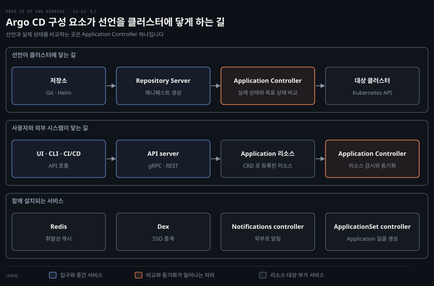
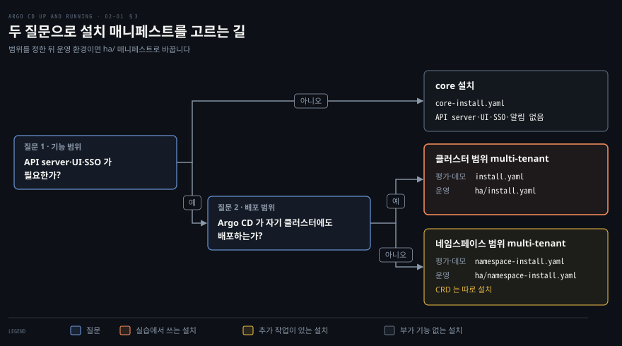

# Argo CD 설치하기 — 구성 요소·설치 유형·매니페스트와 Helm
---

## 핵심 요약

> Argo CD 는 쿠버네티스 컨트롤러와 커스텀 리소스 위에 세운 서비스 묶음이고, 설치는 필요한 기능과 설치 범위를 정해 매니페스트 하나를 고르는 일입니다.

Application Controller 는 Git 의 선언과 클러스터의 실제 상태를 비교합니다. Repository Server 는 매니페스트를 만들고 API server 는 UI 와 CLI 의 요청을 받습니다.

설치 유형은 기능을 모두 갖춘 multi-tenant 와 최소 구성만 설치하는 core 로 나뉩니다. multi-tenant 는 다시 클러스터 범위와 네임스페이스 범위로 갈립니다. 운영에는 `ha/` 매니페스트를 쓰고 설치는 `kubectl apply` 한 번이나 Helm 차트로 끝납니다.[^ver]


## 학습 목표

이 내용을 읽고 나면:

1. 쿠버네티스 컨트롤러와 CRD(Custom Resource Definition, 커스텀 리소스 정의)가 Argo CD 의 바탕이 되는 이유를 설명할 수 있습니다.
2. Argo CD 의 주요 구성 요소가 맡는 일과 요청이 흐르는 길을 말할 수 있습니다.
3. 두 질문으로 설치 매니페스트를 고르고 HA(High Availability, 고가용성) 설치의 조건을 말할 수 있습니다.
4. kind 클러스터에 매니페스트로 Argo CD 를 설치하고 초기 admin 비밀번호로 로그인할 수 있습니다.
5. Helm 차트로 설치할 때 생기는 이름과 Operator 의 현재 상태를 설명할 수 있습니다.


## 1. 컨트롤러와 커스텀 리소스

> Argo CD 는 쿠버네티스의 컨트롤러와 커스텀 리소스를 그대로 써서 배포를 선언합니다.

Argo CD 는 새 기술이 아니라 쿠버네티스가 이미 가진 두 장치를 그대로 씁니다. 그 두 장치가 컨트롤러와 커스텀 리소스입니다.

컨트롤러는 원하는 상태와 실제 상태를 끝없이 비교하며 둘의 차이를 줄이는 반복 루프입니다. 이 루프는 끝나지 않기 때문에 한 번 설정하고 잊어도 상태가 계속 유지됩니다. 책은 Argo CD 가 이 컨트롤러 개념으로 하나 이상의 리소스의 원하는 상태를 관리하고 감시한다고 설명합니다. 컨트롤러 패턴 자체는 [Controller 장](../kubernetes-patterns/27-01.Controller%20—%20Observe-Analyze-Act로%20상태를%20조정하기.md)의 조정 루프 절에서 다룹니다.

커스텀 리소스는 쿠버네티스 API 에 새 종류의 리소스를 더하는 장치입니다. CRD 로 종류를 정의하면 `kubectl` 이 그 종류를 `Deployment` 처럼 다룹니다. 컨트롤러가 이 커스텀 리소스를 감시하면서 도메인 지식을 자동화한 것이 Operator 입니다. 구조는 [Operator 장](../kubernetes-patterns/28-01.Operator%20—%20CRD로%20도메인%20지식을%20자동화하기.md)의 CRD 절에 있습니다.

Argo CD 는 세 가지 커스텀 리소스를 함께 제공합니다. 클러스터 범위 설치와 core 설치는 매니페스트가 이 CRD 를 함께 등록하고 네임스페이스 범위 설치는 따로 등록합니다(3절). `Application` 은 어떤 저장소의 어떤 경로를 어떤 클러스터에 배포할지 선언합니다. `AppProject` 는 Application 이 쓸 수 있는 저장소와 대상의 범위를 묶습니다. `ApplicationSet` 은 템플릿으로 Application 여러 개를 한꺼번에 만듭니다.

설치한 클러스터에서 `kubectl get crd` 를 실행하면 `applications`, `applicationsets`, `appprojects` 세 개가 `argoproj.io` 그룹으로 보입니다.[^crd]


## 2. 구성 요소와 요청 흐름

> 선언은 Repository Server 에서 Application Controller 로 가고, 사용자는 API server 로 들어옵니다.

Argo CD 가 하는 일은 Git 에 적은 선언을 클러스터에 닿게 하는 것이므로, 선언이 지나는 길과 사용자가 지나는 길을 나눠 읽으면 구성 요소의 역할이 분명해집니다.

선언의 길은 Repository Server 에서 시작합니다. Repository Server 는 Git 이나 Helm 저장소의 내용을 로컬에 캐시합니다. 저장소 URL 과 리비전과 경로와 템플릿 설정을 받아 쿠버네티스 매니페스트를 만들어 냅니다. 이 서버가 Helm 이나 Kustomize 같은 도구를 직접 실행하므로 플러그인도 여기서 돕니다.

Application Controller 는 그 결과를 목표 상태로 삼아 대상 클러스터의 실제 상태와 비교합니다. 둘이 다르면 `OutOfSync` 로 표시하고 정책에 따라 동기화합니다. 이 컨트롤러는 StatefulSet 으로 설치됩니다. 매니페스트는 Repository Server 에서, 실제 상태는 쿠버네티스 API server 에서 받아 옵니다.[^arch]

사용자의 길은 API server 로 들어옵니다. API server 는 gRPC 와 REST 로 API 를 열고 웹 UI 도 함께 서빙합니다. UI 와 CLI 와 외부 CI/CD 가 모두 이 API 를 거칩니다. 이 API 로 애플리케이션을 관리하고 동기화와 롤백을 일으키며 저장소와 클러스터의 자격 증명도 다룹니다. RBAC(Role-Based Access Control, 역할 기반 접근 제어)도 이 서버가 강제합니다. API 로 만든 Application 은 쿠버네티스에 `Application` 리소스로 저장되고, 같은 Application Controller 가 그 리소스를 감시합니다.



함께 설치되는 서비스는 넷입니다. Redis 는 캐시로만 쓰이는 저장소여서 다시 만들어도 서비스가 끊기지 않습니다. 그래서 Argo CD 의 상태는 Redis 가 아니라 클러스터의 리소스에 있다고 읽어야 합니다.

Dex 는 Argo CD 가 번들로 품은 OIDC(OpenID Connect) 중계기입니다. SAML 이나 LDAP 처럼 OIDC 를 지원하지 않는 계정 체계를 SSO(Single Sign-On, 통합 로그인)에 잇는 데 씁니다. Notifications controller 는 Application 을 감시하다가 조건이 맞으면 외부로 알림을 보냅니다. ApplicationSet controller 는 `ApplicationSet` 리소스에서 Application 을 만듭니다. v2.3 부터 Argo CD 에 포함되어 따로 설치하지 않습니다.[^bundle]

책은 이 구조를 세 가지 성질로 요약합니다. 선언형은 원하는 상태를 코드로 적는다는 뜻입니다. 상태 없음은 설정이 곧 시스템의 상태여서 언제든 다시 만들 수 있다는 뜻입니다. 리소스별로 기록할 상태는 쿠버네티스 리소스의 `status` 필드에 둡니다. 확장형은 Kustomize 와 Helm 과 Jsonnet 으로 템플릿을 만들 수 있고 사용자가 정의한 도구도 붙일 수 있다는 뜻입니다.


## 3. 설치 유형 고르기

> 필요한 기능과 권한 범위를 정하면 core·클러스터 범위·네임스페이스 범위 매니페스트 중 하나로 좁혀집니다.

설치 전에 정할 것은 두 가지입니다. 어떤 기능이 필요한지와 Argo CD 가 어느 범위의 권한을 가질지입니다. 둘을 정하면 매니페스트가 하나로 좁혀집니다.

기능부터 보면 core 설치는 `core-install.yaml` 로 하며 최소 구성만 설치합니다. API server 와 UI 와 Dex 와 Notifications controller 가 빠집니다. 그래서 Argo CD 자체의 RBAC 와 API 와 OIDC 로그인이 없고 쿠버네티스 RBAC 만 남습니다.

대신 Application Controller 와 Repository Server 와 ApplicationSet controller 와 Redis 와 세 CRD 는 그대로 있습니다. GitOps 엔진은 완전하게 도는 셈이며, 이런 모습을 headless 모드라고 부릅니다.

CLI 를 쓰려면 `kubectl config set-context --current --namespace=argocd` 로 현재 컨텍스트의 네임스페이스를 argocd 로 바꾼 뒤 `argocd login --core` 를 실행합니다. 그 뒤로는 CLI 명령을 실행할 때마다 로컬 API server 프로세스가 떴다가 명령이 끝나면 닫힙니다. UI 가 필요하면 `argocd admin dashboard -n argocd` 로 로컬에서 띄웁니다.[^core]

기능이 모두 필요하면 multi-tenant 설치입니다. 이때는 범위를 고릅니다. `install.yaml` 은 클러스터 전체에 걸친 권한을 쓰는 클러스터 범위 설치이고, Argo CD 가 자기가 도는 클러스터에도 배포할 수 있습니다. 이 매니페스트의 ClusterRoleBinding 은 argocd 네임스페이스의 ServiceAccount 를 가리키므로 다른 네임스페이스에 설치하면 이 참조도 함께 고쳐야 합니다.[^crb]

`namespace-install.yaml` 은 네임스페이스 안의 권한만 씁니다. 팀마다 자기 Argo CD 를 두되 클러스터 범위 리소스 권한은 주지 않을 때 쓰며, 배포 대상은 보통 자격 증명을 넣은 외부 클러스터입니다. 이 매니페스트에는 CRD 가 들어 있지 않습니다. CRD 는 클러스터 단위 리소스라 `manifests/crds` 로 따로 설치해야 합니다.[^ns]



운영에서는 같은 이름의 `ha/install.yaml` 과 `ha/namespace-install.yaml` 로 바꿉니다. HA 매니페스트는 Redis 를 HA 모드로 돌리고 컨테이너를 더 띄웁니다. v3.6.1 의 `ha/install.yaml` 에서 `argocd-server` 와 `argocd-repo-server` 의 replicas 는 2 입니다. `argocd-redis-ha-server` StatefulSet 과 `argocd-redis-ha-haproxy` Deployment 는 3 입니다. 

다만 `argocd-application-controller` 와 `argocd-applicationset-controller` 는 그대로 1 입니다. 책은 모든 구성 요소의 replica 를 똑같이 늘리면 성능이 오히려 떨어질 수 있다고 경고합니다.

파드 anti-affinity 는 같은 종류의 파드를 서로 다른 노드에 흩는 규칙입니다. 이 규칙이 걸려 있어서 노드가 최소 3개 필요합니다. IPv6 만 쓰는 클러스터는 지원하지 않습니다.[^ha]


## 4. 매니페스트로 설치하기

> 매니페스트 하나를 server-side apply 로 적용해 설치하고, port-forward 와 초기 비밀번호로 로그인합니다.

가장 단순한 설치는 매니페스트 하나를 `kubectl` 로 적용하는 것입니다. 이 장의 실습은 kind 로 만든 로컬 클러스터에서 합니다.

```bash
kind create cluster --name argocd-lab
kubectl create namespace argocd
kubectl apply -n argocd --server-side --force-conflicts \
  -f https://raw.githubusercontent.com/argoproj/argo-cd/v3.6.1/manifests/install.yaml
```

`--server-side --force-conflicts` 가 붙는 이유는 CRD 크기에 있습니다. 일반 `kubectl apply` 는 마지막으로 적용한 설정을 어노테이션에 저장하는데 어노테이션은 262KB 를 넘을 수 없고, ApplicationSet CRD 가 이 한도를 넘습니다. server-side apply 는 그 어노테이션을 저장하지 않으므로 한도에 걸리지 않습니다.[^ssa] 주소의 `v3.6.1` 은 설치 시점을 고정하려는 것입니다. 공식 문서는 `stable` 태그도 보여 주지만 그 태그는 움직이므로 같은 명령이 날마다 다른 버전을 설치할 수 있습니다.

설치가 끝나면 파드를 확인합니다. `Running` 이 되어야 하는 것은 Deployment 여섯 개와 StatefulSet 하나입니다.

- Deployment: `argocd-server`, `argocd-repo-server`, `argocd-redis`
- Deployment: `argocd-dex-server`, `argocd-notifications-controller`, `argocd-applicationset-controller`
- StatefulSet: `argocd-application-controller`

이 목록을 앞 절의 그림과 맞대면 구성 요소가 맞는지 알 수 있습니다.

```bash
kubectl get pods -n argocd
kubectl get crd | grep argoproj.io
```

설치 직후에는 외부로 열린 주소가 없으므로 `port-forward` 로 API server 에 닿습니다. 로그인할 초기 admin 비밀번호는 설치가 `argocd-initial-admin-secret` 에 만들어 둡니다. `argocd` CLI 는 macOS 와 Linux 에서 `brew install argocd` 로 설치합니다.[^cli]

```bash
kubectl port-forward svc/argocd-server -n argocd 8080:443
```

`port-forward` 는 터널이 열려 있는 동안 터미널을 붙잡으므로 아래 명령은 새 터미널에서 실행합니다.

```bash
argocd admin initial-password -n argocd
argocd login localhost:8080 --insecure --username admin --password <password>
```

`argocd admin initial-password` 는 쿠버네티스 API 에 직접 접근하므로 kubeconfig 의 컨텍스트가 있어야 합니다. 이 명령은 초기 비밀번호를 출력합니다. `--insecure` 는 기본으로 설치된 API server 의 자체 서명 인증서를 받아들이는 옵션이어서 실습에만 씁니다. 로그인한 뒤에는 `argocd account update-password` 로 비밀번호를 바꿉니다. 공식 시작 가이드는 비밀번호를 바꾼 뒤 이 초기 Secret 을 지우라고 안내합니다. 웹 UI 는 브라우저에서 `https://localhost:8080` 으로 열고 같은 계정으로 들어갑니다.


## 5. Helm 과 Operator

> 값만 바꿔 같은 설치를 반복할 때는 Helm 차트를 쓰고, Operator 는 사실상 휴면 상태입니다.

Helm 은 값만 바꿔 같은 설치를 반복해야 할 때 매니페스트의 대안입니다. Argo CD 의 Helm 차트는 Argo 프로젝트의 `argo-helm` 저장소에서 커뮤니티가 관리합니다. Helm 자체는 [Helm 기초](../../docs/helm/01-01.Helm%20기초.md)의 설치와 업그레이드 절에 정리되어 있습니다.

```bash
helm repo add argo https://argoproj.github.io/argo-helm
helm upgrade --install argo-cd argo/argo-cd \
  --namespace argocd --create-namespace --version 10.14.0
```

`helm upgrade --install` 은 같은 이름의 릴리스가 없으면 설치하고 있으면 업그레이드합니다. 그래서 같은 명령을 다시 실행해도 안전합니다. 차트 10.14.0 은 Argo CD v3.6.1 을 설치합니다.

릴리스 이름이 `argo-cd` 라서 리소스 이름 앞에 `argo-cd-` 가 붙고 서버는 `argo-cd-argocd-server` 가 됩니다. 설치가 끝나면 Helm 이 NOTES 로 `port-forward` 명령을 보여 줍니다. 초기 비밀번호를 읽는 `argocd-initial-admin-secret` 명령도 함께 나옵니다.[^helm] 이름이 매니페스트 설치와 달라지므로 앞 절의 `svc/argocd-server` 대신 `svc/argo-cd-argocd-server` 를 씁니다.

기본값은 `helm show values argo/argo-cd` 로 봅니다. 필요 없는 구성 요소는 값으로 끕니다. `helm template` 에 `--set dex.enabled=false --set notifications.enabled=false` 를 주면 Dex 와 Notifications controller 가 출력에서 빠집니다. 값을 바꾸는 방법은 `helm show values` 출력의 주석이 알려 줍니다.

Argo CD Operator 도 설치 방법의 하나로 OperatorHub 에 올라 있습니다. `argoproj-labs/argocd-operator` README 는 이 프로젝트가 사실상 휴면 상태이고 개발이 `redhat-developer/gitops-operator` 로 옮겨 갔다고 밝힙니다.[^op] 새로 설치하는 환경이라면 매니페스트나 Helm 을 먼저 고려하는 편이 안전합니다.


## 연습 문제

> 아래 여섯 문제는 구성 요소의 역할과 설치 유형 선택과 설치 명령의 이유를 하나씩 묻습니다. 답을 적은 뒤에 정답 절을 펼칩니다.

1. Argo CD 를 설치하면 함께 등록되는 세 커스텀 리소스의 이름과 역할을 한 줄씩 말해 보세요.
2. Git 저장소의 선언이 대상 클러스터에 닿는 동안 Repository Server 와 Application Controller 는 각각 무엇을 합니까?
3. API server 도 UI 도 필요 없고 클러스터에 배포만 하면 되는 CI 용 환경에는 어떤 매니페스트가 맞습니까? 그 환경에서 CLI 는 어떻게 로그인합니까?
4. `namespace-install.yaml` 만 적용한 클러스터에서 `kubectl get crd | grep argoproj.io` 가 아무것도 보여 주지 않습니다. 왜 그렇고 어떻게 고칩니까?
5. 설치 명령에 `--server-side --force-conflicts` 를 붙이는 이유는 무엇입니까?
6. Helm 으로 릴리스 이름 `argo-cd` 를 써서 설치하면 API server Service 이름이 `argocd-server` 와 달라집니다. 어떻게 달라지고 `port-forward` 명령은 어떻게 바뀝니까?


## 정답 (자답 후 펼치기)

### 정답 1

`Application` 은 저장소의 경로를 대상 클러스터에 배포하도록 선언하는 리소스입니다. `AppProject` 는 Application 이 쓸 수 있는 저장소와 대상의 범위를 묶습니다. `ApplicationSet` 은 템플릿으로 Application 여러 개를 한꺼번에 만듭니다. 세 리소스는 CRD 로 등록되므로 `kubectl get crd` 에서 `applications`, `applicationsets`, `appprojects` 가 보입니다.

### 정답 2

Repository Server 는 저장소를 캐시하고 저장소 URL, 리비전, 경로, 템플릿 설정으로 쿠버네티스 매니페스트를 만듭니다. Application Controller 는 그 결과를 목표 상태로 삼아 대상 클러스터의 실제 상태와 비교하고, 다르면 `OutOfSync` 로 표시하며 정책에 따라 동기화합니다. 비교하는 곳이 컨트롤러 하나라는 점이 핵심입니다.

### 정답 3

`core-install.yaml` 이 맞습니다. API server, UI, Dex, Notifications controller 가 빠지고 Application Controller, Repository Server, ApplicationSet controller, Redis 만 설치됩니다. CLI 는 현재 컨텍스트의 네임스페이스를 argocd 로 바꾼 뒤 `argocd login --core` 로 로그인하며, 이후 명령마다 로컬 API server 프로세스가 떴다가 닫힙니다. 권한은 쿠버네티스 RBAC 만으로 판단합니다.

### 정답 4

`namespace-install.yaml` 에는 CRD 가 들어 있지 않기 때문입니다. CRD 는 클러스터 단위 리소스라서 따로 설치해야 합니다. `kubectl apply --server-side --force-conflicts -k "https://github.com/argoproj/argo-cd/manifests/crds?ref=v3.6.1"` 로 세 CRD 를 설치하면 `kubectl get crd` 에 세 개가 보입니다.

### 정답 5

일반 `kubectl apply` 는 마지막 적용 설정을 어노테이션에 저장하는데, ApplicationSet CRD 가 어노테이션 한도인 262KB 를 넘기 때문입니다. server-side apply 는 그 어노테이션을 저장하지 않아 한도에 걸리지 않습니다. `--force-conflicts` 는 다른 도구가 이미 관리하던 필드의 소유권을 넘겨받게 하는 플래그이고, 새 설치에서는 안전하며 업그레이드에는 필요합니다. 매니페스트에 정의된 필드를 직접 고쳤다면 덮어써집니다.

### 정답 6

Helm 은 릴리스 이름을 리소스 이름 앞에 붙이므로 Service 이름이 `argo-cd-argocd-server` 가 됩니다. 그래서 명령은 `kubectl port-forward svc/argo-cd-argocd-server -n argocd 8080:443` 으로 바뀝니다. 설치 직후 NOTES 에 이 명령이 그대로 출력됩니다.


## 참고 자료

- 《Argo CD: Up and Running》(Andrew Block · Christian Hernandez, O'Reilly, 2025, ISBN 978-1-098-14200-1) 2장
- [Argo CD 아키텍처](https://github.com/argoproj/argo-cd/blob/v3.6.1/docs/operator-manual/architecture.md)
- [Argo CD 설치](https://github.com/argoproj/argo-cd/blob/v3.6.1/docs/operator-manual/installation.md)
- [Argo CD Core](https://github.com/argoproj/argo-cd/blob/v3.6.1/docs/operator-manual/core.md)
- [고가용성](https://github.com/argoproj/argo-cd/blob/v3.6.1/docs/operator-manual/high_availability.md)
- [시작 가이드](https://github.com/argoproj/argo-cd/blob/v3.6.1/docs/getting_started.md)
- [argo-helm 의 argo-cd 차트](https://github.com/argoproj/argo-helm/tree/argo-cd-10.14.0/charts/argo-cd)
- [argocd-operator README](https://github.com/argoproj-labs/argocd-operator/blob/41eb8405a317624695bcd15c7df37836619e6ac8/README.md)
- 관련 노트: [이 책의 인덱스](./README.md), [01-01 Argo CD 가 푸는 문제](./01-01.Argo%20CD%20가%20푸는%20문제%20—%20GitOps%20원칙과%20Argo%20생태계.md), [Controller](../kubernetes-patterns/27-01.Controller%20—%20Observe-Analyze-Act로%20상태를%20조정하기.md), [Operator](../kubernetes-patterns/28-01.Operator%20—%20CRD로%20도메인%20지식을%20자동화하기.md), [Helm 기초](../../docs/helm/01-01.Helm%20기초.md)

[^ver]: 최신 릴리스는 Argo CD v3.6.1(2026-11-04)이고 Helm 차트는 10.14.0(appVersion v3.6.1)입니다. 문서와 매니페스트는 v3.6.1 태그에 고정했습니다. 매니페스트·core·네임스페이스 설치와 Helm 설치는 kind v0.31.0 이 만든 Kubernetes v1.35.0 클러스터에서 실행해 확인했고, HA 설치는 매니페스트의 값만 읽었습니다. <https://github.com/argoproj/argo-cd/releases/tag/v3.6.1> (2026-11-06 조회)
[^crd]: `install.yaml` 에는 `CustomResourceDefinition` 이 셋 들어 있고 이름이 `applications`·`applicationsets`·`appprojects` 입니다. 매니페스트 원본: <https://github.com/argoproj/argo-cd/tree/v3.6.1/manifests> (2026-11-06 조회)
[^arch]: 구조 문서는 API server 를 "a gRPC/REST server which exposes the API consumed by the Web UI, CLI, and CI/CD systems"로, Repository Server 를 "an internal service which maintains a local cache of the Git repository"로, Application Controller 를 "a Kubernetes controller which continuously monitors running applications"로 소개합니다. 고가용성 문서는 "The `argocd-application-controller` uses `argocd-repo-server` to get generated manifests and Kubernetes API server to get the actual cluster state"라고 적습니다. <https://github.com/argoproj/argo-cd/blob/v3.6.1/docs/operator-manual/architecture.md> · <https://github.com/argoproj/argo-cd/blob/v3.6.1/docs/operator-manual/high_availability.md> (2026-11-06 조회)
[^bundle]: 고가용성 문서는 "Redis is only used as a disposable cache and can be safely rebuilt without service disruption"이라고 적습니다. 사용자 관리 문서는 "Bundled Dex OIDC provider"를 SAML·LDAP 를 쓸 때의 선택지로 소개하고, ApplicationSet 문서는 "Starting with Argo CD v2.3, the ApplicationSet controller is bundled with Argo CD"라고 밝힙니다. <https://github.com/argoproj/argo-cd/blob/v3.6.1/docs/operator-manual/high_availability.md> · <https://github.com/argoproj/argo-cd/blob/v3.6.1/docs/operator-manual/user-management/index.md> · <https://github.com/argoproj/argo-cd/blob/v3.6.1/docs/operator-manual/applicationset/index.md> (2026-11-06 조회)
[^core]: core 문서는 이 설치를 "runs Argo CD in headless mode"로 소개하고, CLI 가 "spawn a local API server process that will be used to handle the CLI command"하며 명령이 끝나면 그 프로세스도 종료된다고 설명합니다. 예시는 `kubectl config set-context --current --namespace=argocd` 다음에 `argocd login --core` 를 실행합니다. `core-install.yaml` 은 Deployment 3개(applicationset-controller·redis·repo-server)와 StatefulSet 1개(application-controller)와 CRD 3개를 만들고, `argocd login --core` 로 로그인하는 것까지 kind 에서 확인했습니다. <https://github.com/argoproj/argo-cd/blob/v3.6.1/docs/operator-manual/core.md> (2026-11-06 조회)
[^ns]: 설치 문서는 "Argo CD CRDs are not included into namespace-install.yaml"이라고 적고 CRD 는 `manifests/crds` 에서 따로 설치하라고 안내합니다. `namespace-install.yaml` 만 적용했을 때 CRD 가 0개였고 `manifests/crds?ref=v3.6.1` 을 적용하자 3개가 되었으며 파드가 모두 `Ready` 가 되었습니다. 같은 문서는 이 매니페스트를 "requires only namespace level privileges (does not need cluster roles)"라고 설명합니다. <https://github.com/argoproj/argo-cd/blob/v3.6.1/docs/operator-manual/installation.md> (2026-11-06 조회)
[^crb]: 설치 문서는 `install.yaml` 항목 아래에 "The ClusterRoleBinding in the installation manifest is bound to a ServiceAccount in the argocd namespace."라고 적고 네임스페이스를 바꾸면 권한 오류가 날 수 있다고 경고합니다. <https://github.com/argoproj/argo-cd/blob/v3.6.1/docs/operator-manual/installation.md> (2026-11-06 조회)
[^ha]: 고가용성 문서는 "The HA installation will require at least three different nodes due to pod anti-affinity rule in the specs. Additionally, IPv6 only clusters are not supported."라고 적습니다. replicas 는 `ha/install.yaml` 의 값을 직접 읽은 것입니다. <https://github.com/argoproj/argo-cd/blob/v3.6.1/docs/operator-manual/high_availability.md> (2026-11-06 조회)
[^cli]: 시작 가이드의 "Download Argo CD CLI" 절이 "Also available in Mac, Linux and WSL Homebrew"라며 `brew install argocd` 를 보여 줍니다. 같은 가이드는 `kubectl` 설정의 기본 네임스페이스를 argocd 로 맞추라고 안내합니다. <https://github.com/argoproj/argo-cd/blob/v3.6.1/docs/getting_started.md> (2026-11-06 조회)
[^ssa]: 시작 가이드는 "The `--server-side` flag is required because some Argo CD CRDs (like ApplicationSet) exceed the 262KB annotation size limit imposed by client-side `kubectl apply`."라고 적습니다. `--force-conflicts` 에 대해서는 "allows the apply operation to take ownership of fields that may have been previously managed by other tools"라고 설명하고 매니페스트에 정의된 필드의 사용자 수정은 덮어써진다고 경고합니다. 문서의 예시는 `stable` 태그를 쓰지만 이 노트는 `v3.6.1` 로 고정했습니다. <https://github.com/argoproj/argo-cd/blob/v3.6.1/docs/getting_started.md> (2026-11-06 조회)
[^helm]: Helm 설치 결과에 `STATUS: deployed` 와 NOTES 가 출력되었고 NOTES 는 `kubectl port-forward service/argo-cd-argocd-server -n argocd 8080:443` 과 `argocd-initial-admin-secret` 을 읽는 명령을 보여 줍니다. 차트 최신 버전은 index.yaml 에서 읽었습니다. <https://argoproj.github.io/argo-helm/index.yaml> (2026-11-06 조회)
[^op]: README 첫 줄이 "The project is effectively dormant"이고 "The development have moved to redhat-developer/gitops-operator"라고 적습니다. <https://github.com/argoproj-labs/argocd-operator/blob/41eb8405a317624695bcd15c7df37836619e6ac8/README.md> (2026-11-06 조회)
