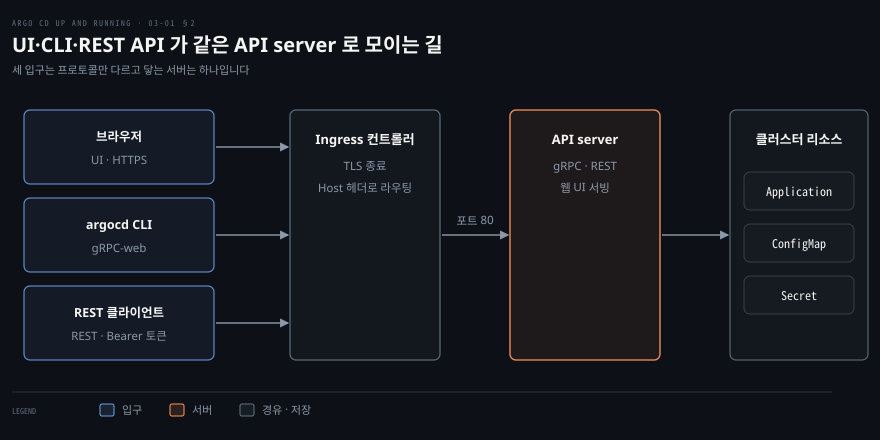
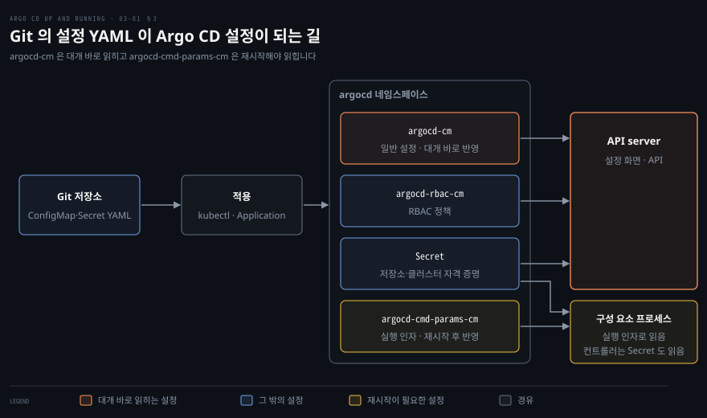

# Argo CD 와 상호작용하기 — UI·CLI·REST API 와 선언적 구성
---

## 핵심 요약

> Argo CD 의 UI 와 CLI 와 REST API 는 모두 같은 API server 로 들어가는 입구이고, Argo CD 의 설정은 `argocd` 네임스페이스의 ConfigMap 과 Secret 으로 선언합니다.

UI 를 Ingress 로 노출하려면 TLS 를 Ingress 에서 끝내도록 API server 의 TLS 를 끄고, CLI 는 `--grpc-web` 과 `--insecure` 로 로그인합니다. REST API 는 `/api/v1/session` 에서 받은 토큰을 Bearer 로 보내 호출하고 명세는 `/swagger.json` 과 `/swagger-ui` 에 있습니다.

설정 ConfigMap 은 종류마다 이름이 하나로 정해져 있습니다. `argocd-cm` 의 값은 재시작 없이 읽히는 경우가 많지만 `argocd-cmd-params-cm` 의 값은 구성 요소를 재시작해야 반영됩니다.[^ver]


## 학습 목표

이 내용을 읽고 나면:

1. Ingress 로 UI 를 노출할 때 API server 의 TLS 설정을 바꿔야 하는 이유와 방법을 설명할 수 있습니다.
2. Settings 페이지와 User Info 페이지에서 볼 수 있는 것을 말할 수 있습니다.
3. CLI 로 로그인하고 비밀번호를 바꾸는 순서와 `--grpc-web` 과 `--insecure` 의 뜻을 말할 수 있습니다.
4. REST API 로 토큰을 받아 호출하고 토큰 없는 호출의 결과를 구분할 수 있습니다.
5. 설정용 ConfigMap 과 Secret 의 이름과 레이블 규칙과 반영 시점을 설명할 수 있습니다.


## 1. UI 심화 — Ingress 로 노출하기

> port-forward 는 임시 통로여서 Ingress 컨트롤러로 UI 를 노출하고, kind 위의 Traefik 으로 실습합니다.

### port-forward 의 한계와 Ingress

UI 를 계속 쓰려면 `port-forward` 대신 Ingress 로 노출해야 합니다. `port-forward` 는 명령이 실행되는 동안만 열려 있는 임시 통로이기 때문입니다.

Argo CD API server 는 한 서버에서 두 가지를 서비스합니다. CLI(Command Line Interface, 명령줄 도구)가 쓰는 gRPC 서버와 UI(User Interface, 사용자 화면)가 쓰는 HTTP·HTTPS 서버입니다. `argocd-server` Service 는 443 포트로 gRPC 와 HTTPS 를 받고 80 포트로 HTTP 를 받으며, 80 포트는 기본적으로 HTTPS 로 리다이렉트합니다. 두 포트 모두 컨테이너의 8080 포트로 넘어갑니다.[^ports]

**Ingress** 는 클러스터 밖의 HTTP 요청을 안쪽 Service 로 보내는 규칙을 적은 리소스이고, 그 규칙대로 요청을 나르는 것은 Ingress 컨트롤러입니다. 규칙과 구현이 갈라진 구조는 [Ingress 와 Service Mesh](../networking-and-kubernetes/05-03.Ingress와%20Service%20Mesh%20—%20L7의%20두%20층.md)의 「Ingress — 스펙과 구현의 분리」 절에 정리되어 있습니다.

### TLS 종료 위치와 컨트롤러 선택

TLS(Transport Layer Security, 전송 계층 보안)를 Ingress 컨트롤러에서 끝내려면 API server 는 TLS 를 꺼야 합니다. 컨트롤러가 TLS 를 풀어 평문 HTTP 로 넘기므로 API server 도 평문을 받아야 하기 때문입니다. 이 설정이 `argocd-cmd-params-cm` ConfigMap 의 `server.insecure: "true"` 이고 기본값은 `"false"` 입니다. Helm 차트에서는 `configs.params."server.insecure": true` 로 줍니다.

차트는 이 값을 읽고 Ingress 의 백엔드를 Service 의 80 포트로 잡습니다. 같은 효과를 내려고 `server.extraArgs` 에 `--insecure` 를 넣으면 API server 의 TLS 는 꺼지지만 Ingress 의 백엔드는 Service 의 443 포트 그대로입니다.[^insecure]

컨트롤러는 하나 골라야 합니다. Argo CD 문서에 절이 있는 ingress-nginx 는 2026-03-24 에 은퇴하고 보관 처리되었으므로 새로 고르지 않습니다. 같은 문서의 컨트롤러별 절 가운데 Traefik 절을 골랐습니다. 문서의 예는 Traefik 전용 `IngressRoute` 리소스이지만 Traefik 은 표준 Ingress 도 `ingressClassName: traefik` 으로 처리하므로, 이 노트는 차트가 만드는 표준 Ingress 를 그대로 씁니다.[^retire]

### kind 와 Traefik 실습 환경

클러스터는 kind 로 만들고 노드의 30443 포트를 내 컴퓨터의 8443 포트에 연결합니다. 이 연결이 있어야 브라우저가 `localhost` 쪽 8443 으로 클러스터 안의 Traefik 에 닿습니다.

```yaml
# kind-config.yaml
kind: Cluster
apiVersion: kind.x-k8s.io/v1alpha4
nodes:
- role: control-plane
  extraPortMappings:
  - containerPort: 30443
    hostPort: 8443
    protocol: TCP
```

Traefik 은 Helm 차트로 설치하고 HTTPS 입구인 `websecure` 를 NodePort 30443 으로 엽니다. NodePort 는 모든 노드의 같은 포트로 Service 를 여는 방식입니다. 차트에서 Service 의 종류를 바꾸는 키는 `service.type` 이 아니라 `service.spec.type` 입니다.

```yaml
# values-traefik.yaml
service:
  spec:
    type: NodePort
ports:
  websecure:
    nodePort: 30443
```

```bash
kind create cluster --name argocd-lab --config kind-config.yaml
helm repo add traefik https://traefik.github.io/charts
helm upgrade -i traefik traefik/traefik --version 42.3.0 \
  -n traefik --create-namespace -f values-traefik.yaml
curl -sk -o /dev/null -w '%{http_code}\n' https://127.0.0.1:8443/
```

마지막 `curl` 이 404 를 돌려주면 컨트롤러가 살아 있다는 뜻입니다. 아직 어떤 Ingress 도 없어서 Traefik 이 기본 404 로 답하는 것입니다. Helm 자체는 [Helm 기초](../../docs/helm/01-01.Helm%20기초.md)의 설치와 업그레이드 절에 있습니다.

### Ingress 를 켠 Argo CD 설치와 접속

이제 Argo CD 를 Ingress 를 켠 값으로 설치합니다. 호스트 이름은 `global.domain` 하나로 정하고, 이 값은 Ingress 의 호스트와 `argocd-cm` 의 `url` 기본값이 됩니다. `url` 은 Argo CD 의 외부 접속 기준 주소입니다.[^domain]

```yaml
# values-argocd-ingress.yaml
global:
  domain: argocd.127.0.0.1.nip.io
configs:
  params:
    server.insecure: true
server:
  ingress:
    enabled: true
    ingressClassName: traefik
```

```bash
helm repo add argo https://argoproj.github.io/argo-helm
helm upgrade -i argo-cd argo/argo-cd --version 10.14.0 \
  -n argocd --create-namespace -f values-argocd-ingress.yaml
kubectl get ingress -n argocd
```

`kubectl get ingress` 는 `argo-cd-argocd-server` 한 줄을 보여 줍니다. CLASS 는 `traefik` 이고 HOSTS 는 `argocd.127.0.0.1.nip.io` 이며 PORTS 는 `80` 입니다. 이 `80` 은 Ingress 가 받는 포트이고 TLS 를 달지 않아서 443 이 없는 것이므로 백엔드 포트와는 무관합니다. 백엔드 포트는 `.spec` 에서 읽습니다.

```bash
kubectl get ingress argo-cd-argocd-server -n argocd \
  -o jsonpath='{.spec.rules[0].http.paths[0].backend.service.port}'
```

이 명령은 `{"number":80}` 을 출력하고, 앞서 말한 Service 의 80 포트가 백엔드로 잡혔다는 것을 확인해 줍니다.

호스트 이름의 `nip.io` 는 이름에 IP 주소를 넣으면 그 IP 를 돌려주는 DNS(Domain Name System) 서비스입니다. `argocd.127.0.0.1.nip.io` 는 `127.0.0.1` 로 풀리므로 `/etc/hosts` 를 고치지 않아도 됩니다.[^nip] 브라우저에서 `https://argocd.127.0.0.1.nip.io:8443` 을 엽니다. Ingress 에 TLS 인증서를 달지 않았으므로 Traefik 이 내놓는 자체 서명 기본 인증서(`TRAEFIK DEFAULT CERT`) 때문에 브라우저가 경고를 띄웁니다. 실습에서는 그대로 진행하면 로그인 화면이 나옵니다.

### Settings 페이지와 User Info

로그인하면 왼쪽 메뉴의 Settings 페이지에서 Argo CD 의 연결 대상과 인증서와 계정을 한곳에서 봅니다. v3.6.1 의 Settings 는 여덟 개 타일입니다. Accounts, Clusters, GnuPG keys, Projects, Repositories 와 Repository certificates and known hosts 가 앞의 여섯이고 Appearance 와 Advanced 가 나머지 둘입니다. Advanced 는 인스턴스 설정을 보여 줍니다.

앞의 여섯 타일은 CLI 의 `account`, `cluster`, `gpg`, `proj`, `repo`, `cert` 명령 묶음과 짝을 이룹니다.[^settings]

User Info 페이지는 지금 로그인한 사용자의 Username 과 Issuer 를 보여 줍니다. Issuer 가 `argocd` 인 로컬 사용자에게는 상단 메뉴에 Update Password 가 나타나고, 누르면 비밀번호 변경 패널이 열립니다. SSO 로 들어온 사용자는 Issuer 가 다르므로 이 메뉴가 보이지 않습니다.[^userinfo]


## 2. CLI 와 REST API — 로그인과 세션 토큰

> CLI 와 REST API 는 UI 와 같은 API server 에 닿는 클라이언트이고, 다른 것은 프로토콜과 토큰 위치뿐입니다.

CLI 와 REST API 는 UI 와 같은 API server 에 말을 거는 다른 클라이언트이므로, 입구마다 다른 것은 프로토콜과 세션 토큰을 담는 곳뿐입니다.

### CLI 로그인과 gRPC-web 옵션

CLI 의 로그인에는 초기 admin 비밀번호가 필요합니다. 이 비밀번호는 `argocd-initial-admin-secret` Secret 에 평문으로 저장됩니다. `argocd admin initial-password` 가 그 값을 읽어 줍니다.[^initpw] Secret 의 값은 base64 로 인코딩되었을 뿐 암호화되지 않았습니다. 이 성질은 [컨테이너에 시크릿 전달하기](../container-security/12-01.컨테이너에%20시크릿%20전달하기%20—%20다섯%20경로와%20root라는%20천장.md)의 「Kubernetes 기본 시크릿」 절에서 다룹니다.

```bash
argocd admin initial-password -n argocd
argocd login argocd.127.0.0.1.nip.io:8443 \
  --insecure --grpc-web \
  --username admin --password '<password>'
argocd account get-user-info
```

`argocd account get-user-info` 는 `Logged In: true` 와 `Username: admin` 과 `Issuer: argocd` 를 출력합니다. `argocd admin initial-password` 는 쿠버네티스 API 에 직접 접근하므로 kubeconfig 의 컨텍스트가 있어야 합니다.

두 옵션은 각자 다른 문제를 풉니다. `--insecure` 는 서버 인증서와 도메인 검증을 건너뛰므로 자체 서명 인증서를 받아들이는 실습에만 씁니다. **gRPC-web** 은 gRPC 호출을 일반 HTTP 요청에 실어 보내는 프로토콜입니다. `--grpc-web` 은 HTTP/2 를 지원하지 않는 프록시 뒤의 서버를 위한 옵션입니다. 로그인이 TLS 확인 단계에서 멈추면 `--skip-test-tls` 로 그 확인을 건너뛸 수 있습니다.[^login]

이 노트의 Ingress 는 백엔드로 HTTP/1.1 만 넘기므로 순수 gRPC 는 통하지 않습니다. `--grpc-web` 을 빼면 CLI 가 `Failed to invoke grpc call` 경고를 찍은 뒤 스스로 gRPC-web 으로 바꿔 접속합니다.

### CLI 설정 파일과 로그인 뒤 작업

로그인에 성공하면 CLI 는 결과를 설정 파일에 저장합니다. 파일 이름은 `config` 이고 `ARGOCD_CONFIG_DIR` 환경 변수로 디렉터리를, `--config` 옵션으로 파일을 바꿉니다. 환경 변수가 없으면 옛 위치인 `~/.argocd` 가 이미 있을 때 그곳을 쓰고, 그다음 `XDG_CONFIG_HOME` 이 있으면 `$XDG_CONFIG_HOME/argocd` 를, 모두 없으면 `~/.config/argocd` 를 씁니다.

파일에는 접속 정보를 모은 contexts 와 서버별 `grpc-web`·`insecure` 설정과 사용자별 `auth-token` 이 들어 있습니다. `auth-token` 은 비밀번호와 같은 자격 증명이므로 이 파일을 공유하지 않습니다.[^config]

`argocd context` 는 저장된 context 목록을 보여 주고 `argocd logout <context>` 는 서버에 그 토큰의 무효화를 요청한 뒤 로컬 설정 파일에서 토큰을 지웁니다. 자체 서명 인증서 환경에서는 `--insecure` 를 붙여야 인증서 확인 질문에서 멈추지 않습니다. 이 노트처럼 8443 포트로 노출하면 서버 쪽 무효화 요청이 `argocd-cm` 의 `url`(포트 없음)로 가서 시간 초과 경고가 남습니다.[^config]

비밀번호는 로그인 직후에 바꿉니다. `argocd account update-password` 는 현재 비밀번호와 새 비밀번호를 물어보고, 끝나면 `Password updated` 를 출력합니다. 바꾼 뒤에는 옛 비밀번호로 로그인하면 `Invalid username or password` 로 거절되고 새 비밀번호는 통과합니다. UI 는 앞 절의 User Info 페이지에서 같은 일을 합니다. 공식 가이드는 비밀번호를 바꾼 뒤 `argocd-initial-admin-secret` 을 지우라고 안내합니다. 이 Secret 은 필요하면 Argo CD 가 다시 만들어 줍니다.

CLI 명령은 Settings 의 타일과 같은 대상을 다룹니다. 설치 직후 `argocd cluster list` 는 `in-cluster` 하나를, `argocd proj list` 는 `default` 프로젝트 하나를 보여 줍니다. `argocd account list` 는 `admin` 이 활성이고 `login` 기능을 가진다고 알려 줍니다.

### REST API 와 세션 토큰

REST API 는 CI/CD(Continuous Integration/Continuous Delivery, 지속적 통합과 전달) 같은 외부 시스템이 쓰는 입구입니다. 명세는 OpenAPI 형식으로 `/swagger.json` 에 있고 사람이 읽는 화면은 `/swagger-ui` 입니다. v3.6.1 의 `/swagger.json` 에는 경로가 82 개 있습니다.[^api]

호출에는 세션 토큰이 필요합니다. `POST /api/v1/session` 에 사용자 이름과 비밀번호를 JSON(JavaScript Object Notation)으로 보내면 토큰이 옵니다. 이후 호출은 `Authorization: Bearer <token>` 헤더에 그 토큰을 담아 보냅니다. 이 엔드포인트는 로컬 계정만 인증하며 SSO 로 들어온 사용자는 인증하지 않습니다.

```bash
HOST=https://argocd.127.0.0.1.nip.io:8443
curl -sk "$HOST/api/v1/settings"
curl -sk -o /dev/null -w '%{http_code}\n' "$HOST/api/v1/applications"
curl -sk -X POST -H 'Content-Type: application/json' \
  -d '{"username":"admin","password":"<password>"}' "$HOST/api/v1/session"
curl -sk -H "Authorization: Bearer <token>" "$HOST/api/v1/session/userinfo"
```

토큰 없이도 `/api/v1/settings` 는 응답합니다. 이 응답에는 `url`, `appLabelKey`, `help`, `kustomizeOptions` 같은 공개해도 되는 설정만 들어 있습니다. 토큰을 실으면 `controllerNamespace`, `passwordPattern`, `resourceOverrides` 가 더해집니다.

반면 `/api/v1/applications` 는 401 과 `no session information` 으로 거절됩니다. 토큰을 실어 보낸 `/api/v1/session/userinfo` 는 `{"loggedIn":true,"username":"admin","iss":"argocd"}` 를 돌려줍니다.

### 세 입구가 닿는 같은 API server

세 입구는 프로토콜과 토큰을 담는 곳만 다르고 같은 서버에 닿습니다. 구조 문서는 API server 를 "a gRPC/REST server which exposes the API consumed by the Web UI, CLI, and CI/CD systems"라고 소개합니다.[^arch]




## 3. 선언적 구성 — ConfigMap 과 Secret

> 설정은 모두 쿠버네티스 리소스라서 ConfigMap 과 Secret 을 apply 하면 CLI 없이 구성이 끝납니다.

### 선언적 구성과 설정 리소스 여섯

Argo CD 의 설정은 모두 쿠버네티스 리소스이므로 `kubectl apply` 로 선언하면 `argocd` CLI 를 쓰지 않고도 설정이 끝납니다. 이 방식을 선언적 구성이라 부르고, 설정 파일을 Git 에 두면 설정의 변경 이력이 Git 에 남습니다.[^decl]

설정을 담는 리소스는 여섯 가지이고 종류마다 이름이 하나로 정해져 있습니다. `argocd-cm` 은 일반 설정이고 `argocd-cmd-params-cm` 은 구성 요소의 실행 인자입니다. `argocd-rbac-cm` 은 RBAC(Role-Based Access Control, 역할 기반 접근 제어) 정책을 담습니다. `argocd-tls-certs-cm` 과 `argocd-ssh-known-hosts-cm` 은 Git 저장소에 접속할 때 쓰는 인증서와 SSH 호스트 키를 담습니다. `argocd-secret` 은 사용자 비밀번호와 서명 키와 웹훅 시크릿을 담는 Secret 입니다.

이 리소스에는 세 가지 규칙이 있습니다. 모두 Argo CD 가 설치된 네임스페이스에 있어야 하고 이름은 위 표기와 정확히 같아야 합니다. 또 ConfigMap 에는 `app.kubernetes.io/part-of: argocd` 레이블이 있어야 하며 없으면 Argo CD 가 그 ConfigMap 을 쓰지 않습니다.

### 레이블로 찾는 저장소 Secret

저장소와 클러스터의 연결 정보는 이름이 정해진 리소스 대신 레이블로 찾는 Secret 이 맡습니다. Secret 의 `argocd.argoproj.io/secret-type` 레이블 값이 `repository` 인 Secret 은 Git 저장소의 연결 정보입니다. 값이 `repo-creds` 인 Secret 은 저장소 자격 증명 템플릿이고 값이 `cluster` 인 Secret 은 배포 대상 클러스터의 연결 정보입니다.[^stype] 이름은 아무렇게나 지어도 됩니다. 아래 Secret 은 UI 나 CLI 없이 Git 저장소를 등록합니다.

```yaml
# repo-secret.yaml
apiVersion: v1
kind: Secret
metadata:
  name: example-apps-repo
  namespace: argocd
  labels:
    argocd.argoproj.io/secret-type: repository
stringData:
  type: git
  url: https://github.com/argoproj/argocd-example-apps.git
```

`kubectl apply -f repo-secret.yaml` 을 실행하면 `argocd repo list` 에 이 저장소가 `Successful` 로 나타납니다. Secret 을 지우면 목록에서도 사라집니다. 비공개 저장소에는 `username` 과 `password` 필드를 더하고, SSH 로 접속하면 `sshPrivateKey` 를 씁니다.[^stype] 이런 Secret 을 Git 에 평문으로 올리지 않는 방법은 이 장의 범위 밖입니다.

### ConfigMap 별 반영 시점

설정이 반영되는 시점은 ConfigMap 마다 다릅니다. `argocd-cm` 은 대개 재시작 없이 반영됩니다. `help.chatUrl` 과 `help.chatText` 를 넣자 `/api/v1/settings` 의 `help` 값이 바로 바뀌었습니다. 다만 키마다 다를 수 있습니다. `timeout.reconciliation` 은 `argocd-repo-server` 와 `argocd-application-controller` 를 직접 재시작해야 반영된다고 `argocd-cm.yaml` 의 주석이 밝힙니다.[^restart]

`argocd-cmd-params-cm` 은 성격이 다릅니다. 이 ConfigMap 의 키는 구성 요소의 실행 인자이고 앞머리가 대상 구성 요소를 가리킵니다. `server` 는 `argocd-server` 를 뜻하고 `reposerver` 는 `argocd-repo-server` 를 뜻합니다. `controller` 는 `argocd-application-controller` 입니다.

프로세스가 시작할 때 읽는 값이라서 `server.log.format: json` 을 넣어도 바로는 바뀌지 않았습니다. `argocd-server` 를 `rollout restart` 한 뒤에야 로그가 JSON 으로 바뀌었습니다.

```bash
kubectl -n argocd patch cm argocd-cm --type merge \
  -p '{"data":{"help.chatUrl":"https://example.com/chat","help.chatText":"Ask the platform team"}}'
kubectl -n argocd patch cm argocd-cmd-params-cm --type merge \
  -p '{"data":{"server.log.format":"json"}}'
kubectl -n argocd rollout restart deploy/argo-cd-argocd-server
```

Helm 차트로 설치했다면 사정이 다릅니다. 차트는 이 ConfigMap 의 체크섬을 파드 템플릿 주석 `checksum/cmd-params` 에 넣으므로 `helm upgrade` 로 값을 바꾸면 `argocd-server` 가 자동으로 다시 뜹니다. 위 실험처럼 `kubectl` 로 ConfigMap 을 직접 고쳤을 때만 손으로 재시작해야 합니다.[^restart]

### Argo CD 가 자기 자신을 관리

설정이 전부 매니페스트라는 점은 Argo CD 가 자기 자신을 관리할 수 있다는 뜻이기도 합니다. 공식 문서가 권하는 방법은 Argo CD 의 기본 매니페스트를 기반으로 삼고 그 위에 패치를 얹는 Kustomize Application 을 만드는 것입니다. 이때 Application 의 동기화 옵션에 `ServerSideApply=true` 를 반드시 켜야 합니다.[^self]




## 연습 문제

> 아래 여섯 문제는 UI 노출과 CLI 로그인과 REST 호출과 설정 반영 시점을 하나씩 묻습니다. 답을 적은 뒤에 정답 절을 펼칩니다.

1. TLS 를 Ingress 컨트롤러에서 끝내려면 Argo CD 에서 무엇을 바꿉니까? Helm 설치에서 Ingress 의 백엔드 포트는 얼마이고 어떻게 확인합니까? 값을 바꾼 뒤 `argocd-server` 에 반영하려면 설치 방식별로 무엇을 합니까?
2. Ingress 뒤의 Argo CD 에 `argocd login` 할 때 `--insecure` 와 `--grpc-web` 은 각각 어떤 문제를 풉니까?
3. 초기 admin 비밀번호는 어디에 저장되고 왜 바꿔야 합니까? 바꾼 뒤에는 CLI 와 UI 에서 각각 어떻게 확인합니까?
4. 토큰 없이 `/api/v1/settings` 와 `/api/v1/applications` 를 호출하면 각각 어떻게 됩니까? 토큰은 어디서 얻습니까?
5. `argocd-cm` 의 값과 `argocd-cmd-params-cm` 의 값은 반영되는 방식이 어떻게 다릅니까?
6. UI 나 CLI 없이 Git 저장소를 Argo CD 에 등록하려면 어떤 리소스를 만들어야 합니까?


## 정답 (자답 후 펼치기)

### 정답 1

`argocd-cmd-params-cm` 에 `server.insecure: "true"` 를 넣어 API server 의 TLS 를 끕니다. Helm 차트에서는 `configs.params."server.insecure": true` 입니다. 컨트롤러가 TLS 를 풀어 평문으로 넘기므로 API server 도 평문을 받아야 하기 때문입니다.

이 값이 true 이면 차트가 Ingress 의 백엔드를 Service 의 80 포트로 잡습니다. 백엔드 포트는 아래 명령으로 확인하며 `{"number":80}` 이 나옵니다.

```bash
kubectl get ingress argo-cd-argocd-server -n argocd \
  -o jsonpath='{.spec.rules[0].http.paths[0].backend.service.port}'
```

`kubectl get ingress` 의 PORTS 는 Ingress 가 받는 포트라서 백엔드 확인에는 쓰지 않습니다. `server.extraArgs` 로 `--insecure` 만 주면 TLS 는 꺼져도 백엔드는 Service 의 443 포트 그대로입니다.

`argocd-cmd-params-cm` 의 값은 프로세스가 시작할 때 읽습니다. Helm 차트는 이 ConfigMap 의 체크섬을 파드 템플릿 주석(`checksum/cmd-params`)에 넣으므로 `helm upgrade` 로 값을 바꾸면 `argocd-server` 가 자동으로 다시 뜹니다. `kubectl` 로 ConfigMap 을 직접 고쳤다면 `kubectl rollout restart` 가 필요합니다.

### 정답 2

`--insecure` 는 서버 인증서와 도메인 검증을 건너뜁니다. Ingress 에 자체 서명 인증서가 달려 있는 실습 환경에서 로그인이 인증서 오류로 막히지 않게 하며 운영 환경에는 쓰지 않습니다. `--grpc-web` 은 gRPC 호출을 일반 HTTP 요청에 실어 보내는 gRPC-web 프로토콜을 켭니다. 공식 설명으로는 HTTP/2 를 지원하지 않는 프록시 뒤의 서버에 쓰는 옵션입니다.

이 노트의 Ingress 는 백엔드로 HTTP/1.1 만 넘기므로 순수 gRPC 는 통하지 않고, 옵션을 빼면 CLI 가 경고를 찍은 뒤 gRPC-web 으로 바꿔 접속합니다. 로그인이 TLS 확인 단계에서 멈추면 `--skip-test-tls` 가 그 확인을 건너뜁니다.

### 정답 3

`argocd-initial-admin-secret` Secret 의 `password` 필드에 저장되며 base64 로 인코딩되었을 뿐 암호화되지 않습니다. 설치 때 자동 생성되는 값이고 Secret 을 읽을 수 있는 누구에게나 보이므로 로그인 직후 바꿉니다.

CLI 는 `argocd account update-password` 로 바꿉니다. 바꾼 뒤 옛 비밀번호로 로그인하면 `Invalid username or password` 로 거절되고 새 비밀번호는 통과합니다. UI 는 User Info 페이지에서 Issuer 가 `argocd` 인지 확인한 뒤 상단 메뉴의 Update Password 로 패널을 엽니다. 바꾼 뒤 UI 에서 확인하려면 로그아웃하고 로그인 화면에서 새 비밀번호로 들어가 봅니다. 공식 가이드는 변경 뒤 이 Secret 을 지우라고 안내합니다.

### 정답 4

`/api/v1/settings` 는 토큰 없이도 응답하지만 `url` 과 `appLabelKey` 와 `help` 와 `kustomizeOptions` 같은 공개해도 되는 키만 돌려줍니다. 토큰을 실으면 `controllerNamespace` 와 `passwordPattern` 과 `resourceOverrides` 가 더해집니다. `/api/v1/applications` 는 401 과 `no session information` 으로 거절됩니다.

토큰은 `POST /api/v1/session` 에 `{"username":"admin","password":"<password>"}` 를 JSON 으로 보내 받고 이후 호출에 `Authorization: Bearer <token>` 헤더로 실어 보냅니다. 이 엔드포인트는 로컬 계정만 인증합니다.

### 정답 5

`argocd-cm` 은 대개 재시작 없이 반영됩니다. `help.chatUrl` 은 재시작 없이 `/api/v1/settings` 에 반영되었습니다.

다만 `timeout.reconciliation` 처럼 `argocd-repo-server` 와 `argocd-application-controller` 의 재시작이 필요하다고 주석에 적힌 키도 있어서 키마다 확인해야 합니다.

`argocd-cmd-params-cm` 은 구성 요소의 실행 인자이고 키 앞머리 `server`, `reposerver`, `controller` 가 대상 구성 요소를 정합니다. 프로세스가 시작할 때 읽으므로 값을 넣어도 해당 구성 요소를 재시작해야 반영됩니다. `server.log.format: json` 은 `argocd-server` 재시작 뒤에 로그를 JSON 으로 바꾸었습니다. Helm 으로 설치했다면 `helm upgrade` 가 체크섬 주석으로 `argocd-server` 를 자동으로 다시 띄우므로 손으로 재시작할 일은 `kubectl` 로 직접 고쳤을 때뿐입니다.

### 정답 6

`argocd` 네임스페이스에 `argocd.argoproj.io/secret-type: repository` 레이블을 단 Secret 을 만듭니다. `stringData` 에 `type: git` 과 `url` 을 넣으면 `kubectl apply` 만으로 `argocd repo list` 에 `Successful` 로 나타납니다. 비공개 저장소에는 `username` 과 `password` 필드를 더하고, SSH 로 접속하면 `sshPrivateKey` 를 씁니다. 여러 저장소가 같은 자격 증명을 쓴다면 `repo-creds` 레이블의 Secret 을 템플릿으로 둘 수 있습니다.


## 참고 자료

- 《Argo CD: Up and Running》(Andrew Block · Christian Hernandez, O'Reilly, 2025, ISBN 978-1-098-14200-1) 3장
- [Argo CD 아키텍처](https://github.com/argoproj/argo-cd/blob/v3.6.1/docs/operator-manual/architecture.md)
- [Ingress 설정](https://github.com/argoproj/argo-cd/blob/v3.6.1/docs/operator-manual/ingress.md)
- [선언적 설정](https://github.com/argoproj/argo-cd/blob/v3.6.1/docs/operator-manual/declarative-setup.md)
- [추가 구성 방법](https://github.com/argoproj/argo-cd/blob/v3.6.1/docs/operator-manual/server-commands/additional-configuration-method.md)
- [argocd-cm.yaml](https://github.com/argoproj/argo-cd/blob/v3.6.1/docs/operator-manual/argocd-cm.yaml)
- [시작 가이드](https://github.com/argoproj/argo-cd/blob/v3.6.1/docs/getting_started.md)
- [CLI 설치](https://github.com/argoproj/argo-cd/blob/v3.6.1/docs/cli_installation.md)
- [argocd login](https://github.com/argoproj/argo-cd/blob/v3.6.1/docs/user-guide/commands/argocd_login.md)
- [API 문서](https://github.com/argoproj/argo-cd/blob/v3.6.1/docs/developer-guide/api-docs.md)
- [argo-helm 의 argo-cd 차트](https://github.com/argoproj/argo-helm/blob/argo-cd-10.14.0/charts/argo-cd/templates/argocd-server/ingress.yaml)
- [Traefik 차트](https://github.com/traefik/traefik-helm-chart/tree/v42.3.0)
- [kind 의 Ingress](https://kind.sigs.k8s.io/docs/user/ingress/)
- [nip.io](https://nip.io/)
- 관련 노트: [이 책의 인덱스](./README.md), [01-01 Argo CD 가 푸는 문제](./01-01.Argo%20CD%20가%20푸는%20문제%20—%20GitOps%20원칙과%20Argo%20생태계.md), [02-01 Argo CD 설치하기](./02-01.Argo%20CD%20설치하기%20—%20구성%20요소·설치%20유형·매니페스트와%20Helm.md), [Ingress 와 Service Mesh](../networking-and-kubernetes/05-03.Ingress와%20Service%20Mesh%20—%20L7의%20두%20층.md), [컨테이너에 시크릿 전달하기](../container-security/12-01.컨테이너에%20시크릿%20전달하기%20—%20다섯%20경로와%20root라는%20천장.md), [Helm 기초](../../docs/helm/01-01.Helm%20기초.md)

[^ver]: 최신 릴리스는 Argo CD v3.6.1(2026-11-04)이고 Helm 차트는 10.14.0(appVersion v3.6.1)입니다. 문서와 소스는 v3.6.1 태그에 고정했습니다. 이 노트의 실습은 kind v0.31.0 이 만든 Kubernetes v1.35.0 클러스터에 Traefik 차트 42.3.0(앱 v3.7.17)과 argo-cd 차트 10.14.0 을 설치해 실행했고, UI 접속과 CLI 로그인과 비밀번호 변경과 REST 호출과 ConfigMap·Secret 반영을 모두 확인했습니다. <https://github.com/argoproj/argo-cd/releases/tag/v3.6.1> (2026-11-06 조회)
[^ports]: Ingress 문서는 "Argo CD API server runs both a gRPC server (used by the CLI), as well as an HTTP/HTTPS server (used by the UI)."라고 적습니다. 이어서 두 프로토콜이 `argocd-server` Service 의 포트로 열린다며 "443 - gRPC/HTTPS"와 "80 - HTTP (redirects to HTTPS)"를 안내합니다. v3.6.1 의 `manifests/install.yaml` 에서 `argocd-server` Service 의 두 포트는 `targetPort` 가 모두 8080 이고, 이 노트의 차트 설치에서도 `kubectl get svc` 가 `80->8080` 과 `443->8080` 을 보여 줍니다. <https://github.com/argoproj/argo-cd/blob/v3.6.1/docs/operator-manual/ingress.md> · <https://github.com/argoproj/argo-cd/blob/v3.6.1/manifests/install.yaml> (2026-11-06 조회)
[^insecure]: Ingress 문서는 "The API server should be run with TLS disabled."라며 `--insecure` 플래그나 `argocd-cmd-params-cm` 의 `server.insecure: "true"` 를 안내합니다. 이 값의 기본값은 `"false"` 이고 설명은 "Run server without TLS"입니다. argo-cd-10.14.0 차트의 Ingress 템플릿은 `eq $insecure "true" | ternary .Values.server.service.servicePortHttp .Values.server.service.servicePortHttps` 로 백엔드 포트를 고르며 `$insecure` 는 `configs.params."server.insecure"` 값입니다. 그래서 `server.extraArgs` 로 준 `--insecure` 는 이 선택에 영향을 주지 않습니다. <https://github.com/argoproj/argo-cd/blob/v3.6.1/docs/operator-manual/ingress.md> · <https://github.com/argoproj/argo-cd/blob/v3.6.1/docs/operator-manual/argocd-cmd-params-cm.yaml> · <https://github.com/argoproj/argo-helm/blob/argo-cd-10.14.0/charts/argo-cd/templates/argocd-server/ingress.yaml> (2026-11-06 조회)
[^retire]: Ingress 문서는 "ingress-nginx is retired, and was archived on March 24, 2026. This section can still be used as a reference for other Ingress Controllers."라고 적습니다. 같은 문서의 Traefik 절은 "Traefik can be used as an edge router and provide TLS termination within the same deployment."라고 소개하고 예로 `IngressRoute` CRD 만 보여 줍니다. 표준 Ingress 를 Traefik 이 `ingressClassName: traefik` 으로 처리하는 것은 이 노트의 실습에서 확인했습니다. <https://github.com/argoproj/argo-cd/blob/v3.6.1/docs/operator-manual/ingress.md> · <https://github.com/traefik/traefik-helm-chart/tree/v42.3.0> (2026-11-06 조회)
[^domain]: `argocd-cm.yaml` 은 `url` 을 "Argo CD's externally facing base URL (optional). Required when configuring SSO"라고 설명합니다. 차트의 `global.domain` 이 Ingress 호스트의 기본값이 되는 것은 설치 뒤 `kubectl get ingress` 의 HOSTS 로 확인했습니다. <https://github.com/argoproj/argo-cd/blob/v3.6.1/docs/operator-manual/argocd-cm.yaml> (2026-11-06 조회)
[^nip]: nip.io 는 자신을 "a DNS (Domain Name System) service that, when queried with a hostname with an embedded IP address, returns that IP address"라고 소개합니다. <https://nip.io/> (2026-11-06 조회)
[^settings]: Settings 페이지 소스는 타일 여덟 개를 `Accounts`, `Clusters`, `GnuPG keys`, `Projects`, `Repositories`, `Repository certificates and known hosts`, `Appearance`, `Advanced` 로 정의하고 마지막 것의 설명을 "View Argo CD instance configuration"으로 적습니다. 짝이 되는 CLI 명령 묶음은 `argocd --help` 의 목록으로 확인했습니다. <https://github.com/argoproj/argo-cd/blob/v3.6.1/ui/src/app/settings/components/settings-overview/settings-overview.tsx> (2026-11-06 조회)
[^userinfo]: User Info 소스는 `userInfo.loggedIn && userInfo.iss === ARGOCD_ISSUER`(`ARGOCD_ISSUER` 는 `'argocd'`)일 때만 비밀번호 변경을 허용합니다. 그때만 상단 액션 메뉴에 `Update Password` 항목이 생기고, 누르면 같은 이름의 슬라이딩 패널이 열립니다. 화면에는 `Username` 과 `Issuer` 를 내보냅니다. <https://github.com/argoproj/argo-cd/blob/v3.6.1/ui/src/app/user-info/components/user-info-overview/user-info-overview.tsx> (2026-11-06 조회)
[^initpw]: 시작 가이드는 초기 비밀번호가 "stored as clear text in the field `password` in a secret named `argocd-initial-admin-secret`"이라 적고 `argocd admin initial-password -n argocd` 를 안내합니다. 같은 가이드는 비밀번호를 바꾼 뒤 이 Secret 을 지우라고 경고하며 "It will be re-created on demand by Argo CD if a new admin password must be re-generated."라고 덧붙입니다. CLI 설치는 `cli_installation.md` 가 다룹니다. <https://github.com/argoproj/argo-cd/blob/v3.6.1/docs/getting_started.md> · <https://github.com/argoproj/argo-cd/blob/v3.6.1/docs/cli_installation.md> (2026-11-06 조회)
[^login]: `argocd login` 문서는 `--grpc-web` 을 "Enables gRPC-web protocol. Useful if Argo CD server is behind proxy which does not support HTTP2."로, `--insecure` 를 "Skip server certificate and domain verification"으로, `--skip-test-tls` 를 "Skip testing whether the server is configured with TLS (this can help when the command hangs for no apparent reason)"로 설명합니다. <https://github.com/argoproj/argo-cd/blob/v3.6.1/docs/user-guide/commands/argocd_login.md> (2026-11-06 조회)
[^config]: `localconfig.go` 의 `DefaultConfigDir` 는 "the local configuration path for settings such as cached authentication tokens"를 돌려주며 `ARGOCD_CONFIG_DIR` 가 있으면 그 값을, 없으면 `~/.argocd` 가 이미 있을 때 그것을, 그다음 `XDG_CONFIG_HOME` 이 있으면 `$XDG_CONFIG_HOME/argocd` 를, 모두 없으면 `~/.config/argocd` 를 쓰고 파일 이름은 `config` 입니다. 로그인한 설정 파일에서 `contexts` 와 `servers`(`grpc-web: true` 와 `insecure: true`)와 `users`(`auth-token`) 항목을 읽었습니다. `logout.go` 는 서버의 로그아웃 엔드포인트로 토큰 무효화를 요청하는 `revokeServerToken` 을 부른 뒤 `localCfg.RemoveToken` 으로 로컬 토큰을 지우고, 서버 인증서에 오류가 있으면 `--insecure` 가 없을 때 계속할지 묻습니다. <https://github.com/argoproj/argo-cd/blob/v3.6.1/util/localconfig/localconfig.go> · <https://github.com/argoproj/argo-cd/blob/v3.6.1/cmd/argocd/commands/logout.go> (2026-11-06 조회)
[^api]: API 문서는 "You can find the Swagger docs by setting the path to `/swagger-ui` in your Argo CD UI."라고 적고 "You'll need to authorize your API requests using a bearer token."라며 `/api/v1/session` 으로 토큰을 받는 예를 보여 줍니다. 같은 문서는 "`/api/v1/session` authenticates local accounts only."라고 밝힙니다. `/swagger.json` 의 경로 수 82 는 실행 중인 서버의 응답을 세어 얻었습니다. `/api/v1/settings` 의 키는 토큰 없이 부른 응답과 Bearer 토큰을 실어 부른 응답을 각각 받아 비교했습니다. <https://github.com/argoproj/argo-cd/blob/v3.6.1/docs/developer-guide/api-docs.md> (2026-11-06 조회)
[^arch]: 구조 문서는 API server 를 "a gRPC/REST server which exposes the API consumed by the Web UI, CLI, and CI/CD systems"로 소개합니다. <https://github.com/argoproj/argo-cd/blob/v3.6.1/docs/operator-manual/architecture.md> (2026-11-06 조회)
[^decl]: 선언적 설정 문서는 "Argo CD applications, projects and settings can be defined declaratively using Kubernetes manifests. These can be updated using `kubectl apply`, without needing to touch the `argocd` command-line tool."이라고 시작하고 "All resources, including `Application` and `AppProject` specs, have to be installed in the Argo CD namespace (by default `argocd`)."라고 적습니다. 같은 문서의 표는 `argocd-cm`, `argocd-cmd-params-cm`, `argocd-rbac-cm`, `argocd-secret`, `argocd-tls-certs-cm`, `argocd-ssh-known-hosts-cm` 를 이름이 정해진 설정 리소스로 올리고 "For each specific kind of ConfigMap and Secret resource, there is only a single supported resource name"이라 덧붙입니다. ConfigMap 레이블 경고는 "Be sure to annotate your ConfigMap resources using the label `app.kubernetes.io/part-of: argocd`, otherwise Argo CD will not be able to use them."입니다. <https://github.com/argoproj/argo-cd/blob/v3.6.1/docs/operator-manual/declarative-setup.md> (2026-11-06 조회)
[^stype]: 선언적 설정 문서의 예제는 `argocd.argoproj.io/secret-type` 레이블 값으로 `repository` 와 `repo-creds` 와 `cluster` 를 씁니다. `common.go` 에는 이 레이블의 키와 `repository`·`repo-creds`·`cluster` 상수가 있고 `repository-write` 같은 값이 더 정의되어 있습니다. 같은 문서는 저장소 Secret 에 `url` 이 있어야 하고 HTTPS 이면 `username` 과 `password` 를, SSH 이면 `sshPrivateKey` 를 쓴다고 적습니다. 레이블을 단 Secret 을 적용하자 `argocd repo list` 에 저장소가 `Successful` 로 나타났고 Secret 을 지우자 사라졌습니다. <https://github.com/argoproj/argo-cd/blob/v3.6.1/docs/operator-manual/declarative-setup.md> · <https://github.com/argoproj/argo-cd/blob/v3.6.1/common/common.go> (2026-11-06 조회)
[^restart]: `argocd-cm.yaml` 의 `timeout.reconciliation` 설명은 "The argocd-repo-server deployment and the argocd-application-controller statefulset (or deployment, if configured) must be manually restarted after changing the setting."입니다. `argocd-cmd-params-cm` 은 "Each component has a specific prefix associated with it."이고 접두사는 `argocd-server` 의 `server` 와 `argocd-repo-server` 의 `reposerver` 와 `argocd-application-controller` 의 `controller` 입니다. 두 ConfigMap 의 반영 차이는 실행해서 확인했습니다. argo-cd-10.14.0 차트의 `argocd-server` Deployment 템플릿은 파드 템플릿 주석에 `checksum/cmd-params` 와 `checksum/cm` 을 넣고, 그래서 Helm 값으로 ConfigMap 내용이 바뀌면 파드 템플릿이 달라져 롤아웃이 일어납니다. <https://github.com/argoproj/argo-cd/blob/v3.6.1/docs/operator-manual/argocd-cm.yaml> · <https://github.com/argoproj/argo-cd/blob/v3.6.1/docs/operator-manual/server-commands/additional-configuration-method.md> · <https://github.com/argoproj/argo-helm/blob/argo-cd-10.14.0/charts/argo-cd/templates/argocd-server/deployment.yaml> (2026-11-06 조회)
[^self]: 선언적 설정 문서의 「Manage Argo CD Using Argo CD」 절은 "Argo CD is able to manage itself since all settings are represented by Kubernetes manifests."라고 시작하고 Kustomize 기반 Application 에 기본 매니페스트와 패치를 얹으라고 권합니다. 이어서 "you **must** enable the `ServerSideApply=true` sync option"이라고 적습니다. 예시는 `stable` 참조를 쓰지만 이 노트는 v3.6.1 에 고정했습니다. <https://github.com/argoproj/argo-cd/blob/v3.6.1/docs/operator-manual/declarative-setup.md> (2026-11-06 조회)
