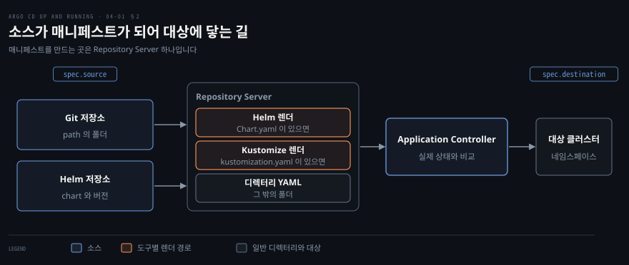
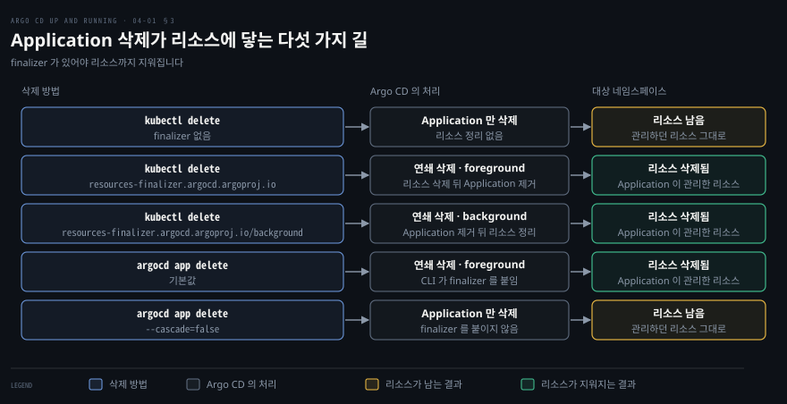

# Application 관리하기 — 소스·대상·Helm·Kustomize 와 삭제·finalizer
---

## 핵심 요약

> Application 은 Argo CD 가 배포를 관리하는 가장 작은 단위이고, `source` 가 매니페스트의 위치를, `destination` 이 배포할 클러스터와 네임스페이스를 정합니다.

Helm 이나 Kustomize 소스는 Repository Server 가 렌더링하므로 Helm 릴리스는 생기지 않고, Application 에 적은 값이 저장소의 값을 덮어씁니다. `syncPolicy.automated` 를 적지 않은 Application 은 수동 동기화라서, sync 를 하기 전까지 OutOfSync 로 남고 배포되지 않습니다.

삭제의 결과는 finalizer 가 정합니다. finalizer 없는 Application 을 `kubectl delete` 로 지우면 리소스가 남고, finalizer 가 있거나 `argocd app delete` 를 쓰면 리소스까지 지워집니다.[^ver]


## 학습 목표

이 내용을 읽고 나면:

1. `source` 와 `destination` 과 `project` 에 무엇을 적는지, `sources` 로 소스를 여러 개 묶는 방법을 설명할 수 있습니다.
2. 폴더에 따라 Helm 과 Kustomize 와 일반 디렉터리 중 무엇으로 렌더링되는지, Helm 값의 우선순위를 말할 수 있습니다.
3. 웹 화면과 명령줄 도구와 YAML 선언으로 Application 을 만들고 Sync status 와 Health status 를 읽을 수 있습니다.
4. `kubectl delete` 와 `argocd app delete` 가 리소스에 미치는 영향을 구분하고 finalizer 를 고를 수 있습니다.
5. `server` 와 `name` 을 함께 적었을 때나 대상 네임스페이스가 없을 때 나는 오류의 원인을 설명할 수 있습니다.


## 본문 정리

### 1. Application 구조 — 소스와 대상

Application 은 `source` 의 매니페스트를 `destination` 의 클러스터와 네임스페이스에 맞추라는 선언이고, 그 선언이 Argo CD 가 배포를 다루는 가장 작은 단위입니다.

Application 은 `argoproj.io/v1alpha1` 의 커스텀 리소스입니다. CRD(Custom Resource Definition, 사용자 정의 리소스 정의)로 등록되어 있어서 `kubectl` 로 다른 리소스처럼 만들고 지웁니다. Application 리소스는 Argo CD 가 설치된 `argocd` 네임스페이스에 둡니다. 다른 네임스페이스에 두는 방식은 따로 켜야 하는 기능입니다.[^appns]

```yaml
# guestbook.yaml
apiVersion: argoproj.io/v1alpha1
kind: Application
metadata:
  name: guestbook
  namespace: argocd
spec:
  project: default
  source:
    repoURL: https://github.com/argoproj/argocd-example-apps.git
    targetRevision: 8088f4c0d970abb09e250248cc97e35623447cb5
    path: guestbook
  destination:
    server: https://kubernetes.default.svc
    namespace: guestbook
  syncPolicy:
    syncOptions:
      - CreateNamespace=true
```

`source` 는 매니페스트가 있는 곳을 `repoURL` 과 `targetRevision` 과 `path` 로 가리킵니다. `repoURL` 은 Git 저장소나 Helm 차트 저장소의 주소입니다. `path` 는 저장소 안에서 매니페스트가 든 폴더입니다. Helm 저장소에서 차트를 바로 받는 소스에서는 `path` 가 뜻이 없습니다.

`targetRevision` 에는 브랜치와 태그와 커밋 SHA(Secure Hash Algorithm 으로 만든 커밋 식별자)와 `HEAD` 를 쓸 수 있습니다. Helm 저장소의 차트에서는 차트 버전을 씁니다.[^rev] 브랜치나 `HEAD` 는 그 끝의 변경을 계속 따라갑니다. 이 노트는 실습을 다시 돌릴 수 있도록 커밋 SHA 를 고정했습니다.

`destination` 은 클러스터를 `server` 나 `name` 중 하나로 가리키고 `namespace` 를 더합니다. Argo CD 가 설치된 클러스터는 `server` 로는 `https://kubernetes.default.svc` 이고 `name` 으로는 `in-cluster` 이며, `argocd cluster list` 에서 두 값이 한 줄로 나옵니다. 둘을 함께 적으면 `InvalidSpecError` 가 나고 메시지는 `application destination can't have both name and server defined: in-cluster https://kubernetes.default.svc` 였습니다.[^dest] 다른 클러스터를 등록하는 방법은 7장에서 다룹니다.

`namespace` 는 매니페스트에 `metadata.namespace` 가 없는 네임스페이스 범위 리소스에만 적용됩니다.[^ns] 이 값을 생략하고 매니페스트에도 네임스페이스가 없으면 `default` 로 배포되지 않습니다. 실습에서는 `InvalidSpecError: Namespace for guestbook-ui /v1, Kind=Service is missing.` 으로 멈췄습니다.

값을 적었어도 그 네임스페이스가 클러스터에 없으면 동기화가 `namespaces "guestbook" not found` 로 실패합니다. 네임스페이스를 만들어 주는 `CreateNamespace=true` 는 5장에서 다루는 sync 옵션입니다.[^sync]

`project` 는 Application 이 속하는 AppProject 의 이름입니다. 적지 않으면 `default` 프로젝트에 속하고, 이 프로젝트는 자동으로 만들어지며 어느 저장소에서 어느 클러스터로든 배포를 허용합니다.[^proj] 프로젝트로 배포 범위를 좁히는 방법은 8장에서 다룹니다.

`sources` 를 적으면 `source`(단수)는 무시됩니다. Argo CD 는 소스마다 매니페스트를 따로 만든 뒤 합칩니다.[^multi] 가장 흔한 쓰임은 외부 Helm 차트와 내 Git 저장소의 values 파일을 묶는 것이고, 아래 Application 은 podinfo 차트 6.17.0 에 Git 저장소의 `values-production.yaml` 을 얹습니다.

```yaml
# multi.yaml 의 spec (metadata.name 은 podinfo-multi)
spec:
  project: default
  sources:
    - repoURL: https://stefanprodan.github.io/podinfo
      chart: podinfo
      targetRevision: 6.17.0
      helm:
        valueFiles:
          - $values/helm-guestbook/values-production.yaml
    - repoURL: https://github.com/argoproj/argocd-example-apps.git
      targetRevision: 8088f4c0d970abb09e250248cc97e35623447cb5
      ref: values
  destination:
    name: in-cluster
    namespace: podinfo-multi
  syncPolicy:
    automated: {}
    syncOptions:
      - CreateNamespace=true
```

Git 소스에 `ref: values` 를 주면 그 저장소의 루트가 `$values` 라는 이름이 됩니다. 차트의 `valueFiles` 는 `$values/...` 처럼 경로 맨 앞에 이 이름을 붙여 그 파일을 가리킵니다. `ref` 가 붙은 소스는 `chart` 를 가질 수 없습니다.

실습에서 Service 의 `type` 이 `LoadBalancer` 가 되어 Git 쪽 values 가 적용된 것을 확인했습니다. `status.sync.revisions` 에는 `6.17.0` 과 커밋 SHA 두 값이 들어 있었습니다.

두 소스가 같은 리소스를 만들면 마지막 소스가 이기고 `RepeatedResourceWarning` 이 나옵니다. 서로 무관한 Application 을 묶는 용도로 쓰지 말라는 경고도 있습니다. 여러 Application 을 한 번에 만드는 방법은 10장의 ApplicationSet 이 맡습니다.


### 2. 템플릿 도구 — Helm 과 Kustomize

Argo CD 는 소스 폴더를 보고 Helm 과 Kustomize 와 일반 디렉터리 가운데 하나로 매니페스트를 만들며, 어느 도구를 쓰든 클러스터에 닿는 것은 렌더링이 끝난 Kubernetes 매니페스트입니다.

도구는 이렇게 정해집니다. Application 에 도구 설정을 적었으면 그 도구가 우선입니다. 적지 않았으면 폴더를 보고 고릅니다. `Chart.yaml` 이 있으면 Helm 이고 `kustomization.yaml` 이나 `kustomization.yml` 이나 `Kustomization` 이 있으면 Kustomize 입니다. 둘 다 없으면 일반 디렉터리로 봅니다.[^tool]

일반 디렉터리에 `*.jsonnet` 파일이 있으면 Jsonnet 으로 처리됩니다. 기본으로 지원하는 도구는 Helm 과 Jsonnet 과 Kustomize 셋입니다. 그 밖의 도구는 Config Management Plugin(구성 관리 플러그인)으로 끼우며 11장에서 다룹니다.[^cmp]

Helm 소스에서 Argo CD 는 `helm template` 으로 차트를 렌더링한 뒤 배포할 뿐 Helm 릴리스를 만들지 않습니다.[^helm] Helm 을 직접 쓰면 릴리스 정보가 클러스터의 Secret 에 남습니다([Helm 기초](../../docs/helm/01-01.Helm%20기초.md)의 「릴리스 저장 백엔드」 절). Argo CD 가 배포한 차트에서는 `helm ls -A` 가 비어 있었고 `helm.sh/release.v1` Secret 도 하나도 없었습니다. 차트의 수명 주기를 Helm 이 아니라 Argo CD 가 맡기 때문입니다. 릴리스 이름은 기본으로 Application 이름이고 `releaseName` 으로 바꿉니다.

값은 `source.helm` 의 네 곳에 줄 수 있습니다. `valueFiles` 는 values 파일의 경로 목록이고 차트 폴더(`path`) 기준 상대 경로입니다. `values` 는 YAML 문자열이고 `valuesObject` 는 YAML 객체이며 `parameters` 는 `--set` 과 같은 이름·값 쌍입니다.

같은 키를 여러 곳에 주면 `parameters`, `valuesObject`, `values`, `valueFiles`, 차트의 `values.yaml` 순서로 앞의 것이 이깁니다. `values` 와 `valuesObject` 는 합쳐지지 않습니다. `valuesObject` 를 적으면 `values` 는 키가 겹치지 않아도 통째로 무시됩니다.[^prec]

```yaml
# helm-guestbook.yaml 의 spec (metadata.name 은 helm-guestbook)
spec:
  project: default
  source:
    repoURL: https://github.com/argoproj/argocd-example-apps.git
    targetRevision: 8088f4c0d970abb09e250248cc97e35623447cb5
    path: helm-guestbook
    helm:
      valueFiles:
        - values-production.yaml
      parameters:
        - name: service.type
          value: ClusterIP
  destination:
    name: in-cluster
    namespace: helm-guestbook
  syncPolicy:
    automated: {}
    syncOptions:
      - CreateNamespace=true
```

이 폴더의 `values-production.yaml` 은 `service.type` 을 `LoadBalancer` 로 정합니다. 실습에서는 층을 하나씩 더하며 Service 의 `type` 을 읽었습니다.

| 적용한 층 | `service.type` 의 결과 |
|-----------|------------------------|
| `valueFiles` 의 `values-production.yaml` | `LoadBalancer` |
| 여기에 `valuesObject` 로 `NodePort` 추가 | `NodePort` |
| 여기에 `parameters` 로 `ClusterIP` 추가 | `ClusterIP` |

Helm 저장소의 차트를 받을 때는 `path` 대신 `chart` 를 쓰고 `targetRevision` 에 차트 버전을 적습니다.

```yaml
# podinfo.yaml 의 spec 일부 (metadata.name 은 podinfo)
source:
  repoURL: https://stefanprodan.github.io/podinfo
  chart: podinfo
  targetRevision: 6.17.0
  helm:
    parameters:
      - name: replicaCount
        value: "2"
destination:
  name: in-cluster
  namespace: podinfo
syncPolicy:
  automated: {}
  syncOptions:
    - CreateNamespace=true
```

이 Application 은 Deployment 2/2 와 이미지 `ghcr.io/stefanprodan/podinfo:6.17.0` 으로 Synced 와 Healthy 가 되었습니다.

Kustomize 소스에서는 `source.kustomize` 의 `namePrefix` 와 `replicas` 와 `images` 가 `kustomization.yaml` 의 같은 항목을 덮어씁니다.[^kust] `images` 는 `이전 이미지=새 이미지:태그` 형태의 목록입니다. 이 폴더의 `kustomization.yaml` 에는 `namePrefix: kustomize-` 가 들어 있는데, 아래 Application 은 그것을 `demo-` 로 덮어씁니다. base 와 overlay 로 폴더를 나누는 구조는 [Kustomize](../../docs/kustomize/01-01.Kustomize.md)의 「base와 overlay」 절에 있습니다.

```yaml
# kustomize-guestbook.yaml 의 spec 일부 (metadata.name 은 kustomize-guestbook)
source:
  repoURL: https://github.com/argoproj/argocd-example-apps.git
  targetRevision: 8088f4c0d970abb09e250248cc97e35623447cb5
  path: kustomize-guestbook
  kustomize:
    namePrefix: demo-
    replicas:
      - name: guestbook-ui
        count: 2
    images:
      - gcr.io/google-samples/gb-frontend=nginx:1.27-alpine
destination:
  name: in-cluster
  namespace: kustomize-guestbook
syncPolicy:
  automated: {}
  syncOptions:
    - CreateNamespace=true
```

결과로 Deployment 이름은 `demo-guestbook-ui` 가 되었고 2/2 로 떴으며 이미지는 `nginx:1.27-alpine` 이었습니다. 저장소의 `namePrefix`, 이미지, 복제본 수를 Git 을 고치지 않고 Application 에서 바꾼 셈입니다.




### 3. 수명 주기 — 배포·상태·삭제

새 Application 은 만들기만 해서는 배포되지 않고 sync 를 해야 리소스가 생기며, 지울 때는 finalizer 가 있느냐에 따라 리소스가 남기도 합니다.

Application 은 YAML 선언과 명령줄 도구와 웹 화면(UI, User Interface) 세 방식으로 만듭니다. YAML 은 `kubectl apply -f guestbook.yaml` 로 적용합니다. 명령줄 도구(CLI, Command Line Interface)로는 같은 값을 옵션으로 줍니다.

```bash
argocd app create cli-guestbook \
  --repo https://github.com/argoproj/argocd-example-apps.git \
  --revision 8088f4c0d970abb09e250248cc97e35623447cb5 \
  --path guestbook \
  --dest-name in-cluster \
  --dest-namespace cli-guestbook \
  --sync-option CreateNamespace=true
```

웹 화면에는 Application 을 만드는 마법사가 있고 도구의 기본값은 Directory 입니다.[^ui] 어느 방식이든 같은 Application 리소스가 만들어집니다.

CLI 로 만든 Application 도 YAML 로 만든 것과 같은 필드를 가집니다. `cli-guestbook` 의 `spec` 을 `kubectl get application cli-guestbook -n argocd -o yaml` 로 읽었습니다. `project: default` 와 `source` 와 `destination` 의 `name`·`namespace` 와 `syncPolicy.syncOptions` 가 위 YAML 과 같은 자리에 있었습니다. 소스가 여러 개인 Application 은 `--repo` 와 `--path` 같은 개별 옵션으로 만들 수 없어서 `--file` 로 매니페스트를 넘깁니다.

`syncPolicy.automated` 가 없으면 Application 은 수동 동기화입니다. 위 `guestbook.yaml` 에서 `syncPolicy` 블록을 뺀 채 처음 적용했을 때 Sync status 는 OutOfSync, Health status 는 Missing 이었습니다. Git 에는 리소스가 있고 클러스터에는 아직 없다는 뜻입니다.

이 상태에서 sync 하면 `namespaces "guestbook" not found` 로 실패했습니다. `CreateNamespace=true` 를 더한 뒤 `argocd app sync guestbook` 을 실행하자 Synced 와 Healthy 가 되었습니다.

Sync status 가 Git 의 변경과 수동 변경으로 OutOfSync 가 되었다가 sync 로 Synced 에 돌아오는 주기는 [01-01](./01-01.Argo%20CD%20가%20푸는%20문제%20—%20GitOps%20원칙과%20Argo%20생태계.md)에 있습니다. 자동으로 sync 하는 `syncPolicy.automated` 는 5장에서 다룹니다. 이 노트의 Helm 과 Kustomize 예제는 `automated: {}` 를 붙여 만들자마자 배포되게 했습니다.

Health status 는 Application 이 직접 거느린 리소스들의 상태 가운데 가장 나쁜 쪽을 따릅니다. 값은 Healthy, Suspended, Progressing, Missing, Degraded, Unknown 이고 왼쪽일수록 건강합니다.[^health]

Service 가 `LoadBalancer` 타입이면 `status.loadBalancer.ingress` 목록이 비어 있지 않아야 Healthy 입니다. 로드밸런서가 없는 kind 클러스터의 `podinfo-multi` 는 그래서 Synced 이면서 Progressing 으로 남았습니다. Sync status 와 Health status 는 따로 읽어야 합니다.

`kubectl delete application` 은 finalizer 가 없으면 Application 만 지우고 대상 네임스페이스의 리소스는 그대로 둡니다. `guestbook` 을 이렇게 지우자 Application 은 사라졌습니다. Deployment 와 Service 는 대상 네임스페이스인 `guestbook` 에 남았습니다.

남은 Service 에는 `argocd.argoproj.io/tracking-id: guestbook:/Service:guestbook/guestbook-ui` 어노테이션이 그대로 있었습니다. Argo CD 가 기본으로 이 어노테이션을 보고 리소스의 주인을 가리기 때문입니다.[^track]

finalizer 는 오브젝트의 `metadata.finalizers` 에 적는 문자열 목록입니다. 삭제를 요청하면 API server 는 `metadata.deletionTimestamp` 를 채우고 목록이 빌 때까지 오브젝트를 지우지 않습니다. 목록의 항목은 그 finalizer 를 맡은 컨트롤러가 정리를 끝낸 뒤 스스로 뗍니다.[^fin] namespace 삭제가 Terminating 에서 멈추는 이유도 같은 구조이고 [namespace 로 클러스터를 가상 분할하기](../kubernetes-in-action/07-01.namespace로%20클러스터를%20가상%20분할하기.md)의 「namespace 삭제」 절에 있습니다.

Argo CD 의 finalizer 는 두 가지입니다. `resources-finalizer.argocd.argoproj.io` 는 foreground 연쇄 삭제이고 `resources-finalizer.argocd.argoproj.io/background` 는 background 연쇄 삭제입니다. 둘은 서로 바꿔 쓰는 값이라 둘 중 하나만 둡니다.[^del] foreground 는 관리하던 리소스가 다 지워질 때까지 Application 을 남깁니다. background 는 Application 을 먼저 지운 뒤 리소스를 뒤에서 지웁니다.[^uidel]

두 finalizer 모두 실습에서 리소스를 지웠습니다. `kustomize-guestbook` 에 foreground finalizer 를, `helm-guestbook` 에 background finalizer 를 달고 `kubectl delete` 하자 Application 과 리소스가 모두 사라졌습니다.[^end] 두 정책의 쿠버네티스 쪽 정의는 [ReplicaSet 컨트롤러](../kubernetes-in-action/14-02.ReplicaSet%20컨트롤러%20—%20reconciliation·장애복구·삭제.md)의 「ReplicaSet 삭제」 절과 공식 가비지 컬렉션 문서에 있습니다.[^gc]

`argocd app delete` 는 기본이 연쇄 삭제이고 finalizer 를 자동으로 붙입니다. `argocd app delete podinfo --yes` 는 리소스까지 지웠습니다. `--cascade=false` 를 준 `cli-guestbook` 은 Application 만 지워져 Deployment 와 Service 가 남았습니다.

삭제 정책은 `--propagation-policy foreground|background` 로 고릅니다.[^del] 웹 화면의 삭제 창에는 Foreground 와 Background 와 Non-Cascading 세 가지가 있습니다.[^uidel] 연쇄 삭제는 Application 이 관리한 리소스만 지웁니다. `CreateNamespace=true` 로 만들어진 네임스페이스(`kustomize-guestbook`, `helm-guestbook`, `podinfo`)는 그대로 남았습니다.




## 연습 문제

> 아래 여섯 문제는 destination 과 Helm 값과 multi-source 와 삭제와 Health 를 하나씩 묻습니다. 답을 적은 뒤에 정답 절을 펼칩니다.

1. `destination` 에 `server` 와 `name` 을 함께 적으면 어떻게 됩니까? Argo CD 가 설치된 클러스터를 가리키는 두 값은 각각 무엇입니까?
2. `destination.namespace` 를 생략하면 매니페스트가 `default` 네임스페이스에 배포됩니까? 대상 네임스페이스가 클러스터에 없으면 어떻게 됩니까?
3. Helm 소스에서 `valueFiles` 와 `valuesObject` 와 `parameters` 가 같은 키를 정하면 어느 값이 적용됩니까? Argo CD 로 배포한 차트가 `helm ls` 에 보이지 않는 이유는 무엇입니까?
4. 외부 Helm 차트에 Git 저장소의 values 파일을 얹으려면 `sources` 를 어떻게 구성합니까? `source` 를 같이 적으면 어떻게 됩니까?
5. finalizer 없는 Application 을 `kubectl delete` 로 지우면 리소스는 어디에 남습니까? 리소스까지 지우는 방법과 두 finalizer 의 관계는 무엇입니까?
6. Synced 인데 Health 가 Progressing 에 머무는 Application 이 있습니다. kind 클러스터에서 먼저 의심할 리소스는 무엇이고, Application 의 Health 는 어떻게 정해집니까?


## 정답 (자답 후 펼치기)

### 정답 1

`InvalidSpecError` 가 나고 메시지는 `application destination can't have both name and server defined: in-cluster https://kubernetes.default.svc` 입니다. 클러스터는 `server` 나 `name` 중 하나로만 가리킵니다. `name` 만 적으면 Argo CD 가 이름으로 `server` 를 계산해 씁니다.

Argo CD 가 설치된 클러스터는 `server` 가 `https://kubernetes.default.svc` 이고 `name` 이 `in-cluster` 입니다. `argocd cluster list` 에서 두 값이 같은 줄에 나옵니다.

### 정답 2

아닙니다. `default` 로 가지 않습니다. 매니페스트에도 `metadata.namespace` 가 없으면 Application 이 OutOfSync 와 Missing 에 머뭅니다. 이때 `InvalidSpecError: Namespace for guestbook-ui /v1, Kind=Service is missing.` 이 납니다. `destination.namespace` 는 `metadata.namespace` 를 적지 않은 네임스페이스 범위 리소스에만 적용됩니다.

네임스페이스를 적었는데 클러스터에 없으면 동기화가 `namespaces "guestbook" not found` 로 실패합니다. `syncOptions` 에 `CreateNamespace=true` 를 더하면 Argo CD 가 그 네임스페이스를 만들어 줍니다. 이 옵션은 5장에서 자세히 다룹니다.

### 정답 3

`parameters`, `valuesObject`, `values`, `valueFiles`, 차트의 `values.yaml` 순서로 앞의 것이 이깁니다. 실습에서 `valueFiles` 만 줬을 때 Service `type` 은 `LoadBalancer` 였습니다. `valuesObject` 로 `NodePort` 를 더하자 `NodePort` 가 되었고 `parameters` 로 `ClusterIP` 를 더하자 `ClusterIP` 가 되었습니다. `values` 와 `valuesObject` 는 합쳐지지 않아서, `valuesObject` 를 적으면 `values` 는 키가 겹치지 않아도 통째로 무시됩니다.

Argo CD 는 `helm template` 으로 차트를 렌더링할 뿐 `helm install` 을 하지 않아 릴리스를 만들지 않기 때문입니다. 릴리스 정보는 Helm 이 클러스터의 Secret 에 저장하는데, 실습에서 `helm ls -A` 는 비어 있었고 `helm.sh/release.v1` Secret 은 하나도 없었습니다.

### 정답 4

`sources` 목록에 Helm 차트 소스와 Git 소스를 나란히 적고, Git 소스에 `ref: values` 를 줍니다. 차트 소스의 `valueFiles` 에는 `$values/helm-guestbook/values-production.yaml` 처럼 `$values` 로 시작하는 경로를 적습니다. `$values` 는 경로 맨 앞에서만 쓸 수 있고 `ref` 를 가진 저장소의 루트를 가리킵니다. `ref` 를 단 소스는 `chart` 를 가질 수 없습니다.

`sources` 를 적으면 `source`(단수)는 무시됩니다. 두 소스가 같은 리소스를 만들면 마지막 소스가 이기고 `RepeatedResourceWarning` 이 나옵니다.

### 정답 5

대상 네임스페이스에 그대로 남습니다. 실습에서 `guestbook` 의 Deployment 와 Service 가 `guestbook` 네임스페이스에 남았고, Service 에는 `argocd.argoproj.io/tracking-id` 어노테이션이 붙어 있었습니다.

리소스까지 지우려면 Application 에 finalizer 를 달고 `kubectl delete` 하거나, `argocd app delete` 를 씁니다. `argocd app delete` 는 기본이 연쇄 삭제이고 finalizer 를 자동으로 붙이며, `--cascade=false` 를 주면 Application 만 지웁니다.

finalizer 는 `resources-finalizer.argocd.argoproj.io`(foreground)와 `resources-finalizer.argocd.argoproj.io/background` 중 하나만 둡니다. 공식 문서의 예제도 둘을 서로 대안으로 적고, foreground 가 기본입니다. foreground 는 리소스가 다 지워질 때까지 Application 을 남기고 background 는 Application 을 먼저 지웁니다.

### 정답 6

Service 가 `LoadBalancer` 타입인지 먼저 봅니다. 이 타입은 `status.loadBalancer.ingress` 목록이 비어 있지 않아야 Healthy 인데, 로드밸런서가 없는 kind 에서는 목록이 채워지지 않아 Progressing 에 머뭅니다. 실습의 `podinfo-multi` 가 그랬습니다.

Application 의 Health 는 직접 거느린 리소스들의 Health 가운데 가장 나쁜 값으로 정해집니다. 건강한 쪽부터 Healthy, Suspended, Progressing, Missing, Degraded, Unknown 순서이므로 Missing 과 Degraded 리소스가 섞이면 Application 은 Degraded 입니다. Sync status 는 이와 따로 정해지므로 Synced 이면서 Progressing 일 수 있습니다.


## 참고 자료

- 《Argo CD: Up and Running》(Andrew Block · Christian Hernandez, O'Reilly, 2025, ISBN 978-1-098-14200-1) 4장
- [Application 예제 application.yaml](https://github.com/argoproj/argo-cd/blob/v3.6.1/docs/operator-manual/application.yaml)
- [선언적 설정](https://github.com/argoproj/argo-cd/blob/v3.6.1/docs/operator-manual/declarative-setup.md)
- [다른 네임스페이스의 Application](https://github.com/argoproj/argo-cd/blob/v3.6.1/docs/operator-manual/app-any-namespace.md)
- [추적 전략](https://github.com/argoproj/argo-cd/blob/v3.6.1/docs/user-guide/tracking_strategies.md)
- [프로젝트](https://github.com/argoproj/argo-cd/blob/v3.6.1/docs/user-guide/projects.md)
- [여러 소스](https://github.com/argoproj/argo-cd/blob/v3.6.1/docs/user-guide/multiple_sources.md)
- [도구 판별](https://github.com/argoproj/argo-cd/blob/v3.6.1/docs/user-guide/tool_detection.md)
- [Helm](https://github.com/argoproj/argo-cd/blob/v3.6.1/docs/user-guide/helm.md)
- [Kustomize](https://github.com/argoproj/argo-cd/blob/v3.6.1/docs/user-guide/kustomize.md)
- [Jsonnet](https://github.com/argoproj/argo-cd/blob/v3.6.1/docs/user-guide/jsonnet.md)
- [Config Management Plugins](https://github.com/argoproj/argo-cd/blob/v3.6.1/docs/operator-manual/config-management-plugins.md)
- [Sync 옵션](https://github.com/argoproj/argo-cd/blob/v3.6.1/docs/user-guide/sync-options.md)
- [Health 판정](https://github.com/argoproj/argo-cd/blob/v3.6.1/docs/operator-manual/health.md)
- [리소스 추적](https://github.com/argoproj/argo-cd/blob/v3.6.1/docs/user-guide/resource_tracking.md)
- [Application 삭제](https://github.com/argoproj/argo-cd/blob/v3.6.1/docs/user-guide/app_deletion.md)
- [Kubernetes finalizer](https://kubernetes.io/docs/concepts/overview/working-with-objects/finalizers/)
- [Kubernetes 가비지 컬렉션](https://kubernetes.io/docs/concepts/architecture/garbage-collection/)
- [argocd-example-apps](https://github.com/argoproj/argocd-example-apps/tree/8088f4c0d970abb09e250248cc97e35623447cb5)
- [podinfo Helm 저장소](https://stefanprodan.github.io/podinfo/index.yaml)
- 관련 노트: [이 책의 인덱스](./README.md), [01-01 Argo CD 가 푸는 문제](./01-01.Argo%20CD%20가%20푸는%20문제%20—%20GitOps%20원칙과%20Argo%20생태계.md), [02-01 Argo CD 설치하기](./02-01.Argo%20CD%20설치하기%20—%20구성%20요소·설치%20유형·매니페스트와%20Helm.md), [03-01 Argo CD 와 상호작용하기](./03-01.Argo%20CD%20와%20상호작용하기%20—%20UI·CLI·REST%20API%20와%20선언적%20구성.md), [namespace 로 클러스터를 가상 분할하기](../kubernetes-in-action/07-01.namespace로%20클러스터를%20가상%20분할하기.md), [ReplicaSet 컨트롤러](../kubernetes-in-action/14-02.ReplicaSet%20컨트롤러%20—%20reconciliation·장애복구·삭제.md), [Helm 기초](../../docs/helm/01-01.Helm%20기초.md), [Kustomize](../../docs/kustomize/01-01.Kustomize.md)

[^ver]: 최신 릴리스는 Argo CD v3.6.1(2026-11-04)이고 Helm 차트는 argo-cd-10.14.0 입니다. 문서와 소스는 v3.6.1 태그에 고정했습니다. 이 노트의 실습은 kind v0.31.0 이 만든 Kubernetes v1.35.0 클러스터에 v3.6.1 의 `manifests/install.yaml` 을 적용하고, v3.6.1 CLI 를 `argocd login --core` 로 로그인해 진행했습니다. 예제 저장소는 `argoproj/argocd-example-apps` 의 커밋 `8088f4c0d970abb09e250248cc97e35623447cb5`(2026-05-19)로 고정했고 Helm 차트는 podinfo 6.17.0 입니다. <https://github.com/argoproj/argo-cd/releases/tag/v3.6.1> (2026-11-06 조회)
[^appns]: 다른 네임스페이스 문서는 "As of version 2.5, Argo CD supports managing `Application` resources in namespaces other than the control plane's namespace (which is usually `argocd`), but this feature has to be explicitly enabled and configured appropriately."라고 적습니다. <https://github.com/argoproj/argo-cd/blob/v3.6.1/docs/operator-manual/app-any-namespace.md> (2026-11-06 조회)
[^rev]: `application.yaml` 은 `repoURL` 에 "Can point to either a Helm chart repo or a git repo.", `targetRevision` 에 "For Helm, this refers to the chart version.", `path` 에 "This has no meaning for Helm charts pulled directly from a Helm repo instead of git."이라는 주석을 답니다. 추적 전략 문서는 Git 의 경우 "all versions are Git references but tags Semantic Versions can also be used"라며 고정에는 태그나 커밋 SHA 를, 최신 추적에는 `HEAD` 나 브랜치를 안내하고, "If a branch name or a symbolic reference (like HEAD) is specified, Argo CD will continually compare live state against the resource manifests defined at the tip of the specified branch"라고 적습니다. <https://github.com/argoproj/argo-cd/blob/v3.6.1/docs/operator-manual/application.yaml> <https://github.com/argoproj/argo-cd/blob/v3.6.1/docs/user-guide/tracking_strategies.md> (2026-11-06 조회)
[^dest]: 선언적 설정 문서는 `destination` 을 "For the cluster one of server or name can be used, but not both (which will result in an error). Under the hood when the server is missing, it is calculated based on the name and used for any operations."라고 설명합니다. 오류 메시지와 `in-cluster` 의 `server` 값은 실습에서 두 값을 함께 적은 Application 을 적용해 읽었고, 두 값이 한 줄에 나오는 것은 `argocd cluster list` 로 확인했습니다. <https://github.com/argoproj/argo-cd/blob/v3.6.1/docs/operator-manual/declarative-setup.md> (2026-11-06 조회)
[^ns]: `application.yaml` 의 `destination.namespace` 주석은 "The namespace will only be set for namespace-scoped resources that have not set a value for .metadata.namespace"입니다. 생략한 경우의 오류는 `destination.name: in-cluster` 만 적고 `namespace` 를 뺀 Application 으로 확인했고, 그 Application 은 OutOfSync 와 Missing 에 머물렀으며 `default` 네임스페이스에는 `service/kubernetes` 만 있었습니다. 컨트롤러는 네임스페이스 범위 리소스의 네임스페이스가 비어 있으면 `InvalidSpecError` 조건을 답니다(`controller/state.go` 1065~1066줄). <https://github.com/argoproj/argo-cd/blob/v3.6.1/docs/operator-manual/application.yaml> <https://github.com/argoproj/argo-cd/blob/v3.6.1/controller/state.go#L1065-L1066> (2026-11-06 조회)
[^sync]: Sync 옵션 문서는 "Without this either declared in the Application manifest or passed in the CLI via `--sync-option CreateNamespace=true`, the Application will fail to sync if the namespace doesn't exist."라고 적습니다. <https://github.com/argoproj/argo-cd/blob/v3.6.1/docs/user-guide/sync-options.md> (2026-11-06 조회)
[^proj]: 프로젝트 문서는 "If unspecified, an application belongs to the `default` project, which is created automatically and by default, permits deployments from any source repo, to any cluster, and all resource Kinds."라고 적습니다. <https://github.com/argoproj/argo-cd/blob/v3.6.1/docs/user-guide/projects.md> (2026-11-06 조회)
[^multi]: 여러 소스 문서는 "When you specify the `sources` field, Argo CD will ignore the `source` (singular) field."와 "Sources with the `ref` field set cannot include the `chart` field."를 적고, 같은 리소스를 여러 소스가 만들면 "the last source to produce the resource will take precedence"이며 `RepeatedResourceWarning` 이 나온다고 설명합니다. "Do not abuse multiple sources"라는 경고와 "Multi-source applications cannot be created using individual flags like `--repo` and `--path`"라는 CLI 안내도 있습니다. <https://github.com/argoproj/argo-cd/blob/v3.6.1/docs/user-guide/multiple_sources.md> (2026-11-06 조회)
[^tool]: 도구 판별 문서는 "If a specific tool is explicitly configured, then that tool is selected to create your application's manifests."로 시작해 "Helm if there's a file matching `Chart.yaml`."과 "Kustomize if there's a `kustomization.yaml`, `kustomization.yml`, or `Kustomization`"을 적고 "Otherwise it is assumed to be a plain directory application."으로 맺습니다. Jsonnet 문서는 "Any file matching `*.jsonnet` in a directory app is treated as a Jsonnet file."이라고 적습니다. <https://github.com/argoproj/argo-cd/blob/v3.6.1/docs/user-guide/tool_detection.md> <https://github.com/argoproj/argo-cd/blob/v3.6.1/docs/user-guide/jsonnet.md> (2026-11-06 조회)
[^cmp]: 플러그인 문서는 "Argo CD's "native" config management tools are Helm, Jsonnet, and Kustomize."라고 시작하고 "When a config management plugin is correctly configured, the repo server may delegate the task of building manifests to the plugin."이라고 설명합니다. <https://github.com/argoproj/argo-cd/blob/v3.6.1/docs/operator-manual/config-management-plugins.md> (2026-11-06 조회)
[^helm]: Helm 문서는 "Helm is only used to inflate charts with `helm template`. The lifecycle of the application is handled by Argo CD instead of Helm."이라고 적습니다. `helm ls -A` 가 비어 있는 것과 `helm.sh/release.v1` 타입 Secret 이 0개인 것은 실습 클러스터에서 확인했습니다. <https://github.com/argoproj/argo-cd/blob/v3.6.1/docs/user-guide/helm.md> (2026-11-06 조회)
[^prec]: Helm 문서는 "Order of precedence is `parameters > valuesObject > values > valueFiles > helm repository values.yaml`."이라고 적고, 릴리스 이름은 "By default, the Helm release name is equal to the Application name to which it belongs."라고 설명합니다. 같은 저장소의 values 파일은 "a relative path relative to the root directory of the Helm chart"로 가리키며, 실습의 `values-production.yaml` 도 `path` 로 정한 차트 폴더 기준이었습니다. 두 층의 관계는 "So valuesObject trumps values - therefore values will be ignored, and both valuesObject and values trump valueFiles."라고 설명합니다. <https://github.com/argoproj/argo-cd/blob/v3.6.1/docs/user-guide/helm.md> (2026-11-06 조회)
[^kust]: Kustomize 문서는 "`namePrefix` overrides the namePrefix in the kustomization.yaml for Kustomize apps", "`images` is a list of Kustomize image overrides", "`replicas` is a list of Kustomize replica overrides"라고 적습니다. <https://github.com/argoproj/argo-cd/blob/v3.6.1/docs/user-guide/kustomize.md> (2026-11-06 조회)
[^ui]: 도구 판별 문서는 "You also can select the tool in the Application creation wizard in the web user interface. The default is 'Directory'."라고 적습니다. <https://github.com/argoproj/argo-cd/blob/v3.6.1/docs/user-guide/tool_detection.md> (2026-11-06 조회)
[^health]: Health 문서는 "The App health will be the worst health of its immediate child resources, based on the following priority (from most to least healthy): Healthy, Suspended, Progressing, Missing, Degraded, Unknown."이라고 적고, Service 는 "If service type is of type `LoadBalancer`, the `status.loadBalancer.ingress` list is non-empty,"일 때 Healthy 라고 안내합니다. <https://github.com/argoproj/argo-cd/blob/v3.6.1/docs/operator-manual/health.md> (2026-11-06 조회)
[^track]: 리소스 추적 문서는 "`annotation` (default) - Argo CD uses the `argocd.argoproj.io/tracking-id` annotation to track application resources."라고 적습니다. <https://github.com/argoproj/argo-cd/blob/v3.6.1/docs/user-guide/resource_tracking.md> (2026-11-06 조회)
[^fin]: Kubernetes finalizer 문서는 삭제를 요청하면 API server 가 "Modifies the object to add a `metadata.deletionTimestamp` field with the time you started the deletion."하고 "Prevents the object from being removed until all items are removed from its `metadata.finalizers` field"한다고 적습니다. 이어서 "Each time a finalizer condition is satisfied, the controller removes that key from the resource's `finalizers` field."라고 설명합니다. <https://kubernetes.io/docs/concepts/overview/working-with-objects/finalizers/> (2026-11-06 조회)
[^del]: Application 삭제 문서는 finalizer 예제에 "The default behaviour is foreground cascading deletion"과 "Alternatively, you can use background cascading deletion"이라는 주석을 달아 두 값을 대안으로 보여 줍니다. 본문에서는 "When deleting an Application with this finalizer, the Argo CD application controller will perform a cascading delete of the Application's resources."라고 쓰고, "When you invoke `argocd app delete` with `--cascade`, the finalizer is added automatically."와 "You can set the propagation policy with `--propagation-policy <foreground|background>`."를 안내합니다. finalizer 없이 `kubectl delete` 하는 비연쇄 삭제는 "To perform a non-cascade delete, make sure the finalizer is unset and then delete the app"입니다. <https://github.com/argoproj/argo-cd/blob/v3.6.1/docs/user-guide/app_deletion.md> (2026-11-06 조회)
[^uidel]: 같은 문서의 웹 화면 절은 Foreground 를 "Waits for all managed resources to be deleted before the Application is removed"로, Background 를 "The Application is removed immediately, and resources are deleted in the background"로, Non-Cascading 을 "Deletes only the Application resource"로 설명합니다. <https://github.com/argoproj/argo-cd/blob/v3.6.1/docs/user-guide/app_deletion.md> (2026-11-06 조회)
[^gc]: Kubernetes 가비지 컬렉션 문서는 foreground 를 "the owner object you're deleting first enters a *deletion in progress* state"로, background 를 "the Kubernetes API server deletes the owner object immediately and the garbage collector controller (custom or default) cleans up the dependent objects in the background"로 설명합니다. <https://kubernetes.io/docs/concepts/architecture/garbage-collection/> (2026-11-06 조회)
[^end]: `kubectl` 로 finalizer 를 붙일 때 `prefer a domain-qualified finalizer name` 으로 시작하는 경고가 나왔지만 오류는 아니었습니다.
