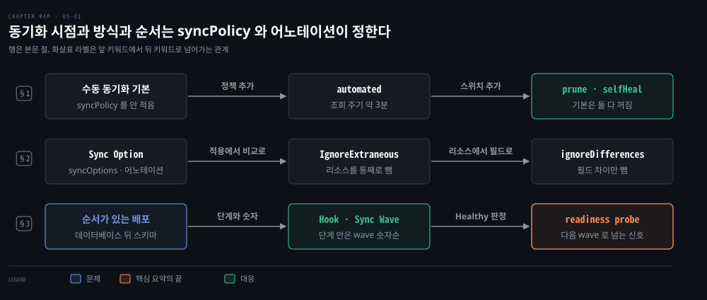
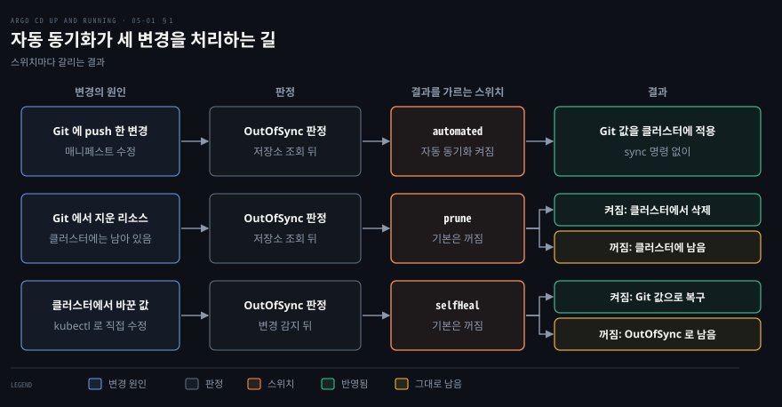
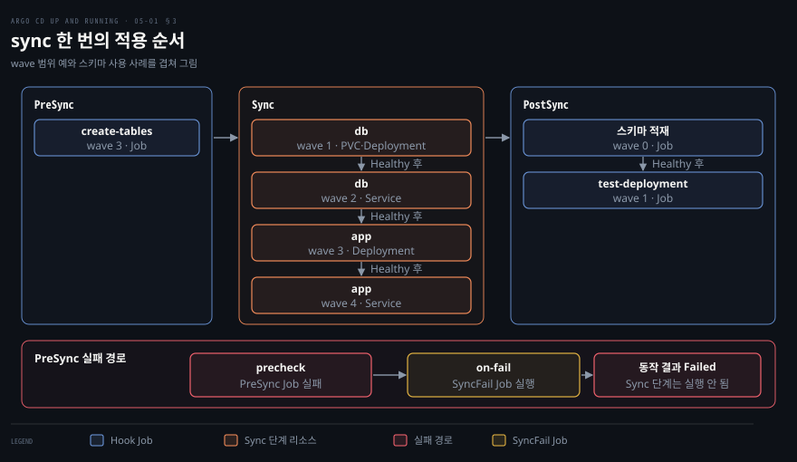

# Application 동기화 — 자동 동기화·Sync Option·Hook·Sync Wave 와 차이 무시
---


## 핵심 요약

> Application 은 `syncPolicy` 를 적지 않으면 수동으로 동기화되고, 언제 sync 를 시작하고 리소스를 어떻게 적용하며 어떤 순서로 적용할지는 모두 이 `syncPolicy` 와 리소스 어노테이션으로 정합니다.

`syncPolicy.automated` 를 적으면 Git 과 클러스터가 달라졌을 때 Argo CD 가 스스로 sync 하고, 지워진 리소스를 치우는 `prune` 과 직접 바뀐 값을 되돌리는 `selfHeal` 은 따로 켭니다. 적용 방식은 `syncOptions` 와 `ignoreDifferences` 로 조절합니다. 순서는 Hook 이 큰 단계를 나누고 Sync Wave 가 단계 안의 순서를 정합니다.

앞 wave 가 Healthy 가 되어야 다음 wave 가 시작되므로 readiness probe 가 순서 제어의 신호가 됩니다.[^ver]


## 학습 목표

이 내용을 읽고 나면:

1. 수동 동기화가 기본인 이유를 설명하고 `automated`, `prune`, `selfHeal` 이 각각 무엇을 바꾸는지 말할 수 있습니다.
2. Git 변경과 클러스터에서 직접 바꾼 값이 자동 동기화에서 어떻게 다르게 처리되는지 구분할 수 있습니다.
3. Sync Option 을 Application 과 리소스 어노테이션에 나누어 적고, `ignoreDifferences` 로 비교에서 뺄 필드를 고를 수 있습니다.
4. Hook 종류와 삭제 정책을 고르고 Sync Wave 로 한 단계 안의 적용 순서를 정할 수 있습니다.
5. 데이터베이스 스키마 배포처럼 순서가 있는 배포를 Hook 과 Sync Wave 와 readiness probe 로 구성할 수 있습니다.

아래 개념도는 이 편의 세 절을 한 줄씩 보입니다. 각 줄이 한 절이고 노드가 그 절의 핵심 키워드입니다. 화살표 위 글자는 앞 키워드에서 뒤 키워드로 넘어가는 관계입니다. 파란 노드가 그 절이 푸는 문제이고 초록 노드가 대응입니다. 1행의 앞 두 노드는 문제가 아니라 출발 상태와 설정이라 색이 없습니다. 2행은 세 방법을 나란히 견주는 줄이라 노드를 모두 중립색으로 둡니다. 코랄색 노드는 핵심 요약이 마지막 문장에서 짚는 한 가지입니다. 3행 끝의 readiness probe 가 그 노드입니다. 앞 wave 가 Healthy 가 되어야 다음 wave 가 시작되므로 이 probe 가 순서 제어의 신호가 됩니다.

1절은 syncPolicy 를 적지 않은 수동 동기화와 automated 로 켜는 자동 동기화, 그리고 prune 과 selfHeal 스위치를 다룹니다. 2절은 Sync Option 과 IgnoreExtraneous 와 ignoreDifferences 로 적용 방식과 비교 대상을 조절하는 방법을 다룹니다. 3절은 Hook 과 Sync Wave 로 순서를 정하고 readiness probe 가 다음 wave 로 넘어가는 조건이 되는 과정을 다룹니다.




## 1. 시작 시점 — 수동 기본과 자동 동기화

> syncPolicy 가 없으면 수동 동기화이고, automated 를 적어야 Git 과 달라졌을 때 Argo CD 가 스스로 sync 합니다.

Application 은 `syncPolicy` 를 적지 않으면 수동 동기화이고, `syncPolicy.automated` 를 적어야 Git 과 클러스터가 달라졌을 때 Argo CD 가 스스로 sync 합니다.

[04-01](./04-01.Application%20%EA%B4%80%EB%A6%AC%ED%95%98%EA%B8%B0%20%E2%80%94%20%EC%86%8C%EC%8A%A4%C2%B7%EB%8C%80%EC%83%81%C2%B7Helm%C2%B7Kustomize%20%EC%99%80%20%EC%82%AD%EC%A0%9C%C2%B7finalizer.md)에서 본 것처럼 새 Application 은 OutOfSync 와 Missing 으로 보일 뿐 리소스를 만들지 않습니다. 수동이 기본인 데에는 이유가 있습니다. 설정을 다듬는 동안 바뀔 내용을 적용 없이 미리 보고 싶을 수 있고, 적용 시점을 사람이 정해야 하거나 조직 정책이 인프라 변경의 자동화를 막는 경우도 있기 때문입니다. 수동 sync 는 웹 화면(UI, User Interface)의 Sync 버튼이나 명령줄 도구(CLI, Command Line Interface)의 `argocd app sync` 로 시작합니다.

### 자동 동기화 켜기와 확인 주기

자동 동기화는 YAML 에 `automated` 를 적거나 CLI 로 정책을 바꿔 켭니다.[^auto]

```yaml
spec:
  syncPolicy:
    automated: {}
```

```bash
argocd app set <APPNAME> --sync-policy automated
```

변경을 알아채는 속도는 Git 저장소를 조회하는 주기가 정합니다. 기본값은 120초에 최대 60초의 무작위 지연(jitter)을 더한 값이라 기본 간격은 약 3분입니다. 실제 감지가 그보다 늦을 수 있는 이유는 [12-01 의 조정 주기 절](12-01.CI%20%EC%99%80%20Argo%20CD%20%EC%9E%87%EA%B8%B0%20%E2%80%94%20%EC%A1%B0%EC%A0%95%20%EC%A3%BC%EA%B8%B0%C2%B7Webhook%C2%B7Tekton.md#%EC%A1%B0%EC%A0%95-%EC%A3%BC%EA%B8%B0%EC%99%80-jitter-%EC%84%A4%EC%A0%95)에서 다룹니다.[^poll] 이 값은 `argocd-cm` ConfigMap 의 `timeout.reconciliation` 으로 바꿉니다. `automated: {}` 로 만든 Application 에서 Git 의 ConfigMap 값을 고쳐 push 하자 sync 명령 없이 클러스터 값이 바뀌었습니다.

### prune 과 selfHeal 스위치

`automated` 안에는 스위치가 두 개 더 있습니다. `prune` 은 Git 에서 정의가 사라진 리소스를 지우는 스위치이고 기본은 꺼져 있습니다. 자동 sync 가 실수로 리소스를 지우지 않게 하려는 안전장치입니다.[^prune] `selfHeal` 은 클러스터에서 직접 바뀐 값을 Git 의 값으로 되돌리는 스위치입니다. 기본값에서는 클러스터의 변경이 자동 sync 를 일으키지 않습니다.[^heal]

두 스위치를 kind 클러스터에서 하나씩 켜 보았습니다. Git 에 없는 ConfigMap 을 Argo CD 가 관리하는 리소스처럼 만들어 두고 `prune: true` 인 Application 이 도는 동안 기다리자 그 ConfigMap 이 사라졌습니다.

같은 Application 에서 Git 에 있는 ConfigMap 의 값을 `kubectl patch` 로 바꾸면 `selfHeal` 이 꺼진 동안은 Sync status 가 OutOfSync 로 40초 넘게 남았습니다. `selfHeal` 을 켜고 같은 변경을 하자 몇 초 안에 Git 의 값으로 돌아왔습니다. Git 에 없는 키를 ConfigMap 에 더한 변경은 비교 대상이 아니어서 Synced 로 남았습니다.

`selfHeal` 이 켜져 있으면 장애 대응으로 `kubectl` 로 바꾼 값도 되돌아가므로 긴급 수정도 Git 을 거쳐야 합니다. 되돌리는 동작이 반복되면 대기 시간이 늘어납니다. v3.6.1 의 기본값은 첫 대기 2초에서 시작해 3배씩 늘며 300초에서 멈춥니다.[^healcfg]

### 자동 sync 의 규칙과 retry

자동 sync 에는 몇 가지 규칙이 따라붙습니다.

- 자동 sync 는 OutOfSync 인 Application 에만 일어납니다.
- 같은 커밋과 같은 파라미터로는 한 번만 시도합니다. 같은 커밋으로 이미 성공한 sync 가 있으면 다시 sync 하지 않지만, `selfHeal` 이 켜져 있으면 클러스터에서 바뀐 값을 되돌리려고 다시 sync 합니다.
- 같은 커밋으로 한 sync 가 retry 를 다 쓰고 실패로 끝난 뒤에는 `selfHeal` 과 상관없이 다시 시도하지 않습니다.
- 자동 sync 가 켜진 Application 은 롤백할 수 없습니다.[^rules]

자동 sync 는 `retry` 를 적지 않아도 실패하면 5회까지 다시 시도합니다. 기본 대기는 5초에서 시작해 2배씩 늘고 3분을 넘지 않습니다. `retry` 를 적으면 이 값을 바꿉니다. `limit` 은 시도 횟수이고 `-1` 이면 무제한입니다. `backoff.duration` 은 첫 대기 시간이고 `factor` 는 실패마다 곱하는 배수이며 `maxDuration` 은 대기 시간의 상한입니다.[^retry]

```yaml
spec:
  syncPolicy:
    retry:
      limit: 5
      backoff:
        duration: 5s
        factor: 2
        maxDuration: 3m
```

위 설정은 기본값을 그대로 적은 모양입니다. 이 설정이면 대기 시간은 5초, 10초, 20초, 40초, 80초로 늘고 5회에서 멈춥니다.




## 2. 적용 방식 — Sync Option 과 차이 무시

> Sync Option 은 매니페스트를 적용하는 방식을 바꾸고, 어노테이션과 ignoreDifferences 는 비교 대상을 좁힙니다.

### Application 단위 Sync Option

Sync Option 은 Application 의 `syncOptions` 에 적으면 모든 리소스에, 리소스의 `argocd.argoproj.io/sync-options` 어노테이션에 적으면 그 리소스에만 적용됩니다.[^opts]

**Sync Option** 은 sync 가 매니페스트를 클러스터에 적용하는 방식을 바꾸는 값입니다. Application 단위 값 가운데 아홉 가지는 아래와 같습니다.

| 옵션 | 켜면 달라지는 것 |
|---|---|
| `Validate=false` | Kubernetes API 의 검증을 건너뜁니다. 기본은 검증합니다 |
| `ApplyOutOfSyncOnly=true` | OutOfSync 인 리소스만 적용합니다. 기본은 모든 리소스를 적용합니다 |
| `CreateNamespace=true` | 대상 네임스페이스가 없으면 먼저 만듭니다 |
| `PrunePropagationPolicy=background` | prune 할 때의 삭제 방식을 고릅니다. 기본은 foreground 입니다 |
| `PruneLast=true` | prune 을 다른 리소스가 모두 Healthy 가 된 뒤 마지막에 합니다 |
| `Replace=true` | `kubectl apply` 대신 `kubectl replace` 나 `create` 로 적용합니다 |
| `ServerSideApply=true` | 서버 사이드 어플라이로 적용합니다 |
| `FailOnSharedResource=true` | 다른 Application 이 이미 적용한 리소스를 만나면 sync 를 실패시킵니다 |
| `RespectIgnoreDifferences=true` | `ignoreDifferences` 를 sync 때도 지킵니다 |

`ApplyOutOfSyncOnly` 는 리소스가 수천 개라서 전부 적용하면 API 서버에 부담이 될 때 씁니다. 일부 리소스만 골라 sync 하는 Selective Sync 는 Hook 이 돌지 않고 이력에도 남지 않지만, 이 옵션을 켜도 Hook 은 실행되고 sync 는 이력에 기록됩니다.[^ooso] 실습에서 ConfigMap 하나만 바뀐 Application 을 sync 하자 sync 결과에 그 ConfigMap 하나만 올랐습니다.

`CreateNamespace` 가 없으면 네임스페이스가 없는 클러스터에서 sync 가 실패합니다.[^ns] `PrunePropagationPolicy` 가 받는 값은 `foreground`, `background`, `orphan` 입니다.[^proppol] `PruneLast` 는 prune 을 마지막의 암묵적 wave 로 만듭니다.[^prunelast]

`Replace=true` 는 기본 적용 방식으로 담을 수 없는 큰 리소스를 위한 옵션입니다. 리소스가 `kubectl.kubernetes.io/last-applied-configuration` 어노테이션에 들어가기엔 크면 `kubectl apply` 가 실패하기 때문입니다. 문서는 이 옵션을 리소스를 다시 만들어야 하는 파괴적인 동작으로 경고합니다.[^replace] 실습에서 sync 결과 메시지가 `replaced` 로 끝났습니다.

`ServerSideApply=true` 는 `kubectl apply --server-side --force-conflicts` 로 적용합니다.[^ssa] 실습에서 sync 결과 메시지가 `serverside-applied` 로 바뀌었습니다. 두 옵션을 함께 켜면 `Replace=true` 가 우선합니다. `FailOnSharedResource=true` 는 같은 리소스를 두 Application 이 건드리는 일을 막습니다.[^shared]

### 리소스 단위 Sync Option 어노테이션

리소스 하나에만 옵션을 주려면 그 리소스의 어노테이션에 적습니다. 여러 옵션은 쉼표로 이어 쓰고 공백은 무시됩니다.

```yaml
metadata:
  annotations:
    argocd.argoproj.io/sync-options: Validate=false,ServerSideApply=true
```

이 노트가 다루는 리소스 어노테이션 값은 `Validate`, `PruneLast`, `Replace`, `ServerSideApply`, `Prune=false`, `SkipDryRunOnMissingResource=true` 입니다.

이 가운데 `Prune=false` 는 그 리소스를 prune 에서 빼고 `SkipDryRunOnMissingResource=true` 는 리소스 종류가 아직 등록되지 않았을 때의 사전 검증(dry run)을 건너뜁니다. CRD(CustomResourceDefinition)가 같은 sync 에 들어 있으면 Argo CD 가 dry run 을 알아서 건너뛰므로 후자는 필요 없습니다. 다른 컨트롤러가 CRD 를 sync 밖에서 만들어 sync 시점에 종류가 아직 없을 때 그 커스텀 리소스에 답니다.[^skipdry]

리소스 어노테이션의 `Prune` 은 Application 의 `Prune` 설정보다 우선합니다. 실습에서 `prune: true` 인 Application 의 Git 에 없는 ConfigMap 두 개를 두자 `Prune=false` 를 단 쪽만 남았습니다.

### 리소스를 비교에서 빼는 compare-options

비교를 좁히는 방법은 두 가지입니다. 하나는 리소스를 통째로 빼고, 다른 하나는 리소스 안의 필드만 뺍니다. 리소스를 빼는 쪽은 `argocd.argoproj.io/compare-options: IgnoreExtraneous` 어노테이션으로, 그 리소스를 Application 전체의 Sync status 계산에서 뺍니다. 컨트롤러나 도구가 Git 에 없는 리소스를 만들어 Application 이 OutOfSync 로 보일 때 씁니다. Health 에는 영향이 없어서 그 리소스가 Degraded 이면 Application 도 Degraded 입니다.[^extra]

```yaml
metadata:
  annotations:
    argocd.argoproj.io/compare-options: IgnoreExtraneous
```

Argo CD 가 관리한다고 표시된 ConfigMap 이 Git 에 없을 때 이 어노테이션이 없으면 Application 이 OutOfSync 였고, 어노테이션을 달자 Application 은 Synced 가 되었습니다. 그 ConfigMap 자신의 상태는 계속 OutOfSync 로 표시되었습니다.

### 필드 차이를 무시하는 ignoreDifferences

필드를 빼는 쪽은 `ignoreDifferences` 로, 특정 필드의 차이를 비교에서 무시합니다. 다른 컨트롤러가 값을 바꾸는 필드가 대표적입니다. Application 의 `spec.ignoreDifferences` 에 그룹과 종류를 적고 무시할 필드를 `jsonPointers` 나 `jqPathExpressions` 나 `managedFieldsManagers` 로 가리킵니다.[^ignore]

```yaml
spec:
  ignoreDifferences:
    - group: apps
      kind: Deployment
      jsonPointers:
        - /spec/replicas
```

`jsonPointers` 는 경로 하나를 그대로 가리킵니다. `jqPathExpressions` 는 jq 식으로 배열 안의 조건까지 고릅니다. `managedFieldsManagers` 는 특정 관리자가 소유한 필드를 통째로 뺍니다.

위 설정을 단 Application 에서 `kubectl scale` 로 replicas 를 3 으로 바꿔도 Deployment 는 Synced 로 남았습니다.

`ignoreDifferences` 는 기본으로 비교에서만 지켜지고 sync 때는 Git 의 매니페스트가 그대로 적용됩니다. sync 때도 지키려면 `RespectIgnoreDifferences=true` 를 함께 적습니다. 이 옵션은 리소스가 이미 클러스터에 있을 때만 효과가 있고 Application 을 처음 만들 때는 Git 의 값이 그대로 적용됩니다.[^respect]

Application 하나가 아니라 설치 전체에 적용하려면 `argocd-cm` ConfigMap 에 `resource.customizations.ignoreDifferences.<그룹>_<종류>` 키로 적습니다. 키 이름에서 그룹과 종류를 밑줄로 잇는 점이 Application 의 `ignoreDifferences` 와 다릅니다.[^sys]

```yaml
data:
  resource.customizations.ignoreDifferences.apps_Deployment: |
    jsonPointers:
      - /spec/replicas
```


## 3. 순서 — Hook·Sync Wave·헬스 검사

> 한 번의 sync 는 세 단계로 나뉘고, 각 단계 안의 적용 순서는 Sync Wave 숫자가 정합니다.

한 번의 sync 는 세 단계로 나뉘고 각 단계 안의 적용 순서는 Sync Wave 숫자가 정합니다. 다음 wave 는 앞 wave 가 Healthy 가 된 뒤에 시작합니다.

### Hook 의 실행 단계

**Hook** 은 리소스에 `argocd.argoproj.io/hook` 어노테이션을 달아 그 리소스를 특정 단계에서 실행하게 하는 장치입니다. 어떤 종류의 리소스든 Hook 이 될 수 있지만 실제로는 Pod, Job, Argo Workflows 가 많습니다. 어노테이션이 없는 리소스는 Sync 단계에서 적용됩니다.[^hooktypes]

| Hook | 실행 시점 |
|---|---|
| `PreSync` | 매니페스트를 적용하기 전. 데이터베이스 스키마 갱신이 대표적입니다 |
| `Sync` | `PreSync` 가 모두 성공한 뒤 매니페스트와 같은 시점 |
| `PostSync` | `Sync` 가 성공하고 모든 리소스가 Healthy 가 된 뒤. 알림이나 테스트에 씁니다 |
| `SyncFail` | sync 가 실패했을 때. 알림이나 정리에 씁니다 |

이 밖에 `Skip` 은 매니페스트의 적용을 건너뛰고 `PreDelete` 와 `PostDelete` 는 Application 전체를 삭제할 때 그 앞과 뒤에 실행됩니다.

한 단계가 실패하면 뒤 단계로 가지 않습니다. 실습에서 종료 코드 1 로 끝나는 Job 을 `PreSync` 에 두자 그 Job 이 Failed 가 되었고 `Sync` 단계의 Deployment 는 만들어지지 않았습니다. 같은 Application 의 `SyncFail` Job 은 실행되어 Succeeded 가 되었고 Application 의 마지막 동작은 Failed 로 끝났습니다.[^phases]

### Hook 삭제 정책

Hook 리소스를 언제 지울지는 `argocd.argoproj.io/hook-delete-policy` 가 정합니다.

| 삭제 정책 | 지우는 때 |
|---|---|
| `HookSucceeded` | sync 가 성공으로 끝났을 때 |
| `HookFailed` | sync 가 실패로 끝났을 때 |
| `BeforeHookCreation` | 새 Hook 을 만들기 전에 기존 것을. 정책을 적지 않으면 이 값입니다 |

기본이 `BeforeHookCreation` 이라서 이름을 붙인 Hook 은 sync 때마다 지우고 다시 만들어 다시 실행됩니다. `metadata.name` 대신 `metadata.generateName` 을 쓴 Job 은 sync 마다 새 Job 이 생기고 이전 것은 남습니다.[^delpol] 실습에서 이름을 붙인 `PostSync` Job 은 sync 를 한 번 더 하자 UID 가 새로 바뀌었고 `generateName` Job 은 sync 를 세 번 하자 세 개가 쌓였습니다. 그래서 Hook 스크립트는 여러 번 실행되어도 결과가 같게 만들어야 합니다.

Hook Job 의 정리를 `ttlSecondsAfterFinished` 에 맡기지 말라는 경고도 있습니다. Argo CD 가 Job 을 읽어 단계의 결과를 알아야 하는데 쿠버네티스가 먼저 지우면 sync 가 없는 Hook 을 기다리게 됩니다.[^delpol] Job 의 동작은 [Job 기초](../kubernetes-in-action/18-01.Job%20%EA%B8%B0%EC%B4%88%20%E2%80%94%20%EC%8B%A4%ED%96%89%C2%B7%EC%83%81%ED%83%9C%C2%B7suspend%C2%B7%EC%9E%90%EB%8F%99%EC%82%AD%EC%A0%9C.md)에 있습니다.

### Sync Wave 와 적용 순서

**Sync Wave** 는 `argocd.argoproj.io/sync-wave` 어노테이션에 정수를 문자열로 적어 적용 순서를 정하는 장치입니다. 값이 작은 wave 부터 적용되고 기본은 0 이며 음수도 쓸 수 있습니다. 같은 sync 안에서 리소스는 단계, wave, 종류, 이름 순으로 정렬됩니다.[^wave]

```yaml
metadata:
  annotations:
    argocd.argoproj.io/sync-wave: "5"
```

Namespace 를 -1 에, ServiceAccount 를 0 에, Deployment 를 1 에 두면 Namespace 가 먼저 만들어지고 마지막에 Deployment 가 적용됩니다. CRD 를 그 커스텀 리소스보다 먼저 적용할 때도 wave 를 씁니다.

wave 는 단계 안에서만 유효합니다. `PreSync` 단계의 Job 을 wave 3 에 두고 `PostSync` 단계의 Job 을 wave 1 에 두면, 숫자는 뒤 Job 이 작지만 단계가 앞서므로 wave 3 의 Job 이 먼저 실행됩니다. 실습에서 `PreSync` 의 wave 3 Job 은 05:50:52 에 끝나고 `Sync` 단계의 wave 1 Deployment 는 05:50:58 에 생겼습니다. 같은 `PostSync` 단계의 wave 0 Job 이 05:51:39 에 끝난 뒤 wave 1 Job 이 05:51:44 에 생겼습니다.

wave 사이에는 기본 2초의 지연이 있습니다. 다른 컨트롤러가 방금 적용된 변경에 반응할 시간을 주고, 이전 상태의 오래된 객체로 Health 를 너무 일찍 판단하지 않게 하려는 장치입니다. 값은 환경 변수 `ARGOCD_SYNC_WAVE_DELAY` 로 바꿉니다.[^delay]

### wave 전환 조건과 prune 순서

다음 wave 로 넘어가는 조건은 앞 wave 의 리소스가 in-sync 이고 Healthy 가 되는 것입니다. 그러니 wave 가 제대로 동작하려면 Health 를 판정할 수 있어야 합니다. Deployment 는 관찰된 세대가 원하는 세대와 같고 갱신된 레플리카 수가 원하는 수와 같아야 Healthy 입니다. 거기에 더해 사용 가능한(available) 레플리카가 갱신된 레플리카보다 적으면 Progressing 입니다.[^health]

파드가 available 이 되려면 Ready 여야 하므로 readiness probe 가 곧 다음 wave 로 넘어가는 신호입니다. readiness probe 가 없으면 컨테이너가 시작한 순간부터 준비된 것으로 보므로 데이터베이스처럼 시작이 느린 프로그램에는 probe 를 달아야 합니다. 두 probe 의 차이는 [liveness·startup probe](../kubernetes-in-action/06-02.liveness%C2%B7startup%20probe%EB%A1%9C%20%EC%BB%A8%ED%85%8C%EC%9D%B4%EB%84%88%20%EA%B1%B4%EA%B0%95%20%EC%9C%A0%EC%A7%80.md)에 있습니다.

실습에서 두 경우를 비교했습니다. 데이터베이스 역할의 Deployment 를 wave 1 에 두고 readiness probe 를 20초 뒤에 통과하게 하자 wave 2 의 Service 가 Deployment 생성 25초 뒤에 만들어졌습니다. probe 가 영원히 통과하지 않게 한 쪽은 Deployment 가 Ready 0/1 의 Progressing 에 머물렀고 wave 2 이후의 리소스는 하나도 만들어지지 않았습니다.

prune 은 wave 의 역순으로 일어납니다. 높은 wave 의 리소스부터 지우고, 한 wave 에서 prune 이 실패하면 낮은 wave 는 처리하지 않습니다.[^wave]

### 데이터베이스 스키마 배포 사례

데이터베이스 스키마를 배포할 때 이 장치들이 어떻게 맞물리는지 봅니다. 백엔드 데이터베이스가 있는 애플리케이션은 데이터베이스가 뜬 뒤에 스키마를 적재해야 합니다. 구성은 다음 순서입니다.

1. wave 1 에 저장소(PersistentVolumeClaim)와 데이터베이스 Deployment 를 둡니다.
2. wave 2 에 데이터베이스 Service 를 둡니다.
3. wave 3 에 웹 애플리케이션 Deployment 를 둡니다.
4. wave 4 에 웹 애플리케이션 Service 를 둡니다.
5. 스키마를 적재하는 Job 을 `PostSync` 에 wave 0 으로 두고 삭제 정책을 `BeforeHookCreation` 으로 합니다.

wave 를 적지 않으면 모두 wave 0 이라 종류와 이름 순으로 정렬될 뿐이고, 데이터베이스가 준비될 때까지 기다리는 지점이 없습니다. Job 에 wave 0 을 적은 것은 기본값이지만 wave 가 단계 안에서만 유효하다는 점을 보이려는 표기입니다.

Application 은 `automated` 에 `prune: true` 와 `selfHeal: true` 를, `syncOptions` 에 `CreateNamespace=true` 를, `retry` 에 `limit: 5` 를 두었습니다. 두 Deployment 에는 readiness probe 와 liveness probe 를 달아 wave 가 넘어가는 조건을 만듭니다.

같은 구성을 이미지만 가볍게 바꿔 kind 에서 재현하자 데이터베이스 Deployment, 데이터베이스 Service, 웹 Deployment, 웹 Service, `PostSync` Job 순서로 만들어졌습니다. 앞 리소스가 Healthy 가 된 뒤에 다음 리소스가 생겼습니다.




## 연습 문제

> 아래 여섯 문제는 자동 동기화와 직접 변경과 Sync Option 과 차이 무시와 순서와 실패 경로를 하나씩 묻습니다. 답을 적은 뒤에 정답 절을 펼칩니다.

1. 새로 만든 Application 에 리소스가 생기지 않는 까닭은 무엇입니까? 자동으로 sync 하게 하려면 무엇을 적으며, Git 에 push 한 변경은 최대 얼마 뒤에 반영됩니까?
2. `automated: {}` 만 적은 Application 에서 Git 의 리소스를 지우면 어떻게 됩니까? `kubectl` 로 Git 에 있는 값을 바꾸면 어떻게 됩니까? `selfHeal` 을 켜면 두 번째 경우는 어떻게 달라집니까?
3. 한 리소스에만 `Validate=false` 와 `ServerSideApply=true` 를 적용하려면 어떻게 합니까? `Prune=false` 는 무엇을 막으며 어디에 적습니까?
4. 다른 컨트롤러가 바꾸는 `replicas` 때문에 Application 이 OutOfSync 로 보입니다. 무엇을 적어야 합니까? 그 설정만으로 sync 때도 값이 지켜집니까? 모든 Application 에 같은 설정을 하려면 어디에 적습니까?
5. `PreSync` 단계의 Job 이 wave 3, `Sync` 단계의 Deployment 가 wave 1, `PostSync` 단계의 Job 이 wave 0 입니다. 적용 순서는 어떻게 되고 다음 wave 는 언제 시작합니까?
6. 데이터베이스 Deployment 를 wave 1 에 두었는데 readiness probe 가 통과하지 않으면 어떻게 됩니까? `PreSync` Job 이 실패하면 `Sync` 단계는 어떻게 되며, 정리 작업은 어느 Hook 에 둡니까?


## 정답 (자답 후 펼치기)

### 정답 1

`syncPolicy` 를 적지 않은 Application 은 수동 동기화여서 OutOfSync 만 표시하고 사람이 sync 를 시작해야 리소스를 만들기 때문입니다. 적용 전에 바뀔 내용을 먼저 볼 수 있고 적용 시점을 사람이 정할 수 있습니다.

`spec.syncPolicy.automated` 를 적거나 `argocd app set <APPNAME> --sync-policy automated` 를 실행하면 자동 동기화가 켜집니다. 조회 주기가 120초에 최대 60초의 지연을 더한 값이므로 기본 간격은 약 3분입니다. 실제 감지가 늦을 수 있는 이유는 [12-01 의 조정 주기 절](12-01.CI%20%EC%99%80%20Argo%20CD%20%EC%9E%87%EA%B8%B0%20%E2%80%94%20%EC%A1%B0%EC%A0%95%20%EC%A3%BC%EA%B8%B0%C2%B7Webhook%C2%B7Tekton.md#%EC%A1%B0%EC%A0%95-%EC%A3%BC%EA%B8%B0%EC%99%80-jitter-%EC%84%A4%EC%A0%95)에서 다룹니다. 주기는 `argocd-cm` 의 `timeout.reconciliation` 으로 바꿉니다.

### 정답 2

Git 에서 리소스를 지워도 `prune` 이 꺼져 있으면 클러스터의 리소스는 남습니다. `prune: true` 로 켜야 자동 sync 가 지웁니다. `kubectl` 로 바꾼 값은 `selfHeal` 이 꺼져 있으면 되돌려지지 않아 OutOfSync 로 남고, 실습에서 40초가 지나도 그대로였습니다.

`selfHeal` 을 켜면 직접 바꾼 값이 Git 의 값으로 돌아갑니다. 실습에서는 몇 초 안에 돌아왔습니다. 연속해서 되돌릴 때의 대기 시간은 v3.6.1 기본으로 2초에서 시작해 3배씩 늘고 300초에서 멈춥니다. Git 에 없는 키를 더한 변경은 비교 대상이 아니므로 Synced 로 남습니다.

### 정답 3

리소스의 `metadata.annotations` 에 `argocd.argoproj.io/sync-options: Validate=false,ServerSideApply=true` 를 적습니다. 옵션은 쉼표로 잇고 공백은 무시됩니다. 같은 Application 의 다른 리소스는 영향을 받지 않습니다.

`Prune=false` 는 그 리소스를 prune 에서 빼서 Git 에서 사라져도 지워지지 않게 합니다. 리소스 어노테이션에 적으면 그 리소스만, Application 의 `syncOptions` 에 적으면 기본값으로 적용되고 리소스 어노테이션이 우선합니다. 실습에서 `Prune=false` 를 단 ConfigMap 만 남고 Git 에 없는 다른 ConfigMap 은 지워졌습니다.

### 정답 4

Application 의 `spec.ignoreDifferences` 에 `group: apps`, `kind: Deployment`, `jsonPointers` 의 `/spec/replicas` 를 적습니다. 그러면 replicas 의 차이가 비교에서 빠져 Synced 로 남습니다. 실습에서 replicas 를 3 으로 바꿨을 때 Deployment 는 Synced 였습니다.

그 설정은 비교에서만 지켜지고 sync 때는 Git 의 매니페스트가 그대로 적용됩니다. sync 때도 지키려면 `syncOptions` 에 `RespectIgnoreDifferences=true` 를 더합니다. 이 옵션은 리소스가 이미 클러스터에 있을 때만 효과가 있습니다.

모든 Application 에 적용하려면 `argocd-cm` 의 `resource.customizations.ignoreDifferences.apps_Deployment` 키에 같은 `jsonPointers` 를 적습니다.

### 정답 5

단계가 wave 보다 앞서므로 `PreSync` 의 wave 3 Job, `Sync` 의 wave 1 Deployment, `PostSync` 의 wave 0 Job 순서입니다. wave 숫자는 단계 안에서만 순서를 정합니다. 실습에서도 `PreSync` Job 이 끝난 뒤에 Deployment 가 생겼습니다.

다음 wave 는 앞 wave 의 리소스가 in-sync 이고 Healthy 가 되면 시작하며 wave 사이에는 기본 2초의 지연이 있습니다. Hook Job 은 성공으로 끝나야 단계가 넘어갑니다.

### 정답 6

readiness probe 가 통과하지 않으면 Deployment 가 Progressing 에 머물러 wave 2 이후의 리소스가 만들어지지 않습니다. 실습에서 Deployment 는 Ready 0/1 로 남았고 데이터베이스 Service 와 웹 Deployment 는 생기지 않았습니다. probe 가 wave 를 넘기는 조건이므로 데이터베이스에는 시작 완료를 정확히 알리는 probe 를 달아야 합니다.

`PreSync` Job 이 실패하면 `Sync` 단계는 실행되지 않고, 자동 sync 라면 재시도를 마친 뒤 Failed 로 끝납니다. 알림과 정리는 `SyncFail` Hook 에 둡니다. 실습에서 `SyncFail` Job 이 실행되어 Succeeded 가 되었습니다.


## 참고 자료

- 《Argo CD: Up and Running》(Andrew Block · Christian Hernandez, O'Reilly, 2025, ISBN 978-1-098-14200-1) 5장
- [자동 동기화](https://github.com/argoproj/argo-cd/blob/v3.6.1/docs/user-guide/auto_sync.md)
- [Argo CD FAQ — 조회 주기](https://github.com/argoproj/argo-cd/blob/v3.6.1/docs/faq.md)
- [argocd-cmd-params-cm](https://github.com/argoproj/argo-cd/blob/v3.6.1/docs/operator-manual/argocd-cmd-params-cm.yaml)
- [Sync 옵션](https://github.com/argoproj/argo-cd/blob/v3.6.1/docs/user-guide/sync-options.md)
- [비교 옵션](https://github.com/argoproj/argo-cd/blob/v3.6.1/docs/user-guide/compare-options.md)
- [차이 무시 설정](https://github.com/argoproj/argo-cd/blob/v3.6.1/docs/user-guide/diffing.md)
- [Sync 단계와 Wave](https://github.com/argoproj/argo-cd/blob/v3.6.1/docs/user-guide/sync-waves.md)
- [Health 판정](https://github.com/argoproj/argo-cd/blob/v3.6.1/docs/operator-manual/health.md)
- 관련 노트: [이 책의 인덱스](./README.md), [01-01 Argo CD 가 푸는 문제](./01-01.Argo%20CD%20%EA%B0%80%20%ED%91%B8%EB%8A%94%20%EB%AC%B8%EC%A0%9C%20%E2%80%94%20GitOps%20%EC%9B%90%EC%B9%99%EA%B3%BC%20Argo%20%EC%83%9D%ED%83%9C%EA%B3%84.md), [04-01 Application 관리하기](./04-01.Application%20%EA%B4%80%EB%A6%AC%ED%95%98%EA%B8%B0%20%E2%80%94%20%EC%86%8C%EC%8A%A4%C2%B7%EB%8C%80%EC%83%81%C2%B7Helm%C2%B7Kustomize%20%EC%99%80%20%EC%82%AD%EC%A0%9C%C2%B7finalizer.md), [liveness·startup probe](../kubernetes-in-action/06-02.liveness%C2%B7startup%20probe%EB%A1%9C%20%EC%BB%A8%ED%85%8C%EC%9D%B4%EB%84%88%20%EA%B1%B4%EA%B0%95%20%EC%9C%A0%EC%A7%80.md), [Job 기초](../kubernetes-in-action/18-01.Job%20%EA%B8%B0%EC%B4%88%20%E2%80%94%20%EC%8B%A4%ED%96%89%C2%B7%EC%83%81%ED%83%9C%C2%B7suspend%C2%B7%EC%9E%90%EB%8F%99%EC%82%AD%EC%A0%9C.md)

[^ver]: 최신 릴리스는 Argo CD v3.6.1(2026-11-04)이고 Helm 차트는 argo-cd-10.14.0 입니다. 문서와 소스는 v3.6.1 태그에 고정했습니다. 이 노트의 실습은 kind v0.31.0 이 만든 Kubernetes v1.35.0 클러스터에 v3.6.1 의 `manifests/install.yaml` 을 적용하고, v3.6.1 CLI 를 `argocd login --core` 로 로그인해 진행했습니다. Git 저장소는 클러스터 안의 `git daemon` 파드로 두었습니다. <https://github.com/argoproj/argo-cd/releases/tag/v3.6.1> (2026-11-06 조회)
[^auto]: 자동 동기화 문서는 첫머리에서 "A benefit of automatic sync is that CI/CD pipelines no longer need direct access to the Argo CD API server to perform the deployment."라고 적고 `argocd app set <APPNAME> --sync-policy automated` 와 `automated` 를 적는 YAML 두 방법을 보여 줍니다. <https://github.com/argoproj/argo-cd/blob/v3.6.1/docs/user-guide/auto_sync.md> (2026-11-06 조회)
[^poll]: FAQ 는 "By default, Argo CD checks (polls) Git repositories every 3 minutes to detect changes. This default interval is calculated as 120 seconds + up to 60 seconds of jitter (a small random delay to avoid simultaneous polling)."라고 적습니다. `argocd-cm` 샘플은 `timeout.reconciliation: 120s` 와 `timeout.reconciliation.jitter: 60s` 를 둡니다. <https://github.com/argoproj/argo-cd/blob/v3.6.1/docs/faq.md> <https://github.com/argoproj/argo-cd/blob/v3.6.1/docs/operator-manual/argocd-cm.yaml> (2026-11-06 조회)
[^prune]: 자동 동기화 문서는 "By default (and as a safety mechanism), automated sync will not delete resources when Argo CD detects the resource is no longer defined in Git."라고 적고, `prune: true` 나 `argocd app set <APPNAME> --auto-prune` 으로 켜게 안내합니다. 대상 리소스가 하나도 없을 때를 막는 `allowEmpty` 보호 장치도 같은 문서에 있습니다. <https://github.com/argoproj/argo-cd/blob/v3.6.1/docs/user-guide/auto_sync.md> (2026-11-06 조회)
[^heal]: 같은 문서는 "By default, changes that are made to the live cluster will not trigger automated sync."라고 적고 `selfHeal: true` 나 `argocd app set <APPNAME> --self-heal` 로 켜게 안내합니다. <https://github.com/argoproj/argo-cd/blob/v3.6.1/docs/user-guide/auto_sync.md> (2026-11-06 조회)
[^healcfg]: `argocd-cmd-params-cm` 샘플은 "Specifies exponential backoff timeout parameters between application self heal attempts" 아래에 `controller.self.heal.backoff.timeout.seconds: "2"`, `controller.self.heal.backoff.factor: "3"`, `controller.self.heal.backoff.cap.seconds: "300"` 을 두고, `controller.self.heal.timeout.seconds` 는 "0" 입니다. <https://github.com/argoproj/argo-cd/blob/v3.6.1/docs/operator-manual/argocd-cmd-params-cm.yaml> (2026-11-06 조회)
[^rules]: 자동 동기화 문서는 "An automated sync will only be performed if the application is OutOfSync."와 "Automated sync will only attempt one synchronization per unique combination of commit SHA1 and application parameters."를 적습니다. 같은 문서는 "If the most recent successful sync in the history was already performed against the same commit-SHA and parameters, a second sync will not be attempted, unless `selfHeal` flag is set to true."라고도 적습니다. 이어서 "Automatic sync will not reattempt a sync if the previous sync attempt against the same commit-SHA and parameters had failed."와 "Rollback cannot be performed against an application with automated sync enabled."를 적습니다. <https://github.com/argoproj/argo-cd/blob/v3.6.1/docs/user-guide/auto_sync.md> (2026-11-06 조회)
[^retry]: 자동 동기화 문서는 "Argo CD can automatically retry a failed sync operation using exponential backoff."라고 적고 `limit` 은 "Set to `-1` for unlimited retries."이며 `backoff.maxDuration` 은 "maximum wait time between retries, regardless of the number of attempts"라고 설명합니다. 기본 재시도는 문서에 없고 소스에 있습니다. `controller/appcontroller.go` 는 자동 sync 의 동작을 `Retry: appv1.RetryStrategy{Limit: 5}` 로 만든 뒤 Application 에 `retry` 가 있을 때만 덮어쓰고, `pkg/apis/application/v1alpha1/application_defaults.go` 는 기본 대기를 5초와 배수 2와 상한 3분으로 둡니다. <https://github.com/argoproj/argo-cd/blob/v3.6.1/docs/user-guide/auto_sync.md> <https://github.com/argoproj/argo-cd/blob/v3.6.1/controller/appcontroller.go> <https://github.com/argoproj/argo-cd/blob/v3.6.1/pkg/apis/application/v1alpha1/application_defaults.go> (2026-11-06 조회)
[^opts]: Sync 옵션 문서는 "Some Sync Options can be defined as annotations in a specific resource. Most of the Sync Options are configured in the Application resource `spec.syncPolicy.syncOptions` attribute."라고 적고, "Multiple Sync Options which are configured with the `argocd.argoproj.io/sync-options` annotation can be concatenated with a `,` in the annotation value; white-space will be trimmed."라고 설명합니다. <https://github.com/argoproj/argo-cd/blob/v3.6.1/docs/user-guide/sync-options.md> (2026-11-06 조회)
[^ooso]: Sync 옵션 문서는 "The default behavior when syncing your application is to apply every object in the application."이라고 적고 "Unlike Selective Sync, when `ApplyOutOfSyncOnly` is enabled, Sync Hooks will still run and the sync will be recorded in the history."라고 설명합니다. <https://github.com/argoproj/argo-cd/blob/v3.6.1/docs/user-guide/sync-options.md> (2026-11-06 조회)
[^ns]: Sync 옵션 문서는 `CreateNamespace=true` 를 "Without this either declared in the Application manifest or passed in the CLI via `--sync-option CreateNamespace=true`, the Application will fail to sync if the namespace doesn't exist."라고 설명합니다. <https://github.com/argoproj/argo-cd/blob/v3.6.1/docs/user-guide/sync-options.md> (2026-11-06 조회)
[^proppol]: Sync 옵션 문서는 "By default, extraneous resources get pruned using the foreground deletion policy."와 "Supported policies are background, foreground, and orphan."을 적습니다. <https://github.com/argoproj/argo-cd/blob/v3.6.1/docs/user-guide/sync-options.md> (2026-11-06 조회)
[^prunelast]: Sync 옵션 문서는 `PruneLast` 를 "to allow the ability for resource pruning to happen as a final, implicit wave of a sync operation, after the other resources have been deployed and become healthy, and after all other waves completed successfully"라고 설명합니다. <https://github.com/argoproj/argo-cd/blob/v3.6.1/docs/user-guide/sync-options.md> (2026-11-06 조회)
[^replace]: Sync 옵션 문서는 "If the `Replace=true` sync option is set, Argo CD will use `kubectl replace` or `kubectl create` command to apply changes."라고 적고 경고로 "This sync option has the potential to be destructive and might lead to resources having to be recreated, which could cause an outage for your application."를 답니다. `Force=true` 를 `Replace=true` 와 함께 쓰면 "For certain resources you might want to delete and recreate"라는 설명대로 삭제 후 재생성이 됩니다. 서버 사이드 어플라이 절은 "Note: `Replace=true` takes precedence over `ServerSideApply=true`."라고 적습니다. <https://github.com/argoproj/argo-cd/blob/v3.6.1/docs/user-guide/sync-options.md> (2026-11-06 조회)
[^ssa]: Sync 옵션 문서는 "If the `ServerSideApply=true` sync option is set, Argo CD will use the `kubectl apply --server-side --force-conflicts` command to apply changes."라고 적습니다. <https://github.com/argoproj/argo-cd/blob/v3.6.1/docs/user-guide/sync-options.md> (2026-11-06 조회)
[^shared]: Sync 옵션 문서는 "If the `FailOnSharedResource` sync option is set, Argo CD will fail the sync whenever it finds a resource in the current Application that is already applied in the cluster by another Application."이라고 적습니다. <https://github.com/argoproj/argo-cd/blob/v3.6.1/docs/user-guide/sync-options.md> (2026-11-06 조회)
[^skipdry]: Sync 옵션 문서는 "The CRD manifest is part of the same sync. Then Argo CD will automatically skip the dry run, the CRD will be applied and the resource can be created."라고 적고 CRD 가 sync 밖에서 만들어지는 경우에 `SkipDryRunOnMissingResource=true` 어노테이션을 안내합니다. 리소스를 막는 `Prune=false` 는 "You may wish to prevent an object from being pruned"로 소개합니다. <https://github.com/argoproj/argo-cd/blob/v3.6.1/docs/user-guide/sync-options.md> (2026-11-06 조회)
[^extra]: 비교 옵션 문서는 "You may wish to exclude resources from the app's overall sync status under certain circumstances, e.g. if they are generated by a tool."이라고 적고 "This only affects the sync status. If the resource's health is degraded, then the app will also be degraded."라는 주의를 답니다. <https://github.com/argoproj/argo-cd/blob/v3.6.1/docs/user-guide/compare-options.md> (2026-11-06 조회)
[^ignore]: 차이 무시 문서는 `spec.ignoreDifferences` 아래에 `jsonPointers`, `jqPathExpressions`, `managedFieldsManagers` 를 쓰는 예를 보여 주고, 마지막 항목을 "To ignore fields owned by specific managers defined in your live resources"라고 소개합니다. <https://github.com/argoproj/argo-cd/blob/v3.6.1/docs/user-guide/diffing.md> (2026-11-06 조회)
[^respect]: Sync 옵션 문서는 "By default, Argo CD uses the `ignoreDifferences` config just for computing the diff between the live and desired state which defines if the application is synced or not. However during the sync stage, the desired state is applied as-is."라고 적고 "Note that the `RespectIgnoreDifferences` sync option is only effective when the resource is already created in the cluster. If the Application is being created and no live state exists, the desired state is applied as-is."라고 덧붙입니다. <https://github.com/argoproj/argo-cd/blob/v3.6.1/docs/user-guide/sync-options.md> (2026-11-06 조회)
[^sys]: 차이 무시 문서는 "Ignored differences can be configured for a specified group and kind in `resource.customizations` key of `argocd-cm` ConfigMap."이라고 적고 `resource.customizations.ignoreDifferences.apps_Deployment` 형식의 예를 보여 줍니다. <https://github.com/argoproj/argo-cd/blob/v3.6.1/docs/user-guide/diffing.md> (2026-11-06 조회)
[^hooktypes]: Sync 단계와 Wave 문서는 Hook 어노테이션을 "Adding the argocd.argoproj.io/hook annotation to a resource will assign it to a specific phase."라고 설명하고 Hook 은 "any type of Kubernetes resource kind, but tend to be Pod, Job, or Argo Workflows"라고 적습니다. 표는 `PostSync` 를 "Executes after all `Sync` hooks completed and were successful, a successful application, and all resources in a `Healthy` state."로, `SyncFail` 을 "Executes when the sync operation fails."로, `Skip` 을 "Indicates to Argo CD to skip the application of the manifest."로 적습니다. `PreDelete` 는 "Executes before Application resources are deleted."이고 `PostDelete` 는 "Executes after all Application resources are deleted."입니다. <https://github.com/argoproj/argo-cd/blob/v3.6.1/docs/user-guide/sync-waves.md> (2026-11-06 조회)
[^phases]: 같은 문서는 "Apply all the resources marked as PreSync hooks. If any of them fails the whole sync process will stop and will be marked as failed"라고 적고, `Sync` 와 `PostSync` 단계의 실패는 "the whole sync process will be marked as failed"로 적습니다. `SyncFail` 은 "During the SyncFail phase, hooks can be used for cleanup and other housekeeping tasks."입니다. <https://github.com/argoproj/argo-cd/blob/v3.6.1/docs/user-guide/sync-waves.md> (2026-11-06 조회)
[^delpol]: 같은 문서는 `BeforeHookCreation` 을 "Any existing hook resource is deleted before the new one is created"로 설명하고 "Note that if no deletion policy is specified, Argo CD will automatically assume `BeforeHookCreation` rules."라고 적습니다. 경고는 "Stick to the hook-delete-policy annotation for cleaning up hooks and avoid `ttlSecondsAfterFinished` on hook Jobs."입니다. <https://github.com/argoproj/argo-cd/blob/v3.6.1/docs/user-guide/sync-waves.md> (2026-11-06 조회)
[^wave]: 같은 문서는 "They are defined by the argocd.argoproj.io/sync-wave annotation. The value is an integer that defines the ordering"과 "Hooks and resources are assigned to wave 0 by default. The wave can be negative, so you can create a wave that runs before all other resources."를 적습니다. 정렬은 "The phase", "The wave they are in (lower values first)", "By kind", "By name" 순서이고, 삭제는 "During pruning, the wave order is reversed from the creation order. Resources in higher waves are pruned first."입니다. <https://github.com/argoproj/argo-cd/blob/v3.6.1/docs/user-guide/sync-waves.md> (2026-11-06 조회)
[^delay]: 같은 문서는 "There is currently a delay between each sync wave in order to give other controllers a chance to react to the spec change that was just applied."라고 적고 지연이 2초이며 환경 변수 `ARGOCD_SYNC_WAVE_DELAY` 로 바꾼다고 설명합니다. `argocd-cmd-params-cm` 샘플의 `controller.sync.wave.delay.seconds` 기본값도 "2"입니다. <https://github.com/argoproj/argo-cd/blob/v3.6.1/docs/user-guide/sync-waves.md> <https://github.com/argoproj/argo-cd/blob/v3.6.1/docs/operator-manual/argocd-cmd-params-cm.yaml> (2026-11-06 조회)
[^health]: Health 문서는 Deployment 와 ReplicaSet 과 StatefulSet 과 DaemonSet 의 판정 기준으로 "Observed generation is equal to desired generation."과 "Number of updated replicas equals the number of desired replicas."를 적습니다. 소스 `gitops-engine/pkg/health/health_deployment.go` 는 `AvailableReplicas < UpdatedReplicas` 일 때 "Waiting for rollout to finish" 메시지와 함께 Progressing 을 돌려줍니다. Sync 단계와 Wave 문서는 wave 진행을 "This is the first number where any resource is out-of-sync or unhealthy."에서 시작해 "until all phases and waves are in-sync and healthy"까지 반복한다고 설명합니다. <https://github.com/argoproj/argo-cd/blob/v3.6.1/docs/operator-manual/health.md> <https://github.com/argoproj/argo-cd/blob/v3.6.1/gitops-engine/pkg/health/health_deployment.go> <https://github.com/argoproj/argo-cd/blob/v3.6.1/docs/user-guide/sync-waves.md> (2026-11-06 조회)
